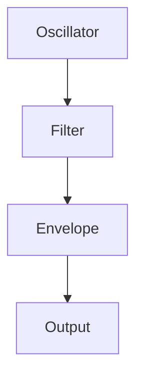

# Beginner Foundation: Synthesizers
## 1. Everyday Intuition & First Principles
Imagine a synthesizer as a magical paintbrush for sound. Just as a painter uses a brush to create a canvas with colors, a synthesizer allows you to create music by manipulating sound waves. Synthesizers can generate a wide range of sounds, from the warm tones of a piano to the futuristic blips of electronic music. They are the cornerstone of modern music production, offering endless possibilities for creativity and expression.

## 2. Foundational Vocabulary & Glossary
- **Oscillator:** The part of a synthesizer that generates sound waves. Think of it as the sound source.
  - *Example:* A sine wave oscillator produces a smooth, pure tone.
- **Waveform:** The shape of a sound wave. Different waveforms produce different timbres.
  - *Example:* A square wave has a sharp, buzzy sound.
- **Envelope:** Controls the volume of a sound over time, typically in four stages: Attack, Decay, Sustain, and Release (ADSR).
  - *Example:* A short attack and long sustain create a staccato effect.
- **Filter:** Alters the frequency content of a sound, emphasizing or reducing certain frequencies.
  - *Example:* A low-pass filter cuts off high frequencies, making the sound warmer.
- **LFO (Low-Frequency Oscillator):** A slow oscillator used to modulate other parameters, creating effects like vibrato or tremolo.
  - *Example:* An LFO modulating the filter cutoff creates a sweeping, filter sweep effect.
- **Patch:** A specific configuration of synthesizer settings, including oscillators, filters, and envelopes.
  - *Example:* A classic patch might use a sawtooth wave with a low-pass filter and an ADSR envelope.

## 3. Visual System Flow
### ASCII Diagram
```
[Oscillator] -> [Filter] -> [Envelope] -> [Output]
```
### Mermaid Flowchart


## 4. Common Beginner Misconceptions & Mental Traps
- **Misconception:** Synthesizers are too complex for beginners.
  - *Reality:* Synthesizers can be as simple or complex as you want them to be. Start with basic settings and gradually explore more advanced features.
- **Misconception:** You need expensive equipment to make good music.
  - *Reality:* Many affordable synthesizers and software options can produce high-quality sounds. Focus on creativity and skill rather than gear.
- **Misconception:** You must understand all the technical details to make music.
  - *Reality:* While knowledge is helpful, you can create music by experimenting and listening to your results. Trust your ears and intuition.

## 5. Socratic Discussion Starters
- What are the primary components of a synthesizer, and how do they interact?
- How does changing the waveform of an oscillator affect the sound?
- Can you explain the purpose of each stage in the ADSR envelope?
- How do filters shape the tone of a sound, and what are some common filter types?
- What is an LFO, and how can it be used to create dynamic effects?
- How do you save and recall patches on a synthesizer, and why is this important?

By exploring these questions and experimenting with your synthesizer, you'll build a strong foundation in music production and develop your own unique sound.
