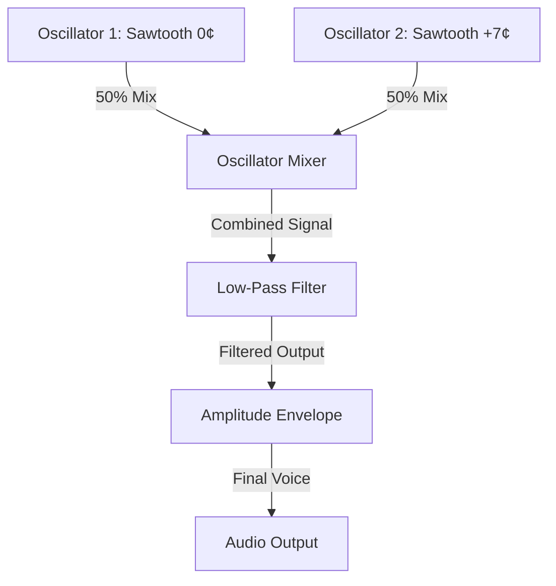

# Operational Verification Labs: Synthesizers

## Objective & DAW / Studio Setup

These operational verification labs establish systematic protocols for synthesizer programming, sound design verification, and spectral analysis within professional digital audio workstation environments. The exercises prioritize tactile parameter manipulation, real-time frequency domain observation, and critical listening assessment over theoretical abstraction. You will construct patches from first principles, analyze their harmonic content using calibrated diagnostic instruments, and verify perceptual outcomes against engineering specifications.

Your studio environment requires a modern digital audio workstation capable of hosting both native and third-party synthesizer plugins, real-time MIDI processing, and multi-channel audio routing. Ableton Live, Logic Pro, or Reaper serve as reference platforms, each providing comparable functionality with minor workflow variations. Install VCV Rack 2 Free as your primary modular synthesis simulator, providing Eurorack-accurate voltage control semantics without hardware investment. Supplement this core toolkit with Voxengo SPAN (freeware spectrum analyzer), s(M)exoscope (oscilloscope plugin), and your DAW's native MIDI monitor utility.

Configure your DAW session template with the following signal flow architecture. Create an instrument track hosting your primary synthesizer (VCV Rack, Vital, Surge XT, or your DAW's native subtractive synth). Insert SPAN on the first post-fader auxiliary send slot, configured for 8192-point FFT resolution with 50% window overlap and Blackman-Harris windowing function to maximize frequency resolution while minimizing spectral leakage. Route a duplicate signal path to a secondary auxiliary track hosting s(M)exoscope in Lissajous XY mode for real-time phase correlation and waveform visualization. Set your master clock to 120 BPM at 4/4 time signature and establish a 48 kHz / 24-bit session sample rate as your baseline operating standard, balancing frequency response extension (DC to 24 kHz) against CPU efficiency and storage overhead.

Verify MIDI connectivity by enabling your DAW's software MIDI keyboard or connecting a hardware USB MIDI controller. Open your MIDI monitor utility and confirm that note-on, note-off, velocity, and continuous controller messages register in real time as you play middle C (MIDI note 60, 261.63 Hz). Adjust your audio interface buffer size to 256 samples at 48 kHz (5.33 ms latency) as a reasonable compromise between performant real-time monitoring and stable CPU headroom for complex synthesis operations. Higher buffer sizes introduce perceptible input lag; lower settings risk audio dropouts under heavy processing loads. Test your monitoring chain by generating a sine wave at A440 (MIDI note 69) and confirming that SPAN displays a single spectral peak at 440 Hz with no aliasing artifacts above the Nyquist frequency (24 kHz).

Calibrate your listening environment by setting your monitor output level such that pink noise measures approximately 75–80 dB SPL C-weighted at the mix position. This reference level aligns with SMPTE and ITU-R BS.1116 standards for critical listening rooms, ensuring that frequency-dependent hearing response (Fletcher-Munson equal-loudness contours) remains relatively flat and that fatigue-inducing excessive sound pressure does not compromise your perceptual judgment over extended sessions. Disable all consumer-grade audio enhancements, spatial virtualizers, and dynamic range compressors in your operating system audio settings, as these processes corrupt spectral analysis and introduce non-deterministic artifacts into your verification workflow.

Document your signal chain topology in a session notes track: synth output → SPAN (FFT analysis) → s(M)exoscope (waveform/phase) → master fader → calibrated monitors. This explicit routing map serves as your operational baseline for all subsequent exercises, ensuring reproducible results and traceable diagnostic procedures when troubleshooting unexpected sonic artifacts.

## Exercise 1: Practical Composition & Voice-Leading Realization

This exercise establishes your command over subtractive synthesis fundamentals by constructing a four-voice polyphonic brass-style patch suitable for harmonic block voicings and contrapuntal part-writing. You will program oscillator detuning relationships, shape filter envelope contours for articulation control, and deploy amplitude envelopes that emulate the attack transient and sustain characteristics of orchestral brass instruments. The verification protocol emphasizes both spectral accuracy (harmonic density, formant shaping) and musical functionality (voice leading smoothness, dynamic responsiveness).

Begin by initializing a blank synthesizer patch in your instrument of choice. For this exercise, use Surge XT (open-source, cross-platform) or your DAW's native polyphonic subtractive synthesizer if it provides at least two oscillators per voice, a resonant multimode filter, and independent amplitude and filter envelopes. Set the synth to polyphonic mode with eight-voice allocation and enable voice stealing with oldest-note priority to prevent MIDI note hangs during dense chord progressions.

Program Oscillator 1 to generate a sawtooth waveform at standard pitch (zero-cent tuning offset). Sawtooth waves contain all integer harmonics at amplitudes inversely proportional to harmonic number (−6 dB per octave rolloff), providing the dense harmonic spectrum characteristic of brass and string timbres. The amplitude of the $n$-th harmonic follows the relationship $A_n = A_0 / n$, where $A_0$ represents the fundamental amplitude. Activate Oscillator 2 as a second sawtooth wave, detuned precisely +7 cents above Oscillator 1. This slight frequency offset creates periodic amplitude modulation (beating) at the difference frequency, producing the characteristic chorusing warmth associated with analog polysynth unison modes. Calculate the beat frequency for middle C (261.63 Hz): a 7-cent detune yields a ratio of $2^{7/1200} \approx 1.00406$, resulting in a difference frequency of approximately 1.06 Hz—a slow, organically evolving amplitude wobble beneath the fundamental pitch.

Balance the oscillator mix to 50% Oscillator 1 and 50% Oscillator 2. Engage SPAN and play middle C. Observe the spectral display: you should see the fundamental at 261.63 Hz and prominent harmonics at 523.26 Hz (second harmonic), 784.89 Hz (third harmonic), 1046.52 Hz (fourth harmonic), and progressively diminishing peaks extending beyond 5 kHz. The slight detuning manifests as spectral smearing around each harmonic peak—individual harmonics appear as closely spaced doublets rather than single lines. This frequency domain signature confirms successful oscillator detuning and verifies that phase coherence between oscillators produces constructive and destructive interference patterns across the harmonic series.

Route the oscillator output through a 24 dB/octave (four-pole) low-pass filter. Set the filter cutoff frequency to 1200 Hz and the resonance (Q factor) to a moderate value that introduces perceptible emphasis at the cutoff region without self-oscillation—typically between 30% and 50% of maximum resonance, depending on your synthesizer's implementation. The four-pole topology provides steeper attenuation of high-frequency content compared to the gentler two-pole (12 dB/octave) alternative, yielding the darker, more focused timbre essential to brass emulation. With the cutoff at 1200 Hz, harmonics above the fourth (1046.52 Hz) will be progressively attenuated, reducing the edgy brightness of the raw sawtooth output while preserving sufficient mid-range energy for articulation clarity.

Configure the filter envelope with an attack time of 80 milliseconds, decay time of 300 milliseconds, sustain level at 60%, and release time of 500 milliseconds. Set the envelope modulation depth to sweep the filter cutoff upward by approximately one octave (1200 Hz to 2400 Hz) at the envelope peak. This envelope contour simulates the initial brightness surge characteristic of brass attacks, where embouchure pressure and airflow velocity reach maximum intensity during the note onset before settling into a sustained tone with reduced harmonic excitation. Play a sustained middle C and observe SPAN in real time: the spectral centroid (the "center of mass" of the frequency distribution) should climb rapidly during the attack phase, stabilize at a lower energy distribution during sustain, and gradually darken during release as the filter envelope returns to its resting state.

Program the amplitude envelope with an attack time of 10 milliseconds, decay time of 200 milliseconds, sustain level at 80%, and release time of 400 milliseconds. The rapid attack prevents perceptible onset latency while the moderate decay introduces subtle dynamic shaping that distinguishes individual note attacks in fast passages. The relatively high sustain level ensures that held notes maintain adequate loudness for harmonic voicings and sustained melodic lines. Test the patch by playing a four-note chord voicing: C3 (130.81 Hz), E3 (164.81 Hz), G3 (196.00 Hz), C4 (261.63 Hz). Monitor both SPAN and s(M)exoscope. The spectrum analyzer should display four distinct fundamental clusters with their respective harmonic series, while the oscilloscope should reveal complex waveform interactions resulting from the superposition of eight detuned sawtooth oscillators (two per voice, four voices total).

Verify voice-leading behavior by performing a stepwise chord progression: Cmaj → Fmaj → G7 → Cmaj. Program the voicings to maintain smooth voice leading with minimal leap distances between adjacent chords. For example, Cmaj (C3-E3-G3-C4) → Fmaj (C3-F3-A3-C4) → G7 (B2-F3-G3-B3) → Cmaj (C3-E3-G3-C4). Play the progression at 120 BPM with quarter-note durations. Each voice should retain its spectral identity while blending into the composite chord texture. Critical listening assessment focuses on three perceptual attributes: intonation stability (no perceivable beating or detuning artifacts that disrupt harmonic consonance), dynamic consistency (all four voices maintain balanced loudness without individual voices dominating or disappearing), and articulation coherence (attack and release characteristics remain uniform across the voice range without unnaturally fast or sluggish envelopes at extreme registers).

Record the chord progression as an audio bounce and import the file into a new track for offline analysis. Loop the recording and sweep SPAN's FFT window size from 2048 points (higher temporal resolution, coarser frequency resolution) to 16384 points (finer frequency resolution, lower temporal resolution). At 16384 points with 48 kHz sample rate, frequency resolution improves to approximately 2.93 Hz per bin, allowing you to resolve individual harmonic partials with high precision. Annotate the spectrum display during the Fmaj chord: identify the fundamentals at C3 (130.81 Hz), F3 (174.61 Hz), A3 (220.00 Hz), and C4 (261.63 Hz), and trace their harmonic series to verify that no unexpected intermodulation products or aliasing artifacts appear in the spectrum. Intermodulation distortion would manifest as sum-and-difference frequencies unrelated to the harmonic series of the input pitches, typically resulting from nonlinear processing or digital clipping. If such artifacts appear, reduce the synthesizer's output gain and verify that no internal stages exceed 0 dBFS.

This exercise establishes the foundational workflow for all subsequent labs: intentional parameter design informed by acoustical principles, real-time verification using calibrated diagnostic tools, and critical listening assessment to confirm that objective measurements translate into musically useful sonic behavior. The brass patch serves as a reference timbre for comparative analysis in later exercises involving frequency modulation, wavetable synthesis, and granular processing.
