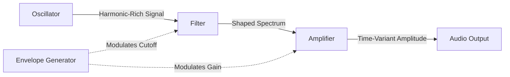
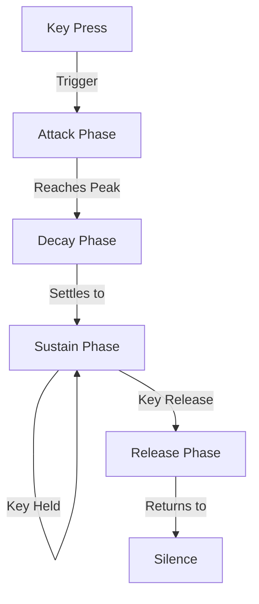
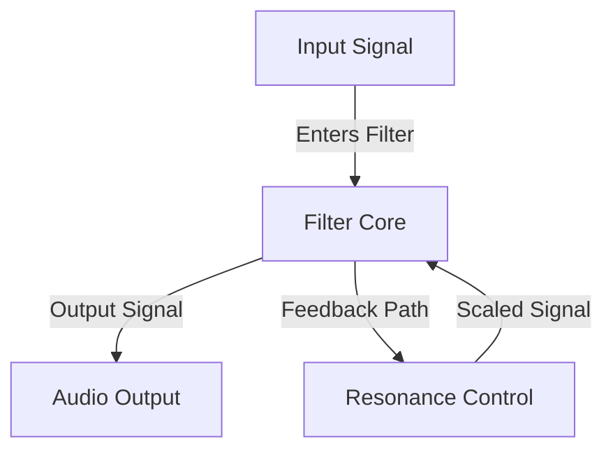
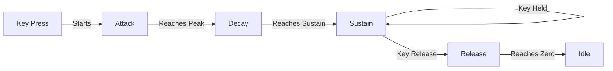

# Lesson 2: Filters, Envelopes, Amplitude Shaping

## 1. First-Principles Intuition & Invariants

The audible spectrum spans approximately 20 Hz to 20 kHz in human perception, containing an overwhelming density of information when a raw oscillator generates a harmonically rich waveform. A sawtooth wave contains every harmonic—integer multiples of its fundamental frequency—with amplitudes declining at 6 dB per octave. A square wave carries only odd harmonics, also with predictable amplitude rolloff. The triangle wave presents an even steeper harmonic decay at 12 dB per octave for its odd harmonics. This mathematical predictability creates a problem for musical expressivity: raw oscillators sound static, lifeless, and machine-like because their harmonic content remains frozen in time.

Subtractive synthesis emerged as the dominant paradigm in analog synthesis precisely because it mirrors the physics of acoustic instruments. A violin string vibrates with a rich harmonic series when bowed, but the instrument's wooden body acts as a complex resonant filter, emphasizing certain frequency bands while attenuating others. The player's bow pressure, speed, and contact point further modulate this spectral content in real time. A clarinet's cylindrical bore reinforces odd harmonics while suppressing even ones, and the player's embouchure and breath pressure continuously reshape the tone. Subtractive synthesis codifies this principle: start with a harmonically dense source waveform, then sculpt away frequency content through filtering and dynamically reshape amplitude through envelopes.



The filter occupies the central architectural position in this signal chain. It functions as a frequency-dependent gain stage, multiplying different portions of the spectrum by different scaling factors. A lowpass filter preserves low frequencies while progressively attenuating higher ones, effectively removing brightness and air from the sound. A highpass filter performs the inverse operation, cutting bass and low-midrange content while allowing treble to pass through unimpeded. A bandpass filter isolates a specific frequency region, rejecting everything above and below the target band. Each topology serves distinct timbral purposes: lowpass filters create warmth, thickness, and darkness; highpass filters produce thin, reedy, telephone-like tones; bandpass filters generate nasal, vowel-like formant qualities.

The resonance parameter introduces a critical nonlinearity into filter behavior. Also called Q or emphasis, resonance creates a sharp amplitude peak at the filter's cutoff frequency before the attenuation slope takes effect. In physical terms, resonance represents positive feedback: a portion of the filter's output feeds back into its input at the cutoff frequency, causing that specific band to ring and reinforce itself. Moderate resonance values between 0.3 and 0.7 add definition and character, making the filter's presence audible without overwhelming the source material. High resonance values approaching 1.0 cause the filter to self-oscillate, generating a pure sine wave at the cutoff frequency even when no input signal exists. This self-oscillation transforms the filter into an auxiliary oscillator, a technique exploited in classic Roland TB-303 acid bass programming and modular synthesis patching.

The envelope generator provides time-varying control over amplitude, filter cutoff, or any other synthesis parameter. Unlike the filter, which operates in the frequency domain, the envelope works in the time domain, defining how a parameter evolves from the moment a key is pressed until it is released and the sound fully decays. The four-stage ADSR envelope—Attack, Decay, Sustain, Release—became the industry standard because it captures the essential temporal behavior of acoustic instruments with minimal parameter complexity. Attack defines the rise time from silence to peak amplitude, measured in milliseconds or seconds. Decay specifies how quickly the sound falls from the initial peak to the sustain level. Sustain represents a steady-state amplitude level maintained as long as the key remains pressed, expressed as a percentage of the peak amplitude rather than a time value. Release determines the fadeout time after key release.



This ADSR structure maps directly onto the physics of struck, plucked, blown, and bowed instruments. A piano hammer strikes the string, causing an instantaneous attack (near-zero milliseconds), followed by an immediate exponential decay as the string's vibration energy dissipates. There is no sustain phase because the hammer does not maintain contact; the string simply rings out until dampers stop it or the sound falls below audibility. A bowed violin exhibits a slower attack as the bow catches and sets the string into motion, no decay phase during the initial transient, and a sustain phase that continues as long as the player maintains bow pressure. When the player lifts the bow, the release phase begins as the string's vibration decays naturally. A pipe organ note has an instantaneous attack when the valve opens, no decay, full sustain at constant amplitude while the key is held, and an immediate release when the valve closes and airflow stops.

The interplay between oscillator harmonic content, filter cutoff frequency, filter resonance, and envelope modulation depth creates the vast timbral palette of subtractive synthesis. A sawtooth wave routed through a lowpass filter with the cutoff set at 2 kHz removes all harmonics above that frequency, producing a warm, mellow tone. If an envelope modulates the filter cutoff with a fast attack and moderate decay, the sound begins bright and edgy, then quickly settles into warmth—mimicking the transient brightness of a plucked string or struck percussion instrument. Increasing resonance adds a vocal, hollow quality as the filter emphasizes its cutoff frequency. Raising the sustain level of the amplitude envelope transforms a percussive pluck into a sustained pad sound.

The mathematical invariant underlying all filter designs is the transfer function, a complex-valued equation describing the filter's frequency response and phase response across the entire spectrum. In continuous-time analog circuits, this transfer function consists of differential equations governing resistor, capacitor, and operational amplifier components. In discrete-time digital implementations, the transfer function becomes a difference equation with coefficients derived through bilinear transform or impulse invariance methods. Regardless of implementation medium, the transfer function defines the filter's slope steepness (measured in decibels per octave), passband flatness, stopband attenuation, and phase distortion characteristics.

Analog filters exhibit component tolerance variations, temperature drift, and nonlinear saturation behaviors that contribute to their characteristic warmth and musicality. The Moog ladder filter, for instance, uses a cascade of four transistor-based low-pass stages, each contributing approximately 6 dB/octave of attenuation for a total slope of 24 dB/octave. The transistor's exponential voltage-current relationship introduces subtle harmonic distortion, particularly at high resonance settings, which adds perceived richness and aggression to the sound. Digital filters, by contrast, can achieve mathematically perfect frequency responses with no tolerance drift, but they lack the analog circuit's natural saturation and component interaction. This distinction drives the ongoing debate between analog purists and digital synthesis advocates.

## 2. Filter Types: Frequency-Domain Sculpting

Filter design begins with the fundamental question: which frequencies should pass and which should be attenuated? The answer determines the filter topology. Lowpass, highpass, bandpass, and notch (band-reject) filters form the four primary categories, each defined by its frequency response magnitude plot.

### Lowpass Filters

The lowpass filter preserves frequency content below the cutoff frequency $f_c$ and attenuates content above it. The slope of this attenuation, measured in decibels per octave (dB/oct), determines how aggressively the filter rejects high frequencies. A first-order lowpass filter exhibits a 6 dB/oct slope—a gentle, gradual rolloff. Each additional filter pole contributes another 6 dB/oct, so a two-pole (second-order) design achieves 12 dB/oct, a four-pole design reaches 24 dB/oct, and so forth.

The transfer function for a simple one-pole lowpass filter in the analog domain takes the form:

$$H(s) = \frac{1}{1 + s\tau}$$

where $s$ represents the complex frequency variable and $\tau = \frac{1}{2\pi f_c}$ is the time constant. This equation describes an RC (resistor-capacitor) circuit, the most basic passive filter topology. The magnitude response follows:

$$|H(j\omega)| = \frac{1}{\sqrt{1 + (\omega\tau)^2}}$$

At the cutoff frequency $\omega_c = \frac{1}{\tau}$, the magnitude equals $\frac{1}{\sqrt{2}} \approx 0.707$, corresponding to -3 dB attenuation—the standard definition of cutoff frequency.

Higher-order lowpass filters require active circuitry with operational amplifiers or, in the digital domain, multi-stage difference equations. The Butterworth filter topology provides maximally flat passband response, meaning no ripple or peaks below the cutoff frequency. The Chebyshev Type I filter trades passband ripple for a steeper rolloff slope. The Chebyshev Type II filter places ripple in the stopband instead. The Bessel filter optimizes for linear phase response, preserving waveform shape at the cost of a more gradual rolloff. Each choice represents a tradeoff between competing design criteria: steepness, flatness, phase linearity, and computational cost.

In musical synthesis, the Moog ladder filter and the Oberheim SEM state-variable filter became iconic lowpass designs. The Moog ladder uses a cascade of four transistor emitter-follower stages with negative feedback, achieving 24 dB/oct rolloff and self-oscillation at maximum resonance. Its transfer function, complicated by transistor nonlinearities, defies simple closed-form expression, but its sonic signature—warm, thick, and slightly aggressive—defined the sound of progressive rock and electronic music in the 1970s.

### Highpass Filters

The highpass filter inverts the lowpass response, attenuating frequencies below $f_c$ while allowing content above to pass. The one-pole highpass transfer function mirrors the lowpass structure:

$$H(s) = \frac{s\tau}{1 + s\tau}$$

This equation describes a differentiator with a pole at $s = -\frac{1}{\tau}$, rolling off at 6 dB/oct below the cutoff. As with lowpass designs, higher-order highpass filters stack additional poles to steepen the slope.

Highpass filters serve multiple roles in synthesis. They remove excessive bass content that can muddy a mix or overload a speaker system. They create thin, nasal, telephone-like timbres when set to high cutoff frequencies (above 1 kHz). They isolate high-frequency transient detail, such as the breathiness of a flute or the bow noise of a violin. In modular synthesis patching, highpass filters often process noise sources to create wind, steam, or cymbal-like textures.

### Bandpass Filters

A bandpass filter combines lowpass and highpass behavior, defining both a lower cutoff frequency $f_{c1}$ and an upper cutoff frequency $f_{c2}$. Only content within the band $[f_{c1}, f_{c2}]$ passes with minimal attenuation; everything outside this range is progressively rejected. The center frequency $f_0 = \sqrt{f_{c1} f_{c2}}$ (the geometric mean) and the bandwidth $\Delta f = f_{c2} - f_{c1}$ characterize the filter's spectral selectivity.

The quality factor Q provides an alternative parameterization:

$$Q = \frac{f_0}{\Delta f}$$

A high Q value indicates a narrow bandwidth relative to the center frequency, creating a sharp, resonant peak. A low Q produces a broad, gentle hump. In speech synthesis and vocal formant emulation, bandpass filters with Q values between 5 and 20 recreate the resonant cavities of the human vocal tract. In electronic music, bandpass filters with moderate Q (2 to 8) generate hollow, nasal, vowel-like tones reminiscent of analog formant synthesis.

The state-variable filter topology—popularized in the Oberheim SEM, ARP 2600, and Korg MS-20—provides simultaneous lowpass, highpass, and bandpass outputs from a single core circuit. This design uses three operational amplifiers configured as integrators and summers, with the bandpass output derived from the difference between lowpass and highpass signals. The state-variable architecture allows independent control of cutoff frequency and resonance without interaction, a significant advantage over the Moog ladder design where resonance affects the perceived cutoff.

### Notch Filters (Band-Reject)

The notch filter, also called a band-reject or band-stop filter, performs the inverse of the bandpass operation: it attenuates a narrow frequency band while allowing everything else to pass. Notch filters find less use in creative sound design but serve critical roles in removing unwanted resonances, power-line hum (50 Hz or 60 Hz), or feedback frequencies in live performance settings.

The transfer function for a simple notch filter introduces a pair of complex zeros on the unit circle at the notch frequency:

$$H(s) = \frac{s^2 + \omega_0^2}{s^2 + \frac{\omega_0}{Q}s + \omega_0^2}$$

This equation creates a sharp null at $\omega_0$ with depth controlled by Q. Unlike the bandpass filter, where high Q emphasizes the passband, in a notch filter high Q creates a deeper, narrower null.

## 3. Resonance: Feedback and Self-Oscillation

Resonance fundamentally alters filter behavior by introducing positive feedback around the cutoff frequency. In physical terms, a portion of the filter's output signal returns to its input, amplifying frequencies near $f_c$ before the rolloff slope takes effect. This feedback creates a sharp peak in the frequency response, transforming a smooth rolloff into a pronounced resonance with a distinctive ringing quality.

The Q parameter quantifies resonance intensity. Mathematically, Q relates to the damping ratio $\zeta$ of the filter's poles:

$$Q = \frac{1}{2\zeta}$$

A second-order Butterworth lowpass filter (no resonance) has $Q = \frac{1}{\sqrt{2}} \approx 0.707$, providing maximally flat response. Increasing Q to 2 or 3 creates a noticeable peak, adding definition and character to the filter sweep. At $Q \geq 10$, the filter enters a highly resonant state, producing a narrow, ringing peak that dominates the timbre. As Q approaches infinity, damping vanishes and the filter self-oscillates, generating a pure sinusoidal tone at $f_c$ even with no input signal.



Self-oscillation transforms the filter into a voltage-controlled sine wave oscillator, a phenomenon exploited in classic analog synthesizers. The Roland TB-303, famous for its squelchy acid bass sound, uses a 24 dB/oct lowpass filter with extreme resonance and rapid envelope modulation of the cutoff frequency. As the cutoff sweeps and the filter self-oscillates, the resulting tone shifts between harmonic filtering and pure sine wave generation, creating the signature "303 scream."

In digital filter implementations, self-oscillation requires careful numerical handling to avoid instability. Direct translation of analog feedback topologies into discrete-time difference equations can produce unbounded output or chaotic behavior due to round-off errors and nonlinear saturation. Modern digital synthesizers employ stabilized filter algorithms with explicit limiting or nonlinear feedback paths to emulate analog self-oscillation without numerical catastrophe.

The Moog ladder filter achieves its characteristic resonance through a four-stage transistor cascade with negative feedback. Each stage contributes a pole, and the feedback path creates a high-Q peak near the cutoff. The exponential voltage-current relationship of the transistors introduces subtle distortion that softens the resonance peak and adds harmonic richness, distinguishing the Moog sound from mathematically clean digital implementations.

## 4. ADSR Envelopes: Time-Domain Shaping

The envelope generator defines how a synthesis parameter evolves over time in response to note events. While the filter operates in the frequency domain, sculpting spectral content, the envelope operates in the time domain, shaping amplitude, cutoff, or modulation depth as a function of elapsed time since key press.

The four-stage ADSR envelope—Attack, Decay, Sustain, Release—became the industry standard because it maps naturally onto the temporal behavior of acoustic instruments while providing intuitive, minimal parameter control. Each stage corresponds to a distinct phase in the sound's lifecycle.

### Attack

The attack phase begins the moment a key is pressed (or a MIDI Note On message is received) and defines the rise time from zero amplitude to peak amplitude. Attack time ranges from instantaneous (0 ms) for percussive, struck sounds to several seconds for slowly evolving pads and strings. Mathematically, the attack segment typically follows a linear ramp:

$$A(t) = \frac{t}{T_A}$$

where $T_A$ is the attack time and $0 \leq t \leq T_A$. Some envelope generators use exponential curves to mimic the natural attack of wind instruments:

$$A(t) = 1 - e^{-t/\tau_A}$$

This exponential shape rises quickly at first, then gradually approaches the peak, creating a more organic feel than a linear ramp.

### Decay

Once the envelope reaches peak amplitude, the decay phase begins, reducing the level to the sustain value. Decay time determines how quickly this transition occurs. The decay segment usually follows an exponential decay curve:

$$D(t) = S + (1 - S)e^{-t/\tau_D}$$

where $S$ is the sustain level (expressed as a fraction of peak amplitude), $\tau_D$ is the decay time constant, and $t$ measures elapsed time since the start of the decay phase. This exponential shape mirrors the natural energy dissipation in vibrating strings and resonant cavities.

### Sustain

The sustain phase differs fundamentally from attack and decay: it represents a steady-state amplitude level, not a time value. As long as the key remains pressed, the envelope holds at the sustain level $S$. For a piano or plucked string, where the sound dies away naturally after the initial transient, the sustain level is set to zero. For a bowed violin or blown flute, where the performer maintains energy input, the sustain level is set near the peak (0.7 to 1.0). For a damped electric piano or harpsichord, the sustain level falls somewhere in between (0.2 to 0.5), allowing a slow decay while the key is held.

### Release

When the key is released (MIDI Note Off), the release phase begins, fading the sound from its current level (either sustain or wherever the envelope was during attack/decay) back to zero. Release time controls how quickly this fadeout occurs, ranging from instantaneous cutoff (0 ms) to long, reverberant tails (several seconds). The release curve typically follows an exponential decay:

$$R(t) = A_{\text{current}} \cdot e^{-t/\tau_R}$$

where $A_{\text{current}}$ is the amplitude at the moment of key release and $\tau_R$ is the release time constant.



The ADSR model extends naturally to control any time-varying parameter. An amplitude envelope shapes the overall loudness contour, creating percussive strikes, sustained pads, or swelling strings. A filter cutoff envelope modulates brightness over time, starting bright and settling to warmth, or vice versa. An oscillator pitch envelope creates pitch bends or portamento effects. A modulation depth envelope controls vibrato or tremolo intensity as the note evolves.

### Beyond ADSR: Extended Envelope Models

While ADSR suffices for most synthesis tasks, more complex envelope generators expand the basic model. The DADSR envelope adds a delay stage before attack, pausing for a specified time before the sound begins. The AHDSR envelope replaces decay/sustain with a hold stage (constant peak amplitude) followed by decay to zero, useful for emulating organ or accordion behavior. The MSEG (multi-segment envelope generator) allows arbitrary breakpoint editing, defining any number of segments with independent time and level values, enabling complex modulation shapes for evolving soundscapes and experimental timbres.

## 5. Envelope Modulation: Linking Time and Frequency

The true power of envelopes emerges when they modulate filter parameters, linking time-domain amplitude shaping with frequency-domain spectral evolution. An envelope controlling the filter cutoff frequency creates dynamic timbral changes synchronized with the note's amplitude contour.

Consider a sawtooth wave routed through a lowpass filter. With a static cutoff at 500 Hz, the filter removes all harmonics above the ninth (assuming a 100 Hz fundamental), producing a warm, dark tone. If an envelope with fast attack, moderate decay, and zero sustain modulates the cutoff, the filter opens rapidly at note onset, allowing high harmonics to pass and creating a bright, edgy transient. As the envelope decays, the cutoff frequency falls, progressively removing high harmonics and darkening the tone. By the time the envelope reaches sustain (in this case, zero), only the fundamental and a few low harmonics remain, producing a soft, mellow tail.

The envelope's modulation depth determines the range of cutoff frequencies swept during the envelope's evolution. A shallow depth (500 Hz to 1 kHz) produces subtle timbral variation. A deep depth (500 Hz to 10 kHz) creates dramatic sweeps from murky bass to piercing treble. The filter's resonance parameter interacts with envelope depth: high resonance emphasizes the swept cutoff frequency, adding a vocal, resonant quality to the sweep.

This technique directly emulates the spectral evolution of acoustic instruments. When a piano hammer strikes a string, the initial impact excites high-frequency partials that decay faster than low-frequency fundamentals, creating a bright attack followed by a warm, mellow sustain. A trumpet's brassy blare begins with rich high harmonics as the player's breath pressure peaks, then settles into a rounder tone as breath pressure stabilizes. A plucked acoustic guitar string exhibits a sharp, bright attack as the plectrum releases the string, followed by rapid decay of high harmonics as the string's vibration energy dissipates.

Envelope modulation of filter resonance creates another dimension of timbral evolution. Starting with high resonance and decaying to low resonance produces a sound that begins nasal and hollow, then becomes smooth and rounded. The reverse trajectory—rising resonance—creates a sound that grows increasingly focused and resonant over time, useful for building tension or creating swelling, dramatic effects.

Multiple envelopes operating in parallel provide independent control over amplitude, filter cutoff, and other parameters. A classic subtractive synthesis patch might use one envelope for amplitude (shaping the overall loudness contour), a second envelope for filter cutoff (controlling brightness evolution), and a third envelope for pulse-width modulation depth (adding subtle timbral motion). This multi-envelope approach allows precise, independent shaping of different sonic dimensions, enabling complex, evolving timbres from simple oscillator and filter building blocks.

## 6. Practical Application: Building a Classic Analog Bass

To consolidate these principles, consider the design of a classic analog bass sound—a staple of funk, disco, electronic music, and modern EDM. The recipe involves careful selection of oscillator waveform, filter type and settings, and envelope parameters to achieve the desired timbral and rhythmic character.

Begin with a sawtooth oscillator tuned to the bass register (fundamental frequency between 40 Hz and 200 Hz). The sawtooth provides a rich harmonic series extending well into the midrange, supplying ample spectral content for the filter to sculpt. A square wave offers an alternative with a slightly hollower, more aggressive character due to its odd-harmonic content.

Route the oscillator through a lowpass filter with a 24 dB/oct slope. The steep rolloff ensures effective removal of high-frequency content, creating a warm, thick tone. Set the filter's static cutoff frequency relatively low—between 200 Hz and 800 Hz—to start with a dark, subdued timbre. Increase resonance to a moderate-high level (Q between 3 and 8) to add definition and nasal character, making the filter's presence audible.

Apply an envelope to modulate the filter cutoff frequency. Set the attack time to 0 ms for an instantaneous brightness peak at note onset. Set the decay time between 50 ms and 300 ms to create a rapid falloff from bright to dark, emulating the transient decay of a plucked or struck bass string. Set the sustain level to zero, allowing the filter to close completely as the note progresses. Set the release time to 50 ms to 200 ms, providing a short tail after key release without excessive lingering.

Configure a second envelope to control amplitude. Set the attack to 0 ms for percussive impact. Set the decay to match the filter envelope's decay time (or slightly longer) to create a cohesive, unified transient. Set the sustain level to zero for a purely percussive, decaying sound, or to 0.3-0.5 for a more sustained bass note that retains some body after the initial transient. Set the release to 50 ms to 200 ms, matching or complementing the filter envelope's release.

The interaction between filter cutoff envelope and amplitude envelope defines the bass sound's character. If both envelopes decay quickly to zero, the result is a short, punchy, staccato bass—ideal for funky, rhythmic basslines. If the amplitude sustain is raised while keeping the filter envelope fast, the sound maintains its body but loses brightness after the attack, creating a darker, more sustained bass suitable for melodic lines. If both envelopes have longer decay times, the sound becomes smoother and more legato, approaching the character of a sustained bass guitar or upright bass.

Resonance control adds another layer of expression. Moderate resonance (Q around 4) provides warmth and definition without overpowering the fundamental. High resonance (Q around 8 or higher) creates the squelchy, resonant quality of TB-303 acid bass, emphasizing the cutoff frequency as it sweeps and adding harmonic distortion when the filter approaches self-oscillation.

This bass patch exemplifies the subtractive synthesis workflow: start with a harmonically rich source, sculpt the spectrum with filtering and resonance, and shape the temporal evolution with envelopes. The same principles scale to any sound design task, from percussive plucks to lush, evolving pads.

## 7. Digital Filter Implementation: From Theory to Code

Translating analog filter theory into digital implementations requires discretization—converting continuous-time differential equations into discrete-time difference equations that operate on sampled audio data. The most common methods are the impulse invariance transform and the bilinear transform.

The bilinear transform maps the s-plane (continuous-time frequency domain) to the z-plane (discrete-time frequency domain) using the substitution:

$$s = \frac{2}{T} \frac{1 - z^{-1}}{1 + z^{-1}}$$

where $T$ is the sampling period (the reciprocal of the sample rate). This mapping preserves the magnitude response shape but introduces frequency warping, where analog frequency $\omega$ maps to digital frequency $\Omega$ according to:

$$\Omega = \frac{2}{T} \tan\left(\frac{\omega T}{2}\right)$$

To compensate, the analog cutoff frequency is pre-warped before applying the bilinear transform:

$$\omega_c' = \frac{2}{T} \tan\left(\frac{\omega_c T}{2}\right)$$

For a one-pole lowpass filter with analog transfer function $H(s) = \frac{\omega_c}{s + \omega_c}$, applying the bilinear transform yields the discrete-time transfer function:

$$H(z) = \frac{b_0 + b_1 z^{-1}}{1 + a_1 z^{-1}}$$

where:

$$b_0 = b_1 = \frac{\omega_c T}{2 + \omega_c T}$$

$$a_1 = \frac{\omega_c T - 2}{\omega_c T + 2}$$

This transfer function translates directly into a difference equation:

$$y[n] = b_0 x[n] + b_1 x[n-1] - a_1 y[n-1]$$

where $x[n]$ is the input sample at time $n$, $y[n]$ is the output sample, and the terms $x[n-1]$ and $y[n-1]$ represent previous input and output samples stored in delay buffers.

Higher-order filters cascade multiple biquad (two-pole, two-zero) sections or use direct-form structures with more taps. The biquad section, the workhorse of modern digital audio filtering, has the general transfer function:

$$H(z) = \frac{b_0 + b_1 z^{-1} + b_2 z^{-2}}{1 + a_1 z^{-1} + a_2 z^{-2}}$$

and difference equation:

$$y[n] = b_0 x[n] + b_1 x[n-1] + b_2 x[n-2] - a_1 y[n-1] - a_2 y[n-2]$$

Digital filter design libraries, such as those found in MATLAB, Python's SciPy, or dedicated audio programming languages like Csound and SuperCollider, provide functions to compute biquad coefficients for standard filter types (Butterworth, Chebyshev, elliptic) given cutoff frequency, sample rate, and Q.

```python
import numpy as np
from scipy import signal

def design_lowpass(cutoff_hz, sample_rate, order=4):
    nyquist = sample_rate / 2.0
    normalized_cutoff = cutoff_hz / nyquist
    b, a = signal.butter(order, normalized_cutoff, btype='low', analog=False)
    return b, a

def apply_filter(audio, b, a):
    return signal.lfilter(b, a, audio)

sample_rate = 44100
cutoff = 1000
audio_in = np.random.randn(sample_rate)

b, a = design_lowpass(cutoff, sample_rate, order=4)
audio_out = apply_filter(audio_in, b, a)
```

This Python example uses SciPy's Butterworth filter design function to compute coefficients for a fourth-order lowpass filter with a 1 kHz cutoff at 44.1 kHz sample rate, then applies the filter to a random noise signal.

Digital filters introduce quantization noise, coefficient sensitivity, and potential instability if poles fall outside the unit circle in the z-plane. Fixed-point implementations (common in embedded DSP hardware) require careful scaling to avoid overflow or underflow. Floating-point implementations (typical in desktop software) mitigate these issues but still require attention to numerical precision when implementing high-Q resonant filters, where poles approach the unit circle and small rounding errors can cause instability or excessive noise.

The topology of the difference equation also affects numerical behavior. The direct-form I structure computes the numerator and denominator separately, requiring more storage but offering better numerical properties. The direct-form II structure (also called canonical form) minimizes storage by reusing delay elements but can suffer from increased noise in high-Q designs. The transposed direct-form II structure, preferred in many professional implementations, rearranges the signal flow to improve numerical stability.

Modern software synthesizers often implement filters using state-space representations or other advanced structures that provide better control over stability and noise. Some designs intentionally introduce nonlinearities, such as tanh saturation or soft clipping, to emulate the warmth and harmonic richness of analog circuits.

## 8. Analog vs. Digital: Character, Saturation, Drift

The ongoing debate between analog and digital synthesis centers on sound quality, character, and musicality. Analog circuits exhibit component tolerance variations, temperature drift, power supply noise, and nonlinear saturation that contribute to their perceived warmth and organic behavior. Digital implementations, by contrast, can achieve mathematically perfect frequency responses, zero tolerance drift, and unlimited dynamic range, but they lack the natural imperfections that many musicians find musically appealing.

The Moog ladder filter provides a case study in analog character. Its four transistor stages introduce exponential voltage-current relationships that create subtle harmonic distortion, particularly at high resonance settings. As the signal level increases, the transistors' nonlinear transfer function compresses peaks and adds odd harmonics, softening the resonance peak and adding perceived warmth and aggression. Component aging, temperature changes, and manufacturing tolerances cause each Moog filter to sound slightly different, even when nominally identical.

Digital emulations of the Moog ladder must intentionally model these nonlinearities to capture the original character. Early digital Moog models used linear biquad filters with high Q, achieving the frequency response shape but missing the saturation and harmonic richness. Modern emulations employ nonlinear difference equations, oversampling, and waveshaping to approximate the transistor behavior, producing results that closely match the analog original.

Temperature drift presents another analog characteristic. As a synthesizer warms up during operation, component values shift, causing filter cutoff frequencies and oscillator tunings to drift slightly. This instability creates subtle detuning and timbral variation that some musicians embrace as desirable analog imperfection. Digital synthesizers, unless explicitly programmed to emulate drift, remain perfectly stable and consistent, which can sound sterile or lifeless in comparison.

Power supply noise and ground loops inject low-level hum and buzz into analog signal paths. While undesirable in high-fidelity reproduction, this noise adds subtle movement and texture that contributes to the analog "feel." Digital systems operate in a noise-free environment until the final digital-to-analog conversion stage, where quantization noise and jitter become the limiting factors.

The rise of analog-modeling virtual instruments in the 2000s and 2010s brought sophisticated nonlinear modeling techniques to digital synthesis. Products such as Native Instruments' Reaktor, U-He's Diva, and Arturia's V Collection employ circuit-level modeling, component-level simulation, and carefully designed nonlinearities to capture analog character in software. These tools achieve remarkable fidelity, often indistinguishable from hardware in blind listening tests, while offering the convenience, recallability, and unlimited polyphony of digital platforms.

Ultimately, the analog versus digital distinction matters less than the designer's understanding of the sonic goals. A well-programmed digital filter can sound warm, rich, and musical. A poorly designed analog circuit can sound thin, harsh, and brittle. The tools serve the music, and the musician's ear remains the final arbiter of quality.

## 9. Advanced Techniques: Formant Filtering and Parallel Filter Banks

Beyond basic lowpass, highpass, and bandpass filtering, advanced synthesis techniques employ multiple filters in parallel or series to create complex spectral shaping and formant structures.

Formant filtering emulates the resonant cavities of the human vocal tract, which emphasize specific frequency bands called formants. Vowel sounds differ primarily in their formant frequencies: the vowel "ah" has formants around 800 Hz and 1200 Hz, while "ee" has formants around 300 Hz and 2300 Hz. By routing a sawtooth or pulse wave through a bank of bandpass filters tuned to specific formant frequencies, a synthesizer can produce vowel-like timbres and speech-like articulations.

The classic formant synthesis architecture uses three to five bandpass filters in parallel, each with a center frequency corresponding to a vocal formant (F1, F2, F3, etc.), a bandwidth of 50 Hz to 200 Hz (Q between 5 and 20), and individual level controls. The outputs sum together, creating a composite spectrum with pronounced peaks at the formant frequencies. Sweeping the formant frequencies with LFOs or envelopes creates vocal-like modulation and talking effects.

The Korg MS-20, a legendary analog synthesizer from 1978, features a unique two-pole highpass and two-pole lowpass filter in series, each with independent cutoff and resonance controls. This topology allows the musician to sculpt a bandpass-like response by carefully tuning the highpass to remove lows and the lowpass to remove highs, effectively isolating a midrange band. The filters' interaction, combined with the resonance controls, produces a wide range of timbres from smooth and mellow to harsh and aggressive.

Parallel filter banks extend the formant concept to arbitrary frequency distributions. By splitting the signal into multiple frequency bands, processing each band independently, and recombining them, a synthesizer can create complex, evolving timbres that traditional single-filter designs cannot achieve. This approach underpins the graphic equalizer, the multiband compressor, and spectral processing effects.

Modern digital synthesizers and audio programming environments enable arbitrary filter networks. MAX/MSP, Pure Data, SuperCollider, and Csound provide filter objects that can be patched in any configuration, allowing musicians and sound designers to explore unconventional topologies limited only by CPU power and imagination.

## 10. Conclusion: Mastery Through Experimentation

Filters and envelopes form the backbone of subtractive synthesis, transforming static, harmonically rich oscillator waveforms into dynamic, expressive musical sounds. The filter sculpts frequency content in real time, removing unwanted harmonics and emphasizing resonant peaks. The envelope shapes amplitude and timbral evolution over time, defining transients, sustains, and decays that mirror the behavior of acoustic instruments. Resonance adds character and definition, transforming smooth rolloffs into sharp, ringing peaks and enabling self-oscillation at extreme settings.

Mastery emerges through experimentation. Adjust cutoff frequencies and listen to how the filter darkens or brightens the tone. Increase resonance and hear the filter's presence grow more pronounced. Modulate the cutoff with an envelope and observe how transient brightness gives way to sustained warmth. Swap oscillator waveforms and note how sawtooth, square, and triangle waves respond differently to identical filter settings. Combine multiple envelopes to control amplitude, cutoff, and resonance independently, building complex, evolving timbres from simple building blocks.

The principles outlined here extend far beyond analog synthesis. Digital synthesizers, software plugins, modular Eurorack systems, and even traditional acoustic instruments follow the same fundamental laws of frequency-domain filtering and time-domain shaping. Understanding these principles empowers the musician to design sounds intentionally, troubleshoot timbral problems, and navigate any synthesis environment with confidence and creativity.
