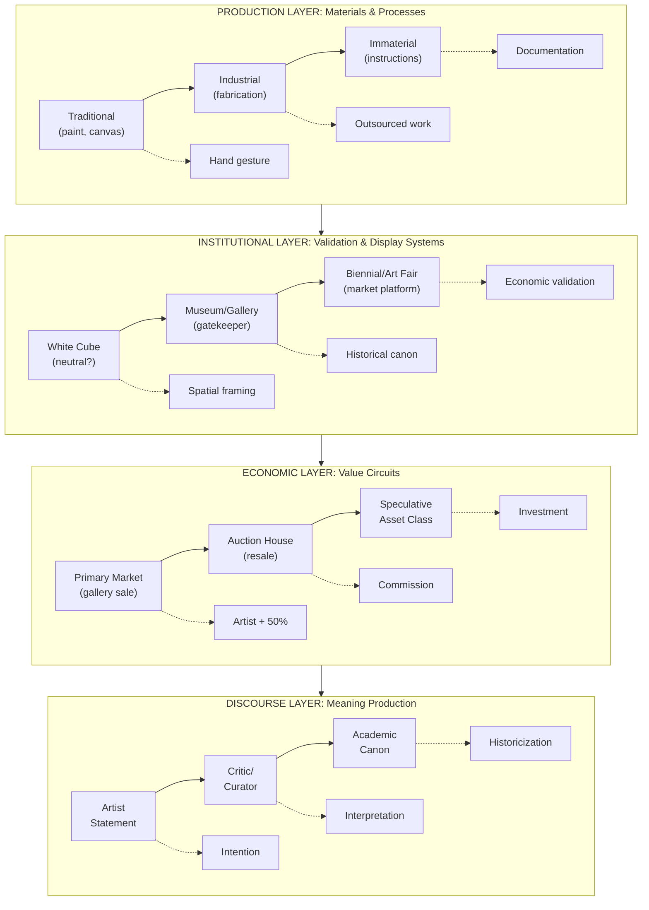

# Lesson 6: Postwar to Contemporary Paradigms

## 1. First-Principles Intuition & Invariants

The collapse of European cultural hegemony following the Second World War precipitated a fundamental reorganization of artistic authority, materials, and meaning-making systems. Where previous lessons traced the evolution of representational strategies from Renaissance perspectival illusion through Impressionist optical sensation and Cubist spatial fragmentation, the postwar period witnesses something more radical: the questioning of whether art must create visual objects at all. This shift operates along three interlocking axes—material dematerialization, institutional critique, and geopolitical decentralization—that collectively dismantle the Enlightenment paradigm of autonomous aesthetic objects contemplated by disinterested subjects.

Abstract Expressionism emerged in New York between 1943 and 1960 as the first genuinely American avant-garde movement, transferring cultural capital from war-devastated Paris to Manhattan. The core invariant here involves process superseding product. Jackson Pollock's drip paintings from 1947 onward eliminate the easel, the brush, and the hand-to-surface contact that had structured painting for five centuries. By pouring industrial enamel from cans onto raw canvas laid horizontally on the studio floor, Pollock transformed painting into a somatic performance captured as trace evidence. The resulting networks of splattered lines record bodily gesture and gravitational physics rather than pictorial illusion. This procedural turn establishes the fundamental postwar principle: the artwork documents a temporal event rather than depicting a static subject.

Mark Rothko's color field canvases, by contrast, pursue a dematerialized sublime through optical saturation. Stacked horizontal bands of thinly layered pigment—often reaching eight or ten feet in height—eliminate drawing, compositional hierarchy, and figuration entirely. The paintings function as environmental fields rather than discrete objects, their blurred edges and pulsing chromatic interactions producing a physiological response in viewers who stand close enough for peripheral vision to be fully occupied. Rothko explicitly framed this work in quasi-religious terms, seeking to evoke transcendent emotion through chromatic resonance. The technical mechanics involve repeated thin glazes of oil diluted with turpentine and egg, allowing underlayers to optically mix with surface tones and creating a luminous depth impossible to reproduce photographically. This optical blending principle—analogous to the way string ensemble sections blend frequencies into a unified timbre—represents a painterly equivalent of acoustic phase interference.

The theoretical armature supporting Abstract Expressionism rested on existentialist philosophy imported from occupied France. Clement Greenberg's formalist criticism argued that painting's essential medium-specific property was flatness, and that modernist progress consisted of purging illusionistic depth to arrive at honest two-dimensional surface. Harold Rosenberg's competing "action painting" thesis emphasized existential authenticity: the canvas became an arena for authentic gesture unmediated by pictorial convention. Both critical frameworks positioned the artist as heroic individual confronting fundamental questions of existence through material struggle. This romantic individualism and emphasis on sincerity would become precisely what subsequent movements attacked.

Pop Art, crystallizing in Britain around 1956 and exploding in New York by 1962, inverted Abstract Expressionism's high seriousness by embracing mass-produced commercial imagery. Where Pollock sought authentic gesture, Andy Warhol mechanically silk-screened photographic images of Campbell's soup cans, Coca-Cola bottles, and celebrity headshots, deliberately eliminating all trace of the artist's hand. The thirty-two Campbell's Soup Cans from 1962 present each variety on an individual canvas arranged in grocery-store grid formation, transforming supermarket shelves into museum walls. The work asks whether any meaningful distinction exists between consumer choice among commodity varieties and aesthetic discrimination among artworks. Warhol's Factory studio—staffed with assistants who executed his designs while he supervised—operated as a corporate production facility rather than a Romantic garret, deliberately collapsing art into commerce.

Roy Lichtenstein's comic strip paintings, meticulously hand-painted to simulate mechanical reproduction, took this logic further. By enlarging Ben-Day dot printing matrices to monumental scale and copying commercial illustration verbatim, Lichtenstein made visible the visual codes structuring mass media perception. A painting like Whaam! from 1963—depicting a fighter jet explosion across two panels—adopts the composition, color palette, and even the onomatopoeia of DC Comics war stories. The ironic distance here is crucial: Lichtenstein paints commercial illustration so faithfully that viewers initially mistake the works for actual reproductions, only to recognize upon closer inspection the laborious hand-painting of each dot. This creates a perceptual feedback loop where high and low culture, original and copy, sincerity and irony become impossible to disentangle.

The theoretical significance of Pop Art extends beyond its surface irreverence. By appropriating commercial imagery wholesale, these artists acknowledged that visual culture was no longer produced primarily by fine artists but by anonymous advertising designers, magazine art directors, and corporate branding departments. The avant-garde gesture was no longer to invent new forms but to frame and recontextualize existing mass-cultural forms, revealing their ideological operations. This shift from production to selection—choosing which existing images to elevate—fundamentally redefined artistic authorship as curatorial rather than inventive.

Minimalism, consolidating in New York galleries between 1963 and 1975, stripped away Pop's ironic commentary to pursue radical objecthood. Donald Judd's "specific objects"—industrially fabricated metal boxes and serial progressions—refused all illusionistic representation, internal composition, and expressive gesture. A work like Untitled (Stack) from 1967 consists of ten identical stainless steel and Plexiglas boxes mounted vertically at equal intervals on a wall. The viewer encounters physical materials and spatial relationships rather than pictorial content. Judd's theoretical writings argued for eliminating the figure-ground relationship inherited from European painting, creating instead three-dimensional objects that occupied literal space without representing anything beyond their material presence.

Carl Andre's floor sculptures—such as 144 Lead Square from 1969, composed of lead tiles arranged in a square grid directly on the gallery floor—pushed this literalism further by eliminating the pedestal and allowing viewers to walk on the work. The sculpture ceases to be a thing looked at from a distance and becomes instead an environmental intervention altering one's bodily movement through space. This spatial activation principle parallels how site-specific sound installations transform acoustic environments rather than presenting discrete sonic objects. The invariant here involves phenomenological presence: the artwork exists only in the viewer's lived experience of encountering materials and spatial relationships in real time.

Agnes Martin's square canvases, though visually austere, pursued a subtly different aim. Her six-foot grids of hand-drawn pencil lines on monochrome grounds—such as Friendship from 1963—employ Minimalist formal reduction to evoke what Martin described as innocence and beauty. The faint irregularities in her hand-drawn grids humanize the geometric rigor, creating a meditative surface that rewards sustained attention. This work demonstrates that Minimalism's phenomenological emphasis could serve contemplative or even spiritual ends rather than purely material investigation.

Conceptual Art, emerging simultaneously with Minimalism but pursuing opposite conclusions, sought to dematerialize the art object entirely. Sol LeWitt's wall drawings, beginning in 1968, consist of written instructions executed by assistants or institution staff. A typical certificate reads: "Draw all combinations of two lines crossing, placed at random, using arcs from corners and sides, straight, not straight and broken lines." The artwork is the instruction set, not any particular execution; museum conservators must reinstall the drawing fresh for each exhibition, following the certificate's parameters. This separates conception from fabrication, defining art as idea rather than object—a distinction with profound economic and philosophical implications.

Joseph Kosuth's One and Three Chairs from 1965 displays a physical chair, a photograph of that chair, and a dictionary definition of the word "chair" mounted side by side. The work investigates how objects, representations, and language construct meaning through mutual reference. Kosuth's theoretical essays argued that art after Duchamp must examine the nature of art itself, making philosophy the true content of avant-garde practice. This self-reflexive turn positioned artists as researchers investigating the institutional and linguistic systems that designate certain objects as art.

The dematerialization tendency reached its logical conclusion in purely documentary works where the artwork existed only as photographic or textual evidence of an action or intervention. Douglas Huebler's Duration Pieces and Location Pieces from the late 1960s consist of typed certificates describing actions like mailing photographs between cities or marking times on a clock. The collector purchases the certificate; the described action may or may not have occurred. This challenged art's commodity status by making artworks impossible to display, insure, or physically possess in conventional ways.

Performance and body art extended these investigations into corporeal presence and endurance. Marina Abramović's early performances, such as Rhythm 0 from 1974—where she stood motionless for six hours while gallery visitors were invited to use seventy-two objects on her body, ranging from feathers to loaded guns—tested the ethical boundaries between artwork and vulnerable human being. Chris Burden's Shoot from 1971, in which an assistant shot him in the arm with a rifle in a Los Angeles gallery, collapsed the distance between art and violence, spectacle and trauma. These works could never be commodified as objects; their existence depended entirely on documentation and witnesses, raising questions about whether photographs and videos of performances were artworks themselves or merely evidence of artworks that existed only in the moment of enactment.

Institutional critique emerged from these dematerialization strategies to examine how museums, galleries, and art-world systems construct value and meaning. Hans Haacke's MoMA Poll from 1970 installed a ballot box in the Museum of Modern Art asking visitors whether they would support Governor Nelson Rockefeller (a MoMA trustee) in the upcoming election, given his refusal to denounce President Nixon's Indochina policy. The work exposed the political allegiances of museum leadership and the economic networks supporting cultural institutions. When the Guggenheim Museum canceled Haacke's 1971 solo exhibition for including a work documenting New York real estate holdings, the cancellation itself became evidence of institutional censorship.

Daniel Buren's vertical stripe paintings, installed in unexpected locations both inside and outside galleries, investigated how architectural framing determines what counts as art. His in situ works—stripes pasted on subway billboards or hung from gallery skylights—revealed that the white cube gallery space was not a neutral container but an ideologically charged frame that transformed objects placed within it. This insight, now foundational to contemporary practice, demonstrates that context determines meaning more powerfully than intrinsic formal properties.

Postmodernism, consolidating as a critical framework in the 1980s, rejected modernist teleology—the idea that art progresses toward increasingly refined medium-specificity and formal purity. Instead, postmodern artists embraced appropriation, pastiche, and hybrid forms that scrambled high and low culture. Cindy Sherman's Untitled Film Stills (1977–1980) present the artist in costumes and settings evoking 1950s and 1960s B-movies, but the films referenced never existed. Sherman performs stereotypical female roles—the vulnerable ingénue, the career woman, the suburban housewife—exposing femininity as constructed performance rather than essential identity. Each photograph mimics the visual codes of mid-century cinema so precisely that viewers assume they recognize the source, only to realize the images document fabricated scenarios staged solely for the camera.

Sherrie Levine's appropriation photographs pushed this logic further by rephotographing canonical modernist images without alteration. Her After Walker Evans series (1981) consists of photographs of Evans's Depression-era FSA photographs, printed identically but credited to Levine. This gesture questioned Romantic notions of originality and authorship, arguing that all images exist within networks of quotation and reference. If Andy Warhol could silk-screen commercial photographs and call the result art, Levine asked, why couldn't she photograph canonical art photographs and claim the same status? The provocation revealed how much art-world value depends on originality claims that postmodern theory considered philosophically untenable.

Barbara Kruger's text-and-image works, employing advertising design strategies with feminist and anti-consumerist messages, demonstrated how visual rhetoric constructs ideological subjects. Phrases like "Your body is a battleground" superimposed on split positive-negative female faces, or "I shop therefore I am" in bold white-on-red Futura, mimicked magazine layouts to critique the very consumer culture they formally resembled. Kruger's background as a graphic designer for Mademoiselle and other fashion magazines equipped her with professional fluency in the visual codes she subverted, making her work rhetorically effective in ways fine-art training alone could not achieve.

Identity politics emerged as a central concern in the 1980s and 1990s, with artists from marginalized communities challenging the art-historical canon's exclusive focus on white European and American men. The Guerrilla Girls' anonymously authored posters and billboards, appearing in New York beginning in 1985, deployed statistics and biting humor to expose gender and racial discrimination in museums and galleries. Their poster Do women have to be naked to get into the Met. Museum? noted that less than five percent of artists in the Modern Art sections were women, while eighty-five percent of nudes were female—revealing how institutions positioned women as objects for contemplation rather than subjects with agency.

Adrian Piper's conceptual performances and videos investigated racial identity and social discomfort. Her Calling Cards (1986–1990) consisted of small printed cards she distributed to people who made racist remarks in her presence, reading: "Dear Friend, I am black. I am sure you did not realize this when you made/laughed at/agreed with that racist remark." The cards performed an intervention that made visible the assumptions underlying casual racism while avoiding direct confrontation. This work exemplifies how conceptual strategies could serve activist ends, using documentation and distribution systems as the primary medium.

Kara Walker's room-sized installations of cut-paper silhouettes depicting antebellum plantation scenes with graphic sexual violence shocked viewers with their unflinching representation of slavery's brutality. The silhouette format—associated with genteel Victorian parlor craft—created a cognitive dissonance that prevented viewers from comfortably consuming the imagery. Walker's work interrogates how historical trauma becomes aestheticized and how contemporary audiences project fantasies onto the past. The black paper figures against white walls create stark contrast that recalls both the racial binaries structuring American history and the positive-negative reversals of photographic processes.

Globalization and postcolonial theory transformed art-world geography in the 1990s and 2000s. Yinka Shonibare's installations, such as his costumed mannequins in Victorian dress made from Dutch wax print fabric, investigated the complex colonial entanglements encoded in supposedly traditional African textiles. These brightly patterned fabrics were designed by Dutch colonizers for the Indonesian market, failed commercially there, and were subsequently marketed in West Africa, where they became signifiers of African cultural identity. Shonibare's work reveals how cultural authenticity is always hybrid and constructed through transnational exchange networks shaped by colonial economics.

Ai Weiwei's interventions, ranging from deliberately smashing Han Dynasty urns to photographing his middle finger in front of international monuments, critique both Chinese government censorship and Western cultural imperialism. His Sunflower Seeds installation at Tate Modern's Turbine Hall (2010) covered the floor with 100 million hand-painted porcelain replicas of sunflower seeds, each unique despite appearing mass-produced from a distance. Visitors were initially invited to walk on and handle the seeds, physically engaging with the overwhelming scale of Chinese labor and the tension between individual craftsmanship and collective production. When porcelain dust proved hazardous, the participatory element was curtailed—an institutional intervention that inadvertently reinforced the work's themes of control and restriction.

Decolonial methodologies, intensifying in the 2010s and 2020s, move beyond postcolonial critique to actively dismantle Eurocentric art-historical frameworks. This involves repatriating looted artifacts, centering Indigenous epistemologies, and refusing Western categories like "art" and "artist" that impose foreign structures on non-Western practices. Artists like Sondra Perry and Ja'Tovia Gary incorporate digital glitches, surveillance footage, and archival materials to investigate how Black bodies have been historically subjected to visual technologies of control—from slave-auction photography to contemporary facial recognition systems.

Digital media transformed artistic production and distribution beginning in the 1990s. Net art pioneers like Jodi.org created websites that deliberately corrupted browser displays, turning digital interfaces themselves into aesthetic material. Their work exploited glitches, broken code, and chaotic visual output to critique the utopian rhetoric surrounding early internet culture. This practice—treating software and networks as sculptural material—paralleled Minimalism's investigation of physical materials and spaces but transposed these concerns into virtual environments.

Video art, pioneered by Nam June Paik and Bill Viola in the 1960s and 1970s, matured into a dominant medium. Viola's slow-motion multi-channel video installations, such as The Crossing (1996)—depicting a man simultaneously consumed by fire and drowned by falling water on opposing screens—employed cinematic production values to explore phenomenological and spiritual themes. These works required darkened gallery spaces and synchronized playback systems, transforming museums into theatrical environments. The economic implications were significant: video installations eliminated the unique material object that painting and sculpture provided, forcing collectors to purchase media files, equipment specifications, and installation certificates rather than singular physical works.

Contemporary practice, from 2000 forward, is characterized by medium pluralism and geopolitical decentralization. No single style or movement dominates; instead, artists employ whatever materials and strategies serve their conceptual aims. This includes traditional media like painting and sculpture, often inflected with conceptual and political concerns that prevent any return to pure formalism. Kehinde Wiley's large-scale oil portraits place young Black men in poses quoting European Old Master paintings, surrounded by ornate floral backgrounds derived from decorative arts. By inserting Black subjects into compositional formats historically reserved for European aristocracy, Wiley interrogates who has been granted visual representation and cultural authority.

Installation art has become a dominant mode, creating immersive environments that viewers navigate rather than contemplate from a distance. Olafur Eliasson's Weather Project (2003) filled Tate Modern's Turbine Hall with artificial sunlight created by hundreds of monofrequency lamps behind a semi-circular mirror, with mist machines producing an indoor fog. Visitors lay on the floor gazing upward at the glowing disk, their reflected silhouettes visible in the mirrored ceiling. The work transformed the museum into an atmospheric phenomenon, collapsing the boundary between natural and artificial, art and environment.

Social practice and participatory art engage communities in collaborative projects that prioritize social interaction over object production. Theaster Gates's Dorchester Projects in Chicago repurposed abandoned buildings in the South Side as cultural centers, libraries, and performance spaces, employing construction and restoration as sculptural practice while addressing urban neglect and disinvestment. This work raises questions about whether art should be judged by aesthetic criteria or social impact, and whether community development constitutes art or activism—or whether that distinction matters.

The invariant connecting these postwar paradigms is the progressive dismantling of aesthetic autonomy. Where modernism sought to purify art into self-referential formal investigation, postwar movements insisted that art operates within institutional, economic, and political systems that determine its meaning and value. Formalist concerns persist but are never separable from their social contexts. The white cube gallery is not neutral; the museum is not universal; the canon is not objective. Contemporary practice begins with these institutional critiques as foundational premises rather than radical discoveries.

## 2. Core Architecture & Mechanics

The structural mechanics governing postwar artistic production can be mapped across four interrelated systems: material processes, institutional frameworks, economic circuits, and knowledge-production protocols. Unlike earlier periods where stylistic analysis could proceed through formal description, postwar art requires understanding these infrastructural layers because the work explicitly thematizes its own conditions of production, display, and circulation.

Material Process Architecture begins with Abstract Expressionism's transformation of painting into somatic performance. Pollock's drip technique eliminated the traditional painter's toolkit—easel, palette, brush—replacing hand-eye coordination with full-body gesture. The mechanics involved pouring and flicking industrial enamel (Duco and Ripolin brands) from punctured cans or sticks dipped in paint, allowing gravity and centrifugal force to determine line trajectory. The canvas lay on the studio floor, enabling the artist to walk around and into the composition, building layers from all sides rather than addressing the surface frontally. This process required primed but unsized raw cotton duck canvas so paint would sink into rather than sit atop the surface, creating integration between figure and ground. Subsequent layers added aluminum paint, colored enamels, and occasionally embedded materials like cigarette butts or pebbles.

The drip process generates specific visual signatures: looping arabesques where wrist rotation creates circular gestures, straight pours where gravity dominates, and splattered bursts where flicking motions atomize the paint. These physical traces allow viewers to reconstruct the choreography of the painting's creation, converting static image into temporal record. The mechanics parallel how geologists read stratigraphic layers to reconstruct depositional history—each mark carries information about the forces that produced it.

Rothko's color field technique operated differently but with equal procedural specificity. He diluted oil paint extensively with turpentine and egg, creating thin washes that soaked into unsized canvas. Applying these diluted layers repeatedly—sometimes dozens of times—built optical depth through translucency rather than opaque coverage. The soft-edged rectangles resulted from loading a large brush with paint and drawing it horizontally across the canvas in a single pass, allowing edges to blur and bleed slightly. This created boundaries that oscillated perceptually, seeming to advance and recede depending on viewing distance and lighting conditions.

The scale was critical to the phenomenological effect. Rothko specified that paintings should be hung low and viewed from approximately eighteen inches away, so peripheral vision would be completely occupied and the paintings would envelop the viewer's visual field. At this distance, the blurred edges and glowing underlayers create an atmospheric space that seems to extend beyond the physical surface. This immersive quality depends on the precise relationship between canvas size, viewing distance, and human perceptual thresholds—the optical equivalent of how reverb and spatial audio processing create acoustic depth in music production.

Pop Art's silkscreen mechanics introduced industrial reproduction techniques into fine-art practice. Warhol's process began with selecting a photographic source image—often a commercial photograph or publicity still—which was converted to high-contrast black-and-white through photographic enlargement. This image was transferred to a fine-mesh silk screen coated with light-sensitive emulsion, creating stencils where light-exposed areas hardened and unexposed areas washed away. Ink was then squeegeed through the open mesh areas onto canvas or paper, transferring the photographic image in flat, unmodulated tones.

The mechanical reproduction allowed for serial repetition with intentional variation. Warhol often misaligned screens slightly between pulls, creating ghost registrations and color shifts. Ink density varied depending on squeegee pressure and speed, producing some prints darker or lighter than others. These "errors" were retained rather than corrected, celebrating the mechanical process's unpredictability while eliminating any trace of individual brushwork. The Factory studio's assembly-line organization—with assistants preparing screens and pulling prints while Warhol supervised and signed—mirrored corporate manufacturing protocols.

Lichtenstein's Ben-Day dot simulation required painstaking hand-painting to achieve the appearance of mechanical reproduction. He employed stencils and projectors to transfer comic book images onto canvases at monumental scale, then meticulously painted each dot using custom perforated stencils. The process was far more labor-intensive than actual mechanical printing, revealing the irony at the work's core: simulating mass production through artisanal technique. The visual effect depends on viewers recognizing the dots as signifiers of printed reproduction before discovering they are individually hand-painted, creating a perceptual double-take that thematizes the relationship between original and copy.

Minimalist fabrication eliminated the artist's hand entirely by outsourcing production to industrial manufacturers. Judd's stainless steel and Plexiglas boxes were fabricated by Bernstein Brothers sheet metal shop in Queens according to Judd's specifications. The artist never touched the materials; his role was limited to designing proportional relationships and selecting materials and finishes. This separation of conception from execution redefined artistic authorship as intellectual rather than manual, positioning the artist as designer or engineer rather than craftsperson.

The fabrication specifications were precise: stainless steel sheets of specific gauge, Plexiglas thickness in millimeters, welded joints ground flush, surfaces polished to mirror finish or left with industrial brushed texture. These decisions determined how light interacted with surfaces and how the works occupied space. Judd's vertical stacks employed precise mathematical progressions—each box the same height, spaced at intervals equal to box height—creating rhythmic repetition that viewers could grasp perceptually. This mathematical seriality parallels minimalist composition in music, where Steve Reich and Philip Glass employed additive processes and phase relationships to create temporal structures based on simple units undergoing gradual transformation.

Andre's floor sculptures consisted of industrially manufactured units—firebricks, concrete blocks, metal plates—arranged directly on gallery floors without modification. The work existed in the relationships between identical units rather than in any individual component. Installation required only arranging materials according to predetermined patterns: a square grid, a line, an L-shape. This emphasis on arrangement over fabrication positioned artistic labor as organizational and intellectual rather than physical.

Conceptual Art's dematerialization eliminated physical production almost entirely, replacing objects with documentation. Sol LeWitt's wall drawing instructions functioned as musical scores: open to interpretation within specified parameters but defining the essential identity of the work. A certificate reading "Lines from the center of the wall to random points along its edges" generates a unique installation each time it is executed, but all installations count as the same work. This raises questions about identity and authenticity: if no two installations look identical, what makes them the same artwork?

The execution mechanics varied by location. Some institutions hired professional painters; others used trained volunteers; some invited LeWitt himself or his studio assistants. The variation in skill level produced different results—shakier lines, slight color mismatches, variation in graphite density—but these differences were considered acceptable within the work's conceptual framework. This tolerance for variation parallels how jazz standards exist as chord changes and melody outlines that generate endless unique performances, each one "the same song" despite surface differences.

Documentation protocols became crucial for artworks existing primarily as events or actions. Performance art required photographic, video, or textual records to persist beyond the ephemeral moment of enactment. These documents raised ontological questions: was the photograph of Chris Burden being shot the artwork, or merely evidence of an artwork that existed only in the moment? Museums collected documentation, but what exactly were they acquiring? This uncertainty troubled traditional curatorial and conservation models built around stable material objects.

Institutional frameworks structure how artworks circulate and accrue value. The white cube gallery space—defined by white walls, neutral lighting, polished floors, and minimal architectural detail—emerged as the standard display environment in the mid-twentieth century. This supposedly neutral container was designed to eliminate contextual distraction and focus attention on the artwork itself. But as institutional critique revealed, the white cube is not neutral; it is an ideologically loaded space that confers art status on whatever it contains.

Daniel Buren's in situ works demonstrated this by placing his striped paintings in non-art contexts—subway stations, building facades, public plazas—where they lost their immediate legibility as art. The same stripes that signified "artwork" in a gallery became ambiguous or invisible in urban environments without institutional framing. This revealed that the museum or gallery context does as much work in defining something as art as any intrinsic property of the object itself.

Museum collection and conservation protocols struggled to accommodate dematerialized and time-based works. How should conservators preserve a conceptual artwork that exists only as a certificate? Traditional conservation focused on arresting material degradation in stable objects: controlling temperature and humidity, preventing light damage, repairing physical trauma. But wall drawings were meant to be repainted for each exhibition and destroyed afterward; performances existed only in documentation; installation art required complete reinstallation for each venue. This necessitated new protocols focused on preserving instructions, maintaining relationships with artists' estates, and documenting variable components rather than preserving fixed objects.

The certificate model for conceptual works created new economic structures. Collectors purchased certificates that granted ownership of an idea and the right to have it realized, but not any particular material instantiation. This separated artwork identity from physical substrate in ways that challenged legal frameworks built around property rights in tangible goods. Insurance and authentication systems had to adapt to artworks that could be repeatedly destroyed and recreated without losing identity.

Economic circuits governing art-world value became increasingly visible as artists thematized commodity relations. Warhol's embrace of commercialism—declaring "making money is art, and working is art, and good business is the best art"—collapsed distinctions between aesthetic and economic value. His Factory operated as a business producing saleable goods; his assistants were employees rather than apprentices. This corporate model acknowledged that art was already thoroughly commodified, and pretending otherwise was dishonest.

The auction system's explosive growth from the 1970s onward concentrated wealth in blue-chip artists while creating speculative bubbles. Record-breaking sales—Warhol's Silver Car Crash (Double Disaster) selling for $105 million in 2013, Basquiat's Untitled skull painting for $110.5 million in 2017—demonstrated that contemporary art functioned as an alternative asset class for ultra-wealthy collectors. This financialization shaped artistic production, with some artists deliberately creating work in formats and editions designed to maximize market value.

The primary/secondary market distinction structures economic incentives. Galleries sell new work directly from artists (primary market), taking a fifty percent commission. Auction houses resell previously purchased work (secondary market), with sellers and buyers splitting commissions around twenty-five percent. Artists receive nothing from secondary sales unless they negotiate resale royalty agreements, creating a situation where an artist might sell a work for $10,000 in the primary market only to see it resell for $1 million at auction with no additional compensation. This economic structure incentivizes artists to produce prolifically for primary sales while having little control over secondary market speculation.

Knowledge production protocols govern how artworks are interpreted and historicized. The artist's statement, gallery press release, and catalogue essay function as interpretive frameworks that guide reception. These texts often explain conceptual premises that are not visually apparent, making them essential to understanding work that deliberately eschews aesthetic or formal interest. A white canvas with a title referencing philosophical concepts requires textual explanation to differentiate it from a primer-coated canvas waiting for paint.

Art criticism and academic discourse construct canons and interpretive frameworks. October journal, founded in 1976, established post-structuralist theory as the dominant lens for interpreting contemporary art, introducing concepts like the simulacrum, the gaze, and intertextuality. This theoretical apparatus shaped artistic production as much as it interpreted it; artists read theory and incorporated those concepts into their work, creating a feedback loop between critical discourse and artistic practice.

Curatorial practice became increasingly important as curators gained authority to define movements and make reputations. Documenta and the Venice Biennale, along with proliferating biennials worldwide, provided platforms where curators assembled international surveys that defined contemporary discourse. These exhibitions functioned as meta-artworks, with curatorial premises and organizational structures contributing as much to meaning as individual artworks on display.

Digital infrastructure transformed production and distribution. Artists working in video, digital photography, and software-based media required new technical competencies: non-linear editing, 3D modeling, code literacy, server administration. This created hybrid practices where artists functioned as technologists, requiring fluency in both aesthetic and technical domains. The workflow for a multi-channel video installation involves scripting, shooting, editing in software like Adobe Premiere or DaVinci Resolve, color grading, rendering, and configuring synchronized playback across multiple displays—a process more analogous to film production than traditional studio practice.

The internet enabled new distribution models outside gallery and museum systems. Net art existed natively online, accessible to anyone with a browser. This democratic access bypassed traditional gatekeepers but also made monetization difficult. Some artists embraced this post-scarcity model; others sought ways to artificially create scarcity through limited-edition digital files or NFTs (non-fungible tokens). The blockchain-based NFT market, surging in 2020–2021, attempted to apply ownership and scarcity mechanisms to infinitely reproducible digital files, with mixed artistic and economic success.

Social media platforms became primary sites for art dissemination and discourse. Instagram's image-centric format privileged photogenic work—bright colors, clear compositions, visually striking forms—creating feedback where artists optimized for Instagram legibility. This flattening effect, where artworks were experienced primarily as phone-screen thumbnails rather than physical encounters, raised concerns about how digital mediation shapes artistic production and reception.

This four-layer architecture reveals that postwar art operates as a complex system where formal properties are only one component among institutional validation, economic exchange, and discursive framing. Understanding any individual artwork requires analyzing how it functions across all four layers simultaneously.

## 3. High-Performance Optimization & Failure Modes

The transformation from material object to dematerialized concept created new optimization strategies and failure modes unique to contemporary practice. Traditional art-making optimized for technical mastery, aesthetic impact, and long-term material stability. Postwar art must additionally optimize for institutional legibility, documentary capture, market positioning, and theoretical coherence. These competing demands generate specific workflow challenges and potential failure points.

Production efficiency in conceptual and installation work operates differently than in traditional media. A painter can work continuously in the studio, building a body of work through regular production. A conceptual artist might spend months developing a premise that results in a single certificate or action, with production time disconnected from material output. This creates uneven workflow where research, writing, and theoretical development consume the majority of time, while physical realization might take hours or days. Optimizing this practice means building infrastructure for documentation, archiving research materials, and maintaining clear records of conceptual development.

For installation artists, efficiency requires logistics and project management skills. Coordinating fabricators, arranging transportation, managing installation crews, and troubleshooting on-site requires abilities more associated with construction management than fine art. Artists develop standardized protocols for common installation types—lighting specifications, audio system configurations, projection calibration procedures—to reduce on-site problem-solving. Detailed technical riders specify all equipment, spacing, and environmental requirements so institutions can prepare correctly before the artist arrives.

Video and digital media work requires optimizing for file management and version control. A multi-channel video installation might involve terabytes of footage, dozens of edit iterations, and complex synchronization timing. Without systematic file naming, backup protocols, and version tracking, projects quickly become unmanageable. Professional workflows employ conventions like:

- Date-stamped folder hierarchies (YYYYMMDD_ProjectName_Version)
- Standardized naming for shot footage (Location_Shot_Take_CameraAngle)
- Master project files with clearly marked approved final versions
- Redundant backup systems (local RAID, cloud storage, offline archive drives)
- Detailed technical documentation of codecs, color spaces, and playback settings

Render optimization becomes crucial for real-time interactive work or generative systems. Processing video effects, running machine learning models, or rendering 3D graphics in real time requires efficient code and appropriate hardware. Artists working in these domains must understand GPU vs. CPU processing, memory management, and algorithmic complexity. A poorly optimized patch might drop frames or crash during exhibition, requiring fallback systems and continuous monitoring.

Fabrication optimization involves balancing ideal materials against budgets and timelines. Industrial fabrication shops provide quotes based on material costs, machine time, and labor. Complex curved forms requiring CNC milling cost exponentially more than simple geometric shapes cut from standard stock. Artists develop material literacy to specify designs that achieve their aesthetic goals within budget constraints. This often means simplifying forms, using modular components, or accepting industrial finishes rather than custom treatments.

Exhibition opportunity optimization requires strategic career management. Artists balance museum shows (prestige, no sales pressure) against gallery exhibitions (commercial imperative, market positioning) and biennials (international visibility, networking). Overexposure in commercial galleries can compromise museum interest; excessive uncommercial work makes gallery representation difficult. Mid-career artists often maintain separate bodies of work: editioned objects or paintings for commercial sales, and ambitious installations or performances for institutional exhibitions.

Market positioning involves edition strategies and pricing structures. Photographs, prints, and sculpture editions are typically limited to 3–10 copies plus artist proofs, with prices increasing as edition sells out. Some artists create pricing tiers: smaller works for emerging collectors, mid-range editions for established collectors, and museum-scale installations for institutions. This requires forecasting demand without underselling or overpricing work, balanced against maintaining consistent price trajectories that don't destabilize the secondary market.

Documentation optimization is critical for ephemeral work. Professional art photographers understand how to light installations, expose for video projections, and capture environmental scale. Artists budget for documentation as a core production cost rather than an afterthought. For performances, this means multiple camera angles, high-quality audio capture, and sometimes hiring professional videographers who understand how to document durational events without creating conventional narrative film.

The documentation raises ontological questions: is the photograph or video the artwork, or evidence of an artwork? If a performance exists only through documentation, has the documentation become the primary artwork? Some artists resolve this by creating distinct documentation works—Abramović's performance videos are carefully edited and presented as autonomous works rather than raw footage. Others maintain the distinction, treating documentation as supplementary evidence rather than equivalent to the live experience.

Failure modes in contemporary practice cluster around several recurring categories. Conceptual incoherence occurs when the theoretical premise doesn't support the physical manifestation, creating work that feels forced or didactic. This often results from applying theory superficially without deeply integrating it into formal decisions. A work that simply illustrates a theoretical concept—placing a Derrida quote next to arbitrary imagery—fails because the visual component adds nothing to the text. Successful conceptual work makes the idea inseparable from its physical realization, where neither text nor image can stand alone.

Technical failure in media art can be catastrophic. Projector bulbs burn out, hard drives fail, software crashes, network connections drop. Exhibitions of technical work require redundant systems, backup equipment, and continuous monitoring. Some artists build monitoring systems that send alerts when playback deviates from expected parameters. Despite precautions, technical failure remains a persistent risk. The failure itself sometimes becomes meaningful—glitches and crashes that reveal the technological substrate can be more interesting than smooth functionality—but unintended failure during exhibition is professionally damaging.

Installation failure often involves spatial miscalculation. Work that succeeds in the studio falls apart in the exhibition space: lighting is wrong, acoustics differ, ceiling height changes relationships, foot traffic patterns disrupt viewing. This is why site visits and digital mockups are crucial. Artists request architectural drawings, photographs, and detailed specifications before finalizing designs. Some create 3D models in Blender or SketchUp to preview spatial relationships. Despite planning, surprises occur: unexpected HVAC noise, light bleed from adjacent galleries, restrictive fire codes.

Market failure can occur when work is too difficult to collect. If installation parameters are so specific that only a few institutions can accommodate the work, it becomes effectively unsaleable. Some artists deliberately create uncollectable work as a political stance, but this limits financial sustainability. Others negotiate flexible installation parameters: modular components that adapt to different spaces, or multiple acceptable installation configurations. This requires balancing artistic integrity against market viability.

Conservation failure emerges when materials degrade in unanticipated ways. Latex rubber sculptures from the 1960s have deteriorated into sticky puddles; CRT monitors for video installations are increasingly difficult to source; obsolete video formats require migration to new media. Artists working with experimental materials sometimes lack understanding of long-term stability. This creates conservation nightmares where museums must decide whether to replace materials (altering the original work) or allow degradation (losing the work entirely).

The failure mode for appropriation art involves lawsuits. Richard Prince's Instagram paintings—screenshots of other people's Instagram posts, printed large and sold for hundreds of thousands of dollars—generated copyright lawsuits from original photographers. The legal ambiguity around fair use and transformative use means appropriation artists face litigation risk, especially as work enters commercial markets where rights holders have financial incentive to sue. Some artists obtain permissions; others accept legal risk as part of the work's conceptual premise.

Institutional critique faces the ironic failure of institutional absorption. Work that critiques museums gets collected by museums, neutralizing its critical force. Hans Haacke's work exposing trustee conflicts of interest now hangs in museums overseen by trustees with similar conflicts. This recuperation is not necessarily failure—the work succeeded in making its point—but it reveals the art world's ability to absorb critique and convert it into cultural capital.

Identity-based work risks essentialism—reducing complex individuals to demographic categories or assuming all members of an identity group share experiences. Successful identity art complicates rather than simplifies identity, acknowledging its constructed and intersectional nature. Work that simply asserts victimhood or celebrates identity uncritically often fails to generate meaningful discourse beyond affirming existing political positions.

Social practice projects face ethical failure when community engagement becomes extractive. Artists who parachute into communities to execute projects without long-term commitment risk using residents as material rather than collaborating genuinely. This requires sustained relationship-building, equitable compensation, shared authorship, and accountability to communities beyond exhibition timelines. Without these commitments, social practice replicates colonial dynamics it might claim to critique.

Digital preservation failure affects born-digital and net art. Websites built in Flash or Director no longer function in modern browsers; custom software requires obsolete operating systems; digital files in proprietary formats become unreadable. Artists must migrate work to current platforms or accept that pieces will become inaccessible. Some institutions use emulation—running old operating systems inside virtual machines—but this is labor-intensive and imperfect.

Funding failure is endemic. Public arts funding has declined since the 1980s culture wars; private patronage concentrates on blue-chip artists; grants are intensely competitive. Most artists balance studio practice with teaching, commercial work, or unrelated employment. This economic precarity shapes what work gets made—favoring smaller, cheaper pieces over ambitious projects requiring significant resources. Some artists crowdfund projects or seek nonprofit fiscal sponsorship; others abandon expensive practices entirely.

The career optimization challenge involves building sustainable practice across decades. Early career requires visibility and risk-taking; mid-career demands consistency and market development; late career involves legacy management and institutional validation. Artists who peak early sometimes struggle to maintain relevance; others develop slowly but sustain long careers. There is no single path, but common patterns include: securing gallery representation in major markets (New York, London, Berlin), building institutional exhibition history, maintaining consistent studio production, and developing critical discourse around the work.

Networking optimization happens through residencies, graduate programs (especially MFA programs), and biennial/art fair participation. These environments concentrate collectors, curators, critics, and gallerists, creating visibility and connection opportunities. Artists invest time in openings, studio visits, and social events not because they enjoy networking but because professional relationships determine opportunities. This social dimension is often opaque to outsiders who assume talent alone drives success.

Critical discourse optimization requires engaging with writers and critics. Artists who articulate their own work clearly, provide good documentation, and make themselves available for interviews receive more critical attention. Some cultivate relationships with specific critics or curators whose interests align with their work. This is not manipulation but professional communication—helping critics understand context and intentions rather than leaving interpretation entirely to chance.

The long-term failure mode involves irrelevance—work that seemed urgent at one moment but doesn't sustain interest. Some political art dates immediately when circumstances change; some formally innovative work becomes quotidian once others absorb the innovation. Sustaining relevance requires either continuously evolving or creating work whose concerns remain resonant across changing contexts. The artists who succeed over decades typically do both: maintaining consistent investigation of core themes while allowing formal strategies to develop as materials and contexts shift.
