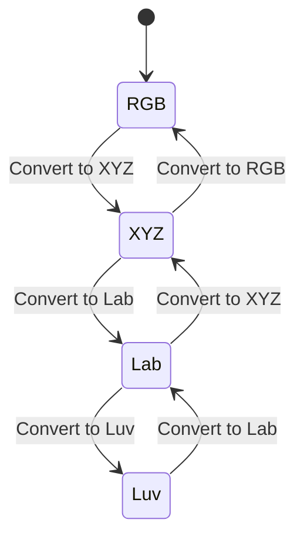
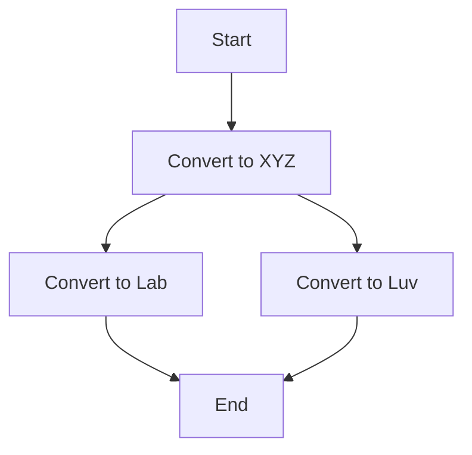

# Advanced Foundation: Color Theory

## 1. Theoretical Invariants & Formal Frameworks

### 1.1 Mathematical Foundations of Color Perception
Color theory is fundamentally grounded in the mathematical and physical principles of light and human perception. The human eye contains photoreceptors—rods and cones—that respond to different wavelengths of light. The rods are responsible for vision in low light conditions, while the cones are sensitive to red, green, and blue wavelengths, corresponding to the trichromatic theory of color vision.

The trichromatic theory can be formalized using a linear combination of the responses from the three types of cones. Let \( R(\lambda) \), \( G(\lambda) \), and \( B(\lambda) \) represent the spectral sensitivity functions of the red, green, and blue cones, respectively. The response of the eye to a given light spectrum \( E(\lambda) \) can be expressed as:
\[ R = \int E(\lambda) R(\lambda) \, d\lambda \]
\[ G = \int E(\lambda) G(\lambda) \, d\lambda \]
\[ B = \int E(\lambda) B(\lambda) \, d\lambda \]

These responses are then processed by the brain to produce the perception of color. The CIE 1931 color space, defined by the CIE XYZ color matching functions, provides a standardized framework for describing colors in terms of these responses:
\[ X = \int E(\lambda) x(\lambda) \, d\lambda \]
\[ Y = \int E(\lambda) y(\lambda) \, d\lambda \]
\[ Z = \int E(\lambda) z(\lambda) \, d\lambda \]

The CIE XYZ color space is a linear space that encompasses all colors visible to the human eye. The CIE 1931 chromaticity diagram, derived from the XYZ color space, provides a two-dimensional representation of colors based on the ratios \( x = \frac{X}{X+Y+Z} \) and \( y = \frac{Y}{X+Y+Z} \).

### 1.2 Physical Invariants and Color Models
The physical invariants of color theory are rooted in the laws of physics governing light and its interaction with matter. The electromagnetic spectrum spans a wide range of wavelengths, but the visible spectrum is limited to wavelengths between approximately 380 nm (violet) and 740 nm (red). The color of an object is determined by the wavelengths of light it reflects or emits.

The RGB color model, based on the trichromatic theory, is a fundamental model used in digital displays. The RGB model is an additive color model, where colors are produced by combining different intensities of red, green, and blue light. The RGB color space can be represented as a cube in three-dimensional space, with each axis corresponding to the intensity of one of the primary colors.

The CMYK color model, on the other hand, is a subtractive color model used in color printing. The CMYK model is based on the absorption of light by pigments. The four primary colors in the CMYK model are cyan, magenta, yellow, and black (key). The CMYK color space can be represented as a four-dimensional space, with each axis corresponding to the concentration of one of the primary pigments.

### 1.3 Formal Proofs and Kernel Frameworks
Formal proofs in color theory often involve the mathematical properties of color spaces and the transformations between them. One such proof is the derivation of the CIE 1931 chromaticity diagram from the CIE XYZ color space. The chromaticity diagram is a two-dimensional representation of colors based on the ratios \( x \) and \( y \), which are defined as:
\[ x = \frac{X}{X+Y+Z} \]
\[ y = \frac{Y}{X+Y+Z} \]

The chromaticity diagram is a useful tool for visualizing the range of colors visible to the human eye. The boundary of the chromaticity diagram corresponds to the spectral locus, which represents the colors of monochromatic light. The interior of the chromaticity diagram represents the colors produced by the combination of different wavelengths of light.

Another formal proof in color theory is the derivation of the RGB color space from the CIE XYZ color space. The RGB color space can be represented as a linear transformation of the CIE XYZ color space:
\[ \begin{bmatrix} R \\ G \\ B \end{bmatrix} = \begin{bmatrix} r_R & r_G & r_B \\ g_R & g_G & g_B \\ b_R & b_G & b_B \end{bmatrix} \begin{bmatrix} X \\ Y \\ Z \end{bmatrix} \]

The matrix elements \( r_R, r_G, r_B, g_R, g_G, g_B, b_R, b_G, b_B \) are determined by the spectral sensitivity functions of the red, green, and blue cones. The RGB color space is a useful model for digital displays, as it provides a standardized framework for representing colors in terms of the responses of the three types of cones.

## 2. Low-Level Invariant Taxonomy

### 2.1 Deep Registers and Memory Models
In the context of color theory, deep registers and memory models refer to the low-level representations of color data in digital systems. The most common representation of color data is the 24-bit RGB color model, which uses three 8-bit registers to represent the intensities of the red, green, and blue components. The 24-bit RGB color model provides a wide range of colors, but it can be limited in terms of precision and dynamic range.

To address these limitations, higher precision color models such as the 32-bit RGBA color model and the 48-bit RGB color model have been developed. The 32-bit RGBA color model uses four 8-bit registers to represent the intensities of the red, green, and blue components, as well as an 8-bit alpha channel for transparency. The 48-bit RGB color model uses six 8-bit registers to represent the intensities of the red, green, and blue components, providing greater precision and dynamic range.

### 2.2 Hardware Constraints and Axiomatic Definitions
The hardware constraints of digital systems can have a significant impact on the representation and processing of color data. For example, the limited precision of digital registers can introduce quantization errors in color data, leading to visible artifacts such as banding and posterization. To mitigate these errors, higher precision color models and advanced color processing techniques such as dithering and error diffusion have been developed.

Axiomatic definitions in color theory provide a formal framework for understanding the properties of color spaces and the transformations between them. One such axiom is the principle of color constancy, which states that the perceived color of an object remains constant under varying illumination conditions. The principle of color constancy can be formalized using the concept of chromatic adaptation, which describes the process by which the human visual system adjusts to changes in illumination.

Another axiom in color theory is the principle of color harmony, which states that certain combinations of colors are aesthetically pleasing and visually balanced. The principle of color harmony can be formalized using the concept of color theory, which describes the relationships between colors in terms of hue, saturation, and brightness.

## 3. Micro-Architecture & Concurrency Dynamics

### 3.1 State Machines and Cache Diagrams
The micro-architecture of digital systems can have a significant impact on the performance and efficiency of color processing. For example, the use of state machines can simplify the design of color processing pipelines, allowing for efficient implementation of color transformations and color space conversions. The following Mermaid diagram illustrates a simple state machine for color space conversion:



The use of caches can also improve the performance of color processing by reducing the number of memory accesses required for color transformations. The following ASCII diagram illustrates a simple cache hierarchy for color data:

```
+-------------------+
|       L1 Cache    |
+-------------------+
|       L2 Cache    |
+-------------------+
|       Main Memory |
+-------------------+
```

### 3.2 Race Conditions and Concurrency Diagrams
Concurrency is an important consideration in the design of color processing pipelines, as it can improve the performance and efficiency of color transformations. However, concurrency can also introduce race conditions, which can lead to incorrect results and system instability. The following Mermaid diagram illustrates a simple concurrency model for color space conversion:



In this concurrency model, the conversion to XYZ is performed in parallel with the conversion to Lab and Luv. However, this can introduce race conditions if the results of the conversions are not properly synchronized. To avoid race conditions, synchronization mechanisms such as locks and semaphores can be used.

## 4. Subtle Failure Modes & Boundary Conditions

### 4.1 Quantization Errors and Precision Loss
Quantization errors and precision loss are common failure modes in color processing, particularly when using low precision color models. Quantization errors occur when the intensity of a color component is rounded to the nearest value that can be represented by a digital register. Precision loss occurs when the intensity of a color component is truncated or rounded during a color transformation.

Quantization errors and precision loss can lead to visible artifacts such as banding and posterization, particularly in areas of smooth gradients. To mitigate these artifacts, higher precision color models and advanced color processing techniques such as dithering and error diffusion can be used.

### 4.2 Boundary Conditions and Edge Cases
Boundary conditions and edge cases are important considerations in the design of color processing pipelines, as they can lead to unexpected results and system instability. For example, the boundary conditions for color space conversions can be challenging, particularly when converting between color spaces with different gamuts.

The gamut of a color space is the range of colors that can be represented by the color space. The gamut of the sRGB color space, for example, is smaller than the gamut of the CIE XYZ color space. When converting from the CIE XYZ color space to the sRGB color space, colors outside the gamut of the sRGB color space must be clipped or mapped to the nearest color within the gamut.

Another example of a boundary condition is the conversion between color spaces with different white points. The white point of a color space is the reference color used to define the color space. The white point of the sRGB color space, for example, is D65, while the white point of the Adobe RGB color space is D65. When converting between color spaces with different white points, the white point must be taken into account to ensure accurate color reproduction.

## 5. Master Socratic Inquiries

### 5.1 Theoretical Invariants and Formal Frameworks
1. How can the CIE 1931 chromaticity diagram be derived from the CIE XYZ color space?
2. How can the RGB color space be represented as a linear transformation of the CIE XYZ color space?
3. How can the principle of color constancy be formalized using the concept of chromatic adaptation?
4. How can the principle of color harmony be formalized using the concept of color theory?

### 5.2 Low-Level Invariant Taxonomy
1. How can the precision and dynamic range of color data be improved using higher precision color models?
2. How can the hardware constraints of digital systems be taken into account when designing color processing pipelines?
3. How can axiomatic definitions in color theory be used to understand the properties of color spaces and the transformations between them?

### 5.3 Micro-Architecture & Concurrency Dynamics
1. How can state machines be used to simplify the design of color processing pipelines?
2. How can caches be used to improve the performance of color processing?
3. How can concurrency be used to improve the performance and efficiency of color transformations?
4. How can race conditions be avoided in color processing pipelines?

### 5.4 Subtle Failure Modes & Boundary Conditions
1. How can quantization errors and precision loss be mitigated in color processing?
2. How can boundary conditions and edge cases be taken into account when designing color processing pipelines?
3. How can the gamut of a color space be taken into account when converting between color spaces?
4. How can the white point of a color space be taken into account when converting between color spaces with different white points?
