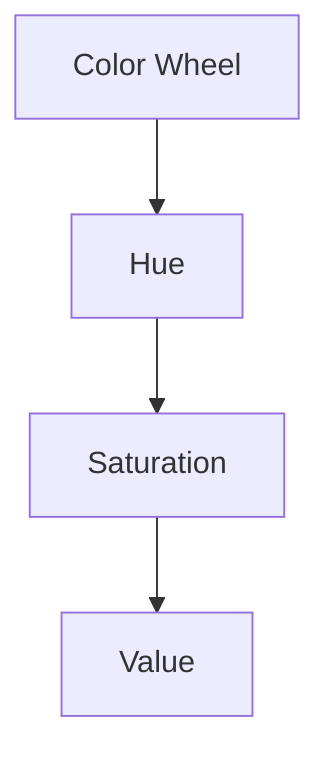

# Beginner Foundation: Color Theory

## 1. Everyday Intuition & First Principles

Imagine you are an artist trying to capture the essence of a sunset on canvas. The sky transitions from a deep, fiery red to a serene, cool blue. These colors are not just random; they evoke emotions and convey the time of day. Color theory is the study of how colors interact with each other and how they affect our perception and emotions. Just as different musical notes combine to create harmony, colors blend to create visual harmony. Understanding color theory is like learning the language of light, enabling you to communicate effectively through your art.

## 2. Foundational Vocabulary & Glossary

### Primary Colors
The three colors that cannot be created by mixing other colors. In traditional color theory, these are Red, Yellow, and Blue. In digital color theory, they are Red, Green, and Blue (RGB).

### Secondary Colors
Colors created by mixing two primary colors. In traditional color theory, these are Orange, Green, and Purple. In digital color theory, they are Cyan, Magenta, and Yellow (CMY).

### Tertiary Colors
Colors created by mixing a primary color with a secondary color. Examples include Red-Orange, Yellow-Orange, Yellow-Green, Blue-Green, Blue-Violet, and Red-Violet.

### Hue
The name of a color, such as red, blue, or yellow. Hue is what distinguishes one color from another.

### Saturation
The intensity or purity of a color. A color with high saturation is vivid and bright, while a color with low saturation appears more washed out or grayish.

### Value
The lightness or darkness of a color. Value is often described using a grayscale, where white is the highest value and black is the lowest value.

### Complementary Colors
Colors that are opposite each other on the color wheel. When placed next to each other, they create a strong visual contrast. Examples include Red and Green, Yellow and Purple, and Blue and Orange.

### Analogous Colors
Colors that are next to each other on the color wheel. They share a common hue and create a harmonious and cohesive look. Examples include Red, Orange, and Yellow.

## 3. Visual System Flow

### ASCII Diagram
```
+-------------------+
|   Color Wheel     |
+-------------------+
          |
          v
+-------------------+
|   Hue             |
+-------------------+
          |
          v
+-------------------+
|   Saturation      |
+-------------------+
          |
          v
+-------------------+
|   Value           |
+-------------------+
```

### Mermaid Flowchart


## 4. Common Beginner Misconceptions & Mental Traps

- **Misconception:** All colors can be mixed to create any other color.
  - **Reality:** In traditional color theory, mixing all primary colors results in black (subtractive mixing). In digital color theory, mixing all primary colors results in white (additive mixing).

- **Misconception:** Bright colors are always more effective in art.
  - **Reality:** The effectiveness of a color depends on the context and the intended emotional response. Subtle, low-saturation colors can be just as powerful.

- **Misconception:** Complementary colors always clash.
  - **Reality:** While complementary colors create strong contrasts, they can also be used harmoniously by adjusting their saturation and value.

## 5. Socratic Discussion Starters

- What is the difference between primary and secondary colors in traditional vs. digital color theory?
- How does changing the saturation of a color affect its perceived intensity?
- Can you identify complementary colors in a natural scene, and how do they interact?
- How might you use analogous colors to create a cohesive background in a painting?
- What role does value play in creating depth and dimension in a piece of art?
