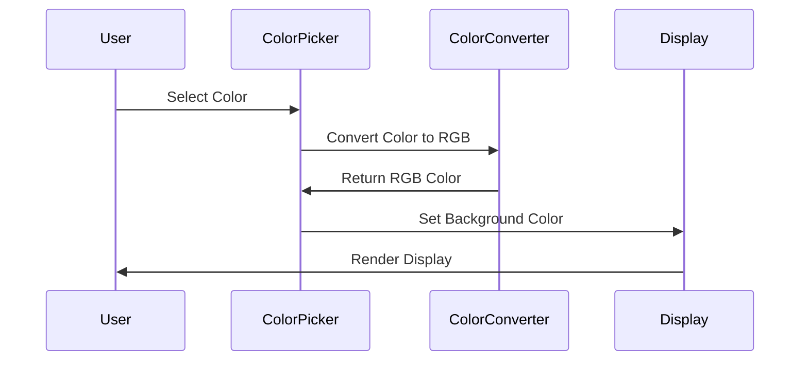

# Intermediate Foundation: Color Theory

## 1. Architectural Mental Model

In the realm of visual arts, color theory is not merely a collection of hues and their interactions; it is a structured system that governs the perception and application of color in design and production. For engineers and practitioners who have a foundational understanding of color, the next step is to delve into the architectural mental model that underpins the systematic use of color in complex visual systems.

### Color Models and Spaces

At the heart of this architecture are color models and spaces, which provide a framework for representing and manipulating color. The most common color models are RGB, CMYK, HSV, and HSL. Each model serves different purposes and is suited to different applications:

- **RGB (Red, Green, Blue):** This additive model is used in digital displays, where light is emitted from a screen. It is ideal for digital design and web development.
- **CMYK (Cyan, Magenta, Yellow, Key):** This subtractive model is used in print media, where ink is applied to a surface. It is essential for professional printing and graphic design.
- **HSV (Hue, Saturation, Value):** This cylindrical model is useful for color selection and manipulation, as it separates color into its perceptual components.
- **HSL (Hue, Saturation, Lightness):** Similar to HSV, HSL is also a cylindrical model but uses lightness instead of value, providing a more intuitive representation of color brightness.

### Color Perception and Psychophysics

Understanding the human perception of color is crucial for designing effective visual systems. The human eye contains photoreceptors called rods and cones, which respond to different wavelengths of light. Cones are responsible for color vision and are sensitive to red, green, and blue wavelengths. The interaction of these cones with light wavelengths determines the color perceived by the human eye.

### Color Harmony and Contrast

Color harmony and contrast are essential for creating visually appealing designs. Harmony involves the use of colors that complement each other, while contrast involves the use of colors that create a visual impact. Key principles of color harmony include:

- **Complementary Colors:** Colors that are opposite each other on the color wheel, such as red and green, create a strong visual contrast.
- **Analogous Colors:** Colors that are adjacent to each other on the color wheel, such as red and orange, create a harmonious and cohesive effect.
- **Triadic Colors:** Colors that are evenly spaced around the color wheel, such as red, yellow, and blue, create a balanced and vibrant effect.

## 2. Systems Taxonomy & Component Protocols

To build robust and scalable visual systems, it is essential to establish a taxonomy of color components and protocols that govern their interaction. This taxonomy should include standard interfaces, protocols, and data models that facilitate the integration of color components into larger systems.

### Standard Interfaces

Standard interfaces define the methods and properties that color components must implement to interact with other components in the system. For example, a color picker component might have methods for setting and getting the current color, as well as properties for the color model and color space.

### Protocols

Protocols define the rules and conventions that govern the interaction of color components. For example, a color conversion protocol might specify the steps required to convert a color from one color model to another. Protocols ensure consistency and interoperability across different components and systems.

### Data Models

Data models define the structure and organization of color data within the system. For example, a color data model might include fields for the red, green, and blue components of an RGB color, as well as fields for the hue, saturation, and value of an HSV color. Data models ensure that color data is consistently represented and manipulated throughout the system.

## 3. Multi-Component Interaction Flow

To understand how color components interact within a larger system, it is helpful to create detailed interaction flow diagrams. These diagrams illustrate the sequence of events and interactions that occur when color components are used in conjunction with other components in the system.

### ASCII Sequence Diagram

```
User -> Color Picker: Select Color
Color Picker -> Color Converter: Convert Color to RGB
Color Converter -> Color Picker: Return RGB Color
Color Picker -> Display: Set Background Color
Display -> User: Render Display
```

### Mermaid Sequence Diagram



## 4. Architectural Trade-offs & Production Pitfalls

When designing color systems, it is essential to consider the trade-offs and pitfalls that can arise from different architectural decisions. Some key considerations include:

### Performance

Color conversion and manipulation can be computationally intensive, especially in real-time applications. To optimize performance, it is important to use efficient algorithms and data structures for color conversion and manipulation.

### Consistency

Consistency is crucial for creating visually cohesive designs. To ensure consistency, it is important to establish a standardized color palette and use it consistently throughout the system. This can be achieved by defining a set of color constants and using them throughout the system.

### Accessibility

Color is an essential aspect of visual communication, but it can also pose challenges for users with color vision deficiencies. To ensure accessibility, it is important to use color contrast ratios that are sufficient for users with different levels of color vision. This can be achieved by using tools and guidelines for color contrast, such as the Web Content Accessibility Guidelines (WCAG).

## 5. Socratic Discussion Starters

To deepen understanding of color theory and its application in visual systems, it is helpful to engage in Socratic discussions that bridge architecture to low-level implementation. Some discussion starters include:

- How can color theory be applied to create visually appealing user interfaces?
- What are the trade-offs between different color models and spaces, and how do they impact performance and consistency?
- How can color contrast ratios be used to ensure accessibility for users with color vision deficiencies?
- What are the best practices for establishing a standardized color palette and using it consistently throughout a system?
- How can color theory be used to create effective visualizations and data representations?

By engaging in these discussions, engineers and practitioners can deepen their understanding of color theory and its application in visual systems, leading to more effective and visually appealing designs.
