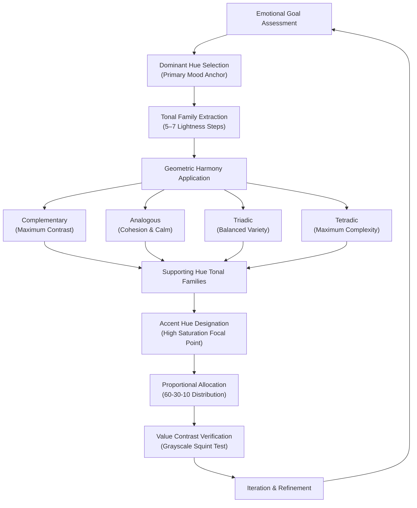

# Lesson 3: Color Harmony Composition

## 1. First-Principles Intuition & Invariants

Color harmony represents the foundational architecture upon which visual hierarchy, emotional resonance, and compositional balance rest. Where musical harmony governs the simultaneous sounding of pitches to create consonance or dissonance, color harmony orchestrates wavelengths of light across the visible spectrum to produce relationships of visual stability, tension, or dynamic movement. The essential invariant underlying all harmonic color systems is this: colors do not exist in isolation but derive their perceptual meaning, emotional weight, and compositional function entirely through their relationships with adjacent hues, surrounding values, and contextual saturation levels.

The human visual system processes color through three opponent channels: red-green, blue-yellow, and light-dark. This neurological architecture explains why certain color pairings generate perceptual tension while others yield visual rest. Complementary colors—pairs positioned opposite one another on the color wheel—stimulate both poles of an opponent channel simultaneously, creating maximum chromatic contrast and vibrational energy at their boundary edges. An orange shape placed against a cyan background activates the red-green and blue-yellow channels in opposing directions, producing a shimmering optical vibration that commands immediate attention. This physiological response is not cultural or learned; it emerges directly from the structure of cone cells in the retina and the lateral inhibition networks in the visual cortex.

Understanding color harmony begins with the HSL color space model: hue represents the wavelength position on the spectrum wheel (measured in degrees from 0° to 360°), saturation quantifies chromatic purity from neutral gray to maximum intensity, and lightness maps the achromatic luminance value from black through middle gray to white. Every color decision operates simultaneously across all three dimensions. A deep navy blue at 220° hue, 80% saturation, and 20% lightness functions entirely differently in composition than a pale sky blue at 220° hue, 40% saturation, and 75% lightness, despite sharing identical hue angles. The composer must internalize that hue alone never defines color behavior—saturation and value modulate weight, spatial position, and emotional temperature.

The color wheel itself descends from Newton's prismatic experiments and was formalized into practical artist models by Johannes Itten at the Bauhaus. The twelve-step wheel positions primary colors (red at 0°, yellow at 60°, blue at 240°) with secondary colors (orange, green, violet) interpolated between them and tertiary colors filling the remaining gaps. This geometric structure enables precise calculation of harmonic relationships: complementary pairs lie 180° apart, analogous clusters span 30° to 60° of adjacent hues, and triadic harmonies form equilateral triangles at 120° intervals. These geometric rules provide the scaffolding, but mastery emerges only when the designer learns to modulate saturation and value to sculpt figure-ground relationships and control visual flow.

Contrast operates as the fundamental tool for directing viewer attention and establishing compositional hierarchy. Value contrast—the difference in lightness between elements—carries the greatest perceptual weight, overriding hue and saturation in determining spatial separation and readability. A dark shape on a light background or vice versa creates immediate figure-ground distinction regardless of chromatic choices. Saturation contrast juxtaposes intense, pure hues against desaturated, grayed tones, allowing the eye to identify focal points through chromatic intensity rather than value shifts alone. Temperature contrast exploits the psychological warmth of red-orange wavelengths versus the coolness of blue-green wavelengths, leveraging the advancing optical property of warm colors and the receding nature of cool colors to construct spatial depth on a flat picture plane.

Psychological color associations layer cultural symbolism atop physiological responses. Red universally signals arousal—increased heart rate, heightened alertness—due to its association with blood, fire, and warning signals across human evolutionary history. Blue induces calm through connections to open sky and deep water, environments signaling safety and stability. Yellow stimulates optimism and energy, though its high luminance value can provoke anxiety when overused at full saturation. These emotional responses are not arbitrary; they emerge from both hardwired survival mechanisms and accumulated cultural conditioning. The designer must recognize that color emotion operates probabilistically rather than deterministically—context, adjacent colors, shape language, and viewer background all modulate the final perceptual outcome.

The design invariant governing all color harmony work is that relationships, not isolated choices, drive visual success. A palette of five colors can produce elegance or chaos depending entirely on their proportional distribution, saturation balance, and value orchestration. The 60-30-10 rule from interior design translates directly to visual composition: allocate roughly 60% of the composition to a dominant color establishing overall mood, 30% to a secondary color providing support and variation, and 10% to an accent color delivering focal punctuation. This proportional hierarchy prevents chromatic competition and ensures a clear tonal center, much as a musical composition establishes a tonic key despite modulations and chromatic embellishments.

## 2. Core Architecture & Mechanics

Complementary harmonies generate maximum chromatic contrast by pairing hues positioned 180° apart on the color wheel. Red and cyan, orange and blue, yellow and violet—these pairings activate opponent color channels simultaneously, producing optical vibration at their boundaries and commanding immediate perceptual attention. In practice, direct complementary pairings at full saturation create aggressive, electrically charged compositions suitable for alert signals, call-to-action buttons, or high-energy branding. The designer must modulate this intensity through desaturation or value shifts to prevent visual fatigue. A burnt sienna (desaturated orange) paired with a dusty teal (desaturated cyan) retains complementary structure while reducing chromatic aggression, yielding a more sophisticated, inhabitable palette.

The split-complementary scheme refines the complementary approach by replacing one hue with its two neighbors at ±30° offsets. Instead of pairing pure orange (30°) with pure cyan (210°), a split-complementary palette uses orange (30°) with steel blue (195°) and turquoise (225°). This triad preserves the tension of complementary contrast while introducing chromatic variety and reducing the harshness of direct opposition. Split-complementary schemes excel in editorial design and brand systems where visual interest must coexist with sustained readability across extended viewing durations.

Analogous harmonies select three to five adjacent hues spanning 30° to 60° of the color wheel, creating monochromatic or near-monochromatic palettes with subtle chromatic variation. A blue-based analogous scheme might progress from cyan (180°) through primary blue (240°) to violet (270°), maintaining cool temperature consistency while providing enough hue differentiation to distinguish overlapping elements. Analogous palettes inherently lack strong contrast, so the designer must employ value and saturation modulation to establish hierarchy. A dark navy anchor with mid-value azure support and pale periwinkle highlights constructs spatial depth within a narrow hue band. Analogous schemes dominate in interface design, data visualization, and environmental graphics where cohesion and calm outweigh the need for high-energy focal punctuation.

Triadic harmonies position three hues at 120° intervals, forming equilateral triangles on the color wheel. The primary triad (red, yellow, blue) and secondary triad (orange, green, violet) represent the foundational examples, though any three equidistant hues constitute a valid triadic system. Triadic palettes balance chromatic variety with geometric stability, avoiding the monotony of analogous schemes while maintaining more harmony than complementary pairings. The challenge lies in proportional distribution—using all three hues at equal saturation and area coverage produces chaotic competition. Effective triadic composition designates one hue as dominant (60% coverage), relegates the second to supporting role (30%), and reserves the third for accent punctuation (10%). A triadic palette of golden yellow, cerulean blue, and coral red succeeds when yellow saturates backgrounds and large masses, blue structures secondary elements and text, and red delivers sharp focal accents in buttons, icons, or call-outs.

Tetradic harmonies employ two complementary pairs forming rectangles or squares on the color wheel. The rectangle scheme selects two pairs not in direct opposition but offset by 60° increments, such as red (0°) and cyan (180°) paired with yellow-orange (30°) and blue-violet (210°). The square scheme maintains strict 90° intervals, such as red (0°), yellow-green (90°), cyan (180°), and blue-violet (270°). Tetradic palettes offer maximum chromatic variety but demand rigorous hierarchical discipline to prevent visual anarchy. Successful tetradic compositions typically desaturate three of the four hues to near-neutral grays, allowing one fully saturated hue to dominate as the chromatic focal point. This approach appears frequently in complex data dashboards where multiple categories require distinct color coding while preserving overall visual coherence.

Value contrast engineering represents the most critical tool for establishing figure-ground separation and guiding viewer attention. The human visual system evolved to detect predators and prey through luminance differences in natural environments; color hue is secondary to survival-critical shape recognition. A composition with rich chromatic variety but insufficient value contrast collapses into an illegible chromatic mush. The squint test—viewing the composition through half-closed eyes to blur color detail—reveals whether value structure remains readable when hue and saturation information degrades. Effective compositions maintain strong value hierarchies even when converted to grayscale, with dominant elements occupying extreme darks or lights, supporting elements inhabiting mid-tones, and backgrounds residing in neutral grays.

The practical implementation of value contrast follows the zone system adapted from Ansel Adams' photographic technique. Divide the value range from pure black (0% lightness) to pure white (100% lightness) into five zones: Zone I (0-20%) for deepest shadows and anchor darks, Zone II (20-40%) for dark supporting tones, Zone III (40-60%) for middle grays and neutral grounds, Zone IV (60-80%) for light supporting tones, and Zone V (80-100%) for highlights and paper whites. Compositional hierarchy emerges by assigning primary focal elements to Zone I or V extremes, secondary elements to Zones II and IV, and backgrounds to Zone III. This structure ensures that critical content maintains maximum separation from its surroundings regardless of chromatic choices.

Saturation contrast exploits the eye's natural attraction to chromatic intensity. In a field of desaturated, grayed tones, a single element at full saturation commands disproportionate attention even when occupying minimal area. This principle underlies the accent color strategy in interface design: establish an overall palette of neutral grays and muted tones, then inject a single saturated hue at strategic interaction points. A corporate dashboard rendered in charcoal backgrounds (5% saturation) with steel blue text (15% saturation) allows a coral button (95% saturation) to function as an unmissable call-to-action despite occupying less than 2% of screen real estate.

Temperature contrast leverages the physiological phenomenon that warm colors (reds, oranges, yellows) appear to advance toward the viewer while cool colors (blues, greens, violets) recede into depth. This optical effect arises from chromatic aberration in the eye's lens, which focuses red wavelengths slightly in front of the retina and blue wavelengths slightly behind. Painters exploit this property to construct atmospheric perspective: warm foreground elements against cool backgrounds create spatial depth on a flat canvas without linear perspective cues. Digital designers employ temperature contrast to establish Z-axis layering in flat UI layouts: warm accent colors on interactive elements (buttons, links) versus cool backgrounds create implied elevation and interactivity signaling.

Figure-ground dynamics govern the perceptual segregation of objects from their surrounding environment. Gestalt psychology identifies several principles driving figure-ground organization: surroundedness (enclosed shapes read as figure), size (smaller elements read as figure against larger backgrounds), contrast (higher-contrast elements separate as figure), and convexity (convex shapes dominate over concave). Color amplifies or undermines these principles. A red circle on a blue field naturally separates as figure due to chromatic contrast, but if the red circle and blue background share identical value (50% lightness), the separation weakens and the composition flattens. Effective figure-ground color design aligns multiple contrast dimensions—hue, value, saturation, temperature—to reinforce hierarchical reading.

Proportional distribution determines whether a multi-hue palette reads as harmonious or chaotic. The golden ratio (1:1.618) and Fibonacci sequence (1, 1, 2, 3, 5, 8) provide mathematical frameworks for color allocation, though simpler heuristics often suffice. The 60-30-10 rule allocates 60% of compositional area to a dominant hue establishing overall emotional tone, 30% to a secondary hue providing visual relief and supporting structure, and 10% to an accent hue delivering focal punctuation. In a magazine layout, this might translate to 60% neutral off-white paper, 30% muted blue-gray text blocks and structural elements, and 10% saturated orange in headlines, pull quotes, and call-out boxes. The dominant color need not be saturated—neutral grays and off-whites often serve as dominant tones, allowing chromatic colors to function as secondary and accent layers.

The practical workflow for constructing harmonious palettes begins with strategic sampling rather than arbitrary selection. Identify the primary emotional goal (calm, energetic, luxurious, playful) and select a dominant hue corresponding to that mood: blues for trust and stability, reds for urgency and passion, greens for growth and balance, purples for creativity and luxury. Extract this dominant hue at multiple saturation and value levels to construct a tonal family—five shades ranging from near-white tints to near-black shades. Next, apply geometric harmony rules (complementary, analogous, triadic) to derive supporting hues, again extracting tonal families for each. Finally, designate one hue at high saturation as the accent color, ensuring it contrasts strongly with the dominant tone in both hue and value. This systematic approach produces palettes with built-in hierarchy and proportional logic before any design execution begins.

## 3. High-Performance Optimization & Failure Modes

The most common failure mode in color harmony work is chromatic competition—multiple fully saturated hues vying for attention without hierarchical structure. A composition employing pure red, pure blue, and pure yellow at equal proportions creates visual noise rather than harmony, as each hue demands focal priority. The corrective strategy involves radical desaturation of all but one accent color. Transform two of the three competing hues into near-neutral grays at 10-20% saturation, allowing the remaining saturated hue to dominate without contest. This desaturation does not eliminate the underlying harmonic structure; a desaturated red at 15% saturation still reads as warm and retains its complementary relationship to cyan, but it no longer competes aggressively for attention.

Value compression—insufficient lightness difference between elements—causes compositions to collapse into illegible flatness. When figure and ground share values within 10-15% lightness, the eye struggles to parse boundaries and hierarchical relationships dissolve. The diagnostic tool is the grayscale conversion test: import the composition into image editing software, strip all hue and saturation, and evaluate whether critical elements remain distinguishable in pure black-and-white. If text becomes unreadable or focal elements disappear, the value structure is insufficient regardless of chromatic richness. The correction requires expanding the lightness range between hierarchical layers—push dominant elements toward 0% or 100% lightness extremes, relegate supporting elements to 20-40% or 60-80% zones, and anchor backgrounds in 40-60% mid-tones.

Overuse of accent colors dilutes their functional impact. Accent hues derive power from scarcity; when a saturated accent color appears across 30-40% of the composition, it ceases to function as accent and instead competes as a dominant or secondary tone. Effective accent application restricts usage to 5-10% of compositional area, concentrating saturation at critical interaction points or focal content. In interface design, this translates to limiting accent color to primary CTAs, active states, and critical alerts while preventing its migration into decorative borders, backgrounds, or structural elements.

Temperature confusion arises when warm and cool hues mix indiscriminately without spatial logic. Warm colors advance and cool colors recede; violating this principle by placing cool elements in foreground and warm elements in background creates spatial ambiguity and flattened depth perception. Corrective discipline requires aligning temperature with Z-axis position: warm foreground elements (buttons, active content) against neutral-to-cool backgrounds (canvas, structural containers) reinforces implied depth. The exception occurs in intentionally flat, graphic design styles where spatial ambiguity serves stylistic goals, but even here, consistent temperature application within hierarchical layers prevents chaotic temperature competition.

Cultural color symbolism requires contextual awareness, particularly in global brand systems. Red signals danger and stop in Western contexts but represents prosperity and celebration in Chinese culture. White conveys purity and weddings in Western traditions but mourns death in many Asian cultures. Purple indicates royalty in European history but suggests death and mourning in Brazil and Thailand. Designers working across cultural boundaries must research regional color associations and test palettes with representative audiences from target demographics. Universal strategies prioritize blue (globally associated with trust and stability) and green (universally linked to nature and growth) while approaching reds, whites, and purples with cultural specificity.

Accessibility compliance mandates sufficient contrast ratios between text and background colors to ensure readability for users with visual impairments. The Web Content Accessibility Guidelines (WCAG) specify minimum contrast ratios: 4.5:1 for normal text, 3:1 for large text (18pt or 14pt bold), and 3:1 for graphical objects and UI components. These ratios measure luminance difference, not hue separation—red text on green background may satisfy complementary harmony but fails accessibility if both colors share similar lightness values. The corrective workflow involves using contrast-checking tools to measure luminance ratios before finalizing color selections, adjusting value relationships while preserving harmonic hue structure. Effective accessible design treats contrast requirements not as constraints but as opportunities to strengthen value hierarchy and compositional clarity.

Saturation fatigue occurs when prolonged exposure to highly saturated colors causes perceptual exhaustion and visual discomfort. Interfaces and environmental graphics intended for extended viewing sessions require lower overall saturation to maintain comfort across hours-long usage. Research in display ergonomics suggests limiting average screen saturation to 20-30% for productivity applications, reserving higher saturation (60-80%) for brief interaction elements. Editorial design and environmental graphics follow similar principles: reduce saturation for large background masses and body text, reserving full saturation for headlines, pull quotes, and wayfinding accents.

Digital color reproduction inconsistencies across devices require defensive palette construction. Consumer displays vary wildly in color gamut, brightness calibration, and color temperature settings. A palette carefully balanced on a calibrated designer's monitor may appear oversaturated on a cheap laptop panel or undersaturated on a dimmed smartphone. Defensive strategies include testing palettes on multiple uncalibrated devices, avoiding extreme saturation values above 90% (which clip unpredictably on narrow-gamut displays), and building sufficient value contrast so that even when hue and saturation render incorrectly, luminance structure maintains readability.

Temporal color adaptation—the eye's automatic adjustment to ambient color temperature—affects how colors appear in different lighting contexts. A composition designed under cool daylight-balanced studio lighting reads differently under warm incandescent home lighting. Printed materials viewed under various lighting conditions require defensive color choices that remain stable across temperature shifts. Strategies include avoiding extreme temperature contrast (which exaggerates under warm lighting) and testing printed proofs under multiple lighting types (daylight, tungsten, fluorescent) before final production approval.

The optimization workflow for professional color harmony composition follows a systematic sequence: establish emotional goals and audience context, select dominant hue aligned with emotional intent, extract tonal families at multiple value and saturation levels, apply geometric harmony rules to derive supporting hues, designate a single accent color at high saturation, allocate proportional distribution (60-30-10), verify value contrast via grayscale conversion, check accessibility contrast ratios, test across devices and lighting contexts, iterate saturation levels to prevent fatigue, and document the final palette with HSL values and usage guidelines for consistent application across assets. This disciplined approach transforms color selection from intuitive guesswork into a rigorous, repeatable, results-driven methodology that produces harmonious, functional, and emotionally resonant compositions across all visual media.
