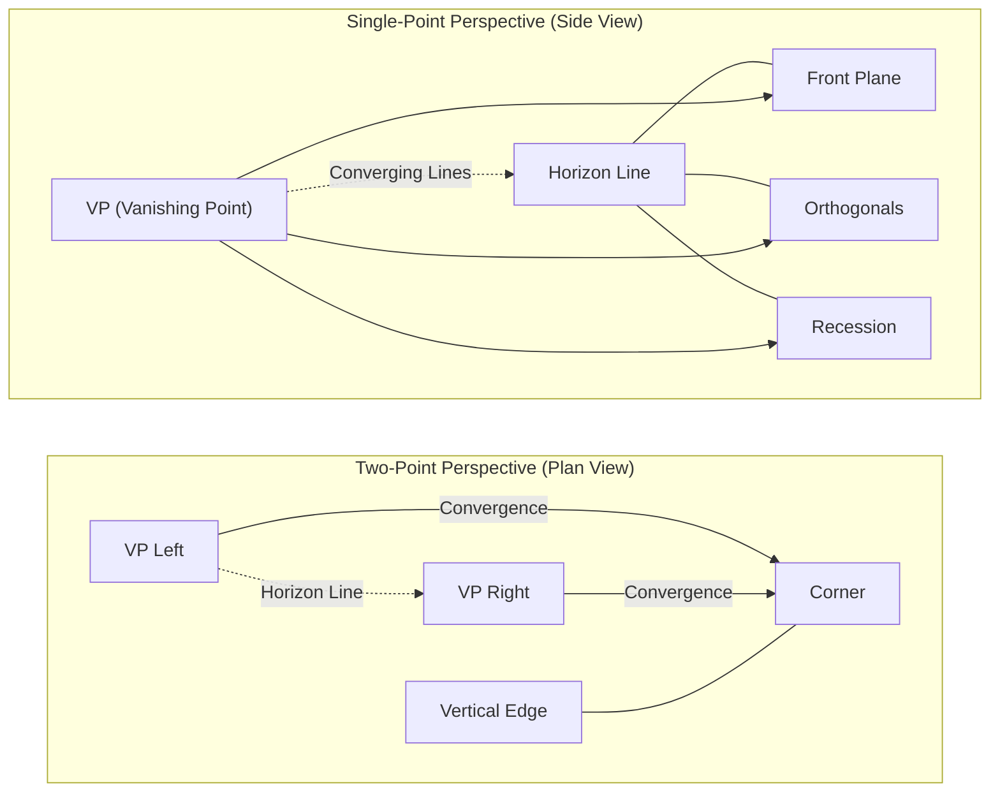
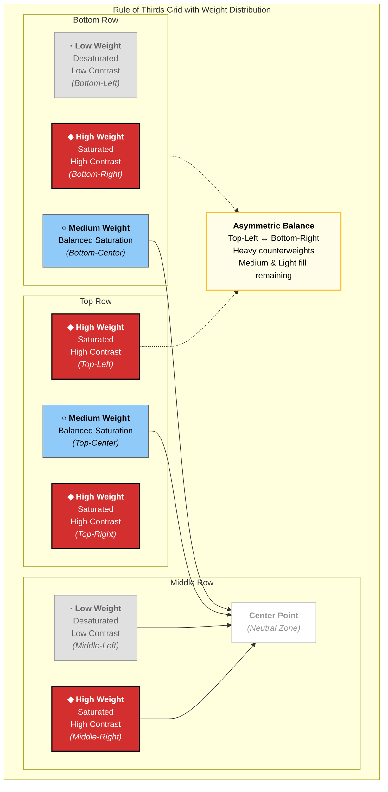

# Lesson 3: Visual Weight, Depth, Focal Points

## 1. First-Principles Intuition & Invariants

The human visual system evolved to extract survival-critical information from three-dimensional environments under finite attentional bandwidth. When we flatten spatial reality onto a two-dimensional picture plane—whether canvas, screen, or photographic sensor—we inherit both the perceptual mechanisms that govern biological vision and the representational constraints of the medium itself. Composition, in its most fundamental sense, becomes the architectural orchestration of these inherited mechanisms: the deliberate construction of spatial recession cues, the strategic distribution of visual mass, and the hierarchical prioritization of information through controlled emphasis.

Visual weight operates as a perceptual analog to physical mass. Just as gravitational systems demand equilibrium or intentional imbalance to communicate stability or dynamism, compositional frameworks distribute visual density across the picture plane to guide scanning behavior and encode narrative hierarchy. A saturated crimson occupies more perceptual real estate than a desaturated gray of identical pixel dimensions. High-contrast edges arrest saccadic eye movement more aggressively than gradual tonal transitions. Dense texture fields—crosshatched pen strokes, stippled grain, algorithmic noise patterns—accumulate visual mass through information density alone, independent of hue or value. The compositional architect must internalize these weights as measurable forces, balancing them across the frame with the same rigor a structural engineer applies to load-bearing calculations.

Depth cues exploit the visual system's stereoscopic and monocular inference engines. Linear perspective codifies the geometric projection of three-dimensional Euclidean space onto the two-dimensional plane through the mathematical constraint of vanishing points—those horizon-locked singularities where parallel lines converge under projective transformation. Atmospheric perspective, conversely, simulates the scattering physics of particulate-laden air: distant mountains desaturate toward blue-violet, contrast compresses, and edge definition dissolves as light traverses kilometers of atmosphere. Scale relationships encode depth through learned size constancy—the cognitive assumption that objects maintain fixed dimensions across viewing distances, such that a smaller rendering signals recession rather than miniaturization. These cues do not operate in isolation; they compound and interfere, and the skilled compositor learns to orchestrate their interactions with surgical precision.

Focal points function as attentional magnets, concentrations of visual weight that interrupt the raster-scan tendency of untrained viewing. The eye defaults to a chaotic wandering pattern when confronted with undifferentiated stimulus fields, but compositional structure imposes navigational architecture. A focal point is not merely "the thing you want people to look at"—it is the terminal node in a deliberately engineered attention pathway, preceded by secondary and tertiary elements that progressively funnel gaze trajectories through the frame. This hierarchy mirrors the foreground-middleground-background stratification of depth, but operates orthogonally: depth organizes spatial recession, while focal emphasis organizes informational priority. A compositionally mature work synchronizes both systems, aligning spatial depth with narrative emphasis such that the viewer's journey through illusory space coincides with their journey through meaning.

The invariants governing these mechanisms remain constant across media and style. Whether working in charcoal realism, digital matte painting, or abstract geometric construction, the perceptual physics remain unchanged: high contrast dominates low contrast, saturation advances relative to desaturation, sharp edges precede soft transitions in attentional priority, and compositional balance—or its deliberate violation—communicates stability or tension regardless of representational content. Mastery demands internalizing these rules not as aesthetic preferences but as measurable, manipulable perceptual forces.

## 2. Core Architecture & Mechanics

Linear perspective's geometric foundation rests on projective transformation, the mathematical operation mapping three-dimensional coordinates onto a two-dimensional viewing plane through a fixed station point. Single-point perspective establishes one vanishing point on the horizon line, appropriate for compositions emphasizing frontal recession—railroad tracks disappearing into distance, corridor interiors, long roads. Orthogonal lines (those perpendicular to the picture plane) converge toward this singularity, while horizontals parallel to the picture plane remain parallel. Two-point perspective introduces lateral recession, positioning vanishing points at opposite ends of the horizon to describe corner views of rectilinear forms—architectural exteriors, urban intersections, furniture corners. Three-point perspective adds a vertical vanishing point above or below the horizon, simulating the convergence visible when viewing tall structures from ground level or depicting aerial viewpoints looking down from height.

Constructing accurate perspective demands methodical procedure. First, establish the horizon line at the viewer's eye level—this horizontal divides the picture plane into sky and ground and anchors all vanishing points. For single-point perspective, place the vanishing point on this horizon, typically off-center to avoid static symmetry. Draw orthogonal guidelines from the vanishing point through key structural nodes—ground plane corners, roofline edges, receding architectural details. Horizontals remain parallel to the horizon; verticals remain perpendicular to it. Measure intervals along the baseline using a diagonal measuring line: to subdivide a receding plane (such as floor tiles), draw a diagonal from one corner through the midpoint of the opposite edge, then drop verticals where this diagonal intersects the receding orthogonals. This preserves proportional foreshortening without manual calculation.

Two-point perspective requires left and right vanishing points positioned outside the composition frame for natural convergence angles—placing them too close flattens the illusion, while excessive separation exaggerates distortion. Each vertical edge remains truly vertical, but all horizontals converge toward one of the two lateral vanishing points depending on their orientation. To construct a rectilinear form such as a building corner, establish the corner vertical first, then draw orthogonals from its top and bottom toward both vanishing points, creating the convergence framework for front and side planes. Measure heights along verticals only—perspective foreshortening affects horizontal and depth dimensions but preserves vertical proportions when the picture plane is vertical.

Atmospheric perspective manipulates four primary variables to encode depth: value contrast, color temperature, edge definition, and detail density. Foreground elements employ the full value range from pure black to pure white, maximizing local contrast. Middleground elements compress this range, restricting darks to mid-tones and lights to upper-mid values. Background elements collapse further toward the horizon value—typically a desaturated blue-gray matching atmospheric haze color. Color temperature shifts follow the Rayleigh scattering model: shorter blue wavelengths scatter more effectively through particulate atmosphere, tinting distant forms toward cool hues, while foreground retains warm local color. Edge definition degrades with distance as atmospheric diffusion blurs contours; render foreground edges with sharp, high-frequency transitions, middleground with moderate softness, and background with soft, low-contrast boundaries. Detail density follows a logarithmic decay: foreground tolerates fine texture—individual leaves, brick mortar, fabric weave—while middleground simplifies to clustered masses and background reduces to silhouetted shapes.

Visual weight distribution requires calibrating multiple perceptual channels simultaneously. Color saturation contributes mass: a fully saturated cadmium red occupies greater visual weight than an identical-value desaturated gray. Quantify this by monitoring HSB (Hue-Saturation-Brightness) values in digital tools—saturation above 70% reads as heavy, below 30% as light. Value contrast operates as the dominant weight factor: high local contrast (dark adjacent to light) creates focal mass regardless of hue. Measure this using histogram analysis: areas with bimodal distributions (separated peaks in dark and light values) carry maximum weight. Texture density accumulates weight through information complexity: a crosshatched region with 20 strokes per square inch outweighs a flat fill of identical average value. Edge complexity follows similar logic—fractal coastlines and zigzag contours attract more attention than smooth curves.

Compositional balance arranges these weights across the frame according to classical principles adapted from physics. Symmetrical balance mirrors weight distribution across a central vertical axis, creating stable, formal compositions appropriate for hierarchical subjects—religious icons, governmental portraiture, architectural facades. Asymmetrical balance distributes unequal weights at varying distances from the fulcrum, analogous to a lever: a small, high-contrast element far from center can balance a larger, lower-contrast mass near center. The rule-of-thirds grid provides a heuristic framework: divide the frame into horizontal and vertical thirds, placing primary focal weights at the four intersection points approximately 1/3 from edges. This asymmetric positioning feels more dynamic than centered placement while maintaining coherent balance.

Focal point hierarchy constructs a multi-tiered attention pathway. The primary focal point receives maximum emphasis through converged depth cues, peak contrast, sharpest edges, and warmest or most saturated color. Secondary focal points employ moderate emphasis, supporting the primary through complementary positioning or narrative connection—a figure's gaze direction pointing toward the primary, or a compositional line leading the eye from secondary to primary. Tertiary elements recede into supporting roles with minimal weight, providing context without competing for attention. This hierarchy must be tested through squint analysis: when viewing the composition through narrowed eyes that blur detail and compress value range, the primary focal point should remain the most visible element, secondary points should read as distinct but subordinate, and tertiary elements should merge into undifferentiated background.

Foreground-middleground-background stratification operates as the spatial scaffold supporting focal hierarchy. Foreground occupies the nearest picture plane, often cropped by frame edges to suggest continuation beyond the composition boundaries—this overlap triggers the occlusion depth cue, wherein partially hidden objects read as behind visible ones. Scale foreground elements larger than background counterparts even when representing identical real-world dimensions: a foreground figure at 1/3 frame height dwarfs a background figure at 1/10 frame height despite both representing six-foot humans. Middleground provides transitional depth, bridging foreground and background through intermediate scale and atmospheric treatment. Background anchors the deepest recession, employing maximum atmospheric perspective and minimum detail to push spatial infinity. This tripartite division need not align with focal hierarchy—a background element can serve as primary focal point if counterbalanced by sufficient emphasis—but coordinating spatial depth with attentional priority produces the most legible compositions.

## 3. High-Performance Optimization & Failure Modes

Efficient compositional workflows prioritize blocking over refinement, establishing spatial architecture and weight distribution before committing to surface detail. Begin with thumbnail sketches at 2×3 inch dimensions, working in pure value (grayscale) to isolate compositional structure from color relationships. Generate 6-12 rapid thumbnails exploring varied focal placement, depth arrangements, and weight distributions. Evaluate thumbnails through squint analysis and reference photography to identify the strongest spatial scaffold. Promote the selected thumbnail to full-scale line drawing, preserving value massing without introducing detail. At this stage, verify perspective accuracy using digital overlays or manual vanishing point plots—correcting perspective errors costs exponentially more effort after rendering begins.

Digital workflows leverage non-destructive layer architecture to preserve compositional flexibility. Structure the layer stack as foreground group, middleground group, and background group, with focal elements isolated on separate layers within their depth group. Apply atmospheric perspective through layer opacity adjustments rather than destructive painting: reduce background layer opacity to 60-70% and overlay a blue-tinted adjustment layer to simulate atmospheric scattering. This approach allows real-time tweaking of depth recession without repainting. Use clipping masks to test color variations on focal elements—painting color options on masked layers above the base rendering permits instant A/B comparison. Maintain a dedicated contrast adjustment layer above all content, toggling it on/off to verify that value structure remains legible independent of color.

Traditional media workflows achieve similar flexibility through underpainting and glazing. Execute the initial underpainting in monochrome (burnt umber or raw umber thinned with solvent), establishing complete value structure and depth recession before introducing color. This underpainting functions as a permanent compositional reference—subsequent color glazes modulate hue and saturation without obscuring underlying value architecture. Apply glazes in order of spatial recession: background first (thin, transparent washes), middleground second (moderate opacity), foreground last (thicker, more opaque application). This sequence prevents foreground pigment from contaminating background atmospheric effects.

Failure mode analysis reveals recurring compositional pathologies. Competing focal points fragment attention when multiple elements receive equivalent emphasis—diagnose this by counting high-contrast zones in the thumbnail squint test; more than three distinct high-contrast areas indicates unfocused composition. Resolution: subordinate secondary elements by reducing their local contrast, desaturating color, or softening edges. Flat depth occurs when atmospheric perspective remains uniform across all spatial planes—verify by comparing foreground and background value ranges; insufficient compression indicates inadequate depth treatment. Resolution: exaggerate atmospheric effects until depth recession becomes obvious, then dial back 10% for natural appearance.

Unstable balance manifests as compositional tipping, wherein excessive weight concentrates on one side of the frame, creating visual tension that distracts from focal content. Diagnose by mirroring the composition horizontally—if the mirrored version feels significantly more stable, weight distribution requires rebalancing. Resolution: introduce counterbalancing elements on the light side (e.g., small high-contrast detail), or shift primary focal point toward center. Dead zones—large areas of undifferentiated value and texture—create compositional voids that interrupt viewer navigation. Identify by overlaying a heat map of local contrast variance; regions with variance below 10% across a 1-inch radius qualify as dead zones. Resolution: introduce subtle textural variation, atmospheric effects, or secondary compositional elements to provide visual interest without competing with primary focal points.

Edge management failures degrade both depth and focal control. Hard edges throughout the composition flatten spatial recession by failing to differentiate foreground sharpness from background softness. Inventory edge types: sharp (high-frequency value transition), firm (moderate transition), soft (gradual transition), lost (dissolved into surrounding value). Foreground requires 60% sharp edges, 30% firm, 10% soft. Middleground inverts to 30% sharp, 40% firm, 30% soft. Background demands 10% sharp, 20% firm, 70% soft-to-lost. Apply this distribution deliberately during rendering, softening edges with blending tools or glazing media as spatial recession increases.

Color temperature conflicts disrupt atmospheric depth when background elements retain warm local color instead of cooling toward atmospheric blue. Verify by sampling background hues—if red/orange values exceed 10% saturation or yellow hues remain above 20%, temperature shift remains insufficient. Resolution: overlay cool-tinted adjustment layers (blue/cyan at 15-25% opacity) on background groups, or glaze background areas with Prussian blue or ultramarine thinned to transparency. Avoid cooling midtones to gray—preserve hue identity while shifting temperature through complementary mixing (add blue to warm browns, add violet to warm reds).

Focal point dilution emerges when excessive detail density distributes across the frame, eliminating emphasis hierarchy. Quantify by measuring detail frequency: count distinct textural elements within standardized 1-inch grid squares across the composition. Primary focal areas should contain 2-3× the detail frequency of surrounding regions. Resolution: simplify non-focal areas through blurring, value averaging, or detail omission. Remember that absence of detail reads as intentional compositional choice rather than incomplete rendering when value structure and edge control remain consistent.

Scale inconsistency violations break spatial believability when elements at identical depth planes exhibit incompatible size relationships. Audit by measuring key objects against anatomical or architectural standards—human figures should maintain 7.5-8 head-height proportions, doorways should measure 80 inches regardless of perspective position. Resolution: construct a perspective grid at the established horizon line and vanishing points, measuring all elements against this calibrated framework. For organic environments lacking rectilinear references, introduce staffage (human figures) at multiple depth planes as scale anchors.

Compositional workflows benefit from iterative refinement protocols. After completing initial blocking, execute a formal critique pass: print the composition at 50% scale and annotate directly on paper, marking weight imbalances, depth inconsistencies, and focal ambiguities. Address critiqued issues in priority order—spatial structure errors first (perspective, scale), weight distribution second, surface refinement last. Repeat this critique-revise cycle until annotations decrease below three per review session. This methodology prevents premature detail commitment that locks in structural flaws.

Advanced practitioners integrate dynamic compositional analysis tools. Digital workers employ layer blend modes to isolate compositional channels: set all layers to 50% opacity to evaluate weight distribution independent of local detail, then switch to desaturation view (grayscale conversion) to verify value structure. Overlay compositional armatures—golden ratio spirals, diagonal power lines, geometric subdivision grids—as non-printing guides to verify alignment between intuitive composition and classical proportional systems. Traditional media artists replicate these analyses by photographing work-in-progress and manipulating images digitally, preserving physical media while gaining digital analysis capabilities.

The master compositor internalizes these mechanisms to the degree that conscious analysis becomes unnecessary during execution—hands construct spatial recession and emphasis hierarchy through trained muscle memory while cognitive attention focuses on narrative content and aesthetic refinement. This automaticity emerges only through deliberate practice: execute 50+ thumbnail compositions analyzing weight distribution, then 50+ perspective construction studies, then 30+ atmospheric depth exercises, then 20+ focal hierarchy studies, integrating learned principles cumulatively. Mastery is not intellectual comprehension of compositional rules but somatic internalization of perceptual physics, such that every mark placed serves spatial architecture and attentional guidance without requiring deliberate calculation.
