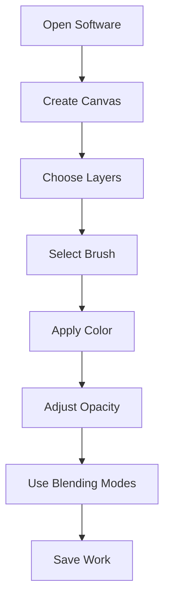

# Beginner Foundation: Digital Painting

## 1. Everyday Intuition & First Principles
Digital painting is akin to traditional painting, but instead of using physical brushes and pigments, you wield a digital brush and digital colors on a computer screen. Just as a painter mixes colors on a palette and applies them to canvas, a digital painter mixes colors on a virtual palette and applies them to a digital canvas. The fundamental principle is the same: to create visual art through the application of color and form, but with the added flexibility and precision of digital tools.

## 2. Foundational Vocabulary & Glossary
### Canvas
The digital equivalent of a traditional painting surface. It is the area on which you will create your artwork. A canvas can be any size and resolution, depending on the intended use of the artwork (e.g., web, print).

### Layers
A feature that allows you to work on different elements of your painting separately. Each layer can be manipulated independently, allowing for non-destructive editing. For example, you can have a layer for the background, another for the main subject, and yet another for details.

### Brush
A digital tool used to apply color to the canvas. Brushes can mimic the texture and behavior of traditional brushes, such as soft, hard, or airbrush effects. Each brush has adjustable settings like size, hardness, and opacity.

### Color Palette
A collection of colors that you can use in your painting. Digital palettes can be customized, and colors can be selected using various color models (e.g., RGB, HSL).

### Opacity
The degree of transparency of a brush stroke or layer. Opacity ranges from 0% (completely transparent) to 100% (completely opaque). Lower opacity allows underlying layers to show through.

### Blending Modes
Settings that determine how colors on a layer interact with the colors on the layers below. Common blending modes include Normal, Multiply, Screen, and Overlay. Each mode produces a different visual effect.

### Selection Tool
A tool used to select specific areas of the canvas for editing. Selections can be made using various shapes (e.g., rectangle, ellipse) or by using more advanced techniques like lasso or quick selection.

### Eraser
A tool used to remove color from the canvas. The eraser can be set to different modes, such as erasing to the background color or erasing to transparency.

## 3. Visual System Flow
### ASCII Diagram
```
+-------------------+
|   Open Software   |
+---------+---------+
          |
          v
+---------+---------+
|  Create Canvas    |
+---------+---------+
          |
          v
+---------+---------+
|   Choose Layers   |
+---------+---------+
          |
          v
+---------+---------+
|   Select Brush    |
+---------+---------+
          |
          v
+---------+---------+
|   Apply Color     |
+---------+---------+
          |
          v
+---------+---------+
| Adjust Opacity    |
+---------+---------+
          |
          v
+---------+---------+
| Use Blending Modes|
+---------+---------+
          |
          v
+---------+---------+
|   Save Work       |
+-------------------+
```

### Mermaid Flowchart


## 4. Common Beginner Misconceptions & Mental Traps
- **Misconception:** Digital painting is too complicated and requires advanced technical skills.
  - **Reality:** Digital painting can be as simple or complex as you want it to be. Beginners can start with basic tools and gradually learn more advanced techniques.
  
- **Misconception:** Digital painting lacks the authenticity and emotion of traditional painting.
  - **Reality:** Digital painting can convey just as much emotion and authenticity as traditional painting. The medium is a tool, and the artist's skill and vision are what make the artwork meaningful.
  
- **Misconception:** You need expensive software and hardware to create professional digital paintings.
  - **Reality:** There are many affordable and free digital painting software options available, and the quality of your artwork depends more on your skill and creativity than on the tools you use.

## 5. Socratic Discussion Starters
- What are the key differences between digital painting and traditional painting?
- How do layers enhance the digital painting process?
- Can you explain the concept of opacity and blending modes in digital painting?
- How does the choice of brush and color palette affect the final artwork?
- What are some common mistakes to avoid when starting digital painting?
- How can you use digital painting to express your unique artistic vision?
