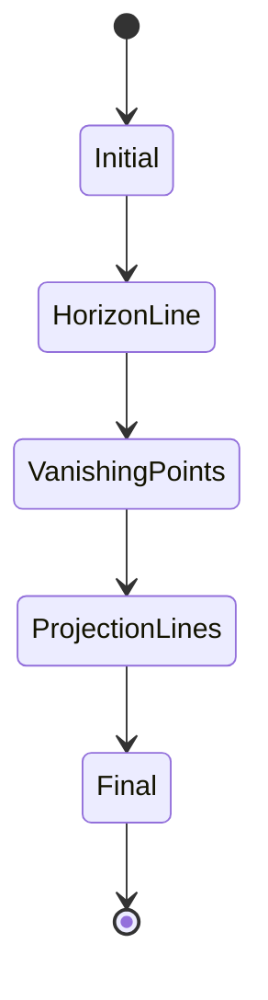
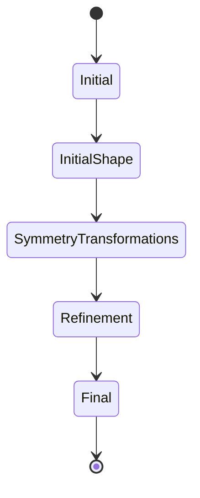

# Advanced Foundation: Drawing

## 1. Theoretical Invariants & Formal Frameworks

Drawing, as a fundamental act of visual representation, is deeply intertwined with mathematical principles and formal frameworks that underpin its practice. These principles are not merely abstract; they are the very fabric that allows for the creation of meaningful and coherent visual expressions. One such invariant is the principle of projective geometry, which governs how three-dimensional objects are represented on a two-dimensional surface. The mathematical formalism of projective geometry ensures that the relative proportions and relationships between objects are preserved, even as they are projected onto a plane. This is crucial for creating drawings that are not only aesthetically pleasing but also accurate in their representation of the physical world.

Another invariant is the principle of symmetry, which is a fundamental aspect of visual perception and aesthetic appeal. Symmetry can be defined formally through group theory, where a set of transformations (such as rotations, reflections, and translations) can be applied to an object without altering its essential form. This formal framework allows for the systematic exploration of symmetrical patterns and their application in drawing, ensuring that the visual elements are balanced and harmonious.

Formal proofs in drawing often involve the rigorous application of these principles to specific problems. For example, proving that a particular perspective projection accurately represents a three-dimensional object involves demonstrating that the projective transformations applied to the object adhere to the principles of projective geometry. Similarly, proving that a symmetrical pattern is correctly rendered involves demonstrating that the transformations applied to the pattern adhere to the principles of group theory.

## 2. Low-Level Invariant Taxonomy

At the low level, drawing involves a taxonomy of invariants that are deeply rooted in the physical properties of the medium and the constraints of the human visual system. One such invariant is the principle of light and shadow, which governs how objects are perceived in terms of their three-dimensional form. The way light interacts with an object and casts shadows on it is a fundamental aspect of visual representation, and it is governed by the laws of physics. The intensity and direction of light, as well as the material properties of the object, all play a role in determining the shadows cast by the object. This principle is invariant across all drawings, regardless of the medium or the subject matter.

Another invariant is the principle of color theory, which governs how colors are perceived and combined. The human visual system is capable of perceiving a wide range of colors, and the way these colors are perceived is governed by the physical properties of light and the physiological properties of the human eye. The principles of color theory, such as the color wheel and the additive and subtractive color models, provide a formal framework for understanding and manipulating colors in drawing. These principles are invariant across all drawings, regardless of the medium or the subject matter.

## 3. Micro-Architecture & Concurrency Dynamics

The micro-architecture of drawing involves the detailed mechanics of how the drawing is created, including the tools and techniques used, the sequence of actions taken, and the interactions between different elements of the drawing. This can be represented using state machines and diagrams, which provide a formal framework for understanding the dynamics of the drawing process.

For example, the process of creating a perspective drawing can be represented using a state machine, where each state represents a different stage of the drawing process. The transitions between states represent the actions taken to move from one stage to the next, such as drawing the horizon line, establishing the vanishing points, and projecting the lines of the object. This state machine can be represented using Mermaid syntax, as shown below:



Similarly, the process of creating a symmetrical pattern can be represented using a state machine, where each state represents a different stage of the drawing process. The transitions between states represent the actions taken to move from one stage to the next, such as drawing the initial shape, applying the symmetry transformations, and refining the pattern. This state machine can be represented using Mermaid syntax, as shown below:



Concurrency dynamics in drawing involve the interactions between different elements of the drawing, such as the interactions between lines, shapes, and colors. These interactions can be represented using diagrams, which provide a formal framework for understanding the dynamics of the drawing process.

For example, the interactions between lines in a perspective drawing can be represented using a diagram, where each line represents a different element of the drawing, and the intersections between lines represent the points where the elements meet. This diagram can be represented using ASCII syntax, as shown below:

```
   /\
  /  \
 /    \
/______\
```

Similarly, the interactions between colors in a symmetrical pattern can be represented using a diagram, where each color represents a different element of the drawing, and the overlaps between colors represent the areas where the elements meet. This diagram can be represented using ASCII syntax, as shown below:

```
   R
  R Y
 R Y G
R Y G B
 Y G B
  G B
   B
```

## 4. Subtle Failure Modes & Boundary Conditions

Drawing, like any other art form, is susceptible to subtle failure modes and boundary conditions that can affect the quality and accuracy of the final product. One such failure mode is the failure to accurately represent the three-dimensional form of an object. This can occur if the perspective projection is not correctly applied, or if the light and shadow are not accurately represented. The boundary conditions for this failure mode are the limits of the human visual system and the physical properties of the medium.

Another failure mode is the failure to accurately represent the colors of an object. This can occur if the color theory is not correctly applied, or if the colors are not accurately mixed. The boundary conditions for this failure mode are the limits of the human visual system and the physical properties of the medium.

Subtle failure modes and boundary conditions can also occur at the micro-architecture level, where the interactions between different elements of the drawing can be affected by small errors or inconsistencies. For example, the interactions between lines in a perspective drawing can be affected by small errors in the placement of the vanishing points, or the interactions between colors in a symmetrical pattern can be affected by small errors in the mixing of the colors.

## 5. Master Socratic Inquiries

Drawing, as a fundamental act of visual representation, raises a number of research-grade discussion questions that can be explored through a Socratic inquiry. These questions are not merely abstract; they are the very questions that drive the practice of drawing and the creation of meaningful and coherent visual expressions.

One such question is the nature of representation in drawing. How does drawing represent the physical world, and what are the limitations of this representation? This question can be explored through a Socratic inquiry that examines the principles of projective geometry and the laws of physics that govern the representation of three-dimensional objects on a two-dimensional surface.

Another question is the nature of symmetry in drawing. How does symmetry contribute to the aesthetic appeal of a drawing, and what are the mathematical principles that govern symmetry? This question can be explored through a Socratic inquiry that examines the principles of group theory and the formal framework of symmetry.

A third question is the nature of color in drawing. How do colors contribute to the visual expression of a drawing, and what are the principles of color theory that govern the use of colors? This question can be explored through a Socratic inquiry that examines the principles of color theory and the physical properties of light and the human visual system.

A fourth question is the nature of the drawing process. How does the drawing process affect the final product, and what are the micro-architecture and concurrency dynamics that govern the drawing process? This question can be explored through a Socratic inquiry that examines the state machines and diagrams that represent the drawing process.

A fifth question is the nature of failure in drawing. How do subtle failure modes and boundary conditions affect the quality and accuracy of a drawing, and what are the strategies for avoiding these failure modes and boundary conditions? This question can be explored through a Socratic inquiry that examines the principles of projective geometry, color theory, and the micro-architecture and concurrency dynamics that govern the drawing process.
