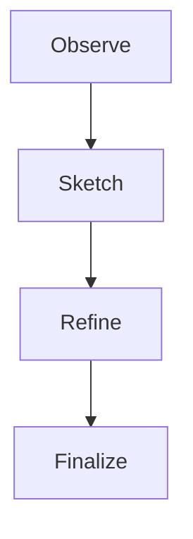

# Beginner Foundation: Drawing

## 1. Everyday Intuition & First Principles
Drawing is a fundamental human activity that bridges the gap between our inner imagination and the external world. Just as a musician translates musical notes into sound, a drawer translates thoughts and observations into visual form. At its core, drawing is about capturing the essence of what we see and feel, much like how a writer uses words to convey ideas. Drawing is a language that allows us to express ourselves visually, and like any language, it has its own set of rules and principles. By understanding these principles, you can develop a strong intuitive sense of how to create compelling and meaningful drawings.

## 2. Foundational Vocabulary & Glossary
### Line
A line is the most basic element of drawing. It can be straight, curved, thick, or thin, and it defines the boundaries and contours of shapes. Lines can convey movement, direction, and emotion. For example, a wavy line might suggest a flowing river, while a jagged line could represent a stormy sky.

### Shape
A shape is a defined area of space that is enclosed by lines. Shapes can be geometric (like squares, circles, and triangles) or organic (like leaves, clouds, and human figures). Shapes are the building blocks of more complex compositions and can be used to create depth and texture in a drawing.

### Form
Form refers to the three-dimensional quality of an object. It is the way an object appears to occupy space. By understanding form, you can create the illusion of depth and volume in your drawings. For example, shading and highlighting can be used to give a sphere the appearance of roundness.

### Value
Value refers to the lightness or darkness of a color. It is a crucial element in creating the illusion of depth and form. By varying the value in a drawing, you can create the impression of light and shadow, which adds realism and dimension to your work.

### Texture
Texture refers to the surface quality of an object. It can be smooth, rough, bumpy, or any number of other qualities. Texture can be represented in a drawing through the use of lines, shapes, and shading. For example, a tree trunk might be represented with a rough, bark-like texture, while a sheet of glass might be represented with a smooth, reflective texture.

### Color
Color is the element of art that is produced by light reflecting off an object. It can evoke emotions and create mood. In drawing, color can be used to add depth, contrast, and visual interest. Even in black and white drawings, the use of value can create a sense of color and mood.

## 3. Visual System Flow
### ASCII Diagram
```
+-------------------+
|   Observe         |
+---------+---------+
          |
          v
+---------+---------+
|   Sketch          |
+---------+---------+
          |
          v
+---------+---------+
|   Refine          |
+---------+---------+
          |
          v
+---------+---------+
|   Finalize        |
+-------------------+
```

### Mermaid Flowchart


## 4. Common Beginner Misconceptions & Mental Traps
### Misconception: Drawing is about copying exactly what you see.
**Reality:** Drawing is about capturing the essence of what you see. It is more about understanding the underlying structure and form of an object rather than copying every detail.

### Misconception: You need to be naturally talented to draw.
**Reality:** Drawing is a skill that can be learned and improved with practice. Just like any other skill, drawing requires dedication and effort.

### Misconception: You need expensive materials to draw well.
**Reality:** While high-quality materials can enhance your drawings, you can create great art with simple tools like pencils and paper. The key is in your technique and understanding of the principles of drawing.

### Misconception: Drawing is only for artists.
**Reality:** Drawing is a universal language that anyone can learn and enjoy. It is a way to express yourself and explore the world around you.

## 5. Socratic Discussion Starters
### Basic Questions to Explore with Your AI Tutor
1. What is the difference between a line and a shape in drawing?
2. How can you use value to create the illusion of depth in a drawing?
3. What are some techniques for representing texture in a drawing?
4. How does color affect the mood and emotion of a drawing?
5. What is the importance of observation in the drawing process?
6. How can you overcome the fear of making mistakes when drawing?
7. What are some common mistakes to avoid when refining a sketch?
8. How can you develop your own unique style in drawing?
