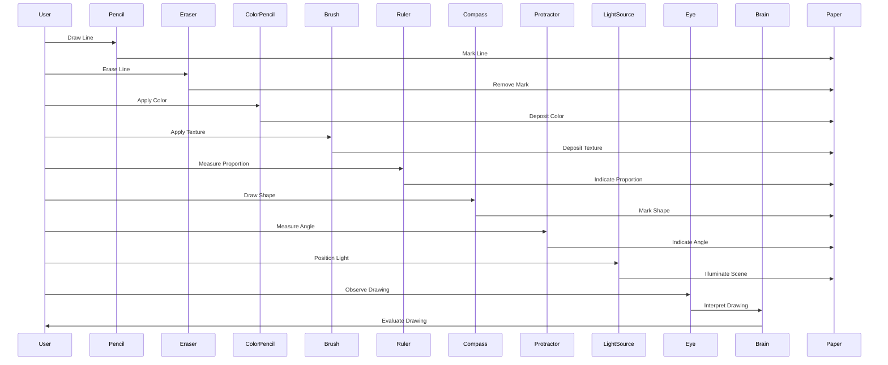

# Intermediate Foundation: Drawing

## 1. Architectural Mental Model

In the realm of drawing, the architectural mental model serves as a blueprint for understanding how various components interact to produce a cohesive and meaningful visual representation. This model extends beyond the basic elements of line, shape, and color, encompassing the structural and functional aspects of a drawing. For engineers and practitioners, this mental model is akin to the architectural design of a software system, where the components are the visual elements and the interactions are the techniques and principles that govern their arrangement.

At the core of this architectural mental model is the concept of **composition**, which involves the arrangement of visual elements to create a harmonious and aesthetically pleasing image. Composition is guided by principles such as balance, proportion, and emphasis, which are analogous to the principles of software architecture such as modularity, scalability, and maintainability. Just as a well-designed software system is modular, allowing for easy updates and maintenance, a well-composed drawing is organized in a way that allows for clarity and impact.

Another critical component of the architectural mental model is **perspective**, which involves the representation of three-dimensional space on a two-dimensional surface. Perspective is governed by principles such as vanishing points, horizon lines, and foreshortening, which are analogous to the principles of software architecture such as data abstraction, encapsulation, and inheritance. Just as a well-designed software system abstracts complex data into manageable components, a well-executed perspective drawing abstracts three-dimensional space into a comprehensible two-dimensional representation.

## 2. Systems Taxonomy & Component Protocols

In drawing, the systems taxonomy and component protocols provide a standardized framework for understanding and implementing various visual elements and techniques. This framework is analogous to the standard interfaces, protocols, and data models in software engineering, where standardized components ensure interoperability and consistency.

### Standard Interfaces

Standard interfaces in drawing refer to the conventions and techniques that govern the interaction between different visual elements. These interfaces include:

- **Line**: The basic element of drawing, used to define shape and form. Lines can be straight, curved, thick, or thin, and they can be used to create a variety of effects, such as texture and shading.
- **Shape**: The two-dimensional area defined by lines. Shapes can be geometric (e.g., circles, squares) or organic (e.g., leaves, clouds).
- **Color**: The visual perception of light and its wavelengths. Colors can be used to create mood, depth, and emphasis.
- **Texture**: The surface quality of an object, which can be represented through various techniques such as hatching, cross-hatching, and stippling.

### Protocols

Protocols in drawing refer to the rules and guidelines that govern the use of visual elements and techniques. These protocols include:

- **Composition**: The arrangement of visual elements to create a harmonious and aesthetically pleasing image. Composition is guided by principles such as balance, proportion, and emphasis.
- **Perspective**: The representation of three-dimensional space on a two-dimensional surface. Perspective is governed by principles such as vanishing points, horizon lines, and foreshortening.
- **Shading**: The technique of representing depth and form through the use of light and shadow. Shading is governed by principles such as light source direction, value contrast, and texture.

### Data Models

Data models in drawing refer to the underlying structures and relationships that govern the visual representation of objects and scenes. These data models include:

- **Geometric Models**: The mathematical representation of shapes and forms. Geometric models are used to create precise and accurate drawings.
- **Color Models**: The mathematical representation of colors. Color models are used to create consistent and harmonious color schemes.
- **Texture Models**: The mathematical representation of surface quality. Texture models are used to create realistic and detailed drawings.

## 3. Multi-Component Interaction Flow

In drawing, the multi-component interaction flow describes the sequence of steps and techniques used to create a cohesive and meaningful visual representation. This flow is analogous to the sequence diagram in software engineering, where the interactions between components are represented in a detailed and organized manner.

### ASCII Sequence Diagram

```
User -> Pencil: Draw Line
Pencil -> Paper: Mark Line
User -> Eraser: Erase Line
Eraser -> Paper: Remove Mark
User -> Color Pencil: Apply Color
Color Pencil -> Paper: Deposit Color
User -> Brush: Apply Texture
Brush -> Paper: Deposit Texture
User -> Ruler: Measure Proportion
Ruler -> Paper: Indicate Proportion
User -> Compass: Draw Shape
Compass -> Paper: Mark Shape
User -> Protractor: Measure Angle
Protractor -> Paper: Indicate Angle
User -> Light Source: Position Light
Light Source -> Paper: Illuminate Scene
User -> Eye: Observe Drawing
Eye -> Brain: Interpret Drawing
Brain -> User: Evaluate Drawing
```

### Mermaid Sequence Diagram



## 4. Architectural Trade-offs & Production Pitfalls

In drawing, architectural trade-offs and production pitfalls refer to the challenges and considerations that arise when creating a cohesive and meaningful visual representation. These trade-offs and pitfalls are analogous to the trade-offs and pitfalls in software architecture, where the choice of components and techniques can have a significant impact on the overall quality and effectiveness of the system.

### Trade-offs

- **Precision vs. Expression**: The trade-off between precision and expression involves the balance between accuracy and creativity. Precise drawings are accurate and detailed, but they may lack creativity and expression. Expressive drawings are creative and dynamic, but they may lack accuracy and detail.
- **Simplicity vs. Complexity**: The trade-off between simplicity and complexity involves the balance between clarity and depth. Simple drawings are clear and easy to understand, but they may lack depth and detail. Complex drawings are deep and detailed, but they may lack clarity and simplicity.
- **Speed vs. Quality**: The trade-off between speed and quality involves the balance between efficiency and effectiveness. Fast drawings are efficient and time-saving, but they may lack quality and effectiveness. High-quality drawings are effective and impactful, but they may lack efficiency and time-saving.

### Pitfalls

- **Over-Engineering**: Over-engineering occurs when a drawing is overly complex and detailed, leading to a loss of clarity and impact. Over-engineering can be avoided by focusing on the essential elements and techniques that create a cohesive and meaningful visual representation.
- **Under-Engineering**: Under-engineering occurs when a drawing is overly simple and lacking in detail, leading to a loss of depth and impact. Under-engineering can be avoided by focusing on the essential elements and techniques that create a cohesive and meaningful visual representation.
- **Inconsistent Techniques**: Inconsistent techniques occur when a drawing uses a variety of techniques and styles that do not work together harmoniously. Inconsistent techniques can be avoided by focusing on a consistent set of techniques and styles that create a cohesive and meaningful visual representation.

## 5. Socratic Discussion Starters

In drawing, socratic discussion starters are questions that bridge the architecture of a drawing to its low-level implementation. These questions are analogous to the socratic questions in software engineering, where the questions challenge the assumptions and principles that govern the design and implementation of a system.

- **What is the purpose of the drawing, and how does the composition reflect that purpose?**
- **How does the perspective of the drawing create a sense of depth and space, and what techniques are used to achieve that perspective?**
- **What is the role of color in the drawing, and how does the color scheme create a sense of mood and emotion?**
- **What is the role of texture in the drawing, and how does the texture create a sense of surface quality and detail?**
- **What is the balance between precision and expression in the drawing, and how does that balance create a sense of clarity and impact?**
- **What is the balance between simplicity and complexity in the drawing, and how does that balance create a sense of clarity and depth?**
- **What is the balance between speed and quality in the drawing, and how does that balance create a sense of efficiency and effectiveness?**
- **What are the trade-offs and pitfalls in the drawing, and how do they impact the overall quality and effectiveness of the drawing?**
- **What are the standard interfaces, protocols, and data models in the drawing, and how do they ensure interoperability and consistency?**
- **What is the multi-component interaction flow in the drawing, and how does it create a cohesive and meaningful visual representation?**

By exploring these questions, engineers and practitioners can deepen their understanding of the architectural and technical aspects of drawing, and create more effective and meaningful visual representations.
