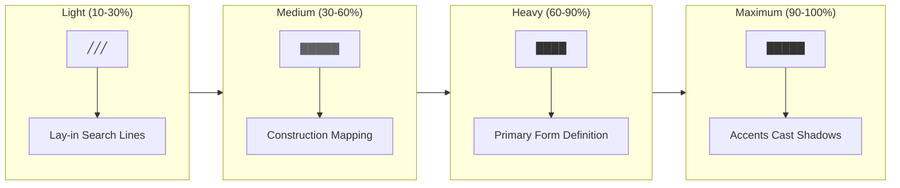

# Lesson 1: Fundamentals of Mark-Making

## 1. First-Principles Intuition & Invariants

Drawing begins not with the hand, but with the recognition that every visual mark carries energy, direction, and intention. Before a single line touches paper, the artist must internalize a fundamental truth: mark-making is the translation of physical gesture into visual language. Just as a cellist shapes tone through bow pressure, speed, and contact point on the string, the visual artist controls line quality through pressure dynamics, velocity, and tool angle. The graphite pencil, charcoal stick, or digital stylus becomes an extension of the body's kinesthetic intelligence, rendering visible the invisible forces of movement, weight, and rhythm.

The core invariant of mark-making lies in the relationship between gesture and control. Gesture embodies the large-muscle movements of the shoulder, elbow, and wrist—fluid, fast, and expressive. Control resides in the fine-motor coordination of the fingers—precise, slow, and deliberate. Master artists fluidly shift between these two poles, moving between broad gestural strokes and tightly refined details as the work demands. The novice mistake is to draw exclusively from the fingers, cramping the hand and producing timid, scratchy lines. Professional mark-making engages the entire kinetic chain from the core of the body outward, allowing the arm to swing freely while the hand stabilizes and articulates.

Line quality functions as the atomic unit of visual communication. A single stroke can convey weight, speed, hesitation, confidence, fragility, or force. In music production, we understand that a sawtooth waveform contains all harmonics in a descending series, creating a bright, edgy timbre. Similarly, a line drawn with variable pressure contains a spectrum of tonal values within a single gesture, moving from near-white where the pencil barely grazes the surface to saturated black where maximum pressure crushes the graphite into the paper's tooth. This pressure modulation creates what classical ateliers call "line weight variation"—the practice of thickening lines in shadow regions and thinning them where form turns toward light, effectively encoding three-dimensional spatial information within a two-dimensional stroke.

The distinction between gestural and contour drawing mirrors the difference between improvisation and scored composition. Gestural drawing captures the essence of form through rapid, loose strokes that prioritize movement, rhythm, and the overall energy of the subject. These marks are exploratory, often overlapping and searching, valuing the kinetic truth of the pose over photographic accuracy. Contour drawing, by contrast, traces the perceived edges of form with deliberate, continuous observation, building a map of boundaries where form meets space or where one plane transitions to another. Classical training demands fluency in both modes: the gestural approach establishes compositional structure and dynamic flow, while contour refines spatial relationships and proportional accuracy.

Tool mechanics introduce a third critical variable. Each drawing implement possesses unique friction coefficients, particle size distributions, and binding properties that dictate its mark vocabulary. Graphite, formed from crystalline carbon in a clay binder, slides across paper with relatively low friction, allowing smooth gradations and precise control. Charcoal, by contrast, consists of carbonized organic material with irregular particle geometry, producing rich, velvety blacks but resisting fine detail. The same principle applies in digital environments: a pressure-sensitive stylus with 8192 levels of sensitivity and tilt recognition allows far greater dynamic range than a mouse-based input, just as a condenser microphone with extended frequency response captures more harmonic detail than a dynamic microphone optimized for mid-range presence.

The paper surface itself acts as a collaborating instrument. Tooth—the microscopic texture of the paper fibers—determines how much pigment can be trapped and how smooth or broken the resulting line appears. Hot-pressed papers with minimal tooth produce glassy, uninterrupted strokes ideal for technical illustration, while cold-pressed and rough papers with aggressive tooth create textured, broken lines that suggest atmosphere and light. This interaction between tool hardness and surface texture parallels the relationship between drumstick tip geometry and drumhead tension: a hard stick on a tight head produces sharp, articulate attack, while a soft mallet on a loose head yields warm, diffuse tone.

Mark-making vocabulary expands through systematic exploration of pressure, speed, angle, and rhythm variations. A line drawn at constant pressure and velocity reads as mechanical and lifeless. Introducing acceleration and deceleration—pulling faster through the middle of a stroke and easing at the ends—creates organic, calligraphic energy. Rotating the pencil to engage fresh graphite edges produces crisp, dark lines, while a worn, flattened tip yields soft, diffuse strokes. Hatching, the practice of layering parallel lines to build tonal density, functions like additive synthesis: each additional layer introduces new frequency components, and crossing hatch directions at varied angles creates optical mixing analogous to subtractive filter slopes attenuating specific harmonic bands.

The foundational principle that unifies all mark-making practice is this: every line is a record of time, pressure, and motion. Unlike photography, which captures an instant, drawing accumulates duration. A five-second gesture carries five seconds of decision, hesitation, confidence, and correction embedded in its physical structure. This temporal dimension gives drawing its unique power as a thinking tool—it externalizes the process of seeing, not merely the result. The mark on paper is permanent evidence of this accumulated time: transient in its creation, physical in its trace, and utterly dependent on the quality of execution in the moment the hand meets the surface.

## 2. Core Architecture & Mechanics

The physical architecture of mark-making begins with posture and grip, two elements that determine the range of motion and control available to the artist. Proper drawing posture positions the body perpendicular to the drawing surface, not hunched over it, allowing the arm to sweep freely from the shoulder. The drawing board should be angled between thirty and sixty degrees from horizontal, approximating the natural plane of vision and reducing distortion that occurs when working flat. This setup mirrors the ergonomic principles of mixing console operation: controls positioned within the natural arc of arm movement reduce fatigue and increase precision during extended sessions.

Grip mechanics divide into three primary modes, each optimized for different mark-making tasks. The tripod grip, familiar from handwriting, positions the pencil between thumb and index finger with support from the middle finger. This grip offers maximum control and is appropriate for detailed contour work and tight hatching patterns, but restricts movement to the fingers and wrist, limiting stroke length and fluidity. The overhand grip holds the pencil from above with the shaft resting in the cradle between thumb and index finger. This configuration frees the entire arm for broad, sweeping gestures and allows easy rotation of the tool to access fresh graphite surfaces. The underhand grip, holding the pencil at a relaxed angle in the palm, provides a middle ground with moderate control and extended range, particularly useful for angled hatching and tonal modeling.

Pressure dynamics operate on a spectrum that must be consciously mapped and practiced. At the lightest threshold, the tool barely contacts the surface, depositing minimal pigment in a pale, transparent mark. This range is critical for initial lay-in gestures and construction lines that will later be obscured by darker finish layers. Medium pressure, engaging approximately thirty to fifty percent of available force, produces the primary working value for contour drawing and structural mapping. Maximum pressure, driving the tool into the paper with full hand and arm weight, creates saturated darks and can physically emboss the paper surface, an effect useful for final accents and cast shadow cores but damaging if overused. Training pressure control requires the same deliberate practice as developing dynamic control on a piano keyboard: repeated exercises moving smoothly from pianissimo to fortissimo and back, internalizing the muscle memory of each increment.

The mechanical execution of a gestural line involves a coordinated sequence that parallels the kinetic chain activation in drumming. The gesture begins with the larger proximal muscles—the shoulder and back—initiating movement direction and velocity. The elbow joint acts as a hinge, allowing the forearm to extend and compress, modulating the arc and reach of the stroke. The wrist provides fine angular adjustments, and the fingers stabilize the tool while micro-adjusting pressure. This proximal-to-distal activation sequence ensures that energy flows from the body's center of mass outward, creating lines with organic momentum rather than cramped, wrist-locked scratching.

Contour drawing inverts this hierarchy, prioritizing observational accuracy over kinetic expression. The classical contour exercise, often called "blind contour," requires the artist to trace the edges of a subject with continuous observation, never looking at the paper. This divorces the hand from conscious control, forcing the eye to lead while the hand follows with a one-to-one correspondence between perceived edge movement and pencil movement. The resulting drawings often appear distorted because the mind's symbolic knowledge of form—what we think an object looks like—is bypassed in favor of direct perceptual data. This practice develops perceptual acuity and trains the hand-eye connection: the ability to translate visual input directly into mark-making without intellectual mediation.

Modified contour techniques introduce intermittent checking, allowing brief glances at the drawing surface to recalibrate proportions and spatial relationships. This mode operates like multitrack recording: alternating between laying down new information and monitoring what has already been captured, iteratively refining the result. The discipline lies in maintaining a high ratio of observation time to drawing time—ideally eighty percent looking at the subject, twenty percent looking at the paper. Novices reverse this ratio, spending most effort managing the marks themselves rather than interrogating the visual information they ostensibly represent.

Mark vocabulary expands through systematic exploration of stroke families, each with distinct visual characteristics and semantic associations. Parallel hatching consists of evenly spaced lines drawn in a consistent direction, building tonal density through accumulation. Cross-hatching layers additional sets of parallel lines at varied angles, creating optical gray values through spatial frequency mixing. Contour hatching follows the surface curvature of forms, wrapping around volumes to reinforce three-dimensional structure, much as delay repeats in audio production can be tuned to reinforce or obscure rhythmic subdivisions. Stippling employs discrete dots rather than continuous lines, building tone through density variation analogous to granular synthesis techniques where individual sound particles coalesce into larger textures.

Calligraphic marks incorporate variable pressure and velocity within single strokes, producing thick-to-thin transitions that encode directional energy and weight distribution. These marks require the same fluidity and commitment as expressive instrumental phrasing: hesitation or correction mid-stroke destroys the gesture's integrity. The tool must move with confidence, even if the direction chosen proves suboptimal, because a committed "wrong" line carries more visual conviction than a tentative "correct" one. This mirrors the improvisational principle that rhythmic authority and tonal commitment often matter more than perfect note selection—a decisively played "incorrect" note can sound intentional, while a correct note played tentatively sounds like a mistake.

The transition between marks—how one line connects to or separates from another—controls visual rhythm and compositional flow. Continuous, connected strokes create fluid, unified forms with high coherence, while broken, staccato marks suggest fragmentation, energy, or atmospheric diffusion. Varying the spacing between parallel hatch lines introduces rhythmic syncopation: tight groupings create dense visual beats, while wider intervals establish breathing space. This pacing operates identically to note density in musical composition, where rests and sustained tones provide contrast to rapid passage work.

Tool angle relative to the paper surface drastically alters mark character. A perpendicular angle, driving the pencil point straight into the surface, produces narrow, intense lines with maximum pressure concentration. Shallow angles, holding the pencil nearly parallel to the paper, engage the side of the graphite core, creating broad, soft strokes ideal for rapid tonal blocking. Professional artists constantly modulate this angle, often unconsciously, to access the full expressive range of the tool. Digital artists working with pressure-sensitive displays must similarly exploit tilt sensitivity, mapping stylus angle to brush shape or opacity to achieve equivalent variation.

## 3. High-Performance Optimization & Failure Modes

Optimizing mark-making efficiency requires understanding the distinction between exploration and refinement phases, then allocating time and attention appropriately to each. The exploration phase, typically occupying the first twenty to thirty percent of a drawing session, prioritizes rapid information gathering and compositional decision-making. Marks during this phase should be light, loose, and overlapping, with no concern for "correctness" or finish quality. This approach parallels the preliminary blocking phase in drawing, where spatial relationships, proportions, and focal points are tested quickly without concern for surface refinement or polished rendering. Attempting to render finished details before establishing global structure wastes resources and often necessitates destructive revisions later.

The refinement phase, following successful structural lay-in, systematically increases mark commitment and pressure weight. A common failure mode occurs when artists jump directly into refinement without adequate exploration, producing technically proficient passages that fail to cohere into a unified composition. This resembles the mixing error of soloing individual tracks to perfection without monitoring the full mix context—each element sounds excellent in isolation but clashes when combined. The solution lies in disciplined restraint during early stages, resisting the temptation to "finish" any single area before the entire drawing reaches comparable development.

Energy management across extended drawing sessions parallels stamina development for live performance. The hand, wrist, and forearm contain small muscle groups prone to fatigue under sustained load, particularly when grip pressure exceeds functional requirements. Novices often death-grip their pencils, applying constant tension even during light exploratory marks. This wastes muscular resources and leads to cramping within fifteen to twenty minutes. Proper technique requires grip pressure modulation synchronized with mark pressure: light marks permit relaxed grip, heavy marks engage firmer holding, but both release immediately after stroke completion. Periodic hand stretching—extending and spreading the fingers, rotating the wrist through full range of motion—prevents repetitive strain injury just as warming up prevents performance injury for instrumentalists.

Tool maintenance directly impacts mark consistency and control. Graphite pencils require frequent sharpening, but the optimal point geometry varies by application. Long, exposed graphite cores with minimal wood casing allow shallow angled strokes and extended work time between sharpenings, but increase breakage risk. Short, protected points withstand higher pressure but require more frequent maintenance. Professional practice involves sharpening multiple pencils in advance, rotating between them as points dull, then batch-sharpening during rest breaks. This workflow mirrors the studio practice of tracking multiple takes consecutively, then editing and comping during separate focused sessions rather than interrupting creative flow with technical tasks.

Paper selection introduces non-obvious performance tradeoffs. Smooth surfaces permit tight detail and crisp edges but resist heavy tonal buildup—the graphite burnishes and begins to repel additional layers after a certain threshold. Toothy surfaces accept deep tonal ranges and layered hatching but cannot support fine detail without the texture breaking up continuous lines. Newsprint, with its soft, absorbent fibers, allows rapid gestural work and accepts charcoal beautifully but degrades quickly under eraser abrasion. Bristol board, with its hard, compressed surface, withstands aggressive correction and layering but feels slippery and unresponsive to some artists. Matching paper to drawing intent is equivalent to selecting recording media: tape for harmonic saturation and compression, digital for transparency and editing flexibility.

The most insidious failure mode in mark-making involves unconscious symbolic drawing—allowing mental templates of "what eyes look like" or "how hands are shaped" to override direct observation. The mind stores simplified icons for common objects, optimized for rapid recognition rather than accurate representation. Under cognitive load or when working quickly, these icons hijack the drawing process, producing generic, lifeless forms that bear little relationship to the specific subject being observed. Visual artists face a parallel challenge when habitual mark-making patterns override direct observation: familiar gestures and standard forms emerge automatically, comfortable but misaligned with the specific subject at hand. The antidote is continuous, disciplined attention to actual sensory input rather than conceptual knowledge.

Correction and revision strategies must balance flexibility with decisiveness. Light construction lines can be erased or obscured without penalty, but aggressive erasing on finished passages damages paper surface and creates muddy, overworked areas. Kneaded erasers, moldable and non-abrasive, lift graphite without destroying tooth, ideal for lightening values or reclaiming highlights. Vinyl or plastic erasers cut cleanly through dark marks but remove paper surface with repeated use. Digital workflows offer non-destructive correction through layer management and undo stacks, but introduce the opposite failure mode: endless indecisive revision that prevents commitment. Setting artificial constraints—limiting undo steps or working on merged layers—can paradoxically increase quality by forcing decisive execution.

Speed optimization requires distinguishing between tempo and rush. Rapid mark-making, when controlled, increases gestural energy and prevents overthinking, producing confident, lively lines. Rushed mark-making, by contrast, bypasses observation and deliberation, resulting in careless errors and weak construction. Professional practice involves working at the fastest tempo compatible with maintained observational accuracy—pushing just beyond comfort but never into panic. This maps directly to metronome practice for instrumentalists: gradually increasing tempo while maintaining technical precision and musical intent, identifying the threshold where control degrades, then consolidating at that tempo before pushing further.

Environmental optimization addresses often-neglected performance factors. Lighting should provide even, neutral illumination across the drawing surface and subject, eliminating cast shadows that obscure form. Cool-temperature LEDs or north-facing window light prevent color temperature shifts that distort value judgment. The drawing surface should be positioned perpendicular to the primary line of sight to minimize perspective distortion—working flat introduces foreshortening that becomes apparent only when the drawing is displayed vertically. These considerations parallel acoustic treatment and monitoring setup in audio production: no amount of technical skill compensates for a fundamentally compromised working environment.

Long-term skill development follows a power law curve, with rapid initial gains followed by progressively slower improvement requiring increasingly focused practice. The first twenty hours of deliberate mark-making practice produce dramatic improvement in basic control and pressure modulation. The next hundred hours refine observational accuracy and expand mark vocabulary. Beyond that, progress targets specialized applications—portraiture, figure drawing, architectural rendering—each requiring domain-specific pattern recognition and motor memory. This trajectory mirrors instrumental practice: foundational technique develops quickly, but professional-level facility in specific genres or techniques requires years of focused application. The key insight is that mark-making fundamentals, once internalized, transfer across all drawing applications, just as solid time-keeping and harmonic knowledge underlie all musical styles.
