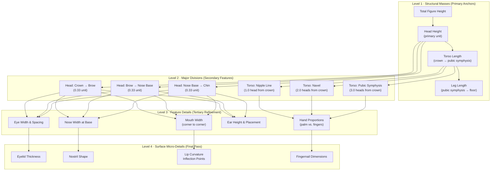

# Lesson 2: Observational Systems: Sight-Size Measurement

## 1. First-Principles Intuition & Invariants

The discipline of representational drawing rests upon a deceptively simple premise: the artist must translate three-dimensional forms perceived through binocular vision into two-dimensional marks on a surface. This translation is not a mechanical reproduction but rather a controlled optical illusion, one that demands the artist abandon preconceptions about the supposed sizes of objects and instead measure what the eye actually receives. The untrained observer sees a table and thinks "rectangular," imposing remembered geometry upon the visual field. The trained artist sees converging parallels, foreshortened edges, and angular relationships that violate Euclidean expectations but honor the cone of vision.

Sight-size measurement, formalized during the nineteenth-century atelier tradition and refined at institutions like the École des Beaux-Arts, provides the foundational protocol for accurate observational drawing. The method derives its name from its central invariant: the artist positions the drawing surface precisely adjacent to the subject such that both occupy identical scales within the visual field when viewed from a fixed station point. If a model's head measures three inches tall when viewed at arm's length through a viewfinder, that same head must measure three inches tall on the drawing surface when both are observed from the same fixed position. This one-to-one correspondence eliminates the cognitive burden of mental scaling and allows the artist to verify proportional relationships through direct visual comparison.

The protocol enforces three absolute invariants that govern all subsequent measurement operations. First, the station point—the physical location of the artist's eye—must remain fixed throughout the drawing session. Even a six-inch shift in position alters parallax relationships and invalidates all prior measurements. Professional ateliers mark station points on the floor with tape crosses and provide chin rests or head supports for extended observation sessions. Second, the drawing surface must occupy a consistent plane parallel to the artist's frontal vision. Tilting an easel forward or backward introduces perspective distortion that corrupts angular measurements. The surface should stand vertical, perpendicular to the line of sight, matching the picture plane convention from classical perspective theory. Third, the subject and drawing surface must maintain consistent lighting throughout the session. Shifting natural light or repositioned artificial sources alter cast shadow shapes and value relationships, effectively presenting the artist with a different subject.

These invariants arise from the geometry of human vision. The eye's lens projects the external world onto the retinal surface through a process mathematically equivalent to perspective projection, where parallel lines in space converge to vanishing points on the retinal plane. When we draw, we attempt to reverse-engineer this projection, deducing the original spatial configuration from the collapsed two-dimensional retinal image. Sight-size measurement exploits a strategic simplification: by eliminating scale transformation and maintaining a fixed viewpoint, we reduce the problem to pattern matching rather than geometric calculation. The drawing becomes a direct trace of the visual field's angular relationships.

The method's philosophical foundation extends beyond mechanical accuracy into perceptual training. Novice artists carry substantial cognitive baggage—symbolic shortcuts accumulated through decades of non-observational looking. A hand is five fingers, a face is two eyes centered above a nose and mouth, a chair has four equal legs. These conceptual schema corrupt observation by substituting memorized forms for perceived reality. Sight-size measurement forces perceptual honesty by providing an external verification system. When the artist measures a foreshortened hand and discovers that the visible fingertips span only half the palm's width, the measurement tool overrides the conceptual schema. Repeated practice gradually rewires the visual cortex, training the artist to see angles, proportions, and spatial relationships without symbolic interference.

The protocol also addresses the fundamental tension between local accuracy and compositional coherence. An artist can render a perfectly observed nose yet place it incorrectly within the face's proportional framework, creating a portrait that feels "off" despite technically correct individual features. Sight-size measurement embeds constant cross-referencing into the drawing process. Every local measurement—the width of an eye, the curve of a jawline—exists in locked proportional relationship to every other measurement. The artist continually verifies that the distance between the eyes equals 1.2 times the eye width, that the nose base aligns vertically with the inner tear ducts, that the ear height spans from brow to nose base. These relational checks create a web of interdependent measurements where errors in one region immediately manifest as inconsistencies elsewhere, triggering correction before the drawing advances too far into error.

## 2. Core Architecture & Mechanics

The sight-size measurement system operates through four interlocking procedural layers: station point calibration, measurement tool deployment, negative space analysis, and angular verification. Each layer provides independent validation of proportional relationships, creating redundant cross-checks that prevent cumulative error propagation.

Station point calibration establishes the geometric foundation for all subsequent measurements. The artist selects a fixed viewing distance that balances two competing requirements: sufficient proximity to perceive fine detail while maintaining enough distance to encompass the entire subject within the cone of vision without excessive head or eye movement. For a seated figure approximately six feet tall, an optimal station point typically falls between ten and fifteen feet from the subject. At this range, the entire figure subtends roughly thirty to forty degrees of visual angle, comfortably within the foveal and parafoveal regions that provide high-resolution perception. The artist marks the station point on the floor using a tape cross or chalk circle, ensuring both feet return to this exact position after any break or movement. Advanced practitioners develop kinesthetic awareness of the station point, learning to sense postural deviation through subtle changes in perceived proportional relationships.

The drawing surface positioning requires equal precision. The easel must stand at the same distance from the station point as the subject, creating a geometric configuration where the artist's line of sight sweeps between subject and drawing surface through equal angular displacements. If the subject sits twelve feet away, the drawing surface must also stand twelve feet away, offset horizontally by sixty to ninety degrees to allow comfortable head rotation between the two. This arrangement means the artist views both subject and drawing surface through identical scale factors. A vertical measuring rod held at arm's length and sighted against the subject's head will measure the same head height when sighted against the drawing surface. The drawing surface height requires additional calibration. Its center should align approximately with the artist's eye level when standing at the station point, matching the natural horizon line in the visual field. This alignment prevents the artist from looking upward or downward at extreme angles, which would introduce unwanted perspective distortion.

Measurement tool deployment transforms abstract proportional relationships into concrete linear dimensions. The classical tool is a straight wooden knitting needle or graphite rod approximately twelve inches long, though modern practitioners often use wooden dowels, unsharpened pencils, or specialized aluminum measuring sticks. The artist extends the measurement tool at full arm's length, maintaining a consistently straight elbow to ensure repeatable distance from eye to tool. This locked arm position is critical—flexing the elbow even slightly changes the tool's apparent size and corrupts all measurements. With the arm fully extended, the artist closes one eye to eliminate binocular disparity and sights along the tool's length, aligning it against the subject. The thumb slides along the tool's shaft to mark observed dimensions.

The measurement process begins with establishing a key proportion that serves as the compositional anchor. For a portrait, this typically means measuring the head's overall height—from the cranium crown to the chin's base. The artist extends the measuring tool at arm's length, aligns the tool's tip with the head's crown, and slides the thumb down to mark the chin's position. Without moving the thumb, the artist rotates at the station point to sight the drawing surface, comparing the marked dimension against the preliminary construction lines on paper. If the drawn head measures four inches tall and the measuring tool's thumb mark also spans four inches when sighted against the drawing, the scales match. Any discrepancy requires immediate correction before proceeding, as this primary measurement anchors all subsequent proportional relationships.

With the head height established as the compositional unit, the artist measures all other features relative to this standard. The distance from crown to brow line might measure 0.33 head heights. The eye-to-eye spacing typically spans 1.0 eye width. The nose length from brow to tip measures approximately 0.5 head heights. These ratios vary infinitely between individuals, and sight-size measurement captures these variations precisely by continually referencing back to the established anchor dimension. The artist builds a proportional map through systematic comparison: how many eye widths fit across the face's width? How does the nose length compare to the distance from nose tip to chin? Each measurement cross-validates the others, creating a self-correcting system.

Negative space analysis provides the most powerful error-detection mechanism in the sight-size arsenal. Rather than measuring positive forms directly—the outline of a nose, the curve of a shoulder—the artist measures the shapes between forms, the voids and background areas surrounding the subject. These negative shapes possess several advantages over positive form measurements. First, negative spaces lack symbolic associations. The mind carries no preconceived notion of what the triangular void between a bent elbow and torso "should" look like, allowing more objective observation. Second, negative shapes often present simpler geometric configurations than the positive forms they surround. A complex hand gesture may create a negative space that resolves into a simple trapezoid, easier to measure and reproduce than the hand's positive outline. Third, negative space measurements automatically verify positive form accuracy—if the negative spaces are correct, the positive forms they define must also be correct.

The artist trains negative space perception by deliberately focusing attention on background regions rather than the subject itself. When drawing a seated figure, rather than looking at the leg's contour, the artist observes the quadrilateral shape formed between the chair leg, the floor plane, the subject's ankle, and the chair seat's underside. This shape can be measured using the extended arm technique: how many units wide compared to its height? What angle does its upper edge describe relative to horizontal? Does it form an acute or obtuse trapezoid? Once these negative space dimensions are captured accurately on the drawing surface, the positive form—the leg—emerges automatically as the boundary between measured negative regions.

Angular verification introduces a third independent measurement modality that cross-checks linear proportions through directional relationships. The artist uses the measuring tool not as a ruler but as a protractor, aligning it against observed angles in the subject and transferring those angles to the drawing surface. A shoulder line might descend at seventeen degrees below horizontal. A jawline might angle thirty-two degrees from vertical. The measuring tool, held at arm's length and sighted with one eye closed, physically matches these angles. The artist then rotates to the drawing surface and marks the equivalent angle, ensuring the drawn shoulder descends at the same seventeen-degree slope.

This angular measurement technique proves especially valuable for capturing gesture and dynamic posture. A standing figure shifts weight onto one leg, creating a cascade of angular relationships through the body's major axes. The shoulder line angles opposite to the hip line, the spine describes an S-curve, the weight-bearing leg stands nearly vertical while the relaxed leg bends at the knee. Linear measurements alone struggle to capture these dynamic relationships, but angular measurements lock them down precisely. The artist measures the shoulder-to-shoulder angle, the hip-to-hip angle, and the relative angle between these two lines, verifying that they create the characteristic contrapposto tilt.

The measurement cycle proceeds iteratively through progressively finer levels of detail. The artist begins with large structural masses—the overall head height, the torso's length, the distance from head crown to feet. Once these primary proportions lock into place, the artist subdivides each mass into secondary features: within the head, establishing the brow line, nose base, and chin subdivision; within the torso, marking the nipple line, navel, and pubic symphysis landmarks. Each subdivision measurement references back to the established structural framework, maintaining proportional consistency. The final measurement passes capture subtle details: the thickness of eyelids, the width of nostril openings, the precise curvature of fingernails. This hierarchical approach prevents the common novice error of rendering a beautifully detailed eye in a head with incorrect proportions.

## 3. High-Performance Optimization & Failure Modes

The sight-size measurement protocol appears deceptively simple in description but reveals substantial complexity in skilled execution. Advanced practitioners develop refined workflows that maximize measurement accuracy while minimizing time expenditure, balancing precision against the practical constraints of limited model availability and muscle fatigue.

The most critical optimization involves strategic measurement selection. Novice artists often fall into the trap of measuring everything, compulsively verifying every dimension multiple times and becoming paralyzed by perfectionist anxiety. Expert practitioners recognize that measurements exist in hierarchical dependency chains where certain anchor measurements automatically constrain all subsequent measurements. By focusing measurement effort on these high-leverage anchor points and allowing secondary features to derive naturally from the established proportional framework, the artist achieves equivalent accuracy with a fraction of the measurement operations. The initial head height measurement deserves exhaustive verification because every subsequent feature references this standard. The distance between the eyes deserves careful measurement because it establishes the horizontal spacing module for all facial features. But once these anchors lock into place, many secondary features can be estimated through visual comparison rather than explicit measurement, with occasional spot-checks confirming the estimates remain accurate.

Measurement frequency adaptation represents another high-performance optimization. During the drawing's initial structural phase, when large masses are being blocked in, the artist measures constantly—sometimes after every few marks—to establish the proportional framework accurately. As the drawing progresses into secondary and tertiary detail levels, measurement frequency decreases substantially. The artist has internalized the subject's proportional relationships through repeated verification and can work more fluidly, measuring only when visual comparison suggests a potential error or when encountering a particularly complex or ambiguous passage. This adaptive measurement rhythm prevents the protocol from becoming a mechanical straightjacket while maintaining the accuracy benefits.

Tool ergonomics significantly impact measurement speed and endurance. Holding the arm fully extended at eye level imposes substantial fatigue on the deltoid and rotator cuff musculature. Sessions longer than thirty minutes often see novice artists unconsciously flexing the elbow to relieve strain, corrupting measurement consistency. Professional practitioners develop conditioned shoulder endurance through progressive training, but even experienced artists benefit from strategic rest intervals. A typical two-hour drawing session should include three to five brief breaks where the artist steps away from the station point entirely, allowing the measurement arm to rest at the side. These breaks also provide crucial opportunities for fresh observation—stepping away and returning to the station point often reveals subtle errors that become invisible during continuous work.

The measurement tool itself invites optimization. The traditional wooden dowel or knitting needle works adequately but can be improved. Some ateliers provide weighted measurement rods that balance more stably when held at arm's length, reducing tremor-induced measurement uncertainty. Others use rods with etched marks every quarter inch, providing built-in scaling references. The most sophisticated measurement tools incorporate spirit levels or plumb bob attachments, allowing the artist to verify vertical and horizontal references against gravitational true rather than trusting visual estimation. However, excessive tool complexity can become counterproductive—the measurement protocol should remain simple enough to execute without conscious thought, allowing the artist's full attention to focus on observation rather than tool operation.

Station point discipline constitutes the most common failure mode in sight-size practice. The human body naturally shifts weight, adjusts posture, and drifts position over time, especially during extended standing sessions. Even a three-inch deviation from the marked station point introduces measurable parallax errors that corrupt proportional relationships. The artist thinks the head has mysteriously expanded or the shoulders have shifted, when in reality the changed viewpoint has altered the angular relationships. This failure mode demands constant vigilance and active postural correction. Advanced practitioners develop kinesthetic awareness of the station point position, learning to sense postural drift through subtle changes in perceived proportions. When the drawing suddenly appears incorrect in ways that resist correction through measurement, the first diagnostic question should always be: "Have I moved from the station point?"

Ocular dominance introduces a subtle but persistent error source that novice practitioners rarely recognize. Most humans possess a dominant eye that the visual cortex favors when processing binocular input, similar to handedness. Sight-size measurement requires closing one eye to eliminate binocular disparity, but which eye to close? The conventional instruction—"close one eye, use the other"—leaves this choice ambiguous. The artist should consistently close the non-dominant eye and measure with the dominant eye, as switching between eyes introduces slight perspective shifts that corrupt measurement consistency. Dominant eye identification can be tested through a simple procedure: extend both arms fully forward with index fingers pointing up and create a small triangular aperture between the hands. With both eyes open, sight a distant object through the aperture. Now close each eye alternately. The eye that maintains the object's centered position through the aperture is the dominant eye.

Subject and lighting consistency present practical challenges in real-world drawing sessions. Live models inevitably shift position slightly between poses, especially during long sessions spanning multiple days. Natural lighting changes continuously throughout the day as the sun tracks across the sky, altering cast shadow shapes and value relationships. These variations degrade the sight-size protocol's accuracy by presenting the artist with subtly different subjects across measurement passes. Professional strategies for mitigating these failure modes include photographic reference documentation—taking high-resolution photographs at the session's start to document the exact pose and lighting configuration—and marking key anatomical landmarks on the model using washable skin-safe markers. The neck's suprasternal notch, the anterior superior iliac spine of the pelvis, and the knee's medial malleolus provide stable bony landmarks that can be marked to verify pose consistency between sessions.

Atmospheric perspective and focal depth effects introduce subtle measurement corruptions that emerge primarily when working from very large subjects or in deep spatial environments. The sight-size protocol assumes that all observed points occupy roughly equivalent distances from the viewpoint, allowing uniform measurement accuracy. This assumption breaks down when drawing interior architectural spaces where the far wall stands forty feet distant while the foreground table sits only eight feet away. Atmospheric scatter and reduced contrast at distance make background elements appear lighter and less distinct, while focal depth limitations prevent simultaneous sharp focus on foreground and background. These effects require the artist to compensate through selective measurement priority—establishing the primary foreground subject with full sight-size rigor while treating distant elements more interpretively, using value and atmospheric perspective to suggest depth rather than relying solely on linear measurement.

The protocol's greatest limitation lies in its inability to capture certain dynamic or time-varying phenomena. Sight-size measurement excels for static subjects—still life arrangements, architectural elements, posed figure studies—where subject constancy allows iterative measurement refinement. It struggles with subjects that fundamentally resist static observation: moving water, tree foliage shifting in wind, facial expressions during conversation, active dance or athletic movement. These dynamic subjects demand alternative observational strategies such as gesture drawing, memory drawing, or photographic reference. The sophisticated artist recognizes sight-size measurement as one tool among many, appropriate for certain observational contexts but not universally applicable.

Cognitive fatigue represents the final high-performance consideration. Sustained observational measurement demands intense visual concentration and executive function engagement. The artist must continuously rotate attention between subject and drawing surface, hold complex proportional relationships in working memory, and override powerful conceptual schema that attempt to substitute symbolic forms for observed reality. This cognitive load induces measurable executive function depletion over time, manifesting as increased measurement errors, reduced error detection rates, and growing difficulty maintaining station point discipline. Professional drawing sessions recognize these cognitive limitations by incorporating structured rest intervals every forty to sixty minutes, during which the artist steps away from the easel entirely and engages in non-visual activities—conversation, walking, food consumption—that allow the visual cortex and executive function networks to recover. A six-hour drawing marathon without breaks yields lower quality work than four focused hours with strategic rest intervals.

The transition from conscious measurement protocol to internalized perceptual skill represents the ultimate optimization. Novice artists measure explicitly, extending the measurement tool for every dimension and consciously comparing values. Intermediate practitioners begin recognizing common proportional relationships automatically—the eye width, the nose-to-chin distance—reducing explicit measurement requirements. Advanced artists have so thoroughly internalized sight-size principles that measurement becomes largely implicit, manifesting as accurate proportional drawing without conscious measurement tool deployment. The tool remains available for verification and error correction, but the primary observational mode operates through trained perceptual judgment. This internalization process requires thousands of hours of deliberate practice and cannot be rushed, but represents the protocol's true goal: rewiring visual perception itself to accurately observe proportional relationships without conscious analytical overlay.
