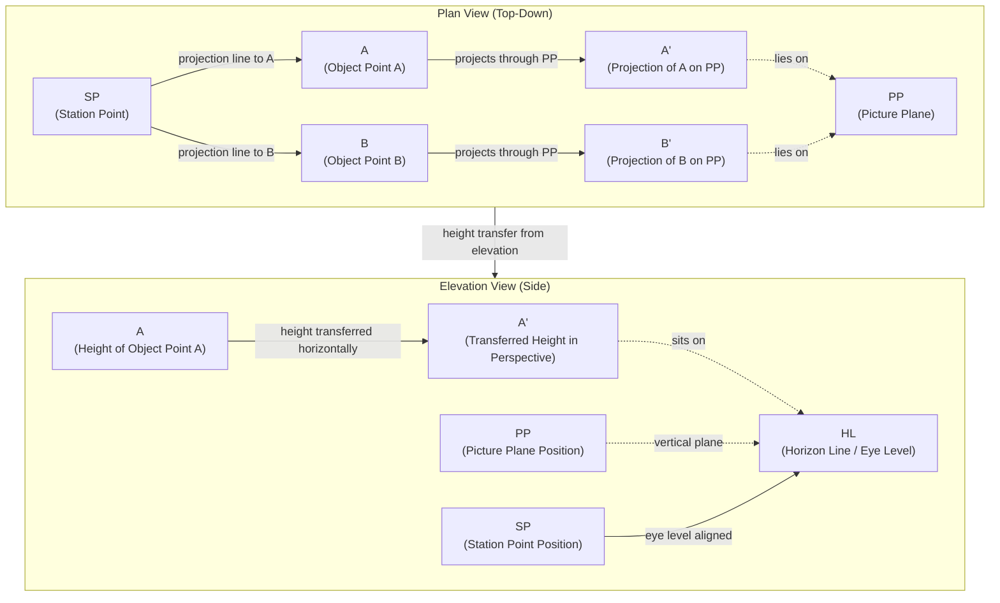

# Lesson 1: Foundational Geometry of Perspective

## 1. First-Principles Intuition & Invariants

Perspective drawing begins not with technique, but with a fundamental recognition: the act of seeing is an act of geometric projection. When light reflects off a three-dimensional object and travels through space to strike the retina of your eye, it carries information about the object's position, form, and spatial relationships. This information arrives at your eye as a two-dimensional pattern of light—a flattened representation of depth encoded through the language of diminishing size, converging lines, and overlapping forms. Perspective drawing is the formalization of this natural optical phenomenon into a repeatable, predictable system of geometric rules.

The cornerstone of this system is the **picture plane**, an imaginary transparent surface positioned between the observer and the observed scene. Think of it as a pane of glass standing vertically in space. When you look through this glass at the world beyond, every object, line, and edge projects a corresponding mark onto the glass surface. If you were to trace these projections directly onto the glass with a marker, you would create a perspectivally accurate drawing. The picture plane is not a metaphor—it is a literal geometric construct that Renaissance artists like Albrecht Dürer explored using physical frames with gridded strings. Understanding that your drawing surface represents this fixed plane in space is the first invariant of perspective: the picture plane remains stationary relative to the observer, and all projection lines pass through it at right angles to the observer's line of sight.

The second invariant is the **horizon line**, which represents the observer's eye level extended infinitely across the picture plane. This line exists at the exact height of the observer's eyes, regardless of whether you are standing, sitting, or lying on the ground. The horizon line is not the line where sky meets earth in a landscape—that is merely where the horizon line happens to intersect visible terrain. The true horizon line persists even when viewing interior spaces, still life arrangements, or figure studies. It marks the vertical boundary where your cone of vision transitions from looking upward to looking downward. Objects positioned above the horizon line require you to tilt your gaze upward; objects below it require a downward tilt. This single line dictates the behavior of all converging parallels in your drawing and establishes the gravitational logic of the scene.

Eye level and horizon line are synonymous terms in perspective drawing, but "eye level" emphasizes the physical position of the observer while "horizon line" emphasizes the geometric boundary on the picture plane. When you place the horizon line high on your drawing surface, you simulate the viewpoint of someone elevated—standing on a ladder, looking down from a balcony, or adopting a bird's-eye view. When you place it low, you create a worm's-eye view, as if the observer is crouching or lying on the ground. The vertical position of the horizon line is the single most powerful compositional decision in perspective drawing because it immediately establishes the viewer's relationship to the subject matter. A horizon line placed at one-third height from the bottom of the frame creates a sense of groundedness and stability. Placing it at two-thirds height produces a feeling of intimacy and vulnerability. Centering it exactly in the middle of the frame often results in static, lifeless compositions unless carefully counterbalanced with asymmetric elements.

The mathematical relationship between observer position and spatial representation follows the principle of **central projection**. Imagine standing at a fixed point in space—this point is your **station point**, the exact location of your eye (or more precisely, the center of your lens of vision). From this station point, projection lines radiate outward in all directions, passing through every visible edge, corner, and surface of the objects in your scene before striking the picture plane. The point where each projection line pierces the picture plane is the location where that edge or point must be drawn. This creates a direct geometric correspondence: every point in three-dimensional space maps to exactly one point on the two-dimensional picture plane. The inverse is not true—multiple points along the same projection line will all map to the same spot on the picture plane, which is why closer objects obscure distant ones.

The distance between the station point and the picture plane is the **viewing distance**, and it profoundly affects the compression or expansion of perspective. A short viewing distance—where the picture plane is positioned close to the observer—produces dramatic, wide-angle perspective with steep convergence and pronounced distortion near the edges of the frame. A long viewing distance creates shallow, compressed perspective that more closely resembles orthographic or parallel projection, minimizing distortion and producing a more neutral, documentary feeling. In practical terms, if you imagine the picture plane as a window two feet in front of you versus twenty feet in front of you, the geometry of projection changes dramatically even though you are observing the same scene.

The concept of orthogonal projection, while technically a separate system, helps clarify what perspective is not. In orthographic projection—used extensively in technical drawing, architecture, and mechanical drafting—projection lines remain parallel rather than converging at a station point. This creates drawings where parallel lines remain parallel regardless of their orientation in space, and objects retain their true proportions regardless of distance from the observer. Perspective abandons both of these properties. Parallel lines receding into depth converge at vanishing points, and distant objects appear smaller than near objects even when they are identical in actual size. Perspective is the visual encoding of depth through geometric convergence and diminishment, while orthographic projection preserves measurability at the cost of perceptual realism.

The invariant that governs all perspective systems—whether one-point, two-point, three-point, or curvilinear—is that **lines parallel to each other in three-dimensional space will converge to the same vanishing point on the picture plane if they are not parallel to the picture plane itself**. Lines that run parallel to the picture plane, such as the horizontal edges of a building facade viewed straight-on, remain parallel in the drawing and never converge. Lines that recede directly away from the observer perpendicular to the picture plane converge at the center of vision—the point on the horizon line directly in front of the observer's eye. Lines angled to the left or right converge at vanishing points positioned left or right along the horizon line. Vertical lines that are truly vertical in space—parallel to gravity—remain vertical in the drawing unless you tilt your head or use three-point perspective to account for looking sharply upward or downward.

## 2. Core Architecture & Mechanics

The internal architecture of perspective drawing rests on three primary geometric elements that interact to define spatial representation: the picture plane, the ground plane, and the cone of vision. The ground plane is the horizontal surface upon which objects rest—typically the floor in an interior or the terrain in an exterior scene. This plane extends infinitely forward and backward from the observer and intersects the picture plane at the horizon line. Understanding that the horizon line is literally the intersection of the ground plane with the picture plane clarifies why it represents eye level: it is the line where the ground would appear if you could see infinitely far into the distance, and it aligns precisely with your eyes because your line of sight runs parallel to the ground plane when looking straight ahead.

The cone of vision defines the angular boundaries of comfortable, undistorted vision. Human binocular vision comfortably encompasses roughly 60 degrees of visual angle without significant distortion, though our peripheral awareness extends far wider. In perspective drawing, we restrict the cone of vision to approximately 60 degrees—30 degrees to either side of the central axis—to avoid the barrel distortion and stretched proportions that occur near the edges of wide-angle views. This means that if you draw a 60-degree cone radiating from your station point and intersecting the picture plane, everything within that cone can be drawn with minimal distortion. Objects outside the cone begin to elongate and warp, much like the edge distortion in a fisheye lens photograph.

To construct a perspective view mechanically, you begin by establishing the picture plane as the drawing surface, marking the horizon line at the desired eye level, and determining the viewing distance. In classical descriptive geometry, you work with two views simultaneously: the plan view (looking straight down at the scene from above) and the elevation view (looking at the scene from the side). The plan view shows the position of objects relative to the picture plane and the station point in horizontal space. The elevation view shows vertical relationships and heights. By projecting lines from the station point through key points on objects in the plan view and noting where they intersect the picture plane, you determine horizontal positions in the perspective view. By projecting vertical heights from the elevation view onto the picture plane at these horizontal positions, you complete the three-dimensional projection.

In practical drawing, you rarely construct full plan and elevation views unless executing architectural or theatrical set designs. Instead, you internalize the geometric principles and use simplified methods. The most direct method for one-point perspective—where one set of parallel lines recedes to a single vanishing point—begins with placing the horizon line and marking the vanishing point anywhere along it. Vertical lines remain vertical. Horizontal lines parallel to the picture plane remain horizontal. All lines receding into depth converge at the vanishing point. To establish depth intervals, such as evenly spaced floor tiles or fence posts, you use the diagonal measuring method: draw a diagonal line through the corners of the first square or interval, and where this diagonal crosses the next receding line indicates the next interval boundary.

For two-point perspective—where two sets of parallel lines converge to two separate vanishing points—you place two vanishing points along the horizon line at appropriate distances from each other. The distance between vanishing points determines the apparent viewing angle. Vanishing points placed far apart create a more neutral, less exaggerated view, while vanishing points close together produce aggressive, wide-angle distortion. A critical constraint: both vanishing points must lie on the horizon line because they represent horizontal sets of parallel lines. One vanishing point governs lines receding to the left, the other governs lines receding to the right. Vertical lines remain vertical in standard two-point perspective, but if you tilt your view sharply upward or downward, verticals will converge to a third vanishing point above or below the horizon, entering three-point perspective territory.

The measuring line is an essential mechanic for establishing accurate proportions in perspective. A measuring line is any line in the drawing that lies parallel to the picture plane, allowing you to mark true measurements directly without perspective compression. The most common measuring line is a vertical line coinciding with the picture plane itself—often the front edge of a building or object. On this line, you can mark actual heights to scale: if drawing at 1:100 scale, a 3-meter door measures 30mm on the measuring line. Once you have established true heights on the measuring line, you project them back to vanishing points to translate those heights into depth.

To demonstrate the proportional relationship between viewing distance and perspective compression, consider a cube drawn in two-point perspective. If the viewing distance is short—say, 1.5 times the cube's width—the faces of the cube will appear drastically foreshortened, and the vanishing points will be close together. If the viewing distance is 10 times the cube's width, the faces appear less compressed, and the vanishing points may fall far outside the drawing area, sometimes requiring you to place them imaginatively or use auxiliary construction lines. Professional illustrators often choose viewing distances between 2 and 4 times the width of the subject to balance dynamic perspective with manageable vanishing point placement.

The geometry of diminishing scale follows an inverse relationship: an object twice as far from the station point appears half as tall in the perspective view. This is not arbitrary—it derives directly from similar triangles in the projection geometry. If you draw projection lines from the station point through the top and bottom of a near object and a distant object of equal height, the angles subtended by the distant object are smaller, resulting in a smaller image on the picture plane. This proportional diminishment is the foundation of atmospheric depth and spatial hierarchy in drawing.

## 3. High-Performance Optimization & Failure Modes

The most significant optimization in perspective drawing is learning to work with implied vanishing points rather than physically marking them on the drawing surface. When working at large scale or with moderate viewing distances, vanishing points often fall far beyond the edges of the paper—sometimes meters away. Experienced artists use a straightedge pivoted around an imaginary anchor point off the page, aligning the edge by eye, or they use a T-square and triangle combination to maintain consistent angles. Digital artists working in software like Clip Studio Paint, Procreate, or Blender's Grease Pencil can place vanishing points infinitely far from the canvas using perspective guide layers, but the principle remains the same: you are simulating projection lines converging to a fixed point in space.

For rapid, efficient construction of complex scenes, the layered block-in method reduces error propagation. Begin by massing the largest volumes as simple rectangular solids in correct perspective, ignoring detail entirely. This establishes the fundamental spatial grid. Once the major masses are correctly positioned and proportioned, subdivide surfaces to add secondary forms, then tertiary details. This hierarchical approach prevents the common failure mode of meticulously rendering a single object in isolation only to discover it exists at the wrong scale or orientation relative to the rest of the scene.

A persistent failure mode arises from confusing the horizon line with the ground line. The ground line is the bottom edge of the picture plane where it intersects the ground plane in front of the observer. Beginners often place the horizon line at the bottom of the page, attempting to draw the ground there, but this creates an impossible viewpoint where the observer's eye level is at ground level. The horizon line must be positioned in the middle or upper portion of the composition to create a believable standing viewpoint. The ground line, if needed, is marked separately and always falls below the horizon line.

Another common error involves inconsistent viewing distance within a single drawing. If you construct the left side of a composition with vanishing points spaced for a long viewing distance and then switch to a shorter viewing distance for the right side, the perspective will conflict, creating spatial incoherence. Vanishing points for all horizontal parallel sets must be derived from the same station point and viewing distance. This is why professional storyboard artists and matte painters establish a formal perspective grid before beginning detail work, ensuring global consistency across the image.

Ellipse construction in perspective demands particular attention because circles in perspective project as ellipses, and the orientation and compression of these ellipses shift based on their position relative to the horizon line. A circle lying flat on the ground plane appears as a narrow ellipse when far from the observer, gradually widening as it approaches the horizon line, and would appear as a perfectly straight line if positioned exactly at the horizon. Above the horizon, the progression reverses. The major axis of the ellipse always remains perpendicular to the receding central axis of the circular form. Drawing wheels, columns, archways, or cylindrical objects requires understanding that the ellipse's width and tilt are determined by the object's vertical position and orientation relative to the viewer.

Edge distortion becomes unavoidable when working beyond the 60-degree cone of vision. If you insist on depicting a 90-degree or 120-degree field of view in linear perspective, objects near the frame edges will stretch and warp grotesquely. This is geometrically correct—a photograph taken with an ultra-wide-angle lens exhibits the same distortion—but it violates perceptual expectations. The mitigation is to either restrict your composition to the central cone of vision or switch to curvilinear perspective systems (such as five-point or six-point fisheye perspective) that distribute distortion more naturally across the frame by curving straight lines. Linear perspective is an idealization that works best within moderate angular bounds.

For production efficiency in concept art and entertainment design, digital perspective grids with adjustable vanishing points and automated horizon line snapping eliminate manual construction time. Blender's camera system, for instance, allows you to position a virtual camera in 3D space and render wireframe perspective guides that perfectly match any desired viewpoint. Artists can rough out compositions in 3D, export the perspective framework, and paint over it with full confidence in spatial accuracy. This hybrid workflow merges the precision of geometric projection with the expressiveness of hand-drawn mark-making.

The final optimization involves internalizing perspective through repetition until geometric construction becomes intuitive muscle memory. Draw hundreds of boxes in two-point perspective from varying viewpoints. Draw grids of floor tiles in one-point perspective, extending them to the horizon. Draw staircases, doorways, and interior corridors. The goal is not to memorize formulas but to train your visual cortex to recognize when convergence looks correct and when it does not. With sufficient practice, you can sketch convincing perspective freehand, checking proportions and vanishing points by eye, and reserving formal construction for final illustrations where precision is non-negotiable. Perspective is both a geometric system and a perceptual skill—master the geometry first, then refine the perception through iterative practice until the two merge seamlessly.
