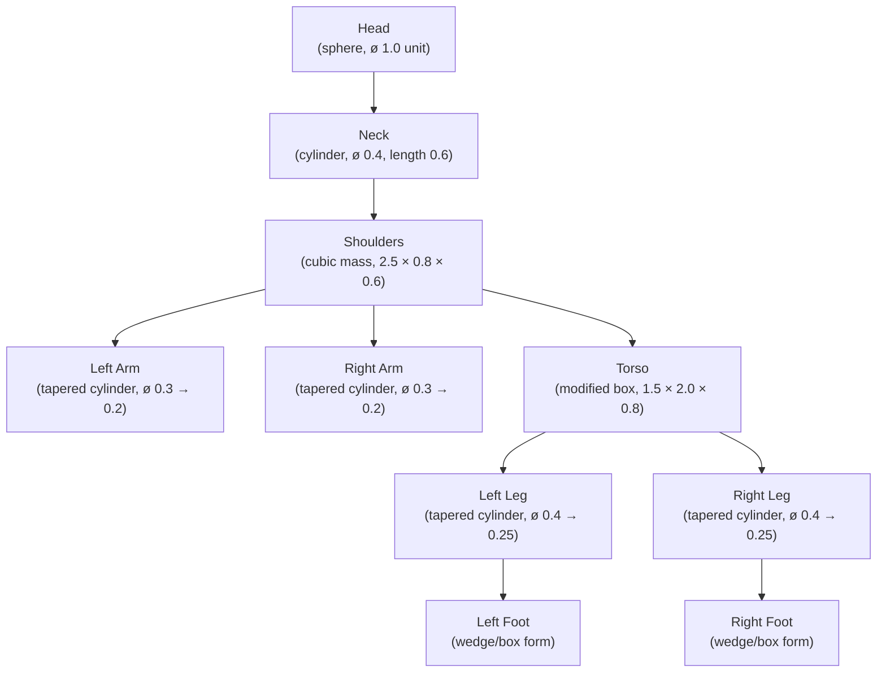

# Lesson 1: Foundational Form Theory in Three-Dimensional Space

## 1. First-Principles Intuition & Invariants

Sculpture operates in physical three-dimensional space, yet its fundamental language transcends material itself. Where painting compresses depth into the illusion of a picture plane and music unfolds through time's irreversible arrow, sculpture exists as occupied volume—mass that displaces air, casts shadows, and demands the viewer's body move around it to comprehend its totality. This irreducible physicality distinguishes sculpture from all other visual arts: a sculptural form cannot be fully apprehended from a single vantage point, and its relationship to gravity, light, and the negative space surrounding it are not optional aesthetic considerations but intrinsic properties of its existence.

The sculptor's primary task is not representation but spatial articulation. Even when working figuratively, the sculptor manipulates volumetric relationships, surface transitions, and physical weight distribution first, with representational accuracy emerging as a secondary consequence of sound formal decisions. A beginner often approaches sculpture as "three-dimensional drawing," attempting to copy contours from photographs or life references, but this fundamentally misunderstands the medium. Sculpture is not drawing extended into depth—it is the organization of mass and void into coherent spatial relationships that generate visual force vectors and psychological presence.

Consider the difference between additive and subtractive processes at the conceptual level before we address specific materials. Additive sculpture—building up clay, welding metal, or assembling found objects—begins with nothing and accretes form through incremental decision-making. The sculptor working additively negotiates each gesture with the cumulative mass already present, constantly reassessing balance, proportion, and spatial tension as the work grows. Subtractive sculpture—carving stone, wood, or machining hard materials—begins with maximum potential and removes material to reveal form. The subtractive sculptor must visualize the final form trapped within the block, understanding that every cut is irreversible and that negative space is created by what is taken away rather than what is added. These are not merely technical distinctions but opposing philosophical approaches to spatial problem-solving.

The invariant principle underlying all sculptural form is the relationship between positive mass and negative space. Positive space is the physical material occupying volume—the bronze torso, the marble column, the welded steel armature. Negative space is the void defined by that mass—the cavity between an arm and torso, the empty frame within a constructed arch, the atmospheric volume surrounding a freestanding figure. Amateur sculptors obsess over positive form and treat negative space as leftover emptiness, but professional sculptors understand that negative space is equally active and must be designed with identical rigor. Henry Moore's reclining figures are masterclasses in negative space activation: the voids piercing through his bronze masses are not holes but carefully shaped volumes that create visual tension, direct eye movement, and establish visual rhythm against the solid forms.

Visual weight operates independently from physical mass. A small, dense sphere of polished obsidian placed at the edge of a composition pulls visual attention disproportionately to its physical size because its reflective surface and geometric perfection generate high information density. Conversely, a large volume of translucent resin foam may occupy substantial space while exerting minimal visual weight because its material uniformity and lack of surface incident generate low perceptual interest. The sculptor must learn to calibrate visual weight distribution across a composition, understanding that imbalance is not always failure—deliberate asymmetry can create dynamic tension and directional force, provided the imbalance is intentional and the composition remains structurally coherent.

Surface treatment directly modulates how form is perceived. A smooth, polished surface reflects light specularly, creating sharp highlights and concealing subtle volumetric transitions because the eye reads reflections rather than underlying form. A rough, matte surface scatters light diffusely, revealing every undulation and texture variation through gradual value transitions. Michelangelo deliberately left tool marks visible on his unfinished sculptures not from laziness but from acute understanding that rough-hewn surfaces emphasize the physical labor of carving and the resistance of stone, while his polished passages on skin and drapery create material differentiation through surface contrast alone. The decision of how to finish a surface is inseparable from the form itself—identical volumes read as entirely different objects depending on whether they are mirror-polished, sandblasted, or left with faceted tool marks.

Scale introduces perceptual phenomena that cannot be linearly extrapolated from smaller works. A six-inch maquette may exhibit perfect proportions and spatial balance, yet when scaled to six feet, the same proportions fail because human perception operates differently at body scale than at handheld scale. Large-scale sculpture must account for viewing distances that compress apparent proportions—elements at the top of a twelve-foot figure will appear smaller than identically-sized elements at eye level due to perspective foreshortening, requiring the sculptor to deliberately distort proportions to achieve perceptual unity. Monumental sculpture intended for outdoor installation must be grossly exaggerated in detail scale because atmospheric haze and viewing distance will visually flatten and soften all surface information.

The interplay between mass and void, weight and balance, surface and volume establishes sculpture's formal vocabulary. These relationships are not arbitrary aesthetic choices but perceptual mechanics rooted in how human vision processes three-dimensional information. The eye constantly seeks closure, rhythm, and structural logic when parsing complex forms, and successful sculpture either satisfies these perceptual expectations with classical balance or deliberately violates them to create productive tension. Before addressing material-specific techniques or stylistic traditions, we must internalize these foundational spatial principles as the invariant grammar underlying all three-dimensional form-making.

## 2. Core Architecture & Mechanics

Sculptural form resolves into three irreducible geometric primitives: the sphere, the cylinder, and the cube. Every complex organic or architectural form can be analytically reduced to combinations and transitions between these elemental volumes. The human figure decomposes into a spheroidal head, cylindrical neck, ovoid torso, cylindrical limbs, and roughly cubic hands and feet. A tree trunk is a tapered cylinder with spheroidal branch nodes. An automobile body is an assemblage of stretched cuboids with cylindrical wheel wells and spherical corner transitions. Beginning sculptors must train their spatial perception to see through surface detail and identify the underlying geometric scaffolding, because successful complex forms are always constructed from properly proportioned and correctly connected simple volumes.

The sphere represents perfect radial symmetry—every point on its surface is equidistant from the center, and it appears identical from every viewing angle. Spheres possess maximum volume for minimum surface area, making them inherently stable and visually complete. When sculpting spherical forms, establish the center point first and build outward with consistent radial measurements. In clay, rotate the work constantly while adding material, using calipers to verify uniform diameter. In subtractive carving, rough out the sphere by removing corners from a cube, creating an initial octahedron, then progressively subdividing facets until curvature emerges. Spheres in composition act as visual anchors—they terminate directional movement and create focal density.

The cylinder embodies directional extension along a single axis while maintaining circular cross-section. Unlike the sphere, the cylinder has implicit orientation—length versus width—creating inherent visual movement along its primary axis. When sculpting cylindrical forms, establish the central axis line first, ensuring perfect straightness or intentional curvature, then build the circular profile perpendicular to that axis. Check cylindrical accuracy by rotating the form and observing the silhouette—any deviation from perfect circular symmetry will create visible wobble. Cylinders introduce rhythm through repetition and variation—a series of stacked cylinders with alternating diameters creates visual cadence analogous to musical meter.

The cube and its derivatives—rectangular prisms, wedges, pyramids—establish orthogonal relationships and planar definition. Where spheres and cylinders define volume through curved surfaces, cubic forms define volume through flat planes meeting at hard edges. This creates fundamentally different light behavior: curved surfaces exhibit gradual value gradation from highlight to shadow, while planar surfaces hold constant value across their extent and transition abruptly at edges. When constructing cubic forms, establish perpendicular axes first using right-angle measuring tools, and verify that opposite faces are truly parallel. Cubic forms introduce architectural logic and structural stability—they visually suggest construction, support, and geometric order.

Transitional volumes connect these primitives into coherent forms. A neck connecting head to torso is not merely a cylinder inserted between two ovoids—it is a transitional form that must mediate the scale change, shift the axes of the two masses it connects, and create fluid surface continuity. These transitions are where sculptures succeed or fail. Harsh, unmodulated transitions create visual breaks that fragment form into disconnected parts. Overly soft, ambiguous transitions create mushy, weak forms that lack definition. The correct transition exhibits clear directional flow while maintaining surface tension—the eye should move smoothly from one volume to the next while still perceiving distinct formal identity.

Mass distribution determines structural stability and visual balance. Physical sculptures must support their own weight without collapse, which imposes engineering constraints on form—cantilevers require counterweight or internal armature, top-heavy compositions demand wide bases, and fragile materials cannot sustain aggressive overhangs. Even when working digitally where physics can be ignored, the eye expects gravitationally plausible form and perceives violations as unstable regardless of actual structural soundness. A figure balanced on one foot must shift its center of mass over the supporting leg's contact point, with the free leg, arms, and torso arranged to create compositional counterbalance. Defying these expectations requires extreme exaggeration to read as intentional rather than error.

Negative space carving is the inverse of additive construction. Where additive sculpture builds outward from a core, negative space is carved inward from edges to create voids that activate the surrounding positive mass. Consider a simple arch: the negative space beneath the arch is not merely empty but a defined volume bounded by the arch's inner curve, the ground plane, and the vertical supports. This void must be designed with identical precision to the stone forming the arch itself. When carving negative space, work from the deepest recess first and carve outward toward edges, constantly reassessing how the emerging void interacts with the surrounding positive form. Negative space should create visual rhythm, directional thrust, and compositional breathing room.

Surface topography—the micro-scale variations of texture, faceting, and mark-making—operates at a different scale than volumetric form but profoundly affects perception. A perfectly smooth surface reads as machine-made or synthetic, conveying precision and intentionality but potentially feeling cold or inert. A heavily textured surface reads as organic, hand-worked, or weathered, conveying history and material authenticity but potentially overwhelming underlying form. Strategic combination of surface treatments creates hierarchy: smooth focal areas draw attention while textured periphery recedes. When working clay, use wooden ribs to compress and smooth focal surfaces while leaving finger marks and tool texture in secondary areas. When carving stone, reserve polishing for select passages that demand emphasis, leaving tooled or sandblasted surfaces as default.

Undercuts and overhangs introduce spatial complexity by creating forms that hook back beneath themselves, generating shadow pockets and occluded surfaces that can only be perceived by moving around the work. Undercuts are technically challenging—in clay, they require internal armature support to prevent collapse; in carving, they demand careful planning to avoid trapping tools or fracturing material. But undercuts are essential for creating dynamic form because they break the silhouette in unexpected ways and reward viewer movement. A standing figure with arms held away from the torso creates undercut negative spaces in the armpits and between arms and body—these voids are as important as the limbs themselves.

Symmetry versus asymmetry establishes compositional character. Perfect bilateral symmetry creates calm, stability, and formal authority—temple architecture, ceremonial masks, and heraldic sculpture deploy symmetry to convey permanence and order. Asymmetry introduces dynamism, implied movement, and narrative—a figure with one arm raised and weight shifted to one leg suggests action frozen mid-gesture. Most successful sculpture operates in asymmetric balance, where dissimilar elements on either side of a central axis are composed to feel perceptually balanced despite lacking mirror-image correspondence. Asymmetric balance requires constant perceptual checking—step back frequently and assess whether the composition feels weighted to one side, then adjust mass distribution until equilibrium is achieved.

## 3. High-Performance Optimization & Failure Modes

Efficient sculptural workflow prioritizes rough-to-refined progression, resisting premature detail resolution that commits to proportions before the overall composition is structurally sound. Begin every sculpture by establishing primary masses at correct scale relationships using the simplest possible geometry—spheres, cylinders, and boxes roughed in with generous tolerances. Only when these primary volumes are positioned correctly in space, exhibiting proper visual weight distribution and directional rhythm, should secondary forms be added. Only when secondary forms are resolved should surface detail and texture be considered. Violating this hierarchy—carving fine wrinkles into a face before the skull's proportions are correct—guarantees wasted labor because fundamental proportion errors will eventually demand re-carving that destroys all detailed work.

The most common failure mode is weak, ambiguous form resulting from insufficient structural commitment. Beginning sculptors often create soft, lumpy masses that lack clear geometric scaffolding because they are afraid to make decisive angular cuts or definitive curve commitments. But sculpture demands bold formal decisions—a form that tries to be slightly curved and slightly flat will read as neither, appearing instead as accidental or unfinished. The antidote is aggressive blocking: push every form toward its geometric extreme, creating overly spherical spheres, excessively cylindrical cylinders, and knife-edge hard transitions. Extreme blocking reveals formal logic that can then be selectively softened, whereas timid, averaged forms provide no structural foundation.

Scale creep insidiously degrades proportions during long working sessions. When staring at a sculpture for hours, the eye adapts to subtle distortions and ceases to register proportion errors that are glaringly obvious to fresh eyes. Combat scale creep by establishing fixed external reference measurements early and checking them obsessively throughout the process. Use calipers to measure critical dimensions—head diameter, torso height, limb lengths—and record these values. Return to these measurements every thirty minutes of active work, comparing current dimensions to recorded targets. Step away from the work every hour and view it from across the room—distance collapses detail and reveals gross proportion errors invisible at arm's length.

Light direction radically transforms form perception but is often ignored during creation. A sculpture worked under flat, diffuse studio lighting may exhibit subtle surface modeling that completely disappears under harsh directional gallery lighting or outdoor sunlight, while bold surface faceting that feels crude under studio lights may be essential for legibility in high-contrast light. Set up multiple light sources at different angles—a strong key light from 45 degrees above and to one side, a diffuse fill from the opposite side, and a rear rim light—and rotate the work through these lighting conditions constantly. Forms that hold visual integrity under varied lighting are structurally sound; forms that collapse into illegibility under certain light angles require deeper surface articulation.

Material behavior imposes non-negotiable constraints that must be understood before design begins. Water-based clay shrinks approximately twelve percent during drying and firing, requiring compensation through over-scaling at the wet stage. Stone carving is unidirectional—removed material cannot be replaced except through mortared joins that compromise structural integrity. Bronze casting via lost-wax process cannot capture undercuts below a certain angle without creating mold-lock, requiring core pins or multi-part mold engineering. Designing forms that exceed material capabilities guarantees either catastrophic failure or compromise through compensatory technique that degrades the original vision. Study material properties rigorously before committing to ambitious forms.

Armature engineering determines whether additive sculptures stand or collapse. For clay work exceeding twelve inches in any dimension, internal armature is non-negotiable. Construct armatures from aluminum wire for small works (under twenty-four inches) or welded steel rod for large works. The armature must extend through all cantilevers and top-heavy masses, with sufficient branch points to distribute weight across the core. Wrap armature with thin wire coils or crumpled aluminum foil to create mechanical key for clay adhesion—smooth wire allows clay to slip and separate under its own weight. Armature must stop at least one inch below final surface to avoid show-through but must be robust enough that clay added beyond armature termination does not sag.

Negative space failure occurs when voids are treated as afterthoughts rather than designed elements. A figure with arms pressed against torso creates no negative space and reads as a solid monolith lacking articulation. The same figure with arms held slightly away from torso creates negative spaces that must be shaped—too wide and the gaps feel arbitrary, too narrow and they read as gaps rather than intentional voids. Negative spaces should echo and reinforce positive form rhythms: if the positive masses exhibit organic curves, negative spaces should curve analogously; if positive forms are angular, negative spaces should exhibit related angularity.

Surface finish incoherence—mixing incompatible surface treatments without deliberate hierarchy—fragments visual unity. A sculpture that is simultaneously polished, rough-hewn, and textured in random distribution appears unfinished or confused. Surface variation must follow formal logic: polish focal areas where maximum definition is required, use medium texture for secondary masses, and employ rough texture for backgrounds or bases. Transitions between surface treatments should be gradual or occur at formal boundaries (edges, seams, material changes) rather than appearing arbitrary.

Viewing angle bias results from sculpting predominantly from one perspective and neglecting how form reads from alternate positions. Rotate work constantly—invest in a turntable for small sculpture or walk completely around large works every fifteen minutes. Force yourself to work from the back, from oblique angles, and from above and below. Forms that only succeed from one canonical viewing position are not fully three-dimensional—they are reliefs masquerading as sculpture. True sculpture maintains formal coherence and visual interest from all positions, with each viewing angle revealing new relationships while maintaining connection to the overall composition.

The transition from maquette to final scale introduces proportion distortions that cannot be mechanically compensated. Scaling up by measuring and multiplying dimensions linearly produces forms that feel incorrect at large scale because human perception is non-linear with respect to size. When working from maquette, scale up approximately eighty percent of measured dimensions, then adjust by eye until proportions feel correct at the target scale. Details must be exaggerated relative to overall mass as scale increases—a subtly incised line appropriate on a twelve-inch model becomes invisible on a six-foot enlargement and must be deepened to maintain visual presence.

Develop perceptual calibration through relentless comparative observation. Spend dedicated time studying masterwork sculpture in museums, noting how great sculptors resolve volumetric transitions, activate negative space, and modulate surface treatment. Measure successful sculptures when possible—record ratios of head to body, limb thickness to length, base width to overall height. Build a mental library of proportion relationships and spatial solutions that can be referenced when confronting similar problems in original work. Sculpture is not mystical inspiration but systematic problem-solving grounded in perceptual mechanics and material constraints, and those mechanics can be studied, dissected, and internalized through deliberate observation and analysis.
