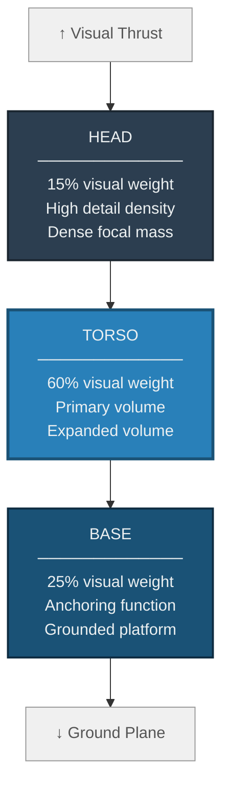
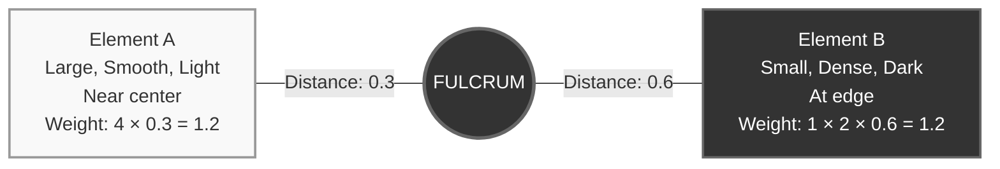
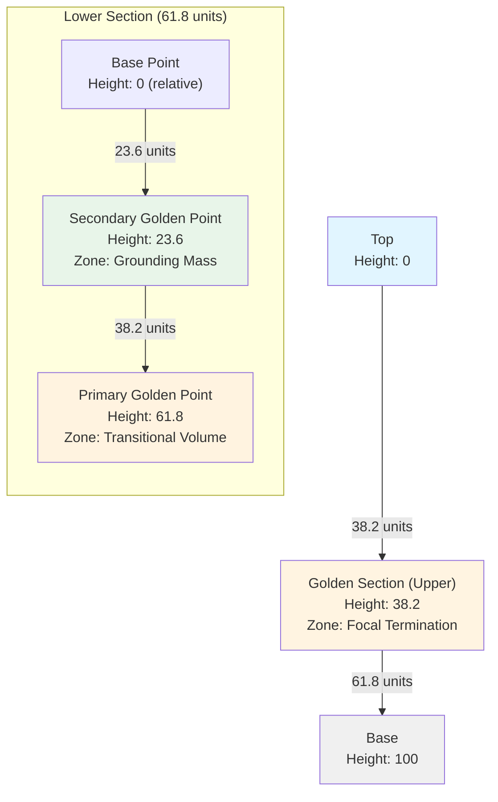
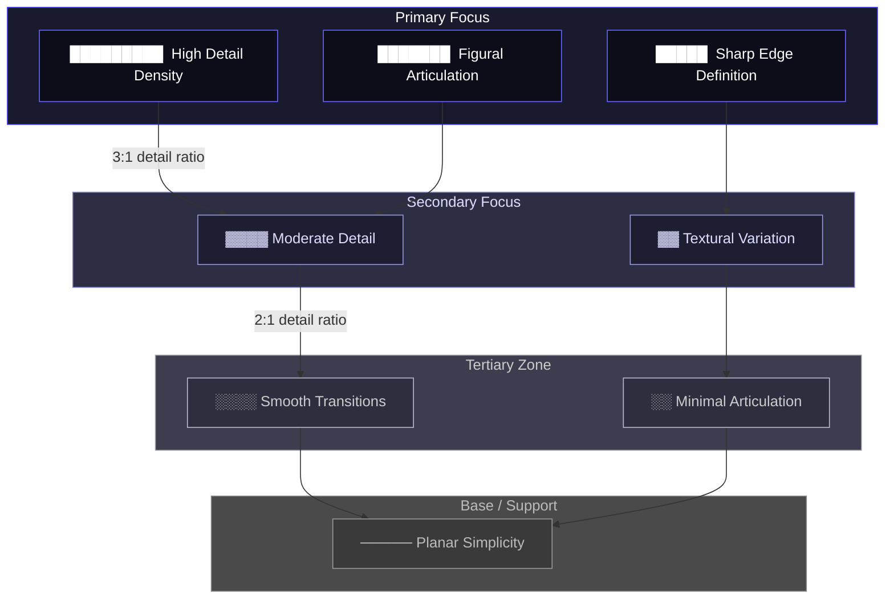

# Lesson 3: Compositional Architectures: Balance, Scale, Proportion

## 1. First-Principles Intuition & Invariants

Every sculptural work exists in a negotiation between gravitational physics, human perception, and the material vocabulary of form. Unlike painting, which operates within the bounded rectangle of the picture plane, sculpture commands three-dimensional space and demands that the viewer navigate around, through, or beneath it. This spatial occupation creates compositional responsibilities that transcend mere aesthetic arrangement—the sculptor must architect a hierarchy of visual forces that remain coherent across multiple viewpoints while responding to the scale of the human body and the constraints of the site itself.

Balance in sculpture is fundamentally a perceptual analog of physical equilibrium. When we perceive a form as balanced, we are unconsciously processing its center of mass, the distribution of visual weight across its volumes, and the directionality of its implied forces. This perception operates on multiple registers simultaneously: the literal structural balance that prevents the work from toppling, the optical balance that creates visual stability within the composition, and the psychological balance that governs emotional response. A cantilevered steel beam extending horizontally from a vertical column reads as tension and defiance of gravity; a pyramidal stone mass conveys permanence and repose. These readings are not arbitrary—they emerge from our embodied experience of weight, leverage, and the constant downward pull we resist in our own musculature.

Symmetry represents the most direct path to perceptual balance, leveraging the bilateral organization of human vision and our neurological bias toward pattern recognition. When a sculpture presents perfect bilateral symmetry across a central axis, the left and right visual fields receive identical stimulus patterns, and the brain experiences this as harmonious closure. Classical Greek kouroi, Renaissance portrait busts, and Brancusi's polished ovoids all exploit this perceptual shortcut. Yet perfect symmetry carries the risk of monotony—the composition resolves too quickly, offering no visual tension to sustain prolonged engagement. The eye completes its scan, finds equilibrium, and moves on.

Asymmetrical balance demands far greater compositional sophistication. Here the sculptor must balance unequal visual masses through strategic placement, tonal contrast, surface articulation, or directional force. A small, densely textured volume positioned at the periphery can counterbalance a large, smooth plane near the center because the eye assigns greater perceptual weight to complexity and isolation. This principle extends from the intimate scale of maquettes to the monumental—Henry Moore's reclining figures achieve balance by distributing voids and masses in calculated opposition, creating visual circuits that pull the viewer's gaze through negative space with the same authority as bronze.

The concept of visual weight itself operates through multiple channels. Physical mass translates directly to perceptual weight, but so do tonal darkness, textural density, chromatic saturation, and compositional isolation. A black granite cube will read as heavier than an identically sized white marble cube because the dark value compresses optically, appearing more dense. A cluster of small elements near the base of a composition can anchor a single elongated form above because the aggregated complexity creates gravitational pull. Understanding these optical mechanics allows the sculptor to construct balance systems that defy literal physics while remaining perceptually convincing.

Scale in sculptural composition operates across three distinct registers: absolute size, relational proportion, and human reference. Absolute size determines the work's physical presence in space and governs its fabrication constraints, structural requirements, and site logistics. A bronze casting limited to foundry bed dimensions demands different architectural thinking than a site-specific earthwork measured in hectares. Relational proportion concerns the internal size relationships among the sculpture's constituent parts—the ratio of head to torso, aperture to mass, base to figure. These proportions generate the work's internal harmonic relationships and control pacing as the eye travels across surfaces. Human scale reference anchors the work to the body of the viewer, creating an experiential contract that can emphasize intimacy, monumentality, or disorientation depending on whether the sculpture corresponds to human dimensions, towers above them, or requires crouching to apprehend.

Classical proportion systems codified these relationships into repeating mathematical ratios meant to echo cosmic order. The Greek canon of Polykleitos prescribed that the head measure one-seventh of total body height, establishing a modular system where every dimension derived from this fundamental unit. The golden ratio, approximately 1.618:1, reappears across Renaissance sculpture as a governing proportion for everything from the relationship of torso to legs to the subdivision of architectural niches. These systems function as compositional scaffolding—they provide a framework of harmonious intervals that can be followed strictly, violated strategically, or used as a baseline against which distortion reads as expressive deviation.

Modern and contemporary practice has largely abandoned universal proportion systems in favor of context-specific relationships. Yet the underlying principle remains: proportion functions as a rhythmic language. When dimensions repeat at consistent intervals, the eye registers pattern and predictability. When proportions shift dramatically—a towering vertical suddenly interrupted by a compressed horizontal—the composition generates visual accent and tension. The sculptor choreographs these shifts to control pacing, establish focal hierarchies, and guide the viewer's phenomenological journey around the work.

Rhythm in three-dimensional composition emerges from the repetition and variation of formal elements across the sculpture's surface and volume. Sculptural rhythm operates spatially—it is perceived through the scanning motion of the eye and the circumambulation of the body. A colonnade of vertical supports establishes a steady beat; their gradual tapering introduces acceleration; an abrupt termination or gap creates syncopation. The sculptor can amplify rhythmic cadence through material contrast, shadow patterns cast by recessed elements, or the grain direction of wood and stone. These rhythms need not be regular—arrhythmic clustering, where elements bunch and disperse in irregular intervals, can generate organic vitality that resists mechanical predictability.

Focal hierarchy determines the sequence and intensity with which the viewer apprehends different regions of the sculpture. In a successful composition, the eye does not wander aimlessly but follows a designed path through zones of varying visual intensity. Primary focal points arrest attention through contrast, isolation, figural detail, or directional convergence—the meeting point of multiple edges, the apex of a pyramidal mass, the single organic curve within a field of rectilinear planes. Secondary focal points provide resting nodes that sustain interest without competing for dominance. Tertiary zones function as connective tissue, allowing the eye to transition smoothly between areas of high activation. This hierarchy must function in the round, remaining coherent as the viewer moves through 360 degrees of approach angles. A sculpture that presents a compelling frontal composition but collapses into incoherence from the side has failed its three-dimensional mandate.

Site responsiveness represents the final layer of compositional thinking, acknowledging that sculpture rarely exists in neutral white-cube isolation. The site imposes gravitational, optical, and cultural constraints that the work must engage or resist. A vertical tower placed in an open plaza responds differently than the same form installed in a dense urban canyon—the former reads against sky and distant horizon, the latter against building facades and compressed sightlines. Interior installations must negotiate ceiling height, ambient lighting, acoustic properties, and pedestrian flow patterns. Outdoor works contend with weather, seasonal lighting shifts, vegetation growth, and long-term material weathering. The most rigorous site-specific practice treats these conditions not as obstacles but as compositional parameters, allowing the sculpture to function as a hinge between human intention and environmental force.

## 2. Core Architecture & Mechanics

The practical construction of sculptural balance begins with the identification of visual axes—imaginary lines along which forces appear to concentrate or resolve. In a vertically oriented work, the primary axis typically runs through the work's center of mass, establishing a gravitational spine. Horizontal extensions from this axis create secondary vectors that must be balanced either through symmetrical distribution or asymmetrical counterweight. The sculptor working from a maquette or digital model must continuously rotate the work, identifying these axes from multiple viewpoints and ensuring that no single angle collapses into visual chaos.



Symmetrical compositions resolve around a single central axis with mirrored distribution on either side. This arrangement leverages our innate preference for bilateral correspondence, but it requires deliberate activation to avoid static predictability. Classical portrait busts achieve this through subtle head rotation—the figure gazes 15 degrees off-axis, introducing directionality without breaking symmetry. Architectural sculpture employs contrapposto, the standing figure's weight shifted to one leg, which tilts the hips and compensates with opposing shoulder rotation, transforming a frontal figure into a dynamic system of opposing curves.

Asymmetrical balance operates through the principle of the visual fulcrum—an imaginary pivot point around which unequal masses achieve equilibrium. A large, light-toned volume positioned near the center can be counterbalanced by a small, dark, highly textured element at the periphery. The designer's task is to calibrate the relative weights: surface area, tonal value, textural complexity, and distance from the fulcrum all contribute to perceived mass. This calibration proceeds iteratively, adjusting positions and proportions until the composition achieves dynamic equilibrium across primary viewpoints.



Scale relationships demand systematic measurement and ratio analysis. The sculptor establishes a base unit—often derived from human proportions such as the width of the hand, the distance from elbow to fingertip, or the height of the head—and then derives all other dimensions as multiples or fractions of this unit. This modular approach ensures internal coherence even when absolute dimensions vary. A site-specific monument scaled up from a 1:10 maquette maintains its proportional integrity if all dimensions increase by the same factor, though the sculptor must account for optical distortion at monumental scale—forms that read clearly at arm's length can appear squat or attenuated when viewed from 50 meters below.

The golden ratio method provides one systematic approach to proportional subdivision. Given a total height or length, the sculptor divides this dimension approximately 61.8% of the way up, creating a larger lower section and a smaller upper section. This point often defines the transition between base and figure, or torso and head. Further subdivisions can follow the same ratio recursively, generating a nested hierarchy of proportions. While not universal, this system produces dimensions that the eye registers as harmonious, likely because the ratio appears frequently in natural growth patterns and therefore aligns with perceptual expectation.



Human scale relationships govern the experiential impact of the work. A sculpture scaled to approximate human height—roughly 1.5 to 2 meters—invites identification and reads as figure or portrait regardless of subject matter. The viewer unconsciously projects bodily experience onto the form, interpreting its gestures and proportions through empathetic simulation. Scale the same form down to 30 centimeters, and it becomes an object of contemplation, something to be held and examined intimately. Scale it to 10 meters, and it becomes environmental infrastructure, a monument that dwarfs the body and asserts dominance over the site. These scalar shifts are not merely quantitative—they fundamentally alter the work's ontological status and the viewer's psychological relationship to it.

Rhythmic patterning across surfaces follows principles analogous to compositional balance and visual rhythm in two-dimensional design. The sculptor can establish a regular interval—a row of vertical ribs spaced every 20 centimeters along a curved surface—and then introduce variation through gradual widening, sudden compression, or strategic omission. This creates visual syncopation, moments where the expected pattern disrupts and the eye must recalibrate. In cast metal or molded concrete, these rhythms can be tooled directly into the surface. In carved stone, they emerge from the chisel's repeated strikes, each mark contributing to an aggregate texture that reads as pattern from a distance and as individual gesture up close.

Focal hierarchy construction proceeds through contrast control. The sculptor reserves the highest degree of surface articulation—fine detail, sharp edges, figural representation—for primary focal zones. Secondary areas receive intermediate treatment, maintaining visual interest without competing for dominance. Tertiary zones transition to simplified planes or smooth gradients that guide the eye toward focal centers without arresting it. This gradient must be managed carefully; too abrupt a transition between detailed and simplified areas reads as incomplete or careless execution, while too gradual a gradient risks diffusing focus entirely.



Site analysis for sculptural placement begins with documentation of existing visual axes—primary sightlines from pedestrian approaches, vehicular corridors, and elevated viewpoints. The sculptor sketches these as vectors converging on the proposed site, identifying which angles will dominate viewer experience. A plaza sculpture seen primarily from one direction can optimize that frontal composition, while a work in a park with 360-degree access must resolve equally from all cardinal approaches. Vertical sightlines matter particularly for indoor installations—does the work sit below eye level, inviting a downward gaze, or rise above, demanding the viewer tilt back and experience foreshortening?

Lighting conditions dramatically affect both balance and focal hierarchy. Direct natural light creates hard shadows that accentuate recessed areas and sharpen edges, amplifying textural contrast. Diffuse overcast light softens these transitions, reading mass and volume more than surface detail. Artificial lighting allows precise control: spotlights can isolate focal points, uplighting can reverse natural shadow patterns to create dramatic inversions, and grazing light raking across a textured surface reveals micro-relief invisible under frontal illumination. The sculptor planning for a specific site must visit at multiple times of day across seasons, documenting how changing sun angles alter the work's appearance and adjusting the composition to remain legible under the full range of lighting scenarios.

Material choice influences compositional mechanics at every level. Dense, opaque materials—bronze, steel, stone—create clear silhouettes and strong positive forms. Transparent or translucent materials—glass, resin, certain plastics—introduce ambiguity, allowing light to pass through and revealing internal structure. Reflective surfaces mirror the surrounding environment, dissolving the boundary between sculpture and site. Each material brings inherent structural constraints: stone works in compression and cannot cantilever far from vertical support; steel allows tensile suspension and dramatic horizontal spans; wood grain directs carving and limits torsional forms. The compositional architecture must work within these constraints, treating them not as limitations but as formal opportunities that guide design toward material honesty.

## 3. High-Performance Optimization & Failure Modes

The sculptor optimizing for compositional coherence across multiple viewpoints employs systematic rotation analysis. Beginning with the primary viewing angle—typically the approach most pedestrians or visitors will take—the composition is refined until balance, proportion, and focal hierarchy function optimally. The sculptor then rotates the work 45 degrees and evaluates whether these compositional elements degrade. If a secondary mass that balanced the composition frontally now reads as protruding awkwardly from the side, adjustments are required: the mass may need repositioning, the angle of attachment may need revision, or compensating elements may need addition on alternate faces. This process continues through 90, 135, 180, 225, 270, and 315-degree intervals, ensuring no angle collapses into visual confusion.

Digital modeling tools accelerate this analysis dramatically. Software like Blender or ZBrush allows real-time rotation under various lighting conditions, and viewport captures can be arrayed in a grid for simultaneous comparison. The sculptor can quickly identify problematic angles and iterate adjustments without physically rebuilding a maquette. However, this speed introduces the risk of over-reliance on screen representation—digital models often fail to convey the tactile qualities of surface texture, the optical behavior of reflective materials, and the phenomenological impact of physical scale. The optimized workflow alternates between digital iteration for rapid compositional testing and physical maquette construction at critical development stages to validate perceptual assumptions.

Scale distortion at monumental proportions demands proactive optical correction. Forms that appear balanced at 30 centimeters can read as bottom-heavy when scaled to 10 meters because the viewer's low angle of regard compresses the upper portions through foreshortening. Classical sculptors compensated by elongating upper elements—the head of a column capital is carved slightly larger than geometric proportion would dictate, so when viewed from below, it reads as proportionally correct. Modern sculptors working with fabricated elements must calculate these corrections during the engineering phase, adjusting dimensions in the digital model to account for the anticipated viewing angle at the installation site. This requires site-specific trigonometric analysis: the sculpture's height, the typical viewing distance, and the viewer's eye height combine to determine the sightline angle, from which the necessary vertical exaggeration can be derived.

```text
VIEWING ANGLE CALCULATION

Site Parameters:
  Sculpture Height: 10m
  Typical Viewing Distance: 15m
  Viewer Eye Height: 1.6m

Sightline Angle to Top:
  tan(θ) = (10 - 1.6) / 15
  θ = arctan(8.4 / 15)
  θ ≈ 29.3°

Foreshortening Factor:
  Apparent Height = Actual Height × cos(θ)
  Apparent = 10 × cos(29.3°) ≈ 8.72m

Optical Correction:
  Increase upper zone height by 15% to compensate
  Adjusted Height = 10 / 0.872 ≈ 11.5m total design height
```

Material failure modes in compositional contexts often manifest as perceptual rather than structural collapse. A steel beam cantilevered dramatically from a central column may be structurally sound according to engineering calculations but read as precarious or unstable to viewers, generating anxiety rather than admiration. This perceptual instability undermines the compositional intent—balance requires not just physical equilibrium but the appearance of equilibrium. The sculptor mitigates this through visual reinforcement: a secondary diagonal brace that contributes minimal structural support but signals stability, or a thickening of the beam's cross-section near the cantilever point to suggest greater mass and resistance to bending. These elements function rhetorically, reassuring the viewer's intuitive sense of safe construction even when technically redundant.

Proportional systems fail when applied dogmatically across different materials and scales. The golden ratio, derived from ideal geometric relationships, does not account for the specific optical behavior of patinated bronze versus polished stainless steel. Dark materials absorb light and visually compress, appearing smaller than their actual dimensions; light materials reflect and expand, reading larger. A proportion calibrated for white marble will produce different perceptual results when executed in black granite at the same dimensions. The sculptor working across materials must adjust proportions empirically, fabricating test samples and evaluating them under site lighting conditions. This material-specific calibration becomes part of the pre-production workflow, adding time and cost but preventing expensive corrections after casting or carving.

Rhythmic patterning degrades when intervals become either too regular or too chaotic. Perfectly uniform repetition—a grid of identical apertures at exact spacing—reads as mechanical and lifeless, failing to sustain visual interest across prolonged viewing. The eye scans, registers the pattern, and disengages. Conversely, arrhythmic variation without underlying structure dissolves into noise, preventing the eye from establishing any perceptual foothold. The optimal zone lies between these extremes: a base rhythm with systematic variation, such as a primary interval of 20 centimeters interrupted by occasional 30-centimeter gaps that occur at predictable but non-adjacent positions. This creates syncopation—the viewer anticipates the pattern's continuation, and the disruption generates a moment of surprise that refreshes attention without disorienting.

Focal hierarchy collapses when too many elements compete for primary status. If multiple zones present equally high detail density, sharp edges, and figural complexity, the eye cannot prioritize and wanders without resolution. This is distinct from intentional all-over composition, where uniform visual activation becomes the deliberate strategy—Jackson Pollock's drip paintings or the fractal complexity of certain Islamic geometric tile work. Those succeed because the uniformity itself constitutes the organizing principle. In traditional hierarchical composition, the sculptor must enforce discipline: primary focus receives maximum articulation, secondary foci are deliberately subordinated through reduced contrast or detail, and tertiary zones recede further. This requires brutal editing—removing attractive but compositionally redundant elements that dilute focal impact.

Site-responsive composition fails when the sculptor ignores environmental context in favor of autonomous formal concerns. A sculpture designed in the studio under controlled lighting, then installed outdoors where harsh midday sun obliterates subtle surface modulation, loses much of its intended effect. Similarly, a vertical tower placed in a dense urban context where no viewer can achieve sufficient distance to apprehend its full height reads as fragmented, experienced only as a series of partial views rather than a coherent whole. The robust site-specific process includes mockups at one-tenth or one-quarter scale positioned at the actual site, photographed from anticipated viewing angles under varying light conditions. These tests reveal compositional problems before full fabrication, allowing adjustments to orientation, surface treatment, or even fundamental proportions.

Weather and long-term environmental exposure introduce time-based failure modes. Untreated steel develops rust patina that darkens and textures the surface, altering tonal relationships calibrated for bright metal. Stone weathers differentially based on hardness and porosity—soft limestone recesses faster than hard granite inclusions, gradually eroding carved detail and flattening relief. Wood expands and contracts with humidity cycles, opening joints and potentially destabilizing constructed assemblies. Bronze in marine environments develops verdigris, shifting from warm brown to blue-green. The sculptor can either accept these transformations as part of the work's temporal evolution—allowing the composition to slowly morph across decades—or engineer material systems that resist change through protective coatings, drainage design that prevents water accumulation, and regular maintenance protocols. The choice depends on whether the work is conceived as a fixed composition or a dynamic process.

Fabrication tolerances at large scale introduce dimensional drift that compounds across assembled components. A sculpture designed as five separate elements, each fabricated by different contractors to a tolerance of ±5 millimeters, may accumulate a 25-millimeter misalignment at final assembly. This misalignment disrupts proportional relationships calibrated in the digital model: a joint designed to align flush now shows a visible gap, a surface meant to read as continuous now steps, an intended perfect symmetry becomes approximate. The sculptor mitigates this through tolerance budgeting—identifying critical dimensions where precision matters most (focal points, human interface zones) and allowing larger tolerances in less visible areas. Final assembly protocols include shimming, field welding, and in-situ carving to bring actual dimensions into alignment with designed proportions. These adjustments become a final compositional tuning, the sculptor responding to the physical reality of the fabricated object rather than the idealized geometry of the model.

Human scale relationships fail catastrophically when the sculpture forces viewers into uncomfortable physical relationships. A work that requires crouching to apprehend detail excludes elderly or disabled visitors; a piece positioned so close to a walkway that pedestrians must press against it to pass generates resentment rather than contemplation. The sculptor performs spatial clearance analysis during site planning, modeling pedestrian flow patterns and ensuring adequate buffer zones. Accessibility standards provide minimum clearances, but the sculptor aiming for generous public engagement exceeds these minima, allowing space for viewers to approach, circle, and retreat without congestion. This spatial generosity becomes part of the compositional architecture—the sculpture does not occupy space selfishly but creates zones of invitation and refuge around itself.

The ultimate failure mode in compositional architecture is conceptual incoherence—when balance, scale, proportion, rhythm, and hierarchy fail to cohere into a unified formal language. This occurs when the sculptor chases multiple incompatible strategies simultaneously: a base designed according to golden ratio proportions supporting a torso articulated through fractal recursion, capped with a head scaled to comic exaggeration. Each system might function in isolation, but their collision generates visual cacophony. The solution lies in rigorous conceptual discipline from the earliest design stages: identify the governing compositional principle, commit to it fully, and allow all subsequent decisions to derive from that principle. If asymmetrical balance through counterweight is the chosen strategy, every mass, void, texture, and tonal shift must reinforce that structural logic. This does not preclude complexity, but it ensures that complexity arises from elaborating a single coherent system rather than grafting incompatible systems together. The result is a sculpture that reads clearly across scales and viewpoints, its compositional architecture transparently legible even as its details reward prolonged examination.
