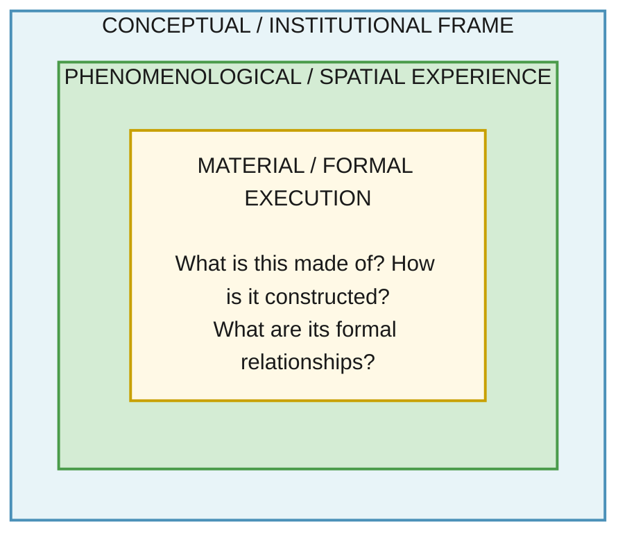

# Lesson 4: Historical Paradigms Through Conceptual Practice

## 1. First-Principles Intuition & Invariants

Sculpture exists at the intersection of material resistance and human intention. Unlike painting, which operates within the flat picture plane, or music, which unfolds across time, sculpture occupies three-dimensional space and demands the viewer's physical navigation. This fundamental constraint—that a sculpture must be *walked around*, viewed from multiple angles, and experienced in relation to the body in space—has shaped every major paradigm shift in sculptural practice across history.

The evolution from representational to abstract to contemporary sculpture is not a simple linear march toward "progress." Rather, it reflects successive recalibrations of what sculpture *can mean*: first, sculpture as a faithful record of the visible world and the sacred; then, sculpture as an exploration of form, material, and spatial relationships independent of reference; finally, sculpture as a vessel for conceptual content, institutional critique, and phenomenological investigation. Each paradigm carried within it a different answer to the fundamental sculptural question: *What is the sculpture actually about?*

In representational sculpture—the dominant mode from antiquity through the Renaissance and into the nineteenth century—the answer was clear: the sculpture was *about* something external to itself. A marble Venus was about divine beauty, feminine grace, and the artist's technical mastery of the human form. The stone was a transparent medium; the viewer's attention passed through the material to the ideal it represented. This mode depended on a shared cultural agreement that sculpture's primary task was mimesis: the faithful rendering of nature, mythology, or religious narrative in durable material.

The crisis of representation began not with sculpture but with photography. When the camera could record the visible world with mechanical precision, sculpture's traditional justification—as the most convincing record of appearance—collapsed. This rupture opened space for a radical question: if sculpture no longer needed to look like something, what could it *be*? This question gave rise to abstract sculpture in the early twentieth century, where artists like Henry Moore, Barbara Hepworth, and Constantin Brancusi began to treat the sculpture itself as the primary subject. Form became autonomous. A hole through a bronze torso was no longer a anatomical void but a formal gesture, a relationship between solid and void, mass and space. The material was no longer transparent; it became opaque, self-evident, insistently *present*.

The contemporary turn, emerging from the 1960s onward, went further still. If abstract sculpture had liberated form from representation, contemporary practice began to liberate sculpture from the requirement of formal beauty altogether. Artists like Carl Andre, Richard Serra, and later practitioners like Rachel Whiteread used sculpture to interrogate space, site, institutional power, memory, and time. The sculpture became a proposition rather than an object: *What does it mean to fill a room with lead sheets?* *What does it mean to cast the negative space of a house?* *What happens when you walk into a corridor that slopes imperceptibly downward?* Meaning shifted from the internal formal relationships of the object to the viewer's phenomenological encounter with it and the conceptual framework surrounding it.

This historical arc is not merely theoretical history; it is immediately relevant to contemporary sculptural practice because it reveals the deep structural choices every sculptor must make. When you begin a sculpture, you are implicitly positioning yourself within—or against—this history. You are making a claim about what sculpture *can* and *should* do. The representational sculptor invokes tradition and humanism. The abstract formalist invokes pure visual experience. The conceptual artist invokes institutional critique and intellectual provocation. Understanding these paradigms is not about antiquarian knowledge; it is about recognizing the toolkit of artistic positions available to you and making conscious choices about which language you will speak.

For the practitioner—whether visual artist or designer accustomed to thinking in formal visual languages—this lesson teaches you to *read* sculpture across these paradigms and to develop critical sensitivity to the choices embedded in any sculptural work. This is not about learning dates and names, though those matter. It is about developing an intuition for *why* a particular form, material, or spatial gesture carries meaning, and how that meaning shifts depending on the historical and conceptual frame you bring to it.

The core invariant across all three paradigms is this: **sculpture is a spatial, material practice that occurs in the presence of the viewer's body**. Whether the work is a classical Venus, an abstract Moore, or a contemporary Serra, the viewer must move, must walk around it, must position herself in relation to it. This physical encounter is non-negotiable. It distinguishes sculpture from painting, from architecture, from installation art (though the boundaries have blurred in contemporary practice). A sculptor's first responsibility is always to the spatial and material reality of the work, regardless of what conceptual or representational claims are layered atop that reality.

## 2. Core Architecture & Mechanics

### Representational Sculpture: The Classical Paradigm

Classical and Renaissance representational sculpture operated within a clear hierarchical system. The human figure, usually idealized and often nude, stood at the apex. The sculptor's task was to carve or model a form that demonstrated mastery of proportion, anatomy, and the idealization of nature. This was not simple copying. A Greek sculptor did not measure a living model and replicate those measurements. Rather, she internalized a system of proportional relationships—the head as one-eighth of total height, specific ratios governing the distance between eye and chin, the width of the shoulders relative to the pelvis—and used those relationships to construct an idealized form that was simultaneously *truer* than nature and deeply rooted in observed nature.

The technical execution of representational sculpture involved a profoundly different workflow than abstract or contemporary practice. Stone carving proceeded from the outside inward, subtractive and irreversible. A sculptor working in marble had to envision the final form within the raw block and remove everything that was "not sculpture." This demanded extraordinary spatial reasoning and technical confidence. The process was constrained by the block's dimensions and internal faults. A single miscalculation could split the stone and destroy months of work.

Bronze casting, by contrast, allowed for additive modeling in clay followed by the lost-wax process. This gave the sculptor greater freedom to revise, to build up forms incrementally, and to achieve more delicate details. But both processes—carving and casting—were subordinated to the single goal: achieving a convincing, idealized human form that conveyed beauty, nobility, or spiritual presence.

The representational paradigm embedded specific material and formal choices. Marble was preferred because it was durable, took fine detail, and had cultural prestige. The figure was usually idealized rather than portraitistic (though portrait busts occupied a distinct subcategory). Gesture and pose were carefully constructed to communicate narrative or emotional states: a raised arm suggested leadership or divine blessing; a contrapposto stance suggested ease and humanity; drapery was arranged to suggest movement and to create visual variety.

The viewer's relationship to representational sculpture was fundamentally one of reverence and learning. You stood before the sculpture and received its message. You admired the technical skill. You contemplated the ideal form or the narrative it embodied. The sculpture's authority came from its fidelity to natural appearance combined with its idealization of that appearance.

### Abstract Sculpture: The Modernist Turn

The shift to abstraction in sculpture occurred in the early twentieth century but accelerated after World War II, particularly in Britain and America. The crucial move was the recognition that sculpture did not *need* to represent anything external. The sculpture itself—its form, material, spatial relationships, and the viewer's phenomenological encounter with it—could be the entire content.

Henry Moore's work provides a paradigmatic case study. Moore's reclining figures from the 1930s onward maintained a nominal reference to the human body, but they were radically abstracted. Forms became voids. Solids interpenetrated. The figure became a landscape of curves and holes. What was Moore actually doing? He was investigating the relationship between solid and void, between the mass of the sculpture and the space it displaced and contained. He was exploring how viewers could move around the work and experience it from multiple viewpoints. He was discovering that the space *around* the sculpture was as important as the sculpture itself.

The technical execution of abstract sculpture involved a fundamental shift in working method. Where the representational sculptor began with a conception of the finished form and worked toward that image, many abstract sculptors worked more heuristically, discovering forms through the material itself. Moore carved directly in stone, allowing the block's existing shapes and faults to influence his decisions. Barbara Hepworth similarly worked with the material rather than imposing a pre-conceived image onto it.

This led to very different material preferences and working processes. Abstract sculptors became interested in materials for their intrinsic qualities: the grain and color of wood, the weight and reflectivity of bronze, the plasticity of clay. They also became interested in non-traditional materials. By mid-century, steel and welding became central. Artists like David Smith used welded steel to create open linear forms that carved space rather than displacing it. This was radically different from stone carving. Steel welding allowed for greater speed, for revision, and for forms that would have been structurally impossible in stone.

The formal language of abstract sculpture crystallized around several key concepts. First, the direct engagement with material became explicit. The sculpture's surface showed evidence of the artist's hand or the material's inherent properties. Second, spatial relationships became primary. How did solid relate to void? How did the viewer move through and around the work? Third, the multiple viewpoints became essential. A successful abstract sculpture was one that revealed new relationships from each new angle of approach.

The viewer's relationship to abstract sculpture was fundamentally different from representation. Rather than receiving a message, the viewer *participated* in the work. She walked around it, discovered relationships, experienced how her own body related to the sculpture's scale and mass. The sculpture's authority came not from its fidelity to nature but from the intensity and clarity of its formal relationships.

### Contemporary Sculpture: Concept, Phenomenology, and Critique

Beginning in the 1960s and accelerating through subsequent decades, sculpture underwent another fundamental recalibration. Minimalism, conceptual art, land art, and installation art all expanded what sculpture could mean and do. The sculpture was no longer primarily about formal relationships or the direct sensory experience of materials and space. Instead, it became a vehicle for ideas, a way of interrogating institutional systems, a method for investigating how viewers construct meaning in space and time.

Carl Andre's floor sculptures exemplify this shift. Andre arranged bricks, or metal plates, or other industrial materials directly on the gallery floor. From a formalist perspective, these works barely seemed to be sculptures at all. There was no apparent craft, no virtuosic handling of material, no obvious aesthetic intention. Yet Andre's work posed a provocative question: *What makes something sculpture?* Is it the artist's intention? The context of the gallery? The viewer's recognition? Andre's work was radically conceptual; its meaning depended entirely on the frame you brought to it.

Richard Serra's work operated differently but with similar conceptual force. Serra's massive steel plates and rolled steel coils demanded active navigation. Walking into a Serra room, you couldn't stand back and view the work from a distance. You were physically inside it, your body was threatened by its scale and weight, your movement was constrained and redirected by its forms. Serra was using sculpture to investigate your phenomenological encounter with space and gravity.

Rachel Whiteread's work took a different approach again. She cast the negative space of familiar objects and spaces: the underside of a staircase, the interior of a Victorian house. By making visible what was normally invisible—the void beneath a staircase, the empty space a house contains—she revealed how we normally ignore the spatial dimensions of everyday life. Her work was about absence, memory, and the charged emotional quality of ordinary spaces.

Contemporary sculptural practice expanded the material palette radically. Neon, video projections, living plants, ephemeral materials, the artist's body, found objects, digital fabrication—all became legitimate sculptural materials. The concept could be more important than the material execution. A sculpture might exist primarily as a proposal, a diagram, a textual description, with the physical instantiation being secondary.

The technical execution of contemporary sculpture became vastly more diverse. Some artists worked with traditional carving and casting. Others used industrial fabrication, digital modeling and CNC cutting, 3D printing, or purely conceptual frameworks. The crucial shift was that the *idea* could now determine the material and method, rather than the artist being constrained by the material's inherent properties.

The viewer's relationship to contemporary sculpture became even more complex. You might be physically present in the work's space (phenomenological engagement). You might be intellectually parsing the conceptual framework (idea-driven engagement). You might be experiencing an emotional or emotional-political response to what the work represents or critiques. You might be frustrated or bored, and that response itself might be part of the work's intended meaning.

### The Spatial Paradigm: A Working Model

To work across these three paradigms, it is useful to think of sculpture as organized around three nested layers of meaning:

In representational sculpture, all three layers are aligned in service of mimesis. The material execution demonstrates mastery of anatomy and proportion. The spatial experience positions you before an idealized form. The conceptual frame tells you this is a noble or sacred subject worthy of contemplation.

In abstract sculpture, the material and phenomenological layers dominate. The conceptual frame is minimal: *Look at how form relates to void. Experience how your body moves around this object.* The material execution is often directly visible—the chisel marks on stone, the weld seams on steel—as evidence of the artist's engagement with the material.

In contemporary sculpture, the conceptual layer often becomes primary. The phenomenological and material layers serve the idea. A Serra room is powerful because of both its phenomenological intensity and its conceptual claim about gravity and embodiment. A Whiteread cast is powerful because you suddenly recognize the absent space as emotionally charged, as worthy of attention and memorialization.

For the practitioner, this model clarifies how to move between paradigms and how to make deliberate choices about which layers you are emphasizing. If you are making a representational sculpture, you are investing heavily in technical execution and material mastery. If you are making an abstract sculpture, you are foregrounding the viewer's sensory and spatial experience. If you are making a contemporary piece, you might be primarily interested in the conceptual proposition, and you might choose materials and execution methods that best serve that proposition rather than demonstrating virtuosic craft.

## 3. High-Performance Optimization & Failure Modes

### Reading Sculpture Across Paradigms: A Critical Practice

The most immediately useful skill for a practitioner is the ability to *read* sculpture critically—to understand what paradigm a work is operating within, what choices it has made, and why those choices matter. This requires developing a specific perceptual and analytical discipline.

Begin by approaching a sculpture physically. If you are in a museum or public space where the sculpture exists, walk around it. Observe how your viewpoint changes the work's appearance. Where is the "front"? Is there a privileged viewpoint, or does the work present equally interesting faces from all angles? What is the relationship between the sculpture's scale and your body's scale? Do you tower over it, or does it tower over you? Does it invite you to move closer or maintain distance?

Next, attend to the material. What is it made of? How does that material affect your perception? A bronze casts fine detail and takes on a warm patina over time. A marble is cool and perfect. Steel is industrial and monumental. Wood is warm and organic. The material is never neutral; it carries cultural associations and affects the work's meaning. A representational figure in marble reads as classical and noble. The same figure cast in rubber or silicone would read as abject or contemporary. A geometric abstract form in welded steel reads as industrial and masculine. The same form carved in marble would read as classical and timeless.

Observe the surface. Is it highly finished or rough? Are tool marks visible? Does the surface suggest the hand of the maker or industrial fabrication? A finely polished surface suggests control and finish. Visible tool marks or rough surfaces suggest process and directness.

Now move to the conceptual layer. What is the work *about*? If it is representational, what subject does it depict, and what ideological values does that subject carry? If it is abstract, what formal relationships does it explore? If it is contemporary, what institutional or phenomenological question is it asking? You may need to consult wall text or read about the work to answer this question, and that is legitimate. Contemporary sculpture especially often depends on contextual knowledge.

Finally, integrate all three layers. How do the material, the formal/spatial experience, and the conceptual frame work together? Does the work feel coherent, or are there tensions between these layers? Sometimes that tension is productive; sometimes it signals a failure of execution.

### Practical Workshop: Three Paradigm Studies

To develop this critical capacity, undertake a concrete comparative study. Find three sculptures that exemplify the three paradigms: a representational piece (a classical or Renaissance figure, or a contemporary figurative work), an abstract piece (a Moore, a Smith, a minimalist work), and a contemporary piece (a Serra, a Whiteread, a conceptual work). You can do this in person if you have access to museums or public sculpture parks, or you can do it digitally by finding high-quality images and, ideally, multiple views of each work.

For each work, document the following observations in writing:

**Material and Execution:** What material is it? How is it constructed? What evidence of process is visible? How does the material affect your perception? If you can touch it (if the work permits), what does it feel like? Does it feel light or heavy? Warm or cool? Rough or smooth?

**Spatial Experience:** How do you move around it? Is there a privileged viewpoint? How does the work's scale relate to your body? Does it enclose space, displace space, or define space? How does the lighting affect it? Does your perception change as you move, and how?

**Formal Relationships:** What are the primary geometric shapes? How do they relate to each other? What is the relationship between solid and void? Between vertical and horizontal lines? Between curves and angles? Can you describe the composition in terms of balance, symmetry, or tension?

**Conceptual Frame:** What is the work about? What subject, formal investigation, or idea does it address? What historical period is it from, and how does that context matter? What is your emotional or intellectual response to it, and what in the work generates that response?

**Paradigm Positioning:** Which paradigm does this work operate within? Representational, abstract, or contemporary? Within that paradigm, does it seem conservative or experimental? How does it relate to the historical trajectory described in this lesson?

By working through this analysis three times, you develop a refined capacity to read sculpture and to understand how historical paradigms shape sculptural meaning.

### Boundary Conditions and Failure Modes

Certain recognizable problems emerge when sculptors fail to integrate their chosen paradigm with their material or spatial choices.

**Representational Incoherence:** A representational work that demonstrates poor anatomical understanding or weak proportions fails to deliver on the paradigm's central promise. The viewer expects the sculpture to convince them of the idealized form, and if the anatomy is clumsy or distorted (unintentionally), the work reads as amateurish rather than as a deliberate stylistic choice. This is different from contemporary figuration, which might distort anatomy deliberately to make a conceptual point.

**Formalist Confusion:** An abstract work that seems to want to represent something but doesn't quite, or that abandons its formal investigation halfway through, often reads as confused.

If the formal logic isn't internally consistent—if compositional decisions appear arbitrary or contradict each other—the work fails to sustain the viewer's engagement. The difference between successful abstraction and formalist confusion lies in the presence of a coherent visual argument: every curve, plane, and mass should feel necessary within the work's own logic, even if that logic is non-representational.

**Conceptual Hollowness:** A contemporary work that deploys materials, site-specificity, or participatory elements without a clear conceptual anchor often reads as gimmicky or superficial. The paradigm demands that material and process choices be legible as ideas, not merely as aesthetic effects. If a work uses unconventional materials but offers no conceptual reason for those choices—if the artist cannot articulate why rust, felt, or found objects are necessary to the work's meaning—the piece collapses into novelty. Similarly, if a work invites participation but the participation feels arbitrary or decorative, the conceptual claim is undermined. Successful contemporary sculpture requires that every formal decision be defensible as part of the work's larger conceptual architecture. The viewer should be able to reconstruct the artist's reasoning from the work itself, even if they ultimately disagree with the conclusion. When this coherence is absent, the work fails not because it is radical, but because it has not done the intellectual work required by its chosen paradigm.

## Summary & Verification Matrix

| **Criterion** | **Representational Paradigm** | **Abstract Paradigm** | **Contemporary Paradigm** | **Diagnostic Question** |
|---------------|-------------------------------|----------------------|---------------------------|-------------------------|
| **Primary Intent** | Idealize and depict recognizable forms (body, figure, narrative) | Investigate formal relationships (line, plane, volume, composition) | Embed ideas in material, context, and process; challenge object-primacy | What is the work trying to accomplish? Representation, formal exploration, or conceptual critique? |
| **Material Logic** | Material serves mimetic accuracy; bronze, marble, clay chosen for detail and permanence | Material chosen for formal qualities (weight, texture, reflectivity) that serve compositional goals | Material is semantically loaded; choice of material *is* part of the conceptual argument | Does the material choice feel decorative, structurally necessary, or conceptually justified? |
| **Spatial Contract** | Sculpture occupies bounded space; viewer remains outside, observing the idealized form | Sculpture reshapes perceptual space; viewer navigates formal relationships dynamically | Sculpture may be site-specific, ephemeral, or participatory; space is part of the work's meaning | Does the work assume a fixed viewing position, invite movement, or require contextual knowledge to decode? |
| **Success Condition** | Anatomical coherence, proportional refinement, convincing idealization of form | Internal formal consistency; compositional logic that sustains visual interest without representational anchor | Conceptual clarity; material and process choices legible as ideas, not mere novelty | Can the viewer reconstruct the work's governing logic? Does it fulfill the paradigm's implicit contract? |
| **Failure Mode** | Representational incoherence: poor anatomy, weak proportion, unintentional distortion | Formalist confusion: arbitrary decisions, contradictory compositional logic, lack of visual argument | Conceptual hollowness: gimmicky materials, decorative participation, inability to articulate necessity of choices | Does the work betray its paradigm by failing to deliver on its core promise? |
| **Historical Positioning** | Dominant from antiquity through 19th century; basis for academic training and public monuments | Emerges early 20th century (Brancusi, Arp); ascendant mid-century (Smith, Caro); formalizes sculpture-as-object | Consolidates 1960s onward (Judd, Serra, Hesse); expands to dematerialization, installation, social practice | Does the work operate within its historical moment's technical and conceptual resources, or does it import later paradigms anachronistically? |
