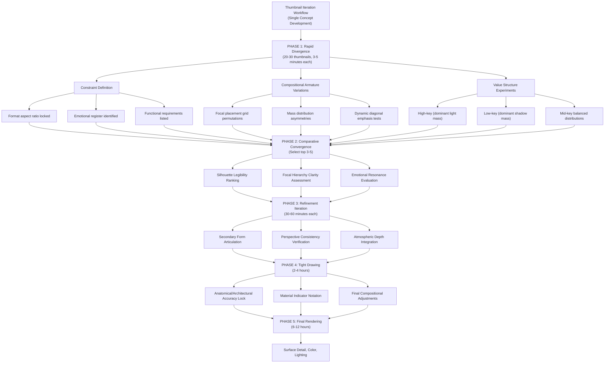

# Lesson 4: Ideation through Iteration

## 1. First-Principles Intuition & Invariants

The primary obstacle facing any visual communicator—whether storyboard artist, character designer, environment concept painter, or compositor—is not the absence of ideas but rather the paralyzing friction between nascent mental imagery and its physical manifestation on paper or screen. The untrained artist frequently approaches the blank page with the expectation that the first mark must be precious, that line quality must be pristine from inception, and that accuracy precedes understanding. This inverted logic produces hesitant, overworked drawings that collapse under the weight of premature refinement. The professional iterative workflow reverses this paradigm entirely: velocity precedes precision, quantity generates quality, and rapid exploratory sketching—thumbnail ideation—becomes the primary vehicle for visual problem-solving.

Thumbnail sketching is not merely "small drawings" but rather a structured protocol for externalizing and stress-testing visual hypotheses at maximum cognitive throughput. The core invariant governing this process is the inverse relationship between sketch fidelity and conceptual exploration bandwidth. When working at postage-stamp scale—typically one to three inches in maximum dimension—the physical constraints of the format enforce several critical disciplines simultaneously. Fine motor control becomes impossible, eliminating the temptation to render prematurely. Spatial relationships compress into their most essential geometric primitives: masses resolve into simple shapes, value structures reduce to three-tone statements (light, mid, shadow), and compositional armatures become immediately legible. This compression is not a limitation but a feature, functioning as a high-pass filter that strips away decorative detail and exposes the underlying structural skeleton of the image.

The velocity achievable at thumbnail scale transforms the economics of exploration. Where a single rendered illustration might consume eight to twelve hours, a thumbnail exploration phase generates twenty to fifty viable compositional variations in the same timeframe. This production rate fundamentally alters the risk calculus of visual decision-making. When iteration cost approaches zero, the artist no longer needs to "guess correctly" on the first attempt. Instead, the thumbnail phase becomes a parallel processing engine, running multiple compositional hypotheses simultaneously and allowing comparative evaluation to surface the strongest solution organically. This is not wasteful redundancy but rather systematic elimination of suboptimal paths through the solution space.

The iterative refinement pipeline operates as a progressive resolution cascade, where each stage increases fidelity while narrowing conceptual options. Thumbnails establish compositional architecture and value structure. Refined sketches introduce form articulation and spatial depth cues. Tight drawings lock down anatomical accuracy and perspective consistency. Final rendering applies surface texture, atmospheric effects, and material properties. Each transition gate represents a deliberate checkpoint: only compositions that satisfy structural integrity requirements advance to higher fidelity investment. This gating mechanism prevents the catastrophic waste of rendering time on fundamentally broken designs, a failure mode endemic to artists who attempt to "fix it in post."

The notation systems employed during rapid ideation must balance capture fidelity against execution velocity. Visual shorthand conventions—gestural line rhythms, symbolic mark-making for texture classes, value hatch patterns, annotation arrows indicating motion vectors or lighting direction—function as a personal visual language optimized for maximum information density per unit time invested. These conventions are not arbitrary but emerge from the constraint that during the white-heat of exploratory sketching, the hand must keep pace with the eye and the conceptual stream must flow uninterrupted. The moment execution latency breaks this synchronization, cognitive momentum stalls and the generative state collapses.

## 2. Core Architecture & Mechanics

The thumbnail exploration phase operates as a structured divergence-convergence cycle engineered to maximize solution space coverage while maintaining evaluative coherence. The canonical protocol begins with constraint definition: format aspect ratio (square, landscape, portrait, or cinematic 2.39:1), intended emotional register (tranquil, tense, triumphant), functional requirements (character visibility, environmental scale reading, focal hierarchy), and production context (standalone illustration, sequential narrative panel, keyframe for animation). These parameters bound the solution space without prescribing specific visual answers, creating a generative framework rather than a prescriptive template.

The initial divergence phase prioritizes quantity over refinement, typically targeting a minimum threshold of twenty discrete compositional variations executed in rapid succession without self-editing. The physical setup enforces discipline: thumbnails are drawn in continuous grid arrays on a single sheet, preventing the artist from discarding "failed" attempts and ensuring all explorations remain visible for comparative analysis. This visibility is critical—compositional solutions often emerge not from isolated brilliance but from recognizing patterns, rhythmic repetitions, or negative space relationships across multiple thumbnails that would remain invisible if evaluated in isolation.

The geometric armature underlying each thumbnail begins with the division of the picture plane into primary masses. The Rule of Thirds grid—dividing the frame into nine equal rectangles via two horizontal and two vertical lines at one-third intervals—provides default anchor points for focal placement, but more sophisticated compositional structures leverage dynamic symmetry rectangles, diagonal reciprocals, and phi-ratio subdivisions. The critical insight is that the eye reads spatial relationships before it reads representational content: a figure silhouette placed on a rule-of-thirds intersection point commands attention regardless of rendering quality, while a meticulously rendered figure floating in dead-center compositional space remains visually inert.

Value structure functions as the primary compositional organizing principle during thumbnail ideation. The three-value reduction protocol compresses the full luminance range into discrete zones: highlight mass (top 20% of the value scale, typically reserved for primary focal elements or light sources), midtone mass (middle 60%, establishing environmental context and secondary forms), and shadow mass (bottom 20%, providing contrast anchors and negative space). This compression forces explicit decisions about silhouette legibility and spatial depth cueing. A successful thumbnail reads clearly when squinted at or viewed from across the room—the acid test for compositional clarity.

The refinement bridge between thumbnail and tight drawing introduces secondary form articulation without sacrificing compositional integrity. At this intermediate scale—typically four to six inches—the artist introduces perspective structure (horizon line placement, vanishing point convergence), anatomical landmark placement (gesture line of action, joint articulation nodes, volumetric axis tilts), and spatial depth layering (foreground occlusion overlaps, atmospheric perspective gradient weakening). The critical discipline at this stage is resisting premature detail investment: edges remain softly blocked, surfaces indicated with broad value planes rather than texture rendering, and contours defined through value contrast rather than hard line boundaries.

The annotation system overlay transforms static thumbnails into dynamic procedural records. Directional arrows indicate motion vectors for character poses or compositional flow lines that guide the viewer's eye through the frame. Value notation markers—simple numerical scales (1-5 or 1-10) written adjacent to mass regions—document intended luminance relationships that may not be fully resolved in the thumbnail's limited value range. Cropping frame indicators, drawn as brackets outside the primary thumbnail boundary, test alternate compositional extractions from the same underlying arrangement. Material callout labels ("brushed metal," "wet stone," "backlit translucent fabric") capture surface quality intentions before rendering infrastructure exists to execute them. These annotations function as executable instructions for the artist's future self, preserving conceptual decisions that would otherwise evaporate between sessions.

The synthesis protocol integrates principles from prior lessons into the iterative pipeline. Gesture drawing's emphasis on dynamic motion capture informs thumbnail figure placement: even static poses retain implied directionality through weight distribution and gaze vectors. Contour economy principles—the selective emphasis and de-emphasis of edge hardness—translate directly to thumbnail silhouette design, where the eye naturally follows transitions from hard to soft boundaries. Value control disciplines from observational rendering ensure that thumbnail shadow shapes function as positive compositional elements rather than default dark regions. This recursive application of foundational skills transforms iteration from mechanical repetition into systematic knowledge integration.

## 3. High-Performance Optimization & Failure Modes

The velocity optimization imperative in thumbnail generation confronts several biomechanical and cognitive bottlenecks that novice practitioners routinely misdiagnose. The most common failure mode is mistaking "sketching faster" for "moving the hand faster," which produces only sloppy execution rather than authentic velocity gains. True throughput optimization occurs at the decision-making layer: reducing the latency between visual perception of a compositional opportunity and its physical execution on the page. This requires cultivating what master illustrators term "hand-eye-brain coordination"—a trained reflexive loop where compositional intuitions bypass conscious analytical processing and flow directly into mark-making.

The physical setup calibration directly impacts sustainable iteration rates. Drawing surface angle matters: a flat horizontal desk forces awkward wrist extension and restricts shoulder rotation, while a 20-30 degree inclined surface aligns the forearm naturally and enables full-arm gestural movements that produce fluid curves and confident diagonals. Tool selection scales to iteration phase requirements: graphite pencils (2B-4B range) provide sufficient value range for thumbnail work without the execution friction of charcoal dust or the permanence anxiety induced by ink. Digital thumbnail workflows leverage software like Photoshop's custom brush presets with opacity-pressure curves, Procreate's rapid layer duplication for variation testing, or Blender's Grease Pencil tool for frame-by-frame animatic thumbnailing. The critical insight is that tool mastery must reach unconscious competence—any cognitive overhead spent managing the medium subtracts directly from conceptual exploration bandwidth.

The temporal batching strategy addresses the creative fatigue curve inherent in sustained ideation sessions. Human visual problem-solving follows a predictable energy expenditure pattern: the first five to seven thumbnails emerge with maximal creative freshness but often replay familiar compositional patterns stored in procedural memory. Thumbnails eight through fifteen typically represent the "valley of despair" where obvious solutions are exhausted but novel approaches have not yet crystallized. The breakthrough zone—thumbnails sixteen through twenty-five—occurs only after the artist exhausts default responses and is forced into genuine experimentation. Professional studios structure thumbnail sessions to exploit this pattern: ninety-minute blocks with mandatory minimum output quotas (twenty thumbnails minimum) followed by fifteen-minute comparative review sessions and thirty-minute breaks before subsequent iteration rounds.

The comparative evaluation framework must operate on explicit criteria to avoid subjective drift and ensure consistent quality gating. Compositional strength evaluation tests silhouette legibility at thumbnail scale (place the array across the room and identify which compositions remain readable), focal hierarchy clarity (cover everything except the thumbnail in question and verify the eye lands on the intended primary element first), and emotional register alignment (does the composition's formal structure—diagonal tension, vertical stability, radial expansion—reinforce the intended narrative mood?). Value structure evaluation examines whether the three-tone compression remains distinct (no muddy mid-value merging), whether shadow shapes create positive compositional geometry (not merely absence of light), and whether highlights are reserved strategically (typically 5-10% of total picture area maximum to preserve their attention-commanding power).

The catastrophic failure mode in iterative practice occurs when the artist conflates conceptual weakness with execution refinement deficiency. A fundamentally flawed composition—poor focal hierarchy, illegible silhouette, emotionally misaligned value structure—cannot be rescued through increased rendering fidelity. This produces the terminal failure state where dozens of hours are invested polishing a structurally broken image that should have been abandoned at the thumbnail gate. The corrective discipline is ruthless: if a composition fails the squint test (compositional clarity when viewed at distance or through blurred vision) at the thumbnail phase, it is eliminated immediately regardless of hours invested in preliminary sketches. This zero-tolerance policy for structural flaws paradoxically accelerates final delivery timelines by preventing resource allocation to unsalvageable approaches.

The cross-pollination synthesis between thumbnail ideation and downstream production phases creates compound efficiency gains. Character designers generate thumbnail costume variations that simultaneously test silhouette distinctiveness, color distribution balance, and functional plausibility (armor articulation joints, fabric drape physics). Environment concept artists thumbnail camera angle variations that stress-test scale relationships, atmospheric perspective depth, and architectural landmark visibility. Storyboard artists thumbnail sequential panel arrangements that validate pacing rhythm, shot-reverse-shot eyeline continuity, and action geography comprehension. In each domain, the thumbnail phase functions not as preliminary sketching but as the primary problem-solving engine that de-risks all subsequent production investment.

The portfolio development strategy leverages thumbnail archives as both training data and creative capital. Successful professional illustrators maintain indexed thumbnail libraries—organized by subject category, compositional structure type, and emotional register—that function as external creative memory. When facing new commission briefs, these archives provide proven compositional templates that can be rapidly adapted rather than designed from scratch. More critically, the accumulated thumbnail volume serves as objective evidence of iteration discipline and conceptual range when presenting to clients or art directors, demonstrating systematic problem-solving methodology rather than single-solution guesswork.

The iterative mastery endgame transcends mechanical thumbnail generation to achieve what cognitive scientists term "perceptual chunking"—the compression of complex compositional principles into instantly recognizable patterns that bypass conscious analysis. Master artists perceive not individual line placements but holistic compositional gestalts: they see negative space as positive geometric elements, recognize value structures as sculptural forms independent of representational content, and intuit focal hierarchies through spatial rhythm and directional flow. This perceptual reorganization cannot be taught directly but emerges inevitably from sustained high-volume thumbnail practice, where repeated pattern exposure trains the visual cortex to extract compositional invariants automatically. The artist who has generated five thousand thumbnails across diverse subjects no longer consciously applies the Rule of Thirds or value compression protocols—these principles have been internalized as pre-conscious perceptual filters that shape visual attention before marks reach the page.
