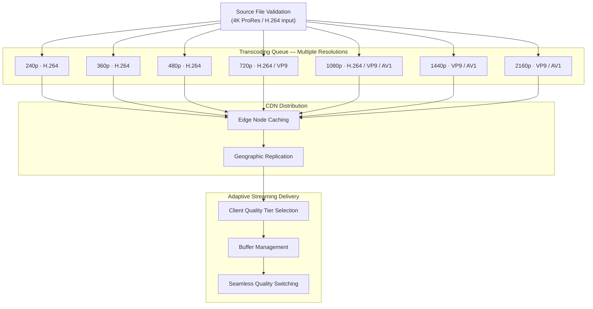

# Lesson 5: Distribution Platform Ecosystems

## 1. First-Principles Intuition & Invariants

The modern content creator operates within a fundamentally bifurcated ecosystem: the creative domain where artistic vision materializes through technical craft, and the distribution domain where algorithmic gatekeepers determine whether that work reaches human attention. Understanding this second domain requires abandoning romantic notions of meritocracy and embracing a hard reality—platform algorithms are not neutral discovery engines but sophisticated economic optimization systems designed to maximize engagement metrics, advertising inventory value, and platform retention above all other objectives.

Every major distribution platform—YouTube, Instagram, TikTok, Spotify, SoundCloud, Vimeo, Patreon—operates on a core economic invariant: they are advertising-funded attention brokers or subscription revenue aggregators whose primary fiduciary responsibility is to shareholders, not creators. This foundational truth shapes every downstream architectural decision, from recommendation algorithm weighting to monetization threshold requirements to content moderation policies. The creator who internalizes this reality gains strategic clarity; the creator who resents it wastes energy fighting immutable platform economics.

The algorithmic recommendation engine represents the central nervous system of modern distribution platforms. Unlike the chronological feeds of early social media, contemporary platforms employ multi-armed bandit optimization algorithms, collaborative filtering models, and deep neural network architectures trained on billions of interaction datapoints to predict which content will generate the highest probability of sustained user engagement. These systems do not evaluate artistic merit, technical excellence, or cultural significance—they evaluate click-through rates, watch time percentages, session duration extensions, and virality coefficients. A technically flawed but emotionally resonant fifteen-second clip will consistently outrank a masterfully crafted three-minute narrative if the former drives higher engagement velocity.

Discoverability operates on a compound interest model where initial velocity determines long-term trajectory. Platforms allocate content to progressively larger audience cohorts based on early performance metrics within seed audiences. YouTube's first twenty-four hours determine whether a video enters the "browse features" recommendation tier; TikTok's first hundred views establish baseline engagement rates that gate access to the "For You" page algorithmic lottery; Instagram's first thirty minutes of post activity influence whether content escapes follower-only distribution into explore page eligibility. This cold-start problem creates a structural advantage for creators with existing audiences and imposes a brutal discovery barrier for new entrants, regardless of content quality.

The monetization architecture across platforms follows a tiered access model that compounds inequality. YouTube requires one thousand subscribers and four thousand watch hours for Partner Program eligibility; Spotify's per-stream payout averages $0.003 to $0.005, meaning a creator needs roughly three hundred thousand streams to generate minimum wage equivalent for one month of work; Patreon takes five to twelve percent platform fees plus payment processing costs. These thresholds create survivorship bias in visible creator populations—the vast majority of content producers operate below monetization thresholds, subsidizing their work through external income sources while platforms harvest their content to train recommendation algorithms and fill content libraries.

Format specifications impose hard technical constraints that directly influence creative decisions. Instagram's one-to-one square aspect ratio dominated mobile photography composition for nearly a decade before the platform added support for vertical and horizontal formats. TikTok's nine-by-sixteen vertical video standard, optimized for single-handed smartphone consumption, has fundamentally reshaped videography conventions, prioritizing tight framing, rapid cutting, and text overlay communication over traditional cinematic composition. YouTube's codec preferences and compression algorithms reward specific production workflows—uploading in 4K even when most viewers watch at 1080p preserves more visual information post-compression due to higher bitrate allocation. These technical parameters are not neutral transmission vessels but active shapers of aesthetic evolution.

Cross-platform optimization requires understanding the distinct behavioral contexts and algorithmic priorities of each distribution channel. YouTube's long-form search-driven consumption pattern favors tutorial content, deep-dive analyses, and educational series with consistent publishing schedules. Instagram's rapid-scroll visual feed rewards immediate aesthetic impact, high contrast compositions, and the first three seconds of video content. TikTok's entertainment-first discovery algorithm prioritizes novelty, humor, and emotional intensity over production polish. Spotify's playlist-driven listening model creates bifurcated success paths—either algorithmic playlist inclusion that drives exponential discovery or playlist curator relationships that provide sustained baseline streams. A creator must develop platform-specific content adaptations rather than uniform cross-posting strategies.

Analytics frameworks provide the empirical foundation for iterative optimization, yet most creators misinterpret their own data. Vanity metrics like follower counts and total views obscure more predictive signals. YouTube's average view duration percentage reveals whether content retains attention or triggers abandonment; the precise timestamp where viewer drop-off accelerates identifies structural weaknesses in pacing or narrative construction. Instagram's "saves" metric outweighs likes as a quality signal because saving indicates genuine utility or future reference value. TikTok's completion rate and rewatch rate determine algorithmic promotion more heavily than raw view counts. Spotify's skip rate within the first thirty seconds predicts playlist algorithm exclusion. These second-order metrics provide actionable feedback loops that raw engagement numbers conceal.

Rights management infrastructure operates as a parallel technical stack beneath content distribution, though most creators only confront its complexity during conflict scenarios. Content ID systems on YouTube employ audio fingerprinting and visual pattern matching to automatically detect copyrighted material, triggering monetization redirects, geographic blocks, or takedown notices. Instagram's music licensing agreements with major labels permit thirty-second snippets in Stories but restrict full-track usage in Reels without proper clearance. TikTok's viral sound usage operates in legal gray zones where original audio creators retain nominal ownership but platform terms of service grant TikTok broad usage rights. Blockchain-based rights tracking systems and NFT distribution models promise disintermediation but currently impose prohibitive technical barriers and speculative volatility that exclude mainstream adoption.

The structural power asymmetry between platforms and creators represents the ecosystem's defining invariant. Platforms unilaterally modify algorithms without creator consultation, alter monetization policies retroactively, and terminate accounts without appeal mechanisms. YouTube's "adpocalypse" demonetization waves, Instagram's shadowbanning opacity, and TikTok's arbitrary content moderation demonstrate that creators operate as tenant farmers on platform-owned digital land, subject to landlord rule changes without recourse. This reality necessitates portfolio diversification strategies—maintaining email lists, building platform-independent websites, developing direct patron relationships, and treating social media presence as rented distribution infrastructure rather than owned assets.

## 2. Core Architecture & Mechanics

The recommendation engine architecture that governs content distribution operates on a multi-stage filtering pipeline that progressively narrows billions of candidate content items to the handful presented to each user. Understanding this pipeline's internal structure transforms abstract algorithmic anxiety into concrete optimization targets.

The initial candidate generation stage employs collaborative filtering to identify content consumed by users with similar historical interaction patterns. If User A and User B both watched videos X, Y, and Z, and User A subsequently watched video W, the system increases the probability of recommending W to User B. This approach creates taste clusters and filter bubbles—algorithmic monocultures where stylistic diversity decreases over time as recommendations reinforce existing preferences. Platforms implement deliberate exploration mechanisms, occasionally injecting statistically dissimilar content to test whether user preferences expand beyond current clusters, but these exploration phases represent a small percentage of total recommendations.

The ranking stage applies machine learning models trained on engagement prediction to score each candidate item. These models incorporate hundreds of features: video metadata (title keywords, description text, tags), creator historical performance (average view duration, upload consistency), user contextual signals (time of day, device type, watch history recency), and interaction probabilities (predicted likelihood of like, comment, share, subscribe). YouTube's ranking model specifically optimizes for expected watch time rather than click-through rate alone, penalizing clickbait content that generates high initial clicks but rapid abandonment. TikTok's model weighs completion rate and rewatch loops more heavily than total views, creating incentives for tight narrative construction over extended exposition.

The content delivery network architecture that actually transmits video and audio files to end users operates through geographically distributed edge servers that cache popular content close to viewer populations. When a user requests a video, the platform's origin server does not directly stream the file; instead, the request routes to the nearest edge node in a CDN like Cloudflare, Fastly, or AWS CloudFront. If that edge server has previously cached the content, it serves the file directly, reducing latency and origin server load. If the content is not cached, the edge server requests it from the origin, caches a copy locally, and serves it to the user. This architecture explains why newly uploaded content sometimes exhibits slower initial loading times—edge caches have not yet propagated globally.

Adaptive bitrate streaming protocols like HLS (HTTP Live Streaming) and MPEG-DASH dynamically adjust video quality based on available bandwidth. The platform encodes uploaded content into multiple quality tiers—240p, 360p, 480p, 720p, 1080p, 1440p, 4K—and segments each version into small chunks, typically two to ten seconds long. The client video player continuously monitors download speeds and buffer fullness, requesting higher or lower quality segments as network conditions change. This seamless quality switching prevents buffering interruptions but introduces encoding complexity for creators. Uploading source files at the highest practical resolution and bitrate maximizes quality preservation across all adaptive tiers, even if most viewers consume lower resolutions.



Metadata optimization represents a direct interface to the candidate generation and ranking systems. Titles and thumbnails function as the primary click-through rate drivers, but their impact extends beyond initial attraction. YouTube's algorithm parses title text for keyword relevance to search queries and suggested video associations. Including specific terminology rather than vague descriptors increases discoverability—"Neapolitan Jazz Piano Voicings Tutorial" outperforms "Cool Piano Lesson" in search relevance. However, keyword stuffing triggers spam detection penalties; natural language with strategic terminology placement balances optimization and authenticity.

Thumbnail design follows empirically validated principles rooted in visual attention research. High-contrast color schemes utilizing complementary hues increase visibility in crowded feeds. Human faces with direct eye contact and exaggerated emotional expressions leverage innate social attention mechanisms. Text overlays containing three to five words maximum communicate value propositions without overwhelming the composition. Negative space around focal subjects prevents cluttered compositions that fail to register at small mobile screen sizes. These techniques are not manipulative hacks but applications of perceptual psychology to competitive attention economies.

The description field and tags provide additional metadata signals but carry diminishing marginal returns. YouTube's algorithm no longer heavily weights tags due to historical abuse; descriptions primarily aid search discoverability and provide context for accessibility systems. Including timestamps for video chapters improves user experience and may provide minor algorithmic benefits by reducing abandonment through easier navigation. External links in descriptions historically incurred algorithmic penalties as platforms discourage off-platform traffic, though recent policy shifts have softened these restrictions.

Engagement signals—likes, comments, shares, saves—function as quality votes within the ranking model, but their weighting varies across platforms and contexts. YouTube's algorithm treats comments as a strong engagement indicator but also evaluates comment velocity relative to view count; a video with one hundred comments from one thousand views demonstrates higher intensity engagement than one hundred comments from one hundred thousand views. Instagram's algorithm elevates posts with high "saves" rates because saving indicates content utility worth returning to, while likes represent weaker passive approval. TikTok's share rate, particularly shares sent through direct messages rather than posted to feeds, signals that content resonates enough to become social currency within private relationships.

Publishing cadence and consistency directly influence algorithmic distribution through creator authority scoring. Platforms reward regular upload schedules by priming subscriber audiences for new content and maintaining active creator status within recommendation pools. A channel uploading weekly establishes predictable inventory that the algorithm can confidently slot into recommendation queues. Erratic publishing—three videos one week, nothing for two months—degrades algorithmic trust and reduces baseline distribution to existing subscribers. This mechanism favors professional creators with production infrastructure over hobbyists with inconsistent output capacity, further concentrating distribution power.

Monetization architecture layers multiple revenue streams with distinct qualification thresholds and payout structures. YouTube's Partner Program combines pre-roll, mid-roll, and post-roll advertisements, banner ads, and YouTube Premium revenue sharing. Creators earn approximately $3 to $5 per thousand monetized views (CPM), though actual rates fluctuate based on advertiser demand, content category, viewer geography, and seasonal cycles. Finance, technology, and business content commands higher CPMs than entertainment or gaming due to advertiser target demographics. December CPMs spike as brands exhaust annual advertising budgets; January CPMs crater during post-holiday spending contractions.

Streaming platforms' revenue models operate on a pro-rata system that distributes total subscription and advertising revenue proportional to each creator's share of total platform views or engagements. This structure inherently favors high-volume mainstream creators over niche artists—if a major visual creator captures one percent of all platform views in a given month, they receive one percent of the total royalty pool, regardless of how many individual viewers their content reaches. The per-view payout statistic of $0.003 to $0.005 represents an averaged abstraction; actual payouts depend on viewer subscription status (premium subscribers generate higher per-view value than ad-supported users), geographic location (views in Norway pay more than views in India due to subscription price variations), and label or platform revenue splits that often allocate seventy to eighty percent of payouts to rights holders before creators receive their contractual shares.

Patreon's direct patronage model circumvents algorithmic gatekeepers by establishing recurring payment relationships between creators and supporters. The platform charges creators five to twelve percent fees depending on service tier, plus payment processing costs of approximately 2.9 percent plus thirty cents per transaction. This structure makes small-dollar subscriptions inefficient—a two-dollar monthly pledge loses roughly fifty cents to fees, yielding a one-dollar-fifty net return. Creators optimize by offering higher-value tiers and emphasizing annual subscriptions that amortize per-transaction fees across twelve months of access.

```text
Monetization Threshold Comparison:

Platform      | Follower Req. | Watch Time | Min. Payout | Avg. RPM*
--------------|---------------|------------|-------------|----------
YouTube       | 1,000 subs    | 4,000 hrs  | $100        | $3-5
Twitch        | 50 followers  | 500 min    | $100        | $2-4
Instagram     | 10,000        | N/A        | Variable    | $0.50-2
TikTok        | 10,000        | 100K views | $50-100     | $0.20-0.40
Spotify       | None          | None       | Variable    | $3-5/1K
Patreon       | None          | None       | $0**        | N/A

*Revenue Per Mille (thousand impressions/streams)
**Patreon pays out regardless of amount, minus processing fees
```

Analytics dashboard interpretation requires distinguishing between descriptive statistics and actionable insights. YouTube Studio provides real-time traffic source breakdowns showing whether views originate from search, browse features, suggested videos, external websites, or direct links. Suggested video traffic indicates strong algorithmic promotion; browse features suggests homepage and subscription feed visibility; search traffic demonstrates keyword optimization success. A video deriving seventy percent of traffic from suggested videos has achieved algorithmic escape velocity; one receiving eighty percent from external links remains dependent on off-platform promotion.

Audience retention graphs reveal precise engagement patterns across video timelines. The first fifteen seconds typically exhibit the steepest drop-off as casual clickers immediately leave; maintaining seventy percent retention past this threshold signals effective hook construction. Mid-video retention plateaus suggest pacing issues or narrative drag; sharp drop-offs at specific timestamps indicate jarring edits, audio issues, or content mismatch between title promise and delivery. Re-watch loops visible as retention percentages exceeding one hundred percent demonstrate that segments contain rewatchable value—tutorial steps, visual demonstrations, or comedic payoffs that viewers replay.

Click-through rate (CTR) metrics measure thumbnail and title effectiveness but must be contextualized by traffic source. A ten percent CTR from homepage browse features represents exceptional performance; a three percent CTR from suggested videos after related content may be average. High CTR with low average view duration indicates clickbait misalignment—the thumbnail and title attracted clicks but the content failed to deliver on implied promises, triggering rapid abandonment. The algorithm penalizes this mismatch by reducing future distribution. Optimal performance balances strong CTR with sustained view duration, signaling that content delivers on its packaging promises.

## 3. High-Performance Optimization & Failure Modes

Cross-platform content adaptation requires understanding the distinct consumption contexts and behavioral patterns that define each distribution channel. A single piece of source content—a documentary interview, a music performance, a tutorial demonstration—must be strategically fragmented, reformatted, and recontextualized to align with platform-specific algorithmic preferences and user expectations.

YouTube long-form optimization prioritizes narrative structure and sustained engagement over rapid attention capture. Videos should front-load value propositions within the first thirty seconds through explicit promise statements or immediate demonstration of the core concept. The classic tutorial mistake involves lengthy introductions covering channel context, sponsor messages, and philosophical preambles before addressing the title's core promise. High-performing creators employ in medias res openings that drop viewers directly into the primary content, then circle back to context after establishing momentum. Mid-roll retention maintenance requires pacing variation—alternating between detailed exposition and rapid-fire summary segments prevents monotonous rhythm that induces abandonment. Strategic placement of pattern interrupts—on-screen graphics, B-roll cutaways, tonal shifts—resets attention fatigue every sixty to ninety seconds.

Instagram Reels and TikTok vertical video optimization demands fundamentally different structural approaches. The first half-second determines algorithmic fate; viewers scroll past unremarkable openings before conscious evaluation occurs. High-performing short-form content employs immediate visual or auditory hooks—jarring cuts, unexpected audio stings, text overlays posing provocative questions—that interrupt scroll momentum through pattern violation. The nine-by-sixteen vertical aspect ratio invites aggressive subject framing; compositional dead space wastes attention real estate. Faces, text, and primary subjects should dominate the frame with minimal environmental context. Pacing accelerates beyond long-form conventions; cut frequency often doubles or triples traditional editing rhythm, maintaining stimulation velocity that matches scroll-feed browsing behavior.

The algorithmic lottery of short-form platforms introduces profound unpredictability that frustrates creators accustomed to consistent performance. A creator's fiftieth video may inexplicably achieve ten million views while adjacent content languishes at ten thousand views despite identical production quality and subject matter. This variance reflects the multi-armed bandit exploration mechanism; the algorithm continuously tests content with small seed audiences, and rare statistical flukes—videos that happen to resonate with high-engagement early viewers—receive exponential promotion. Creators cannot directly control lottery outcomes but can increase ticket volume through consistent posting cadence. Posting daily or multiple times daily on TikTok multiplies lottery entries; one viral hit compensates for dozens of underperforming posts.

Thumbnail A/B testing through platform native tools or external services provides empirical data on click-through rate optimization. YouTube allows creators to test multiple thumbnail variants simultaneously, automatically rotating options and tracking performance metrics. Common split test variables include facial expression intensity, text overlay presence, background color schemes, and compositional framing. Counterintuitive results frequently emerge—subtler thumbnails occasionally outperform high-contrast clickbait designs by attracting higher-intent viewers who convert to sustained watch time, which the algorithm ultimately rewards more than raw click volume.

Audio optimization for platform compression and playback environments represents a frequently neglected technical dimension. Instagram and TikTok apply aggressive audio compression to reduce file sizes, introducing artifacts in high-frequency content and reducing dynamic range. Mastering audio with conservative peak levels around negative six to negative three dB provides headroom for platform compression without clipping distortion. Emphasizing midrange frequencies ensures intelligibility on smartphone speakers, which reproduce bass and treble poorly. Spotify's loudness normalization targets negative fourteen LUFS (Loudness Units Full Scale) for consistent playback levels across tracks; masters exceeding this target get attenuated while quieter masters remain unchanged, creating competitive disadvantage for underloud releases.

Algorithm-triggered failure modes manifest through subtle content moderation and shadowbanning mechanisms that platforms rarely acknowledge explicitly. Instagram's shadowban reduces content distribution to non-followers without notifying creators; posts remain visible to existing followers but disappear from hashtag feeds and explore pages. Triggers include excessive hashtag usage, third-party automation tools, posting copyrighted audio, or algorithmic flags for sensitive content. Detection requires monitoring reach metrics—sudden drops in non-follower impressions signal potential shadowban status. Remediation involves reducing posting frequency, avoiding flagged hashtags, and eliminating automation tools until distribution recovers over one to two weeks.

YouTube's demonetization and age-restriction policies directly impact revenue and distribution. The automated Content ID system scans uploaded videos for copyrighted audio and visual content, automatically redirecting ad revenue to rights holders or blocking videos entirely in specific geographic regions. Even unintentional background music in public spaces can trigger claims. Creators mitigate this risk through royalty-free music libraries, original compositions, or properly licensed tracks. Age restrictions reduce distribution by excluding videos from recommendation algorithms and search results for logged-out users. Common triggers include profanity, suggestive content, violence, or controversial subject matter, even in educational contexts. Appealing restrictions through YouTube's review process succeeds inconsistently; preventative content design—avoiding explicit language, providing content warnings, and focusing on educational framing—proves more reliable than post-publication appeals.

The platform abandonment risk scenario represents the ultimate failure mode—investing years building audience on a platform that subsequently becomes obsolete or hostile to creator economics. Vine's 2017 shutdown stranded creators who built followings on its six-second video format. Twitter's 2023 API restrictions broke thousands of third-party tools and analytics services. Each platform evolution reminds creators that audience relationships mediated through platform infrastructure remain contingent on platform business priorities. The mitigation strategy centers on audience ownership diversification.

Email list cultivation transforms followers into directly contactable audiences immune to algorithmic gatekeeping or platform policy changes. Converting ten percent of a social media following to email subscribers creates a portable communication channel that persists across platform migrations. Effective conversion requires explicit value propositions—exclusive content, early access, community participation—rather than generic newsletter signup requests. Regular email engagement maintains list health; sporadic communication trains subscribers to ignore messages, degrading deliverability through spam filter relegation.

Personal website development establishes platform-independent digital real estate where creators control presentation, monetization, and data collection. Website hosting costs minimal compared to the value of owning audience relationships and content archives. WordPress, Squarespace, and Ghost provide accessible content management systems requiring minimal technical expertise. Integrating email capture forms, product sales, and content archives creates a hub that social media presence drives traffic toward rather than serving as terminal destination.

Community platform diversification spreads risk across multiple audience relationship channels. A creator maintaining YouTube, Instagram, TikTok, Patreon, Discord, and email presence survives individual platform algorithm changes or policy shifts that devastate creators dependent on single distribution channels. This diversification imposes significant production overhead—adapting content to five platform formats demands substantially more effort than optimizing for one—but the risk mitigation value justifies the investment for creators dependent on digital presence for income.

Cross-promotion strategy execution requires balancing platform-specific optimization with unified brand identity. Posting identical content across all platforms wastes platform-specific opportunities and appears lazy to multi-platform followers. Instead, create platform-native primary content while strategically repurposing elements. A YouTube tutorial becomes an Instagram carousel post summarizing key points, a TikTok demonstrating one specific technique, a Twitter thread expanding on conceptual context, and a Patreon post with extended behind-the-scenes commentary. Each format delivers value within its native context while cross-promoting other platforms for deeper engagement.

Analytics-driven iteration loops transform abstract performance data into concrete creative adjustments. Establishing baseline metrics for typical content performance enables statistical identification of outlier successes and failures. When a video achieves three times typical view counts, systematically analyze distinguishing characteristics—thumbnail design, topic selection, title phrasing, publishing timing, first thirty-second hook structure. Replicate successful elements in subsequent content while varying one dimension at a time to isolate causal factors. When content underperforms, conduct similar failure analysis. Over dozens of iterations, patterns emerge that reveal audience preferences more accurately than intuition or creative instinct alone.

The platform ecosystem's trajectory continues accelerating toward short-form video dominance, algorithm-curated feeds, and creator economy fragmentation. TikTok's explosive growth pressured YouTube and Instagram to clone its format through Shorts and Reels, redirecting platform development resources and algorithmic promotion toward vertical video. Long-form content maintains niche value for educational, tutorial, and deep-dive content where sustained attention provides utility, but casual entertainment consumption increasingly fragments into sub-sixty-second chunks optimized for infinite scroll engagement.

Creators entering this ecosystem confront structural disadvantages that early adopters never faced. Saturation, algorithmic complexity, and professionalized competition raise barriers to entry. Yet opportunities persist for those willing to embrace platform realities rather than romanticizing pre-algorithmic distribution models. The creator who studies recommendation architectures, optimizes metadata scientifically, diversifies distribution channels, cultivates owned audience relationships, and iterates relentlessly on empirical feedback builds sustainable presence despite platform volatility. Success requires treating content creation as a technical discipline grounded in data-driven optimization rather than pure artistic expression awaiting algorithmic blessing.
