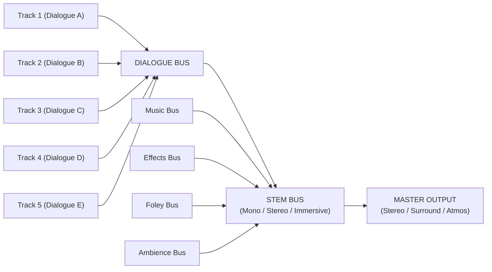

# Lesson 4: Fairlight Audio Signal Flow

## 1. First-Principles Intuition & Invariants

Audio signal flow in DaVinci Resolve's Fairlight module represents the digital equivalent of a professional analog mixing console. Just as a recording engineer patches microphones through preamps, equalizers, and compressors into a mixing desk before routing to a master bus and mastering chain, Fairlight organizes incoming audio tracks through a hierarchical routing topology where every audio decision—from individual track processing to submix grouping to master limiting—flows through discrete signal paths with measurable gain stages, phase relationships, and frequency content at each junction.

The fundamental principle underlying Fairlight's architecture is *non-destructive signal routing with real-time automation*. Unlike linear audio editing where you commit destructive edits to waveforms, Fairlight maintains a clean separation between source material and processing: audio clips remain unchanged while mixing decisions (gain, pan, effects, automation) exist as metadata layers that the playback engine renders on-the-fly during timeline scrubbing or export. This architectural choice has profound consequences for workflow efficiency, iterative creativity, and collaborative editing—a mixing decision made at 2 AM can be unmixed at noon without re-recording or re-editing the underlying tracks.

The second invariant is *hierarchical gain staging and metering accuracy*. Professional audio workflows depend on signal levels hitting standardized reference points: dialogue typically peaks at −12 to −6 dB on a mixing console (leaving headroom for dynamics), music beds sit at −18 to −12 dB, sound effects layer beneath them, and the master output targets −3 to 0 dB (leaving 3 dB of safety margin before digital clipping). Fairlight's meter bridge reflects these standards with color-coded zones: green for healthy signal (−18 to −6 dB), yellow for caution (−6 to 0 dB), and red for clipping danger. Every routing decision must preserve this headroom philosophy or you face the choice between audible distortion and dynamic range loss through aggressive downward compression.

The third invariant is *immersive audio object and bed separation*. Modern Dolby Atmos and spatial audio workflows treat the mix as two distinct entities: the *bed*—a surround or 7.1.4 immersive mix that forms the spatial foundation—and *objects*—discrete, panned audio sources (dialogue, effects, music elements) that float independently in three-dimensional space. Fairlight's routing architecture must support both paradigms simultaneously, allowing a mix engineer to construct a stereo or surround bed while simultaneously automating object positions and distances. This requires thoughtful bus architecture from the outset: you cannot retrofit object-based routing after the fact without rebuilding the entire mix topology.

The fourth invariant concerns *automation automation*, which is to say that every mixing parameter in Fairlight—volume, pan, plugin parameters, even routing itself—can be time-linked to the timeline via keyframe curves. Unlike recording-era mixing where you performed a physical fader move in real time, Fairlight decouples mixing gestures from real-time performance: you can draw a volume curve frame-by-frame, erase it, redraw it, and preview it instantly without touching hardware. This enables precision mixing impossible on analog consoles, but it also introduces a new cognitive burden: you must think of mixing as a composition process, not a performance.

## 2. Core Architecture & Mechanics

### Track-Level Signal Chain & Gain Staging

Every audio track in Fairlight follows an invariant signal path: **source clip → input fader → pan pot → track output → bus routing**. Understanding this sequence is critical because it defines where processing can live and how signal levels interact.

When you drag an audio file onto a Fairlight track, that file becomes a *clip*. The clip itself is immutable; Fairlight never modifies the underlying file when you adjust its gain or add effects. Instead, every track maintains an *input fader* (visible on the left side of the mixer panel) that scales the clip's amplitude before any processing. This input fader operates at unity gain (0 dB) by default, meaning the signal passes through untouched. When you drag the fader downward to −6 dB, you are reducing the signal's power by half (in linear amplitude terms) or 6 decibels (in logarithmic perception). Critically, the input fader affects the signal *before* any plugins inserted into that track's effects rack.

After the input fader comes the *track effects rack*—a vertical stack of plugins (EQ, compression, reverb, delay, saturation) that process the signal sequentially. Here is where the ordering becomes sacred. A compressor will perceive and respond to the signal *after* an EQ has shaped the frequency content; placing the compressor before the EQ means the compressor reacts to raw spectral content, while placing it after means the compressor only sees the EQ's output. For dialogue mixing, you typically place a high-pass filter first (removing rumble below 80 Hz), then gentle parametric EQ (de-essing sibilance, brightening presence), then compression (controlling dynamic range), then any reverb or spatial effects last. This order respects the signal's semantic intention: clean up the spectral content, tame the dynamics, then add ambience. Reversing this order—say, compressing first, then EQ—means your compressor fights against the raw sibilance peaks before they are tamed, wasting compression range on frequency bands you plan to reduce anyway.

After the track effects rack comes the *pan pot*—a stereo field control where you position the signal left, center, or right in the stereo image. The pan pot operates *after* all track-level processing, meaning any automation you draw on the pan curve affects the signal after it has been shaped by EQ and compression. This sequencing ensures that panning moves are audible and predictable: you are moving a finished signal around the stereo field, not panning a signal that may later be compressed or equalized in ways that interact unpredictably with the pan position.

Finally, after panning comes the *track output level* (often called the "fader") visible on the right side of Fairlight's mixer strip. This fader controls the signal strength at the moment of output routing. When you route a track to a bus or the master output, you are sending the signal at this output level. If the output fader is set to −3 dB, the signal arriving at its destination bus is 3 dB softer than if the fader were at 0 dB.

The practical consequence of this architecture is *gain staging integrity*. Suppose you have a dialogue track whose peaks are hitting −4 dB at the input fader (loud enough to risk clipping on the master). You have three moves: reduce the input fader to −6 dB (quieting the raw signal), apply a compressor with 4:1 ratio to tame the peaks, or reduce the track output fader to −3 dB (softening the already-processed signal). Each choice has different sonic consequences. Reducing the input fader affects how plugins perceive the signal—a compressor with a soft knee will respond differently to −10 dB peaks than −4 dB peaks. Applying a compressor preserves the peaks' transients (helpful for punch) while controlling their maximum excursion. Reducing the output fader after compression is purely a mixing decision, not an error-correction move. A professional gain-staging workflow involves setting input faders to give plugins healthy headroom (peaking around −12 dB so compressors and saturators respond musically), then using track output faders and bus faders as mixing tools to balance the final blend.

### Bus Architecture & Submix Hierarchy

The true power of Fairlight's architecture emerges when you construct *buses*—virtual mixing destinations that collect multiple tracks into a submix. A bus is simply an audio summing node where multiple tracks' outputs converge, allowing you to apply processing to an entire group (all dialogue tracks, all sound effects, all music elements) simultaneously.

In a typical television or film mixing scenario, you might construct this bus hierarchy:

Each track routes to its category bus (dialogue, music, effects, foley, ambience). Each category bus routes to a *stem bus* that collects all content for a particular delivery format (stereo mix, 5.1 surround, Atmos immersive bed). The stem bus finally routes to the master output, which represents the final mix.

This hierarchy achieves several critical goals. First, it provides *organizational clarity*: a supervising mixer can instantly identify which tracks belong to which semantic category by observing the bus topology. Second, it enables *group processing*: a compressor inserted on the dialogue bus affects all dialogue simultaneously, ensuring consistent dynamic control across multiple speakers without individually tweaking each dialogue track. Third, it allows *category-level automation*: you can automate the dialogue bus fader to duck dialogue during intense action sequences, then un-duck during dialogue-heavy scenes, all without touching individual track faders. Fourth, it supports *stem export*: when you finish the mix, you can export each bus independently (dialogue stem, music stem, effects stem) so the client can re-mix or re-conform each category without re-exporting the entire master.

In Fairlight, creating a bus is straightforward but requires intentional configuration. You navigate to the Mixer panel and create a new track, designating it as a *bus track* rather than an audio input track. The bus track appears in the mixer with a distinctive icon (usually a highlighted background). When you want to route Track 1 to the Dialogue Bus, you right-click on Track 1's output routing menu and select "Dialogue Bus" from the available destinations. Track 1's signal now flows through its effects rack, pan pot, and output fader, then arrives at the Dialogue Bus's input where it summons with other dialogue tracks.

Here is where bus-level effects become powerful. If you insert a compressor on the Dialogue Bus with a 2:1 ratio and −18 dB threshold, the compressor sees the *summed* signal from all five dialogue tracks. When the dialogue collective peaks above −18 dB, the compressor gently reduces all dialogue simultaneously, preserving the relative balance between speakers while preventing any single dialogue spike from overwhelming the mix. This is far more elegant than compressing each track individually, which often results in pumping artifacts or loss of natural dynamics.

A critical subtlety emerges when you nest buses: if the Dialogue Bus routes to a Stem Bus, and the Stem Bus routes to Master, you have created a *bus tree* where processing cascades through levels. A compressor on the Dialogue Bus affects only dialogue; a compressor on the Stem Bus affects the summed dialogue, music, effects, foley, and ambience collectively. The order matters profoundly. Compressing dialogue first, then compressing the stem ensures consistent control at multiple scales: the dialogue compressor handles relative balance between speakers, the stem compressor handles overall dynamic range. Reversing this order—compressing the stem first, then dialogue—means the stem compressor may squash dialogue peaks before the dialogue compressor can react, potentially muting dialogue entirely if the stem compressor's ratio is aggressive.

### Automation & Parameter Control

Fairlight's automation system decouples mixing parameters from real-time performance, enabling frame-accurate control over volume, pan, plugin parameters, and even routing decisions. Every automatable parameter in Fairlight maintains a *keyframe curve*—a series of time-linked points that define how the parameter changes across the timeline.

The most fundamental automation is *volume automation*, where you draw a curve on the volume fader to change its level over time. Suppose a dialogue line peaks at an awkward moment, ruining the mix. Rather than compressing the entire track, you can draw a volume curve that reduces the fader by 2 dB exactly at that moment, then returns to normal. This is *surgical* mixing: you are targeting a specific problem without affecting the entire track's character. Volume automation is typically drawn directly on the mixer fader by clicking and dragging; Fairlight creates keyframes automatically as you click.

*Pan automation* works identically but controls stereo position. Imagine a sound effect that should move from left speaker to right speaker as a character walks across the frame. You automate the pan pot from −100 (hard left) to +100 (hard right) over the duration of the walk, and Fairlight smoothly interpolates the pan position between keyframes at every sample in the audio engine. The movement is continuous and imperceptible (unless you deliberately use step automation for a mechanical effect).

*Plugin parameter automation* extends this principle to every knob, slider, and button on an inserted plugin. A compressor has automatable threshold, ratio, attack, and release parameters. You might automate the threshold lower during quiet dialogue and higher during shouting, causing the compressor to behave more aggressively when needed. This is far more musically intelligent than a static compressor setting that either over-compresses quiet passages or under-compresses loud ones. Similarly, an EQ's gain can be automated to brighten dialogue during moments where it competes with music, then revert to neutral during quiet scenes.

The interpolation mode between keyframes determines how Fairlight renders the parameter's movement. *Linear interpolation* draws a straight line between keyframes, causing parameter values to change at a constant rate. This is suitable for gradual fader moves or pan sweeps where smooth, predictable motion is desired. *Bezier interpolation* allows you to specify curve shape at each keyframe, enabling ease-in and ease-out behavior; a volume duck with Bezier curves feels more natural because the volume dips smoothly rather than jerking downward in a straight line. *Step automation* jumps instantaneously from one keyframe value to the next without interpolation, useful for switching parameters (like toggling a plugin on/off) without audible transitions.

A advanced automation technique is *preset morphing*, where you automate a plugin's preset selection itself rather than individual parameters. Suppose you have two compressor presets: "Light" with 1.5:1 ratio for gentle control, and "Heavy" with 4:1 ratio for aggressive squashing. You can automate the preset selection to switch from Light to Heavy during an action sequence, then revert to Light during dialogue. Fairlight smoothly crossfades the plugin's parameter values between presets, avoiding audible clicks or parameter jumps. This enables semantic mixing decisions: you are not thinking in terms of specific threshold/ratio numbers but in terms of *compression philosophy* (light control vs. aggressive control), which maps more naturally to the creative intent.

Critically, automation curves are *non-destructive and infinitely revisable*. You can delete automation keyframes, redraw curves, audition changes in real time, and print the mix. If the client requests a different mixing choice hours later, you simply modify the automation curve rather than re-mixing from scratch. This iterative flexibility is Fairlight's greatest advantage over analog mixing.

### Fairlight FX Plugin Chain Order & Spectral Processing

The sequence in which plugins sit on a track fundamentally affects the audio's sonic character. This is not merely a preference—it is a psychoacoustic and signal-processing reality rooted in how each plugin perceives and transforms the signal it receives.

The canonical professional order for a dialogue or vocal track is: **High-Pass Filter → Parametric EQ → Saturation (optional) → Compressor → De-Esser (if needed) → Reverb/Delay**. Each stage has a distinct role and perceives a different signal state.

The *high-pass filter* (typically a 12 or 24 dB/octave slope) removes low-frequency rumble, wind noise, and proximity bass that clutters the dialogue intelligibility. Setting the filter cutoff at 80 Hz removes content below that frequency while preserving the fundamental frequencies of male and female speech (which typically live between 85 Hz and 3 kHz). This filtering happens first because it cleans the raw signal before any other processing attempts to shape it. If you placed a compressor before the high-pass filter, the compressor would waste dynamic range reacting to sub-80 Hz rumble that you plan to discard anyway.

The *parametric EQ* enters next, allowing surgical frequency shaping. For dialogue, typical moves include a gentle shelf boost around 2 to 4 kHz (presence region, making dialogue pop forward in the mix) and a subtle cut around 5 to 8 kHz if sibilance is problematic (before de-essing). The EQ perceives the signal after rumble has been removed, so you are shaping perceptually relevant content. If you applied EQ before high-pass filtering, the EQ might boost energy in frequency bands destined for removal, wasting processing resources.

*Saturation* (soft clipping, distortion, or tape modeling) optionally follows EQ, adding harmonic richness and slight signal compression through nonlinear processing. For dialogue, subtle saturation (5 to 15% wet signal) can add warmth and presence, making intimate dialogue feel closer. Saturation perceives the EQ'd signal, so it colors the finalized spectral content rather than raw input. However, saturation adds complexity and is typically used only when the raw dialogue sounds thin or digitally harsh; for clean dialogue, this stage is often bypassed.

The *compressor* follows, taming dynamic range after spectral shaping. The compressor now sees a cleaned, EQ'd, possibly saturated signal. It reacts to perceptually relevant content and prevents peaks from exceeding a target level. A typical dialogue compressor uses a 4:1 ratio with −18 dB threshold, 10 ms attack, and 100 ms release, creating gentle dynamic control that constrains shouting without muting whispered dialogue. The compressor perceives the signal after EQ has brightened the presence region, so high-frequency peaks (often from sibilance or plosives) are slightly more visible to the compressor; this is intentional—the compressor catches these peaks before they become problems.

The *de-esser* optionally enters after compression, addressing sibilant energy (the /s/ and /sh/ sounds in speech that can feel harsh). A de-esser is a specialized compressor that triggers only when specific frequency bands (typically 5 to 8 kHz) exceed a threshold, reducing only those frequencies rather than all frequencies. By placing it after the main compressor, you avoid double-compressing the entire signal; instead, you surgically control only the problematic sibilance band. The main compressor may have already tamed some sibilance, so the de-esser captures any remaining peaks that slip through.

Finally, *reverb or delay effects* enter last. These are "return" effects that should perceive the compressed, de-essed signal, not the raw input. By placing reverb at the end of the chain, you ensure that the reverb tail receives a finalized, controlled signal; if reverb preceded compression, the compressor would react to the reverb's reflections, potentially compressing the natural spatial decay you are trying to add. Additionally, reverb at the end chain allows you to adjust the wet/dry blend independently; the effect's output level can be set so reverb never exceeds a defined maximum, preventing the effect from drowning the dialogue.

This ordering principle extends to all tracks: *corrective processing* (high-pass, EQ, compression) comes before *creative processing* (saturation, reverb, delay). Corrective processing shapes what is there; creative processing adds what is not. If you reverse this order, creative effects pollute the signal that corrective tools must clean, requiring more aggressive correction and losing musicality.

### The Fairlight Meter Bridge & Loudness Standards

Fairlight's meter bridge displays real-time signal levels at multiple points in the signal chain, providing empirical feedback for gain-staging decisions. Understanding the meter hierarchy is essential for professional mixes that deliver consistent loudness across platforms.

The *input meter* (on each track) displays the signal level at the track's input fader. Healthy input levels typically peak around −12 to −6 dB, leaving headroom so plugins (especially compressors and saturators) perceive a clean signal without excessive headroom waste or risk of digital clipping. If a dialogue track's input peaks at 0 dB, the signal is too hot; reducing the input fader by 6 dB gives plugins something to work with. If the input peaks at −20 dB, the signal is too quiet; the compressor must operate on very small numbers, potentially triggering noise floor or losing dynamic range.

The *output meter* (on each track and bus) displays the signal level at that fader's output. This is where you see the effect of mixing moves: compressing a track reduces its output level, expanding it increases the level. Professional mixing targets specific output levels for each category. A dialogue bus typically peaks at −6 to −3 dB, a music bus at −12 to −6 dB, and an effects bus at −12 to −9 dB. The master output should peak at −3 to 0 dB, leaving 3 dB of safety headroom before digital clipping. If the master peaks at +2 dB, the mix is clipping; you must reduce one or more elements (dialogue, music, or effects) to bring the master below 0 dB.

Fairlight's meters support multiple loudness standards. The *PPM* (Peak Programme Meter) displays true peak levels, useful for preventing clipping. The *VU* meter displays average perceived loudness, mimicking analog console behavior. The *LUFS* (Loudness Units Relative to Full Scale) meter displays integrated loudness based on ITU-R BS.1770 standardization, essential for streaming delivery where platforms normalize all content to a target loudness (−14 LUFS for YouTube, −16 LUFS for Netflix, −23 LUFS for broadcast). Modern mixing requires checking both PPM (peak safety) and LUFS (perceived loudness) simultaneously. A mix may peak at −3 dB (safe from clipping) but integrate at −20 LUFS (too quiet relative to streaming standards), requiring gain adjustments across the mix to bring LUFS closer to the platform target without exceeding PPM limits.

## 3. High-Performance Optimization & Failure Modes

### Real-Time Rendering & CPU Efficiency

Fairlight computes every automation keyframe and plugin effect in real time as you scrub the timeline or play back. This computation burden scales with the number of tracks, plugins, and automation complexity. A 50-track mix with dense EQ and compression on every track, plus reverb sends, plus Atmos object automation can consume significant CPU resources. Optimization strategies become essential to maintain responsive playback without audio dropout.

The first optimization is *freezing tracks*, which pre-renders a track's effects chain into a temporary cached audio file. Once frozen, Fairlight plays back the cached audio instead of computing plugins in real time, freeing CPU. However, freezing is not final; you can unfreeze at any moment to adjust plugins or automation. Professional workflows freeze dialogue and effects tracks once their mixing is finalized, keeping music and dialogue bus tracks unfrozen for last-minute tweaks. Freezing has a critical caveat: if you freeze a track before finalizing its bus routing or master processing, changes to the bus compressor or master EQ will not affect the frozen track. You must unfreeze to incorporate downstream changes.

The second optimization is *plugin instance sharing*.

Many DAWs share identical plugin instances across multiple tracks when the same plugin is inserted with identical settings, reducing CPU load. Fairlight, however, instantiates a separate plugin process for each track by default, which can double or triple CPU usage in sessions where the same EQ or compressor appears on 20+ tracks. To mitigate this, professional mixers consolidate common processing to buses—routing all dialogue tracks through a single dialogue bus with one EQ and one compressor, rather than placing those plugins on each individual track. This bus-centric approach mirrors analog console workflows where all channels of a given type (drums, vocals, dialogue) are summed into a group bus before hitting master processing. The trade-off is loss of per-track granularity; if one dialogue clip requires different EQ, it must be handled via clip-level effects or a separate routing path. The third optimization is *sample rate and buffer size management*. Higher sample rates (96 kHz, 192 kHz) double or quadruple the number of samples processed per second, increasing CPU load proportionally. Professional workflows use 48 kHz for final delivery unless the project explicitly requires high-resolution audio for theatrical release. Buffer size controls the latency between when Fairlight computes audio and when you hear it. Smaller buffers (64 samples) give near-zero latency for recording but require more frequent CPU interrupts, increasing dropout risk. Larger buffers (1024 samples) introduce noticeable delay but allow smoother playback. Standard practice: use 128–256 samples during mixing, increase to 512–1024 for final render if dropout occurs.

Failure modes in Fairlight signal flow are almost always traceable to routing misconfiguration, clipping, or plugin overload. The most common failure is *silent bus output*: you hear tracks in solo but not in the mix. This indicates the track is routed to a bus that is either muted, disabled, or not routed to the master. The diagnostic is to check the track's output assignment in the mixer, verify the bus fader is up and enabled, then confirm the bus routes to the master output. The second failure is *pre-fader send clipping*: a reverb or delay bus distorts even though the source track is at reasonable levels. This occurs when the pre-fader send is set too high, sending a hot signal to the bus before the track fader attenuates it. The fix is either switching to post-fader sends or reducing the send level. The third failure is *automation fighting manual adjustments*: you move a fader during playback, but it snaps back to its automated position. Fairlight's automation read mode overrides manual input unless switched to latch or touch mode, where manual moves create new keyframes. The final critical failure is *plugin latency accumulation*: some plugins (especially linear-phase EQs and look-ahead limiters) introduce processing delay. When multiple such plugins are chained across tracks and buses, the cumulative latency can desynchronize audio from video by tens of milliseconds. Fairlight compensates automatically via plugin delay compensation (PDC), but PDC can be disabled by user error or fail when plugin latency reporting is incorrect. The diagnostic is to check the PDC indicator in the mixer and verify all plugins report their latency accurately to the host.

## Summary & Verification Matrix

| **Invariant / Mechanism** | **Governing Rule** | **Diagnostic Criterion** | **Failure Mode** |
|---------------------------|-------------------|-------------------------|-----------------|
| **Signal Flow Hierarchy** | Track → Bus → Master, each stage sums inputs and applies processing. No stage can amplify beyond 0 dBFS without clipping. | Solo the master output; if silent, verify bus routing. Solo the bus; if silent, verify track outputs target that bus. | Bus assigned but muted, or bus not routed to master. Track routed to wrong bus. |
| **Pre/Post-Fader Topology** | Pre-fader sends sample signal before volume fader; post-fader sends sample after. Pre-fader is independent of track level; post-fader is proportional. | Mute the source track. If the reverb/delay persists, the send is pre-fader. If it stops, the send is post-fader. | Pre-fader send overloads the effects bus when the source track is reduced. Post-fader send disappears when the track is soloed if not configured correctly. |
| **Metering Standards** | PPM measures instantaneous peaks (protect converters). LUFS measures integrated loudness (match platform targets). A mix can be peak-safe but too quiet, or vice versa. | Peak meter hits −3 dB max; LUFS integrates to −16 LUFS (Netflix) or −14 LUFS (YouTube). If LUFS is −20, raise overall gain without exceeding PPM limits. | Mix peaks at −6 dB but integrates at −10 LUFS: platform normalizer will reduce gain, losing headroom. Mix integrates at −14 LUFS but peaks at +2 dB: clipping on export. |
| **CPU Optimization** | Freezing pre-renders effects; bus-centric routing reduces plugin instances; sample rate and buffer size control CPU load vs. latency. | Freeze finalized tracks, route common processing (EQ, compression) to buses, use 48 kHz and 256-sample buffer for mixing. Monitor CPU meter during playback. | Frozen track does not respond to bus changes (must unfreeze). Per-track plugin duplication exhausts CPU. Dropout occurs at low buffer sizes under high CPU load. |
| **Automation Modes** | Read plays back keyframes. Latch overwrites all downstream automation. Touch writes automation only while the control is held. Manual moves are ignored in Read mode. | Switch to Touch mode; move a fader during playback. If new keyframes appear on the timeline, automation is writing correctly. If fader snaps back, mode is still in Read. | Automation in Read mode ignores manual adjustments. Latch mode accidentally overwrites existing automation past the intended edit point. |
| **Plugin Delay Compensation** | High-latency plugins (linear-phase EQ, look-ahead limiters) delay audio. PDC shifts all tracks to maintain sync. PDC failure desynchronizes audio and video. | Check PDC indicator in mixer. Render a sync reference (beep + flash). If audio lags video by >10 ms, PDC is disabled or a plugin misreports latency. | PDC disabled in preferences. Plugin does not report latency to host. Cumulative latency exceeds PDC buffer limits (rare above 10,000 samples). |
