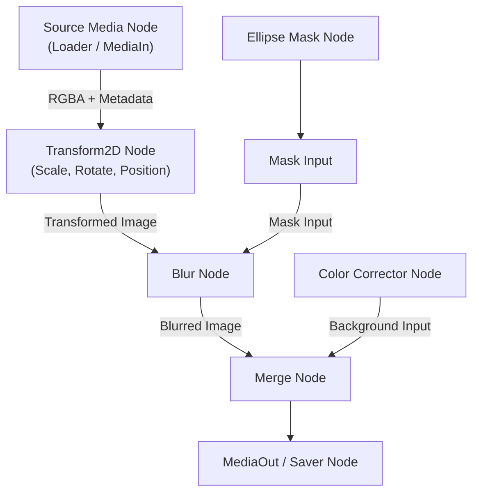
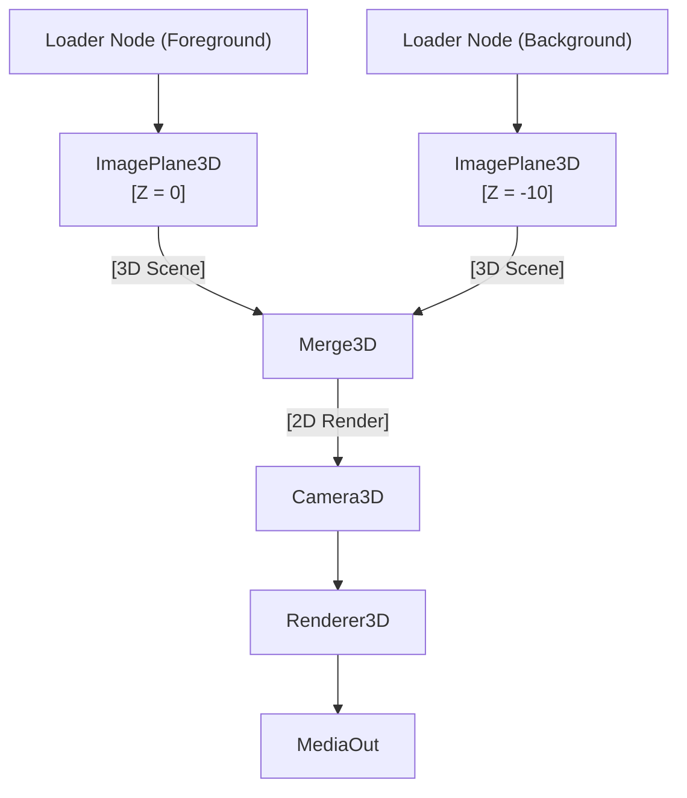

# Lesson 5: Fusion Compositing Node Pipeline

## 1. First-Principles Intuition & Invariants

The transition from layer-based compositing to node-based architecture represents a fundamental shift in how visual effects artists conceptualize image manipulation pipelines. Traditional layer stacks, familiar from applications like Adobe After Effects or Photoshop, enforce a strictly linear top-to-bottom evaluation order where each layer paints atop the previous one in a predetermined sequence. This paradigm mirrors the physical act of stacking acetate cels in traditional animation, where spatial ordering dictates visibility. While intuitive for simple composite tasks, layer-based systems impose severe constraints on complex branching operations, non-destructive experimentation, and the reuse of intermediate processing results across multiple output paths.

DaVinci Resolve's Fusion page adopts a node-based compositing paradigm rooted in dataflow programming principles, where image processing operations exist as discrete computational units connected by explicit data channels. Each node represents a self-contained transform function that accepts input images, manipulates pixel data according to its algorithm, and outputs the transformed result downstream. The directed acyclic graph structure of the node tree allows multiple operations to branch from a single source, reconverge through merge operations, and feed parallel processing chains without duplicating upstream work. This architectural model traces its lineage to scientific visualization systems like AVS and industrial compositing tools like Nuke, where the need to manage hundreds of interdependent operations demanded a more flexible execution model than simple layer stacks could provide.

The core invariant of node-based compositing lies in the distinction between the graph topology—the structural arrangement of nodes and their connections—and the evaluation order determined by dataflow dependencies. Unlike layer stacks where evaluation proceeds in fixed spatial order, node graphs evaluate lazily based on demand propagation: when the final output node requests pixel data, it recursively queries its upstream dependencies, which in turn query their inputs, cascading back to the original source media nodes. This pull-based evaluation model enables the renderer to skip entire branches that do not contribute to the final output, automatically optimizing computation without manual intervention. The render cache intelligently tracks which nodes have already been computed for the current frame, preventing redundant recalculation when multiple downstream nodes share the same upstream source.

Fusion's node graph operates on RGBA floating-point image buffers augmented with auxiliary channels for depth information, motion vectors, world position coordinates, and object masks. Each connection between nodes carries not merely pixel color data but a rich packet of metadata describing the image's color space, pixel aspect ratio, frame rate, and spatial resolution. When nodes with mismatched resolution or aspect ratio connect, Fusion automatically inserts implicit resampling operations governed by the project's quality settings, though these hidden transforms can introduce subtle artifacts if the compositor remains unaware of the underlying conversions. Understanding that every visual artifact in a composite ultimately traces back to either incorrect data propagation through the node graph or mismatched metadata between connected branches forms the diagnostic foundation for troubleshooting complex shots.

The mathematical model underlying merge operations extends far beyond simple alpha compositing. While the standard Over operator implements the Porter-Duff compositing algebra familiar from 2D graphics—blending foreground and background based on alpha transparency using the formula `Cout = Afg × Cfg + (1 - Afg) × Cbg`—Fusion provides dozens of blend modes implementing alternative mathematical transforms. Screen mode inverts both inputs, multiplies them, and inverts the result, effectively simulating the optical behavior of projecting two images onto the same surface. Multiply mode performs element-wise channel multiplication, darkening the composite and modeling subtractive color mixing like overlapping theatrical gels. Each blend mode embeds specific assumptions about the physical or perceptual relationship between foreground and background layers, and selecting the wrong mode for a given composite often produces visually plausible but physically incoherent results that betray the artificial nature of the effect.

Three-dimensional compositing within Fusion's 3D workspace introduces coordinate system transformations that differ fundamentally from 2D image plane manipulations. When a 2D image enters the 3D environment through an ImagePlane3D node, it becomes a textured quadrilateral existing at a specific XYZ position within a virtual camera's view frustum. The camera's projection matrix transforms 3D world coordinates into normalized device coordinates, which then map to final pixel positions through the viewport transformation. This pipeline mirrors the vertex processing stages of real-time GPU rendering, allowing Fusion to integrate genuine 3D elements—particle systems, 3D text, geometric primitives—directly into the composite without pre-rendering them to 2D plates. The critical insight is that 3D compositing does not merely add depth blur and parallax to 2D layers; it constructs a true volumetric scene where lighting, shadows, and occlusion obey physically consistent rules governed by the same rendering equations that drive game engines and 3D animation software.

Motion tracking algorithms in Fusion extract temporal correspondence data from footage, encoding how pixel regions move across frames into either point tracks or planar surface tracks. Point trackers identify high-contrast features and follow them using optical flow algorithms that minimize pixel intensity differences between consecutive frames within a search window. These single-point tracks capture translation and, when multiple points are tracked simultaneously, enable the reconstruction of rotation and scale through least-squares fitting of affine transforms to the point constellation. Planar trackers, by contrast, analyze entire rectangular regions and compute the homography—a perspective transformation matrix—that maps the tracked surface from frame to frame. Planar tracking proves essential for tasks like screen replacements or stabilizing footage of flat surfaces photographed from varying angles, where simple point tracks fail to capture the perspective distortion inherent in the camera motion.

Keying algorithms, the computational heart of chroma key compositing, must distinguish foreground subjects from background screens based solely on color information while preserving fine edge detail like hair strands and motion blur. The Primatte keyer operates in a perceptually uniform color space where it constructs a 3D convex hull around sampled background colors, classifying pixels inside this hull as background and those outside as foreground. The algorithm's sophistication lies in its handling of the boundary region—pixels whose color falls near the hull surface—where it computes partial transparency based on the pixel's distance from the hull boundary. Delta Keyer, conversely, works by computing color difference vectors between each pixel and the sampled key color, then applying adjustable tolerances to classify pixels into foreground, background, and edge categories. The fundamental challenge both algorithms face stems from color spill, where colored light from the green or blue screen reflects onto the subject, contaminating foreground pixels with hues similar to the background and undermining the color-based classification. Advanced keying workflows always include explicit spill suppression nodes that selectively desaturate or shift contaminated foreground colors back toward neutral tones.

Temporal effects—operations that depend on pixel data from multiple frames—require Fusion to maintain frame buffers for past and future frames simultaneously, a memory-intensive operation that distinguishes temporal processing from purely spatial transforms. Optical flow analysis, used for motion-based effects like time remapping and motion blur synthesis, computes dense motion vector fields that describe how every pixel moves between frames. These motion vectors, stored as two-channel UV maps where the red and green channels encode horizontal and vertical displacement respectively, enable the renderer to synthesize intermediate frames by warping existing frames along the computed motion paths. The accuracy of temporal effects depends critically on the quality of the motion estimation: discontinuities in the motion field at object boundaries, occlusions where background becomes visible, and fast-moving objects that exceed the optical flow algorithm's search radius all produce visible artifacts that manual correction can rarely fully eliminate.

Macro encapsulation allows compositors to collapse entire node subgraphs into single reusable units with published input and output ports, implementing a crucial abstraction mechanism for managing complexity in large composite trees. A macro internally maintains its own isolated node graph but presents a simplified interface to the parent composition, hiding implementation details and reducing visual clutter. The disciplined use of macros transforms node trees from sprawling tangles of hundreds of interconnected nodes into hierarchical structures where each macro represents a logically distinct processing stage—beauty pass integration, lens distortion compensation, color grade, final output formatting. This hierarchical organization not only improves human readability but also facilitates debugging by localizing problems to specific functional blocks: when an artifact appears in the final output, the compositor can progressively disable macros until the problem vanishes, immediately identifying which processing stage introduced the defect.

## 2. Core Architecture & Mechanics

The Fusion node graph editor visualizes the dataflow topology as a two-dimensional canvas where nodes appear as labeled rectangles and connections manifest as lines drawn between input and output ports. Each node declares its interface through a set of typed input ports—typically including a primary image input, a mask input for regional application of effects, and an effects mask for modulating effect strength—and one or more output ports carrying the processed result. The fundamental rule governing node connections states that each input port accepts exactly one connection, preventing ambiguity about which upstream node provides data, while output ports can fan out to multiple destinations, enabling a single processing result to feed multiple downstream operations without recomputation.

The rendering engine evaluates this graph through a recursive traversal beginning at the output nodes and working backward through dependencies. When MediaOut requests the final frame, it queries its input connection, which propagates the request upstream through the Merge node. The Merge node, requiring both foreground and background inputs, simultaneously requests data from the Blur node and the Color Corrector node. The Blur node queries the Transform2D node, which ultimately requests the original frame from the Loader node. As each node receives the data from its dependencies, it executes its processing algorithm and passes the result downstream, with the final composite emerging at the MediaOut node only after all upstream dependencies have completed their computations.

Merge nodes implement the critical operation of combining multiple image streams into a unified composite, with the Merge node presenting three essential input ports: foreground, background, and optional mask. The foreground image composites over the background according to the selected blend mode, with the mask controlling the spatial application of the merge—white mask regions apply the merge at full strength, black regions ignore the foreground entirely, and intermediate gray values produce proportional blending. The Apply Mode dropdown determines how the blend mode interacts with the alpha channel, offering choices like Normal (respects foreground alpha), Screen (ignores alpha, useful for additive light effects), and Multiply (preserves shadows in the background). The Blend slider provides a global opacity control, scaling the effect strength uniformly across the entire frame without requiring a separate mask node.

Understanding the distinction between premultiplied and straight alpha proves essential for avoiding edge artifacts in composites. In straight alpha representation, the RGB color channels store the actual object color independent of transparency, with the alpha channel separately encoding opacity. A semitransparent red pixel might have RGB values of (1.0, 0.0, 0.0) with an alpha of 0.5, indicating pure red at half transparency. Premultiplied alpha, conversely, multiplies the RGB channels by the alpha value during storage, so the same pixel becomes (0.5, 0.0, 0.0, 0.5). This representation offers computational advantages for compositing because the blend operation simplifies to `Cout = Cfg + (1 - Afg) × Cbg`, eliminating one multiplication per pixel. However, mixing premultiplied and straight alpha images in the same composite introduces fringing artifacts as the math assumes consistent alpha handling. Fusion defaults to premultiplied alpha internally, but when importing media from external sources, the compositor must verify the alpha type in the Loader node's attributes and enable the appropriate interpretation flag.

The 3D workspace fundamentally alters the compositing paradigm by introducing a virtual camera, world coordinate system, and true depth sorting of elements. Creating a 3D merge requires replacing standard Merge nodes with Merge3D nodes, which accept 3D scene inputs rather than flat image streams. An ImagePlane3D node converts a 2D image into a 3D card—a rectangular polygon positioned in 3D space—with transform controls for XYZ position, rotation on all three axes, and independent XY scale. Multiple ImagePlane3D nodes feed into a Merge3D node, which performs depth-sorted compositing based on each element's Z-distance from the camera, with nearer elements automatically occluding farther ones regardless of connection order in the node graph. The Camera3D node defines the viewpoint from which the scene renders, with adjustable field of view, near and far clipping planes, and depth of field parameters that simulate realistic lens optics.

Tracker nodes extract motion data from source footage through pattern matching algorithms that localize and follow visual features across frames. A standard Tracker node allows the placement of multiple tracking points within the viewer, each defined by a pattern rectangle (the reference image to track) and a search rectangle (the region in subsequent frames where the algorithm hunts for the pattern). The tracking operation proceeds either forward from the current frame or backward, computing XY position offsets for each tracked point at every frame and storing this data as an animated path. The Operation Mode dropdown determines what transform the tracker derives from the point data: a single-point track extracts only translation (XY position), two-point tracking adds rotation and uniform scale by analyzing how the distance and angle between points change, and four-point tracking computes a full corner-pin perspective transform suitable for replacing flat surfaces like signs or screens.

Planar tracking, implemented through the dedicated Planar Tracker node, analyzes an entire rectangular region rather than isolated points, computing the homography matrix that describes how the tracked surface transforms perspectively between frames. This algorithm proves vastly more robust than point tracking for surfaces that undergo significant perspective distortion, as it uses hundreds or thousands of pixels within the tracked region to constrain the solution. The compositor defines the tracking region by drawing a quadrilateral around the surface to track, and the planar tracker automatically computes the four corner positions for every frame, generating data directly compatible with corner-pin operations. Planar tracking excels at screen replacements because it inherently captures the perspective distortion of a phone screen or monitor viewed from varying angles, eliminating the need for manual corner keyframing that point-based approaches require.

Motion vector fields, encoded as two-channel images where red and green channels represent horizontal and vertical displacement in pixels, enable sophisticated temporal effects like frame interpolation and motion blur synthesis. The Optical Flow node analyzes two consecutive frames and generates a dense motion vector field describing how each pixel moves from the first frame to the second. This vector field can then drive a VectorMotionBlur node, which synthesizes realistic motion blur by warping the current frame along the motion vectors and blending the warped images. The amount of blur correlates directly with the vector magnitude: static regions with zero motion vectors exhibit no blur, while fast-moving areas with large vectors receive proportionally longer blur streaks. This approach produces motion blur that correctly adapts to varying object velocities within the frame, unlike uniform directional blur which applies the same blur length everywhere.

Keying operations begin with careful sampling of the background color to establish the color classifier. The Primatte keyer's sampling workflow involves selecting clean background areas with the Clean Background Plate eyedropper, then refining the matte by sampling foreground colors that should remain opaque and edge transition colors that require partial transparency. The internal algorithm constructs its classification hull in a perceptually uniform color space, ensuring that equal color differences in the mathematical space correspond to equal perceptual differences in human vision. After initial sampling, the matte typically requires refinement through the Matte Gamma control, which adjusts the edge gradient to soften or harden transitions, and Spill Sponge sampling, which identifies foreground regions contaminated by green or blue spill and marks them for color correction. The Primatte's spill suppression phase selectively desaturates the contaminated channel, often replacing green spill with neutral gray or biasing toward the opposite color to restore natural skin tones.

Delta Keyer operates on simpler principles but offers more direct control over the classification parameters. The compositor samples a key color using the Key Color eyedropper, and the algorithm computes the color difference between each pixel and this reference. Three threshold parameters define the classification regions: Background Threshold sets the maximum color difference for pixels classified as pure background (zero alpha), Foreground Threshold defines the minimum difference for pure foreground (full alpha), and the intermediate range produces the edge gradient with partial transparency. The Edge Thin control erodes the foreground region inward from the edges, useful for eliminating thin green fringes, while Edge Soft adds blur to the matte boundary, smoothing jagged edges at the cost of some sharpness. Delta Keyer proves faster and more predictable than Primatte for clean green screen footage but struggles with uneven lighting or color variation in the background, situations where Primatte's adaptive hull performs better.

Temporal effects impose unique caching requirements because they demand access to multiple frames simultaneously. A motion blur node set to 16 sample points must access 16 consecutive frames to synthesize a single output frame, forcing Fusion to maintain all 16 frames in memory. The Playback menu's Render Cache setting determines how aggressively Fusion caches intermediate results: Smart mode caches only nodes flagged as cacheable (typically heavy operations like 3D renders or optical flow analysis), while All mode caches every node, consuming vast memory but maximizing playback speed. The critical trade-off involves memory consumption versus interactive responsiveness—aggressive caching enables real-time playback of complex composites at the cost of potentially exhausting system RAM, while minimal caching preserves memory but forces frequent recomputation during playback scrubbing.

Macro creation encapsulates a selected subgraph of nodes into a single reusable component through the Edit menu's Create Macro command. Fusion generates a new macro node containing the selected nodes internally, automatically routing external connections to the macro's published input and output ports. The macro's edit interface allows the compositor to designate which internal node controls should expose themselves in the macro's control panel—for example, a color grading macro might publish exposure and saturation parameters while hiding complex internal curve adjustments. Macros can nest arbitrarily deep, with macros containing other macros, enabling the construction of sophisticated reusable effects libraries. Version control and sharing of macros occurs through the file system: each macro exists as a separate .setting file in Fusion's Macros directory, allowing teams to build shared libraries of standardized effects that ensure visual consistency across shots and artists.

## 3. High-Performance Optimization & Failure Modes

The render performance of complex Fusion compositions depends critically on understanding the computational cost hierarchy of different node types and strategically positioning expensive operations within the graph topology. Temporal operations like optical flow analysis and multi-frame motion blur dominate the computational budget because they must process multiple full-resolution frames for every output frame, while simple 2D transforms and merges consume negligible time by comparison. When profiling a slow composition, the Time Ruler panel displays per-node render times, immediately revealing bottlenecks. A common optimization pattern involves moving expensive operations downstream from branch points: if three parallel chains branch from a common source, applying color correction after the Merge node that recombines them rather than in each branch reduces the operation count from three to one, cutting render time proportionally.

Resolution management provides another critical performance lever. Many effects—particularly blurs, glows, and keying operations—produce visually acceptable results at reduced resolution, and Fusion's Proxy Scale setting enables the compositor to work at half or quarter resolution during the interactive phase. However, proxy rendering introduces subtle but important complications: operations that depend on pixel-exact coordinates or subpixel precision, like tracking and stabilization, must run at full resolution to maintain accuracy, while effects sensitive to frequency content, such as film grain simulation, change character at different resolutions. The disciplined workflow involves setting Proxy Scale globally to accelerate general interaction, then selectively marking accuracy-critical nodes with the Force Full Resolution flag, ensuring they compute at final quality regardless of the global proxy setting.

Motion blur synthesis through vector fields often produces characteristic artifacts that betray the synthetic nature of the effect. When the optical flow algorithm fails to correctly estimate motion—commonly occurring at object boundaries, in regions with motion blur already present in the source, or where occlusions reveal previously hidden background—the generated motion vectors diverge from true motion, producing distorted or smeared regions in the motion-blurred output. The root cause traces to fundamental limitations of optical flow: the algorithm assumes brightness constancy (pixels maintain constant intensity as they move) and spatial smoothness (adjacent pixels move similarly), assumptions violated by real-world phenomena like lighting changes, shadows, and independent object motion. Practical mitigation requires manually masking problematic regions and either excluding them from motion blur synthesis or providing hand-tracked motion vectors through animated transform data.

Keying failures manifest in several characteristic patterns, each indicating specific algorithmic challenges. Transparent fringes or halos around keyed subjects typically result from premultiplied alpha mismatch or incomplete spill suppression: the keying algorithm correctly generated partial transparency at edges, but contaminated foreground colors remain, becoming visible when composited over the new background. The solution involves aggressive spill suppression tuned specifically to the edge regions, often requiring separate spill suppression for core areas (minimal correction to preserve natural color) and edge zones (heavy correction to eliminate contamination). Noisy or chattering mattes, where the alpha channel fluctuates frame-to-frame in supposedly static regions, indicate that the background color varies beyond the keying threshold tolerances, requiring either tighter green screen lighting in production or temporal smoothing of the matte through median or temporal denoising filters.

Screen replacement operations via planar tracking occasionally produce sliding or swimming artifacts where the replacement content appears to drift relative to the tracked surface despite clean tracking data. This phenomenon typically originates from motion blur in the source footage: the planar tracker analyzes a sharp reference frame to establish the tracking pattern, but when subsequent frames exhibit motion blur, the blurred edges of the tracked surface shift the computed corner positions inward, creating apparent drift. The robust solution involves tracking a frame with minimal motion blur, then using Fusion's motion blur controls to synthesize matching blur on the replacement content, ensuring that both the tracked surface and replacement exhibit consistent blur characteristics. Alternatively, the MotionBlur2D node can analyze the existing blur direction and magnitude, allowing the compositor to apply equivalent blur to screen replacements algorithmically.

The 3D workspace introduces depth sorting challenges when transparent or semitransparent elements intersect in 3D space. Unlike opaque geometry where simple depth testing produces correct visibility, overlapping transparent cards require back-to-front rendering to achieve proper blending: farther elements must composite first, with nearer elements blending over them progressively. Fusion's Merge3D node performs this sorting automatically based on each element's Z-depth, but when elements intersect or interpenetrate, the depth-based sort order becomes ambiguous. The compositor must either manually adjust Z-positions to eliminate overlap or split intersecting elements into separate non-overlapping segments that can be depth-sorted unambiguously. The symptom of failed depth sorting appears as flickering or popping transparency where the render alternates which element appears in front as the sorting algorithm oscillates between possible solutions.

Cache management becomes critical in compositions with long duration or high node counts, as aggressive caching can exhaust available RAM and force the system to disk swap, paradoxically slowing playback despite the cache. The Memory preference panel displays real-time cache usage, allowing the compositor to monitor how close the composition approaches available memory limits. When approaching capacity, strategic cache disabling for low-cost nodes—simple transforms, merges, and color corrections that render quickly—frees memory for caching expensive operations like 3D renders and temporal effects. The Cache To Disk option extends cache capacity beyond RAM by writing rendered frames to high-speed storage, trading memory for disk I/O bandwidth. This approach proves particularly effective with NVMe solid-state drives where sequential write speeds approach several gigabytes per second, sufficient to cache 4K frames in real-time.

Macro dependencies introduce version control complications in team environments where multiple artists contribute to a shared macro library. When one artist modifies a macro used in another's composition, the changes propagate immediately to all compositions referencing that macro, potentially breaking existing shots that depended on the macro's original behavior. Best practices dictate versioning macros explicitly through filename suffixes—ColorGrade_v1.setting, ColorGrade_v2.setting—and updating composition references deliberately rather than allowing automatic propagation. Mission-critical compositions should embed their dependencies by converting macros to groups (Edit > Expand Macro), sacrificing reusability for immunity to external changes.

The distinction between node-based and layer-based compositing ultimately reflects a trade-off between flexibility and initial learning curve. Layer stacks offer immediate intuitive understanding for simple tasks, requiring minimal conceptual overhead to stack images and apply blend modes. Node graphs demand upfront investment in understanding dataflow principles and graph topology but pay dividends in complex scenarios where non-linear processing, shared intermediate results, and hierarchical abstraction become essential. The professional compositor masters both paradigms, recognizing that simple four-layer beauty pass composites warrant a layer-based tool, while 150-node hero VFX shots with branching processing chains, temporal effects, 3D integration, and reusable macro libraries demand the architectural discipline that only node-based systems provide.
