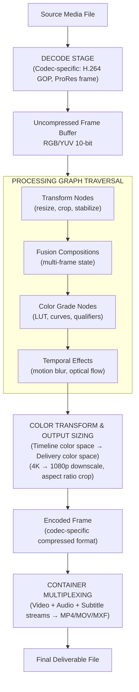

# Lesson 6: Render Delivery Optimization

## 1. First-Principles Intuition & Invariants

The final render is the moment where every creative decision, every color grade adjustment, every temporal effect, and every audio mix channel converges into a single linear file stream that must survive playback on infrastructure you cannot control. Whether delivering to a broadcast network expecting IMF packages with strict QC parameters, exporting social media previews constrained by mobile bandwidth, or archiving master files for decade-long preservation, the render pipeline represents the boundary where creative intention meets delivery pragmatism. Understanding this pipeline requires grasping three foundational invariants: the irreversible collapse from non-destructive timeline metadata into destructive pixel raster encoding, the entropy cost of compression algorithms trading file size against perceptual fidelity, and the hardware resource arbitrage between CPU scalar processing and GPU parallel throughput.

DaVinci Resolve's rendering architecture operates as a directed acyclic graph where every clip, effect node, grade operation, and fusion composition occupies a node position in a dependency tree. When you initiate a render, the system traverses this graph from source media through transforms to the final output codec, but the traversal order and caching strategy directly govern whether the render completes in minutes or hours. The render cache system exists to precompute intermediate results for computationally expensive nodes—temporal noise reduction algorithms scanning dozens of adjacent frames, optical flow retiming calculating motion vectors across frame boundaries, or OpenFX plugins executing GPU shader passes—so that subsequent playback or export operations can read cached frames rather than recalculating them in real time. However, cache strategies introduce their own complexity: smart cache automatically identifies expensive nodes and renders them to disk in optimized YUV 10-bit formats, while optimized media transcodes source files into edit-friendly intraframe codecs like ProRes or DNxHR, sacrificing disk space for decode speed.

The codec selection decision tree hinges on understanding the distinction between intraframe and interframe compression. Intraframe codecs like ProRes, DNxHR, and JPEG2000 encode every frame independently, storing complete raster images with predictable decode latency and zero temporal dependencies, making them ideal for editorial workflows where random access scrubbing and frame-accurate cuts are non-negotiable. Interframe codecs like H.264 and H.265 employ temporal prediction, storing only keyframes as complete images while intermediate P-frames and B-frames encode motion vectors and residual differences, achieving 10x to 30x smaller file sizes at equivalent perceptual quality but introducing decode complexity and GOP (Group of Pictures) boundary constraints. For final delivery, the choice between these families depends on distribution channel requirements: broadcast networks mandate intraframe formats to preserve editing flexibility downstream, streaming platforms prefer H.265 for bandwidth efficiency, and archival workflows demand lossless or mathematically reversible compression to prevent generation loss across future migrations.

Bitrate calculation operates under Shannon's information theory: every pixel transition, every texture detail, and every temporal motion event consumes entropy that must be encoded into the finite bitstream budget. Constant bitrate (CBR) encoding allocates uniform bits-per-second regardless of scene complexity, ensuring predictable file sizes but wasting bandwidth on static shots and crushing detail in high-motion sequences. Variable bitrate (VBR) encoding dynamically adjusts allocation, applying higher bitrates to complex frames and lower bitrates to simple frames, but requires multi-pass analysis where the encoder first surveys the entire timeline to build a complexity map before committing bits. Target bitrate selection demands calibrating perceptual quality against distribution constraints: a 1920×1080 24fps timeline targeting broadcast typically requires 50–100 Mbps for ProRes 422, 20–35 Mbps for H.264 high-profile, or 10–18 Mbps for H.265 main10, but these figures scale quadratically with resolution and linearly with frame rate.

The GPU versus CPU decode/encode decision hinges on understanding parallel instruction throughput versus scalar branching complexity. Modern GPUs like NVIDIA RTX series or AMD Radeon Pro lines provide thousands of CUDA or compute units executing identical operations across thousands of pixels simultaneously, making them ideal for embarrassingly parallel workloads like color space transforms, resize filters, and temporal effects applying uniform calculations per pixel. However, GPU hardware encoders (NVENC, AMD VCE, Intel Quick Sync) sacrifice compression efficiency for speed, producing files 10–20% larger than CPU software encoders at equivalent quality settings because hardware implementations use fixed quantization matrices and simplified rate control algorithms to maintain real-time throughput. CPU software encoders like x264 and x265 execute multi-stage rate-distortion optimization, testing dozens of encoding modes per macroblock and selecting optimal prediction vectors, but this sophistication requires 10–50x more processing time. For delivery optimization, the pragmatic strategy involves GPU-accelerated timeline processing for speed-critical proxies and drafts, reserving CPU software encoding for final master deliverables where file size and archival quality outweigh render time.

## 2. Core Architecture & Mechanics

The render pipeline in DaVinci Resolve decomposes into five sequential stages: source decode, processing graph traversal, color transform and output sizing, encoding, and container multiplexing. Each stage introduces distinct performance bottlenecks and quality checkpoints that require explicit configuration in the Deliver page render settings.

The source decode stage reads compressed media from disk, decompresses frames into uncompressed RGB or YUV raster buffers in system or GPU memory, and applies any necessary color space transforms from the source's embedded metadata (Rec.709, Rec.2020, log gammas). For interframe codecs like H.264, this requires maintaining a sliding decode window where the codec maintains three or more reference frames in memory to reconstruct predicted frames, introducing decode latency proportional to GOP length. Files recorded at high bitrates (100+ Mbps intraframe) become I/O bound, where disk read speed becomes the limiting factor, while heavily compressed interframe files become CPU-bound, where decode threads saturate before disk bandwidth limits.

The processing graph traversal stage walks the node tree for every active clip in the timeline, executing transform operations in dependency order. Fusion compositions containing tracker data, particle systems, or 3D camera solves require serialized execution because each frame depends on state accumulated across previous frames. Color grading nodes execute as GPU shader passes when possible, compiling the entire node graph into a single unified shader program to minimize memory roundtrips, but plugins lacking GPU acceleration force expensive GPU-to-CPU memory transfers and CPU scalar processing before uploading results back to GPU memory. Temporal effects like optical flow retiming and motion blur require the render engine to decode and hold multiple adjacent frames simultaneously, scaling memory consumption proportional to the temporal window radius.

The color transform and output sizing stage performs the critical conversion from timeline working color space to delivery color space. If your timeline operates in DaVinci Wide Gamut intermediate with log gamma and your delivery target specifies Rec.709 with standard gamma, this stage applies the 3D LUT or matrix transform converting wide gamut primaries into the smaller Rec.709 triangle, clipping or compressing out-of-gamut colors, and applying the inverse log-to-linear-to-gamma curve to restore contrast for display. Output sizing applies resize algorithms (Lanczos, bicubic, bilinear) when the delivery resolution differs from timeline resolution, and letterboxing or pillarboxing when aspect ratios mismatch. These operations execute as GPU shader passes for standard transforms but may fall back to CPU for exotic color science requiring high-precision floating-point calculations.

The encoding stage compresses the uncompressed raster frame into the selected delivery codec format. For intraframe codecs, this involves independent per-frame compression: DCT (Discrete Cosine Transform) frequency decomposition, quantization of high-frequency coefficients to discard imperceptible detail, entropy coding with Huffman or arithmetic coders, and packaging into codec-specific frame containers. ProRes operates with fixed quantization matrices optimized for 10-bit 4:2:2 chroma subsampling, while DNxHR provides multiple quality profiles (LB, SQ, HQ, HQX) corresponding to different bitrate targets. For interframe codecs, encoding becomes a multi-pass prediction problem: the encoder searches across reference frames for matching macroblocks, calculates motion vectors, stores predicted differences, and periodically inserts I-frames to limit error propagation. Rate control algorithms dynamically adjust quantization parameters per macroblock to hit target bitrates, using psychovisual optimization models to allocate more bits to high-frequency textures and skin tones while starving flat backgrounds.

The container multiplexing stage interleaves compressed video frames with audio streams, subtitle tracks, and metadata into standardized container formats. MP4 and MOV containers organize data as hierarchical atom structures (moov, mdat, trak atoms), embedding codec parameters, timecode metadata, and color space tags. MXF (Material Exchange Format) wraps streams in SMPTE-standardized operational patterns designed for broadcast interchange, carrying additional metadata like UMID identifiers, KLV-encoded descriptors, and AS-11 delivery specifications. IMF (Interoperable Master Format) goes further, packaging video as JPEG2000 image sequences with XML composition playlists (CPL) defining temporal edits, audio as PCM WAV files, and sidecar metadata for versioning, making it the archival format for studios needing to generate localized versions or future remastering without re-rendering.

Render cache strategies bifurcate into smart cache and optimized media, each optimizing different bottlenecks. Smart cache targets playback performance by prerendering expensive timeline segments—clips with temporal NR, heavy fusion comps, or stacked grade nodes—into lightweight proxy files stored in the cache directory, typically encoded as YUV 10-bit 4:2:2 at timeline resolution with minimal compression overhead. The cache system maintains dependency tracking: if you adjust a color node affecting cached frames, Resolve invalidates only the downstream cache segments requiring recomputation, preserving unaffected regions. However, smart cache occupies disk space proportional to timeline complexity, easily consuming hundreds of gigabytes for feature-length projects with dense effects.

Optimized media solves a different problem: decode latency for highly compressed or inefficient source formats. When you transcode camera originals (H.264 mirrorless footage, H.265 drone clips) into ProRes or DNxHR optimized media, you trade disk space for instantaneous decode speed, as intraframe formats eliminate GOP dependencies and reduce CPU decode overhead by 10x. Resolve maintains bidirectional linking: edits and grades apply to the optimized media proxy during playback and export, but you can toggle back to original camera files for final conform or archival output. For multi-cam timelines with a dozen synchronized H.265 streams, generating optimized media transforms a stuttering playback experience into fluid real-time scrubbing, but the disk cost scales linearly with clip duration and resolution, often exceeding 1 TB for 4K projects.

## 3. High-Performance Optimization & Failure Modes

Optimizing render throughput begins with profiling the limiting bottleneck in your specific hardware configuration and timeline composition. On systems with NVME SSDs, abundant RAM, and mid-tier GPUs, source decode and encoding typically dominate render time, making codec selection the primary optimization lever. On systems with mechanical hard drives or limited RAM, I/O latency and memory swapping introduce stalls where the render engine idles waiting for frames to load from disk. On systems with high-end GPUs but older CPUs, software encoding becomes the chokepoint, with render progress stalling at the encoding stage while timeline processing completes instantly.

For I/O-bound workflows, consolidating source media onto the fastest available storage pool provides immediate gains. Resolve's media pool allows relocating clips to local NVME drives during active editing, then relinking to network or archival storage post-delivery. Enabling disk caching in Preferences → Memory and GPU → Disk Cache allows the system to preload adjacent frames into RAM during playback, reducing seek latency for random access operations. For extremely large projects, splitting timelines into shorter segments (acts, reels) and rendering independently reduces the working set size, preventing memory exhaustion and swap thrashing.

For GPU-bound workflows where color grading nodes or fusion compositions saturate GPU compute, enabling GPU acceleration for OpenFX plugins and ResolveFX effects offloads work from CPU to GPU, but this requires ensuring plugin vendors provide CUDA or Metal implementations. Disabling real-time playback caching during rendering frees GPU memory for encoding tasks, as the cache buffer occupies several gigabytes of VRAM for decoded frame storage. Lowering timeline proxy resolution (half-res or quarter-res) during draft renders reduces GPU processing load quadratically: a 4K timeline at half-res processes four times faster than full-res, allowing rapid iteration on edits before committing to final full-res renders.

For CPU-bound encoding workflows, selecting GPU hardware encoders (NVIDIA NVENC, AMD VCE) provides 5–10x faster encoding at the cost of 10–20% larger file sizes or slightly reduced perceptual quality. Enabling multi-frame encoding in the Advanced Settings panel allows the encoder to process multiple frames in parallel when temporal dependencies permit, scaling throughput nearly linearly with CPU core count for intraframe codecs. For H.264 and H.265 software encoding, reducing preset complexity (ultrafast, superfast presets) sacrifices compression efficiency for speed, cutting render time by 50–70% while increasing file size by 15–30%. For delivery-critical final masters, reserving high-complexity presets (slower, veryslow) for overnight batch renders ensures optimal compression efficiency.

Render queue job prioritization becomes essential when managing dozens of deliverables with varying resolution, codec, and bitrate requirements. Resolve's Deliver page allows adding multiple render jobs to the queue, each configured independently for aspect ratio crops (16:9 theatrical, 1:1 social square, 9:16 vertical stories), resolution ladders (4K master, 1080p web, 720p mobile), and codec profiles (ProRes archival, H.265 streaming, H.264 compatibility). Organizing jobs by priority (archival masters first, drafts last) ensures critical deliverables complete before deadline, while enabling background rendering allows the queue to process overnight or during non-editing hours.

Batch export templating eliminates repetitive configuration by encoding render presets as XML templates. Create a custom preset defining codec, resolution, bitrate, and color space parameters, then apply it across timelines or projects with consistent delivery specs. For example, a broadcast delivery template might specify 1920×1080, 23.976 fps, ProRes 422 HQ, Rec.709 color, PCM 48kHz audio, and MXF OP1a container, ensuring every export matches network technical specifications without manual reconfiguration. Presets synchronize across Resolve installations via cloud sync, allowing facility-wide standardization of delivery formats.

IMF package assembly represents the apex of delivery complexity, designed for long-term archival and multi-version localization workflows. An IMF package consists of essence files (JPEG2000 image sequences for video, PCM WAV for audio), composition playlists (CPL XML defining edit decisions and timeline structure), and packing lists (PKL XML inventorying all assets with checksums). Unlike single-file deliverables, IMF decomposes the timeline into reusable components: a feature film might package original language audio, translated dubs, theatrical cuts, and airline edits as separate CPL variations referencing shared video essence, enabling distributors to generate region-specific versions without re-encoding master video. Resolve's IMF export workflow generates these components automatically, but requires strict adherence to SMPTE ST 2067 specifications: video must be JPEG2000 with defined bitrates (compliant profiles like APP2, APP3), audio must be PCM at 48kHz or 96kHz, and metadata must include EIDR identifiers for content registration.

Common failure modes during rendering include dropped frames, corrupted exports, and aborted renders. Dropped frames occur when the render engine cannot maintain target frame rate, typically due to insufficient CPU or GPU throughput for real-time encoding constraints; disabling real-time rendering in Advanced Settings forces offline processing where render time exceeds playback duration, eliminating frame drops entirely. Corrupted exports manifest as visual artifacts (blocking, banding, color shifts) and typically trace to codec incompatibilities or invalid parameter combinations: ensure delivery color space matches codec expectations (Rec.709 for H.264, Rec.2020 for H.265 HDR), and verify bitrate settings fall within codec-supported ranges (H.264 Level 4.1 caps at 50 Mbps, higher bitrates require Level 5.0 or 5.1). Aborted renders result from disk space exhaustion, memory allocation failures, or GPU driver crashes; monitoring system resources during test renders identifies bottlenecks, and enabling automatic job restart in preferences allows failed renders to resume from the last successfully encoded frame rather than restarting from the beginning.

Quality control validation demands objective measurement beyond subjective visual inspection. Generate reference stills from the timeline at critical color grading checkpoints (skin tones, saturated primaries, shadow detail) and compare against rendered output using waveform and vectorscope analysis to confirm color space transforms preserved intended tonal distribution. For broadcast delivery, validate rendered files against QC specifications using tools like Interra Baton or Tektronix Cerify, which automate detection of technical violations: illegal luma levels exceeding IRE limits, chroma exceeding gamut boundaries, audio clipping or silence, and metadata inconsistencies. For archival workflows, compute cryptographic checksums (MD5, SHA-256) of rendered files and store them alongside deliverables, enabling future integrity verification to detect bitrot or corruption during long-term storage migration.

The render optimization strategy ultimately balances four competing constraints: render time urgency, delivery file size limits, perceptual quality requirements, and downstream workflow compatibility. For draft reviews prioritizing speed, accept larger file sizes and GPU hardware encoding. For client-facing deliverables, invest CPU time in software encoding for optimal compression. For archival masters, prioritize lossless or mathematically reversible formats regardless of render duration. For broadcast interchange, adhere strictly to mandated technical specifications even when they sacrifice compression efficiency. Mastering this constraint space transforms rendering from a black-box export step into a deliberate optimization problem where you consciously trade resources to achieve delivery objectives.
