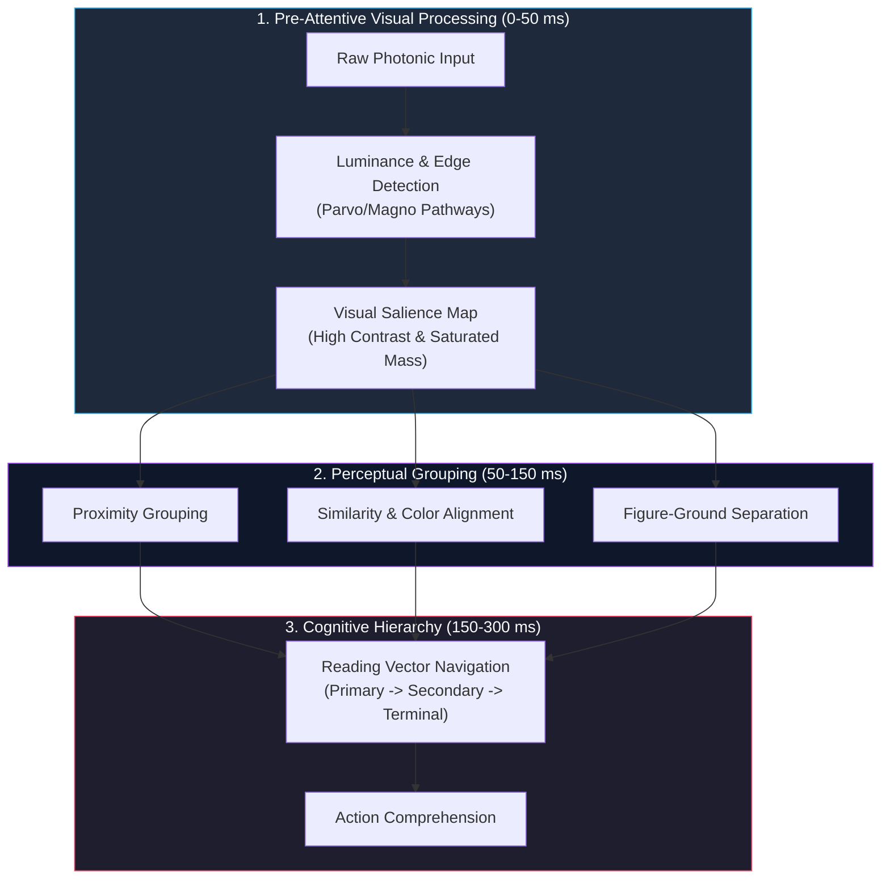
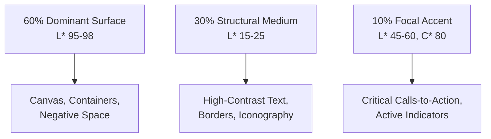

# Lesson 1: Visual Fundamentals, Perception, and Design Primitives

## 1. First-Principles Intuition & Invariants

The human visual system processes information through an evolved biological cascade optimized for edge detection, motion tracking, and spatial contrast. Before any conscious semantic evaluation occurs, the viewer's retinal ganglion cells perform center-surround receptive field processing, the magnocellular pathways resolve luminance contrast and low-frequency spatial structure, and the parvocellular pathways parse chromatic nuance and high-frequency edge detail. Visual design is not aesthetic ornamentation; it is the deliberate structuring of optical signals to guide human neuro-cognitive processing.

The foundational physical invariant of graphic design is **the luminance contrast threshold**:

$$\text{Contrast Ratio} = \frac{L_1 + 0.05}{L_2 + 0.05}$$

Where $L_1$ is the relative luminance of the lighter color and $L_2$ is the relative luminance of the darker color, normalized according to CIE colorimetry standards. Without sufficient luminance separation ($\ge 4.5:1$ for body text, $\ge 7:1$ for fine detail), visual edges cannot be resolved by the human eye regardless of hue variation.

Design primitives operate through five immutable perceptual laws:
1. **Focal Dominance & Visual Weight**: Visual weight is an optical mass determined by area, luminance contrast, saturation, and geometric complexity. An interface or canvas reaches equilibrium when visual weights balance across horizontal and vertical axes.
2. **Gestalt Grouping**: The brain automatically groups elements according to **Proximity** (spatial distance), **Similarity** (shared shape/color), **Common Region** (enclosure), and **Continuity** (aligned vectors).
3. **Reading Vector Dynamics**: Western cultural reading conditioning drives predictable eye-tracking trajectories: the **Gutenberg Diagram** (primary optical area to terminal terminal), the **Z-Pattern** (scanning open promotional layouts), and the **F-Pattern** (information-dense text parsing).
4. **Typographic Hierarchy**: Structural scale ratios (e.g., Major Third $1.250$, Perfect Fourth $1.333$, Golden Ratio $1.618$) dictate proportional typographic steps from micro-caption to primary display heading.



---

## 2. Core Architecture & Kinematic Layout Mechanics

### 2.1 The Swiss Modular Grid System

A professional visual composition relies on a mathematically disciplined grid structure to enforce rhythm and alignment across viewport resolutions:

```text
[Margin: 24px] | [Col 1] (Gutter: 16px) [Col 2] ... [Col 12] | [Margin: 24px]
Baseline Grid: 8px vertical baseline rhythm (8px, 16px, 24px, 32px, 48px)
```

1. **Columns and Gutters**: A 12-column grid provides maximum modular divisibility ($12 = 1, 2, 3, 4, 6, 12$), allowing asymmetrical compositions (e.g., 8-column primary content + 4-column contextual sidebar).
2. **Vertical Baseline Rhythm**: All typography, component heights, and vertical margins must be integer multiples of a baseline unit (typically $8\text{px}$ or $4\text{px}$). If body copy has a line-height of $24\text{px}$ ($3 \times 8\text{px}$), headings must align to $32\text{px}$ or $40\text{px}$ to preserve baseline locking.

### 2.2 Typographic Hierarchy & Modular Scale

Typographic hierarchy translates semantic structure into immediate optical rank. A modular scale computes type sizes by multiplying a base size by a consistent ratio $r$:

$$S_n = S_{\text{base}} \cdot r^n$$

Using a base size of $16\text{px}$ and a Perfect Fourth ratio ($r = 1.333$):

```text
Level      Exponent   Calculated Size   Rounded Size   Line Height (8px grid)
Caption    n = -1     12.00 px          12 px          16 px
Body       n = 0      16.00 px          16 px          24 px
Subhead    n = 1      21.33 px          21 px          32 px
H3         n = 2      28.44 px          28 px          32 px
H2         n = 3      37.91 px          38 px          48 px
H1 Display n = 4      50.53 px          50 px          56 px
```

### 2.3 Chromatic Architecture & Optical Contrast

Color in graphic design is functional rather than decorative. A production color system enforces precise luminance assignments:



Under **WCAG 2.2** standards:
- **AA Level**: Requires minimum $4.5:1$ contrast for standard text ($< 18\text{pt}$) and $3:1$ for large text or graphical interface components.
- **AAA Level**: Requires minimum $7:1$ contrast for standard text and $4.5:1$ for large text.

---

## 3. Compositional Balance & Golden Ratio Geometry

The distribution of visual mass on a two-dimensional surface determines compositional stability. Unbalanced layouts trigger cognitive friction as the eye struggles to find an anchor.

### 3.1 Asymmetric Dynamic Equilibrium

Symmetric balance places identical visual mass equidistant from a central axis, conveying formal rigidity and solemnity. Asymmetric balance achieves dynamic equilibrium by positioning contrasting elements of unequal size:
- A large, muted element close to the center axis is balanced by a small, highly saturated element placed far out near the canvas margin.
- Negative space (whitespace) functions as an active mass: surrounding an object with expansive negative space artificially elevates its visual gravity.

$$\text{Torque}_{\text{visual}} = \sum_{i} \text{Weight}_i \cdot \vec{d}_i = 0$$

Where $\vec{d}_i$ is the distance vector from the optical center of the composition.

---

## 4. Summary & Verification Matrix

| Design Primitive | Governing Rule / Standard | Diagnostic Test | Acceptance Threshold |
|:---|:---|:---|:---|
| **Text Contrast** | WCAG 2.2 AAA Standards | Colorimeter / Contrast Checker | Ratio $\ge 7.0:1$ for body copy |
| **Grid Alignment** | 12-Column Swiss Modular Grid | Column overlay inspection | Zero unaligned bounding box edges |
| **Vertical Rhythm** | $8\text{px}$ Baseline Multiplier | Line-height & margin audit | All vertical dimensions $\bmod 8 = 0$ |
| **Typographic Scale** | Modular Scale ($r = 1.333$) | Type ladder verification | Monotonically increasing step ratios |
| **Focal Hierarchy** | Visual Salience Test | 3-Second Blur / Squint Test | Single dominant anchor visible first |
