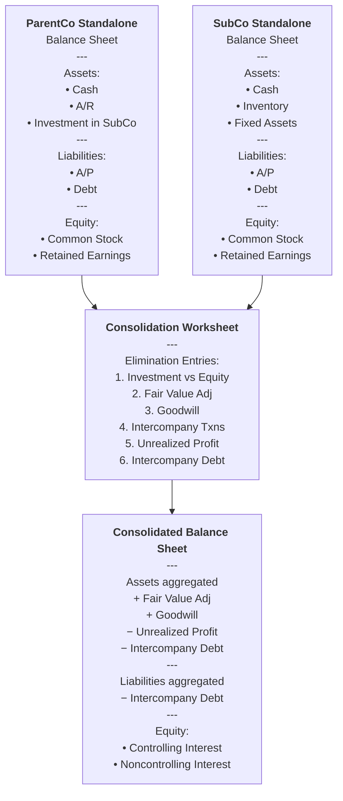

# Lesson 3: Consolidation and Intercompany Elimination

## 1. First-Principles Intuition & Invariants

When a corporation acquires control over another legal entity, two parallel realities emerge. The first reality is legal: the acquired subsidiary remains a distinct juridical person with its own tax identification number, contracts, bank accounts, and statutory filing obligations. The second reality is economic: from the perspective of equity holders in the parent company, the subsidiary's assets, liabilities, revenues, and expenses are indistinguishable from those owned and generated directly by the parent. Consolidated financial statements resolve this duality by presenting the economic reality—a unified view of the enterprise as if all controlled entities were a single operating company.

The consolidation process rests on a foundational invariant: **the parent company's shareholders have an indirect economic claim on every asset controlled by the parent, regardless of the legal structure separating those assets across subsidiary entities**. This principle, codified in accounting standards such as ASC 810 (US GAAP) and IFRS 10, mandates that when one entity controls another, the controlling entity must prepare consolidated financial statements that aggregate the financial position and performance of all controlled entities. Control is typically established through ownership of a majority voting interest—greater than fifty percent of outstanding voting shares—though control can also arise through contractual arrangements, variable interest entities, or de facto control through operating agreements.

The consolidation imperative creates immediate mechanical challenges. Consider a parent company that owns one hundred percent of a subsidiary's equity. The parent's standalone balance sheet carries an investment asset representing the cost paid to acquire the subsidiary. The subsidiary's standalone balance sheet reports individual assets such as inventory, property, plant, equipment, and intangible assets, along with liabilities including accounts payable and debt obligations. If we simply added the parent's balance sheet to the subsidiary's balance sheet without adjustment, we would double-count the subsidiary's net assets: once as the investment account on the parent's books, and again as the individual assets and liabilities on the subsidiary's books. This double-counting violates the economic reality that the parent's investment represents nothing more than an ownership claim on the subsidiary's underlying net assets.

The solution is **equity method elimination**: the parent's investment account must be eliminated against the subsidiary's equity accounts (common stock, additional paid-in capital, and retained earnings) in the consolidation worksheet. This elimination entry removes the legal artifact—the investment account—and replaces it with the economic substance—the subsidiary's individual assets and liabilities. However, this substitution is rarely a simple one-for-one swap. The price the parent paid to acquire the subsidiary (the investment account balance) almost never equals the book value of the subsidiary's equity at the acquisition date. This discrepancy between purchase price and book value creates **fair-value adjustments** and **goodwill**, both of which must be recognized in the consolidated financial statements.

Fair-value adjustments arise because the subsidiary's historical cost-based balance sheet does not reflect the current market value of its assets and liabilities at the acquisition date. A subsidiary may have purchased land decades ago for ten million dollars that is now worth fifty million dollars, or it may have developed proprietary software that cost five million dollars to create but has a fair market value of thirty million dollars. Under acquisition accounting (ASC 805 / IFRS 3), the parent must revalue all identifiable assets acquired and liabilities assumed to their fair values at the acquisition date. This revaluation creates a new basis—a step-up or step-down—for assets such as inventory, fixed assets, intangible assets (customer relationships, trade names, patents, and developed technology), and liabilities including debt and contingent liabilities. The cumulative fair-value adjustment represents the difference between the subsidiary's book value and the fair value of its identifiable net assets.

Goodwill emerges as the residual: the excess of the purchase price over the fair value of identifiable net assets acquired. If a parent pays one hundred million dollars to acquire a subsidiary whose identifiable assets have a fair value of ninety million dollars and whose liabilities have a fair value of thirty million dollars, the fair value of net assets is sixty million dollars. The forty-million-dollar difference between the purchase price and the fair value of net assets is recorded as goodwill, representing intangible value that cannot be separately identified and measured—workforce quality, market position, synergies, operational expertise, and barriers to entry. Goodwill is not amortized under current US GAAP and IFRS standards; instead, it is tested annually for impairment, with write-downs recognized if the carrying value exceeds the recoverable amount.

The second consolidation invariant addresses **intercompany transactions**: any transaction between the parent and subsidiary, or between two subsidiaries under common control, must be eliminated in consolidation. The rationale is straightforward: a company cannot generate profit by selling to itself. When the parent sells inventory to its subsidiary at a markup, the parent's standalone income statement records revenue and cost of goods sold, recognizing a profit on the transaction. The subsidiary's standalone income statement records the purchase as cost of goods sold when it eventually sells the inventory to an external customer. From a consolidated perspective, however, no external sale has occurred at the intercompany transaction date. If the subsidiary still holds the inventory in its balance sheet at the reporting date, the consolidated balance sheet must eliminate the intercompany profit embedded in that inventory, as the enterprise has not yet realized that profit through a sale to a third party.

Intercompany eliminations extend beyond inventory transfers. Intercompany loans create a receivable on one entity's balance sheet and a payable on another entity's balance sheet; these must be eliminated in consolidation because the enterprise cannot owe money to itself. Intercompany interest income and interest expense must similarly be eliminated, as must intercompany service fees, royalty payments, and dividend distributions. Dividends paid by a subsidiary to its parent do not represent income to the consolidated entity; they are simply transfers of cash within the enterprise that reduce the subsidiary's retained earnings and increase the parent's cash, with no net effect on consolidated equity.

A third invariant governs **noncontrolling interests** (formerly called minority interests): when the parent owns less than one hundred percent of a subsidiary's equity, the consolidated financial statements must present the full amount of the subsidiary's assets, liabilities, revenues, and expenses, but must also separately report the portion of equity and net income attributable to outside shareholders. This presentation reflects the economic reality that the parent controls the subsidiary's operations and benefits from that control, even though it does not own every equity dollar. The noncontrolling interest appears as a separate component of consolidated equity on the balance sheet and as a deduction from consolidated net income on the income statement, allocating a proportionate share of the subsidiary's earnings to the outside shareholders.

The consolidation process is not a mere accounting formality; it has profound implications for financial analysis, covenant compliance, credit ratings, and capital allocation decisions. Lenders often impose financial covenants—maximum leverage ratios, minimum interest coverage ratios, and minimum net worth requirements—measured on a consolidated basis. A subsidiary's debt may not appear on the parent's standalone balance sheet, but it absolutely appears on the consolidated balance sheet, increasing consolidated leverage and potentially triggering covenant violations. Analysts evaluating a company's creditworthiness or equity valuation examine consolidated financial statements to assess the enterprise's aggregate debt burden, operating performance, and cash generation capacity. Consequently, understanding the mechanics of consolidation is not an academic exercise; it is a fundamental competency for M&A professionals, credit analysts, equity research analysts, and corporate finance practitioners.

## 2. Core Architecture & Mechanics

The consolidation process unfolds through a systematic sequence of elimination entries applied to a consolidation worksheet. This worksheet begins with the standalone financial statements of the parent and each subsidiary, presented in adjacent columns. Elimination entries are recorded in a separate column to adjust and remove artifacts of the legal structure, and the final column presents the consolidated financial statements. These elimination entries are worksheet adjustments only—they are never recorded in the general ledger of the parent or subsidiary—and must be repeated each reporting period.

The acquisition date consolidation establishes the baseline. Assume ParentCo acquires one hundred percent of SubCo on January 1 for a cash purchase price of one hundred fifty million dollars. SubCo's pre-acquisition balance sheet reports total assets of one hundred twenty million dollars, total liabilities of forty million dollars, and shareholders' equity of eighty million dollars (common stock of ten million dollars, additional paid-in capital of twenty million dollars, and retained earnings of fifty million dollars). The fair-value appraisal identifies the following adjustments: inventory has a fair value five million dollars above book value, fixed assets have a fair value twenty million dollars above book value, and identifiable intangible assets (customer relationships with a ten-year useful life) have a fair value of thirty million dollars, which were not previously recognized on SubCo's balance sheet. Liabilities require no fair-value adjustment.

The calculation of goodwill proceeds as follows. The fair value of identifiable net assets equals the book value of net assets (eighty million dollars) plus the fair-value adjustments: five million dollars for inventory, twenty million dollars for fixed assets, and thirty million dollars for intangible assets, totaling fifty-five million dollars in fair-value adjustments. The fair value of identifiable net assets is therefore one hundred thirty-five million dollars. The purchase price is one hundred fifty million dollars. Goodwill is the residual: one hundred fifty million dollars minus one hundred thirty-five million dollars, equal to fifteen million dollars.

The acquisition date consolidation elimination entries are structured as follows. Entry one eliminates the investment account against SubCo's equity accounts and establishes the fair-value adjustments and goodwill. The debit side of the entry increases inventory by five million dollars, increases fixed assets by twenty million dollars, records intangible assets of thirty million dollars, and records goodwill of fifteen million dollars. The credit side eliminates the investment account carried on ParentCo's balance sheet (one hundred fifty million dollars) and eliminates SubCo's equity accounts (common stock of ten million dollars, additional paid-in capital of twenty million dollars, and retained earnings of fifty million dollars). The entry is:

```text
Debit: Inventory                       5,000,000
Debit: Fixed Assets                   20,000,000
Debit: Intangible Assets              30,000,000
Debit: Goodwill                       15,000,000
Debit: Common Stock (SubCo)           10,000,000
Debit: Additional Paid-In Capital     20,000,000
Debit: Retained Earnings (SubCo)      50,000,000
Credit: Investment in SubCo          150,000,000
```

This single compound entry transforms the legal structure into the economic substance. ParentCo's investment account disappears, SubCo's equity accounts disappear, and the consolidated balance sheet presents SubCo's individual assets at their fair values plus goodwill.

Post-acquisition consolidation introduces temporal complexity because the fair-value adjustments must be amortized or depreciated over their useful lives, and the subsidiary's retained earnings change each period due to earnings and dividends. Consider the consolidation one year after acquisition, on December 31. During the year, SubCo generated net income of twelve million dollars and paid dividends of four million dollars to ParentCo. SubCo's retained earnings increased from fifty million dollars to fifty-eight million dollars (fifty million plus twelve million minus four million). The fair-value adjustments must now be amortized: the inventory adjustment is fully recognized in cost of goods sold once the inventory is sold (assume sold during the year), the fixed assets adjustment is depreciated over a remaining useful life of ten years (two million dollars annual depreciation), and the intangible assets adjustment is amortized over ten years (three million dollars annual amortization). The total amortization of fair-value adjustments is five million dollars for the year (zero for inventory since fully recognized, two million for fixed assets, three million for intangibles).

The consolidation elimination entry at December 31 must accomplish three objectives: eliminate the investment account, eliminate SubCo's equity accounts, and reverse the cumulative impact of fair-value amortization. The investment account on ParentCo's books has changed during the year under the equity method of accounting. ParentCo recorded equity method income of twelve million dollars (SubCo's net income) and reduced the investment account by four million dollars (SubCo's dividends). The investment account balance is now one hundred fifty-eight million dollars (one hundred fifty million plus twelve million minus four million).

The elimination entry structure shifts to reflect the changed balances:

```text
Debit: Common Stock (SubCo)           10,000,000
Debit: Additional Paid-In Capital     20,000,000
Debit: Retained Earnings (SubCo)      58,000,000
Debit: Intangible Assets              27,000,000  (30M - 3M amortization)
Debit: Fixed Assets (net)             18,000,000  (20M - 2M depreciation)
Debit: Goodwill                       15,000,000
Credit: Investment in SubCo          148,000,000
```

The consolidated income statement must eliminate the equity method income recorded by ParentCo (twelve million dollars) and replace it with SubCo's individual revenues and expenses. Additionally, the consolidation must recognize the amortization of fair-value adjustments (five million dollars), which reduces consolidated net income. The elimination entries on the income statement are:

```text
Debit: Equity Method Income           12,000,000
Credit: SubCo Revenues                (included in consolidation)
Credit: SubCo Expenses                (included in consolidation)

Debit: Depreciation Expense            2,000,000
Debit: Amortization Expense            3,000,000
Credit: Accumulated Depreciation       2,000,000
Credit: Intangible Assets              3,000,000
```

Intercompany transaction elimination introduces a second layer of adjustments. Assume during the year ParentCo sold inventory to SubCo for twenty million dollars. ParentCo's cost of goods sold for that inventory was fifteen million dollars, resulting in a five-million-dollar intercompany profit. By year-end, SubCo has sold eighty percent of the inventory to external customers, retaining twenty percent (four million dollars at intercompany transfer price) in its ending inventory. The consolidated financial statements must eliminate the intercompany sale and the unrealized profit in ending inventory.

The intercompany sale elimination removes the revenue and cost of goods sold associated with the intercompany transaction:

```text
Debit: Intercompany Revenue (ParentCo)  20,000,000
Credit: Intercompany COGS (SubCo)       20,000,000
```

This entry eliminates twenty million dollars of revenue and twenty million dollars of cost of goods sold, leaving no net impact on consolidated gross profit for the portion sold externally. However, SubCo's ending inventory includes four million dollars of inventory purchased from ParentCo at a transfer price that includes a one-million-dollar markup (twenty-five percent gross margin on the twenty-million-dollar sale). The unrealized profit in ending inventory must be eliminated:

```text
Debit: Cost of Goods Sold               1,000,000
Credit: Inventory                       1,000,000
```

This entry increases consolidated cost of goods sold by one million dollars and reduces consolidated inventory by one million dollars, deferring recognition of the intercompany profit until SubCo sells the inventory to an external customer in a future period.

Intercompany loans and interest elimination follows a similar pattern. Assume ParentCo loaned ten million dollars to SubCo at a six percent annual interest rate. SubCo accrued and paid six hundred thousand dollars of interest expense during the year, which ParentCo recorded as interest income. The consolidation must eliminate both the intercompany loan balance and the intercompany interest:

```text
Debit: Notes Payable (SubCo)          10,000,000
Credit: Notes Receivable (ParentCo)   10,000,000

Debit: Interest Income (ParentCo)        600,000
Credit: Interest Expense (SubCo)         600,000
```

These entries remove the intercompany loan from the consolidated balance sheet and eliminate the intercompany interest from the consolidated income statement, as the enterprise has neither borrowed from nor paid interest to itself.

Dividend elimination is straightforward. SubCo paid four million dollars in dividends to ParentCo during the year. ParentCo recorded the dividends as a reduction in the investment account under the equity method. SubCo recorded the dividends as a reduction in retained earnings. The consolidation elimination is implicit in the investment elimination entry, as the investment account balance already reflects the dividend reduction. No separate dividend elimination entry is required when the parent uses the equity method, because the equity method automatically eliminates the dividend through the investment account adjustment. If the parent used the cost method (rare in practice), a separate entry would be required:

```text
Debit: Dividend Income (ParentCo)      4,000,000
Credit: Dividends Declared (SubCo)     4,000,000
```

Noncontrolling interest introduces allocation mechanics. Assume ParentCo owns eighty percent of SubCo, with the remaining twenty percent owned by outside investors. The consolidation still includes one hundred percent of SubCo's assets, liabilities, revenues, and expenses, but must allocate twenty percent of SubCo's equity and net income to the noncontrolling interest. At the acquisition date, if the fair value of SubCo's identifiable net assets is one hundred thirty-five million dollars and ParentCo paid one hundred twenty million dollars for eighty percent (implying a one hundred-fifty-million-dollar enterprise value), the noncontrolling interest is initially recorded at thirty million dollars (twenty percent of one hundred fifty million dollars). The acquisition date elimination entry becomes:

```text
Debit: Inventory                       5,000,000
Debit: Fixed Assets                   20,000,000
Debit: Intangible Assets              30,000,000
Debit: Goodwill                       15,000,000
Debit: Common Stock (SubCo)           10,000,000
Debit: Additional Paid-In Capital     20,000,000
Debit: Retained Earnings (SubCo)      50,000,000
Credit: Investment in SubCo          120,000,000
Credit: Noncontrolling Interest       30,000,000
```

In subsequent periods, the noncontrolling interest is adjusted for its proportionate share of SubCo's net income and dividends. If SubCo reports net income of twelve million dollars, the consolidated income statement allocates two million four hundred thousand dollars (twenty percent) to the noncontrolling interest and nine million six hundred thousand dollars (eighty percent) to ParentCo's shareholders. If SubCo pays total dividends of four million dollars, eight hundred thousand dollars (twenty percent) is attributed to the noncontrolling interest, reducing the noncontrolling interest balance on the consolidated balance sheet.

The consolidation worksheet for a complex group with multiple subsidiaries and layers of ownership becomes a multi-dimensional reconciliation. Each subsidiary requires a separate set of elimination entries. Intercompany transactions between subsidiaries require elimination entries that span multiple entities. The worksheet methodology ensures that every elimination is explicitly documented and can be audited, providing a clear trail from standalone financial statements to consolidated results.

A visual representation of the consolidation flow for a two-entity group is:



The consolidation process is not merely additive; it is reconstructive, transforming legal form into economic substance through systematic elimination of intra-enterprise transactions and fair-value revaluation of acquired assets and liabilities.

## 3. High-Performance Optimization & Failure Modes

Consolidation execution at scale—particularly within multinational corporations with hundreds of subsidiaries across dozens of jurisdictions—demands rigorous process design, system architecture, and control frameworks. The consolidation close cycle operates under compressed timelines, with public companies required to file quarterly 10-Q reports within forty days of quarter-end and annual 10-K reports within sixty to ninety days of year-end, depending on filer status. Within these windows, the consolidation team must collect standalone financial statements from every subsidiary, validate intercompany transaction reconciliations, prepare and review elimination entries, and produce consolidated financial statements that comply with US GAAP or IFRS standards. Process optimization and failure mode mitigation are mission-critical.

The first optimization lever is **intercompany reconciliation automation**. Manual reconciliation of intercompany balances—comparing ParentCo's receivable to SubCo's payable, or ParentCo's intercompany revenue to SubCo's intercompany expense—is error-prone and time-intensive. Best-practice organizations implement intercompany matching platforms (such as BlackLine, Trintech, or SAP Intercompany) that require each entity to report intercompany transactions in a standardized format with unique transaction identifiers. The platform automatically matches corresponding entries and flags discrepancies—timing differences, exchange rate mismatches, or transaction recording errors—for resolution. This automation reduces the consolidation cycle time from weeks to days and eliminates a primary source of restatement risk.

A related optimization is **chart of account harmonization** across subsidiaries. When each subsidiary maintains a different account structure—one subsidiary classifying certain expenses as cost of goods sold while another classifies the same expenses as operating expenses—the consolidation team must manually remap account balances to a common presentation format. Organizations that enforce a global chart of accounts, or at least a common mapping layer, eliminate this manual remapping and ensure consistency in financial statement classification. The tradeoff is reduced flexibility for local statutory reporting requirements, which may necessitate maintaining dual reporting hierarchies: one for local statutory purposes and one for consolidation purposes.

Fair-value measurement optimization focuses on **acquisition integration playbooks** that accelerate the identification and valuation of intangible assets. The fair-value exercise is time-sensitive: the acquirer typically has one year from the acquisition date to finalize the purchase price allocation, during which adjustments to provisional fair-value estimates are retrospectively applied to the acquisition date. Delays in identifying customer relationships, trade names, or developed technology can result in undervaluation of intangible assets and overstatement of goodwill, which cannot be corrected after the measurement period closes. Leading M&A integration teams deploy standardized intangible asset identification checklists, engage third-party valuation specialists immediately upon deal closure, and establish cross-functional working groups (combining finance, legal, tax, and operations personnel) to surface intangible assets that may not be visible on the target's balance sheet.

Goodwill impairment testing represents a recurring failure mode with material financial statement impact. Under ASC 350 and IAS 36, goodwill is tested for impairment at the reporting unit level at least annually and more frequently if indicators of impairment exist. The impairment test compares the carrying value of a reporting unit (including allocated goodwill) to its fair value, with impairment recognized if the carrying value exceeds fair value. Fair value estimation requires management judgment regarding discount rates, terminal growth rates, and future cash flow projections, creating significant estimation risk. Organizations optimize this process by maintaining detailed documentation of cash flow assumptions, benchmarking discount rates against market-observable rates (such as weighted average cost of capital calculated from comparable public companies), and establishing independent review procedures where corporate finance reviews reporting unit forecasts for optimism bias. Failure to rigorously test goodwill impairment has resulted in multi-billion-dollar write-downs (General Electric in 2018 took a twenty-two-billion-dollar goodwill impairment charge) that could have been anticipated through more conservative forecasting.

Noncontrolling interest allocation failures arise from incorrect calculation of the noncontrolling interest's share of fair-value adjustments and their subsequent amortization. The noncontrolling interest is entitled to its proportionate share of the subsidiary's adjusted net income, which includes the impact of fair-value amortization. If fair-value adjustments reduce the subsidiary's net income by five million dollars through incremental depreciation and amortization, the noncontrolling interest's allocation must reflect its share of that reduction. Organizations that fail to systematically track fair-value amortization by subsidiary and by noncontrolling interest percentage overstate or understate the noncontrolling interest balance, creating cumulative reconciliation issues that compound over time.

Variable interest entity (VIE) consolidation represents a structural failure mode with catastrophic precedent. Under ASC 810, an entity must consolidate a VIE if it is the primary beneficiary—the party that has both the power to direct the activities that most significantly impact the VIE's economic performance and the obligation to absorb losses or the right to receive benefits that could be significant. The Enron collapse in 2001 was precipitated by the company's failure to consolidate VIEs (special purpose entities) that held billions of dollars in off-balance-sheet debt. Modern VIE analysis requires quarterly reassessment of the primary beneficiary determination, particularly for entities with shared governance rights or contingent funding obligations. Organizations optimize VIE analysis by maintaining a centralized inventory of all potential VIE relationships, establishing qualitative and quantitative primary beneficiary criteria, and requiring legal and tax review of any new investment or financing structure before execution.

Push-down accounting introduces a technical edge case with significant practical implications. When an acquirer gains control of a target in a change-of-control transaction, the target may elect to "push down" the acquirer's purchase price allocation to the target's standalone financial statements, revaluing the target's assets and liabilities to fair value in the target's own general ledger. Push-down accounting eliminates the need for fair-value elimination entries in consolidation, as the fair-value basis is already reflected in the subsidiary's standalone balance sheet. However, push-down accounting creates additional complexity for the subsidiary: it changes the subsidiary's depreciation and amortization expense, affects the subsidiary's statutory earnings and tax basis, and may trigger debt covenant violations if the subsidiary has its own credit agreements. Organizations evaluate push-down accounting on a case-by-case basis, weighing consolidation simplification benefits against subsidiary-level complications.

Foreign currency translation represents a multi-layered failure mode in multinational consolidation. Subsidiaries operating in functional currencies other than the parent's reporting currency must translate their financial statements using the current rate method: assets and liabilities are translated at the period-end exchange rate, and income statement items are translated at average exchange rates for the period. The cumulative translation adjustment (CTA) is recorded in other comprehensive income, a component of consolidated equity, and is not recognized in net income until the subsidiary is sold or liquidated. Intercompany transactions between entities with different functional currencies create transaction gains and losses that must be eliminated in consolidation, but the elimination is complicated by exchange rate movements between the transaction date and the settlement date. Organizations optimize foreign currency consolidation by centralizing intercompany netting (offsetting intercompany payables and receivables before settlement to minimize cash flows and transaction exposure) and establishing monthly revaluation procedures to ensure transaction gains and losses are symmetrically recorded.

Partial-period consolidation introduces temporal complexity when an acquisition occurs mid-period. The consolidated income statement includes the acquiree's results only from the acquisition date forward, not for the full reporting period. If ParentCo acquires SubCo on July 1, the consolidated income statement for the calendar year includes SubCo's revenues and expenses only for July through December. Organizations optimize partial-period consolidation by requiring subsidiaries to close their books at the acquisition date, producing a transaction-date balance sheet that serves as the starting point for the purchase price allocation and a transaction-date income statement that segregates pre-acquisition results (not consolidated) from post-acquisition results (consolidated).

Step acquisition accounting addresses scenarios where the acquirer previously held a non-controlling investment and subsequently acquires control. ASC 805 requires the acquirer to remeasure its pre-existing equity interest to fair value at the acquisition date, recognizing a gain or loss in net income. This remeasurement ensures that the entire investment—both the original stake and the newly acquired stake—is reflected at fair value in the consolidated balance sheet. Organizations that fail to recognize step acquisition remeasurement gains or losses understate or overstate consolidated net income and create basis differences that distort future fair-value amortization. The optimization strategy is to establish pre-closing valuation procedures that estimate the fair value of the pre-existing equity interest before the acquisition closes, enabling real-time income statement impact modeling.

The consolidation process, when executed with rigorous discipline and supported by appropriate technology infrastructure, transforms a legally fragmented enterprise into a coherent financial narrative that enables stakeholders—equity investors, debt holders, credit rating agencies, regulators, and management—to assess the enterprise's aggregate financial position, operating performance, and cash generation capacity. Mastery of consolidation mechanics is not optional for corporate finance professionals; it is the foundation upon which M&A valuation, credit analysis, and capital structure decisions are built. The practitioner who understands not only the technical entries but also the economic intuition underlying those entries—who can explain why intercompany profit must be deferred, why goodwill emerges as a residual, and why noncontrolling interests receive allocation of fair-value amortization—possesses the analytical toolkit to navigate the most complex corporate structures and deliver decision-useful financial insights.
