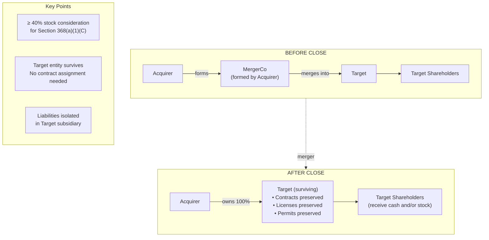

# Lesson 2: Deal Structuring, Financing, and Tax Considerations

## 1. First-Principles Intuition & Invariants

Every acquisition structure is the product of a negotiation among three constituencies with fundamentally misaligned preferences: the selling shareholders, the buying shareholders, and the tax authorities. The acquirer wants to minimize cash outflow, preserve tax attributes, and avoid diluting existing equity. The seller wants to maximize after-tax proceeds, defer capital gains recognition, and retain upside in a combined entity if the consideration is equity. The tax authorities want recognition events that generate immediate revenue. The deal architect's job is to find the structure that resolves these tensions at the lowest aggregate friction cost, where friction is measured in taxes paid, capital deployed, risk assumed, and optionality forfeited.

The foundational invariant is that consideration composition dictates tax character, and tax character dictates the economic outcome for both sides of the transaction. This is not a secondary consideration to be addressed by tax counsel after the commercial terms are locked. It is the primary design constraint. A deal that optimizes headline purchase price but ignores the seller's tax basis can deliver less after-tax value to the selling shareholders than a deal with a nominally lower enterprise value structured as a tax-free reorganization. Similarly, an acquirer that overpays with stock at a depressed valuation multiple, thinking it is conserving cash, may be transferring more economic value than a cash deal at a premium would require.

A second invariant is that the accounting treatment under ASC 805 (Business Combinations) is decoupled from the tax treatment. A transaction can be a tax-free reorganization under Section 368(a) of the Internal Revenue Code while simultaneously requiring purchase price allocation and goodwill recognition on the acquirer's financial statements. Practitioners who conflate the two regimes produce models that misstate earnings, miscalculate EPS accretion, and create audit surprises in the quarter following close. The deal structure must satisfy two parallel but independent sets of rules: the tax code, which determines who pays what and when, and GAAP/IFRS, which determines how the combined entity reports its financial position to the market.

The third invariant is that financing structure determines risk allocation across the capital structure, and that allocation is not symmetric around the closing date. Before close, the risk that financing cannot be secured falls on the acquirer and is typically mitigated by a financing condition in the merger agreement. After close, the risk that the combined entity cannot service its debt falls on the equity holders through deleveraging pressure, dividend restrictions, and covenant compliance. The bridge between these two risk regimes is the commitment letter, the term sheet, and ultimately the credit agreement, and the deal architect must understand how provisions in each document cascade into the post-close operating environment.

The decision tree begins with a single branching question: what does the seller want to receive, and what can the buyer afford to give? When the seller wants cash and the buyer has access to capital, the analysis is straightforward but the financing mechanics are complex. When the seller wants equity, the analysis shifts to valuation, exchange ratios, collars, and the tax deferral mechanics of Section 354, which governs the non-recognition of gain when a shareholder exchanges stock for stock in a manner that constitutes a continuity of interest. When the seller wants both, the mixed consideration structure introduces partial gain recognition and allocation rules that require line-by-line computation.

The tax-free reorganization regime in the United States is built on the continuity of interest doctrine, which holds that a transaction qualifies for non-recognition treatment only if the selling shareholders retain a substantial and non-contingent equity interest in the acquiring corporation or its parent. The Treasury Regulations establish a bright-line threshold of 40 percent of the total consideration must be stock, though in practice practitioners target a higher percentage to provide a margin of safety against IRS challenge. Below 40 percent stock consideration, the transaction is fully taxable. Above 40 percent, the stock portion qualifies for deferral and the non-stock portion is taxable as boot. This threshold is the single most important number in deal structure design, because it determines whether a transaction can be marketed as tax-free to the seller's shareholders, which directly impacts the price the seller is willing to accept.

The continuity of business enterprise doctrine provides a second constraint: the acquiring corporation must continue the historical business of the acquired corporation or use a significant portion of its assets in a business. This prevents tax-free treatment of transactions that are effectively liquidations dressed as reorganizations. A third constraint, the continuity of shareholder interest, is satisfied when the same shareholders who held the target continue to hold an equity stake in the acquiring entity, ensuring the transaction is a recombination rather than a sale to a third party.

These doctrines are not academic. They determine which transactions can proceed as stock-for-stock mergers under Section 368(a)(1)(A), forward triangular mergers under Section 368(a)(1)(C), reverse triangular mergers under Section 368(a)(1)(C), or Section 351 transfers. They determine whether a Section 338(h)(10) election is available to step up the basis of the target's assets, generating future tax deductions that have real NPV value to the acquirer. They determine whether the selling shareholders recognize capital gains at long-term rates, ordinary income rates, or defer entirely. The practitioner who does not internalize these rules cannot structure a deal competently.

## 2. Core Architecture & Mechanics

The architecture of an acquisition structure can be decomposed into four independent but interlocking layers: the legal form of the transaction, the consideration mix, the financing mechanism, and the tax election. Each layer constrains the others, and the practitioner must model all four simultaneously to arrive at an optimal structure.

### Legal Forms of Combination

The simplest structure is a direct asset acquisition, in which the buyer purchases identified assets and assumes specified liabilities of the seller. The buyer gets a step-up in basis equal to the purchase price allocated to each asset, which generates future tax depreciation and amortization. The seller recognizes gain on each asset sold, and the character of the gain depends on the nature of the asset. This structure is clean from the buyer's perspective because it avoids inhererring unknown liabilities, but it is administratively burdensome because every asset must be individually transferred, and every contract must be assigned, which often requires counterparty consent that may not be forthcoming.

The stock acquisition is the mirror image: the buyer purchases the selling shareholders' stock directly, acquiring the target as a going concern with all its assets, liabilities, contracts, and tax attributes intact. This is administratively simpler and commercially faster, but the buyer inherits all contingent and unknown liabilities, and the tax basis of the target's assets remains unchanged, meaning no step-up in depreciation and amortization. The buyer may subsequently make a Section 338(h)(10) election, which treats the stock purchase as an asset purchase for tax purposes, but this election requires a qualifying stock purchase (generally 80 percent or more of the target's stock) and triggers a deemed sale at fair market value, which means the target recognizes gain as if it sold its assets.

The forward merger is a statutory merger under state law in which the target corporation merges into the acquiring corporation, with the target ceasing to exist as a separate legal entity. The acquiring corporation assumes all of the target's obligations by operation of law, and the target's shareholders receive the agreed-upon consideration. This structure can be structured as taxable or tax-free depending on the consideration mix.

The forward triangular merger introduces a holding company structure. The acquirer forms a subsidiary (NewCo), and the target merges into NewCo, with NewCo surviving. This allows the acquirer to isolate the target's liabilities in the subsidiary, protecting the parent's other assets from target-related claims. If the consideration is at least 40 percent acquirer stock, the transaction can qualify as a Section 368(a)(1)(C) reorganization, provided the acquirer substantially continues the target's business enterprise.

The reverse triangular merger is the most complex and most common structure for public company acquisitions. The acquirer forms a subsidiary (MergerCo), and MergerCo merges into the target, with the target surviving as a wholly-owned subsidiary of the acquirer. This structure preserves the target's legal entity, which means all of its contracts, licenses, permits, and regulatory approvals remain in force without the need for assignment or novation. This is critically important in heavily regulated industries where transfer of licenses would trigger costly and time-consuming regulatory review. The structure also allows the acquirer to push the consideration down to the target's shareholders through MergerCo, which facilitates mixed consideration structures. If the consideration is at least 40 percent acquirer stock and the acquirer acquires substantially all of the target's properties, the transaction qualifies as a Section 368(a)(1)(C) reorganization.



### Consideration Mechanics

The consideration mix is the lever through which the deal architect allocates risk and tax burden between buyer and seller. An all-cash transaction is the cleanest commercially but the most tax-intensive for the seller. The seller's shareholders recognize capital gains equal to the difference between the cash received and their tax basis in the target stock. For founders with a low basis, this can result in a tax bill of 20 percent of the proceeds (federal long-term capital gains rate) plus state taxes plus the Net Investment Income Tax of 3.8 percent, totaling over 33 percent in high-tax jurisdictions. The buyer receives no tax basis step-up on the target's assets, meaning no incremental depreciation or amortization deduction.

An all-stock transaction defers the seller's gain recognition entirely, provided the continuity of interest threshold is met. The seller's shareholders exchange their target stock for acquirer stock and do not recognize gain until they sell the acquirer stock. The buyer's cost basis in the target stock equals the fair market value of the acquirer stock issued, but the target's asset basis remains unchanged, so there is no step-up. This structure is optimal when the seller's shareholders have a low basis, want to participate in the combined entity's upside, and the buyer's stock is undervalued relative to its long-term prospects.

The exchange ratio is the mechanism through which the relative valuations of the two companies are translated into a specific number of shares. If the acquirer's stock is trading at $50 per share and the target's stock is trading at $25 per share, and the parties agree to a 0.60 exchange ratio, each target share converts to 0.60 acquirer shares, implying a deal value of $30 per target share, a 20 percent premium to the unaffected price. The exchange ratio can be fixed (a specific number of acquirer shares per target share), floating (a specific dollar value per target share, with the number of acquirer shares adjusting based on the acquirer's stock price at close), or collared (a fixed ratio that adjusts only if the acquirer's stock price moves outside a specified band).

A fixed exchange ratio places all market risk on the seller's shareholders between signing and close. If the acquirer's stock declines, the deal value declines. A floating exchange ratio places all market risk on the acquirer. If the acquirer's stock declines, the acquirer must issue more shares to deliver the agreed dollar value, increasing dilution. A collar splits the risk: within the collar band, the exchange ratio is fixed and both parties share the risk. Below the floor, the acquirer must issue additional shares or the seller can walk. Above the ceiling, the seller receives fewer shares or the acquirer captures the benefit of its appreciation.

The mixed consideration structure allows the seller to elect between cash and stock, or to receive a combination of both. The election mechanics are governed by Section 358, which allocates basis between the stock and boot received based on the relative fair market values. The seller recognizes gain only to the extent of the boot received, provided the stock portion meets the 40 percent continuity of interest threshold. The election mechanism can create adverse selection: if the election is left to the seller's shareholders individually, those with the highest basis will elect cash (minimizing gain) and those with the lowest basis will elect stock (deferring gain), which can concentrate the cash portion disproportionately and threaten the 40 percent stock threshold. Deal architects resolve this with a proration mechanism that limits the total cash and stock available, ensuring the aggregate consideration mix is maintained.

### Financing Mechanics

The financing layer determines how the buyer sources the capital required to close the transaction. For an all-stock deal, the financing is the issuance of acquirer equity, which requires no external capital but dilutes existing shareholders. For a cash deal or the cash portion of a mixed deal, the acquirer must source debt, use balance sheet cash, or raise equity specifically for the transaction.

Senior secured debt is the cheapest form of acquisition financing because it is collateralized by the assets of the borrower and carries the lowest risk premium. The primary instruments are the revolving credit facility, which provides flexible short-term capital for working capital and general corporate purposes, and the term loan, which provides a lump sum amortizing over a defined period. Term Loan A amortizes evenly over five years and is held by banks. Term Loan B amortizes minimally (typically 1 percent per year) with a bullet at maturity, is held by institutional investors, and carries a higher interest rate. For acquisition financing, the term loan is the primary instrument because it provides the bulk capital needed at close, while the revolver provides ongoing liquidity.

The debt sizing constraint is the covenant package, which imposes maximum leverage ratios, minimum interest coverage ratios, and restrictions on additional indebtedness. The most common leverage covenant limits total debt to a multiple of EBITDA, typically 4.0x to 6.0x for investment-grade borrowers and 5.0x to 7.5x for speculative-grade borrowers. The interest coverage covenant requires EBITDA to exceed interest expense by a minimum multiple, typically 2.0x to 3.0x. These covenants are not advisory: they are hard constraints that, if breached, trigger default, acceleration, and potential foreclosure. The deal architect must model the pro forma capital structure to ensure compliance under stressed scenarios, not just under the base case.

Subordinated debt fills the gap between senior secured debt and equity in the capital structure. Mezzanine financing is the primary instrument, typically structured as subordinated notes with a coupon of 10 to 12 percent, often with payment-in-kind (PIK) toggles that allow interest to accrue rather than be paid in cash, preserving liquidity during the integration period. Mezzanine debt often includes warrants, which give the lender the right to purchase equity at a fixed price, effectively reducing the lender's cost to a lower all-in yield while giving the borrower a lower headline coupon. The warrant coverage is typically 1 to 5 percent of the equity value, and the dilution impact must be modeled into the acquirer's EPS accretion analysis.

Bridge financing provides committed capital between signing and close when permanent financing cannot be arranged due to market conditions or timing constraints. The bridge is a short-term loan, typically 12 months, provided by an investment bank under a commitment letter that specifies the amount, rate, and conditions. The bridge carries a high coupon (typically LIBOR/SOFR plus 300 to 500 basis points) and includes a step-up provision that increases the rate every six months, incentivizing the borrower to refinance into permanent debt as quickly as possible. The commitment letter itself carries a fee of 1 to 2 percent of the committed amount, payable regardless of whether the bridge is drawn.

The complete financing structure for a leveraged acquisition typically layers these instruments in a waterfall that determines the priority of claims in a downside scenario:

```
    Acquisition Financing Capital Stack
    ====================================

    Layer                | Typical Rate      | Priority | Typical Size (% of EV)
    -------------------- | ----------------- | -------- | ---------------------
    Revolving Credit     | SOFR + 125-200bps | 1st      | 0-15% (drawn at close)
    Term Loan B          | SOFR + 250-400bps | 1st      | 30-45%
    Senior Sub. Notes    | 7-9% fixed        | 2nd      | 10-20%
    Mezzanine / PIK      | 10-12% + warrants | 3rd      | 5-15%
    Sponsor / Acquirer   | n/a               | 4th      | 30-45%
    Equity

    Key constraint: Total debt / LTM EBITDA <= covenant limit (typically 5.5-6.5x)
    Key constraint: (EBITDA - CapEx) / Interest >= 2.0x stressed
    Key constraint: Minimum liquidity (cash + revolver) >= 12mo burn rate
```

### Tax Elections and Purchase Price Allocation

The Section 338(h)(10) election is the most consequential tax structuring tool in stock acquisitions. When an acquirer purchases 80 percent or more of the target's stock, it can elect to treat the purchase as an asset acquisition for tax purposes. The target is deemed to have sold all of its assets at fair market value, recognizing gain on the deemed sale. The acquirer receives a stepped-up basis in the target's assets equal to the purchase price, generating incremental tax depreciation and amortization over the useful life of each asset. The target's tax attributes (NOLs, credits) are typically eliminated by the ownership change rules of Section 382, so the election does not forfeit significant existing attributes.

The economics of the 338(h)(10) election depend on the present value of the incremental tax deductions generated by the step-up versus the tax cost of the deemed sale. The target's deemed sale triggers gain equal to the excess of the fair market value of its assets over their tax basis. This gain is taxed at the corporate level (21 percent federal). The acquirer's benefit is the present value of the incremental depreciation and amortization deductions, discounted at the acquirer's after-tax cost of capital, times the acquirer's tax rate. If the present value of the deductions exceeds the tax on the deemed sale, the election is value-creating and the parties can share the benefit through a higher purchase price.

The calculation requires a full purchase price allocation under ASC 805 for book purposes and a parallel allocation under Section 1060 for tax purposes. The allocations may differ because the book allocation must conform to fair value measurement under ASC 820, while the tax allocation must conform to the classes of assets specified in Section 1060, which are narrower. The residual, which is the amount allocated to goodwill, is the purchase price minus the fair value of identifiable tangible and intangible assets minus assumed liabilities. Goodwill is not amortizable for book purposes under ASC 350 (it is subject to annual impairment testing), but it is amortizable over 15 years for tax purposes under Section 197, which is a critical asymmetry that drives the value of the 338(h)(10) election.

The following framework shows the complete calculation for evaluating a 338(h)(10) election:

| Parameter | Formula | Example Value |
|---|---|---|
| Purchase Price (Equity Value) | Agreed price for target stock | $500,0M |
| Target Asset Tax Basis | Sum of NBV of all assets | $320.0M |
| Target Stock Tax Basis (SHs) | Original cost adjusted for distributions | $180.0M |
| Deemed Asset Sale Gain | Purchase Price - Target Asset Tax Basis | $180.0M |
| Tax on Deemed Sale (Target) | Deemed Gain × 21% | $37.8M |
| Step-Up in Asset Basis | Purchase Price - Target Asset Tax Basis | $180.0M |
| PV of Tax Shield from Step-Up | Step-Up × 21% × PV Factor (15yr, WACC) | $24.9M |
| Net Benefit of Election | PV Tax Shield - Tax on Deemed Sale | -$12.9M |
| Election Value-Adding? | Net Benefit > 0? | No (in this example) |

The election requires the consent of both the acquirer and the target (as the target bears the tax on the deemed sale), which is typically negotiated as a sharing of the benefit. The standard market practice is for the acquirer to increase the purchase price by 50 to 80 percent of the net benefit, compensating the target's shareholders for the tax cost their corporation incurs. The exact split is a commercial negotiation, but the quantification of the benefit must be done with precision and supported by a tax opinion from qualified counsel.

For transactions that do not qualify for or do not benefit from a 338(h)(10) election, the tax treatment depends on the consideration mix. In a taxable stock purchase for cash, the seller's shareholders recognize capital gain equal to the cash received minus their basis in the target stock. In a tax-free stock-for-stock merger under Section 368(a)(1)(B), the seller's shareholders take a substituted basis in the acquirer stock equal to their basis in the target stock, deferring all gain recognition. In a mixed transaction, the seller's shareholders recognize gain to the extent of cash received, and take a substituted basis in the stock portion equal to their allocable basis, calculated under Section 358 as follows:

```
    Basis Allocation in Mixed Consideration
    ========================================

    Given:
        Basis in Target Stock (B)        = $100/share
        FMV of Acquirer Stock received   = $160/share
        Cash received (boot)             = $40/share
        Total FMV received                = $200/share

    Step 1: Recognized Gain
        Gain = min(Boot, FMV_total - Basis)
        Gain = min($40, $200 - $100) = min($40, $100) = $40

    Step 2: Basis in Stock Received
        Stock Basis = B × (FMV_stock / FMV_total)
        Stock Basis = $100 × ($160 / $200) = $80

    Step 3: Verification
        Total FMV received = $200 (stock) + $40 (cash) = $200
        Gain recognized = $40 (taxable now)
        Deferred gain = $160 (FMV stock) - $80 (basis) = $80 (taxable on future sale)
        Total gain = $40 + $80 = $120 = $200 (FMV) - $100 (basis) ✓
```

## 3. High-Performance Optimization & Failure Modes

The optimization of acquisition structures proceeds along three axes: minimizing aggregate tax cost across both transacting parties, minimizing the acquirer's cost of capital while maintaining financing certainty, and preserving the combined entity's operational and strategic flexibility. These axes frequently conflict, and the practitioner's value lies in identifying the specific trade-offs that each structure implies and quantifying them with precision.

The first optimization frontier is the interplay between the 338(h)(10) election and the negotiated purchase price. The mechanical calculation described above identifies the net tax benefit of the election, but the commercial question is how that benefit is shared. In a competitive auction, the acquirer may be forced to pass 100 percent of the benefit to the seller to win the deal, effectively making the election a pure transfer with no net benefit to the acquirer. In a negotiated transaction, the acquirer can retain a portion of the benefit, improving its effective purchase price. The practitioner should model multiple sharing scenarios and identify the break-even sharing percentage, which is the point at which the acquirer is indifferent between making and not making the election. This break-even percentage is the acquirer's reservation price in the sharing negotiation.

A second optimization involves the use of Section 336(e) as an alternative to 338(h)(10). Section 336(e) allows an election to treat a stock purchase as an asset sale for tax purposes in transactions involving the acquisition of 80 percent or more of a target's stock, but it applies only to C corporations and has different timing and consent requirements. The key practical difference is that Section 336(e) does not require a consolidated group filing, which makes it available in transactions where the target is a standalone C corporation that is not part of a consolidated group. The election is made by the target, not the acquirer, which shifts the locus of consent. The economic consequences are similar, but the availability of the election in different ownership structures provides structural optionality that the deal architect should evaluate.

The financing structure optimization requires the acquirer to balance cost of capital against covenant flexibility and refinancing risk. The cheapest capital structure is one with maximum senior secured debt and minimum equity, but this structure imposes the tightest covenants and the highest refinancing risk. A more conservative structure with more subordinated debt and equity costs more but provides greater operating flexibility. The optimization requires the acquirer to model the combined entity's cash flow projections under base, downside, and severe downside scenarios and determine the maximum debt service the entity can support in each case. The optimal capital structure is the one that minimizes the weighted average cost of capital while maintaining covenant compliance and minimum liquidity buffers in the downside scenario.

A critical failure mode is the mismatch between the financing committed at signing and the financing required at close. This occurs when the acquirer's credit metrics deterior between signing and close, triggering a material adverse change clause that allows lenders to walk away from their commitment. More commonly, it occurs when market conditions deterior, widening credit spreads and making the committed financing uncompetitive relative to market rates, which creates pressure on the acquirer to renegotiate or accept unfavorable terms. The mitigant is the bridge commitment, which provides certainty of funding at a known, if expensive, rate. The cost of the bridge commitment fee (1 to 2 percent of committed amount) is the insurance premium the acquirer pays for financing certainty.

A second failure mode is the collapse of a tax-free reorganization structure due to a failure of the continuity of interest doctrine. This can occur if the acquirer's stock price declines significantly between signing and close in a fixed exchange ratio deal, reducing the value of the stock consideration below 40 percent of total consideration at the closing date. The structure then fails to qualify as a Section 368 reorganization, and the seller's shareholders face immediate tax recognition on the full amount of consideration. The mitigant is to structure the transaction with a floating exchange ratio that maintains the value of the stock component, or to include a collar that ensures the stock value remains above 40 percent. The practitioner should model the acquirer's stock price sensitivity and identify the price level at which the 40 percent threshold is breached, which defines the boundary of the safe zone.

A third failure mode is the post-close discovery of tax attributes that are eliminated or limited by the ownership change rules of Section 382. When an acquirer purchases more than 50 percentage points of a target's stock (measured by voting power or value), an ownership change occurs under Section 382, and the target's net operating loss carryforwards and tax credits are limited to the product of the target's value immediately before the ownership change and the long-term tax-exempt rate (published monthly by the IRS). This limitation can eliminate the value of significant NOLs that the acquirer assumed it could utilize. The deal architect must quantify the target's tax attributes, model the Section 382 limitation, and determine whether the attributes have any value in the transaction. If they do not, the 338(h)(10) election becomes more attractive because it eliminates the attributes without cost.

A fourth failure mode is the impairment of goodwill under ASC 350. Goodwill is not amortized for book purposes but is tested for impairment annually (or more frequently if indicators of impairment exist). If the combined entity's performance falls short of the projections used to justify the purchase price, the carrying value of goodwill may exceed its implied fair value, triggering an impairment charge that reduces reported earnings. This is not a cash event, but it signals to the market that the acquirer overpaid, which can trigger a decline in the acquirer's stock price and, in severe cases, lead to activist investor pressure or a change in management. The mitigant is conservative deal modeling: the acquirer should ensure that the purchase price is justified by projections that the management team has a high degree of confidence in, and the sensitivity analysis should identify the performance level at which impairment is triggered.

The following decision framework summarizes the structuring logic for a representative transaction:

```
    Deal Structuring Decision Framework
    ===================================

    1. Is target stock basis low (founders/early investors)?
       YES -> Stock consideration attractive (defers gain)
       NO  -> Cash consideration acceptable

    2. Does target have significant tax attributes (NOLs)?
       YES -> Avoid 338(h)(10) if attributes survive Section 382
       NO  -> Evaluate 338(h)(10) for asset basis step-up

    3. Can acquirer issue >= 40% of consideration as stock?
       YES -> Evaluate tax-free reorganization structure
       NO  -> Taxable structure, optimize cash/financing mix

    4. Is acquirer stock undervalued or overvalued?
       UNDervalued -> Prefer cash, avoid issuing stock
       OVERvalued  -> Prefer stock, capture arbitrage

    5. Does target have licenses/contracts requiring consent?
       YES -> Use reverse triangular merger (entity survives)
       NO  -> Forward merger or asset deal acceptable

    6. What is the financing capacity of the combined entity?
       Calculate: Max Debt = min(Covenant Leverage × EBITDA,
                                (EBITDA-CapEx)/Interest_min)
       Gap to purchase price = Equity required
```

The practitioner who approaches deal structuring as a mechanical exercise of applying templates will produce structures that are technically correct but commercially suboptimal. The value lies in the iterative process of modeling the tax, financing, and accounting consequences of each structural variant, quantifying the trade-offs, and negotiating the allocation of benefits and risks between the parties with the precision that the transaction's scale demands. Every basis point of tax efficiency, every turn of leverage capacity, and every percentage point of consideration mix has a dollar value that can be calculated, and the deal architect who calculates these values and uses them to drive the negotiation will consistently produce structures that deliver more after-tax value to both sides than the structures that result from commercial negotiation unguided by quantitative analysis.
