# Lesson 4: Post-Acquisition Integration and Value Creation

## 1. First-Principles Intuition & Invariants

The transaction close represents not an endpoint but an inflection point where strategic thesis transitions into operational execution. The discounted cash flow models, accretion-dilution analyses, and investment committee presentations that justified the purchase price now face the ruthless test of actual implementation. Academic research consistently demonstrates that between fifty and seventy percent of acquisitions fail to deliver anticipated returns, and the primary failure mode is not deal pricing but post-merger integration execution. The delta between projected synergies captured in valuation and realized synergies embedded in consolidated financial statements determines whether the acquiring board of directors faces activist investor pressure or shareholder commendation.

Post-acquisition integration operates under a fundamental tension between speed and disruption. Moving too slowly allows value leakage through customer attrition, employee departures, and competitor opportunism. Moving too aggressively fractures operational continuity, alienates the target company's institutional knowledge base, and triggers unintended cascading failures across interdependent business processes. This tension manifests most acutely in the first hundred days following close, when the acquirer must simultaneously maintain business continuity, extract cost synergies, and begin cultural integration without triggering material adverse changes to revenue trajectory.

The mechanics of value creation post-acquisition decompose into three fundamental categories: cost synergies, revenue synergies, and financial synergies. Cost synergies arise from eliminating redundant functions, consolidating facilities, renegotiating supplier contracts with enhanced purchasing power, and reducing overhead through shared service models. Revenue synergies emerge from cross-selling existing products to newly acquired customer bases, geographic expansion through combined distribution networks, and accelerated product development cycles through shared R&D capabilities. Financial synergies manifest through lower weighted average cost of capital from enhanced credit ratings, more efficient capital allocation across a diversified portfolio, and tax optimization through jurisdictional arbitrage or consolidated net operating loss carryforwards.

Each synergy category operates under distinct realization timelines and confidence intervals. Cost synergies typically realize within twelve to eighteen months post-close, exhibit high confidence intervals exceeding eighty percent, and produce tangible EBITDA impacts that flow directly through consolidated income statements. Revenue synergies extend across twenty-four to forty-eight month horizons, carry confidence intervals below fifty percent, and depend on customer behavior changes that resist managerial control. Financial synergies realize through capital structure optimization and tax planning but require careful navigation of debt covenants, rating agency methodologies, and regulatory constraints.

The accounting treatment of acquisitions under U.S. GAAP and IFRS establishes the measurement foundation for integration success. Purchase price allocation determines the balance sheet structure, goodwill impairment testing requirements, and amortization schedules that will impact reported earnings for years following the transaction. The acquiring company must allocate the total consideration transferred across tangible assets, identifiable intangible assets, assumed liabilities, and residual goodwill within a measurement period not exceeding one year from acquisition date. This allocation process directly impacts future cash flows through tax deductibility of certain intangible assets, annual impairment testing obligations, and earnout liability remeasurement.

Goodwill represents the premium paid above fair value of identifiable net assets and captures expected future economic benefits from assembled workforce, synergies, and market position that cannot be separately identified and measured. Unlike definite-lived intangible assets subject to systematic amortization, goodwill resides on the balance sheet indefinitely until triggered by impairment indicators. The annual impairment test compares the fair value of reporting units to their carrying amounts, including allocated goodwill. Failure to realize projected synergies, deteriorating market conditions, or strategic pivots away from acquired business lines frequently trigger goodwill impairment charges that signal value destruction to equity markets and invite forensic scrutiny of the original acquisition thesis.

Intangible assets identified during purchase price allocation typically include customer relationships, developed technology, trade names, non-compete agreements, and favorable lease contracts. Each category requires distinct valuation approaches—customer relationships often valued through multi-period excess earnings method, developed technology through relief-from-royalty method, and trade names through comparable royalty rates for similar assets. The assigned useful lives for these intangibles drive amortization expense that reduces reported net income but carries no cash flow impact, creating a wedge between GAAP earnings and cash-based performance metrics that management must carefully communicate to investors.

The integration management office serves as the operational nucleus for synergy realization, tracking hundreds of discrete workstreams across functional towers while maintaining visibility into interdependencies, sequencing constraints, and critical path items. This temporary organizational structure must command authority across business units, possess direct executive sponsorship, and maintain rigorous cadence discipline through weekly steering committee meetings with quantified progress metrics. The IMO operates as a matrix overlay atop existing organizational hierarchies, creating tension between business-as-usual operational priorities and transformation imperatives that require explicit escalation protocols and decision rights frameworks.

## 2. Core Architecture & Mechanics

The integration planning architecture begins before transaction close through clean team protocols that manage confidential information flow while preparing Day One operational readiness. Clean teams comprise advisors and select employees authorized to access competitively sensitive target company information under strict firewalls enforced by antitrust counsel. These teams develop integration playbooks, identify critical decision points, and prepare organizational announcements while the transaction remains subject to regulatory approval and closing conditions. The investment in pre-close planning directly correlates with Day One readiness and first-quarter synergy capture rates.

The Day One readiness checklist encompasses legal entity structure, treasury and cash management connectivity, IT infrastructure access, employee communication protocols, customer notification templates, and supplier continuity assurance. On the first business day following close, employees at the acquired company must understand their reporting structure, access necessary systems to perform their roles, and receive clear guidance on immediate priorities. Failures in Day One execution—inaccessible email systems, undefined decision authority, or contradictory communications from multiple leaders—immediately erode confidence and trigger voluntary attrition among high-value employees whom the acquisition was intended to retain.

The synergy tracking model operates as a detailed, initiative-level ledger that maps each discrete action to financial impact, responsible owner, timeline, and realization status. A typical enterprise acquisition generates between one hundred fifty and four hundred distinct synergy initiatives spanning procurement savings, facility consolidations, headcount reductions, sales force productivity improvements, and product portfolio rationalization. Each initiative requires baseline establishment, quantified target setting, milestone definition, and variance explanation protocols. The aggregated model rolls up to the board-level synergy commitments embedded in transaction approval materials and quarterly earnings guidance.

Cost synergy realization follows a characteristic sequencing pattern driven by implementation complexity and organizational resistance. Procurement savings from vendor consolidation and volume rebate renegotiation realize fastest, often within the first six months, because they require primarily contractual actions rather than operational restructuring. Facility consolidations follow, requiring twelve to eighteen months to execute lease terminations, relocate personnel, and dispose of redundant assets. Headcount reductions face the longest implementation timelines due to severance negotiation, knowledge transfer requirements, retention incentives for critical employees, and jurisdictional labor law constraints that particularly slow European workforce actions.

The detailed mechanics of procurement synergy capture illustrate the granular execution required for successful realization. The combined enterprise must first consolidate spend data across disparate ERP systems to identify overlapping suppliers and category spend concentrations. Procurement teams then approach strategic suppliers with enhanced volume commitments to negotiate stepped discount tiers, rebate thresholds, and payment term extensions. The negotiation leverage depends critically on switching cost assessment, supplier margin structure understanding, and credible alternative sourcing options. Realized savings flow through cost of goods sold or operating expense line items depending on spend category, with timing dependent on contract renewal dates and minimum purchase commitment fulfillment.

```mermaid
flowchart TD
    Root["Procurement Synergy Waterfall Analysis<br/>Combined Annual Spend: $850M"]
    
    Root --> CatA["Category A (Direct Materials): $420M"]
    Root --> CatB["Category B (IT & Telecom): $95M"]
    Root --> CatC["Category C (Professional Services): $140M"]
    
    CatA --> A1["Overlapping Suppliers:<br/>12 vendors representing $180M spend"]
    CatA --> A2["Volume Rebate Tier Improvement:<br/>3.2% incremental discount"]
    CatA --> A3["Gross Annual Savings: $5.76M"]
    CatA --> A4["Implementation Cost<br/>(RFP, qualification): $0.45M"]
    CatA --> A5["Net Year 1 Savings: $5.31M<br/>(realizes Month 4-12)"]
    
    CatB --> B1["Duplicate Software Licenses:<br/>$12M redundant spend"]
    CatB --> B2["Vendor Consolidation:<br/>8 vendors → 3 vendors"]
    CatB --> B3["Gross Annual Savings: $8.4M<br/>(70% elimination)"]
    CatB --> B4["Implementation Cost<br/>(migration, training): $1.2M"]
    CatB --> B5["Net Year 1 Savings: $6.3M<br/>(realizes Month 2-8)"]
    
    CatC --> C1["Master Service Agreement Consolidation:<br/>$45M addressable"]
    CatC --> C2["Rate Reduction Through Volume Commitment:<br/>12% average"]
    CatC --> C3["Gross Annual Savings: $5.4M"]
    CatC --> C4["Implementation Cost<br/>(legal, transition): $0.3M"]
    CatC --> C5["Net Year 1 Savings: $3.8M<br/>(realizes Month 6-12)"]
    
    A5 --> Total["Total Procurement Synergy:<br/>$15.41M Net Year 1"]
    B5 --> Total
    C5 --> Total
    
    Total --> RunRate["Annual Run-Rate (Year 2+):<br/>$19.46M"]
    
    style Root fill:#e1f5ff,stroke:#0066cc,stroke-width:3px
    style CatA fill:#fff4e6,stroke:#ff9800,stroke-width:2px
    style CatB fill:#f3e5f5,stroke:#9c27b0,stroke-width:2px
    style CatC fill:#e8f5e9,stroke:#4caf50,stroke-width:2px
    style Total fill:#fff9c4,stroke:#fbc02d,stroke-width:3px
    style RunRate fill:#c8e6c9,stroke:#2e7d32,stroke-width:3px
```



Revenue synergy realization requires fundamentally different operational mechanics than cost extraction because it depends on customer adoption decisions outside direct managerial control. The acquiring company must train the target's sales force on its product portfolio, integrate CRM systems to enable cross-sell opportunity identification, develop bundled pricing and packaging, and create incentive compensation structures that reward cross-product attachment without cannibalizing existing revenue streams. The confidence interval on revenue synergies remains perpetually lower than cost synergies because customer purchasing decisions respond to competitive dynamics, economic conditions, and relationship factors that transcend simple product availability.

The practical execution of cross-sell revenue synergies begins with customer segmentation analysis that maps acquired customer accounts against the acquirer's product portfolio to identify whitespace opportunities. High-propensity targets exhibit characteristics such as enterprise agreements indicating budget authority, multi-year contracts signaling strategic commitment, and usage patterns demonstrating technical sophistication required for additional products. The sales organization then receives target account lists, enablement training on value propositions, and adjusted quota structures that balance new logo acquisition against installed base expansion. Early wins in the first two quarters provide proof points that validate the synergy thesis and build organizational momentum, while early losses trigger strategic reassessment of product-market fit assumptions.

The financial synergy category encompasses working capital optimization, debt refinancing, and tax structure enhancement. Working capital optimization begins with harmonizing payment terms, collections processes, and inventory management policies across the combined entity. If the acquirer operates a centralized treasury function with sophisticated cash forecasting while the target maintains decentralized regional accounts, consolidation can release trapped cash and reduce external borrowing needs. Similarly, if the acquirer maintains investment-grade credit ratings while the target carried sub-investment grade debt, refinancing the target's debt at lower spreads generates immediate interest expense savings that flow through the income statement as increased net income.

Tax synergies arise from multiple structural opportunities. If the target company carried net operating loss carryforwards from historical operating losses, those NOLs can offset future taxable income of the combined entity subject to Section 382 limitations that restrict annual usage based on equity value change during ownership transition. If the acquirer operates in multiple jurisdictions, transfer pricing optimization can allocate profits to lower-tax regimes through intra-company service agreements, intellectual property licensing arrangements, and cost allocation methodologies. However, aggressive tax planning attracts regulatory scrutiny, and the reputational risk of public tax controversy often outweighs marginal effective tax rate improvements.

The purchase price allocation process under ASC 805 establishes the accounting foundation that will govern financial reporting for the acquisition's duration. The allocation begins with fair value determination for all identifiable assets acquired and liabilities assumed as of the acquisition date, independent of their carrying values on the target's historical books. Tangible assets such as property, plant, and equipment receive appraisals that reflect current replacement cost less depreciation. Inventory steps up to estimated selling price less costs to complete and dispose, creating a one-time margin impact when sold. Accounts receivable may require valuation allowance adjustments if the target maintained inadequate reserves for doubtful accounts.

Identifiable intangible assets require specialized valuation analysis conducted by independent appraisal firms using income, market, or cost approaches depending on asset characteristics. Customer relationship intangibles value the present value of projected cash flows from existing customer contracts, incorporating attrition assumptions and contributory asset charges for working capital, fixed assets, and workforce supporting those relationships. Developed technology intangibles capture the fair value of patented innovations, proprietary software, or engineering know-how using relief-from-royalty methods that estimate the hypothetical licensing fees avoided by owning rather than licensing the technology. Trade names and trademarks receive valuation through comparable market royalty rates adjusted for relative brand strength and market position.

```text
Purchase Price Allocation Example: $500M Acquisition

Total Consideration Transferred: $500,000,000
├─ Cash Payment: $450,000,000
├─ Contingent Consideration (earnout): $30,000,000 (fair value)
└─ Equity Issued: $20,000,000 (fair value)

Fair Value of Identifiable Net Assets:
┌─────────────────────────────────────────────────────┐
│ ASSETS ACQUIRED                                     │
├─────────────────────────────────────────────────────┤
│ Current Assets                                      │
│   Cash and Cash Equivalents        $   12,000,000  │
│   Accounts Receivable (net)        $   35,000,000  │
│   Inventory (step-up applied)      $   28,000,000  │
│                                    ───────────────  │
│ Total Current Assets               $   75,000,000  │
│                                                     │
│ Property, Plant & Equipment        $   85,000,000  │
│                                                     │
│ Identifiable Intangible Assets:                    │
│   Customer Relationships           $  120,000,000  │
│     (useful life: 12 years)                        │
│   Developed Technology             $   80,000,000  │
│     (useful life: 8 years)                         │
│   Trade Names                      $   25,000,000  │
│     (useful life: 15 years)                        │
│   Non-Compete Agreements           $    5,000,000  │
│     (useful life: 3 years)                         │
│                                    ───────────────  │
│ Total Intangible Assets            $  230,000,000  │
│                                                     │
│ Other Assets                       $    8,000,000  │
│                                    ───────────────  │
│ TOTAL ASSETS ACQUIRED              $  398,000,000  │
└─────────────────────────────────────────────────────┘

┌─────────────────────────────────────────────────────┐
│ LIABILITIES ASSUMED                                 │
├─────────────────────────────────────────────────────┤
│ Current Liabilities                                 │
│   Accounts Payable                 $   22,000,000  │
│   Accrued Expenses                 $   15,000,000  │
│   Deferred Revenue (adj. to FV)    $    8,000,000  │
│                                    ───────────────  │
│ Total Current Liabilities          $   45,000,000  │
│                                                     │
│ Long-Term Debt                     $  125,000,000  │
│ Deferred Tax Liabilities           $   78,000,000  │
│   (from intangible step-up)                        │
│ Other Long-Term Liabilities        $   12,000,000  │
│                                    ───────────────  │
│ TOTAL LIABILITIES ASSUMED          $  260,000,000  │
└─────────────────────────────────────────────────────┘

Fair Value of Identifiable Net Assets:
  Total Assets - Total Liabilities = $138,000,000

GOODWILL CALCULATION:
  Consideration Transferred          $  500,000,000
  Less: Fair Value of Net Assets     $ (138,000,000)
                                     ───────────────
  GOODWILL                           $  362,000,000
                                     ═══════════════

Annual Amortization Expense Impact:
  Customer Relationships: $10,000,000/year
  Developed Technology:   $10,000,000/year
  Trade Names:            $ 1,666,667/year
  Non-Compete:            $ 1,666,667/year
                          ───────────────
  Total Annual Amortization: $23,333,334
```

The deferred tax liability arising from intangible asset step-up merits detailed examination because it represents a non-cash liability that reduces net assets acquired while creating future tax deductions unavailable to the target as a standalone entity. When the acquirer recognizes intangible assets for book purposes at fair value exceeding their tax basis (often zero for internally developed intangibles), a temporary difference emerges. This temporary difference will reverse as the acquirer amortizes the book intangible basis over its useful life while taking tax deductions based on the lower tax basis (subject to Section 197 rules for tax amortizable intangibles). The deferred tax liability calculation applies the combined entity's expected statutory rate to the step-up difference, effectively reducing the net assets acquired in the purchase price allocation and increasing residual goodwill.

Goodwill impairment testing occurs annually at the reporting unit level under ASC 350, with interim testing required if triggering events indicate potential impairment between annual tests. The acquirer must allocate goodwill to reporting units expected to benefit from acquisition synergies, typically the operating segments that will absorb the acquired business. The impairment test compares each reporting unit's fair value to its carrying amount including allocated goodwill. If fair value exceeds carrying amount, no impairment exists. If carrying amount exceeds fair value, the acquirer recognizes an impairment charge equal to the excess, not to exceed the goodwill allocated to that reporting unit.

Fair value determination for reporting units typically employs income approach valuation using discounted cash flow methodology or market approach using comparable company trading multiples. The income approach requires explicit cash flow projections for the reporting unit, terminal value assumptions, and discount rate selection reflecting the unit's specific risk profile. Management must document the valuation assumptions, sensitivities, and any changes from prior periods. Auditors scrutinize these valuations intensely because goodwill impairment represents management's implicit admission that acquisition returns fell short of original expectations, potentially indicating overpayment or integration failures.

The organizational integration architecture determines the structural relationship between acquirer and target, ranging from full absorption to autonomous subsidiary operation. Full absorption dissolves the target's legal entity, migrates all employees to acquirer employment contracts, consolidates all systems onto acquirer platforms, and eliminates the target brand. This approach maximizes cost synergies through complete redundancy elimination but carries highest integration risk and cultural disruption. Autonomous operation maintains the target as a separate subsidiary with independent systems, branding, and leadership, preserving continuity but severely limiting synergy realization. Most acquisitions pursue hybrid models that consolidate back-office functions while maintaining customer-facing operational independence during a phased integration timeline.

The functional tower integration model organizes workstreams by corporate function—finance, human resources, IT, legal, sales, marketing, operations, and R&D—with dedicated leads responsible for their domain's integration across the combined enterprise. The finance tower addresses treasury consolidation, accounting policy harmonization, ERP system migration, financial reporting integration, and tax structure optimization. The IT tower tackles application rationalization, data center consolidation, network integration, cybersecurity unification, and helpdesk support merger. Each tower maintains detailed project plans with task-level ownership, dependency mapping, milestone tracking, and issue escalation protocols that roll up to the integration management office.

The integration governance model typically establishes a three-tier structure: steering committee, integration management office, and functional working teams. The steering committee comprises C-suite executives from both legacy organizations who meet weekly during the first ninety days to resolve escalated issues, approve budget variances, and maintain strategic alignment. The IMO operates as full-time program management, maintaining the master integration plan, tracking synergy realization, facilitating cross-functional coordination, and preparing steering committee materials. Functional working teams execute specific initiatives within their tower, reporting progress through tower leads into the IMO consolidation process.

## 3. High-Performance Optimization & Failure Modes

The velocity of integration execution directly correlates with value preservation, yet aggressive timelines introduce execution risk that can trigger cascading failures across interdependent systems and processes. The optimal integration cadence balances speed-to-synergy against operational continuity, with empirical evidence suggesting that the first hundred days represent a critical window where integration momentum either builds or dissipates. Organizations that achieve fifty percent of committed cost synergies within the first year dramatically outperform those that defer difficult integration decisions, because delayed action allows organizational antibodies—middle management resistance, cultural incompatibility, and competing priorities—to calcify and block transformation.

The measurement of integration success requires a multi-dimensional scorecard that extends beyond simple synergy capture to encompass leading indicators of value realization and risk. Financial metrics include actual synergy achievement against committed targets, organic revenue growth rates versus pre-acquisition baselines, EBITDA margin expansion trajectories, and return on invested capital improvement. Operational metrics track customer retention rates, employee attrition among critical talent segments, product development cycle time, and sales productivity per representative. These operational indicators serve as early warning signals when integration stress threatens business continuity before financial performance deteriorates.

Customer attrition represents the most insidious failure mode in post-acquisition integration because revenue losses compound across multi-year customer lifetime value horizons. Customers face uncertainty when their vendor undergoes ownership change, questioning product roadmap continuity, service level sustainability, and organizational commitment to their success. Competitors exploit this uncertainty through targeted account penetration, offering switching incentives and raising concerns about future support. The acquiring company must execute a disciplined customer communication strategy that begins immediately post-close, includes executive-to-executive relationship reinforcement for strategic accounts, and provides concrete product integration roadmaps that demonstrate enhanced value rather than capability reduction.

Employee retention of critical talent segments requires targeted intervention beyond general workforce communication because key employees—lead engineers, top sales representatives, product visionaries—possess asymmetric impact on business value and face the most attractive external opportunities. The acquirer should identify these individuals during due diligence, structure retention incentives that vest over eighteen to thirty-six month periods with cliff or ratable schedules, and provide career pathing clarity that demonstrates opportunity rather than diminishment. The retention program must balance equity across organizations to avoid perceived favoritism while concentrating resources on roles with highest replacement cost and business impact.

Cultural integration represents the softest variable and the hardest execution challenge because organizational culture comprises unwritten norms, behavioral expectations, decision-making processes, and communication styles that resist explicit documentation or mandate. When an aggressive, risk-taking acquirer absorbs a consensus-driven, process-oriented target, the cultural collision manifests through conflict over decision velocity, tolerance for failure, and authority delegation. The leadership team must explicitly define the desired future state culture, identify specific behaviors that reinforce those values, and model those behaviors consistently in visible forums. Cultural integration extends across three to five years, far beyond the typical eighteen-month integration program timeline.

System integration failures create immediate operational disruption with customer-visible impacts that erode trust and revenue. When an acquirer attempts to migrate the target's customer base from a legacy CRM system to its enterprise platform on an aggressive timeline without adequate data cleansing, mapping validation, or user training, the result predictably includes lost customer records, corrupted opportunity data, and sales force productivity collapse during the transition window. Best practice system integration follows a phased approach that begins with read-only replication, proceeds through parallel operation with validation, and concludes with cutover only after demonstrated stability and user proficiency.

The technology rationalization process identifies overlapping applications, selects winners based on capability fit and total cost of ownership, and executes sunset plans for displaced systems. A typical enterprise acquisition involves forty to sixty significant application overlaps spanning ERP, CRM, HRMS, marketing automation, product lifecycle management, and analytics platforms. Each rationalization decision requires functional capability comparison, integration complexity assessment, license cost analysis, and organizational change management planning. The temptation to defer difficult rationalization decisions—maintaining parallel systems indefinitely—creates technical debt, duplicative maintenance costs, and data synchronization complexity that undermines long-term value creation.

Earnout structures create performance measurement and incentive alignment challenges that frequently trigger disputes between acquirer and seller. When purchase price includes contingent consideration based on future revenue or EBITDA targets, the seller maintains vested interest in maximizing reported performance while the acquirer controls operational decisions affecting that performance. Disputes arise over product pricing decisions that trade short-term revenue for long-term market position, overhead allocation methodologies that reduce EBITDA, and integration investments that depress near-term profitability to enable future growth. Clear earnout definitions, mutually agreed accounting policies documented at close, and dispute resolution mechanisms reduce but do not eliminate conflict.

The accounting treatment of earnouts under ASC 805 requires fair value measurement at acquisition date with subsequent remeasurement at each reporting period until settlement. The acquirer classifies earnouts as liability or equity based on settlement terms, with liability classification far more common because most earnouts settle in cash. Liability-classified earnouts require mark-to-market adjustment through earnings each quarter as probability-weighted expected outcomes change based on performance trajectories. These remeasurement adjustments create earnings volatility independent of core business performance, necessitating clear investor communication about earnout impacts on reported results.

Integration cost management requires explicit budgeting, tracking, and capitalization analysis separate from synergy realization tracking. Integration costs include severance payments, facility closure expenses, system migration costs, professional fees, retention bonuses, and dual-running costs during transition periods. These costs typically range from five to fifteen percent of transaction value depending on integration depth. Under GAAP, most integration costs expense as incurred rather than capitalize, creating a near-term earnings headwind that management must clearly communicate to investors alongside offsetting synergy realization timelines.

The synergy tracking rigor separates successful integrations from value-destructive combinations. Each synergy initiative requires baseline establishment that documents pre-acquisition cost structure or revenue performance, enabling accurate measurement of incremental impact. The tracking model must clearly identify initiatives with hard benefits that flow through actual P&L reduction or revenue increase versus soft benefits that avoid future costs or enable future opportunities. Hard benefits receive full credit in synergy realization reporting while soft benefits require probability weighting and conservative attribution to maintain credibility with board oversight and investor expectations.

Dis-synergies represent the mirror image of synergies—incremental costs or revenue losses caused by the acquisition that offset gross synergy benefits to determine net value creation. Common dis-synergies include lost revenue from channel conflict when the acquirer and target served overlapping customer segments through competing distribution partners, increased compensation expense from harmonizing pay scales upward to retain target employees, and duplicative compliance costs from operating in newly entered regulated jurisdictions. Conservative deal modeling explicitly quantifies probable dis-synergies rather than ignoring implementation friction, improving post-close performance predictability.

The quarterly integration reporting cadence to the board of directors maintains accountability and enables mid-course correction when integration performance diverges from plan. The standard integration dashboard presents synergy realization by category with variance explanations, customer and employee retention metrics with trend analysis, major milestone achievement status with risk flagging, and updated return on invested capital projections incorporating actual performance. When synergy realization lags committed targets by more than fifteen percent, the dashboard should include explicit remediation plans with accountable owners and revised timelines rather than generic explanations about timing delays.

Post-acquisition performance measurement extends three to five years beyond close to assess whether the acquisition delivered returns exceeding the cost of capital and whether strategic objectives materialized. The measurement framework compares actual financial performance against the original deal model, adjusting for macroeconomic factors and industry conditions that affected all comparable companies. Return on invested capital calculation divides cumulative incremental EBITDA (including realized synergies) less incremental capital expenditures and working capital investment by total consideration transferred. Successful acquisitions generate ROIC exceeding the weighted average cost of capital within three years and demonstrate sustainable competitive advantage creation beyond pure cost extraction.

The institutional learning process captures integration lessons to improve future acquisition execution. High-performing serial acquirers maintain integration playbooks that document successful approaches, common failure modes, critical path items, and decision frameworks refined through multiple transactions. These playbooks standardize repeatable processes—Day One checklists, communication templates, synergy tracking models, and governance structures—while remaining flexible to deal-specific circumstances. The corporate development function conducts post-mortems on each acquisition at twelve and twenty-four month intervals, documenting what worked, what failed, and what would change in future integrations. This disciplined reflection converts expensive experience into reusable institutional knowledge that compounds across acquisition programs.

The strategic reassessment process recognizes when acquisitions fail to deliver expected value and requires candid acknowledgment followed by decisive action. When a reporting unit consistently underperforms, when expected revenue synergies prove illusory, or when strategic rationale erodes due to market evolution, management faces the decision to double down through incremental investment, harvest through operational optimization, or exit through divestiture. The sunk cost fallacy—continuing to invest in failing acquisitions because of capital already deployed—destroys shareholder value. Disciplined portfolio management requires unsentimental assessment of forward returns and willingness to admit mistakes through strategic dispositions that redeploy capital to higher-return opportunities.
