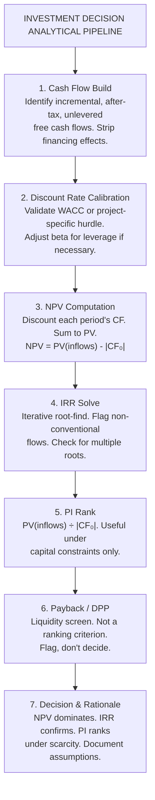

# Lesson 3: Investment Decision Frameworks

## 1. First-Principles Intuition & Invariants

Every capital allocation decision rests on a single, inescapable truth: a dollar available today is worth more than a dollar promised tomorrow. This is not a convention or a modeling artifact. It reflects the opportunity cost of capital, the irreducible reality that money deployed in a productive investment foregoes its next best alternative use. When a corporate finance practitioner evaluates whether to build a new manufacturing line, acquire a competitor, or license a technology platform, she is fundamentally asking one question: does the present value of what this investment returns exceed the present value of what it costs? Everything else — IRR calculations, payback hurdles, profitability indices — is scaffolding built around that single question.

The formal machinery begins with net present value. NPV is not merely a formula; it is an epistemological framework for translating an uncertain future into a defensible present-day verdict. Its logical structure demands that an analyst identify every incremental cash flow the project generates, assign a discount rate that faithfully represents the riskiness of those flows, and then subtract the initial outlay. When NPV is positive, the investment creates value above and beyond what the firm's capital providers require. When it is negative, the project destroys value even if it generates accounting profit, because accounting profit does not account for the time value of money or the opportunity cost embedded in the discount rate.

Understanding why the discount rate is the most consequential input in any DCF analysis requires tracing its economic origin. In practice, the discount rate used for corporate investment decisions is the Weighted Average Cost of Capital, WACC, which blends the after-tax cost of debt with the cost of equity, weighted by each component's proportion in the firm's target capital structure. The cost of equity is typically derived from the Capital Asset Pricing Model, which decomposes equity return expectations into the risk-free rate, usually the yield on a 10-year U.S. Treasury, plus a risk premium that scales with the asset's systematic risk as measured by beta. For a CAPM-derived cost of equity:

$$k_e = R_f + \beta \cdot (R_m - R_f)$$

Where $R_f$ is the risk-free rate, $\beta$ is the project's or firm's equity beta, and $(R_m - R_f)$ is the equity risk premium, historically averaging between 4.5% and 6.0% in U.S. markets depending on the estimation methodology. WACC then assembles these components:

$$WACC = \frac{E}{E+D} \cdot k_e + \frac{D}{E+D} \cdot k_d \cdot (1 - t)$$

Where $E$ is market value of equity, $D$ is market value of debt, $k_d$ is the pre-tax cost of debt, and $t$ is the marginal corporate tax rate. The $(1-t)$ term on the debt component reflects the interest tax shield — interest payments are deductible, reducing the effective cost of borrowing.

This grounding matters for investment decisions because misspecifying the discount rate is far more damaging than most analysts appreciate. A project evaluated at 8% WACC that should have been discounted at 12% will appear to create $14 million in value when it actually destroys $6 million. The error is not in the cash flow arithmetic; it is in the implicit claim about what return the capital providers require. Senior practitioners therefore spend disproportionate analytical time validating the discount rate before trusting any NPV output.

The internal rate of return, IRR, occupies a different conceptual space. Rather than asking "what is the present value of these cash flows at a given discount rate," IRR asks "what discount rate would make the present value of these cash flows exactly equal to the investment cost?" Mathematically, it solves for $r$ in:

$$0 = \sum_{t=0}^{n} \frac{CF_t}{(1+r)^t}$$

This is a polynomial root-finding problem with no closed-form algebraic solution for $n > 4$. Financial calculators and spreadsheet solvers use iterative numerical methods — Newton-Raphson being the most common — to converge on a solution. The decision rule is straightforward in its intuitive appeal: if IRR exceeds the hurdle rate, accept the project; if it falls below, reject it. When the hurdle rate and WACC are equivalent, the IRR rule and NPV rule yield identical accept/reject verdicts for conventional cash flows, meaning projects with a single sign change from negative to positive across the cash flow timeline.

The practical danger of IRR arises from exactly this "conventional cash flow" assumption. Real capital projects frequently violate it. A mining operation, for instance, might require large environmental remediation expenditures in its final years — producing negative cash flows in both the opening and closing periods, with positive flows sandwiched between. This non-conventional structure can produce multiple valid mathematical solutions to the IRR equation, a phenomenon called multiple IRRs or the Descartes' Rule of Signs problem. When a cash flow series changes sign $k$ times, there are potentially $k$ positive real roots to the IRR polynomial. Presenting any single one of those roots as "the" IRR is analytically misleading, and an analyst who does so without qualification is making a material error.

A related but distinct failure mode occurs when comparing two mutually exclusive projects using IRR alone. Suppose Project Alpha requires a $1 million investment and returns an IRR of 35%, while Project Beta requires a $10 million investment and returns an IRR of 22%. If the firm's hurdle rate is 10%, IRR analysis selects Alpha because 35% > 22%. NPV analysis may select Beta, however, because a 22% return on ten times the invested capital might generate $3.2 million in NPV compared to Alpha's $900,000. IRR is a measure of return efficiency, not absolute value creation, and maximizing efficiency at the expense of scale is precisely the wrong objective when a firm has access to sufficient capital. The scale-sensitivity problem is systematic, not incidental, and it explains why IRR should never be used as the sole criterion for ranking mutually exclusive investments.

The profitability index, PI, provides a partial remedy when capital is constrained. It is defined as the ratio of the present value of future cash flows to the initial investment outlay:

$$PI = \frac{\sum_{t=1}^{n} \frac{CF_t}{(1+r)^t}}{|CF_0|}$$

A PI greater than 1.0 is equivalent to a positive NPV project. Its utility emerges specifically in capital rationing scenarios — situations where the firm cannot fund every positive-NPV project simultaneously due to budget constraints. Ranking projects by PI and selecting down the list until the capital budget is exhausted allocates finite capital to the highest value-per-dollar-invested projects, which is the correct objective under scarcity. The limitation, discussed at greater length in Section 3, is that PI ranking breaks down when projects are indivisible and budget surpluses from early selections cannot be optimally filled.

The payback period holds a peculiar position in the practitioner toolkit: nearly every sophisticated finance team uses it, almost none would defend it theoretically, and it survives because it measures something IRR and NPV genuinely do not — liquidity risk and forecast uncertainty over time. Payback simply counts the number of periods required for cumulative undiscounted cash inflows to recover the initial outlay. Its defects are well documented. It ignores time value entirely, assigns equal weight to a cash flow in year one and a cash flow in year three. It ignores all cash flows beyond the payback cutoff, potentially ranking a project that breaks even in year two with zero terminal value above one that breaks even in year two and then generates a decade of strong returns. These are not minor technicalities; they are category errors in investment logic.

The discounted payback period addresses the first defect by applying the discount rate before accumulating cash flows, so the hurdle becomes "how many periods until we recover the present value of the investment." This is strictly superior to raw payback. Neither variant, however, resolves the truncation problem. Projects with long economic lives — infrastructure, pharmaceutical pipelines, branded consumer platforms — will systematically be penalized by any payback-based criterion because their value is concentrated in later cash flows that the payback screen never reaches.

What survives scrutiny is using payback as a first-pass filter for liquidity-constrained organizations, or as a proxy measure for forecast confidence intervals. Cash flow projections for year six of a ten-year model carry substantially more parameter uncertainty than projections for year two. A project with a three-year payback has recovered its capital before the forecast degrades into speculation. This is a real and legitimate concern in capital allocation — it simply does not constitute an investment decision framework in its own right.

---

## 2. Core Architecture & Mechanics

The practical execution of investment analysis flows through a sequence of analytical stages that are logically dependent on one another. Getting the architecture of this workflow right matters as much as getting the formula right, because errors introduced early cascade through every downstream calculation. The sequence moves from cash flow identification to discount rate validation to NPV computation to comparative ranking, with each stage producing an output that becomes the input for the next.

**Building the Cash Flow Schedule.** The most consequential discipline in this entire architecture is constructing cash flows correctly. The fundamental rule is that project cash flows must be incremental, after-tax, and unlevered. Incremental means only cash flows that exist because the project exists: sunk costs, already spent and irreversible, are excluded entirely. If the firm paid $500,000 for a market study before the investment decision point, that money is gone regardless of what is decided today, and including it in the analysis will mechanically bias the NPV downward, potentially causing the firm to reject a value-creating investment to avoid psychologically "losing" money it has already lost. This is the sunk cost fallacy encoded in a spreadsheet, and it is surprisingly common.

After-tax means applying the marginal corporate tax rate to operating income before computing free cash flow. The standard unlevered free cash flow formula used in DCF and project valuation is:

$$UFCF_t = EBIT_t \cdot (1 - t) + D\&A_t - \Delta NWC_t - CapEx_t$$

Where $EBIT$ is earnings before interest and taxes, $t$ is the marginal tax rate, $D\&A$ is depreciation and amortization added back because it is a non-cash charge that reduced EBIT, $\Delta NWC$ is the period change in net working capital, and $CapEx$ is capital expenditures. This formulation is unlevered because it does not subtract interest expense; the discount rate (WACC) separately accounts for the value of the tax shield created by debt financing. Including interest expense in cash flows and then discounting at WACC would double-count the debt tax shield, producing an overstated NPV. This is a conceptual error that persists in practitioner models with surprising frequency.

Working capital deserves particular attention because analysts consistently underestimate it. When a project ramps up revenues, receivables increase — cash that has been earned but not yet collected. When inventory builds in advance of production, cash is consumed before any revenue is recognized. These are real, cash-absorbing mechanics. A model that ignores NWC changes will overstate free cash flows in growth years and understate them in wind-down years when working capital is released. For a capital-intensive manufacturing project projecting $80 million in peak annual revenues with 45-day receivables and 60-day inventory, the working capital build in the ramp year alone can consume $25 to $30 million of cash, a figure large enough to shift the IRR by several hundred basis points.

**Computing NPV with Full Mechanics.** A complete five-year project NPV model, structured for direct use in a financial model workbook, operates as follows. Suppose a firm evaluates a project with an initial investment of $20 million at $t=0$, unlevered free cash flows of $3.0M, $4.5M, $6.0M, $7.5M, and $8.0M in years one through five, plus a terminal cash flow from asset disposal of $2.0M at year five. WACC is 10%.

The terminal year cash flow is $8.0M + $2.0M = $10.0M.

$$NPV = -20 + \frac{3.0}{1.10^1} + \frac{4.5}{1.10^2} + \frac{6.0}{1.10^3} + \frac{7.5}{1.10^4} + \frac{10.0}{1.10^5}$$

$$NPV = -20 + 2.727 + 3.719 + 4.508 + 5.123 + 6.209$$

$$NPV = -20 + 22.286 = +\$2.286 \text{ million}$$

This project clears the hurdle rate and creates $2.286 million of economic value above the 10% required return. Had WACC been 14%, the same project would yield:

$$NPV_{14\%} = -20 + \frac{3.0}{1.14} + \frac{4.5}{1.14^2} + \frac{6.0}{1.14^3} + \frac{7.5}{1.14^4} + \frac{10.0}{1.14^5}$$

$$NPV_{14\%} = -20 + 2.632 + 3.463 + 4.050 + 4.439 + 5.194 = -\$0.222 \text{ million}$$

The project destroys value at a 14% hurdle. The crossover point — the IRR — lies between 10% and 14%. By iterative approximation (or Excel's `IRR()` function applied to the array `{-20, 3.0, 4.5, 6.0, 7.5, 10.0}`), the IRR resolves to approximately 13.72%. The practical implication is that the investment decision hinges entirely on whether WACC should be 10% or something higher. This is precisely why discount rate calibration, not cash flow arithmetic, is where the highest-value analytical work occurs.

**Capital Rationing and PI Mechanics.** When a firm operates under a hard capital constraint — a fixed budget of, say, $50 million that cannot be exceeded regardless of the number of positive-NPV projects available — the NPV rule in its simple form becomes insufficient as a ranking tool. Consider four independent projects competing for a $50M budget:

| Project | Initial Outlay | PV of Inflows | NPV    | PI   |
|---------|---------------|---------------|--------|------|
| Alpha   | $30M          | $39M          | $9M    | 1.30 |
| Beta    | $20M          | $27M          | $7M    | 1.35 |
| Gamma   | $25M          | $31.25M       | $6.25M | 1.25 |
| Delta   | $15M          | $19.5M        | $4.5M  | 1.30 |

Selecting by NPV rank alone would fund Alpha ($30M) and then Beta ($20M), consuming the full $50M and producing combined NPV of $16M. Ranking by PI instead selects Beta ($20M, PI=1.35), Alpha ($30M, PI=1.30) — but that combination again exhausts the budget at exactly $50M with the same $16M NPV. In this case both methods agree. The PI ranking diverges from the NPV ranking in its guidance when the highest PI projects leave budget surpluses that cannot be filled by remaining projects. Suppose Alpha and Beta consumed $50M perfectly — but what if the budget were $45M? Alpha alone ($30M) leaves $15M for Delta (PI=1.30), producing NPV of $9M + $4.5M = $13.5M. Beta alone ($20M) plus Gamma ($25M) consumes exactly $45M and produces $7M + $6.25M = $13.25M. The correct choice — Alpha plus Delta — is identified by exhaustive combination analysis, not pure PI ranking. For projects with low divisibility, integer programming methods rather than heuristic PI sorting produce provably optimal allocations.

**Modified IRR and Its Role.** The Modified Internal Rate of Return, MIRR, was developed specifically to address two IRR defects simultaneously: the multiple-roots problem and the reinvestment rate assumption. Standard IRR implicitly assumes that interim cash flows are reinvested at the IRR itself, which is unrealistic whenever the IRR significantly exceeds the firm's cost of capital. A project with a 40% IRR only delivers 40% if every cash flow received in years one through four is itself reinvested at 40%, which is rarely possible.

MIRR corrects this by separating the finance rate (cost of capital, used to discount negative cash flows back to $t=0$) from the reinvestment rate (typically WACC or some conservative reinvestment assumption, used to compound positive cash flows forward to the terminal year). The formula is:

$$MIRR = \left(\frac{FV(\text{positive CFs at reinvestment rate})}{PV(\text{negative CFs at finance rate})}\right)^{1/n} - 1$$

For the project above, compounding all positive cash flows at 10% to year five:

$$FV = 3.0 \cdot 1.10^4 + 4.5 \cdot 1.10^3 + 6.0 \cdot 1.10^2 + 7.5 \cdot 1.10 + 10.0$$

$$FV = 4.392 + 5.990 + 7.260 + 8.250 + 10.0 = 35.892$$

The PV of the negative cash flow is simply $20M at $t=0$.

$$MIRR = \left(\frac{35.892}{20.0}\right)^{1/5} - 1 = (1.7946)^{0.2} - 1 = 1.1238 - 1 = 12.38\%$$

The MIRR of 12.38% is below the standard IRR of 13.72%, which is the expected direction: when the reinvestment rate is below the IRR, MIRR < IRR. The MIRR figure is the more credible single-number return estimate for investment committee communication because it does not embed an implausible compounding assumption about interim cash flows.

---

## 3. High-Performance Optimization & Failure Modes

The gap between a technically correct investment analysis and a practically useful one is bridged almost entirely by understanding where models fail in production — meaning, in the actual decision-making environments of investment committees, CFO reviews, and board capital allocation sessions. Each of the frameworks in this lesson carries a distinct failure mode that tends to emerge not in simple textbook examples but in the messy, constraint-laden, politically charged environment of real project evaluation.

**Discount Rate Gaming and Hurdle Rate Politics.** The single most common and consequential failure in NPV analysis is not computational error but hurdle rate manipulation. In organizations where project sponsors control the discount rate inputs — common in decentralized divisional structures — there is systematic pressure to lower WACC estimates to push marginal projects into positive-NPV territory. This takes several forms. A sponsor might argue for a lower beta because the project is "less risky" than the overall firm without empirical support for the claim. She might use book-value weights for the capital structure rather than market-value weights, which will overweight debt if the equity has appreciated substantially since issuance, artifically reducing WACC. She might select a stale risk-free rate from a low-rate environment to anchor the WACC calculation below current market conditions.

Best-practice governance addresses this by centralizing WACC governance in the corporate treasury or finance function, independent of project sponsors, and by requiring that any project-specific discount rate adjustments be supported by documented comparables from traded companies with genuinely similar business risk profiles. Divisional hurdle rates should be set above the firm's enterprise WACC for divisions with above-average systematic risk — a pharmaceutical R&D investment should not be discounted at the same rate as a stable logistics asset, even within the same corporation.

Sensitivity analysis is the most effective technical defense. Rather than presenting a single-point NPV, a well-constructed analysis presents NPV as a function of WACC across a credible range, typically ±200 to 400 basis points around the base case estimate, alongside sensitivity to the two or three cash flow line items with the highest uncertainty. The result is a two-dimensional matrix showing the NPV outcome at every combination of discount rate and, for example, revenue growth rate. This transforms the investment discussion from "is NPV positive" to "under what assumptions does NPV turn negative," which is a much more productive analytical conversation.

**IRR Failure in Mutually Exclusive Ranking.** When a firm must choose between two projects that cannot both be executed — competing uses of the same factory floor, alternative product roadmaps for the same engineering team, rival acquisition targets in the same market segment — IRR ranking will produce the wrong answer whenever the projects differ materially in scale or timing of cash flows. The correct framework for resolving this is incremental NPV analysis, also called the NPV of the incremental investment.

The logic is straightforward. Treat the difference between the larger and smaller project as a hypothetical incremental project. If the incremental project — defined as the cash flows of the larger project minus the cash flows of the smaller project — itself passes the NPV test, then the larger project is preferred. If the incremental project fails the NPV test, the smaller (but higher-IRR) project is preferred. Concretely: Project Large requires $12M and generates an IRR of 18%; Project Small requires $4M and generates an IRR of 25%. At a hurdle rate of 12%, both clear the bar. The incremental investment is $8M in additional capital. If that $8M increment generates NPV > 0 at 12%, Large is the right choice even though its IRR is lower. The IRR of the incremental cash flows, sometimes called the crossover rate, is the rate at which an analyst would be indifferent between the two projects.

**Terminal Value Sensitivity in Long-Duration Projects.** For projects with meaningful value beyond the explicit forecast period — energy infrastructure, software platforms, branded consumer assets — the terminal value component frequently constitutes 60% to 80% of total NPV. Terminal value is typically computed using a Gordon Growth Model structure applied to the final year's free cash flow:

$$TV = \frac{UFCF_n \cdot (1 + g)}{WACC - g}$$

Where $g$ is the perpetuity growth rate, commonly assumed at 2% to 3% to approximate long-run nominal GDP growth. The catastrophic failure mode here is that this formula's output is exquisitely sensitive to the spread between WACC and $g$. If WACC is 9% and $g$ is 2%, the denominator is 7% and the terminal value multiple is approximately 14.3x the final year FCF. If $g$ is raised to 4% — a seemingly minor 200 basis point adjustment — the denominator drops to 5% and the multiple becomes 20x, a 40% increase in terminal value. For a project where terminal value constitutes 70% of NPV, a 2% change in the perpetuity growth rate assumption changes total project NPV by roughly 28%. This is not a rounding error; it is decision-reversing.

Practitioners manage this by applying multiple terminal value methodologies — Gordon Growth alongside an exit multiple approach calibrated to current comparable transaction multiples — and triangulating. If both methods produce similar terminal values, confidence in the NPV estimate increases. If they diverge materially, the divergence itself is analytically important: it signals that either the long-run growth assumption or the market multiple is out of alignment with observable market data, and that discrepancy deserves investigation rather than averaging.

**Capital Rationing Under Real Constraints.** The PI-based capital rationing approach described in Section 2 rests on an assumption of project divisibility that rarely holds in practice. Physical assets, software systems, and business units generally cannot be built at 60% of their planned scale and produce 60% of their projected cash flows. When project indivisibility is combined with a hard capital constraint, the theoretically correct approach is integer linear programming — treat each project as a binary variable (funded or not), define a budget constraint, and maximize total NPV subject to that constraint. This can be solved with Excel Solver or any linear programming library when the number of candidate projects is tractable.

For large-scale annual capital allocation processes involving dozens of projects, firms use a portfolio approach that incorporates not only NPV but also strategic optionality, operational interdependencies, and risk diversification. A project with a modest standalone NPV may be funded because it creates a real option on a larger subsequent investment — the ability to enter a market, test a technology, or establish a supplier relationship that reduces the cost and uncertainty of a future capital commitment. Real options theory, discussed in a subsequent lesson, provides the formal framework for valuing this kind of optionality, but even without formal real options modeling, practitioners should explicitly map investment interdependencies before ranking projects purely on standalone financial metrics.

**Behavioral and Process Failures in Investment Committees.** No analytical framework survives contact with an investment committee if the presentation architecture encourages the wrong conversation. Presenting IRR first because it is a familiar shorthand gives it analytical primacy it does not deserve. Leading with payback because it is intuitive cedes the decision framework to a measure explicitly designed to ignore the majority of a project's economic life. Best practice structures the investment memorandum to present NPV and its key assumptions first, followed by a sensitivity table, followed by IRR and MIRR as supplementary perspectives, and payback as the final, explicitly labeled liquidity screen.

The most experienced capital allocators in any organization recognize that the financial model is not the decision; it is the analytical translation of a thesis about how the world will evolve. The thesis — the view on market growth, competitive dynamics, execution capability, and technology trajectory — precedes the model and determines whether the model's inputs are grounded or invented. A technically perfect NPV calculation built on implausible revenue assumptions produces a number that looks like precision but functions as fiction. The practitioner's highest-order responsibility is not to operate the analytical machinery correctly, though that is necessary, but to pressure-test the assumptions that the machinery processes. That means knowing which inputs move the needle, knowing what it would take for those inputs to be wrong, and being willing to say so clearly in the investment recommendation — even when the NPV is positive and everyone in the room wants to proceed.
