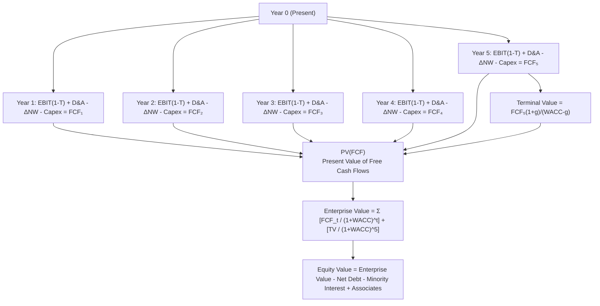

# Lesson 1: Valuation Fundamentals

## 1. First-Principles Intuition & Invariants

The entire edifice of investment banking rests on a single animating principle: the value of any asset equals the present value of all future cash flows that asset will generate, discounted at a rate that reflects the risk of those cash flows materializing. This axiom, deceptively simple in its articulation, governs every merger negotiation, every leveraged buyout, every fairness opinion, and every pitch book that crosses a managing director's desk. The Discounted Cash Flow model is not merely one valuation methodology among many—it is the theoretical foundation upon which all other approaches, from comparable company analysis to precedent transactions, derive their legitimacy. When a private equity sponsor pays fourteen times EBITDA for a software company, that multiple implicitly encodes assumptions about growth rates, margin expansion, terminal value, and discount rates that a rigorous DCF would make explicit.

Understanding valuation mechanics at the atomic level requires grasping why cash flow, rather than accounting earnings, constitutes the proper measure of economic value. Earnings reported under GAAP or IFRS reflect accrual accounting conventions—revenue recognition triggers, depreciation schedules, amortization policies—that bear only tangential relationship to the actual movement of cash through an enterprise. A company may report substantial net income while burning cash if it extends generous payment terms to customers, finances rapid inventory accumulation, or finances capital expenditures that exceed depreciation charges. Conversely, a firm may show losses while generating robust cash flow if it carries heavy non-cash charges from prior acquisitions or accelerated tax depreciation. The investment banker's craft demands cutting through these accounting artifacts to isolate the cash that equity and debt holders can actually extract from the business.

The mechanics of present value discounting encode a fundamental economic reality: a dollar received five years hence is worth less than a dollar received today, not merely because of inflation, but because capital has opportunity cost. If an investor can deploy one dollar today into a risk-adjusted alternative investment yielding ten percent annually, then foregoing that opportunity to invest in a particular project carries a real economic cost. The discount rate in a DCF model calibrates this opportunity cost, adjusting for both the time value of money and the probability-weighted distribution of outcomes. A stable utility with contracted revenues and modest leverage might warrant a seven percent discount rate, while a pre-revenue biotechnology venture could justify thirty percent or higher. The discount rate is not arbitrary; it is a quantitative encoding of risk, derived from observable market prices of comparable securities.

Terminal value introduces the most consequential assumption in any DCF model, typically representing sixty to eighty percent of total enterprise value in a standard five-year projection period. This dominance arises from the mathematical reality that most businesses are going concerns, expected to operate indefinitely beyond the explicit forecast horizon. Projecting individual line items for decades proves both impractical and spuriously precise, so practitioners instead model a perpetual growth assumption or apply an exit multiple to terminal year metrics. The choice between the perpetuity growth method and the exit multiple method is not arbitrary; each encodes different economic assumptions and proves more or less appropriate depending on industry maturity, competitive dynamics, and the business's life cycle stage. A regulated utility with stable market share might reasonably assume perpetual growth at the rate of nominal GDP, while a consumer technology company facing rapid product cycles might better suit a multiple-based approach anchored in precedent transactions.

Weighted Average Cost of Capital derivation demands reconciling the capital structure claims of both equity holders and debt holders into a single blended rate. Equity investors, who bear residual risk after debt obligations are satisfied, require higher returns than lenders who enjoy contractual priority and security interests. The Modigliani-Miller framework, stripped of its unrealistic assumptions about frictionless markets and zero bankruptcy costs, nevertheless provides the conceptual scaffold: enterprise value remains invariant to capital structure in the absence of taxes, distress costs, and agency conflicts. In reality, interest tax shields create value by reducing the corporate tax burden, while excessive leverage imposes costs through financial distress, covenant restrictions, and underinvestment. The optimal capital structure balances these competing forces, and WACC reflects the blended cost at that equilibrium.

The mathematical formulation of WACC weights the after-tax cost of debt and the cost of equity by their respective proportions in the target capital structure. This weighting must reflect market values rather than book values, because market prices reveal investors' actual required returns while book values reflect historical accounting artifacts. A company with one hundred million dollars of debt on its balance sheet might see that debt trade at ninety cents on the dollar if credit spreads have widened, making the true market value of the debt obligation ninety million. Similarly, equity market capitalization fluctuates continuously, creating a moving target for capital structure weights. Sophisticated practitioners iterate their WACC calculations, using the DCF-derived enterprise value to back into market-value capital structure weights, then recalculating WACC with those updated weights until the model converges.

## 2. Core Architecture & Mechanics

The construction of a defensible DCF model proceeds through five structural layers: revenue projection, operating cost modeling, working capital and capital expenditure forecasting, free cash flow derivation, and present value calculation. Each layer demands granular line-item specification rather than top-down percentage assumptions. A revenue forecast for a multi-segment industrial conglomerate cannot simply extrapolate historical growth rates; it must decompose into unit volumes, pricing dynamics, geographic mix, and product line contributions. An aerospace manufacturer might model commercial aircraft deliveries based on firm order backlog, defense contracts by program award schedules, and aftermarket services as a function of the installed fleet base. This bottoms-up architecture ensures that growth assumptions remain tethered to operational drivers rather than devolving into wishful extrapolation.

Operating expense modeling requires distinguishing variable costs that scale with revenue from fixed costs that remain largely invariant to volume changes and discretionary investments that management can modulate based on strategic priorities. Cost of goods sold for a manufacturer includes direct materials, direct labor, and factory overhead that varies proportionally with production volumes, though economies of scale may drive margin improvement as fixed factory costs spread over larger unit bases. Selling, general, and administrative expenses contain both fixed components—executive salaries, facility leases, compliance functions—and variable elements such as sales commissions and shipping costs. Research and development expenditures represent discretionary investments in future product pipelines, and management often adjusts R&D spending cyclically in response to revenue performance and capital market conditions. The DCF model must capture these distinctions, projecting each cost category with appropriate scaling relationships and inflection points.

Working capital dynamics translate accrual-basis financial statements into cash flow reality by adjusting for the timing mismatches between revenue recognition and cash collection, and between expense recognition and cash disbursement. When a company records ten million dollars of revenue on credit terms, accounts receivable increases by ten million while cash remains unchanged. The DCF model must subtract this working capital increase, recognizing that the company has not yet converted the sale into liquid capital. Conversely, when the company receives inventory on sixty-day payment terms, accounts payable increases while cash is preserved, creating a working capital source. The net working capital change in any period equals the sum of increases in current assets minus increases in current liabilities, excluding cash itself and short-term debt, which are financing items rather than operational working capital.

Capital expenditure forecasting distinguishes between maintenance capital expenditures required to sustain current operations and growth capital expenditures that expand productive capacity or enter new markets. A mature manufacturing business might require maintenance capex equal to depreciation charges, simply replacing equipment as it wears out, while a high-growth data center operator could invest three times depreciation annually to build new facilities. The DCF model typically projects capex as a percentage of revenue, with the percentage varying over time as growth rates evolve. Practitioners often benchmark capex intensity against industry peers, investigating material deviations that might signal competitive disadvantage—chronic underinvestment eroding market position—or inefficient capital allocation.

Free cash flow to the firm, the metric that drives enterprise valuation, crystallizes after all operating and investment obligations are satisfied. The canonical formulation begins with earnings before interest and taxes, adjusts to a cash basis by adding back non-cash charges and subtracting cash taxes, then accounts for working capital investment and capital expenditures. This represents the cash flow available to all capital providers—both equity holders and debt holders—before any financing decisions. The explicit algebraic formulation reads: FCFF = EBIT × (1 - Tax Rate) + Depreciation & Amortization - Change in Net Working Capital - Capital Expenditures. Each component merits careful specification. The tax rate should reflect the marginal statutory rate adjusted for permanent differences, not the effective rate reported in financial statements, which includes one-time items and discrete adjustments. Depreciation and amortization are added back because they represent non-cash accounting charges, but capital expenditures are subtracted because they represent real cash outflows required to maintain and grow the business.

Terminal value computation through the perpetuity growth method applies the Gordon Growth Model, a mathematical construct derived from the infinite sum of a geometric series. If free cash flow in the terminal year grows at a constant perpetual rate, the present value of all future cash flows collapses to a simple closed-form expression: Terminal Value = FCF × (1 + g) / (WACC - g), where g represents the perpetual growth rate. This formulation imposes a critical constraint: the growth rate must fall strictly below the discount rate, or the series diverges to infinity—a mathematical impossibility for any real business. Economically, perpetual growth rates exceeding the long-term nominal GDP growth rate prove unsustainable, as no company can grow faster than the economy indefinitely without eventually consuming the entire economic output. Conservative practice anchors terminal growth rates between two and three percent for mature businesses in developed markets, reflecting long-term inflation plus modest real growth.

The exit multiple method for terminal value instead applies a valuation multiple to a terminal year metric, typically EBITDA or EBIT, derived from precedent transactions or trading comparables. This approach encodes different assumptions than perpetuity growth, effectively anchoring terminal value to market pricing conventions rather than perpetual cash flow projections. The algebraic relationship between the two methods reveals the implicit growth assumption embedded in any multiple: if TV = EBITDA × Multiple and also TV = FCF / (WACC - g), then algebraic manipulation yields the implied growth rate encoded in that multiple given the company's margin profile and WACC. A fourteen times EBITDA exit multiple for a software business with thirty percent EBIT margins and eight percent WACC implies a specific perpetual growth rate, which practitioners can back-solve and sanity-check against long-term industry forecasts.

The WACC derivation begins with the cost of equity, typically estimated through the Capital Asset Pricing Model, which decomposes required equity returns into a risk-free rate, a market risk premium, and a beta coefficient that measures the company's systematic risk relative to the broad market. The risk-free rate draws from long-term government bond yields, matching the duration of the DCF projection period; practitioners typically use ten-year Treasury yields for US-based valuations. The equity risk premium represents the excess return investors demand for bearing market risk rather than holding risk-free bonds, empirically estimated from long-term historical averages of equity returns over government bonds, typically calibrated between five and six percent for developed markets. Beta captures the company's correlation with market movements, estimated through regression analysis of historical stock returns against market index returns, with adjustments for leverage and statistical reliability.

```text
WACC Calculation Architecture:

Cost of Equity (Re) = Rf + β × ERP

where:
  Rf    = Risk-free rate (10-year Treasury yield)
  β     = Levered beta (correlation with market)
  ERP   = Equity risk premium (~5-6%)

After-Tax Cost of Debt (Rd) = Yield to Maturity × (1 - Tax Rate)

WACC = (E/V) × Re + (D/V) × Rd × (1 - Tc)

where:
  E/V   = Market value of equity / Total market value
  D/V   = Market value of debt / Total market value
  Tc    = Marginal corporate tax rate
```

The cost of debt estimation requires identifying the yield to maturity on the company's traded debt instruments, or if debt does not trade publicly, constructing a synthetic credit spread based on the company's credit rating and debt maturity profile. Investment-grade issuers with strong interest coverage might borrow at spreads of one hundred to two hundred basis points over Treasuries, while speculative-grade borrowers could face spreads of five hundred basis points or more. The after-tax adjustment recognizes that interest expense generates tax deductions, reducing the effective cost of debt by the marginal tax rate. A company paying six percent on its debt with a twenty-five percent tax rate experiences an after-tax cost of 4.5 percent, because each dollar of interest saves twenty-five cents in taxes.

The iterative nature of WACC calculation arises because capital structure weights depend on equity value, which in turn depends on WACC through the DCF formula. Practitioners typically seed the initial calculation with current market capitalization and book value of debt, calculate an initial WACC, perform the DCF valuation, then update capital structure weights with the DCF-derived enterprise value and recalculate WACC. This process iterates until convergence, typically achieved within three to five cycles. The mathematical convergence is guaranteed because each iteration produces a more accurate estimate of intrinsic value, and the system is not chaotic—small changes in WACC produce proportional changes in enterprise value rather than discontinuous jumps.

Present value calculation discounts each year's projected free cash flow and the terminal value back to the present using the WACC as the discount rate. The discounting formula for a cash flow occurring at time t is: PV = FCF_t / (1 + WACC)^t. The exponent reflects the compounding periods between the valuation date and the cash flow receipt. A subtlety arises in mid-year convention versus year-end convention: if cash flows accrue continuously throughout the year rather than in a lump sum on December 31st, then discounting should use t - 0.5 rather than t, reflecting that the average cash flow occurs at mid-year. This adjustment typically increases enterprise value by two to four percent, and convention varies by institution and geography. The terminal value, calculated as of the end of the explicit forecast period, must be discounted back the same number of periods as the final year's cash flow.



The bridge from enterprise value to equity value requires subtracting net debt and other non-equity claims. Net debt equals total debt, including bonds, term loans, revolving credit facilities, and capital leases, minus cash and marketable securities. The cash subtraction recognizes that an acquirer inheriting a company's balance sheet receives not just the operating business but also its cash balances, effectively reducing the net purchase price. Minority interest, representing third-party ownership stakes in consolidated subsidiaries, must be subtracted because the DCF projects consolidated cash flows but equity value should reflect only the parent company shareholders' claim. Conversely, the company's proportional ownership in unconsolidated affiliates, valued at market if publicly traded or carried at book value if private, should be added back as a separable asset.

## 3. High-Performance Optimization & Failure Modes

Sensitivity analysis transforms a single-point DCF estimate into a distribution of possible outcomes, acknowledging that every input carries uncertainty. The practitioner identifies the two or three variables that drive the greatest variance in valuation—typically WACC, terminal growth rate, and a key operating metric such as revenue growth or EBITDA margin—and constructs a two-dimensional matrix showing enterprise value across a range of assumptions. A standard sensitivity table might vary WACC from 7.5 percent to 10.5 percent in fifty-basis-point increments on one axis, and terminal growth rate from 2.0 percent to 3.5 percent in fifty-basis-point increments on the other, producing a twenty-five-cell grid of valuations. This presentation surfaces how valuation migrates across the plausible range of assumptions, helping investment committees understand the distribution of outcomes rather than fixating on a false precision.

The failure modes of DCF modeling cluster around three categories: projection optimism, mechanical errors, and inappropriate discount rate selection. Projection optimism manifests when management forecasts extrapolate recent growth rates indefinitely, ignoring competitive mean reversion, market saturation, and cyclical headwinds. A retailer that has grown revenue twelve percent annually for three years might project ten percent growth for the next five years, implicitly assuming market share gains continue unabated and macroeconomic conditions remain supportive. Reality intervenes through new entrants, format shifts, and recessions, causing actual growth to undershoot projections. The disciplined investment banker stress-tests management projections against historical performance, industry benchmarks, and bottoms-up market sizing to construct conservative, defensible, and base case scenarios rather than accepting aspirational forecasts at face value.

Mechanical errors in DCF construction frequently arise from inconsistent treatment of debt and equity claims, mismatched fiscal year conventions, and incorrect discounting periods. A common mistake involves projecting unlevered free cash flow, which implicitly assumes zero debt, then using a WACC that includes a debt weighting, creating an internal inconsistency. The model must either project free cash flow to equity—after interest and debt principal payments—and discount at the cost of equity, or project free cash flow to the firm—before financing cash flows—and discount at WACC. Mixing these approaches produces systematically biased valuations. Similarly, when the target company's fiscal year ends on a date other than December 31st, practitioners must align projection periods with fiscal reporting periods and adjust discount factors accordingly, rather than mechanically applying calendar-year conventions that misalign with actual reporting.

Inappropriate discount rate selection typically manifests as using the acquirer's WACC rather than the target's risk profile, or failing to adjust beta for leverage differences. When a diversified conglomerate evaluates acquiring a high-growth technology subsidiary, the appropriate discount rate reflects the technology business's standalone risk and optimal capital structure, not the parent company's blended cost of capital. The beta used in WACC calculation must be relevered to the target's capital structure rather than using the parent's beta, which reflects an entirely different business mix and leverage profile. The mathematical procedure for relevering beta applies the Hamada formula, which adjusts equity beta for changes in financial leverage: Levered Beta = Unlevered Beta × [1 + (1 - Tax Rate) × (Debt/Equity)]. This ensures that the discount rate calibrates to the specific risk profile of the cash flows being valued.

Circular references between enterprise value and WACC require careful resolution through iteration or algebraic substitution. The circular logic arises because WACC depends on capital structure weights (E/V and D/V), which depend on equity value, which depends on enterprise value, which depends on WACC. Simple spreadsheet models that directly reference enterprise value in the WACC calculation will produce circular reference errors unless Excel's iterative calculation feature is enabled. More robust approaches solve the circularity through algebraic substitution, expressing equity value as a function of WACC, then solving for the WACC that produces consistent capital structure weights. This transforms the problem into finding the fixed point of a function, which can be solved through goal-seek routines or Newton-Raphson iteration.

Terminal value dominance creates profound sensitivity to perpetual growth rate and exit multiple assumptions, demanding rigorous sanity checks. When terminal value represents seventy-five percent of enterprise value, a twenty-five basis point shift in terminal growth rate or a half-turn change in exit multiple can swing valuation by ten to fifteen percent. This sensitivity is not a flaw in the methodology but rather an acknowledgment that most enterprise value derives from cash flows in the distant future, which carry inherent uncertainty. The disciplined approach subjects terminal assumptions to triangulation from multiple angles: comparing implied exit multiples under the perpetuity growth method to precedent transactions, back-solving the growth rate implied by exit multiples, and stress-testing whether terminal margins and returns on invested capital appear sustainable given competitive dynamics.

The selection between perpetuity growth and exit multiple methods for terminal value should reflect the business's expected maturity at the end of the projection period. A company projected to reach steady-state operations with stable market share and mature margins by year five suits the perpetuity growth method, which assumes indefinite continuation under stable conditions. Conversely, a business expected to remain in high-growth mode with significant uncertainty about long-term margins—perhaps because the industry itself remains nascent—better suits the exit multiple approach, which delegates long-term valuation to market pricing conventions rather than perpetual growth assumptions. Some practitioners calculate terminal value using both methods and triangulate, ensuring that the implied assumptions remain internally consistent and economically plausible.

Scenario analysis extends sensitivity analysis by constructing internally consistent narratives around bull, base, and bear cases rather than simply varying individual inputs. A bear case for a consumer goods manufacturer might combine revenue growth below GDP with margin compression from commodity inflation and market share loss to private label, plus elevated working capital investment from inventory buildup and slower receivables collection. This constellation of negative assumptions coheres around a unified narrative—eroding competitive position and input cost pressure—rather than arbitrarily pessimizing each variable independently. The scenario valuations are then probability-weighted, with subjective probabilities assigned to each case, producing an expected value that incorporates the full distribution of outcomes. This probability-weighted approach more accurately captures risk than simply using base-case assumptions, because it explicitly models tail outcomes that drive significant value variance.

Covenant and structural considerations affect how DCF valuations translate into deal pricing, particularly in leveraged transactions where debt capacity constrains valuation. A private equity sponsor might derive a DCF valuation of nine hundred million dollars but discover that debt markets will support only four hundred million dollars of leverage at sustainable interest coverage ratios, limiting the equity check and total purchase price the sponsor can pay while hitting return hurdles. The DCF provides a ceiling valuation but not necessarily the actual transaction price, which reflects capital structure optimization, negotiating dynamics, and sponsor return requirements. Similarly, when valuing a target for a stock-for-stock merger, the DCF must account for the fact that purchase price varies with the acquirer's stock price, creating a moving target that requires iterative recalibration as market conditions shift.

Cross-border valuation introduces additional layers of complexity through currency translation, country risk premiums, and differential tax regimes. A US acquirer valuing a Brazilian target must project cash flows in Brazilian reais, then either discount at a real-denominated WACC that includes Brazil country risk or convert projected cash flows to US dollars using forward exchange rates and discount at a dollar-denominated rate. The choice between these approaches affects valuation mechanically, because interest rate parity and purchasing power parity do not hold perfectly in practice, creating basis risk. Country risk premiums, added to the equity risk premium to reflect sovereign default risk and political instability, vary from zero for developed markets to five hundred basis points or more for frontier economies. These adjustments ensure that discount rates properly reflect the incremental risk of operating in less stable regulatory and macroeconomic environments.

The transition from DCF theory to transaction execution requires embedding valuation outputs into broader strategic and financing contexts. A DCF might indicate that a target's intrinsic value is seven hundred million dollars, but if the target's management demands eight hundred million and no other bidders emerge, the acquirer must decide whether strategic synergies—revenue enhancement, cost savings, tax benefits—justify paying above standalone DCF value. The synergy valuation follows identical DCF mechanics, projecting incremental cash flows from identified synergies and discounting at a rate reflecting synergy realization risk, which typically exceeds standalone business risk because integration execution introduces new uncertainties. The sum of standalone value and synergy value establishes the ceiling price the acquirer can rationally pay, ensuring that the transaction creates rather than destroys shareholder value.
