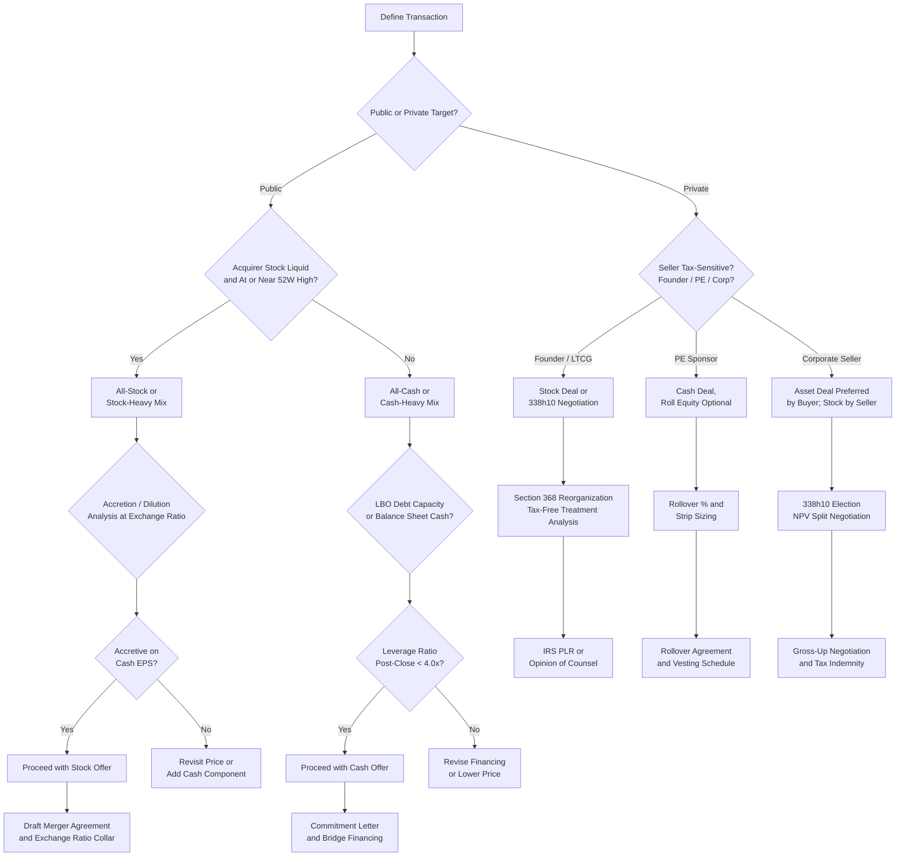

# Lesson 3: M&A Structuring

## 1. First-Principles Intuition & Invariants

Every merger and acquisition is, at its core, a negotiation over three interrelated questions: what is being transferred, what is being paid, and who bears the risk of being wrong about the answer to either. These questions sound simple until you sit across a conference table from a seller's counsel who has spent three weeks inserting carve-outs into a representations schedule, or until a CFO asks you to explain why an all-stock deal that looked accretive on Monday becomes dilutive after you adjust for the diluted share count. M&A structuring is the discipline of resolving those three questions in a way that maximizes value for your client while allocating risk in a manner the counterparty will actually accept.

The foundational invariant of deal structuring is that form and substance are inseparable. The legal form of a transaction — asset purchase, stock purchase, or statutory merger — determines tax treatment, liability exposure, and the assignability of key contracts. The economic substance — cash, stock, or contingent consideration — determines who bears market risk between signing and closing, what the seller's after-tax proceeds actually look like, and whether the board of the acquiring company needs to put the deal to a shareholder vote. A banker who treats these as separable concerns, optimizing tax structure on one track and consideration mix on another, will eventually discover that an IRS Section 338(h)(10) election that looks elegant in isolation creates a consent requirement under a material customer contract that unravels the commercial thesis entirely.

The second invariant is that value and risk transfer together, and the structure of a deal is fundamentally a mechanism for disaggregating them. When a private equity sponsor pays a 14x EBITDA multiple for a software business with significant revenue concentration, the headline number overstates what the buyer actually believes the business is worth. The portion of the purchase price that lands in escrow, the portion contingent on hitting forward EBITDA targets, and the portion the seller must roll into the surviving entity all represent the buyer's attempt to pay for quality they can verify and defer payment for quality they cannot. Understanding this disaggregation — not as a legal technicality but as an expression of the buyer's genuine uncertainty about the business — is the starting point for structuring any deal intelligently.

The third invariant is what practitioners call the tax triangle: the interests of the seller, the buyer, and the government are not aligned, and the structure of the deal determines how the available economic surplus is split among them. Sellers almost universally prefer stock deals or asset deals structured as stock deals for tax purposes, because capital gains treatment at the entity or shareholder level typically produces a lower effective rate than ordinary income. Buyers almost universally prefer asset deals or transactions treated as asset deals, because they receive a stepped-up tax basis in the acquired assets, generating future depreciation and amortization deductions that reduce taxable income. The government prefers whatever produces the highest near-term tax revenue, which is generally an asset deal with no basis step-up for the seller. Every consideration structure negotiation is, in part, a negotiation over how to split the incremental tax benefit of choosing one form over another.

### The Stock Deal vs. Asset Deal Dichotomy

In a stock purchase, the buyer acquires 100% of the equity interests in the target entity. The legal entity continues to exist with all its assets, liabilities, contracts, permits, and tax history intact. This continuity is simultaneously the stock deal's greatest strength and its greatest liability. Existing customer contracts transfer automatically without counterparty consent. Existing environmental liabilities, underfunded pension obligations, and unasserted litigation claims transfer equally automatically, without negotiation and often without full disclosure. The buyer assumes the seller's tax basis in its assets — typically a low historical cost basis accumulated over years of depreciation — meaning the buyer receives no step-up in depreciable assets and therefore loses the future tax shield that an asset purchase would provide.

The economic cost of this lost depreciation shield is real and quantifiable. If a target has $200 million of fixed and intangible assets with a historical tax basis of $40 million, a buyer paying $200 million in an asset deal would receive $160 million of incremental depreciable basis. At a 21% corporate tax rate and a 10-year straight-line amortization for intangibles under Section 197, that incremental basis generates $16 million per year in additional amortization, producing $3.36 million per year in tax savings, with a present value of approximately $20–25 million depending on the discount rate. In a stock deal, that value is forfeited entirely unless the parties negotiate a Section 338(h)(10) election, which allows the transaction to be treated as an asset purchase for tax purposes while retaining the legal form of a stock deal. The seller must consent to this election and typically demands compensation in the form of a higher gross purchase price to offset the ordinary income tax triggered at the entity level, which means the buyer and seller are, in effect, negotiating over how to split the NPV of the future tax benefit.

In an asset purchase, the buyer selects which assets and liabilities to acquire and which to leave behind. This selectivity is enormously valuable when the target carries contingent liabilities that are difficult to quantify, such as environmental cleanup obligations, employment discrimination claims, or warranty reserves for products sold years before the acquisition. The buyer can exclude these liabilities contractually, transferring them to the seller (or leaving them stranded in a shell entity the seller retains). The corresponding disadvantage is that every asset transfer must be accomplished individually: real property requires a deed, vehicles require title transfers, intellectual property requires assignment filings, and customer contracts require counterparty consents that may trigger renegotiation rights or change-of-control termination provisions. For businesses with hundreds of customer contracts, software licenses, or government permits, an asset deal can generate months of consent-gathering work and material closing risk.

The choice between these structures is rarely binary. Most sophisticated transactions involve a hybrid approach: a stock purchase with specific indemnities for identified liabilities, a Section 338(h)(10) election negotiated as part of the economic package, and contractual representations requiring the target to pursue third-party consents for material contracts before or as a condition to closing.

### Merger Structures and Board Authority

Statutory mergers — both forward triangular and reverse triangular — are the dominant legal form for public company acquisitions and many larger private transactions precisely because they provide a mechanism for transferring 100% of the target's assets and liabilities through operation of law, without requiring individual asset assignments or counterparty consents. In a forward triangular merger, the target merges into a wholly owned subsidiary of the acquirer, with the target's shareholders receiving the merger consideration and the subsidiary surviving. In a reverse triangular merger, the acquirer's subsidiary merges into the target, with the target surviving as a wholly owned subsidiary of the acquirer and the target's shareholders receiving consideration. The reverse triangular form is preferred when the target holds government licenses, regulated assets, or contracts that explicitly prohibit assignment but do not explicitly address mergers, because the target entity — and therefore its legal identity as the licensee or contracting party — survives.

The legal mechanics of board approval and shareholder voting are not merely procedural. Under Delaware General Corporation Law Section 251, a merger agreement must be approved by the boards of both the target and acquirer and, in most cases, by the shareholders of the target. The acquirer's shareholders need only vote if the deal involves issuance of more than 20% of the acquirer's outstanding shares — a threshold that creates real incentives to structure consideration. A buyer with $5 billion in equity market cap acquiring a $1.2 billion target entirely in stock will cross that threshold, requiring a shareholder vote and a registration statement, adding four to six months and meaningful execution risk to the timeline. Structuring even a small cash component into the consideration — say, 85% stock and 15% cash — may keep the stock issuance below 20%, allowing the deal to close without an acquirer vote.

---

## 2. Core Architecture & Mechanics

### The Consideration Mix Decision Framework

The consideration offered to target shareholders is typically some combination of cash, acquirer stock, contingent value rights, earnout payments, and seller rollover equity. Each form of consideration carries a distinct risk and return profile for both the seller and the buyer, and the optimal mix is determined by the interaction of several factors: the seller's tax position, the buyer's stock currency strength, the degree of information asymmetry between parties about the target's future performance, and the structural requirements of any financing package.

The following diagram captures the high-level decision architecture for structuring consideration. Each node represents a question whose answer routes the transaction toward a specific structural choice.

The accretion/dilution question at the center of any stock deal analysis deserves extended treatment because it is frequently misunderstood and even more frequently misapplied. Accretion/dilution measures whether the pro forma EPS of the combined company is higher (accretive) or lower (dilutive) than the acquirer's standalone EPS. The mechanical driver is the relationship between the target's earnings yield (net income divided by the equity consideration paid) and the acquirer's earnings yield (net income divided by market cap). If the target's earnings yield exceeds the acquirer's, the deal is accretive because the buyer is purchasing earnings at a cheaper multiple than the market assigns to its own earnings. If the target's earnings yield is lower, the deal is dilutive.

Consider a concrete example. Acquirer A has a market cap of $10 billion and net income of $500 million, implying a 5.0% earnings yield (or a 20x P/E multiple). Target B has $100 million of net income and the acquisition price is $3 billion, implying a 3.3% earnings yield (or a 30x P/E multiple). In an all-stock deal, A issues $3 billion of shares, increasing its share count by 30%. Net income increases by $100 million (before synergies and transaction adjustments), or 20%. Because shares outstanding increase faster (30%) than earnings (20%), EPS declines — the deal is dilutive by approximately 8%. To make this deal accretive without synergies, A must either pay less, demonstrate synergies that add more than $150 million of post-tax net income, or use cash or debt financing instead of equity (which eliminates the share count dilution at the cost of interest expense).

### Tax-Free Reorganizations Under Section 368

When a seller desires to defer capital gains recognition — a common priority for founders and family-owned businesses with very low cost basis in their shares — the transaction must qualify as a tax-free reorganization under Internal Revenue Code Section 368. The two most practically relevant forms are the Type A reorganization (a statutory merger) and the Type B reorganization (a stock-for-stock acquisition). The critical constraint under Section 368 is the "continuity of interest" requirement: the target's shareholders must receive acquirer stock representing at least 40% of the total consideration (per IRS Revenue Procedure 77-37) for the transaction to qualify. If the cash component of consideration exceeds 60%, the transaction fails to qualify as tax-free and all target shareholders recognize gain at the time of closing.

This creates a structuring tension in deals where the acquirer has strong stock currency and the seller wants full tax deferral but also wants downside protection if the acquirer's stock declines before the closing date. The standard mechanism for addressing this tension is a floating exchange ratio collar. Rather than fixing the number of acquirer shares to be issued per target share at signing, a collar establishes a band within which the exchange ratio floats to maintain a fixed dollar value of consideration. If the acquirer's stock trades between $45 and $55 at the time of pricing, the exchange ratio adjusts so that each target share receives consideration worth, say, $20. Outside the collar, the exchange ratio is fixed, meaning the target shareholders bear the acquirer's stock price risk beyond the collar's limits.

### Earnout Architecture

An earnout is a contingent payment structure in which a portion of the purchase price is paid after closing, conditioned on the acquired business achieving defined financial or operational milestones. Earnouts are most common in three situations: when buyer and seller disagree on the probability-weighted value of a specific growth opportunity (a pending regulatory approval, a customer contract under negotiation, a product launch), when the target is a high-growth business with limited earnings history that makes a DCF valuation highly uncertain, and when the seller is retaining an operational role post-close and the earnout serves as a retention and alignment mechanism.

The design of an earnout requires precise drafting of four elements: the metric, the measurement period, the payment formula, and the operational covenants. Each element is a potential source of post-closing litigation.

The metric should be chosen to minimize the buyer's ability to influence the outcome through post-closing accounting or business decisions. Revenue is generally preferable to EBITDA because it is harder for a new parent to depress revenue through allocation of overhead, intercompany pricing, or changed accounting policies. EBITDA is preferred when revenue growth could be achieved by burning margin — for example, by adding sales headcount below the earnout period's end. Specific operational metrics (number of active customers, gross retention rate, FDA approval date) are most resistant to manipulation but require precise definition: "active customer" means something very different if it is defined as any customer invoiced at least once versus any customer generating $10,000 or more of annual recurring revenue.

The measurement period is typically one to three years. Beyond three years, the operational connection between the seller's pre-closing work and the earnout achievement weakens, and courts have increasingly questioned whether earnout obligations that extend beyond four years are enforceable against an acquirer who has integrated and substantially transformed the business. The Delaware Court of Chancery's 2019 decision in *Shareholder Representative Services v. Shire* reinforced that acquirers have broad discretion to operate the business post-closing in a manner that affects earnout outcomes, unless the merger agreement explicitly restricts that discretion.

The operational covenant — the buyer's obligation to operate the business during the earnout period in a manner that does not frustrate the seller's ability to earn the earnout — is the single most negotiated clause in earnout drafting. Sellers want language obligating the buyer to operate the business "in the ordinary course consistent with past practices and in a manner designed to maximize the probability of achieving the earnout milestones." Buyers resist this language because it constrains their integration strategy. The resulting compromise typically includes a "best efforts" or "commercially reasonable efforts" standard with a list of specific prohibited actions: eliminating the acquired business unit, transferring its key customers to other business units, or changing the revenue recognition policy.

The payment formula must address threshold, cap, and slope. A simple binary earnout — $50 million if annual recurring revenue exceeds $100 million, zero if it does not — creates a cliff that incentivizes sellers to pull forward revenue, offer deep discounts to customers at year-end, or take other economically harmful actions to clear the threshold. A linear formula — $0 at $80 million ARR, scaling to $50 million at $100 million ARR, capped at $60 million at $110 million ARR — aligns incentives more continuously. Including an accelerator above the cap (10 cents of additional earnout for every dollar of ARR above $110 million) further aligns the seller with upside performance.

### Representations, Warranties, and the Risk Allocation Machinery

The representations and warranties section of a merger agreement is not, as junior bankers sometimes assume, a formality drafted by lawyers after the economic terms are set. It is the primary mechanism by which the economic risk of unknown liabilities is allocated between buyer and seller, and in private transactions it has a direct impact on the effective purchase price.

A representation is a statement of fact as of a specific date (typically the signing date and the closing date). A warranty is a promise that the statement remains true. If a representation proves to be false — a "breach" — the indemnification provisions of the merger agreement determine whether the seller must compensate the buyer for resulting losses. The standard private M&A indemnification structure has three financial parameters: a basket (or deductible), a cap, and a survival period.

The basket works like an insurance deductible: the buyer must absorb losses up to the basket amount before any indemnification obligation is triggered. Baskets are typically structured as "tipping baskets" (once cumulative losses exceed the basket, the seller indemnifies all losses from dollar one) or "true deductibles" (the seller indemnifies only losses exceeding the basket). True deductibles are more protective of sellers and have become increasingly standard in competitive deal environments. For a $200 million transaction, a typical basket might be 0.5% to 1.0% of enterprise value ($1 million to $2 million), with a cap on indemnification liability of 10% to 20% of enterprise value ($20 million to $40 million).

The survival period — the window during which the buyer may bring an indemnification claim — is typically 12 to 24 months for general representations and warranties, running from the closing date. Fundamental representations (title to shares, authorization, capitalization, no-conflict with charter) survive for the applicable statute of limitations, often six years. Tax representations survive until the tax statute of limitations expires, typically three to four years from the filing of the relevant return.

Representations and Warranties Insurance (RWI) has fundamentally transformed private M&A risk allocation over the past decade. In an RWI-backed deal, the buyer purchases an insurance policy from a carrier — typically AIG, AXA XL, Euclid Transactional, or Berkshire Hathaway Specialty Insurance — that pays covered indemnification claims directly, reducing or eliminating the buyer's reliance on the seller for post-closing indemnification. The seller receives a clean exit: its indemnification obligation is typically limited to a "synthetic deductible" equal to 1% of enterprise value or less, and the escrow holdback that would otherwise tie up 10% of proceeds for 18 months is either eliminated or dramatically reduced. The buyer gets a creditworthy counterparty (the insurer) rather than a disbanding PE fund or a founder who has redeployed the proceeds.

RWI policies carry a retention (the buyer's deductible, typically 1% of enterprise value) and a policy limit (typically 10% to 15% of enterprise value). The premium is 2% to 4% of the policy limit for a 3-year general R&W policy, with tax R&W policies priced separately at higher rates. The underwriting process runs in parallel with due diligence: the insurer reviews the buyer's diligence work product and may exclude specific known issues from coverage. Any matter disclosed in the seller's disclosure schedules is excluded from coverage — which is precisely why sophisticated buyers push for "clean" disclosure schedules rather than allowing sellers to sweep every potential issue into a schedule as a prophylactic disclosure.

---

## 3. High-Performance Optimization & Failure Modes

### Optimizing the Due Diligence to Structure Feedback Loop

In practice, the most experienced M&A practitioners treat deal structuring as a continuous feedback loop between legal due diligence findings, financial model assumptions, and contractual risk allocation mechanisms, rather than a linear sequence in which diligence precedes structuring. A finding that emerges in week three of a four-week diligence process — a material customer contract with a change-of-control termination right, an undisclosed IRC Section 409A liability, an environmental indemnity obligation inherited from a prior acquisition — should immediately trigger a structuring response: a price adjustment request, an escrow holdback, a specific indemnity, or in extreme cases a decision to restructure the transaction from a stock deal to an asset deal to avoid inheriting the liability.

The operational discipline required to maintain this feedback loop is a weekly deal issues log that connects every material diligence finding to a specific structural mitigation. The log should track the finding, its estimated financial exposure under a base case and a stress case, the proposed structural mitigation (escrow, specific indemnity, price chip, deal renegotiation), the status of the mitigation, and the owner responsible for resolving it. Without this discipline, deals reach the final week of negotiation with a pile of unresolved issues that have to be cleared in a 72-hour sprint, creating exactly the conditions under which negotiators make concessions they later regret.

### Failure Mode: Inadequate Material Adverse Change Drafting

The Material Adverse Change (MAC) or Material Adverse Effect (MAE) clause is the buyer's primary contractual mechanism for walking away from a signed deal if the target's business deteriorates materially between signing and closing. The clause is also one of the most heavily litigated provisions in M&A law, and its practical value depends entirely on how precisely it is drafted.

The Delaware Chancery Court's 2001 decision in *IBP, Inc. v. Tyson Foods* established the foundational standard for MAC clauses: a qualifying material adverse change must be significant not just in absolute terms but "in the overall context of the transaction." Courts interpret MAC clauses very narrowly, with Delaware having found a qualifying MAC in only a handful of cases. In *Akorn, Inc. v. Fresenius Kabi AG* (2018), the Court found that a target's regulatory compliance failures and deteriorating financial performance met the MAC threshold, but it identified the operative factors as the depth, duration, and business-specific nature of the deterioration. The COVID-19 pandemic litigation that followed (*AB Stable VIII LLC v. MAPS Hotels and Resorts*, 2020) reinforced that broadly worded pandemic or macro-economic carve-outs in MAC definitions can prevent buyers from invoking the clause even when the target's operations are severely impaired.

The practical implication is that MAC definitions require three layers of specificity. The definition of a MAC must affirmatively capture the types of events the buyer considers material — for example, loss of a named customer that represents more than 15% of revenue, loss of a material regulatory license, or a restatement of historical financial statements. The carve-outs to the MAC definition (macroeconomic conditions, industry-wide downturns, changes in law) must be paired with a "disproportionate impact" exception that re-captures the event as a MAC if it affects the target materially worse than industry peers. And the representations that cross-reference the MAC standard must themselves be drafted with sufficient specificity that a breach is capable of being measured objectively rather than adjudicated subjectively.

### Failure Mode: Integration Risk Not Captured in Structure

The most expensive failure mode in M&A is not a failed legal argument but a failed integration. The structure of the deal — particularly the earnout mechanics, the rollover equity terms, and the management retention arrangements — either supports or undermines the operational integration thesis. A deal that structures an earnout around standalone revenue performance for a business unit the buyer intends to integrate into its own distribution channel creates an irreconcilable conflict: the seller's retained management team will resist integration steps that threaten their earnout, and the buyer's commercial team will be frustrated by the constraint. The resulting tension is not a negotiation failure. It is a structuring failure that should have been identified when the integration plan was drafted, well before the merger agreement was signed.

The discipline required to avoid this failure mode is an integration planning kickoff that occurs no later than the end of the first phase of due diligence, running in parallel with the financial and legal workstreams. By the time the merger agreement is being negotiated, the integration team should have produced a Day 100 plan with identified synergy sources, organizational changes, systems integrations, and customer communication strategies. The earnout definition, the rollover equity vesting schedule, and the operational covenants in the merger agreement should all be designed with reference to that plan, not drafted in ignorance of it.

### Failure Mode: Purchase Price Allocation Disputes

Under ASC 805 (Business Combinations), an acquirer must allocate the total consideration paid across the fair values of all identifiable assets acquired and liabilities assumed, with the residual allocated to goodwill. This purchase price allocation (PPA) has direct and lasting financial statement consequences: identifiable intangible assets (customer relationships, developed technology, trade names) must be amortized over their estimated useful lives, typically three to fifteen years, reducing reported GAAP earnings. Goodwill is not amortized but is subject to annual impairment testing that can produce large, sudden write-downs that damage the acquirer's earnings and stock price.

The practical failure mode in PPA is an over-allocation to goodwill driven by insufficient effort at the intangible asset identification and valuation stage. When a buyer pays $500 million for a business with $50 million of tangible assets and allocates $450 million to goodwill without identifying the customer relationship intangible (typically valued using the Multi-Period Excess Earnings Method) or the technology intangible (valued using the Relief from Royalty Method), the financial statements overstate goodwill and understate intangible amortization. The understated amortization makes near-term earnings look higher than they are, which is not a financial gain but an accounting illusion that creates impairment risk in later periods when the goodwill carrying value is tested against the fair value of the reporting unit. Properly executed PPA, using independent valuation specialists engaged before the deal closes, produces a more accurate amortization schedule that is embedded in the acquisition-year financial model so that acquirer management is not surprised by the EPS impact in the first post-close earnings release.

### Optimizing the Signing-to-Closing Period

The window between signing a merger agreement and closing the transaction is a period of significant operational and legal risk. The target is contractually constrained in its operations (no extraordinary transactions, no new debt above defined thresholds, no changes to material contracts without buyer consent), but the buyer has limited visibility into day-to-day operations and limited control over employees who may be anxious about the pending change. The standard risk management toolkit for this period includes a closing condition checklist aligned to a critical path schedule, a third-party consent tracking workbook, an antitrust filing calendar (HSR Act waiting periods, CFIUS review timelines, international merger control filings), and a weekly call between deal teams to surface emerging issues before they become closing impediments.

Antitrust clearance represents the most common source of unexpected closing delay. For transactions involving parties with overlapping product markets, the reviewing agency — the Department of Justice Antitrust Division or the Federal Trade Commission in the United States, the European Commission in the EU — may issue a "second request" demanding extensive document production that extends the closing timeline by four to twelve months. Second requests require immediate mobilization of litigation-style document review infrastructure, often involving hundreds of thousands of custodian documents, and cost the buyer $5 million to $30 million in legal and consulting fees before any substantive agency review begins. Deals in concentrated markets — healthcare, financial services, technology, defense — should include antitrust risk analysis in the deal structuring phase, not as an afterthought. The merger agreement should specify which party bears the obligation to divest assets to obtain clearance, and to what depth: an obligation to accept "any divestitures required by the agency" is materially different from an obligation to accept divestitures "that do not have a material adverse effect on the pro forma combined company."

The endpoint of this entire structural machinery is a merger agreement that accurately reflects the economic understanding of the parties, allocates risk in a manner proportionate to each party's ability to bear it, and creates contractual obligations specific enough to be enforced when circumstances change. That last criterion is the hardest to satisfy and the most consequential. Deals that close cleanly, integrate smoothly, and generate the anticipated returns are not the product of favorable market conditions alone. They are the product of structuring work that anticipated failure modes, allocated them contractually, and built the operational mechanisms — integration plans, earnout governance processes, R&W insurance programs, antitrust risk mitigation strategies — to prevent those failures from materializing.
