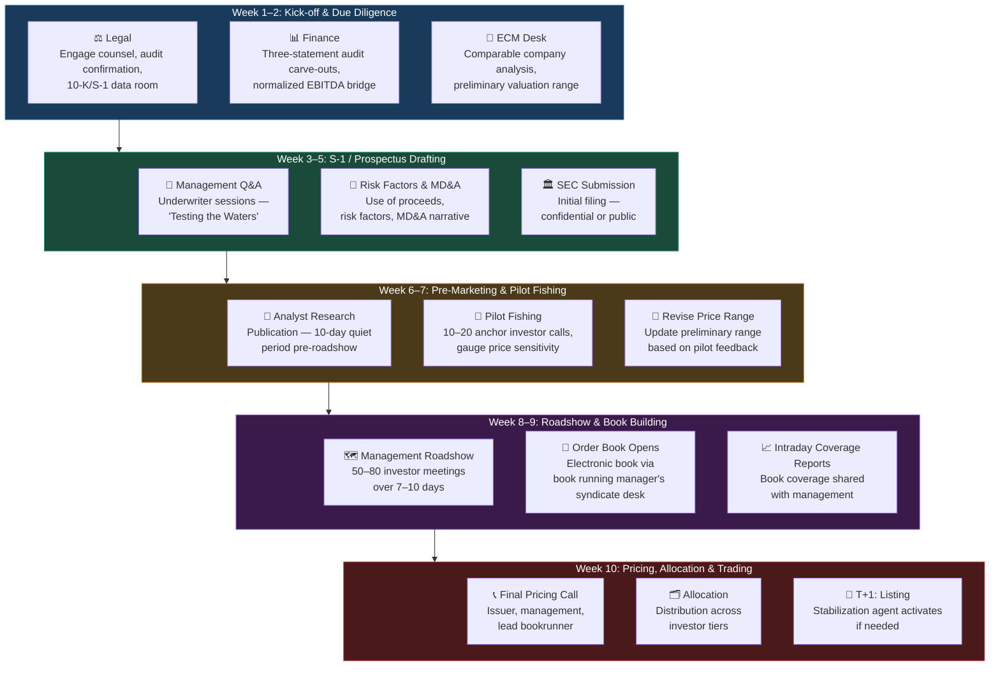
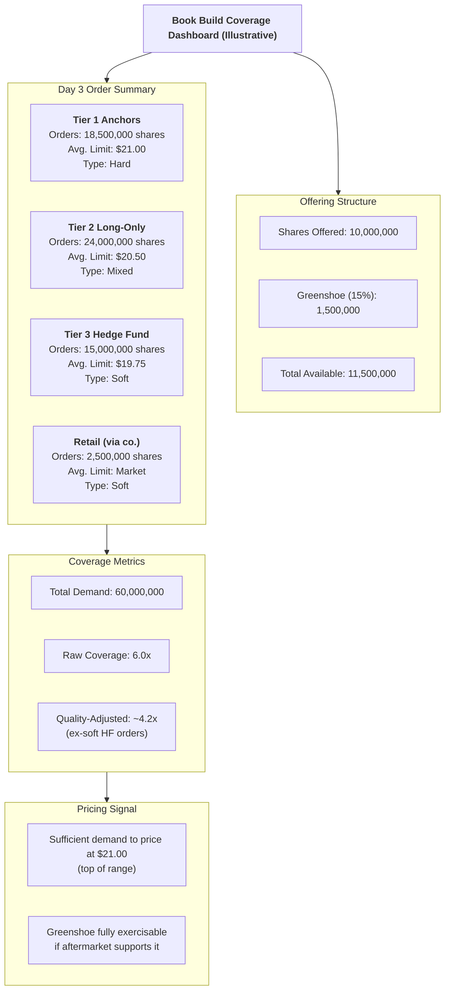

# Lesson 4: Capital Raising Markets

## 1. First-Principles Intuition & Invariants

Capital markets exist because capital formation is fundamentally a matching problem. On one side sits a universe of enterprises with positive net-present-value investment opportunities and insufficient internal cash flows to fund them. On the other sits a universe of investors with surplus capital and the appetite to deploy it in exchange for a share of future economic value. Investment banks occupy the intermediary position, earning their fees by reducing the information asymmetry, pricing uncertainty, and execution risk that would otherwise prevent these two populations from transacting efficiently. Everything that happens in an equity or debt capital markets transaction — the roadshow, the order book, the spread, the lockup, the covenant package — is a mechanism designed to solve one of three problems: discovery of the clearing price, distribution of risk among parties best suited to bear it, or enforcement of the commitments that make the transaction credible in the first place.

The foundational invariant underpinning all capital markets activity is that securities are priced not on intrinsic value alone, but on the intersection of intrinsic value estimates and the liquidity constraints of the market at the moment of issuance. A company worth $4 billion by any reasonable DCF analysis may clear at $3.4 billion in an IPO if the macroeconomic backdrop has softened equity sentiment, if the float is too large for the available investor base to absorb without price concession, or if management has failed to construct a coherent investment narrative. This is not a market inefficiency to be arbitraged away. It is the structural reality of primary issuance, where unlike the secondary market there is no pre-existing order book and no prior clearing price. The investment bank's first obligation is to manufacture the conditions under which price discovery can occur at all.

Understanding capital raising markets requires distinguishing clearly between the equity capital markets (ECM) and debt capital markets (DCM) functions within an investment bank, and then understanding the mechanics native to each. ECM transactions include initial public offerings, follow-on offerings (also called seasoned equity offerings or SEOs), rights issues, accelerated bookbuilds, block trades, and convertible note issuances. DCM transactions encompass investment-grade and high-yield bond offerings, leveraged loans, revolving credit facilities, securitizations, and hybrid instruments such as preferred equity or payment-in-kind notes. Despite their structural differences, both channels share a common execution spine: mandate origination, due diligence and documentation, marketing, pricing, allocation, and stabilization. The practitioner who internalizes this spine can operate across instrument types by understanding which levers behave differently in each context and why.

The theory of underwriting, in its deepest form, is a theory of risk transfer and option pricing. When a bank underwrites a securities offering, it is making a commitment — either firm or best-efforts — to deliver proceeds to the issuer. In a firm-commitment underwriting, the bank purchases the securities from the issuer at the offer price minus the gross spread, and immediately resells them to investors. The bank has taken on the inventory risk of holding securities it may not be able to sell at the agreed price. In a best-efforts arrangement, the bank acts as agent and bears no price risk itself. Firm-commitment underwriting dominates ECM and investment-grade DCM for large transactions precisely because issuers, having accepted the spread as a cost of certainty, need the execution risk to disappear from their balance sheet the moment the deal prices. The gross spread — typically 7% for a U.S. IPO below $250 million, compressing toward 3.5% to 5% for larger transactions, and tighter still for investment-grade bonds at 0.3% to 1.5% — is thus best understood as an insurance premium the issuer pays to convert a probabilistic capital raise into a certain one.

The critical invariant governing all underwritten transactions is the principle of anchored demand. No book builds efficiently from zero. Every successful capital raise requires a core group of investors — typically large asset managers, sovereign wealth funds, or institutional accounts with established relationships with the lead underwriter — who will anchor demand early in the marketing process and whose participation signals quality to the broader investor population. This is not merely convention. It is a cascade mechanism. When anchor investors commit, they reduce the perceived risk of participation for the next tier of investors, who in turn reduce it for the tier below. The book fills in rounds, not uniformly. Underwriters who understand this design their roadshows and investor outreach sequences accordingly, targeting anchors in the first two days of the roadshow before opening the broader book to maximize this cascade effect.

---

## 2. Core Architecture & Mechanics

### The IPO Execution Pipeline

The initial public offering represents the most complex and highest-stakes transaction in ECM because it establishes a company's first public market clearing price with no precedent and a constrained timeline that rarely exceeds eight to twelve weeks from mandate to listing. The execution pipeline can be described as five discrete phases: preparation and filing, pre-marketing, roadshow and book building, pricing and allocation, and aftermarket stabilization. Each phase has specific deliverables, decision gates, and financial mechanics that practitioners must execute with precision.

The S-1 registration statement is simultaneously a legal document, a marketing document, and a pricing instrument. The financial statements within it must conform to U.S. GAAP (or IFRS for foreign private issuers on Form F-1), audited for three fiscal years, with interim periods reviewed. The Management Discussion & Analysis section is the narrative the equity research analysts will read first, and it must reconcile GAAP figures to the non-GAAP metrics — adjusted EBITDA, free cash flow, annual recurring revenue — that investors will actually use to value the business. When these reconciliations are poorly constructed or inadequately explained, the pilot fishing phase reveals immediate investor skepticism, forcing revisions to the prospectus and delaying the timeline. Getting the MD&A right the first time is a material operational variable, not a cosmetic one.

### Valuation Architecture in ECM

The preliminary price range disclosed in the S-1 is generated through a triangulated analysis combining comparable company multiples, precedent transaction multiples, and a discounted cash flow model. The comparable company analysis anchors the offer price in observable secondary market data:

**EV/EBITDA multiple selection:** Identify five to eight public companies operating in the same sector, with similar growth profiles and capital intensity. Compute the median and 25th/75th percentile of their forward EV/EBITDA and EV/Revenue multiples. Apply a 10% to 20% IPO discount to the comparable median to reflect illiquidity of the newly issued shares and the demand uncertainty inherent in primary issuance. This discount is itself negotiated between the issuer (who wants it minimized) and the underwriter (who wants enough cushion to build a healthy, oversubscribed book).

**DCF as an anchor:** The DCF model for ECM pricing uses a five-year explicit forecast period with a terminal value computed on a Gordon Growth Model basis. The weighted average cost of capital for an IPO-stage company is built using the CAPM formula applied to the unlevered beta of the comparable set, re-levered to the target company's post-IPO capital structure:

$$
\beta_{\text{levered}} = \beta_{\text{unlevered}} \times \left(1 + \frac{D}{E} \times (1 - t)\right)
$$

$$
k_e = r_f + \beta_{\text{levered}} \times (r_m - r_f) + \text{size premium}
$$

For a mid-cap technology company in a neutral rate environment, this typically produces a WACC of 10% to 14%. The DCF output serves less as a price anchor and more as a sanity check against the comparable multiples analysis — a cross-validation tool that alerts underwriters if the comps-implied valuation is implying growth assumptions inconsistent with what the financial model can actually support.

### Book Building: The Order Book as a Price Discovery Engine

The book build is the central mechanism of ECM price discovery. It is not a passive collection of orders; it is an active, iterative auction managed by the syndicate desk of the lead bookrunner. The book opens after the roadshow launches with a price range (e.g., $18–$21 per share), and investors submit indications of interest specifying a quantity and either a limit price or a "market" instruction. The syndicate desk records every order in a proprietary system (Bloomberg DEAL, Ipreo/Ipreo Investor Access, or a bank's internal platform), tracking coverage ratios in real time.

Coverage ratio is the single most-watched metric during book building. It measures total demand, in shares, divided by shares offered. A book that reaches two-times coverage early in the roadshow is performing adequately; five-times or higher coverage signals strong demand and gives the bookrunner latitude to price at the top of the range or above it. Books that struggle to reach one-times coverage by day three of the roadshow force a critical decision: price at the bottom, narrow the range downward, reduce deal size, or withdraw. These decisions require rapid interpretation of order quality, not just order volume.

Order quality assessment is a practitioner discipline that transforms raw coverage data into actionable pricing intelligence. The syndicate desk categorizes incoming orders across several dimensions: investor type (long-only institutional vs. hedge fund vs. retail), order conviction (hard orders with explicit price limits vs. soft market orders that may be withdrawn), geographic distribution, and anchor investor status. A book showing ten-times coverage composed predominantly of hedge fund soft orders and no anchor participation is a weaker book than one showing three-times coverage with four large long-only accounts at the top of the range and two sovereign wealth fund commitments. The desk builds a "quality-adjusted coverage" view that feeds directly into the pricing recommendation to the issuer.

### The Greenshoe Mechanism and Stabilization

The overallotment option — universally called the greenshoe, after the Green Shoe Manufacturing Company, the first issuer to use it in 1963 — is a 15% overallotment right granted to the underwriter syndicate. It operates as a price stabilization instrument by creating a short position that the stabilization agent can cover depending on aftermarket trading conditions. The mechanics are worth understanding precisely because they are frequently mischaracterized as simply "selling extra shares."

When the IPO prices, the underwriters sell 115% of the base deal — the full 10 million shares plus an additional 1.5 million shares from the greenshoe. The stabilization agent (typically the lead bookrunner) is now short 1.5 million shares. If the stock trades below the IPO price in the aftermarket, the stabilization agent buys shares in the open market to cover this short position, creating artificial demand that supports the price. If the stock trades above the offer price, the stabilization agent exercises the greenshoe option, purchasing the additional 1.5 million shares from the issuer at the offer price to close the short, leaving the issuer with the proceeds from those extra shares. The result is an asymmetric support mechanism: downside price pressure triggers buying support, while upside momentum triggers additional primary share issuance without further dilution risk to the issuer's existing shareholders.

### Seasoned Equity Offerings and Accelerated Mechanics

Once a company is public, it can return to the equity markets through a seasoned equity offering. The mechanics differ from an IPO primarily in timeline compression and pricing reference. Because a secondary market price already exists, the entire book build can occur overnight in an accelerated bookbuild (ABB) or over one to three days in a standard marketed follow-on. The pricing discount for an accelerated bookbuild is typically 3% to 8% to the last closing price, reflecting the speed premium investors demand for committing capital without full due diligence time. For a marketed follow-on with a roadshow, discounts compress to 1% to 4% because investors have more time to form conviction.

The rights issue — common in European markets and for companies with existing concentrated ownership structures — introduces a different mechanic entirely. Rather than offering new shares to new investors, the company offers existing shareholders the right to purchase new shares at a subscription price (usually a 20% to 40% discount to market) in proportion to their existing holdings. Shareholders who do not wish to subscribe can sell their rights in a secondary market. The theoretical ex-rights price (TERP) governs the fair value rebalancing:

$$
\text{TERP} = \frac{(N \times P_{\text{cum}}) + (R \times P_{\text{sub}})}{N + R}
$$

where $N$ is the number of existing shares, $P_{\text{cum}}$ is the cum-rights market price, $R$ is the number of new rights shares, and $P_{\text{sub}}$ is the subscription price. The value of a single right is then $P_{\text{cum}} - \text{TERP}$. This formula is not academic; it is the basis on which the company's stock will trade on the ex-rights date, and investment bank syndicate desks use it to advise issuers on how to set subscription pricing without destroying existing shareholder value.

### Debt Capital Markets: Bond Issuance and the Credit Continuum

DCM transactions operate on the same five-phase pipeline as ECM but with a fundamentally different pricing reference: the credit spread over a risk-free benchmark rate. For investment-grade issuers, the benchmark is the interpolated U.S. Treasury curve (or the SONIA/SOFR curve for sterling and euro-denominated issues). For high-yield issuers, the spread over Treasuries is wide enough — typically 300 to 800 basis points — that the absolute yield drives investor thinking more than the spread itself.

The DCM execution process begins with mandate award, followed by selection of tenor, covenants, and structure. The issuer and lead bookrunner agree on initial price thoughts (IPTs), which are shared with investors during a one to three day global investor call or roadshow. IPTs are loose guidance: "in the area of T+150" for an investment-grade bond or "low 7s" for a high-yield note. Investor feedback during this phase informs the official price guidance, which tightens the range. Final pricing is set after the book builds to sufficient coverage — typically two-to-three-times for investment-grade deals, with high-yield books running closer to three-to-five-times before underwriters feel comfortable tightening into final pricing.

The bond indenture governs the contractual relationship between the issuer and bondholders, and its covenants are critical deal mechanics that practitioners must negotiate with precision. Maintenance covenants (required in leveraged loans) mandate that the borrower maintain a specified financial ratio — maximum net leverage of 5.5x EBITDA, minimum interest coverage of 2.0x — tested quarterly. Incurrence covenants (standard in high-yield bonds) are triggered only when the issuer takes a specified action, such as incurring additional debt or making a restricted payment. The practical difference is enormous: a maintenance covenant breach triggers an immediate event of default and lender negotiation rights, while an incurrence covenant only constrains what actions the issuer can undertake going forward. Private equity-backed issuers strongly prefer incurrence-only packages because they preserve operational flexibility during periods of EBITDA volatility.

---

## 3. High-Performance Optimization & Failure Modes

### Pricing Optimization: Managing the Tension Between Issuer and Investor

The fundamental agency problem in capital markets is that the issuer wants the highest possible offer price (maximizing proceeds) while investors want the lowest possible entry price (maximizing aftermarket return). The investment bank sits between these interests and earns its credibility precisely by calibrating the offer price to leave enough return on the table for investors to generate a positive first-day pop — establishing a healthy secondary market — without leaving so much on the table that the issuer feels it was undersold. The empirical literature on IPO underpricing (Ritter, Loughran) documents a systematic first-day average return of 15% to 20% across U.S. IPOs over the past three decades, which represents the structural "cost" of the information asymmetry that the book build has not been able to fully resolve.

A sophisticated issuer and its advisors can reduce this underpricing through several mechanisms. Extending the roadshow by two to three days allows for more institutional engagement, more orders at the top of the range, and tighter quality-adjusted coverage, all of which reduce the uncertainty premium investors demand. Anchoring large long-only funds early in the roadshow process (pilot fishing) gives the book a quality signal that reduces other investors' risk perception, compressing the discount they require. Using a Dutch auction mechanism — as Google did in its 2004 IPO — attempts to eliminate the underpricing entirely by letting investors set the clearing price directly, though the Google execution itself demonstrated that retail investor uncertainty and large-order stratification can undermine the auction's theoretical efficiency in practice.

The practical calibration tool is the "price sensitivity matrix" that underwriters construct from the order book data. For each potential offer price within the preliminary range (and above and below it), the desk computes implied coverage ratio, implied investor mix, and expected allocation fulfillment rate for anchor accounts:

| Offer Price | Implied Coverage | Anchor Alloc. Fill | HF Soft Order Fallout | Net Quality-Adj. Coverage |
|-------------|------------------|--------------------|-----------------------|---------------------------|
| $18.00      | 9.2x             | 100%               | High                  | 6.8x                      |
| $19.00      | 7.8x             | 100%               | Medium                | 5.6x                      |
| $20.00      | 6.1x             | 95%                | Medium                | 4.4x                      |
| $21.00      | 4.3x             | 90%                | Low                   | 3.9x                      |
| $22.00      | 2.1x             | 70%                | Very Low              | 1.8x                      |

Pricing at $21.00 preserves a 3.9x quality-adjusted book — healthy, but not spectacular — while maximizing issuer proceeds. Pricing at $22.00 risks a broken deal: insufficient demand from quality accounts means the stabilization agent will almost certainly need to defend the price in the aftermarket, consuming greenshoe capacity immediately and signaling weakness to the broader market. This matrix is not theoretical. It is built live on the syndicate desk in the final 48 hours before pricing, using the actual order data, and it is the central document around which the final pricing conversation with management occurs.

### Allocation Strategy as a Long-Term Relationship Investment

Allocation — the decision of how to distribute shares across investors when the book is oversubscribed — is both a commercial tool and a relationship management instrument. The lead bookrunner controls allocation, subject to the issuer's stated preferences, and uses it to reward investors who provide high-quality, early, price-sensitive orders; to cultivate relationships with investors who will provide stable, long-term shareholder support; and to manage the percentage of the float held by potentially destabilizing shareholders such as short-term hedge funds.

A common allocation framework segments the book into tiers and applies differential fill rates across each. Tier 1 anchor accounts who submitted large, hard orders at the top of the range early in the book will receive allocation fills of 50% to 80% of their order — still less than full because even anchors shouldn't receive 100%, which would suppress their aftermarket demand. Tier 2 long-only funds receive 20% to 40% fill rates. Tier 3 hedge funds in the book for momentum plays receive 5% to 15%, limiting their ability to flip on the first day. The economic consequence of this differential allocation is a secondary market ownership structure tilted toward stable, long-horizon holders, which supports lower volatility and tighter bid-ask spreads in the first several weeks of trading.

### Failure Modes: When Deals Break and How to Recover

The worst outcome in capital markets execution is a broken deal — a transaction that is announced, marketed, and then withdrawn or repriced dramatically below the initial range. Broken deals are expensive, reputationally damaging, and operationally complex to recover from, but they are not random. They follow a predictable pattern of contributing causes that experienced practitioners can identify and mitigate before they compound.

The most common root cause of a broken ECM deal is a valuation that was set before the macroeconomic environment shifted sufficiently to reprice risk. When the S&P 500 sells off 8% during the roadshow week, the preliminary price range anchored to comps from two weeks prior becomes immediately stale. The market clearing price has moved, but the issuer has not recalibrated. At this point, the underwriter faces a stark choice: recommend a range revision (which signals weakness and can trigger a negative feedback loop in the order book) or push forward at the original range and risk a failed book or a first-day collapse. The correct response — almost always — is early and transparent range revision, executed before the broader market hears about it through investor chatter. A 10% price range revision managed quickly is recoverable; a mispriced deal that opens down 15% on its first day becomes a governance crisis and a legal exposure.

For DCM transactions, the equivalent failure mode is "busted deal" territory in high-yield markets, where the spread demanded by investors has widened so materially during marketing that the issuer can no longer service the debt at the terms proposed. The 2022 leveraged finance market provided a stark illustration: several leveraged buyout financings arranged in spring 2022 were held on bank balance sheets for months as rising rates and credit spread widening made the bonds unsaleable at or near par. The practical mitigation is a "flex" provision in the commitment letter, which grants the arranging bank the right to increase the interest rate, add OID (original issue discount), or modify covenants by specified amounts to clear the market. Flex provisions are negotiated at mandate stage, before the deal is live, and their range defines the outer boundary of pricing risk the bank is willing to absorb without seeking issuer consent to restructure the deal more fundamentally.

The lockup agreement — the contractual provision restricting insiders, pre-IPO shareholders, and certain institutional investors from selling their shares for 90 to 180 days post-listing — is both a stabilization tool and a potential failure mode trigger. If the lockup expiry date arrives during a period of weak trading, the anticipated flood of insider supply can generate a self-fulfilling price decline. Sophisticated post-IPO investor relations programs manage this by coordinating analyst reaffirmation of price targets in the weeks preceding lockup expiry, by engaging the stabilization agent to monitor float dynamics, and by pre-arranging structured secondary offerings — block trades arranged overnight by the investment bank at a 3% to 5% discount to market — that absorb insider selling supply in a single controlled transaction rather than letting it hit the open market incrementally over days or weeks.

### Syndicate Architecture and Fee Waterfall

A large IPO or bond offering is not executed by a single bank. It is executed by a syndicate of banks with clearly defined roles and fee sharing arrangements. The lead left bookrunner — the bank named first in the tombstone advertisement, running the actual order book — receives the largest share of the gross spread, typically 30% to 40% of the total fee pool for a co-managed offering. Joint bookrunners receive proportionally smaller shares based on the economics negotiated at mandate. Co-managers receive "selling concession" credits for the investors they bring to the book without receiving full underwriting liability.

The gross spread is divided into three components: the management fee (20% of the spread, compensating the bookrunner for structuring and documentation work), the underwriting fee (20%, compensating all syndicate members in proportion to their underwriting commitment), and the selling concession (60%, the largest component, allocated based on the actual investors each bank brings to the book). This structure creates a direct economic incentive for every syndicate member to generate high-quality investor orders, since their share of the most valuable fee component is determined by their demonstrated ability to distribute securities, not merely by their commitment to underwrite them. It is a deliberately designed incentive architecture, not an administrative convention, and it is the reason that competition for "league table" credit — the rankings of bookrunner market share published by Bloomberg and Dealogic — is so commercially intense within investment banking.

The practitioner who understands capital raising markets at this level of mechanical precision — who can read a book build coverage report and interpret order quality, who can construct a TERP calculation for a rights issue and explain its implications to a CFO, who can negotiate flex provisions in a DCM commitment letter and explain the spread-tightening sequence to an investor relations team — has mastered the operational core of investment banking's most critical revenue-generating function. Capital markets are not abstract finance theory. They are a precisely engineered set of mechanisms for transferring risk, discovering prices, and moving capital from those who have it to those who can deploy it most productively. The investment banker's job is to run those mechanisms with enough precision, speed, and market judgment to make the transaction work in conditions that rarely cooperate.
