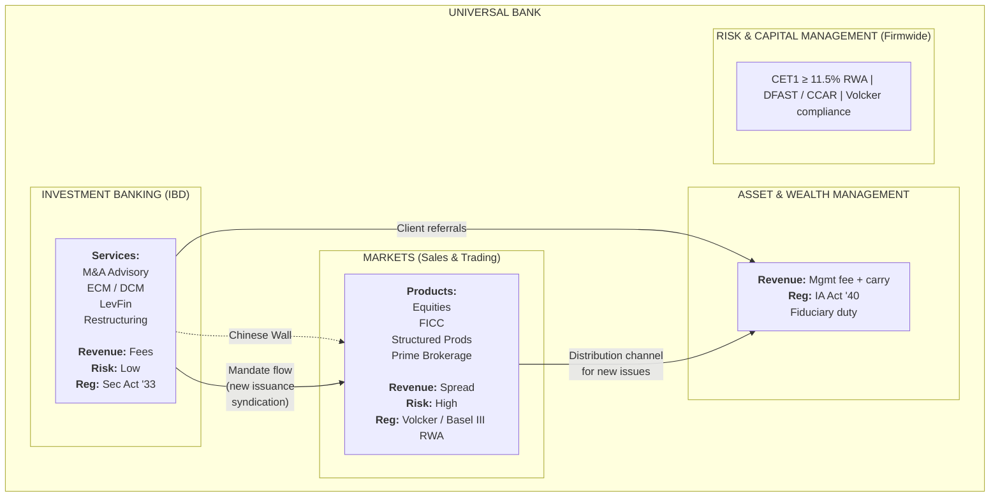

# Lesson 6: Institutional Ecosystems

## 1. First-Principles Intuition & Invariants

Investment banking does not exist in a vacuum. It operates within a dense web of institutional relationships, regulatory mandates, capital constraints, and competitive incentives that collectively define what a bank can do, how it prices risk, and whose interests it ultimately serves. Understanding this ecosystem at a mechanical level—not merely as a compliance checklist—is what separates an analyst who executes transactions from one who can anticipate market behavior, navigate conflicts, and design deal structures that survive regulatory scrutiny.

The modern institutional ecosystem emerged from a century of successive crises and the regulatory responses they triggered. The Glass-Steagall Act of 1933 was the first major architectural intervention: it cleaved commercial banking from securities underwriting in direct response to the perceived conflicts that helped inflate and then detonate the 1920s bull market. For sixty-six years, that wall held. Its repeal via the Gramm-Leach-Bliley Act of 1999 allowed universal banks—JPMorgan, Citigroup, Bank of America—to consolidate lending, underwriting, trading, and asset management under a single roof. The 2008 financial crisis demonstrated what this consolidation could produce when leverage, opacity, and misaligned incentives compounded across interconnected balance sheets. The Dodd-Frank Wall Street Reform and Consumer Protection Act of 2010 did not rebuild Glass-Steagall's wall, but it added a different architecture: capital buffers through Basel III, the Volcker Rule's prohibition on proprietary trading by deposit-taking institutions, mandatory central clearing for standardized OTC derivatives, and the creation of the Financial Stability Oversight Council (FSOC) to monitor systemic risk across entities too large and interconnected to allow unmanaged failure.

The practitioner's first invariant is this: every institutional actor in the ecosystem is simultaneously a counterparty, a competitor, and sometimes a regulator of other actors. A bulge-bracket bank underwrites bonds for a corporate issuer, sells those bonds to asset managers who are also clients of the bank's prime brokerage, and may hold residual inventory on its own trading desk subject to Volcker limits. The same bank's equity research analysts publish ratings on the issuer's stock while the bank's M&A advisory team is engaged on a deal that will materially change that issuer's capital structure. These overlapping relationships are not incidental—they are the economic logic of the universal bank model. Profitability depends on cross-selling across divisions. Systemic risk depends on how well each division's risk-taking is quarantined from the others.

### The Sell-Side / Buy-Side Divide

The sell-side and buy-side are the two hemispheres of institutional capital markets, and understanding the structural difference in their incentive architectures is non-negotiable for any practitioner who needs to predict behavior rather than merely describe it.

Sell-side institutions—investment banks, broker-dealers, and market makers—generate revenue by facilitating transactions. Their economics are volume-driven and fee-driven. An M&A advisory team earns a success fee that is a percentage of transaction value, typically structured on a Lehman-formula basis or its modern variants: 5% on the first million of consideration, 4% on the second, 3% on the third, 2% on the fourth, and 1% on everything above $5 million, though for large-cap transactions the effective blended rate compresses significantly, often into the range of 0.1% to 0.5% of enterprise value. An equity capital markets (ECM) desk earns underwriting spread—the difference between the price paid to the issuer and the price at which shares are sold to investors, typically 3.5% to 7% of gross proceeds for a U.S. IPO depending on deal size. A leveraged finance desk earns origination fees, typically 1% to 2% of term loan and high-yield bond principal, plus arrangement fees for revolving credit facilities. In every case, the sell-side is compensated for deal completion, not deal quality. This creates a structural pressure toward transaction execution that every sophisticated buy-side participant and issuer must account for.

Buy-side institutions—pension funds, sovereign wealth funds, insurance companies, mutual funds, hedge funds, private equity firms, and endowments—generate revenue by managing capital and capturing returns. Their economics are AUM-driven and performance-driven. A traditional long-only asset manager earns a management fee of 50 to 75 basis points on assets under management with limited performance upside. A hedge fund operates on the classic "2 and 20" structure: 2% management fee on AUM and 20% of profits above a high-water mark, though fee compression has pushed many managers toward "1.5 and 15" or lower. A private equity firm earns a 1.5% to 2% management fee on committed capital during the investment period and 20% carried interest on realized profits above an 8% preferred return hurdle. These structures mean the buy-side's incentive is to put capital to work at favorable prices and exit at higher prices—a mandate directly opposed to the sell-side's incentive to close transactions at the highest possible price for the issuer client.

This tension is structural and permanent. It cannot be resolved through relationship management alone. The practitioner's job is to understand exactly where each party's incentive function bends, and to structure information flow, negotiation sequences, and deal terms accordingly.

### Regulatory Architecture as Market Infrastructure

Regulation is not merely a constraint on institutional behavior—it is infrastructure that creates the conditions under which markets function. Without mandated disclosure, price discovery degrades. Without capital requirements, leverage cycles amplify until they produce systemic failure. Without clearing mandates, bilateral OTC derivatives create opaque bilateral exposure webs that become impossible to unwind in stress scenarios, as the collapse of Lehman Brothers demonstrated with crystalline finality in September 2008.

The key regulatory regimes governing U.S. investment banking activity are the Securities Exchange Act of 1934 (governing secondary market trading and broker-dealer registration), the Securities Act of 1933 (governing primary issuance and disclosure requirements), Regulation FD (Reg FD, prohibiting selective disclosure of material non-public information), Regulation M (restricting certain market activities during distributions), and the Investment Advisers Act of 1940 (governing fiduciary obligations for registered investment advisers). Layered above these is Basel III, which is not U.S. law but is implemented through Federal Reserve, OCC, and FDIC rulemaking and governs capital adequacy for banking organizations globally.

The Basel III framework operates through three pillars. Pillar 1 sets minimum capital requirements: a Common Equity Tier 1 (CET1) ratio of at least 4.5% of risk-weighted assets (RWA), a Tier 1 capital ratio of 6%, and a total capital ratio of 8%, with a capital conservation buffer of an additional 2.5% CET1. G-SIBs (Global Systemically Important Banks) carry an additional surcharge of 1% to 3.5% based on systemic importance scores, pushing effective CET1 requirements for the largest U.S. banks to 11.5% or higher. Pillar 2 addresses supervisory review—regulators can impose institution-specific capital add-ons based on stress testing results, the Fed's DFAST (Dodd-Frank Act Stress Test) and CCAR (Comprehensive Capital Analysis and Review) being the primary mechanisms. Pillar 3 mandates public disclosure to enforce market discipline. The practical effect for investment banking practitioners is that capital constraints are binding constraints on transaction structuring: an underwritten deal that leaves residual inventory on the bank's balance sheet consumes regulatory capital, reducing the bank's capacity to write new transactions until that inventory is distributed.

---

## 2. Core Architecture & Mechanics

### The Organizational Topology of a Bulge-Bracket Bank

A full-service investment bank is organized around three primary functional divisions that operate with distinct P&L accountability, risk mandates, and regulatory treatment. Understanding their internal topology is a prerequisite for navigating the cross-divisional dynamics that define real transactions.

The Investment Banking Division (IBD) contains the advisory and capital-raising functions: M&A advisory, Leveraged Finance (LevFin), Equity Capital Markets (ECM), Debt Capital Markets (DCM), and sometimes Restructuring as a standalone group or folded under M&A. IBD professionals are primarily fee-earners—they generate revenue by winning mandates and executing transactions. They are largely insulated from market risk because they distribute securities to investors rather than holding them on the firm's balance sheet (with the important exception of the underwriting commitment period, discussed below).

The Markets Division, sometimes called Sales & Trading or Global Markets, is the principal risk-taking arm of the bank. It encompasses equities, fixed income, currencies and commodities (FICC), structured products, and prime brokerage. Markets professionals earn revenue through bid-ask spreads, market-making fees, and—subject to Volcker Rule constraints—positioning profits. The distinction between permissible market-making and prohibited proprietary trading is a live regulatory question that generates substantial compliance overhead. The Volcker Rule permits a bank to hold inventory sufficient to meet "reasonably expected near-term customer demand," but that phrase requires quantitative justification through position duration, turnover, and profit-and-loss attribution analysis that regulators can audit.

The third pillar is Asset & Wealth Management (AWM), which manages external capital for institutional and high-net-worth clients. AWM is structurally different from the other two divisions in that it generates fee income tied to AUM rather than transaction flow. It also creates the most acute conflicts of interest: when the bank's AWM division holds positions in securities that IBD is underwriting or that Markets is making a market in, the potential for information leakage and preferential treatment is significant. Chinese Walls—formal informational barriers enforced through physical separation, restricted list management, and compliance monitoring—are the primary architectural response, but their effectiveness depends entirely on the rigor of their implementation.

The following diagram illustrates the information flows, revenue streams, and regulatory boundaries within this topology:



### Market Microstructure: Price Discovery and Order Flow

Market microstructure is the study of how prices form at the transaction level—the mechanics of bids, offers, order routing, and information asymmetry that determine the price at which a security actually clears. For investment banking practitioners, microstructure matters because it governs the execution quality of block trades, the dynamics of book-building in new issuances, and the speed at which information is impounded into prices (which in turn determines the window during which MNPI can generate alpha before it becomes public).

In equity markets, the dominant execution venues are registered national securities exchanges (NYSE, Nasdaq, CBOE) and Alternative Trading Systems (ATS), including dark pools operated by broker-dealers such as Goldman Sachs' Sigma X and Morgan Stanley's MS Pool. Under Regulation NMS (National Market System, 2005), the Order Protection Rule (Rule 611) requires that any trade be executed at the best available price across all displayed markets—the National Best Bid and Offer (NBBO). This rule effectively mandates the consolidation of price discovery across fragmented venues, but it also created the conditions for high-frequency trading firms to exploit latency differentials between venues.

For a practitioner advising a corporate issuer on an equity offering, microstructure mechanics translate into concrete execution decisions. A marketed follow-on offering involves a public roadshow, an order book managed by the ECM desk, and a pricing event at which the offering price is set at a discount to the prevailing market price to ensure full distribution—typically 3% to 5% for a large-cap issuer with a liquid float. An accelerated bookbuild (ABB), by contrast, is executed in a matter of hours: the bank approaches institutional investors directly, collects indications of interest over a compressed timeline of 2 to 4 hours, and prices the transaction with a tighter discount (1% to 3%) because the speed of execution reduces market impact risk for the seller. The trade-off is execution certainty versus price optimization, and the right choice depends on whether the issuer's stock is under active short pressure, whether material events are pending that create a closing window, and whether the bank has sufficient balance sheet capacity to absorb any unsold portion during the commitment period.

### The Syndication Architecture of Leveraged Finance

No single transaction better illustrates institutional ecosystem mechanics than a leveraged buyout financing. When a private equity sponsor acquires a target using the LBO structure, the acquisition financing—typically comprising a revolving credit facility, Term Loan A (TLA), Term Loan B (TLB), and senior secured or senior unsecured high-yield notes—must be originated by an arranger bank and then syndicated to a universe of institutional investors.

The debt waterfall in a typical LBO financing, ranked by seniority of claim and cost of capital, operates as follows. The revolving credit facility sits at the top of the capital structure: it is senior secured, revolving (meaning it can be drawn and repaid repeatedly), and priced at SOFR plus a margin of 150 to 275 basis points depending on leverage. It is used for working capital and liquidity needs rather than acquisition financing per se. The TLA is also senior secured and typically held by the bank syndicate, amortizing at 15% to 25% of principal per year with final maturity at five to six years, priced at SOFR plus 175 to 300 basis points. The TLB is senior secured but institutional in nature—held by CLOs, hedge funds, and loan mutual funds—with minimal amortization (typically 1% per year, the remainder paid at maturity in year seven), priced at SOFR plus 300 to 500 basis points with an OID (Original Issue Discount) of 97 to 99 cents on the dollar. High-yield bonds occupy the next layer: senior secured second lien or senior unsecured, fixed-rate instruments sold to bond investors, with coupons of 6% to 10% depending on market conditions and credit quality, governed by an indenture that specifies the covenant package. Mezzanine financing, where it appears, is the most junior debt instrument, with PIK (payment-in-kind) toggle features that allow the borrower to defer cash interest in stress scenarios in exchange for accruing additional principal. Sponsor equity sits at the bottom of the waterfall, providing the residual cushion.

The arranger bank's syndication risk is the central operational concern for LevFin practitioners. When a bank commits to arrange financing—signing a commitment letter that specifies terms, conditions, and "market flex" provisions—it is accepting balance sheet exposure from the commitment date to the syndication closing date. Market flex provisions allow the arranger to adjust pricing and terms within specified bands (e.g., flex the TLB spread by up to 50 basis points, or offer OID of up to 97) in order to clear the market. If syndication fails at any flex level—a "busted deal"—the arranger is left holding paper it committed to place, consuming regulatory capital and generating mark-to-market losses if the debt trades below par in the secondary market. The 2007-2008 period generated hundreds of billions in hung leveraged loans that banks could not syndicate, contributing materially to the balance sheet deterioration that precipitated the crisis.

The following diagram maps the capital structure waterfall and cash flow priority in a typical LBO:

```
  ENTERPRISE VALUE (EV)
  ┌─────────────────────────────────────────────┐
  │                                             │
  │  Revolver (unfunded at close)               │  ← Priority 1: First lien
  │  Commitment: $150M @ SOFR + 200bps          │    secured claim
  │                                             │
  ├─────────────────────────────────────────────┤
  │  Term Loan A (TLA)                          │  ← Priority 1 (pari passu)
  │  Principal: $400M @ SOFR + 250bps           │    Held by bank syndicate
  │  Amortization: 20%/yr → 5yr maturity        │    Amort shields exposure
  │                                             │
  ├─────────────────────────────────────────────┤
  │  Term Loan B (TLB)                          │  ← Priority 1 (pari passu)
  │  Principal: $800M @ SOFR + 400bps           │    Held by institutional
  │  OID: 98 cents → effective yield ~4.4%      │    investors (CLOs, HFs)
  │  Amortization: 1%/yr → 7yr bullet           │    Low amort, spread comp.
  │                                             │
  ├─────────────────────────────────────────────┤
  │  Senior Unsecured High-Yield Notes          │  ← Priority 2: Unsecured
  │  Principal: $500M @ 8.5% fixed coupon       │    bond investors, public
  │  Maturity: 8 years                          │    indenture governs
  │  Covenant: Maintenance vs. Incurrence       │
  │                                             │
  ├─────────────────────────────────────────────┤
  │  Mezzanine / PIK Toggle (if applicable)     │  ← Priority 3: Junior debt
  │  Principal: $150M @ 12% (cash/PIK toggle)   │    Subordinated, flexible
  │  Maturity: 10 years                         │    cash-pay mechanics
  │                                             │
  ├─────────────────────────────────────────────┤
  │  SPONSOR EQUITY CHECK                       │  ← Residual claim
  │  Equity: $700M (27% of total cap)           │    IRR / MOIC driven
  │  Total Capitalization: ~$2.55B              │    Exit via sale/IPO
  └─────────────────────────────────────────────┘

  Cash Waterfall (Annual EBITDA → $350M example):
  
  EBITDA:                    $350M
  Less: Cash Interest        ($172M)   [TLA+TLB+HY+Mezz]
  Less: TLA Amortization     ($80M)
  Less: Capex (maint.)       ($40M)
  Less: Tax (25%)            ($14.5M)
  Free Cash Flow:            ~$43.5M
  
  FCF/Debt service coverage: 1.21x (covenant threshold typically 1.10x)
```

### Advisory Conflicts and Chinese Wall Mechanics

The conflict of interest architecture within investment banking is not merely an ethical concern—it has direct legal consequences under SEC regulations and can expose banks to liability that voids transactions or triggers disgorgement. Understanding where conflicts arise and how they are managed operationally is essential practitioner knowledge.

The most acute conflict in advisory work arises when a bank represents a client on an M&A transaction while simultaneously holding research coverage, a trading position, or a financing relationship with the counterparty. This configuration is common in large financial institutions and is managed through the following mechanisms. The Restricted List is a list of securities in which the bank's trading desks and research analysts are prohibited from taking positions or publishing opinions while the bank holds MNPI related to that issuer—typically because IBD has an active advisory engagement. The Watch List is a broader list of securities flagged for enhanced compliance monitoring without a full trading prohibition. Physical separation of IBD professionals from trading floor access is maintained in most large banks, though the Chinese Wall is fundamentally an informational rather than a physical barrier.

Reg FD, adopted by the SEC in 2000, prohibits issuers from selectively disclosing material non-public information to sell-side analysts or institutional investors without simultaneously making that information public. Its practical impact on the ecosystem is to formalize the boundary between what a bank can discuss with a potential deal counterparty during a "wall-crossing" event—when an investor is explicitly brought over the wall and acknowledged to be in possession of MNPI—versus what can be discussed in ordinary investor relations conversations. Practitioners executing block trades, private placements under Rule 144A, or acquisition financings must manage wall-crossing procedures with precision, including requiring investors to sign confidentiality acknowledgments before receiving material deal information.

The fairness opinion represents a particularly instructive case study in advisory conflict. When a board of directors approves a merger, they typically obtain a fairness opinion from an investment bank attesting that the transaction consideration is "fair from a financial point of view" to shareholders. The bank rendering this opinion frequently also serves as the advisor earning a success fee contingent on transaction closing—a structural conflict that the Delaware courts have examined in cases including *In re Rural/Metro Corporation Stockholders Litigation* (2014), in which the Delaware Court of Chancery imposed $76 million in liability on RBC Capital Markets for aiding and abetting a breach of fiduciary duty, in part because of an undisclosed conflict arising from RBC's simultaneous efforts to win buy-side financing roles in the same transaction. The practitioner lesson is that conflicts do not need to be intentional to generate liability—they need only be undisclosed and material.

---

## 3. High-Performance Optimization & Failure Modes

### Optimizing the Capital-Raising Process: Book-Building and Price Discovery

For practitioners managing an equity or debt capital markets transaction, the book-building process is both the primary price discovery mechanism and the primary source of execution risk. A poorly managed book results in either an overpriced deal that breaks price in the aftermarket (damaging the issuer's future access to capital and the bank's reputation with investors) or an underpriced deal that leaves money on the table for the issuer (damaging the relationship with the issuer client and triggering accusations of "gifting" allocations to favored buy-side accounts).

The mechanics of optimal book-building require the ECM or DCM desk to manage three variables simultaneously: price range, investor demand quality, and allocations. Price range is set initially based on comparable company analysis, precedent transaction multiples, and anchor investor feedback gathered during pre-marketing. As the book builds, the desk must distinguish between "real" orders—investors submitting firm indications at specific prices with genuine intent to hold positions—and "inflated" orders, which investors submit at the top of the range purely to maximize their allocation, with the intent to flip the position in the aftermarket. Inflated orders are endemic to hot new issuances and create the phenomenon of immediate post-IPO price drops as "flippers" unload their allocations. Sophisticated ECM teams track investor behavior across transactions—flip rates, holding periods, aftermarket buying—and use that history to weight allocations toward long-term holders, even if their orders are smaller in nominal size.

For high-yield bond offerings, the equivalent optimization challenge involves managing the relationship between covenant structure and investor demand. Investors in leveraged loans and high-yield bonds are acutely sensitive to the covenant package, particularly the distinction between maintenance covenants (tested quarterly, requiring the borrower to maintain specified financial ratios regardless of action) and incurrence covenants (triggered only by specific borrower actions such as taking on additional debt or making restricted payments). The secular shift toward "covenant-lite" structures since 2012—driven by the dominance of institutional investors in the leveraged loan market who have shown a willingness to accept looser protections in exchange for yield—means that the negotiation over covenant flexibility is now a critical value-creation lever for private equity sponsors. A practitioner advising a sponsor on a new LBO financing must model the precise headroom created by each covenant construct under the acquisition scenario and several stress scenarios, translating financial covenants into actual operational latitude for the portfolio company's management team.

### Systemic Risk Propagation: Mechanisms and Mitigation

The 2008 financial crisis is the definitive empirical case study in systemic risk propagation through an institutional ecosystem. Its mechanics are worth dissecting in operational detail, because the same propagation pathways—leverage, opacity, correlated exposures, and liquidity transformation mismatches—remain structurally present in today's markets, albeit partially mitigated by post-crisis regulation.

The crisis propagated through the following sequence of institutional failures. The mortgage origination chain—from non-bank originators through aggregator banks through securitization vehicles—had created a separation between loan origination and loan credit risk bearing that eliminated the underwriting incentive for originators. Banks originating mortgages that would immediately be securitized into RMBS (Residential Mortgage-Backed Securities) and further into CDOs (Collateralized Debt Obligations) had no residual exposure to default outcomes. This "originate-to-distribute" model generated roughly $2 trillion in subprime and Alt-A mortgage originations between 2004 and 2007. When housing prices declined and default rates in the 2006 and 2007 vintage pools exceeded the assumptions embedded in CDO waterfalls, the AAA tranches that money market funds, insurance companies, and bank treasury departments had purchased as near-cash equivalents experienced price dislocations that neither their models nor their risk managers had quantified.

The second-order propagation mechanism was the repo market. Banks financing their RMBS and CDO inventory used overnight and short-term repurchase agreements—essentially collateralized overnight loans—to fund long-dated positions with short-dated liabilities, creating a classic maturity transformation mismatch. As mark-to-market losses on the collateral triggered margin calls and haircut increases from repo counterparties, banks were forced into collateral sales that further depressed prices, triggering further margin calls in a reflexive loop. Bear Stearns' internal hedge funds collapsed in June 2007 through exactly this mechanism. Lehman Brothers failed in September 2008 when counterparties declined to roll its repo financing for a $700 billion balance sheet funded largely overnight.

The third propagation mechanism was the CDS (Credit Default Swap) market. AIG Financial Products had written approximately $441 billion in CDS protection on CDO tranches, treating the premium income as nearly riskless given AAA ratings. When the referenced CDOs deteriorated, AIG's counterparties—Goldman Sachs, Société Générale, Deutsche Bank, and others—demanded collateral posting under the CSA (Credit Support Annex) provisions of their ISDA Master Agreements. AIG lacked the liquidity to meet these calls and required an $85 billion Federal Reserve emergency credit facility in September 2008, later expanded to $182 billion, to prevent the disorderly unwinding of its counterparty exposures across the global financial system.

The post-crisis regulatory response addressed each of these propagation channels. The requirement under Dodd-Frank for mortgage originators to retain at least 5% of the credit risk in securitized pools (the "skin in the game" rule, implemented through the Qualified Residential Mortgage exemption framework) directly attacks the originate-to-distribute incentive misalignment. The mandatory central clearing of standardized OTC derivatives through CME Group, ICE Clear Credit, and LCH addresses the bilateral opacity of the CDS market by interposing a central counterparty (CCP) with a funded default waterfall. The Liquidity Coverage Ratio (LCR) under Basel III requires banks to hold enough High Quality Liquid Assets (HQLA) to survive 30 days of net cash outflows under a stress scenario, directly targeting the repo funding mismatch that destroyed Bear and Lehman.

For the practitioner, the operational implication of these systemic risk mechanics is that counterparty credit analysis cannot be conducted in isolation. The right question is not "what is the probability that counterparty X defaults?" but "what is the probability that counterparty X defaults in a scenario that also impairs my other counterparties and dries up the market liquidity I would need to hedge or unwind my exposure?" Correlation of counterparty exposures under stress is the quantity that the pre-2008 risk models systematically underestimated, and it remains the most important parameter in any stress scenario analysis conducted by a sell-side risk management desk or a buy-side credit analyst today.

### Failure Mode Taxonomy for Institutional Transactions

Transactions in the institutional ecosystem fail—or fail to achieve their intended economic outcome—through a finite set of repeating failure patterns. Recognizing these patterns in live transactions is a practitioner skill that cannot be acquired by reading term sheets in isolation.

**Underwriting commitment risk during market dislocation** occurs when a bank has committed firm capital to an underwritten offering and market conditions deteriorate materially between commitment and syndication closing. The legal protection for arrangers in debt markets is the Material Adverse Change (MAC) clause in the commitment letter, which allows the arranger to withdraw if a MAC has occurred in the borrower's business or in the leveraged finance market generally. The "market MAC" provision was the subject of extensive litigation following the 2007 market dislocation, as banks sought to invoke it to escape hung LBO financings. Courts have generally interpreted market MAC provisions narrowly, requiring documentation of a generalized market disruption rather than merely unfavorable conditions for the specific deal—making it a genuinely high bar to clear and reinforcing the importance of careful market flex provision drafting at the commitment stage.

**Information asymmetry in M&A valuation** produces systematic overpayment by acquirers, a phenomenon documented empirically in the literature on merger premiums and bidder returns. The mechanism is well-understood: in a competitive auction, the winner is the bidder who made the most optimistic assumptions about synergies, the most aggressive growth projections, or who suffered the most acute anchoring bias from management's information advantage. The practitioner's mitigation is the quality-of-earnings (QoE) analysis conducted by independent accounting advisors during due diligence, which re-casts the target's EBITDA to remove non-recurring items, one-time revenue accelerations, and accounting policy choices that inflate the apparent earnings base. A QoE adjustment of 10% to 15% of reported EBITDA is common in private company transactions, and a failure to identify such adjustments before signing materially alters the implied acquisition multiple and the LBO model's return projections.

**Chinese Wall failures under time pressure** are operationally the most acute failure mode in institutional ecosystems. When a large transaction is live—an M&A deal, a block trade, a material financing—the economic pressure to involve specialists from across the firm creates a systematic temptation to work around rather than through the Chinese Wall procedures. Front-running, selective disclosure to a privileged investment management client, or trading desk positioning ahead of public announcement are not simply compliance failures—they are federal securities law violations under Section 10(b) of the Securities Exchange Act and Rule 10b-5, carrying criminal penalties. The SAC Capital insider trading investigation (2013) and the subsequent guilty plea by SAC's subsidiary CR Intrinsic demonstrated that the SEC and DOJ are prepared to impose entity-level criminal liability when systemic information barrier failures can be documented through electronic communication records. The practitioner's mitigation at the institutional level is a surveillance infrastructure that flags anomalous trading patterns in securities on the Restricted or Watch List, with pre-clearance requirements for all personal trading by IBD professionals during active engagement periods.

**Covenant breach cascades** represent the debt-side equivalent of a margin call spiral. When a leveraged borrower's EBITDA deteriorates such that it trips a maintenance financial covenant—most commonly a Total Net Leverage covenant of the form (Total Net Debt / LTTMe EBITDA) ≤ 6.0x—the entire term loan and revolving credit agreement goes into default, triggering cross-default provisions in the high-yield indenture and potentially the derivative CSA as well. This cross-default cascade converts a manageable liquidity problem into an existential solvency crisis unless the company can negotiate a waiver and amendment package with its lenders before the default is declared. The practitioner's role in this scenario is to advise the company (or the lenders) on the available levers: an amendment increasing the covenant threshold in exchange for a fee (typically 25 to 50 basis points on outstanding commitments), an equity cure right that allows the sponsor to inject equity counted as EBITDA for covenant compliance purposes for up to two consecutive quarters under many credit agreements, or a comprehensive liability management transaction (LMT) that extends maturities and potentially exchanges existing claims into new capital structure instruments. The 2022-2024 period saw a wave of LMT activity—including priming transactions, uptier exchanges, and double-dip structures—that tested the limits of credit agreement drafting and produced litigation that is still defining the enforceability boundaries of these techniques.

The institutional ecosystem's complexity is not incidental bureaucracy. It is the accumulated response of regulators, practitioners, and market participants to successive waves of failure, each of which revealed a gap between the economic incentives embedded in the system's architecture and the collective stability that the system is supposed to produce. The practitioner who internalizes this dynamic—not as historical fact but as an ongoing operational reality—is equipped to identify, in the structure of any current transaction, the pressure points where the next failure is most likely to emerge before it does.
