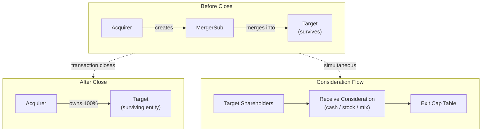

# Lesson 1: Merger Fundamentals, Rationales, and Deal Types

## 1. First-Principles Intuition & Invariants

At its most elemental level, a merger is a theory about the future. Two organizations—each carrying its own cost structure, revenue base, management culture, and capital allocation history—are combined under the thesis that the resulting entity will be worth more than the arithmetic sum of its parts. This thesis is called synergy, but that word has been so thoroughly hollowed out by investment bank pitch decks that it is worth rebuilding it from first principles before we let it back into the vocabulary.

The economic logic of combining firms traces directly to Ronald Coase's 1937 work on the nature of the firm. Coase observed that markets have transaction costs: search, negotiation, contracting, and enforcement all consume resources. A firm internalizes transactions to eliminate those costs when doing so is cheaper than trading across a market boundary. A merger extends this logic to a second-order transaction: when two firms discover that their combined productive capacity is cheaper to coordinate under a single legal entity than across a supplier-customer or competitor relationship, they have identified a Coasian motive for combination. That is not synergy as a PowerPoint aspiration; it is a falsifiable economic hypothesis about where transaction costs live and what it costs to eliminate them.

This distinction between a merger and an acquisition is frequently misused in practice, so it is worth resolving precisely. A **merger** is the combination of two companies into a single surviving legal entity, with shareholders of the acquired firm receiving consideration—cash, stock, or some combination—in exchange for their shares. An **acquisition** is the purchase of one company's assets or equity by another, where the target may continue to exist as a subsidiary rather than being absorbed. In a statutory merger, the target is dissolved into the acquirer by operation of law; in a subsidiary merger, the target survives as a wholly owned subsidiary of the acquirer. In common market usage, the terms are used interchangeably, particularly because public announcements of "mergers of equals" are frequently structured legally as acquisitions where one party is the nominal acquirer for accounting and tax purposes. The practitioner must always look past the press release to the merger agreement and the structure of consideration to understand which entity is absorbing which liabilities, which shareholders are diluted, and which tax basis is preserved.

### The Strategic Rationale Taxonomy

Understanding why a deal happens is the prerequisite for valuing it correctly. Deals fail when the valuation model encodes a growth assumption or a cost-take-out that the underlying strategic rationale cannot actually support. There are four principal rationale categories, and each has a different financial signature in the model.

**Growth acquisition** is the most straightforward. A company buys another company primarily for its revenue—its customer base, its product, its geographic presence, or its distribution channel. The acquirer is essentially buying future revenue that would take years and significant capital expenditure to build organically, and paying a control premium over the market price to access it now. The financial model for a growth acquisition is dominated by revenue synergy assumptions: cross-sell rates, geographic expansion penetration curves, and product attach rates. These are almost always harder to achieve than cost synergies because they depend on changing customer behavior, not on renegotiating supply contracts or eliminating redundant headcount. The empirical record on revenue synergies is sobering: McKinsey & Company's research across hundreds of deals consistently shows that companies achieve less than 50% of projected revenue synergies within three years of close, while cost synergy achievement rates run closer to 70–80%.

**Efficiency acquisition** is structurally different. Here, the acquirer's thesis is that the target is running below productive capacity due to a suboptimal cost structure, underfunded operational functions, or management underperformance—and that the acquirer's operating model, procurement scale, or shared service infrastructure can close that gap. The financial model is driven by EBITDA margin expansion: the acquirer takes the target's standalone EBITDA and applies a "synergized" margin that reflects the elimination of duplicate corporate overhead (typically G&A as a percentage of revenue), consolidated procurement contracts, and rationalized real estate. For a typical industrial company acquisition, buyers in a competitive process will model 2–4% of combined revenue as achievable cost synergies, with the costs to achieve (severance, facility consolidation, system migrations) typically running 1.0–1.5× the annual synergy run-rate.

**Market power acquisition** is motivated by competitive positioning rather than internal efficiencies. By acquiring a competitor, a supplier, or a customer, the acquirer changes the competitive dynamics of the entire industry—enlarging its pricing power, controlling a critical input, or foreclosing a distribution channel from rivals. Horizontal combinations (competitor + competitor) expand market share directly. Vertical combinations (supplier + manufacturer, or manufacturer + distributor) reduce the acquirer's exposure to opportunistic pricing and information asymmetry in its supply chain. These deals attract the most regulatory scrutiny because they are, by design, intended to change competitive equilibrium. The antitrust analysis executed by the Department of Justice and the Federal Trade Commission in the United States—and by the European Commission in the EU—examines market concentration using the Herfindahl-Hirschman Index (HHI), where a post-merger increase in HHI above 200 points in a market already above 2,500 HHI creates a presumption of competitive harm.

**Diversification acquisition** is the most theoretically contested rationale in corporate finance. The logic is that a conglomerate with businesses across multiple industries or geographies enjoys lower earnings volatility because industry downturns are not perfectly correlated. The problem is that capital markets can diversify far more cheaply than operating companies can. An investor who wants exposure to both an industrial manufacturer and a software company can buy both stocks for essentially zero transaction cost, while the industrial company acquiring the software company pays a 25–40% control premium plus investment banking fees, legal costs, and integration costs. The empirical literature—most famously Jensen's 1986 paper on free cash flow and the diversification discount—documents that diversified conglomerates trade at a persistent discount to the sum-of-parts valuation of their constituent businesses. The discount exists precisely because conglomerate structure destroys the market's ability to price-discover each business unit efficiently and because internal capital allocation by management is reliably worse than external capital market discipline.

### The Fundamental Invariants

Three invariants govern every deal, regardless of its strategic rationale, and violating any of them will destroy value.

The first invariant is that **value is not created by the transaction itself; it is created by what happens after the transaction closes.** A deal announced at a 30% premium to the target's pre-announcement share price is not a value-creating event for the acquirer's shareholders unless the present value of synergies and performance improvement exceeds the premium paid. The investment bank's fairness opinion addresses whether the price is "fair" to the target's shareholders, not whether it is accretive to the acquirer's shareholders. These are fundamentally different questions, and the analyst who confuses them will consistently overpay.

The second invariant is that **the form of consideration is a signal, not just a financing decision.** When an acquirer uses its own stock as currency, it is implicitly communicating that its stock is at least fairly valued—and quite possibly overvalued. A rational acquirer does not issue stock to buy a dollar of assets if its stock is trading at a discount to intrinsic value, because doing so transfers wealth from existing shareholders to target shareholders. The empirical event-study literature (starting with Travlos, 1987) documents that all-cash deals produce neutral-to-positive abnormal returns for acquirer shareholders on announcement, while all-stock deals produce negative abnormal returns of 2–3% on average, consistent with the market interpreting stock issuance as a negative signal about the acquirer's view of its own valuation.

The third invariant is that **complexity in deal structure is not sophistication; it is a price of disagreement.** When buyer and seller cannot agree on price, deal architects introduce contingent consideration (earnouts), seller financing, rollover equity, and equity kickers to bridge the gap. Each of these instruments introduces information asymmetry, moral hazard, and future litigation risk. The analyst who accepts a complex structure as a creative solution to a valuation gap should ask whether the disagreement about value reflects genuine uncertainty about future performance—which an earnout can appropriately allocate—or whether it reflects the buyer's unwillingness to pay fair value, which no structural complexity can cure.

---

## 2. Core Architecture & Mechanics

### Deal Structure Taxonomy

The legal and economic mechanics of M&A execution resolve into three structural dimensions: the form of combination, the form of consideration, and the method of acquisition. Each dimension operates independently, and the final deal structure is the intersection of all three choices.

The **form of combination** determines what legal entity survives and how the target's assets, liabilities, contracts, and employees transfer. In a **forward merger**, the target merges into the acquirer, with the target's legal existence extinguished and all of its assets and liabilities absorbed by the acquirer by operation of law. This is the simplest structure but requires shareholder votes from both sides and triggers contract assignment clauses in the target's key agreements. In a **reverse triangular merger**—the most common structure for public company acquisitions—the acquirer creates a new wholly owned merger subsidiary, that subsidiary merges into the target, and the target survives as a wholly owned subsidiary of the acquirer. This preserves the target's legal existence (and therefore its contracts, licenses, and regulatory approvals) while still transferring economic ownership to the acquirer. The merger subsidiary is dissolved in the transaction, leaving the target as the surviving entity.



An **asset acquisition** bypasses the merger structure entirely: the acquirer purchases specific assets (and assumes specific liabilities) of the target rather than acquiring its equity. This is common in distressed situations, where a buyer wants a target's productive assets without inheriting its legacy liabilities (pension obligations, environmental claims, undisclosed contingent liabilities). The legal transfer of each individual asset requires a separate conveyance, making asset deals operationally cumbersome for companies with large portfolios of contracts and intellectual property.

### Consideration Structures: Cash, Stock, and Mixed

The **form of consideration** in a public company deal is governed by the merger agreement and directly determines the tax treatment received by target shareholders. In an all-cash deal, target shareholders receive a fixed dollar amount per share and recognize a capital gain (or loss) in the year of close. This is a fully taxable transaction. In an all-stock deal structured as a tax-free reorganization under Section 368 of the Internal Revenue Code, target shareholders exchange their shares for acquirer shares without recognizing gain—tax is deferred until they sell the acquirer shares. The Internal Revenue Service requires that the acquirer's stock constitute "substantially all" of the consideration (the IRS safe harbor is 40% stock minimum) for Section 368 treatment to apply. A mixed consideration deal—say, 60% cash and 40% stock—is partially taxable: the cash portion triggers gain recognition, while the stock portion rolls over tax-deferred.

The economic significance of these tax distinctions is substantial. A target shareholder with a low tax basis who has held shares for decades faces a marginal capital gains rate of 23.8% (20% long-term capital gains rate plus the 3.8% Net Investment Income Tax at the top bracket in the United States). On a $100 per share deal price with a $10 per share tax basis, the after-tax proceeds in a cash deal are $78.28, while a tax-free stock exchange preserves the full $100 of economic value until subsequent disposition. This creates a real negotiating dynamic: sophisticated target shareholders—particularly founders with large low-basis positions—will accept a meaningfully lower headline price in a stock deal than in a cash deal if the tax deferral benefit exceeds the valuation gap.

The **financing of cash consideration** introduces the third structural dimension. Cash to fund an acquisition comes from one of three sources: the acquirer's balance sheet cash reserves, new debt financing (a term loan or bridge loan arranged by the acquisition's lead bank), or proceeds from an equity offering. The mix of these sources directly affects the acquirer's pro forma leverage, interest coverage ratios, and credit rating. A deal that pushes the acquirer's net debt/EBITDA ratio above 4.0× in an investment-grade company will typically trigger a negative outlook from Moody's or S&P, which raises the acquirer's cost of debt capital going forward and constrains its ability to do further acquisitions. This is why large strategic acquirers manage acquisition pace against their balance sheet capacity, maintaining what bankers call "dry powder"—a combination of undrawn revolver capacity and investment-grade headroom—as a strategic asset.

### The Transaction Timeline and Process Architecture

A public company M&A transaction from initial board authorization to shareholder vote and regulatory clearance follows a compressed but structured timeline. The practitioner must internalize this sequence not as bureaucratic procedure but as a series of risk gates, each of which can kill the deal.

The process begins with the acquirer's board authorizing management to explore the transaction, typically with the assistance of a financial advisor (the investment bank) and outside M&A counsel. If the transaction is initiated by the acquirer approaching the target directly (a "negotiated deal"), the two parties execute a non-disclosure agreement (NDA) and a standstill agreement before any material non-public information is exchanged. The standstill prevents the target from using the NDA process to build a competing bid or to run a parallel sale process without the acquirer's knowledge.

Following the NDA, the target provides access to a virtual data room (VDR) containing financial statements, material contracts, intellectual property documentation, employee benefit plan summaries, environmental assessments, litigation schedules, and regulatory filings. The acquirer's financial and legal diligence teams—typically organized into workstreams covering financial, tax, legal, commercial, operational, and IT—spend four to eight weeks reviewing this material and issuing diligence reports to the deal team. The diligence process is not merely confirmatory; it is the mechanism by which the acquirer discovers material liabilities (undisclosed pension deficits, problematic customer contract termination rights, unresolved intellectual property ownership disputes) that either reprice the deal or introduce specific representations and warranties into the merger agreement.

The merger agreement itself is the governing legal document of the transaction and runs 80–150 pages for a typical public company deal. Its critical commercial provisions include the **material adverse change (MAC) clause**, which defines what conditions permit the acquirer to walk away from the signed deal before closing; the **representations and warranties** made by the target about the accuracy of disclosed information; the **termination fee** (also called a "break fee"), typically 2–4% of deal value, which the target must pay if its board withdraws its recommendation in favor of a superior proposal; and the **reverse termination fee**, which the acquirer pays if it fails to close due to its own breach or financing failure. The relative size of the reverse termination fee compared to the deal value is a precise signal of how much deal certainty the acquirer is offering: a reverse termination fee of 3% signals that the acquirer is essentially purchasing an option to walk away at a fixed cost, while a reverse termination fee of 7–9% signals genuine commitment to close.

```
Public M&A Transaction Timeline (Negotiated Deal)

Week  0:   Board authorization; financial advisor engagement letter signed
Weeks 1–2: NDA + standstill executed; initial management presentation
Weeks 2–6: Virtual data room access; diligence workstreams (financial,
           tax, legal, commercial, operational, IT)
Week  5:   Indicative offer letter / term sheet submitted
Weeks 6–9: Merger agreement negotiation (markup rounds)
Week  9:   Definitive merger agreement signed; deal announced
           → Acquirer files Hart-Scott-Rodino (HSR) notification (Day 0)
           → 30-day initial waiting period (or early termination)
           → If Second Request: 6–12 months additional review
Weeks 9–24: SEC proxy statement preparation and review
           (target files preliminary proxy; SEC has 10 days to review)
Week  22:  SEC declares proxy effective; proxy mailed to shareholders
Week  26:  Target shareholder vote; deal closes upon regulatory clearance
```

### The Role of Investment Banks and Financial Advisors

The investment bank in an M&A transaction functions simultaneously as valuation analyst, deal architect, negotiation strategist, and financing arranger. The sell-side bank (representing the target) runs the sale process, prepares the confidential information memorandum (CIM) or management presentation, coordinates diligence, negotiates price and terms, and delivers a fairness opinion to the target's board attesting that the consideration is fair from a financial point of view to the target's shareholders. This fairness opinion is not a legal guarantee of value; it is a board governance document that protects directors against breach-of-fiduciary-duty claims by demonstrating that an independent valuation expert reviewed the transaction.

The buy-side bank (representing the acquirer) constructs the valuation model, develops the acquisition financing structure (advising on the mix of cash on hand, term debt, and equity issuance), and helps the acquirer's management team understand the range of prices it can pay while maintaining financial covenants and strategic optionality. When the buy-side bank also commits to providing the acquisition financing (as a "committed financing" bank), it has a direct financial incentive to close the deal, which creates a subtle but real conflict: the bank earning underwriting fees on $5 billion of acquisition financing has a different risk posture than a purely advisory advisor with no financing at stake.

Fees in M&A are structured as a fixed retainer plus a "success fee" contingent on transaction close—the Lehman formula and its modern variants. The original Lehman formula (5% on the first $1 million, 4% on the second, 3% on the third, 2% on the fourth, 1% on everything thereafter) has long since been renegotiated downward for large-cap deals. For a deal above $1 billion, buy-side advisory fees typically run 0.3–0.6% of transaction value, while sell-side fees run 0.5–0.75%. This means the investment banks advising on a $5 billion transaction collectively earn $25–65 million in advisory fees, plus underwriting fees if they provide the acquisition debt—which explains why the M&A franchise is among the highest-margin businesses in financial services.

---

## 3. High-Performance Optimization & Failure Modes

### Optimizing the Diligence-to-Model Feedback Loop

The most expensive mistake in M&A execution is the disconnect between the diligence team and the financial model. In a poorly run process, the diligence workstreams produce reports that are filed, read once, and forgotten while the financial model continues to run on the original projections submitted by the target's management. The practitioner who has seen even two deals close knows that the target management's projections are almost invariably optimistic: revenue growth rates exceed what the sales pipeline can support, margin expansion assumes operational improvements that have been "in progress" for two years, and capital expenditure forecasts are systematically understated. The working capital adjustment at closing (where the target must deliver a specified level of net working capital at the moment of closing) is a direct mechanism to force accurate normalization, and disputes over the closing working capital statement are among the most common post-closing conflicts in M&A.

The practitioner should build the financial model in a structure that accepts diligence findings as direct inputs rather than requiring manual interpolation. This means the model's revenue assumptions are linked to the commercial diligence team's customer concentration analysis (the top 10 customers as a percentage of revenue, their contract expiration dates, and their renewal likelihood scores), the cost structure assumptions are linked to the HR diligence team's headcount and compensation data, and the capex forecast is linked to the facilities and IT diligence teams' findings on deferred maintenance and technology refresh requirements. When a diligence finding reveals that 40% of the target's revenue comes from a single customer whose contract expires 18 months post-close with no renewal guarantee, that finding should reprice the model immediately—not appear as a footnote in a risk section that the investment committee never reads.

The other critical model optimization is **sensitivity analysis over the synergy bridge**. Every public acquisition model contains a "synergy bridge" showing the expected present value of cost and revenue synergies, net of costs to achieve, that justifies paying a premium over the target's standalone intrinsic value. This synergy bridge should be stress-tested across three dimensions: timing (what happens to IRR if synergies arrive 12 months later than projected), magnitude (what is the minimum synergy achievement rate at which the deal creates value for the acquirer, expressed as a percentage of projected synergies), and cost-to-achieve (how does deal NPV change if integration costs are 2× the base case). Most investment committee presentations show only the base-case synergy scenario, which is a governance failure. A properly prepared analysis shows the full distribution and identifies the precise break-even assumption below which the acquirer would have been better served by buying back its own stock.

### Regulatory Failure Mode: The Second Request

The Hart-Scott-Rodino Antitrust Improvements Act of 1976 requires parties to transactions above certain size thresholds (the 2024 threshold is $119.5 million for the "size of transaction" test) to notify the Department of Justice and the Federal Trade Commission and observe a waiting period before closing. The initial waiting period is 30 days. If the reviewing agency issues a "Second Request" for additional information, the waiting period extends until 30 days after substantial compliance with the Second Request—a process that typically adds six to twelve months to the transaction timeline and costs the parties $5–20 million in additional legal and economic consulting fees.

The strategic failure mode here is **announcing a deal before completing antitrust pre-clearance analysis**. The correct workflow is to retain antitrust counsel before signing the merger agreement, run a preliminary market definition analysis (identifying the relevant product and geographic markets, computing the pre- and post-merger HHI, and identifying the most likely theories of harm the reviewing agency will develop), and either modify the deal structure to include agreed divestitures upfront (called a "fix-it-first" remedy) or condition signing on antitrust counsel's preliminary view that the deal has a clear path to clearance. A deal that is announced with a 25% acquisition premium but then blocked by regulators or terminated after a failed 12-month antitrust fight has effectively handed the target's shareholders a 25% gain on leaked deal value while destroying acquirer shareholder value through the management distraction, opportunity cost, and reverse termination fee payment. The 2022 termination of Nvidia's $40 billion acquisition of Arm Holdings—abandoned after 18 months of global regulatory resistance—is an instructive case: Nvidia paid a $1.25 billion reverse termination fee and lost 18 months of strategic focus, while the acquired-price announcement itself temporarily inflated Arm's perceived valuation in ways that complicated SoftBank's subsequent Arm IPO planning.

### Integration Failure Mode: The 100-Day Fallacy

The single most common cause of post-merger value destruction is insufficient integration planning executed too late. The standard industry practice of forming an integration management office (IMO) after signing and running a 100-day planning sprint before close is demonstrably inadequate for large transactions. By the time the merger agreement is signed, the acquirer has typically spent 90% of its pre-close management bandwidth on the transaction process itself—diligence, negotiation, financing, regulatory filings—and 10% on planning what it will actually do when it owns the business. The integration work plan, which should specify the ownership, timeline, interdependencies, and success metrics for every synergy initiative down to the individual general ledger code, is usually still a slide deck on Day 1 of ownership.

The practitioner-level correction is to begin integration planning during diligence, not after signing. This is called **Day 1 readiness planning**, and it requires the acquirer to designate integration workstream leads—drawn from the operational functions that will own the synergies, not from the deal team—who attend diligence sessions in their functional area and simultaneously draft integration plans. The HR workstream lead does not just inventory the target's headcount; they draft the organizational design for the combined entity, identify which roles are redundant, and prepare the communication plan for affected employees—so that on Day 1 of ownership, decisions are made rather than studied. This approach compresses the period of organizational uncertainty from 12–18 months to 3–6 months, which matters because organizational uncertainty is the primary driver of voluntary attrition among the target's key talent—the people whose retention is usually listed in the investment thesis as a critical value driver.

### MAC Clause Failure Mode: Defining the Escape Hatch Precisely

The Material Adverse Change clause is the contractual mechanism by which an acquirer can terminate a signed merger agreement if the target's business deteriorates materially between signing and closing. Its practical utility is inversely proportional to how precisely it is drafted. Courts—particularly the Delaware Court of Chancery, which has jurisdiction over most significant M&A disputes given Delaware's role as the dominant state of incorporation for public companies—have set an extremely high bar for MAC invocations. In the seminal 2018 case *Akorn, Inc. v. Fresenius Kabi AG*, the Delaware Court of Chancery upheld Fresenius's MAC-based termination for the first time in Delaware history, but only because the target had suffered a 29% revenue decline, had concealed material regulatory compliance failures, and had made fraudulent representations in the merger agreement. A mere industry downturn, a loss of a major customer, or a decline in earnings below projections will not constitute a MAC under Delaware law unless the merger agreement explicitly carves such events into the MAC definition.

The practitioner consequence is that the MAC clause cannot be relied upon as a risk management tool for ordinary business variability. The real risk management tools are the **representations and warranties** (which create a basis for indemnification claims post-closing if the target's disclosures prove false), **representations and warranties insurance (RWI)** (a buy-side insurance policy that pays claims against the rep and warranty indemnification without requiring the target's selling shareholders to remain solvent and available post-close), and **earnout provisions** (which defer a portion of the consideration contingent on post-close performance, effectively transferring the risk of financial underperformance back to the seller). Each of these instruments has its own cost and complexity profile, and the sophisticated practitioner treats them not as boilerplate but as the precise financial instruments that determine how valuation risk is allocated between buyer and seller—which is, at its foundation, the central mechanical question of every M&A transaction.
