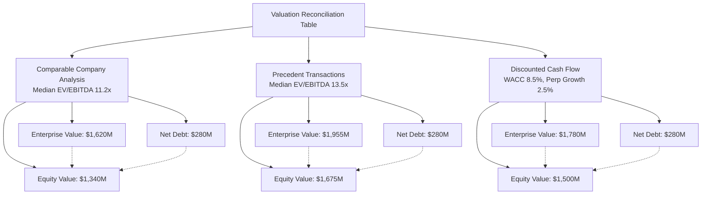

# Lesson 2: Target Valuation Methods in M&A Context

## 1. First-Principles Intuition & Invariants

Valuation in a mergers and acquisitions context diverges sharply from passive equity research or public market investment analysis. When an acquirer evaluates a target firm, the analytical framework must reconcile three competing economic realities: the standalone intrinsic value of the target as an independent operating entity, the strategic value unlocked through combination and synergy realization, and the price the market will bear given competitive dynamics and seller negotiating leverage. Unlike a portfolio manager who can diversify away idiosyncratic risk across dozens of positions, the corporate acquirer commits enormous capital and management attention to a singular transaction. The stakes demand precision, and the methodology must synthesize quantitative rigor with qualitative judgment about competitive positioning, organizational culture, and execution risk.

At its core, target valuation rests on a deceptively simple invariant: the value of any asset equals the present value of all future cash flows it will generate, discounted at a rate commensurate with the risk of those cash flows. This principle, inherited from Irving Fisher's theory of capital and formalized through decades of capital markets research, provides the intellectual foundation for discounted cash flow analysis. Yet practitioners rarely rely on DCF alone. The inherent uncertainty in forecasting cash flows five or ten years into the future, combined with the sensitivity of terminal value assumptions to perpetuity growth rates and exit multiples, introduces enormous variance in DCF outputs. A fifty-basis-point shift in the weighted average cost of capital can swing valuation by fifteen to twenty percent, rendering the model simultaneously indispensable and dangerously brittle.

To triangulate around this brittleness, acquirers deploy a triad of valuation methodologies: comparable company analysis, precedent transaction analysis, and discounted cash flow modeling. Each method interrogates value from a distinct vantage point. Comparable company analysis anchors valuation to the trading multiples of similar publicly traded firms, reflecting the market's real-time assessment of risk and growth within a given industry vertical. This approach assumes that capital markets efficiently aggregate information and that peer firms share similar operational profiles, capital structures, and end-market exposures. Precedent transaction analysis examines the premiums paid in historical acquisitions of comparable targets, capturing not just standalone value but the control premium buyers have historically been willing to pay to secure governance rights and operational control. Discounted cash flow analysis, by contrast, eschews market comparables entirely and builds value from the ground up through explicit cash flow projections, capital investment requirements, and tax-effected return on invested capital dynamics.

The tension between these methods reveals a deeper epistemological divide. Market-based approaches—comparables and precedents—are inherently backward-looking and assume that past valuation benchmarks remain relevant despite shifts in interest rate regimes, competitive intensity, and technological disruption. DCF analysis is forward-looking but demands heroic assumptions about revenue growth trajectories, margin expansion, and terminal economics in perpetuity. The skilled acquirer does not treat these methods as interchangeable commodities but as complementary lenses that expose different dimensions of risk and return. When all three methods converge on a narrow valuation range, conviction increases. When they diverge sharply, the discrepancies force critical inquiry: Is the target's business model structurally different from its peers? Are recent transactions in the sector driven by strategic buyers with unique synergy opportunities, or financial sponsors arbitraging cheap debt? Does our DCF embed overly aggressive margin expansion that historical precedent cannot support?

Embedded within this analytical framework are several critical invariants that govern M&A valuation discipline. First, enterprise value must be reconciled to equity value through the balance sheet bridge: subtracting net debt, minority interests, and preferred stock while adding back cash and marketable securities. This reconciliation is not mere accounting hygiene; it exposes the capital structure arbitrage opportunities and refinancing risks that will shape post-acquisition returns. Second, valuation multiples must be applied consistently across the capital structure. EBITDA multiples correspond to enterprise value, while earnings per share multiples correspond to equity value. Mixing these constructs—applying a P/E multiple to calculate enterprise value, for instance—produces nonsensical results and yet remains a distressingly common error among junior analysts.

Third, the concept of control premium is not a static add-on percentage but a function of the synergies available to the acquirer and the competitive tension in the sales process. In an auction with multiple credible bidders, the control premium compresses as value transfers from buyer to seller. In a proprietary bilateral negotiation where the acquirer possesses unique integration capabilities—access to distribution channels, complementary intellectual property, or operational expertise—the control premium can expand to fifty or even seventy-five percent above the unaffected trading price. The acquirer's challenge is to estimate the synergy value it can credibly capture while ensuring the bid remains competitive enough to win the process but disciplined enough to generate acceptable returns on invested capital.

Finally, valuation is an input to negotiation strategy, not the output of a mechanical algorithm. The bid price reflects not just analytical output but game-theoretic positioning: What signal does our initial indication of interest send about our seriousness and financial capacity? How do we structure earnouts, contingent consideration, or deferred payments to bridge valuation gaps rooted in differing growth assumptions? How do we balance offering a premium that compensates target shareholders while preserving enough value to satisfy our own board and investors? These questions require judgment that no spreadsheet can encode, yet they rest on the quantitative scaffolding that robust valuation methodologies provide.

## 2. Core Architecture & Mechanics

The architecture of target valuation proceeds through a sequence of interdependent analytical modules, each requiring specific data inputs, transformation logic, and cross-validation checkpoints. We begin with comparable company analysis, which constructs a peer set of publicly traded firms and derives trading multiples that serve as valuation benchmarks.

Comparable company analysis initiates with peer set construction, a process that is part art and part science. The objective is to identify firms that share the target's industry classification, revenue scale, geographic footprint, business model, and growth profile. Practitioners typically begin with Standard Industrial Classification (SIC) or North American Industry Classification System (NAICS) codes to generate an initial universe of candidates. This mechanical screen must then be refined through qualitative filters: Does the peer operate in the same value chain position—original equipment manufacturer versus distributor versus retailer? Does it serve similar end markets—enterprise software versus consumer applications, medical devices for acute care versus chronic care management? Does it exhibit comparable capital intensity, with similar ratios of property, plant, and equipment to revenue?

Having constructed a defensible peer set of five to ten companies, the analyst pulls the latest trading data: current share price, fully diluted shares outstanding, market capitalization, total debt, cash and equivalents, and minority interests. Enterprise value is calculated by adding net debt to market capitalization, a construction that reflects the total value available to all capital providers—equity holders, debt holders, and preferred shareholders. The analyst then collects the relevant financial metrics from the most recent fiscal year and forward estimates: revenue, EBITDA, EBIT, net income, and unlevered free cash flow. Wall Street consensus estimates sourced from Bloomberg, FactSet, or Capital IQ provide forward projections, though the analyst should scrutinize these forecasts for anchoring bias and herd behavior, particularly in high-growth sectors where sell-side analysts often extrapolate recent momentum into perpetuity.

Trading multiples are calculated as simple ratios: enterprise value to revenue (EV/Revenue), enterprise value to EBITDA (EV/EBITDA), enterprise value to EBIT (EV/EBIT), and price to earnings (P/E). Each multiple captures a different dimension of profitability and capital efficiency. EV/Revenue multiples are agnostic to profitability and thus useful for early-stage or high-growth firms where current margins remain depressed by investment spending. EV/EBITDA multiples abstract away differences in depreciation policies and capital intensity, providing a cleaner view of operating cash generation. EV/EBIT multiples incorporate depreciation and thus reflect the ongoing capital expenditures required to sustain the asset base, making them appropriate for capital-intensive industrials. P/E multiples, while widely reported in financial media, are less useful in M&A contexts because they are sensitive to capital structure and tax positioning, which the acquirer will often restructure post-acquisition.

Having calculated multiples for each comparable, the analyst constructs a distribution summary: minimum, 25th percentile, median, 75th percentile, and maximum. The choice of reference statistic—mean versus median—has real consequences. Medians are robust to outliers and thus preferred when the peer set includes a high-growth outlier trading at thirty times EBITDA alongside mature firms trading at eight times EBITDA. Means can be appropriate when the peer set is tightly clustered and the analyst believes each comparable deserves equal weighting in the valuation benchmark. Some practitioners apply a harmonic mean to multiples, which mitigates the distortive effect of extreme high values, though this technique remains less common in sell-side advisory work.

The analyst then applies the selected multiple range to the target's corresponding financial metric. If the median EV/EBITDA multiple of the peer set is 11.2x and the target's last twelve months (LTM) EBITDA is $145 million, the implied enterprise value is $1.624 billion. To derive equity value, the analyst subtracts the target's net debt. If the target carries $320 million of gross debt and holds $40 million of cash, net debt is $280 million, yielding an implied equity value of $1.344 billion. This figure represents the price an acquirer would pay to target shareholders, assuming no control premium.

Precedent transaction analysis follows a parallel structure but substitutes trading multiples with transaction multiples derived from historical M&A deals. The data sources shift from real-time market quotes to deal databases: S&P Capital IQ, MergerMarket, Thomson Reuters SDC Platinum, and PitchBook. The analyst filters for transactions involving targets in the same industry, of comparable size, and closed within the past three to five years. Transactions older than five years may reflect different interest rate environments, regulatory regimes, or competitive dynamics and thus lose relevance. The analyst excludes distressed sales, bankruptcy reorganizations, and take-private transactions by financial sponsors if the current situation involves a strategic buyer, as the valuation dynamics differ materially.

For each precedent transaction, the analyst collects the announced deal value, the target's financial metrics at the time of announcement, and the unaffected stock price—the trading price prior to any market speculation or leak about the potential transaction. The transaction multiple is calculated as deal value divided by the target's LTM or forward financial metric (revenue, EBITDA, EBIT). The control premium is calculated as the percentage by which the offer price exceeded the unaffected stock price, typically measured one day, one week, or four weeks prior to announcement. Industry studies consistently show that control premiums in U.S. public company acquisitions average thirty to forty percent, though this figure varies significantly by sector, deal size, and auction competitiveness.

Precedent transaction multiples typically trade at a premium to comparable company multiples because they embed the control premium. If comparable company analysis yields a median EV/EBITDA of 11.2x while precedent transactions show a median of 13.5x, the two-point-three-turn differential approximates the market's historical assessment of control value in that sector. The acquirer must then assess whether its own synergy case justifies paying a premium at the upper end, middle, or lower end of the precedent range.

Discounted cash flow analysis represents the most theoretically rigorous but operationally intensive valuation method. The DCF framework projects the target's unlevered free cash flows over an explicit forecast period—typically five to ten years—and then calculates a terminal value that captures all cash flows beyond the forecast horizon. These cash flows are discounted to present value using the target's weighted average cost of capital (WACC), which reflects the blended return required by equity and debt investors given the target's risk profile.

The construction of unlevered free cash flow follows a strict sequence. The analyst begins with projections of revenue growth, which must be grounded in unit volume assumptions, price realization, market share dynamics, and addressable market expansion. Revenue projections are then converted to EBIT by applying projected gross margins and operating expense ratios. The analyst must model the P&L with sufficient granularity to capture operating leverage: as revenue scales, certain fixed costs such as corporate overhead, facilities, and core IT infrastructure do not scale proportionally, allowing EBIT margins to expand. The tax rate applied to EBIT should reflect the statutory corporate tax rate adjusted for permanent differences such as non-deductible expenses or tax credits.

From tax-effected EBIT (also called net operating profit after tax, or NOPAT), the analyst subtracts capital expenditures required to sustain and grow the asset base and the change in net working capital. Working capital is defined as current operating assets (accounts receivable, inventory, prepaid expenses) minus current operating liabilities (accounts payable, accrued expenses). Growing businesses typically require incremental working capital investment as receivables and inventory scale with revenue, creating a cash drag. The formula for unlevered free cash flow becomes:

    Unlevered Free Cash Flow = NOPAT + Depreciation & Amortization 
                                - Capital Expenditures 
                                - Increase in Net Working Capital

Depreciation and amortization are added back because they are non-cash charges, though capital expenditures represent actual cash outflows required to replace aging equipment and fund capacity expansion. The distinction between maintenance capex and growth capex is analytically important but empirically difficult to disentangle, as the target's financial disclosures rarely segregate these categories.

Having projected unlevered free cash flows through the explicit forecast period, the analyst must estimate terminal value, which often comprises sixty to eighty percent of the target's total enterprise value. Two approaches dominate: the perpetuity growth method and the exit multiple method. The perpetuity growth method assumes that free cash flows grow at a constant rate (g) in perpetuity and applies the Gordon Growth Model:

    Terminal Value = FCF_{n+1} / (WACC - g)

where FCF_{n+1} is the free cash flow in the first year beyond the forecast horizon. The perpetuity growth rate g must be selected with care. It cannot exceed the long-run nominal growth rate of the economy, typically estimated at two to three percent in developed markets, because no firm can grow faster than GDP indefinitely without eventually representing an implausibly large share of the economy. Analysts commonly use the long-run inflation target of the central bank—two percent for the Federal Reserve—as a conservative proxy for perpetuity growth.

The exit multiple method calculates terminal value by applying a terminal EBITDA multiple to the target's projected EBITDA in the final forecast year. The terminal multiple is typically derived from the comparable company analysis, often set at the lower end of the range to reflect the mature, steady-state profile of a firm at the end of the forecast horizon. The exit multiple approach has the advantage of being intuitive and grounded in observable market data, but it introduces circularity: the terminal value depends on multiples, yet the DCF framework was designed to provide an independent check on market multiples.

Both the perpetuity growth and exit multiple methods require the analyst to compute present value by discounting terminal value back to the present using WACC. The construction of WACC itself demands careful attention to detail:

    WACC = (E / (E + D)) × Cost of Equity + (D / (E + D)) × Cost of Debt × (1 - Tax Rate)

where E represents the market value of equity, D represents the market value of debt, and the cost of equity is estimated using the Capital Asset Pricing Model (CAPM):

    Cost of Equity = Risk-Free Rate + Beta × Equity Risk Premium

The risk-free rate is sourced from the yield on long-term government bonds, typically the ten-year U.S. Treasury. Beta measures the target's equity volatility relative to the broader market and is estimated through regression analysis of the target's historical stock returns against a market index. For private targets without publicly traded equity, the analyst may use the median beta of the comparable public company peer set. The equity risk premium—the excess return investors demand for bearing equity risk versus holding risk-free bonds—is a subject of perpetual academic debate, but practitioners commonly employ a range of five to seven percent based on long-run historical averages.

The cost of debt is estimated as the yield to maturity on the target's outstanding bonds or, for firms without publicly traded debt, the estimated borrowing rate based on the target's credit rating and prevailing market spreads. The tax shield benefit of debt is captured through the (1 - Tax Rate) adjustment, reflecting the deductibility of interest expense.

Having computed WACC, the analyst discounts each year's unlevered free cash flow and the terminal value to present value. The sum of these present values equals enterprise value. Subtracting net debt and adding back excess cash yields equity value, which can be compared to the outputs from comparable company and precedent transaction analyses.

The range of equity values—$1.34 billion to $1.68 billion—provides the acquirer with a negotiating envelope. The floor is typically set by the comparable company analysis, representing the value the target could achieve as a standalone public entity. The ceiling is informed by precedent transactions, reflecting the premiums historically paid by acquirers with synergy opportunities. The DCF serves as an internal sanity check, revealing whether the acquirer's own cash flow projections and return requirements can justify a price within the market-derived range.

## 3. High-Performance Optimization & Failure Modes

The translation of valuation theory into executable M&A practice encounters a series of friction points where analytical rigor collides with data limitations, agency conflicts, and cognitive biases. Mastery of target valuation requires not only technical fluency with discounted cash flow mechanics and multiple regression but also the procedural discipline to structure workflows that expose these failure modes before they contaminate the final price recommendation.

The first failure mode emerges in comparable company peer set construction. The mechanical temptation is to rely uncritically on screening tools provided by financial data platforms, which assign industry classifications based on self-reported business segment descriptions or algorithmic text parsing of 10-K filings. This automation frequently produces false positives: firms that superficially share an SIC code but operate in structurally different businesses with divergent margin profiles, capital intensity, and competitive dynamics. A medical device manufacturer focused on implantable orthopedic hardware trades at fundamentally different multiples than a diagnostic imaging equipment supplier, despite both firms falling under the same four-digit SIC classification. The high-performance practitioner invests time in reading each peer's latest annual report, scrutinizing revenue mix, customer concentration, geographic exposure, and management commentary on competitive positioning. This qualitative diligence often culls twenty to thirty percent of the algorithmically generated peer set, tightening the distribution of trading multiples and increasing the reliability of the median benchmark.

The second failure mode resides in the treatment of one-time items, non-recurring charges, and accounting adjustments that distort reported EBITDA. Target management teams routinely present "adjusted EBITDA" figures that add back restructuring charges, litigation settlements, acquisition-related expenses, and stock-based compensation. While some adjustments are defensible—a factory closure that will not recur, for instance—others represent recurring economic costs disguised as one-time events. Stock-based compensation is a cash expense to shareholders through dilution and should not be casually added back to EBITDA without corresponding adjustments to the fully diluted share count. Litigation settlements may be non-recurring in name but reflect underlying operational risks—product liability, regulatory non-compliance—that are likely to recur in different forms. The disciplined acquirer constructs a normalized EBITDA figure that reflects sustainable, recurring cash generation, applying the same normalization logic to both the target and the comparable company peer set. Inconsistent normalization practices—adding back stock-based comp for the target but not for peers—artificially inflates the target's valuation multiple and erodes comparability.

The third failure mode manifests in the selection of forward versus trailing multiples. Comparable company analysis can be conducted using last twelve months (LTM) financials or next twelve months (NTM) consensus estimates. LTM multiples anchor valuation to realized, audited results and thus provide a conservative benchmark grounded in historical performance. NTM multiples incorporate growth expectations and are appropriate when the target operates in a high-growth sector where current profitability understates the firm's earnings power twelve months hence. The failure mode arises when the analyst applies NTM multiples from high-growth comparables to the target's LTM financials, or vice versa, creating a temporal mismatch that overstates or understates value. The solution is simple in principle but requires vigilance in execution: if the peer set multiples are calculated on a forward basis, the target's valuation must be anchored to its own forward estimates, adjusted as necessary to reflect the acquirer's diligence findings regarding the credibility of management's projections.

The fourth failure mode concerns the extrapolation of near-term growth into terminal value. DCF models are exquisitely sensitive to terminal value assumptions, and small perturbations in the perpetuity growth rate or terminal multiple generate large swings in enterprise value. A common error is to embed aggressive growth assumptions throughout the explicit forecast period—fifteen percent revenue CAGR, two hundred basis points of annual EBIT margin expansion—and then apply a perpetuity growth rate of three percent, implicitly assuming that the firm snaps from high growth to mature steady state at the end of year five. This discontinuity creates a hidden valuation kink. Real firms undergo gradual deceleration as they saturate addressable markets, encounter intensifying competition, and exhaust low-hanging operating efficiency opportunities. The high-performance DCF practitioner models a transition period in the final two years of the explicit forecast horizon, tapering revenue growth from double digits toward the long-run GDP growth rate and stabilizing margins at sustainable levels. This tapering discipline prevents the terminal value from embedding residual heroic assumptions that the perpetuity math was never designed to accommodate.

The fifth failure mode arises in the estimation of WACC, particularly the selection of beta for cost of equity calculations. Beta is empirically estimated through regression of the target's historical stock returns against a market index, but this estimation is fraught with statistical noise. The choice of lookback period—two years versus five years—and return frequency—daily versus weekly—materially affects the resulting beta estimate. Short lookback periods capture recent volatility but may reflect idiosyncratic shocks; long lookback periods smooth transient noise but may fail to capture structural shifts in the firm's business model. The regression R-squared often hovers around 0.20 to 0.30, indicating that the market index explains only a modest fraction of the target's stock return variance, undermining confidence in the beta estimate. For private targets without publicly traded equity, the analyst must rely on peer betas, introducing additional estimation error. A pragmatic optimization is to calculate an industry-adjusted beta: first unlever the betas of each public comparable to remove the effect of their capital structures, then take the median unlevered beta, and finally relever it to reflect the target's capital structure. This approach pools information across the peer set, reducing the idiosyncratic noise inherent in any single firm's beta estimate.

The sixth failure mode emerges in the treatment of control premiums. Precedent transaction analysis reports historical premiums as simple statistics—median premium of thirty-five percent—without dissecting the drivers: Was the premium driven by revenue synergies through cross-selling, cost synergies through overhead elimination, or financial engineering through tax optimization? The naïve acquirer applies the historical median premium mechanically, ignoring whether its own synergy case resembles the precedents. A more refined approach segments precedent transactions by buyer type—strategic versus financial sponsor—and by deal rationale—horizontal consolidation, vertical integration, adjacency expansion. Strategic buyers pursuing horizontal consolidation typically pay higher premiums because they can harvest cost synergies by eliminating duplicate functions; financial sponsors pay lower premiums because they lack operational synergies and rely on financial leverage and operational improvement to generate returns. If the current acquisition is a vertical integration play and the precedent set comprises horizontal consolidations, the median premium overstates the relevant benchmark. The high-performance practitioner triangulates the control premium by building a bottoms-up synergy model: line-by-line cost savings from facility closures, headcount reductions, and vendor rationalization, plus revenue synergies from channel access and product bundling, discounted to present value and compared against the premium required to win the auction. If the synergy value supports a forty percent premium but competitive tension is driving bids to fifty percent, the acquirer must either walk away or identify additional value levers that justify the higher price.

The seventh failure mode concerns marketability discounts for minority stakes or illiquid securities. If the transaction involves acquiring a minority position without control rights, or if the target's equity is subject to transfer restrictions or lacks a public trading market, a marketability discount must be applied. Academic studies and court precedents suggest that marketability discounts range from twenty to forty percent, depending on the expected holding period, the presence of co-sale rights or drag-along provisions, and the probability of a liquidity event such as an IPO or sale. The failure arises when analysts apply control premium and marketability discount sequentially without recognizing that they partially offset: the control premium compensates for governance rights and strategic flexibility, while the marketability discount penalizes the absence of liquidity. Applying a thirty-five percent control premium to the comparable company valuation and then a thirty percent marketability discount to the result is internally contradictory unless the analyst can articulate precisely which attributes of control are being acquired and which liquidity constraints remain binding.

The eighth failure mode surfaces in the negotiation dynamics between bid price and deal structure. Valuation outputs inform but do not dictate the offer price. The acquirer must navigate a multi-dimensional optimization: the headline purchase price, the mix of cash versus stock consideration, the earnout or contingent payment provisions, the indemnity caps and escrow holdbacks, and the timing of closing and post-closing adjustments. A lower headline price coupled with aggressive earnouts shifts risk to the seller and may be more palatable than a higher fixed price if the seller has conviction in the business's growth trajectory. Earnouts introduce valuation complexity because the expected payment depends on probabilistic outcomes: What is the likelihood that the target achieves the revenue or EBITDA milestones that trigger the earnout? How should this contingent consideration be valued and reflected in the purchase price allocation? The answer requires option pricing techniques or scenario-weighted expected value calculations, yet many acquirers treat earnouts as simple zero-or-one binaries, resulting in systematic mispricing.

The ninth failure mode emerges post-acquisition during purchase price allocation. U.S. Generally Accepted Accounting Principles (GAAP) and International Financial Reporting Standards (IFRS) require the acquirer to allocate the purchase price across the acquired assets and liabilities, including identifiable intangible assets such as customer relationships, trade names, developed technology, and non-compete agreements. The residual unallocated amount is recorded as goodwill. This allocation has real economic consequences: intangible assets are amortized over their useful lives, creating non-cash charges that reduce reported net income, while goodwill is not amortized but subject to annual impairment testing. Aggressive allocation to intangible assets maximizes amortization shields, reducing taxable income if the jurisdiction allows amortization deductions, but also depresses reported earnings, potentially violating debt covenants or performance targets. The allocation must be supported by independent appraisals, often conducted by valuation specialists using relief-from-royalty methods for trade names or multi-period excess earnings methods for customer relationships. The acquirer's valuation team should anticipate this allocation during the diligence phase, modeling the post-acquisition amortization burden and ensuring it does not erode the transaction's accretion profile or trigger covenant violations.

The tenth and final failure mode is cognitive anchoring and confirmation bias. Once the acquirer's management team articulates a strategic rationale for the acquisition and publicly signals interest, the valuation team faces enormous pressure to produce outputs that support the deal. Analysts unconsciously bias their assumptions—nudging revenue growth rates upward, extending the forecast horizon to capture more of the perpetuity value, selecting aggressive terminal multiples—to justify a price that management has already mentally committed to. This phenomenon is exacerbated in auction processes where the seller's investment banker provides a Confidential Information Memorandum (CIM) with heroic projections designed to anchor bidders high. The high-performance acquirer institutes procedural safeguards: independent valuation reviews by corporate development teams or external advisors, formal sensitivity analyses that expose the assumptions driving value, and pre-mortem exercises that challenge the team to articulate scenarios under which the acquisition destroys value. These safeguards do not eliminate bias but create friction that forces explicit acknowledgment of the risks embedded in the valuation.

Optimization of the valuation workflow requires investment in data infrastructure and analytical tools that reduce latency and improve reproducibility. Acquirers with active M&A programs build standardized Excel templates with modular sheets for comparable company analysis, precedent transactions, and DCF, linked through dynamic cell references that propagate assumption changes across all three methodologies. These templates embed data validation rules—ensuring that beta cannot exceed five, that perpetuity growth cannot exceed inflation plus one percent, that net debt reconciles to the balance sheet—reducing the incidence of mechanical errors. Access to premium financial data platforms such as Bloomberg Terminal, FactSet, or S&P Capital IQ is non-negotiable for serious acquirers; these platforms provide not only current trading data but also historical financials, consensus estimates, covenant details, and bond spreads that are prohibitively time-consuming to assemble manually.

Advanced acquirers further invest in Monte Carlo simulation tools to quantify valuation uncertainty. Rather than presenting a single-point DCF output—enterprise value of $1.78 billion—the analyst specifies probability distributions for each key assumption: revenue growth drawn from a triangular distribution with minimum, mode, and maximum values; EBIT margin drawn from a beta distribution calibrated to historical performance; WACC drawn from a normal distribution reflecting parameter estimation uncertainty. The Monte Carlo engine draws thousands of samples from these distributions, calculates enterprise value for each sample, and aggregates the results into a probability distribution. This output reveals that while the median DCF value is $1.78 billion, there is a twenty-five percent probability that the value falls below $1.50 billion and a ten percent probability it exceeds $2.10 billion. This probabilistic framing transforms valuation from a spurious precision exercise into an honest acknowledgment of uncertainty, enabling the acquirer to structure the bid and deal protections—material adverse change clauses, indemnity caps—in proportion to the downside tail risk.

The integration of valuation into the broader M&A process requires coordination across corporate development, finance, legal, and business unit leadership. Valuation is not a one-time analysis conducted during the indication of interest phase but an iterative process that evolves as diligence uncovers new information. Initial valuation ranges are broad, reflecting public information and management presentations. As the acquirer gains access to detailed financial records, customer contracts, and operational metrics through confirmatory diligence, the valuation range narrows. Discovery of undisclosed liabilities—pending litigation, environmental remediation obligations, off-balance-sheet lease commitments—triggers downward revisions. Identification of incremental synergy opportunities—accelerated product development timelines, access to proprietary distribution networks—supports upward revisions. The final valuation presented to the board and embedded in the definitive purchase agreement represents the synthesis of this iterative refinement process, capturing not a static snapshot but the accumulated learning over weeks or months of intensive analysis.

Ultimately, target valuation in the M&A context is an exercise in disciplined inference under uncertainty. The methodologies—comparables, precedents, DCF—are not competing alternatives but complementary instruments that triangulate value from different perspectives, each exposing different risks and opportunities. The practitioner's task is not to achieve false precision through ever more elaborate models but to structure the analytical process such that key value drivers, sensitivities, and failure modes are made transparent to decision-makers. The best valuation work does not deliver a single number but a coherent narrative: Here is what the business is worth as a standalone entity based on market comparables. Here is what acquirers have historically paid for similar assets based on transaction precedents. Here is what we believe the business is worth to us based on our synergy case and required returns. Here are the assumptions that drive that value, the sensitivities that matter most, and the risks that could cause us to destroy value rather than create it. Armed with this narrative, leadership can make an informed decision not just about what to bid but whether to bid at all.
