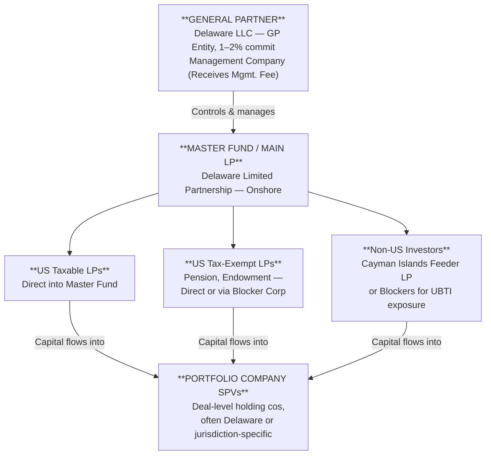

# Lesson 1: Fund Structures, LP-GP Dynamics, Capital Call Mechanisms

## 1. First-Principles Intuition & Invariants

Private equity, at its structural core, is a solution to a principal-agent problem that conventional public markets never fully resolved. When a pension fund allocates capital to publicly traded equities, it buys a fractional claim on an enterprise managed by executives whose incentives — quarterly earnings, stock option vesting schedules, analyst coverage — are misaligned with the pension's thirty-year liability horizon. The limited partnership structure that defines private equity was engineered, over decades of legal and financial iteration, specifically to collapse that misalignment. It does so by concentrating decision authority in the hands of a small team of investment professionals, locking capital away from premature redemption, and paying those professionals almost nothing unless they generate returns that clear a contractually defined performance threshold. Every mechanical detail of fund structure — the capital call schedule, the waterfall, the hurdle rate, the carried interest clawback — flows from this founding logic.

The Delaware Limited Partnership, the dominant legal vehicle for US-domiciled PE funds, divides participants into two economically and legally distinct classes. Limited Partners are the capital providers: endowments, sovereign wealth funds, public pension systems, insurance companies, family offices, and a small number of high-net-worth individuals who meet the qualified purchaser standard. They receive liability protection strictly bounded by their committed capital. If the fund fails catastrophically, an LP can lose every dollar it invested but cannot be pursued for the fund's debts beyond that amount. This is not a trivial protection. Before limited partnership law matured in the 1970s and 1980s, institutional investors faced genuine structural barriers to investing in illiquid pools, because active participation in management could expose them to unlimited liability under partnership law. The legal architecture of the LP structure, formalized through statutes like the Delaware Revised Uniform Limited Partnership Act, resolved this by granting passive status — and its associated liability shield — to investors who do not participate in day-to-day management.

The General Partner sits on the other side of this arrangement. The GP is typically a management company entity, often a Delaware LLC wholly owned by the fund's senior partners, and it holds unlimited personal liability for the partnership's obligations. In practice, that theoretical exposure is managed through indemnification provisions in the Limited Partnership Agreement and through the GP entity's own legal structure, but the asymmetry is not merely symbolic. It concentrates legal and fiduciary accountability in the hands of the people making investment decisions. The GP commits a nominal slice of fund capital — industry convention runs between one and three percent of total fund size — to ensure skin-in-the-game alongside LPs, though the real incentive mechanism is carried interest rather than co-investment returns.

The Limited Partnership Agreement, commonly called the LPA, is the constitutional document of the fund. It is a contract that runs between fifty and several hundred pages in complex vintage-year funds, and it governs every dimension of the relationship: the investment period (typically four to five years from first close, during which the GP may call capital and deploy it into new platform investments), the fund term (usually ten years with two optional one-year extensions), the management fee basis and step-down schedule, the preferred return hurdle, the carried interest percentage, the distribution waterfall mechanics, excuse and exclusion rights for specific investments, key-man provisions, LP advisory committee rights, and the conditions under which LPs can remove the GP for cause. Negotiating the LPA is itself a significant commercial exercise, and institutional LPs with sufficient commitment size — a sovereign wealth fund writing a $500 million ticket, for example — will extract meaningful concessions on economics, co-investment rights, and governance that smaller LPs never see.

Understanding fund lifecycle requires understanding the distinction between committed capital and contributed capital. When an LP signs the subscription agreement, it commits a specific dollar amount — say, $100 million — to the fund. It does not wire $100 million on day one. Instead, it retains that capital in its own investment portfolio, earning returns, until the GP issues a capital call notice specifying an exact amount and a funding deadline, typically ten business days. The LP's unfunded commitment is the difference between the total commitment and the sum of all contributions to date. This architecture matters because the LP's actual cash deployment is lumpy, unpredictable, and spread across the investment period. Institutional LPs model their expected capital call schedules — drawing on historical pacing data from the GP's prior funds and comparable vintage year benchmarks from databases like Burgiss, PitchBook, or Cambridge Associates — to avoid a liquidity crisis in which call notices arrive simultaneously with redemption requests from other parts of the portfolio.

The practical implication for the LP's internal operations is a commitment pacing model, which estimates the schedule of outflows against anticipated distributions from maturing funds in the portfolio. A sophisticated endowment running a 25% private equity target allocation typically operates a rolling five-year pacing model that projects, by quarter, the net cash flows from every fund in the portfolio. The model uses an S-curve deployment assumption — slow in year one as deals are sourced, accelerating through years two and three, then tapering in years four and five — and a J-curve return assumption, whereby the fund generates negative returns net of fees in early years before realizations recover the invested base and produce gains. Getting the pacing model wrong in either direction is costly: over-commitment relative to liquidity results in forced secondary market sales at a discount; under-commitment leaves the allocation chronically underweight, diluting portfolio returns.

---

## 2. Core Architecture & Mechanics

### The Fund Legal Entity Stack

A production-grade private equity fund is not a single entity. It is a carefully constructed stack of legal vehicles designed to accommodate the tax, regulatory, and domicile requirements of a heterogeneous LP base. The core structure typically consists of a master fund or parallel fund set, with onshore and offshore feeders that allow US tax-exempt investors, US taxable investors, and non-US investors to participate through the most efficient structure for their circumstances.



The Cayman Islands feeder exists primarily to shield non-US investors and US tax-exempt investors from Unrelated Business Taxable Income (UBTI), which arises when a partnership uses debt financing — as LBO transactions always do — to generate returns. The income flowing through a leveraged buyout is effectively debt-financed income, which triggers UBTI rules for US tax-exempts investing directly in a partnership. Routing those LPs through a Cayman blocker corporation converts partnership income into corporate dividends, eliminating the UBTI taint.

### Management Fee Mechanics

The management fee is the GP's operating revenue, funding salaries, infrastructure, deal sourcing, and due diligence costs. The standard structure charges 2% of committed capital annually during the investment period, then steps down to 2% of invested capital (deployed cost basis) for the remainder of the fund term. The step-down matters enormously in later fund years because it shrinks the fee base as the GP harvests investments and distributes proceeds. At a $1 billion fund, 2% of commitments generates $20 million per year in years one through five. If by year seven the fund has realized 60% of its investments and the remaining portfolio has a cost basis of $280 million, the management fee base drops to $5.6 million annually — a reflection of the fact that the GP's active management workload has declined as the portfolio matures.

The formula for annual management fee is:

**During Investment Period:**

$$\text{Management Fee}_t = \text{Committed Capital} \times \text{Fee Rate}$$

**Post-Investment Period:**

$$\text{Management Fee}_t = \text{Remaining Cost Basis}_t \times \text{Fee Rate}$$

Where remaining cost basis equals total contributions to portfolio companies minus the cost basis of fully realized investments. Some LPAs reduce the fee rate itself post-investment period — to 1.5% or 1.75% — rather than merely changing the basis. The economic difference is significant at scale, and LP negotiating leverage in a large fund determines which structure prevails.

Management fees are typically offset against carried interest in a mechanism called the management fee offset. The LPA specifies an offset percentage — often 80% to 100% of transaction, monitoring, and board fees collected from portfolio companies — that reduces the management fee otherwise owed. A GP charging 2% on a $2 billion fund collects $40 million annually in fees. If portfolio company monitoring fees and transaction fees total $15 million in a given year, and the offset is 100%, the net management fee billed to the fund is $25 million. This protects LPs from double-dipping on economics that the GP generates from the portfolio companies they manage on the fund's behalf.

### Distribution Waterfall Architecture

The distribution waterfall defines the sequencing rules by which cash proceeds from realized investments are allocated between LPs and the GP. The two dominant structures in market practice are the American waterfall (also called deal-by-deal) and the European waterfall (whole-fund). Understanding their mechanical difference is critical because they produce radically different GP cash flow timing and risk profiles, and sophisticated LPs negotiate hard to push US mid-market funds toward European waterfall terms.

Under the **European (whole-fund) waterfall**, the GP cannot receive any carried interest until LPs have been returned 100% of their contributed capital across the entire fund, plus the preferred return on that capital. The distribution sequence is as follows:

**Tier 1 — Return of Capital:** All distributions first return LP contributed capital in full. If the fund has called $800 million across all investments and $400 million has been distributed so far, the first $400 million of additional proceeds in this tier repay the remaining contributed capital.

**Tier 2 — Preferred Return (Hurdle Rate):** Once capital is returned, the next distributions fund an 8% compounded annual preferred return on each dollar of LP capital from the date it was called to the date it was returned. This is the hurdle rate, and it is calculated on a deal-by-deal date-weighted basis within the whole-fund structure. The 8% figure is the market convention inherited from leveraged buyout fund practice in the 1980s, calibrated to roughly the long-run real return on public equity plus a liquidity premium.

**Tier 3 — GP Catch-Up:** After the LPs have received their capital plus preferred return, the GP receives 100% of subsequent distributions until it has received an amount equal to 20% of the total profits distributed to that point (i.e., the preferred return plus the catch-up combined equal the GP's intended carried interest share). Some LPAs structure a 50/50 catch-up rather than 100%, meaning the GP catches up at half the rate, which extends the time before the full 20% carry ratio is achieved.

**Tier 4 — Carried Interest Split:** Once the catch-up is complete, all remaining distributions are split 80% to LPs and 20% to the GP as carried interest.

The formula for the preferred return at the end of the fund, assuming annual compounding, for a single capital contribution made at time $t_0$ and returned at time $t_n$:

$$\text{Preferred Return} = \text{Contributed Capital} \times \left[(1 + h)^{(t_n - t_0)} - 1\right]$$

Where $h$ is the hurdle rate (0.08 for an 8% preferred return) and $(t_n - t_0)$ is expressed in years. In practice, because capital calls happen at irregular intervals, each tranche of contributed capital carries its own preferred return accrual, and the aggregate preferred return is the sum across all tranches:

$$\text{Total Preferred Return} = \sum_{i=1}^{n} C_i \times \left[(1 + h)^{(T - t_i)} - 1\right]$$

Where $C_i$ is the capital called in tranche $i$, $t_i$ is the date of that call, and $T$ is the distribution date.

The **American (deal-by-deal) waterfall** allows the GP to receive carried interest from profitable exits before the entire fund has been returned. The GP earns carry on each deal independently, provided that deal has returned its contributed capital plus the preferred return. This structure accelerates GP cash flows dramatically — a GP running an American waterfall can receive carry from a successful early exit in year three even if other portfolio companies are underwater. The resulting asymmetry creates a risk of overpayment: if early winners are followed by later losses, the GP has been paid carry it did not ultimately earn on a whole-fund basis. This is why American waterfall funds include a **clawback provision**, which obligates the GP to return excess carried interest at the end of the fund term.

### Carried Interest Calculation and Clawback Mechanics

The clawback obligation is calculated at fund termination. The formula compares the total carry actually distributed to the GP against the carry the GP would have received under a hypothetical whole-fund waterfall calculation using actual realized outcomes:

$$\text{Clawback} = \max\left(0,\ \text{Carry Distributed} - \text{Carry Earned}_{whole\text{-}fund}\right)$$

Enforcing this obligation in practice is complicated by the fact that individual partners who received carry distributions may have spent or reinvested those funds over a ten-year period, and their tax liability on received carry means the gross clawback obligation exceeds the after-tax economic value they retain. Well-negotiated LPAs address this through escrow provisions that hold a portion — typically 25% to 30% — of each carry distribution in a segregated account for the life of the fund. The escrowed amount is released to the GP only at fund termination, once the clawback calculation confirms no repayment is owed.

The full waterfall model for a $1 billion committed fund with an 8% preferred return, 20% carried interest, and European distribution structure is illustrated in the table below. Assume total capital called of $850 million, total gross proceeds from exits of $1.7 billion, and that all capital was called uniformly over a four-year investment period for simplicity.

| Waterfall Tier | Amount Distributed | Running Total to LP | Running Total to GP |
|---|---|---|---|
| **Return of Capital (LP)** | $850M | $850M | $0 |
| **Preferred Return @ 8% (LP)** | ~$306M | $1,156M | $0 |
| **GP Catch-Up (20% of $1,156M total to LP)** | ~$289M | $1,156M | $289M |
| **Residual 80/20 Split** | Remaining ~$255M total | +$204M | +$51M |
| **Final Totals** | $1,700M | $1,360M (80%) | $340M (20%) |

The catch-up calculation warrants careful attention. The GP's target is to receive 20% of total profits, where total profits equal total distributions less return of capital. Total profits here are $1,700M − $850M = $850M. The GP's target carry is $850M × 20% = $170M. Because the preferred return of $306M was paid entirely to the LP, and the GP receives 20% of total profits rather than 20% of residual profits after the hurdle, the catch-up tier must compensate. The GP catches up to 20% of cumulative distributions (LP capital + preferred return), which is $1,156M × 20% / 80% = $289M paid to GP, at which point the split ratio holds. The residual $255M is then split $204M to LP and $51M to GP. Total GP carry = $289M + $51M = $340M, which is exactly 20% of $1,700M total distributions less return of capital ($850M), confirming $340M / $1,700M = 20%.

### Capital Call Mechanics

The capital call process is a formal, time-sensitive operational workflow with legal and financial consequences for failure. When the GP identifies a deal that has passed investment committee approval, it calculates the equity check required, accounts for any existing fund-level credit facilities (subscription lines), and issues a capital call notice to each LP based on its pro-rata share of unfunded commitments.

```text
┌─────────────────────────────────────────────────────────────────┐
│                   CAPITAL CALL SEQUENCE                         │
├─────────────────────────────────────────────────────────────────┤
│                                                                 │
│  1. IC Approval → Determine equity check size                   │
│         ↓                                                       │
│  2. Check subscription line availability                        │
│     (Bridge drawn? Repay from call or deploy directly?)         │
│         ↓                                                       │
│  3. Calculate each LP's pro-rata call amount                    │
│     Pro-rata share = LP Commitment / Total Fund Commitments     │
│     Call Amount_LP = Pro-rata share × Total call amount         │
│         ↓                                                       │
│  4. Issue Notice (10 business day minimum funding deadline)     │
│     Notice contains: amount, wire instructions, purpose,        │
│     funding deadline, investment description                    │
│         ↓                                                       │
│  5. LP internal approval & treasury execution                   │
│     Pension/Endowment: wire from liquidity reserve or           │
│     liquidate near-term assets                                  │
│         ↓                                                       │
│  6. Funds received → GP records contribution to capital         │
│     account; LP's funded commitment increases                   │
│         ↓                                                       │
│  7. Transaction close: equity wired to acquisition entity       │
│                                                                 │
└─────────────────────────────────────────────────────────────────┘
```

A critical operational instrument bridging capital calls and deal timing is the **subscription line of credit**, also called a capital call facility or fund-level revolver. Banks extend these credit facilities against the unfunded commitments of the LP base, treating LP commitments as the collateral. A subscription line allows the GP to close a transaction immediately using bank debt, then issue a capital call to repay the facility within 90 to 180 days. This timing advantage can be decisive in competitive auction processes where the ability to close without a funding condition is a differentiator.

Subscription lines also have an important and often underappreciated effect on fund IRR. Because capital sits in the LP's own portfolio for an extra ninety to one hundred eighty days before being called, the effective deployment period shortens, and returns that are measured from the date capital is contributed rather than the date the investment is made benefit from a later time-zero. A fund deploying $1 billion across a four-year period with consistent subscription line usage might report an IRR 100 to 200 basis points higher than the same fund measured on a gross economic basis, solely due to the timing effect. This dynamic has drawn increasing scrutiny from LP advisory committees and institutional investors, who now frequently request both time-zero-of-call and time-zero-of-investment IRR calculations in performance reporting, alongside the Total Value to Paid-In (TVPI) and Distributions to Paid-In (DPI) multiples that are unaffected by the subscription line timing phenomenon.

The LP's capital account tracks the economic record of its participation in the fund. It opens at zero, increases by each contribution, decreases by each distribution, and is adjusted for the LP's pro-rata share of fund-level income, losses, and expenses as allocated by the LPA. At any point in the fund's life, the net asset value attributable to an LP equals the fair value of its capital account, which the GP calculates quarterly using mark-to-market valuations of portfolio companies under ASC 820 fair value accounting standards. These quarterly NAV marks flow into the LP's financial statements, affecting the carrying value of the private equity line in a pension fund's investment portfolio and creating the unrealized gain-and-loss volatility that institutional LPs model when assessing private equity's impact on their total portfolio risk budget.

---

## 3. High-Performance Optimization & Failure Modes

### Optimizing Capital Deployment Sequencing

The GP's capital deployment sequence is not simply a function of when attractive investment opportunities arise. It is a strategic variable that interacts with the management fee basis, the preferred return accrual, and the fund's internal rate of return. Deploying capital slowly in the early years of the investment period extends the management fee basis on committed capital but reduces the IRR impact of the preferred return accrual, since fewer dollars have accrued interest over fewer years. Deploying quickly harvests management fee income at the committed capital rate before the step-down, and may also allow the GP to establish early marks on portfolio companies that will generate strong carry calculations later — but it also concentrates vintage-year risk in a narrow market window.

Sophisticated GPs model the deployment pacing as a constrained optimization against three competing objectives: maintaining dry powder for follow-on investments in existing portfolio companies (defensive reserves), maximizing fee-generating deployment, and avoiding adverse vintage-year concentration. The industry norm of deploying 20-25% of fund capital per year reflects this balance, though technology and buyout funds in compressed auction markets often deploy more aggressively.

The deployment sequence also interacts with the preferred return in a way that creates a genuine incentive for GPs to call capital only when immediately needed rather than staging large calls speculatively. Every dollar called but not yet deployed into a portfolio company begins accruing the 8% preferred return clock without yet generating any investment return. If a GP calls $100 million in January to fund a deal that closes in July, the preferred return accrues for six months on capital that generated no return, deepening the J-curve and increasing the hurdle the GP must clear before receiving carry. Many GPs use the subscription credit line to avoid precisely this scenario, drawing the facility at deal close and calling LP capital only once a deal is fully operational.

### Key-Man, Removal, and LP Advisory Committee Governance

The LPA's governance provisions are not boilerplate — they are operational risk management instruments. The key-man clause specifies that if one or more named senior investment professionals (typically two to four partners whose combined presence defines the fund's investment thesis) leave the fund, are incapacitated, or devote less than a specified percentage of their professional time to the fund, the investment period automatically suspends. During the suspension, the GP cannot make new platform investments (follow-on investments in existing portfolio companies may be permitted at LP advisory committee discretion) and must typically obtain LP consent to lift the suspension or agree to wind down.

Key-man clauses have teeth. When a founder departure triggered the key-man provision at a mid-market buyout fund in a well-known historical instance, the resulting LP pressure forced the GP to negotiate a modified team structure before resuming the investment period — a process that took five months and effectively froze the fund's ability to pursue live deal opportunities in a favorable credit environment. The economic cost of that delay was not theoretical; it was measured in missed transactions.

The LP Advisory Committee (LPAC) is typically composed of representatives from the five to ten largest LP commitments, often with rotating membership for smaller LPs. Its formal authorities under the LPA include approving conflict-of-interest transactions (such as a GP selling a portfolio company to another fund it manages), granting extensions to the investment period or fund term, approving valuations in cases where GP mark-to-market judgment is questioned, and reviewing related-party expense allocations. The LPAC does not make investment decisions — doing so would strip LPs of their limited liability protection — but its approval rights over conflicts and extensions give it meaningful influence over GP behavior in edge cases.

### Failure Modes and Their Structural Causes

The most consequential failure mode in fund structure is the **carry overpayment under an American waterfall without adequate escrow**. If a fund's early exits produce strong returns that generate $50 million in carried interest distributions to the GP, and subsequent investments lose $200 million, the whole-fund carry calculation may show that the GP earned zero carry. The clawback provision requires the GP to return $50 million, but if that capital has been distributed to individual partners who have paid taxes on it and reinvested the net proceeds, the actual recovery can take years of litigation. The practical mitigation is a well-drafted escrow mechanism holding 25-30% of gross carry in a separate account, controlled by a third-party escrow agent, with a net-of-tax floor that acknowledges partners cannot return more than their after-tax receipts without penalty.

The **subscription line misuse** failure mode is subtler but increasingly problematic at scale. When GPs extend subscription line drawdowns beyond ninety days consistently — using the facility not as a bridge but as a quasi-permanent lever — they create a systematic IRR inflation that misrepresents fund performance to LPs. The mitigation deployed by institutional LPs is dual-reporting: requiring the GP to report IRR on both a funded (traditional) basis and an unfunded (from date of investment) basis, with the spread between the two serving as a direct measure of subscription line impact. Any spread above 150 basis points warrants detailed review of facility utilization patterns.

**Vintage-year concentration risk** manifests when a fund deploys the majority of its capital in a narrow window that coincides with peak credit market conditions. Funds raised between 2005 and 2007, deploying heavily into leveraged buyouts at twelve to fourteen times EBITDA multiples with six to seven times leverage, faced catastrophic write-downs when credit markets seized in 2008-2009 and enterprise values corrected sharply. The structural mitigation is the investment period architecture itself — spreading deployment over four to five years — but GPs facing competitive pressure to deploy in hot markets often bend toward front-loading. LPs with LPAC seats can pressure GPs through informal channels to maintain deployment discipline, and some sophisticated investors negotiate hard caps on maximum capital deployment per year (typically 30-35% of fund size) directly into the LPA.

**LP default on a capital call** is rare but structurally significant. The LPA defines the remedies available to the GP when an LP fails to fund a capital call by the deadline, which typically include charging penalty interest (8-12% per annum on the unfunded amount), diluting the defaulting LP's capital account by transferring a portion of its interest to the non-defaulting LPs, forcing a sale of the defaulting LP's interest at a discount (often to an approved secondary market buyer), and in extreme cases, forfeiting the defaulting LP's unfunded commitment entirely. The practical severity of enforcement depends on the GP's relationship with the LP and the size of the commitment. A large sovereign wealth fund experiencing a temporary liquidity constraint is treated differently than a small family office in financial distress, but the LPA's written remedies give the GP contractual leverage to protect the fund's ability to close committed transactions.

**GP clawback insolvency** arises at the other end of the structure. If the management company entity that serves as GP becomes insolvent — through operational losses, litigation, or other business failure — before the fund has completed its clawback calculation, LPs may have no practical recourse to recover overpaid carry even if the obligation exists on paper. The mitigation, increasingly demanded by institutional LPs since the 2009-2012 period when several fund managers encountered financial stress, is a **GP clawback guarantee** executed by the individual senior partners personally, backstopped by the escrow account. This creates a personal liability on named individuals that survives the management company's failure, though it too is limited by the partners' individual net worth.

The fund structure invariants that survive all of these edge cases can be summarized in a single operating principle: every mechanical design choice in the LPA — the waterfall sequence, the escrow percentage, the key-man triggers, the LPAC approval rights — exists to hold the GP accountable to the economic agreement it made with LPs at the time of fundraising. Practitioners who understand these mechanics not as legal boilerplate but as economic control systems are equipped to negotiate, model, and manage private equity capital structures rather than merely participate in them.
