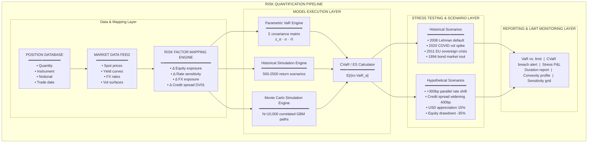

# Lesson 2: Risk Measurement & Quantification Frameworks

## 1. First-Principles Intuition & Invariants

Risk, in its most precise financial formulation, is not uncertainty in the colloquial sense of "things might go wrong." It is the measurable dispersion of outcomes around an expected value, and the science of quantifying it is what separates a disciplined capital allocator from a speculator with good instincts. Every framework in this lesson traces back to a single epistemological commitment: that future outcomes, while unknowable, are not equally probable, and that the shape of their probability distribution tells you something actionable about how to price, hedge, and size exposures.

The intellectual lineage of modern risk measurement runs from Markowitz's 1952 portfolio selection theory through the Black-Scholes-Merton option pricing framework and into the Value at Risk methodologies popularized by J.P. Morgan's RiskMetrics in the 1990s. What unites these contributions is a willingness to treat financial returns as random variables subject to statistical characterization. That treatment is not without its critics — Nassim Taleb's work on fat tails and Mandelbrot's fractal geometry of markets both challenge the normality assumption embedded in classical variance-based measures — but understanding those critiques requires first mastering what they critique.

**Variance and Standard Deviation** are the foundational building blocks. For a discrete set of historical returns $r_1, r_2, \ldots, r_n$ with mean $\bar{r}$, variance is defined as:

$$\sigma^2 = \frac{1}{n-1} \sum_{i=1}^{n} (r_i - \bar{r})^2$$

The $n-1$ denominator applies Bessel's correction to produce an unbiased estimate from a sample rather than the full population. Standard deviation $\sigma$ is simply $\sqrt{\sigma^2}$, returning the dispersion to the same unit as the returns themselves — a critical practical advantage. When an analyst says a stock has annualized volatility of 28%, they are reporting $\sigma$ scaled to a one-year horizon using the square-root-of-time rule: $\sigma_{annual} = \sigma_{daily} \times \sqrt{252}$, where 252 is the convention for US trading days. This scaling assumes returns are independently and identically distributed across periods, an assumption that becomes fragile during market stress when serial correlation in volatility spikes.

The practitioner's instinct should immediately question what standard deviation cannot tell you. It treats upside dispersion identically to downside dispersion, which misrepresents the asymmetric preferences of most investors. A bond portfolio generating occasional high coupon reinvestment windfalls alongside rare catastrophic credit events has the same $\sigma$ as a symmetric equity portfolio with identical dispersion, yet their risk profiles are fundamentally different. This is why standard deviation is a necessary but insufficient tool, and why the frameworks that follow exist.

**Beta** extends variance analysis into the realm of systematic risk — the component of an asset's return volatility that co-moves with the broader market and therefore cannot be diversified away in a portfolio context. Beta is defined as the ratio of the covariance of asset returns with market returns to the variance of market returns:

$$\beta_i = \frac{\text{Cov}(r_i, r_m)}{\sigma_m^2} = \frac{\rho_{i,m} \cdot \sigma_i \cdot \sigma_m}{\sigma_m^2} = \rho_{i,m} \cdot \frac{\sigma_i}{\sigma_m}$$

A beta of 1.4 on a leveraged buyout target's peer set, for instance, tells the LBO analyst that for every 10% move in the market index, the comparable company's equity historically moves 14% in the same direction. In practice, beta estimation is sensitive to the choice of look-back window (commonly 2–5 years of monthly data), the benchmark index selected, and whether the analyst applies Blume's adjustment — which shrinks raw betas toward 1.0 on the premise that extreme betas mean-revert — by computing adjusted beta as $\beta_{adjusted} = 0.67 \times \beta_{raw} + 0.33 \times 1.0$.

For corporate finance applications, particularly in WACC estimation, analysts unlever and relever beta to strip out capital structure effects when constructing a pure-play comparable. The Hamada equation governs this transformation:

$$\beta_L = \beta_U \times \left[1 + (1 - t) \times \frac{D}{E}\right]$$

where $\beta_L$ is levered beta, $\beta_U$ is unlevered (asset) beta, $t$ is the marginal corporate tax rate, and $D/E$ is the debt-to-equity ratio at market values. An analyst building a DCF for a private manufacturing company strips the leverage from each public comparable to get $\beta_U$, averages those values to remove idiosyncratic capital structure noise, then relevered the mean using the target's own projected $D/E$ ratio to arrive at an equity beta that feeds the CAPM cost of equity calculation. The mechanical discipline of doing this correctly — especially when comparables span different leverage profiles — is where most DCF errors accumulate.

**Value at Risk (VaR)** represents the first attempt to compress a full return distribution into a single, decision-relevant number: the maximum loss expected over a given holding period at a specified confidence level. At the 95% confidence level over a one-day horizon, a VaR of $2.3M means that on 95 out of 100 trading days, losses should not exceed $2.3M. Equivalently, the portfolio is expected to lose more than $2.3M on approximately 5% of trading days — roughly 12–13 days per year.

Three computational approaches to VaR each embody different assumptions about the return distribution. The **parametric (variance-covariance) method** assumes multivariate normality and computes VaR analytically:

$$\text{VaR}_\alpha = \mu \cdot \Delta t - z_\alpha \cdot \sigma \cdot \sqrt{\Delta t}$$

where $z_\alpha$ is the standard normal quantile corresponding to confidence level $\alpha$ (1.645 for 95%, 2.326 for 99%), $\mu$ is the expected return over the period, and $\sigma$ is the portfolio's standard deviation. For a one-day horizon, $\mu \cdot \Delta t$ is small enough to drop in practice, leaving VaR $\approx z_\alpha \cdot \sigma$. The analytical elegance comes at a cost: normality assumption means the method systematically underestimates tail losses in portfolios with skew and excess kurtosis.

The **historical simulation method** avoids the normality assumption by applying actual observed returns to the current portfolio. The analyst collects 500 days of daily P&L scenarios from actual market moves, reprices the current portfolio under each scenario, sorts the 500 P&L observations from worst to best, and reads off the 5th percentile outcome as the 95% one-day VaR. This approach captures fat tails and skew as they actually appeared in the historical data, but it anchors entirely to the past, making it blind to regime changes or events with no historical precedent.

**Monte Carlo simulation** sits between these extremes. The analyst specifies a return model — often geometric Brownian motion with estimated $\mu$ and $\sigma$, potentially enriched with jump-diffusion parameters or stochastic volatility — and simulates thousands of return paths. VaR is then read from the simulated distribution's quantile. For a corporate treasury team managing a multicurrency receivables book, Monte Carlo allows explicit modeling of correlation structures between currency pairs, something the parametric method handles only through a covariance matrix that may itself be unstable.

**Conditional Value at Risk (CVaR)**, also called Expected Shortfall (ES), addresses VaR's most significant structural deficiency. VaR tells you nothing about the severity of losses beyond its threshold — a 95% VaR of $2.3M is consistent with a worst-case loss of $2.4M or $240M. CVaR reports the expected loss conditional on being in the tail:

$$\text{CVaR}_\alpha = -\frac{1}{1 - \alpha} \int_\alpha^1 \text{VaR}_u \, du = E[r \mid r \leq -\text{VaR}_\alpha]$$

For a discrete historical simulation, CVaR at 95% is simply the arithmetic mean of all losses worse than the VaR threshold — the average of the worst 5% of outcomes. The Basel III regulatory framework migrated from VaR to Expected Shortfall precisely because CVaR satisfies the mathematical property of sub-additivity, meaning the CVaR of a combined portfolio can never exceed the sum of individual CVaRs, which VaR can violate in portfolios with non-linear instruments.

**Stress testing and scenario analysis** shift the analytical frame from statistical frequency to narrative plausibility. Where VaR asks "what loss is consistent with the bottom 5% of historical experience?", a stress test asks "what would happen to this portfolio if the 2008 Lehman bankruptcy, the 2020 COVID liquidity shock, or a 300-basis-point parallel shift in the yield curve were to occur tomorrow?" The two methodologies are complementary rather than competitive. Historical VaR, by construction, can only sample from regimes already lived through. Stress testing expands the scenario space into tail events that may not appear in the look-back window.

A proper stress test for a corporate bond portfolio operates through four sequential mechanics: define the shock vector (e.g., credit spreads widen 250 bps across all investment-grade names, high-yield spreads widen 600 bps, and 10-year Treasury yields fall 75 bps as a flight-to-quality offset), reprice each position using full valuation models rather than linear approximations, aggregate P&L across positions accounting for cross-asset correlations under stress, and report the net portfolio impact as both an absolute dollar figure and a percentage of Tier 1 capital or equity. The discipline of full repricing rather than delta approximation matters most for positions with embedded optionality — callable bonds, convertibles, credit default swaps — where convexity causes linear approximations to fail badly under large shocks.

**Sensitivity analysis** operates at a more granular level, measuring how a single output variable responds to controlled changes in a single input while holding all others constant. In a leveraged buyout model, the analyst builds a sensitivity table sweeping entry EBITDA multiple across the rows (7.0x to 11.0x in 0.5x increments) and exit multiple across the columns (6.0x to 10.0x in 0.5x increments), reporting the sponsor's IRR in each cell. A secondary sensitivity table might hold entry multiple fixed and vary revenue CAGR and EBITDA margin expansion assumptions instead, isolating the operational value creation thesis from the financial engineering component.

**Duration and convexity** translate all of these statistical frameworks into the specific mechanics of fixed-income risk. Duration measures the first-order price sensitivity of a bond or portfolio to changes in interest rates. Modified duration is defined as:

$$D_{mod} = \frac{D_{mac}}{1 + y/m}$$

where $D_{mac}$ is Macaulay duration (the present-value-weighted average time to cash flows), $y$ is the yield to maturity, and $m$ is the compounding frequency per year. The price change approximation using modified duration is:

$$\frac{\Delta P}{P} \approx -D_{mod} \times \Delta y$$

A portfolio with modified duration of 6.2 will lose approximately 6.2% in market value for each 100-basis-point parallel rise in rates. Duration, however, is a linear approximation, and bond price-yield relationships are convex — meaning the actual price decline from a rate rise is less than the duration approximation predicts, while the actual price gain from a rate decline exceeds it. Convexity captures this second-order curvature:

$$\frac{\Delta P}{P} \approx -D_{mod} \times \Delta y + \frac{1}{2} \times C \times (\Delta y)^2$$

where $C$ is the convexity of the instrument. For option-free bonds, convexity is always positive, meaning the asymmetry works in the holder's favor. Mortgage-backed securities and callable bonds exhibit negative effective convexity in certain rate environments because the embedded prepayment or call option truncates the upside price appreciation when rates fall, creating a one-sided exposure profile that duration alone completely mischaracterizes.

---

## 2. Core Architecture & Mechanics

The computational architecture of an institutional risk measurement system is best understood as a data pipeline with distinct transformation stages: position ingestion, return generation, risk factor mapping, model execution, and reporting aggregation. Understanding where each measure lives in this pipeline — and what it consumes — clarifies why different frameworks answer different questions and why no single metric suffices.

**Building the Variance-Covariance Matrix in Practice**

The covariance matrix is the mathematical substrate of parametric VaR and portfolio risk decomposition. For a portfolio of $n$ assets, the matrix $\Sigma$ is $n \times n$, where each diagonal element $\sigma_{ii}$ is the variance of asset $i$'s returns, and each off-diagonal element $\sigma_{ij}$ is the covariance of assets $i$ and $j$. Portfolio variance is then $\sigma_p^2 = \mathbf{w}^T \Sigma \mathbf{w}$, where $\mathbf{w}$ is the vector of portfolio weights.

In Excel or Python, an analyst builds this matrix from a time series of daily returns. In Excel, `=COVARIANCE.S(array1, array2)` computes sample covariance between two return series, and constructing the full matrix means populating a grid where each cell calls this function on the appropriate pair of return columns. The standard sample covariance estimator weights all historical observations equally regardless of age, which means a market dislocation from 18 months ago contributes identically to today's risk estimate. Practitioners frequently apply exponential weighting — the RiskMetrics EWMA approach uses a decay factor $\lambda = 0.94$ for daily data, assigning recent observations more weight:

$$\sigma_t^2 = \lambda \sigma_{t-1}^2 + (1 - \lambda) r_{t-1}^2$$

$$\sigma_{ij,t} = \lambda \sigma_{ij,t-1} + (1-\lambda) r_{i,t-1} r_{j,t-1}$$

This produces a matrix that adapts to current market regimes faster than equally weighted estimation, at the cost of placing less structural weight on tail events that occurred outside the recent memory window.

A well-constructed covariance matrix must be **positive semi-definite** — mathematically, $\mathbf{w}^T \Sigma \mathbf{w} \geq 0$ for all weight vectors $\mathbf{w}$. This property ensures that no combination of assets can produce negative portfolio variance, which would be economically absurd. The condition can fail in practice when the number of assets $n$ exceeds the number of return observations $T$, because the sample covariance matrix becomes rank-deficient. The fix is either to increase $T$, reduce the number of assets through factor aggregation, or apply a regularization technique such as Ledoit-Wolf shrinkage, which blends the sample covariance matrix with a structured target (commonly the identity matrix scaled by average variance) to produce an invertible, well-conditioned estimate.

**Computing Historical Simulation VaR Step by Step**

The workflow for historical simulation VaR follows a disciplined sequence. First, collect a clean daily return matrix for all instruments in the portfolio covering at least 500 trading days (approximately two calendar years), sourced from Bloomberg, Refinitiv, or a validated internal data warehouse. Second, for each of the $T$ historical days, compute the hypothetical P&L of the *current* portfolio if those historical returns had occurred today:

$$P\&L_t = \sum_{i=1}^{n} w_i \cdot V \cdot r_{i,t}$$

where $V$ is the total portfolio value, $w_i$ is the current weight in asset $i$, and $r_{i,t}$ is the historical return of asset $i$ on day $t$. Third, sort all $T$ hypothetical P&L values in ascending order. For a 500-day lookback and 95% confidence VaR, the VaR is the 25th worst observation (the 5th percentile of 500 observations). CVaR is the arithmetic mean of the 25 worst observations. This simulation is entirely contained within a spreadsheet for small portfolios: the return matrix occupies columns A through N, the P&L formula populates column O, and `=PERCENTILE(O:O, 0.05)` delivers the 95% VaR directly.

**Duration, DV01, and Key Rate Duration in Fixed Income**

Dollar Value of a Basis Point (DV01) translates duration into a directly interpretable dollar sensitivity:

$$\text{DV01} = -\frac{\partial P}{\partial y} \times 0.0001 = D_{mod} \times P \times 0.0001$$

A bond portfolio with $P = \$50M$ and $D_{mod} = 7.3$ has DV01 $= 7.3 \times \$50M \times 0.0001 = \$36,500$. For every basis point rates rise, the portfolio loses $36,500. This is the primary hedge sizing metric: if a Treasury futures contract has DV01 of $85 per contract, the analyst needs $\lfloor 36,500 / 85 \rfloor = 429$ contracts short to immunize the rate exposure.

Key rate duration (KRD) distributes this aggregate sensitivity across specific maturity buckets on the yield curve — typically the 2Y, 5Y, 10Y, 20Y, and 30Y key rates. The sum of all key rate durations equals the modified duration of the portfolio, but the distribution across buckets reveals whether the exposure is concentrated in short-end repricing risk or long-end duration risk, which parallel-shift duration completely obscures. A barbell portfolio holding short-dated and long-dated bonds may have the same modified duration as a bullet portfolio concentrated at the 10Y point, but their KRD profiles will differ dramatically, and so will their P&L under a yield curve twist or flattening scenario.

Convexity calculation for a plain-vanilla bond follows from the second derivative of the price-yield function. For a bond with $n$ coupon periods, coupon $C$, face value $F$, yield $y$, and price $P$:

$$C_{convexity} = \frac{1}{P \cdot (1+y)^2} \sum_{t=1}^{n} \frac{t(t+1) \cdot CF_t}{(1+y)^t}$$

where $CF_t$ is the cash flow at period $t$. In spreadsheet mechanics, this means creating a column of cash flows, a column of periods $t$, computing $t \cdot (t+1) \cdot CF_t / (1+y)^t$ for each row, summing the column, then dividing by $P \cdot (1+y)^2$. The combined price change approximation using both duration and convexity:

$$\Delta P \approx \left(-D_{mod} \times \Delta y + \frac{1}{2} \times C_{convexity} \times (\Delta y)^2\right) \times P$$

For a 100-basis-point shock ($\Delta y = 0.01$) on a bond with $D_{mod} = 7.3$ and convexity $= 68$, the duration-only approximation predicts $-7.3\%$ while the duration-plus-convexity approximation yields $-7.3\% + \frac{1}{2} \times 68 \times (0.01)^2 = -7.3\% + 0.34\% = -6.96\%$, a 34-basis-point correction that matters materially for a $\$50M$ portfolio.

---

## 3. High-Performance Optimization & Failure Modes

The gap between understanding risk measures theoretically and deploying them reliably in a production analytical workflow is where practitioners consistently encounter problems. Each failure mode described below reflects a category of systematic error that propagates through financial decisions in ways that standard model documentation rarely anticipates.

**The Lookback Period Selection Problem**

The single most consequential parameter in any historical simulation or covariance estimation is the lookback window, and there is no mathematically optimal answer — only deliberate trade-offs that must be documented and understood by decision-makers. A 2-year window captures the most current volatility regime with high precision but completely omits events like the 2008 financial crisis unless you are within two years of it. A 10-year window incorporates more tail events but dilutes current regime volatility with stale observations, potentially producing a VaR estimate that is too conservative in calm markets and insufficiently responsive to escalating stress.

The professional resolution is to run multiple lookback windows simultaneously and report the range, flagging when estimates diverge significantly across horizons as a first-order signal that the current market regime is distinct from the recent past. Many institutional risk systems maintain both a 250-day and a 1,000-day historical simulation and use the more conservative of the two for limit monitoring, while reporting both to senior management for transparency. When the 1,000-day VaR exceeds the 250-day VaR, the portfolio carries tail events in its long-run memory that are not reflected in current pricing volatility — a regime warning worth examining through targeted scenario analysis.

**VaR's Structural Failure During Correlation Breakdown**

VaR built from normal market covariance matrices fails precisely when it matters most: during market dislocations, correlations between asset classes that diversify a portfolio under ordinary conditions converge toward 1.0 as investors liquidate everything simultaneously to meet margin calls. A portfolio that showed VaR diversification benefits between, say, high-yield credit and emerging market equity under a standard covariance matrix will find those benefits evaporate in the first three weeks of a risk-off episode. The historical simulation method partially addresses this if the lookback window includes a comparable crisis period, but if the current portfolio composition differs substantially from the historical period — newer instruments, different duration profile, derivatives with nonlinear payoffs — the historical scenarios may not translate cleanly.

The mitigation strategy is to maintain a **correlation stress matrix** as a companion to the standard covariance matrix. This matrix sets all correlations to their observed crisis-period peaks — commonly sourced from 2008, 2011, 2015, or 2020 observations — and reports a stressed VaR alongside the base VaR in every risk report. When stressed VaR is more than twice base VaR, the portfolio has meaningful diversification that depends on correlation assumptions holding, and the analyst should escalate that dependency explicitly to portfolio management.

**The Normality Violation and Tail Risk Underestimation**

Empirical return distributions exhibit excess kurtosis (fat tails) and negative skew for most asset classes. A Student's-t distribution with 4–6 degrees of freedom fits most equity return series substantially better than a normal distribution, particularly in the tails where VaR and CVaR estimates actually live. The practical consequence is that a parametric VaR built on normality at the 99% confidence level systematically underestimates the true loss threshold by a factor of 20–40% in equity portfolios, depending on the asset class and the period sampled.

The practitioner's correction is straightforward to implement. In the parametric VaR formula, substitute the standard normal quantile $z_\alpha$ with the quantile from a Student's-t distribution with the empirically estimated degrees of freedom. For 5 degrees of freedom, $t_{0.99,5} = 3.365$ versus $z_{0.99} = 2.326$ — a 44% wider tail. The degrees of freedom are estimated from the return data using maximum likelihood estimation: in Python's `scipy.stats`, `df, loc, scale = scipy.stats.t.fit(returns)` returns the fitted parameters directly. Alternatively, one can compute the excess kurtosis $\kappa$ of the return sample and back out degrees of freedom as $df = \frac{6}{\kappa - 3} + 4$ for $\kappa > 3$.

**Sensitivity Analysis: Avoiding One-Variable Myopia**

A common failure in sensitivity analysis is treating it as a one-dimensional exercise when the most dangerous risks are multidimensional. An LBO analyst who shows IRR sensitivity to exit multiple while holding revenue growth constant has not addressed the covariance between those inputs: economic downturns that compress exit multiples are the same events that suppress revenue growth and margin. Building a one-way sensitivity table using those two inputs independently produces a falsely reassuring diagonal of "best case entry / best case exit" that overstates the upside and understates the downside by design.

The correct execution is a **correlation-consistent scenario matrix** that maps input combinations to economically coherent states. The analyst defines a recession scenario (revenue CAGR -2%, EBITDA margin contraction 300 bps, exit multiple 6.5x), a base case (revenue CAGR 5%, EBITDA margin flat, exit multiple 8.5x), and an expansion scenario (revenue CAGR 9%, EBITDA margin expansion 150 bps, exit multiple 10.5x). The resulting IRR outputs — say 8.2%, 18.6%, and 31.4% — tell a structurally honest story about return dispersion that a grid of independently varying inputs cannot.

**Duration Drift and Convexity Rebalancing Discipline**

A fixed-income portfolio that is correctly duration-neutral at the start of a quarter will drift away from that target as rates move, bond prices change, and the passage of time shortens maturities. This duration drift is not a failure of the model — it is the natural dynamic of a fixed-income portfolio — but failing to track and rebalance it causes what appears to be a hedged portfolio to accumulate uncompensated rate exposure silently. For leveraged portfolios using futures or interest rate swaps to manage duration, the DV01 of the hedge changes as the hedging instrument's price moves (for futures, the cheapest-to-deliver bond and its conversion factor shift the effective duration of the futures position), requiring regular recalculation of hedge ratios.

The operational discipline is to recompute DV01 and key rate duration daily as a matter of standing process, not quarterly as a periodic review. Rate moves of 15–20 basis points over a week, sustained across the yield curve, can shift the DV01 of a leveraged rate portfolio by several thousand dollars per basis point without any change in position notional, purely through repricing effects on duration. Combining that drift with gamma on embedded options in a callable bond or MBS portfolio makes weekly rebalancing insufficient for large rate moves — the portfolio's convexity profile means that the hedge ratio itself is a moving target as the underlying rate level shifts.

**Model Validation and Backtesting as Operational Hygiene**

Every VaR model must be backtested against realized P&L to verify that actual loss exceptions occur at a frequency consistent with the stated confidence level. Under a 99% one-day VaR, exceptions should occur roughly 2.5 times per year (1% of 250 trading days). The Basel "traffic light" framework classifies models based on exception counts in a 250-day rolling window: green zone is 0–4 exceptions, yellow zone is 5–9, and red zone is 10 or more. Entering the yellow zone triggers a mandatory model review; the red zone requires a capital multiplier adjustment (scaling VaR by a factor of up to 4.0 for regulatory capital purposes, as specified under the Internal Models Approach of Basel 2.5 and beyond).

For corporate practitioners not operating under Basel, backtesting serves an identical analytical function: it is the feedback loop that tells you whether your risk model is calibrated to reality or generating a false sense of precision. Running a 250-day backtest of your historical simulation VaR against actual daily P&L takes three hours of spreadsheet work and should be part of every quarterly model review. The correct statistical test for exception frequency is the Kupiec proportional of failures test, which forms a likelihood ratio statistic comparing observed exceptions $x$ against expected exceptions $p \cdot T$ under the null hypothesis that the model is correctly calibrated:

$$LR_{POF} = -2 \ln\left[\frac{(1-p)^{T-x} p^x}{\left(1 - \frac{x}{T}\right)^{T-x} \left(\frac{x}{T}\right)^x}\right] \sim \chi^2(1)$$

A $\chi^2$ statistic above 3.84 (the 95th percentile critical value) rejects the null hypothesis that the model is correctly specified — a signal to revisit lookback parameters, distributional assumptions, or the return model driving simulation.

The practitioner who internalizes all of this — variance as the substrate, beta as systematic decomposition, VaR and CVaR as tail quantification, stress testing as regime imagination, duration and convexity as fixed-income mechanics, and backtesting as the empirical governor on all of it — does not simply have a toolkit. They have a coherent language for describing the shape of financial uncertainty, one precise enough to price it, hedge it, and report it to anyone who needs to make a decision around it.
