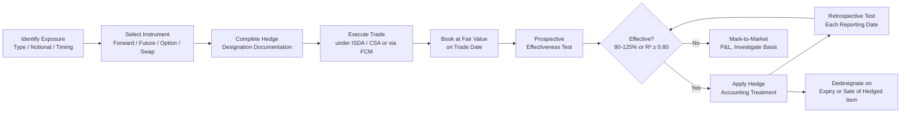

# Lesson 3: Hedging Strategies & Derivative Instruments

## 1. First-Principles Intuition & Invariants

Risk, in the corporate finance sense, is not the enemy of value creation — uncompensated risk is. A manufacturer with a sterling balance sheet can watch five years of margin improvement evaporate inside a single quarter if the currency in which it invoices customers appreciates sharply against the currency in which it pays its workforce. A utility company with a decade of contracted power purchase agreements can find its entire debt service model broken by a 200-basis-point rate move on floating-rate debt. The function of hedging is not to eliminate risk in its totality — that is both impossible and undesirable, since risk is the mechanism through which return is generated — but to surgically remove the exposures that produce earnings volatility without producing compensating upside: the risks a company did not get into business to bear.

This distinction is the first invariant every practitioner must internalize before touching a derivative contract. A semiconductor company exists to earn margin on intellectual property embedded in silicon, not to speculate on the trajectory of the Japanese yen. When that company hedges its yen receivables, it is not reducing its strategic risk; it is *clarifying* it, ensuring that reported earnings reflect the operational decisions management actually made rather than the noise introduced by an FX market it has no informational edge in. This is the philosophical foundation from which the entire mechanics of corporate hedging flow.

The second invariant is that derivatives are zero-sum instruments at the moment of contract — for every dollar of gain one counterparty realizes, the other realizes a dollar of loss. This is not a warning against using them; it is a reminder that derivatives create no intrinsic economic value. Their value to a corporation comes entirely from the interaction between the derivative payoff and the underlying business exposure. A long put option on crude oil is a losing trade in isolation if oil prices rise. The same put option held against a refinery's fuel cost exposure converts a catastrophic margin compression into a managed, bounded outcome. The hedge and the underlying exposure are inseparable in economic analysis, and conflating their standalone P&L with their combined contribution to firm value is one of the most persistent errors in corporate treasury practice.

The third invariant concerns accounting treatment, specifically the distinction between *hedge accounting* under ASC 815 (US GAAP) or IFRS 9 and plain-vanilla mark-to-market accounting. Without hedge accounting designation, a derivative's fair value changes flow through the income statement immediately, often in the opposite direction of the underlying exposure that hasn't been recognized yet, producing exactly the earnings volatility the company was trying to prevent. Hedge accounting allows a qualifying hedge relationship to match the timing of the derivative's gain or loss recognition with the hedged item's impact on earnings. The cost of this benefit is rigorous documentation: the hedge must be designated before inception, the hedged item and hedging instrument must be clearly identified, and effectiveness must be tested prospectively and retrospectively. The practical implication is that a corporate treasury team deciding to hedge at 3:00 PM on a Thursday must have its designation documentation completed before the market close, not after the weekend. Retroactive designation is prohibited.

These three invariants — hedge only uncompensated risks, evaluate the instrument against the exposure not in isolation, and manage the accounting designation with the same rigor as the trade itself — govern every workflow that follows in this lesson.

### The Taxonomy of Exposure

Before selecting an instrument, the practitioner must map the exposure with precision. Corporate risk exposures fall into three categories that demand different instrument structures.

**Transaction exposure** arises from contracted cash flows denominated in a foreign currency or tied to a floating rate: a purchase order already signed, a loan already drawn. The timing and notional amount are known. This is the most straightforward exposure to hedge because the hedge can be sized exactly and the maturity can be matched precisely to the settlement date.

**Translation exposure** arises from consolidating foreign-currency-denominated balance sheet items into the reporting currency. A US parent with a German subsidiary carries the subsidiary's net assets on its consolidated balance sheet at the period-end exchange rate; movements in EUR/USD between periods produce gains and losses in Other Comprehensive Income (OCI) that never touch cash but affect book equity ratios, potentially triggering loan covenant tests tied to tangible net worth. Hedging translation exposure is structurally more complex because the "exposure" is a stock rather than a flow, and the hedge itself may create its own accounting complications.

**Economic exposure** is the broadest and most difficult to hedge: the impact of exchange rate or commodity price movements on the present value of all future cash flows, including those not yet contracted. A European automaker whose primary competitor is Japanese faces economic exposure to EUR/JPY even if it has no direct transactions in yen, because yen depreciation gives its competitor pricing power in shared markets. Economic exposure often cannot be addressed with financial derivatives alone and requires operational responses: shifting production, diversifying supplier geography, repricing contracts. This is where the concept of the *natural hedge* becomes relevant and where the distinction between financial and operational hedging strategy begins.

---

## 2. Core Architecture & Mechanics

### Forward Contracts: The Baseline Instrument

A foreign exchange forward contract is an agreement between two parties to exchange a specified amount of one currency for another at a predetermined rate on a predetermined future date. It is the simplest and most widely used corporate hedging instrument, and understanding its mechanics completely is prerequisite to understanding everything more complex.

The forward rate is not a forecast. It is a mathematical consequence of the interest rate differential between two currencies, derived from the covered interest rate parity relationship:

$$F = S \times \frac{(1 + r_d)}{(1 + r_f)}$$

where $F$ is the forward rate (domestic per foreign), $S$ is the spot rate, $r_d$ is the domestic interest rate for the contract tenor, and $r_f$ is the foreign interest rate for the contract tenor. If the domestic rate exceeds the foreign rate, the forward rate will be higher than the spot (the domestic currency trades at a forward discount); if the domestic rate is lower, the forward rate is lower than spot (the domestic currency trades at a forward premium). The practical consequence is that hedging a receivable in a high-interest-rate currency is costly — the forward rate locks in a rate below current spot — and this cost is not a function of anyone's view on where rates will go. It is simply the cost of eliminating uncertainty, priced by arbitrage.

Consider a US-based software company that has just signed a contract to deliver services to a British client for £5,000,000 payable in 90 days. The current GBP/USD spot rate is 1.2700. The 90-day USD LIBOR equivalent (SOFR term rate) is 5.30% annualized and the 90-day SONIA rate is 5.10% annualized. The 90-day forward rate is calculated as:

$$F = 1.2700 \times \frac{(1 + 0.0530 \times \frac{90}{360})}{(1 + 0.0510 \times \frac{90}{360})} = 1.2700 \times \frac{1.01325}{1.01275} \approx 1.2706$$

The company enters a forward contract to sell £5,000,000 at 1.2706 in 90 days, locking in USD proceeds of $6,353,000. If sterling falls to 1.2300 by settlement, the unhedged position would have yielded $6,150,000 — a $203,000 shortfall that the forward eliminates. If sterling rises to 1.3100, the forward caps the upside, delivering the same $6,353,000 while the unhedged position would have yielded $6,550,000. This asymmetry is the fundamental trade-off of a forward: complete certainty, complete elimination of upside participation. It is the right instrument when the company needs certainty, not optionality.

The settlement mechanics matter operationally. At maturity, a deliverable forward requires physical exchange of the currency amounts. A non-deliverable forward (NDF) settles the net difference in a single currency, which is the standard structure for currencies subject to capital controls (the Chinese renminbi, the Indian rupee, the Brazilian real) where physical delivery of the offshore currency is restricted. In treasury practice, deliverable forwards are typically used where the company actually needs the foreign currency for operational payments; NDFs are used for financial hedging of exposures in restricted currencies.

### Futures Contracts: Exchange-Traded Precision and Basis Risk

Futures contracts on currencies, interest rates, and commodities are economically similar to forwards but structurally distinct in ways that create both advantages and complications for corporate hedgers. Futures are standardized, exchange-traded, margined daily, and liquid. The CME Group's EUR/USD futures contract, for example, specifies a notional of €125,000, is settled in USD, and trades in quarterly March/June/September/December expirations. The LME copper futures contract specifies 25 metric tonnes of Grade A copper in a standard warrant.

The daily margining mechanism — variation margin — means that unrealized losses are collected in cash each day rather than settled at contract expiration. A company that has sold copper futures to hedge its mining output and then watches copper prices rise will face daily margin calls throughout the period even though the physical copper it will ultimately sell is gaining value simultaneously. The cash flow mismatch between daily margin payments on the futures position and the eventual receipt of elevated copper sales revenue is a liquidity risk that must be explicitly managed. Many corporations maintain revolving credit facilities partially for this purpose, treating the available revolver capacity as a margin liquidity buffer.

**Basis risk** is the central imperfection of futures hedging and deserves precise definition. Basis is the difference between the spot price of the asset being hedged and the futures price of the contract being used to hedge it:

$$\text{Basis} = S_t - F_t$$

Basis risk arises when the asset being hedged does not perfectly match the standardized asset underlying the futures contract — in maturity, in grade, in geographic delivery point, or in some other dimension. A US airline hedging jet fuel costs with NYMEX ULSD (Ultra Low Sulphur Diesel) futures faces basis risk because jet fuel and ULSD are chemically related but not identical commodities, and their price spread can widen significantly during supply disruptions. A corporate bond issuer hedging rate exposure with 10-year Treasury futures faces basis risk because the spread between its borrowing rate and the Treasury benchmark is not fixed. When basis moves adversely, it erodes hedge effectiveness and must be measured, reported, and reflected in the hedge ratio.

The **hedge ratio** for a futures position is not simply notional-for-notional. The minimum-variance hedge ratio, derived from an OLS regression of changes in the spot price on changes in the futures price, is:

$$h^* = \rho_{SF} \times \frac{\sigma_S}{\sigma_F}$$

where $\rho_{SF}$ is the correlation between spot and futures price changes, $\sigma_S$ is the standard deviation of spot price changes, and $\sigma_F$ is the standard deviation of futures price changes. If the correlation is 0.95 and the spot price moves 1.05 times as much as the futures price (a ratio of $\sigma_S / \sigma_F = 1.05$), the optimal hedge ratio is 0.9975 — meaning the company should short approximately 99.75% of its notional exposure in futures, not 100%. This calibration reduces residual variance in the hedged position and is the mechanically correct approach; using a naive 1:1 ratio in the presence of meaningful basis risk will systematically over- or under-hedge.

The number of contracts required is then:

$$N^* = h^* \times \frac{V_A}{V_F}$$

where $V_A$ is the notional value of the asset being hedged and $V_F$ is the notional value of one futures contract. This calculation must be revisited as the exposure size changes, as the correlation between spot and futures shifts, and as contracts approach expiration and are rolled.

### Options: Purchasing Asymmetric Outcomes

An option gives its buyer the right, but not the obligation, to transact at the strike price on or before the expiration date. The buyer pays a premium upfront; the seller receives that premium and assumes the obligation. For a corporate hedger, the asymmetry is the defining feature: unlike a forward, an option allows the hedger to participate in favorable price movements while still being protected against adverse ones. The cost of this asymmetry is the option premium, and understanding what drives that premium is essential to making intelligent instrument selection decisions.

Option premium is decomposed into intrinsic value (the amount by which the option is currently in the money) and time value (which reflects the probability distribution of outcomes between now and expiration, driven by time remaining and the volatility of the underlying). The Black-Scholes-Merton formula for a European call option on a currency (the Garman-Kohlhagen extension for FX) is:

$$C = S_0 e^{-r_f T} N(d_1) - K e^{-r_d T} N(d_2)$$

$$d_1 = \frac{\ln(S_0/K) + (r_d - r_f + \sigma^2/2)T}{\sigma\sqrt{T}}, \quad d_2 = d_1 - \sigma\sqrt{T}$$

where $S_0$ is the current spot rate, $K$ is the strike price, $r_d$ and $r_f$ are the domestic and foreign risk-free rates, $T$ is time to expiration in years, $\sigma$ is the implied volatility of the currency pair, and $N(\cdot)$ is the cumulative standard normal distribution function. For a put option, the premium is:

$$P = K e^{-r_d T} N(-d_2) - S_0 e^{-r_f T} N(-d_1)$$

Consider the same software company from the forward example. Rather than selling £5,000,000 forward at 1.2706, it purchases a 90-day GBP put option (the right to sell sterling) with strike 1.2700 at an implied volatility of 8.5%. Plugging into the formula with $S_0 = 1.2700$, $K = 1.2700$, $r_d = 5.30\%$, $r_f = 5.10\%$, $T = 0.25$, $\sigma = 0.085$:

$$d_1 = \frac{\ln(1) + (0.053 - 0.051 + 0.085^2/2) \times 0.25}{0.085\sqrt{0.25}} = \frac{0 + (0.002 + 0.003613) \times 0.25}{0.0425} = \frac{0.001403}{0.0425} \approx 0.0330$$

$$d_2 = 0.0330 - 0.0425 = -0.0095$$

$$P = 1.2700 \times e^{-0.053 \times 0.25} \times N(0.0095) - 1.2700 \times e^{-0.051 \times 0.25} \times N(-0.0330)$$

$$P \approx 1.2700 \times 0.9869 \times 0.5038 - 1.2700 \times 0.9873 \times 0.4868 \approx 0.6307 - 0.6103 \approx 0.0204 \text{ per GBP}$$

The total premium is approximately $0.0204 \times 5,000,000 = \$102,000$, paid upfront. If sterling falls to 1.2300, the option is exercised and the company receives its locked-in $6,350,000 minus the $102,000 premium paid: net $6,248,000, still substantially better than the unhedged $6,150,000. If sterling rises to 1.3100, the option expires worthless, and the company sells spot at 1.3100 for $6,550,000 minus the $102,000 premium: net $6,448,000. The option strategy outperforms the forward when sterling appreciates by more than the premium cost and underperforms it when sterling depreciates — which is exactly the intuition of purchasing insurance.

**Cost reduction structures** are common in practice because option premiums can be prohibitive for large notionals or long tenors. The two most prevalent structures for corporate use are the **collar** and the **participating forward**.

A collar involves simultaneously buying an out-of-the-money (OTM) put and selling an OTM call with the same tenor. The call premium received offsets part or all of the put premium paid. The company retains downside protection below the put strike, surrenders upside above the call strike, and participates in moves between the two strikes. A zero-cost collar is structured so that the premium received for the call exactly equals the premium paid for the put, eliminating any upfront cash outlay at the cost of bounded upside participation.

A participating forward combines a full-notional put with a sold call on a fraction of the notional, allowing partial upside participation in exchange for no net premium. If a company buys a put on £5,000,000 and sells a call on £2,500,000, it pays for 50% of the put with the call premium. If sterling rises, the sold call obligation covers only £2,500,000, leaving the company to sell the remaining £2,500,000 at the appreciated spot rate.

### Interest Rate Swaps: Restructuring the Cost of Capital

An interest rate swap is an agreement between two counterparties to exchange cash flows calculated on a notional principal: typically, one party pays a fixed rate and receives a floating rate, while the other does the reverse. No principal is exchanged; only the net interest differential changes hands on each payment date. The fixed rate on a vanilla interest rate swap is set at inception such that the present value of the fixed leg equals the present value of the floating leg, making the initial fair value of the swap zero (before bid-ask spread).

The mechanics of pricing a vanilla USD fixed-for-floating swap against SOFR term rate rest on the construction of a discount curve from observed market rates. Each fixed payment on the swap is essentially a zero-coupon bond at the fixed rate; the floating leg, by construction, reprices to par at each reset date. The fixed rate that equates the two legs is the par swap rate, which can be derived from the discount factors implied by the SOFR OIS curve:

$$\text{Fixed Rate} = \frac{1 - D(T_n)}{\sum_{i=1}^{n} \delta_i \cdot D(T_i)}$$

where $D(T_i)$ is the discount factor at time $T_i$ and $\delta_i$ is the day-count fraction for period $i$ (typically Actual/360 for the floating leg and 30/360 for the fixed leg in a standard USD swap). This formula says the fixed rate is simply the coupon that makes a fixed-rate bond worth par, given the prevailing discount curve.

The corporate use case is typically a company with floating-rate debt — say, a $200,000,000 term loan priced at SOFR + 225 bps — that wants to convert some or all of its interest cost to fixed to reduce earnings sensitivity to rate movements. The company enters a pay-fixed/receive-floating swap with a notional of $150,000,000 (hedging 75% of its floating rate exposure, a deliberate decision reflecting a view that partial hedging balances rate risk against the cost of locking in the prevailing rate). If the 5-year par swap rate is 4.85%, the company's effective fixed rate on the hedged portion is 4.85% + 2.25% = 7.10% — the swap's fixed leg plus the credit spread that remains regardless of the rate structure.

If rates rise 150 bps after the swap is executed, the floating rate on the unhedged $50,000,000 increases by $750,000 annually, while the swap generates offsetting income as the floating leg received increases and the fixed leg paid remains constant. The hedged portion is immunized from the rate movement; only the unhedged $50,000,000 carries rate exposure, which was the deliberate decision.

**Cross-currency swaps** extend this logic to situations where both the principal currency and the interest rate must be managed simultaneously. A US company that has issued EUR-denominated bonds to access the European investor base but has only USD cash flows uses a cross-currency swap to exchange the EUR proceeds for USD at inception, make USD fixed payments throughout the life of the bond, receive EUR payments to service the bond coupons, and reverse the exchange at maturity. The swap effectively converts a EUR liability into a synthetic USD liability, eliminating both the translation risk on the bond principal and the transaction risk on the coupon payments in a single instrument.

### The Execution and Documentation Workflow

The following sequence reflects standard treasury practice for entering a derivative hedge under a qualified hedge accounting designation, from exposure identification through ongoing monitoring.

**Step 1: Exposure Quantification.** The treasury team identifies the hedgeable item — a forecasted sale in GBP 90 days forward, a floating rate coupon payment, a projected jet fuel purchase — and determines notional amount, timing, and currency or rate basis. For highly probable forecasted transactions (required for cash flow hedge designation), the team must document why the transaction is "highly probable," typically using historical transaction data showing consistent transaction occurrence.

**Step 2: Hedge Documentation.** Prior to or at inception of the derivative, the team completes a formal hedge designation memo specifying: the risk management objective and strategy, the hedged item (description, risk being hedged, how ineffectiveness will be assessed), the hedging instrument (description, counterparty, notional, term, settlement terms), and the hedge relationship type (fair value hedge, cash flow hedge, or net investment hedge). This document is auditable and must exist before the trade is booked.

**Step 3: Trade Execution.** For OTC instruments (forwards, swaps, OTC options), the trade is executed under an ISDA Master Agreement, which governs close-out netting in the event of counterparty default. The Credit Support Annex (CSA) to the ISDA agreement specifies collateral posting requirements — threshold amounts, eligible collateral types, minimum transfer amounts, and the interest rate paid on posted cash collateral. The economics of the CSA directly affect the fair value of OTC derivatives: a derivative traded under a zero-threshold, daily-margined CSA will have different pricing than the same instrument traded without a CSA, because the dealer's counterparty credit risk is different. For exchange-traded instruments, the execution is through a futures commission merchant (FCM) with initial margin posted to the exchange clearinghouse.

**Step 4: Effectiveness Testing.** Under both ASC 815 and IFRS 9, a hedge must be "highly effective" to qualify for hedge accounting. The quantitative threshold under the dollar-offset method has historically been 80–125%: the ratio of the hedge gain/loss to the hedged item gain/loss must fall within this band. In practice, most treasury teams use regression analysis (the R-squared must exceed 0.80 and the slope coefficient must fall within a specified range) or the hypothetical derivative method, in which the actual hedging instrument is compared against a "perfect" hypothetical derivative that exactly matches the hedged item's terms. The hypothetical derivative method produces lower measured ineffectiveness for instruments that closely match their hedged items and is therefore preferred when the hedge relationship is tight.

The workflow from exposure through execution and ongoing monitoring can be visualized as a linear process with feedback loops for effectiveness testing:

---

## 3. High-Performance Optimization & Failure Modes

### Hedge Ratio Optimization and Dynamic Rebalancing

A static hedge ratio calibrated at inception deteriorates over time as the correlation between the hedging instrument and the underlying exposure shifts, as the size of the exposure changes (particularly for revolving commodity exposures or a sales pipeline that grows through the quarter), and as the basis between the instrument and the exposure widens or compresses. High-performing treasury operations treat the hedge ratio as a dynamic parameter, not a one-time calculation.

The practical framework for ratio monitoring sets a rebalancing trigger: if the retrospective effectiveness ratio falls outside a range tighter than the 80–125% accounting threshold — say, 90–110% — the position is rebalanced before the accounting threshold is breached. This creates a buffer and ensures that the team is managing the hedge economically rather than simply trying not to fail the accounting test. Rebalancing may involve adding or removing a portion of the hedging instrument, rolling to a different maturity, or switching instrument types if a forward contract's basis has become unfavorable relative to a futures-based alternative.

For commodity hedges with significant volume uncertainty — an airline projecting fuel consumption 12 months forward cannot know actual flight hours — the standard practice is to hedge a **declining percentage** of the exposure as the horizon lengthens: 85% of the next-quarter projected consumption, 70% of the two-quarter-forward projection, 50% at three quarters, and 30% at four quarters. This layered approach reflects the increasing uncertainty of the volume forecast and prevents over-hedging if actual consumption falls short of projections. Over-hedging creates a speculative position in the derivative, which is both economically inefficient and potentially disqualifying for hedge accounting designation.

### Natural Hedges and Operational Hedge Architecture

A natural hedge exists when two or more of a company's cash flows offset each other without requiring a financial derivative. A multinational with both revenues and operating costs in euros has a naturally lower EUR/USD transaction exposure than a company with all revenues in euros and all costs in dollars. The engineering of natural hedges through operational decisions — where to locate manufacturing, in which currencies to invoice, how to structure procurement contracts — reduces the residual financial risk that derivatives must address and therefore reduces the derivative notional outstanding, the associated counterparty credit exposure, and the hedging cost.

The operational hedge audit is a structured exercise that treasury teams should conduct at minimum annually. It involves mapping every significant cash flow by currency, tenor, and certainty class (contracted versus forecast), netting natural offsets within each currency, and calculating the residual net exposure position that requires financial hedging. This netting calculation is not trivial in a large multinational: a company may have fifteen business units each managing their own receivables and payables in multiple currencies, with significant natural offsets between units that are invisible if each unit reports its exposure independently. Centralizing treasury and aggregating the net group-level exposure before hedging is one of the most significant cost reductions available to a multinational corporation, often reducing total hedge notional by 20–40% simply by netting existing positions.

The balance sheet hedge of translation exposure deserves specific treatment because it is frequently mismanaged. A company with a €500,000,000 net investment in its German subsidiary faces a translation risk: if EUR depreciates 10% against the USD, the subsidiary's contribution to consolidated equity falls by approximately €50,000,000. The standard financial hedging tool is to designate the foreign-currency-denominated debt on the parent's balance sheet as a net investment hedge, or to enter a forward contract on the net investment. Under ASC 815 net investment hedge accounting, the effective portion of the hedge gain or loss is recorded in OCI (the same location as the translation gain or loss being hedged) rather than in earnings, achieving the matching that hedge accounting is designed to deliver.

The critical judgment here is sizing. The net investment being hedged is the subsidiary's net assets at the beginning of the period, translated at the closing rate. If the subsidiary earns retained earnings during the period that increase net assets, and the hedge notional is not increased correspondingly, the hedge will be under the actual net investment by the end of the period. Conversely, if the subsidiary pays dividends that reduce net assets, an unchanged hedge notional will exceed the net investment, partially dedesignating the hedge and potentially introducing income statement volatility. The hedge must be sized against the net investment at inception and monitored each period for alignment.

### Counterparty Credit Risk and CVA

Every OTC derivative carries counterparty credit risk — the risk that the counterparty defaults when the derivative has a positive fair value to the hedging company (i.e., the company is in-the-money and the counterparty owes it money). The Credit Valuation Adjustment (CVA) is the market price of this risk, calculated as the present value of the expected loss given the probability of counterparty default:

$$\text{CVA} = (1 - R) \times \sum_{i=1}^{n} \text{EE}(t_i) \times \text{PD}(t_{i-1}, t_i) \times D(t_i)$$

where $R$ is the recovery rate (typically 40% for senior unsecured bank debt), $\text{EE}(t_i)$ is the expected positive exposure at time $t_i$ (the average of the positive mark-to-market values of the derivative across all simulation paths at that date), $\text{PD}(t_{i-1}, t_i)$ is the marginal probability of counterparty default in that period (derived from the counterparty's CDS spread), and $D(t_i)$ is the risk-free discount factor. The CVA is subtracted from the derivative's risk-free fair value to arrive at the credit-adjusted fair value that must be reported on the balance sheet.

In practice, corporate treasury teams manage counterparty credit risk through a combination of ISDA netting agreements (which reduce gross exposure to net exposure across all trades with a given counterparty), CSA collateral thresholds (which cap the maximum uncollateralized exposure), diversification across multiple dealer counterparties (a large company should not concentrate more than 25–30% of its derivative notional with any single bank), and ratings-based assignment triggers in ISDA agreements that allow the company to terminate and replace a derivative if the counterparty's credit rating falls below a specified threshold.

### Hedge Accounting Failure Modes

The failure modes in hedge accounting are well-documented in SEC comment letter practice and represent the most common sources of restatement risk in treasury operations.

**Inadequate documentation** is the most prevalent failure mode. If the designation memo does not exist at inception, was backdated, or does not specifically identify the hedged item and hedging instrument with sufficient detail, the hedge accounting designation is invalid from the start. The entire derivative must then be marked to market through earnings, potentially creating significant non-cash income statement volatility retroactively.

**Over-hedging through imprecise exposure forecasting** occurs when a company hedges forecasted transactions that do not materialize as projected. If a company hedges 100% of projected foreign currency revenue and actual revenue comes in at 70% of forecast, it has a 30% over-hedge that is now a speculative position. The portion of the derivative that exceeds the hedged item must be dedesignated and marked to market through earnings immediately.

**Failure to roll hedges with the underlying exposure** is a process failure rather than a conceptual one. A derivative designated against a 90-day receivable expires at day 90; if the receivable is extended to day 120, the company is unhedged for the final 30 days unless it enters a new hedge and completes new designation documentation. Treasury operations that rely on manual calendar tracking rather than a treasury management system (TMS) with automated alerts are vulnerable to this gap.

**Basis mismatch creating persistent ineffectiveness** arises when the hedging instrument and the hedged item are misaligned in ways that cause the effectiveness ratio to systematically drift outside the allowable range. The classic example is hedging a SOFR-indexed loan with an older LIBOR-based swap that has not been updated to reflect the benchmark rate transition. Post-LIBOR transition, any swap that references USD LIBOR is mismatched against a SOFR-indexed obligation, and the basis between the two rates, though small in normal conditions, can widen enough to breach effectiveness thresholds. This type of structural basis mismatch requires instrument replacement, not rebalancing.

**Dedesignation failures at the point of hedged item modification** occur when changes to the underlying loan agreement — an amendment that modifies the spread, extends the maturity, or converts the rate basis — alter the hedged item in ways that the existing hedge documentation does not contemplate. Any material modification to the hedged item requires the company to assess whether the existing hedge relationship remains valid and, if not, to dedesignate the existing hedge and redesignate a new relationship against the amended instrument.

### Measuring Aggregate Hedge Program Effectiveness

Beyond the instrument-by-instrument effectiveness tests required for accounting compliance, a well-run treasury operation measures the effectiveness of its hedge program at an aggregate level against its stated hedging policy objectives. This aggregate measurement answers a different question than accounting effectiveness: not "did this derivative's gain offset the hedged item's loss within 80–125%?" but rather "did our hedging program reduce the volatility of reported earnings, cash flows, and key financial ratios to the target range specified in our treasury policy?"

The standard metric for this is the **hedge ratio coverage percentage** (what fraction of the identified exposure was hedged) alongside the **earnings-at-risk (EaR) reduction** attributable to the hedge program. EaR is the analog of Value-at-Risk (VaR) for earnings rather than portfolio mark-to-market. It is computed by running Monte Carlo simulations of the company's key risk factor exposures — foreign exchange rates, benchmark interest rates, commodity prices — across thousands of scenarios drawn from historically calibrated or risk-neutral distributions, applying the company's current hedge book to each scenario, and comparing the distribution of simulated earnings with and without the hedges. The 95th percentile adverse outcome without hedges might be a $45,000,000 reduction in operating earnings; with the current hedge book, the same 95th percentile adverse outcome is a $12,000,000 reduction. The hedge program has reduced EaR by $33,000,000, a number that can be presented to the board, the audit committee, and the CFO as a concrete, defensible measure of the economic value delivered by the treasury risk management function — moving the conversation from "how much did we spend on premiums" to "what earnings volatility did we eliminate, and at what cost per dollar of risk reduced."

This framing connects the technical mechanics of derivative instruments, the accounting rigor of hedge designation, and the operational discipline of exposure monitoring into a coherent value proposition: hedging is not a cost center. Properly executed, it is the mechanism through which a company ensures that its reported financial results reflect the quality of its operational decisions, uncontaminated by the market risks it neither chose nor is equipped to manage.
