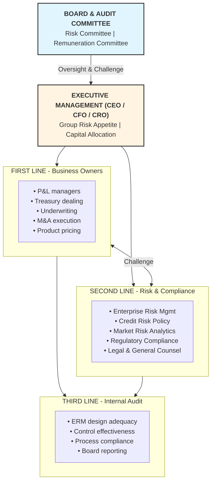

# Lesson 4: Enterprise Risk Management, Governance Structures

## 1. First-Principles Intuition & Invariants

Risk, in its most fundamental sense, is the possibility that outcomes deviate from expectations. For a corporate finance practitioner, that definition is simultaneously too broad and too precise: too broad because it encompasses every conceivable source of deviation, and too precise because it implies that expectations themselves are well-formed, consistently measured, and comparably denominated across a firm's diverse business activities. Enterprise Risk Management exists as a discipline precisely because neither condition holds naturally inside large organizations. Without a deliberate architecture, each business unit develops its own vocabulary for risk, its own tolerances, and its own implicit capital consumption — producing a portfolio of hidden exposures that aggregate in ways no single executive can observe until a stress event makes them visible all at once.

The invariant at the heart of ERM is deceptively simple: **risk and return are inseparable, so the firm's governance of risk must be as rigorous as its governance of return.** A treasury desk that hedges currency exposure without reference to the firm's overall risk appetite may be eliminating a risk the board would have willingly retained in exchange for carry, while simultaneously leaving an offsetting natural hedge in the operating business unexploited. A product division that accepts long-tail warranty liabilities to win a contract may be consuming risk capital that would generate five times the return if redeployed toward a leveraged acquisition. These misallocations are not failures of individual judgment; they are structural failures of governance — the absence of a common language, a common measurement framework, and an accountable decision hierarchy for risk.

### The Two Canonical Frameworks and Why Both Are Necessary

Two frameworks dominate enterprise risk governance in practice: the Committee of Sponsoring Organizations of the Treadway Commission framework — universally known as COSO — and ISO 31000. Understanding their mechanics and their limitations is prerequisite knowledge for any practitioner who wants to do more than check a compliance box.

COSO's Enterprise Risk Management framework, most recently revised in 2017, is organized around five interrelated components and twenty principles. Its architecture reflects an auditor's intuition about control environments: it begins with governance and culture, moves through strategy and objective-setting, then into performance (the identification, assessment, and prioritization of risk), then review, and finally information, communication, and reporting. The 2017 revision was important because it explicitly linked ERM to strategy formulation, not just strategy execution. Prior versions treated risk management as a tool for protecting a strategy already chosen; the revised framework recognizes that the choice of strategy is itself a risk decision. When a board approves a growth-through-acquisition strategy rather than an organic expansion strategy, it is selecting a different risk profile — higher execution risk, higher integration risk, higher leverage — not merely accepting a strategy and then separately deciding how to manage it.

The practical weakness of COSO is that its principles are largely qualitative. It tells you *what* a mature risk management system should contain but provides almost no quantitative machinery for *how* to measure exposure, aggregate risk across categories, or translate risk into capital requirements. This is where ISO 31000 plays a complementary role. ISO 31000 is a process standard: it defines a risk management process — context establishment, risk identification, risk analysis, risk evaluation, risk treatment, monitoring, and communication — with an emphasis on iterative improvement and integration into existing management systems. It is architecture-agnostic and industry-agnostic, which makes it adaptable but also means its quantitative rigor depends entirely on the practitioner implementing it.

The practitioner synthesis of these two frameworks is to use COSO as the governance architecture — defining committee structures, risk appetite statements, escalation thresholds, and culture expectations — while using ISO 31000 as the operational process standard that governs how individual risk assessments are conducted, documented, and fed back into the COSO governance layer. The two frameworks are not competitive; they address different levels of abstraction.

### Risk Appetite: The Firm's Most Consequential Financial Decision

Before any risk can be managed, the board must answer a question that most boards answer only implicitly, and therefore poorly: how much risk should this firm bear, in which categories, and at what cost? The formal expression of that answer is the **Risk Appetite Statement**, and it is the cornerstone document of any ERM implementation with real operational teeth.

A risk appetite statement that merely declares the firm has "low tolerance for compliance risk and moderate tolerance for market risk" is decorative, not functional. It cannot be operationalized because it provides no basis for quantitative decision-making. A practitioner-grade risk appetite statement has three layers. The first layer is a **qualitative strategic intent** that describes, in plain language, the nature of the risks the firm is in business to take — the risks that constitute its competitive differentiation. A bank that describes itself as a credit intermediary is explicitly stating that credit risk is its primary economic value creation mechanism; it is in business *because* of credit risk, not in spite of it. The second layer is a **quantitative aggregate risk limit** denominated in a capital or earnings metric: for example, "the firm will not tolerate a one-year loss exceeding 15% of Tier 1 capital at a 99.9% confidence level." The third layer translates that aggregate limit into **business-unit-level risk budgets** — allocations of the aggregate risk capacity to individual divisions, expressed in the same metric so that they can be summed and compared.

This three-layer architecture makes the risk appetite statement a capital allocation tool, not merely a governance document. When a CFO reviews a capital expenditure request, the approval process should explicitly verify that the incremental risk of the investment fits within the requesting division's risk budget. If it does not, the division must either obtain a budget increase (which requires releasing capital from somewhere else or raising the aggregate limit, both of which require board-level approval) or restructure the investment to reduce its risk profile. This is how ERM becomes embedded in ordinary commercial decision-making rather than remaining a parallel compliance exercise.

---

## 2. Core Architecture & Mechanics

### The Three Lines of Defense

The governance architecture of an ERM system is most clearly understood through the Three Lines of Defense model, which has become the standard organizational framework endorsed by regulators in banking, insurance, and increasingly in publicly listed corporates under SEC and FCA guidance.

The first line consists of business owners — the people making commercial decisions that create, transform, and consume risk daily. They own the risk; they are the ones entering contracts, extending credit, pricing products, and committing capital. The second line consists of independent risk and compliance functions whose mandate is to design the measurement framework, set policy limits, challenge first-line assumptions, and aggregate risk exposures into a firm-wide picture. The CRO sits at the top of the second line, with direct access to the board's Risk Committee independent of the CEO. This independence is structural, not political: without it, the second line becomes a decoration rather than a genuine counterweight to revenue pressure. The third line, internal audit, provides independent assurance that both the first and second lines are functioning as designed. Internal audit does not own risk and does not set policy; it assesses whether the system of controls is properly designed and operating effectively.

The practical failure mode in most organizations is that the first and second lines blur. When risk analysts are embedded within business units and report to business unit heads rather than to the CRO, their independence is compromised. When risk limits are routinely waived under commercial pressure without formal escalation, the limit framework loses its constraining force. These are governance failures that no amount of sophisticated quantitative modeling can compensate for.

### Risk Committee Mechanics and Decision Protocols

The board-level **Risk Committee** (distinct from the Audit Committee, though they overlap in agenda at smaller firms) has four primary operational responsibilities that practitioners should understand concretely rather than abstractly.

First, the Risk Committee approves and annually reviews the **Risk Appetite Statement**. This is not a rubber-stamp review; it involves interrogating the CRO on whether actual risk positions over the prior year remained within appetite, what appetite limit breaches occurred and why, and whether the existing appetite remains appropriate given changes in strategy, competitive environment, or macroeconomic conditions.

Second, the committee approves the **Risk Framework**, which includes the taxonomy of risk categories (credit, market, liquidity, operational, strategic, reputational), the methodologies used to measure each category, the aggregation approach, and the stress testing calendar. When a firm shifts from a Value-at-Risk methodology to Expected Shortfall for market risk (as Basel III.1 / FRTB requires), that methodological change requires Risk Committee approval because it changes the measurement of risk positions against which appetite is calibrated.

Third, the committee reviews **material risk exposures** on a regular cycle — typically monthly at the management-level Risk Committee and quarterly at the board-level committee. Each exposure report should include current utilization against limit, trend over the prior period, forward-looking projections under base and stress scenarios, and any management actions underway. A well-structured exposure report for credit risk looks something like this:

| Portfolio Segment | Limit (£m) | Current Exposure (£m) | Utilization | 90-Day Trend | 1-in-20 Stress Loss (£m) |
|---|---|---|---|---|---|
| Investment Grade Corporate | 2,500 | 1,847 | 73.9% | +4.2% | 312 |
| Leveraged Loans | 800 | 763 | 95.4% | +11.7% | 287 |
| Commercial Real Estate | 1,200 | 998 | 83.2% | -2.1% | 441 |
| Sovereign (Non-G10) | 400 | 156 | 39.0% | -8.4% | 89 |

The leveraged loan portfolio at 95.4% utilization with an 11.7% upward trend is an immediate flag for Risk Committee discussion, not a passive data point. The committee's role is to challenge management on whether that trend is intentional (a strategic decision to increase leveraged lending exposure) or inadvertent (positions accumulating without deliberate underwriting decisions), and whether a limit revision is warranted or whether the first line should be instructed to reduce exposure.

Fourth, the committee oversees the **stress testing program**. The specific mechanics of stress testing deserve careful treatment because they are frequently misunderstood as statistical exercises when they are actually scenario-based planning exercises with capital implications. A stress test asks: *under a specified adverse scenario, what losses would the firm sustain across its current portfolio, and would the firm survive?* The scenario must be severe enough to be informative — a scenario that the firm easily absorbs provides no useful information about capital adequacy — but it must also be plausible enough to generate credible management responses. For a mid-size corporate lender, a useful stress scenario might combine a 400-basis-point rise in base rates with a 25% decline in commercial property values, a 15% increase in corporate default rates, and a simultaneous liquidity squeeze that closes wholesale funding markets for 90 days. That scenario is not the most severe event imaginable, but it represents a plausible correlated stress that the Risk Committee can reason about in terms of its probability, its management response, and its capital impact.

### Capital Allocation Under Risk Constraints

The connection between ERM and capital allocation is the most important — and most frequently underdeveloped — dimension of enterprise risk governance. The logic is direct: if risk is the possibility of unexpected loss, then capital is the resource the firm holds to absorb unexpected loss without becoming insolvent. Allocating capital is therefore equivalent to allocating risk-bearing capacity, and any capital allocation framework that does not explicitly account for risk is systematically misallocating capital toward activities that consume more risk per unit of return than less capital-intensive alternatives.

The standard practitioner tool for this is **Economic Capital (EC)** allocation. Economic capital is not regulatory capital (which is set by regulators for prudential purposes) and is not accounting equity (which is a backward-looking measure of historical retained earnings and paid-in capital). Economic capital is the internal estimate of the capital required to absorb unexpected losses at the firm's chosen solvency confidence level — typically 99.9% for a firm targeting a single-A credit rating, which corresponds to a one-in-a-thousand probability of default over a one-year horizon. The calculation methodology differs by risk type. For credit risk, it derives from the portfolio loss distribution, typically modeled using a Gaussian copula or a more sophisticated asymmetric distribution to capture the fat tails observed empirically in credit portfolios. For market risk, it derives from the VaR or ES calculation scaled to the capital horizon. For operational risk, it typically uses a Loss Distribution Approach combining external loss data, internal historical losses, and scenario analysis.

Once individual EC estimates are computed by risk type and business unit, they are aggregated at the firm level with a diversification benefit — the firm-level EC is less than the sum of the parts because not all risks materialize simultaneously. The key governance decision is how to allocate that diversification benefit: should each business unit receive credit for the diversification it contributes, or should the diversification benefit be held at the center? Most practitioners hold a portion centrally (as a buffer against model uncertainty) and allocate the remainder to business units in proportion to their contribution to diversification. The allocation affects profitability metrics materially, so the methodology should be documented and approved by the Risk Committee.

---

## 3. High-Performance Optimization & Failure Modes

### Risk-Adjusted Performance Metrics: RAROC and EVA in Full Mechanical Detail

The purpose of allocating economic capital to business units is to enable an apples-to-apples comparison of risk-adjusted returns across activities that look superficially similar on a gross return basis but are radically different in their risk consumption. The two metrics that operationalize this comparison are **Risk-Adjusted Return on Capital (RAROC)** and **Economic Value Added (EVA)**.

RAROC is defined as:

$$\text{RAROC} = \frac{\text{Net Revenue} - \text{Expected Losses} - \text{Operating Costs} + \text{Return on EC}}{\text{Economic Capital}}$$

Each component deserves precise definition. Net Revenue is revenue net of funding costs — the actual economic spread generated by the activity after paying the firm's cost of funds. Expected Losses (EL) represent the statistical average loss the activity will generate over time, computed as the product of Probability of Default (PD), Loss Given Default (LGD), and Exposure at Default (EAD) for credit-intensive activities, or as the long-run average loss rate for operational activities. Expected losses are not risk; they are a cost of doing business that should be priced into the product and recovered through net revenue. The function of Economic Capital is to absorb *unexpected* losses — the deviation of actual losses from expected losses in adverse scenarios. Return on EC reflects the investment income earned on the capital held as a buffer; since EC is typically invested in high-quality liquid assets (government bonds, agency securities), this component is the risk-free rate applied to the EC allocation.

Operating Costs are direct and allocated overhead costs attributable to the activity. The allocation of corporate overhead is a persistent source of contention in RAROC calculations; the standard practitioner approach is to allocate costs on an activity-based costing methodology rather than simple revenue-proportional splits, because the latter systematically penalizes high-margin businesses and subsidizes high-cost, low-margin operations.

A worked example makes the formula concrete. A corporate lending team originates a $500 million leveraged loan portfolio with the following characteristics:

The portfolio generates a gross spread of 325 basis points over SOFR, producing net revenue of $16.25 million annually after funding costs. The expected loss on the portfolio, calculated from the borrowers' average PD of 2.1%, LGD of 45%, and EAD of $500 million, is $4.725 million per year (the mathematical product $500\text{m} \times 0.021 \times 0.45$). Operating costs attributable to the team, including origination, monitoring, and allocated overhead, are $2.1 million. The Economic Capital allocation, computed from the portfolio's loss distribution at 99.9% confidence and reflecting correlations with the rest of the firm's credit portfolio, is $62 million — approximately 12.4% of exposure, consistent with the leveraged nature of the portfolio. The return on that EC, invested at the current 90-day Treasury yield of 5.1%, adds $3.162 million.

Substituting into the RAROC formula:

$$\text{RAROC} = \frac{16.25 - 4.725 - 2.10 + 3.162}{62} = \frac{12.587}{62} = 20.3\%$$

The firm's cost of equity — the hurdle rate against which RAROC is compared — is 14.5%, estimated from a CAPM calculation using the firm's levered beta of 1.2, a risk-free rate of 4.8%, and an equity risk premium of 8.1%. Since RAROC of 20.3% exceeds the hurdle rate of 14.5%, this portfolio generates genuine risk-adjusted economic profit. The Risk Committee and business heads can compare this 20.3% against, say, an investment-grade bond portfolio generating RAROC of 11.2% (below hurdle) and an M&A advisory business generating RAROC of 38.7% (well above hurdle), and use that comparison to inform capital allocation decisions across the fiscal year.

EVA provides a complementary view by expressing the same comparison in dollar terms rather than a ratio, which is important for avoiding rank-ordering distortions when business units differ substantially in size:

$$\text{EVA} = (\text{RAROC} - \text{Hurdle Rate}) \times \text{Economic Capital}$$

For the leveraged loan portfolio: $\text{EVA} = (0.203 - 0.145) \times 62\text{m} = 0.058 \times 62\text{m} = \$3.6\text{m}$. This means the portfolio generates $3.6 million of economic profit above what investors require for the risk they bear — genuine wealth creation. A portfolio with RAROC below the hurdle rate generates negative EVA and destroys value even if it generates accounting profits, because it earns insufficient return for the risk capital it consumes.

### Risk Appetite Calibration and Common Failure Modes

The most common failure in ERM implementation is not technical — it is behavioral. Organizations build technically sophisticated frameworks and then find that the frameworks have no actual influence on decisions under commercial pressure. Understanding why this happens, and how to prevent it, is the difference between a practitioner who understands ERM as governance and one who merely understands it as measurement.

The first failure mode is **risk appetite set above revealed tolerance**. When the board sets a formal risk appetite limit that is consistently higher than the level at which management actually becomes uncomfortable and begins taking defensive action, the formal limit provides no binding constraint. The board believes it has established governance; management ignores the stated limit because experience has shown that action is taken at a lower threshold. The fix is to calibrate the stated appetite to the level at which the board would actually *prefer* management to intervene — not the theoretical maximum loss the firm could absorb, but the loss level at which strategic flexibility begins to materially constrain. These are different numbers, often by a factor of two or three.

The second failure mode is **risk aggregation gaps**. Even well-funded risk functions frequently struggle to aggregate exposures across risk types — they can measure credit risk and market risk in isolation but cannot answer the question: "What is our total exposure to a recession scenario?" Recessions produce correlated losses across credit (rising default rates), market risk (falling equity and bond prices), operational risk (increased fraud and processing errors under stress), and liquidity risk (funding market disruption) simultaneously. A firm that has well-calibrated silos for each category but no cross-category aggregation methodology will systematically understate its true recession exposure. The solution is a **scenario-based aggregation approach**: define macro scenarios (recession, inflation shock, geopolitical disruption) that drive correlated outcomes across risk types, model the impact on each portfolio under each scenario, and sum the scenario losses to produce a firm-level stress P&L. This output is both more credible and more actionable than a statistical EC aggregation because it generates a narrative the board can reason about.

The third failure mode is **remuneration misalignment**. If front-office compensation is determined by gross revenue or profit before risk adjustments, individuals have an incentive to maximize revenue without regard to risk capital consumption. The structural fix is to base incentive compensation on RAROC or EVA contribution rather than gross P&L — a leveraged loan originator who generates $20 million gross revenue by consuming $150 million of economic capital at a RAROC of 10% (below hurdle) should receive lower compensation than one who generates $12 million gross revenue from $40 million of economic capital at a RAROC of 22%. Most compensation committees understand this principle but struggle with implementation because it requires allocating EC to individual deal-makers, which requires granular EC attribution methodologies that most risk functions do not yet operate at.

The fourth failure mode is **model monoculture**, the tendency for sophisticated institutions to converge on the same risk models, particularly in market risk (VaR with historical simulation) and credit risk (Basel internal ratings-based models calibrated to the same 2000-2010 historical period). When all major participants use the same model calibrated to the same history, they will all generate similar risk estimates, all breach limits simultaneously under a novel stress, and all attempt to reduce risk in the same way at the same time — amplifying rather than dampening the stress. The mitigation is to maintain at least two independent model families for each major risk type, to compare their outputs under stress scenarios, and to investigate discrepancies between models rather than averaging them. The gap between two models is often more informative than the output of either model in isolation; it marks the boundary of the firm's genuine knowledge about its risk profile.

The governance insight that connects all four failure modes is structural: a technically correct ERM system will fail without genuine board-level engagement, without compensation architecture that rewards risk-adjusted performance rather than gross returns, and without a CRO who has the institutional authority and independence to hold the line when commercial pressure pushes against risk limits. These are not design problems to be solved with better models; they are power and culture problems to be solved through governance design — the precise architecture that COSO and ISO 31000, taken together, were designed to address.
