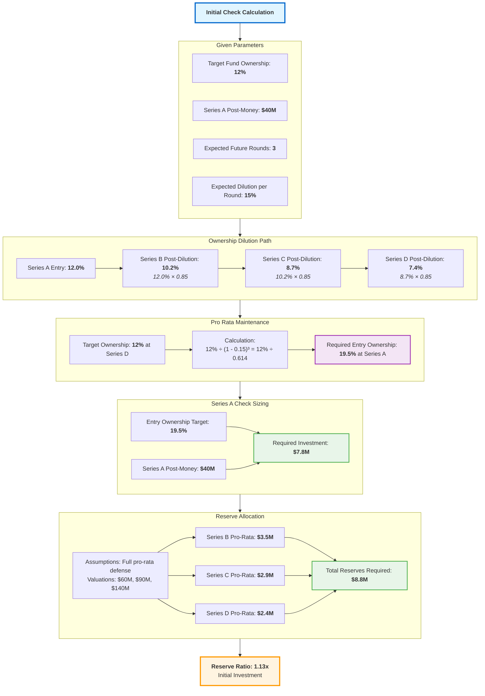
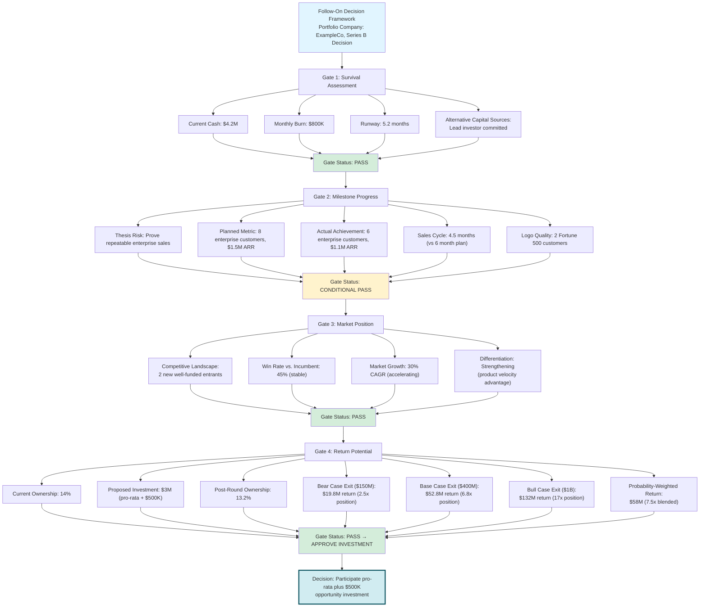
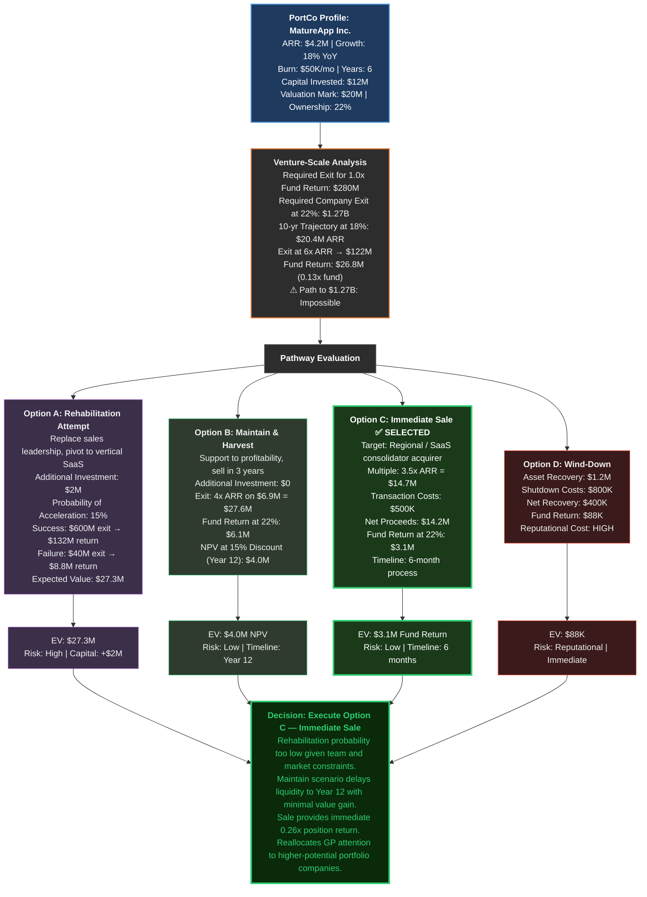
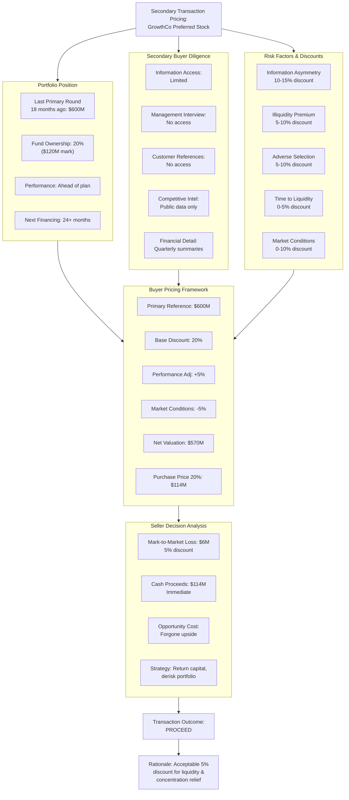

# Lesson 4: Portfolio Management, Value Creation, Exit Mechanisms

## 1. First-Principles Intuition & Invariants

Venture capital portfolio management operates on fundamentally different principles than public equity or fixed-income investing because the asset class exhibits profound non-normality in its return distribution. The core mathematical reality governing venture portfolios stems from the power law: a small minority of investments generate the majority of fund returns, while the median outcome hovers near zero. This distributional asymmetry forces fund managers to construct decision frameworks optimized not for consistent modest gains but for capturing tail outcomes while efficiently managing the inevitable casualties.

The institutional mechanics of venture capital create temporal constraints that shape every portfolio decision. A typical fund operates under a ten-year partnership agreement with optional two-year extensions, divided into an investment period spanning the first three to five years and a harvest period occupying the remainder. During the investment period, general partners deploy committed capital into portfolio companies, reserving substantial dry powder for follow-on rounds. The harvest period demands disciplined exit execution because limited partners expect distributed proceeds rather than perpetually marked-up paper gains. This temporal boundary condition means every portfolio company exists on an implicit countdown timer from initial investment to liquidity event, with the clock dictating strategic interventions, board governance intensity, and exit path selection.

The primary value creation mechanism in venture portfolios operates through staged capital deployment coupled with operational inflection milestones. Unlike buyout funds that extract value through financial engineering, operational improvement, and leverage optimization across stable cash-flowing businesses, venture funds create value by reducing uncertainty at each financing stage. A seed-stage company carries maximum uncertainty across product-market fit, unit economics viability, founder capability, and market timing. Each subsequent round should retire specific risk categories: Series A proves repeatable customer acquisition, Series B validates unit economics and retention, Series C demonstrates scalability beyond founder-led sales. The venture portfolio manager's role centers on diagnosing which risks have been adequately retired to justify follow-on capital and which portfolio companies remain trapped in uncertainty despite multiple financing attempts.

Board governance in venture portfolios differs fundamentally from public company or private equity board models because venture-backed companies operate in discovery mode rather than execution mode for extended periods. Public company boards oversee management teams executing against established playbooks in known markets with predictable competitive dynamics. Private equity boards govern operational improvement programs with clear benchmarks and quantifiable milestones. Venture boards must navigate ambiguity where the correct strategy remains unknown, market feedback arrives slowly and noisily, and pivots may be necessary despite perfect execution. This uncertainty environment demands governance models emphasizing hypothesis testing, rapid iteration, and strategic flexibility rather than adherence to multi-year strategic plans.

The zombie company phenomenon emerges from the collision between power law economics and partnership fiduciary duties. A zombie company generates insufficient growth to justify further investment but maintains enough revenue or strategic optionality that outright shutdown would constitute negligent duty breach. These entities consume disproportionate management time relative to their contribution to fund returns, creating an organizational drag that prevents portfolio managers from concentrating attention on genuine breakout candidates. The zombie triage decision tree requires brutally honest assessment of three factors: probability of achieving a venture-scale outcome given current trajectory, opportunity cost of management attention, and reputational consequences of abandonment. Many general partners maintain zombie companies on life support far longer than economic rationality suggests because LP relationships, founder community reputation, and partnership internal politics overwhelm pure return optimization.

Exit path optimization crystallizes around the fundamental tension between IPO liquidity timelines and strategic acquisition premiums. Initial public offerings provide maximum validation, permanent capital for growth investment, employee option liquidity, and benchmark-setting valuations that elevate portfolio company status. However, IPOs impose eighteen to twenty-four month lockup periods for investors, demand six to twelve months of preparation including financial controls implementation, carry execution risk if market windows close, and require companies to sustain public market growth expectations indefinitely. Strategic acquisitions offer immediate liquidity, shorter negotiation timelines, and often premium valuations reflecting synergy value and competitive positioning. The trade-off calculus depends on company maturity, market conditions, acquirer landscape, founder preferences, and fund return requirements. A fund in its ninth year facing imminent dissolution pressure operates under different optimization constraints than a second-year fund with abundant time horizon.

Secondary market liquidity mechanisms have evolved substantially over the past decade as institutional buyers recognized opportunities to acquire venture positions from liquidity-constrained sellers. General partners utilize secondary sales to manage portfolio concentration, return capital to LPs during extended holding periods, and provide liquidity to departing institutional investors. However, secondary transactions introduce valuation complexity because buyers demand discounts reflecting illiquidity, information asymmetry, and the seller's adverse selection problem. A GP selling a position signals potential concerns about exit prospects, creating a lemons market dynamic. Structured secondary transactions where GPs lead the process to provide proportional liquidity to all LPs mitigate but do not eliminate these signaling concerns.

Performance measurement in venture capital relies on cash-flow-based metrics rather than time-weighted returns because the lumpy, long-dated nature of venture distributions makes period-by-period return calculations meaningless. Distributed to Paid-In capital (DPI) measures actual cash returned to investors divided by capital contributed, representing realized returns independent of marking assumptions. Total Value to Paid-In capital (TVPI) incorporates both distributions and remaining net asset value, providing a current performance snapshot but remaining vulnerable to marking discretion. Multiple on Invested Capital (MOIC) tracks gross returns before fees and carry, enabling comparison across fee structures. Internal Rate of Return (IRR) calculates the annualized return considering cash flow timing but exhibits mathematical quirks in venture contexts where distributions occur late in fund life. A fund returning three times invested capital in year ten generates a twenty-percent IRR, while the same multiple returned in year five yields a twenty-five percent IRR, yet the absolute wealth creation remains identical.

LP reporting requirements have intensified following the Institutional Limited Partners Association (ILPA) guidelines and the increasing sophistication of institutional allocators. Modern LPs demand granular portfolio company metrics beyond valuation marks: quarterly revenue growth, gross margin trends, cash burn rates, customer acquisition costs, cohort retention data, and competitive positioning assessments. This reporting standardization serves dual purposes: enabling LPs to monitor portfolio health between formal valuations and providing comparative data across managers competing for re-up commitments. However, excessive reporting demands create operational burden for GPs managing dozens of portfolio companies, particularly when portfolio companies themselves lack robust financial systems in early stages.

The fiduciary tension between fund-level optimization and founder-level advocacy represents a permanent structural challenge in venture portfolio management. General partners owe legal fiduciary duties to limited partners, demanding they maximize risk-adjusted returns to the fund. Simultaneously, GPs cultivate reputations as founder-friendly partners who support entrepreneurs through difficult periods, provide patient capital, and prioritize company-building over quick flips. These incentives occasionally conflict: a struggling company might benefit from an acquihire that provides founder liquidity and team continuity but generates minimal fund returns. A successful company might face a strategic acquisition offer at a meaningful multiple but below the GP's target return threshold for that position size. Navigating these conflicts requires transparent communication, clear investment thesis documentation, and partnership governance structures that separate portfolio management decisions from individual partner advocacy.

## 2. Core Architecture & Mechanics

The operational architecture of venture portfolio management begins with position sizing and capital reserve allocation at initial investment. Unlike public market portfolios where managers can scale positions freely through secondary market purchases, venture investors must commit to ownership targets at entry and defend those positions through follow-on rounds. A typical early-stage fund targets ten to fifteen percent ownership at Series A, requiring initial investment sizing that accounts for both the entry round and anticipated future dilution across three to five subsequent financings. The reserve ratio—capital held back for follow-on investment divided by initial investment amount—typically ranges from 1.5x to 3.0x depending on entry stage and expected capital intensity.

The decision architecture for follow-on investment operates through a multi-factor triage framework that evaluates both absolute company performance and relative portfolio opportunity cost. Each follow-on decision represents a discrete capital allocation choice between supporting an existing position, initiating a new investment, or returning capital to LPs. The evaluation framework assesses progress against the original investment thesis, comparison to plan across key metrics, competitive positioning evolution, and founder execution capability. However, the most critical input remains the probability-weighted return potential relative to other deployment opportunities available to the fund.

A structured follow-on decision tree proceeds through four sequential gates. The first gate evaluates survival probability: does the company possess sufficient cash runway and access to capital to reach the next meaningful milestone, or does it face imminent distress? Companies failing the survival gate enter triage mode where bridge financing, down-round participation, and structured instruments become relevant. The second gate assesses progress against milestones: has the company retired the specific risk factors the previous round was meant to address? A Series A company that has not demonstrated repeatable sales motion or validated unit economics has not earned Series B capital regardless of revenue growth. The third gate examines market position: has competitive intensity increased, decreased, or remained stable, and does the company maintain credible paths to market leadership? The fourth gate calculates return potential: given current ownership, likely exit valuation range, and required additional investment, does this position offer top-quartile fund return potential?

Board governance mechanics in venture portfolios establish a cadence of strategic oversight that balances fiduciary monitoring with operational support. A typical venture board meets six to eight times annually, structured around quarterly financial reviews and strategic planning sessions. The operational rhythm separates routine oversight reporting from strategic deliberation to prevent administrative tasks from consuming limited strategic discussion time. Effective board packages arrive five business days before meetings, structured in three sections: financial dashboard including cash, revenue, key unit economics, and runway; operational metrics covering product development, sales pipeline, and customer success; strategic items requiring board input or approval.

The information architecture of board reporting has evolved toward metric standardization across portfolio companies to enable pattern recognition and peer benchmarking. Modern venture boards expect consistent metric definitions: Annual Recurring Revenue calculated as most recent month's recurring revenue multiplied by twelve, not annualized bookings or forward contract value; Net Revenue Retention measured as cohort expansion minus contraction over a trailing twelve-month period; Customer Acquisition Cost calculated as total sales and marketing expense divided by new customer additions with consistent lag period assumptions. This standardization enables portfolio-level pattern recognition where GPs can identify leading indicators of trouble or breakout performance by comparing metrics across similar-stage companies.

Board composition dynamics create principal-agent tensions that portfolio managers must navigate carefully. Early-stage boards typically comprise two founders, two investors, and one independent member. As companies mature and raise additional rounds, new investors demand board seats, creating pressure to expand board size or force earlier investors off the board. The mechanics of board seat allocation become contentious when ownership percentages diverge from board representation: a late-stage investor contributing fifteen percent ownership may demand board representation equal to a Series A investor still holding twenty percent ownership. Shareholder agreements typically include provisions for major investor director designation rights, independent director appointment processes, and founder control maintenance through observer rights and information access.

Zombie company triage operates through a deliberate evaluation process that assesses opportunity cost, reputational risk, and fiduciary duty simultaneously. The defining characteristic of a zombie company is the divergence between current trajectory and venture-scale outcome requirements. A software company generating three million dollars in recurring revenue growing at twenty percent annually with breakeven cash flow represents a successful small business but a failed venture investment. The company possesses insufficient growth velocity to reach the hundred-million-dollar revenue scale that justifies venture ownership structures and liquidation preferences, yet generates enough revenue that outright shutdown would constitute value destruction.

The triage decision tree evaluates three pathways: rehabilitation through strategic intervention, graceful wind-down maximizing asset recovery, or sale to a financial or strategic buyer willing to accept lower growth rates. Rehabilitation requires identifying a specific, actionable hypothesis for accelerating growth—typically founder replacement, market repositioning, or product strategy pivot. If no credible acceleration path exists, the choice collapses to wind-down versus sale. Wind-down analysis calculates recovery value from intellectual property sale, customer list monetization, and asset liquidation minus shutdown costs including employee severance and facility lease termination. Sale processes target niche acquirers seeking established revenue streams or specific technical assets, accepting lower multiples than venture-backed strategic acquisitions.

Exit path optimization mechanics depend on fund lifecycle stage, portfolio company maturity, market conditions, and founder preferences. The strategic choice between IPO and M&A acquisition rests on multiple dimensions beyond simple valuation comparison. IPOs provide permanent capital enabling continued growth investment, establish public currency for acquisitions, create liquid compensation instruments for employee retention, and generate market validation that elevates company status. However, IPOs impose significant execution burden including eighteen to twenty-four months of preparation, implementation of public company financial controls and SOX compliance, quarterly earnings pressure, and lockup restrictions preventing investor liquidity for six to twelve months post-offering.

The IPO readiness assessment evaluates financial metrics, governance maturity, and market receptivity simultaneously. Financial prerequisites include three consecutive quarters of accelerating revenue growth, clear path to profitability or EBITDA breakeven within two years, annual recurring revenue exceeding one hundred million dollars for enterprise software (lower thresholds for consumer technology), and gross margins above sixty-five percent for software businesses. Governance prerequisites include a CFO with public company experience, implemented SOX 404 internal controls, independent compensation and audit committees, and clean cap table without complex liquidation preferences or participation rights that confuse public market investors.

Strategic M&A processes operate through different mechanics than IPO executions because negotiation leverage and information asymmetry create distinct dynamics. A well-run M&A process cultivates multiple bidders to establish competitive tension while maintaining process confidentiality to preserve company operations if the sale fails. The process architecture typically follows a five-phase structure: buyer identification and preliminary outreach conducted through investment bank intermediaries, distribution of teaser documents and execution of non-disclosure agreements, management presentation and data room access, indication of interest submission with preliminary valuation ranges, and final due diligence with binding offer negotiation.

The valuation mechanics in strategic acquisitions often create disconnect between financial buyer perspectives and strategic acquirer rationales. Financial buyers including private equity firms underwrite acquisitions based on cash flow projections and leverageable EBITDA, typically offering five to eight times EBITDA for profitable software companies. Strategic acquirers assess value based on synergy potential, competitive positioning, and customer acquisition cost arbitrage. A marketing technology company generating twenty million in revenue growing at forty percent annually might receive a three-times-revenue offer from a financial buyer but a seven-times-revenue offer from a strategic acquirer seeking to bundle the capability into an existing platform with shared customer relationships.

```mermaid
flowchart TD
    COMPANY["<b>ScaleUp Corp</b><br/>ARR: $110M | Growth: 65% YoY<br/>NRR: 125% | Rule of 40: 35<br/>Raised: $85M | Last Valuation: $800M<br/>Fund Ownership: 18%"]

    COMPANY --> IPO_PATH
    COMPANY --> MA_PATH

    subgraph IPO_PATH ["📈 IPO Path Analysis"]
        direction TB

        subgraph IPO_READY ["Readiness Assessment"]
            FIN["✅ Financial Metrics: READY<br/>$110M ARR exceeds threshold<br/>65% YoY meets public expectations<br/>Breakeven path in 18 months"]
            GOV["✅ Governance: READY<br/>Public company CFO (14 mo.)<br/>SOX Compliance 75% complete<br/>2 of 7 independent directors"]
            MKT["✅ Market Conditions: FAVORABLE<br/>3 comps filed in past 90 days<br/>Public comps: 12x fwd revenue<br/>VIX: 18 (stable)"]
        end

        IPO_VAL["<b>IPO Valuation Model</b><br/>Revenue at Filing: $145M<br/>Multiple: 12x fwd revenue<br/>IPO Discount: 25%<br/>─────────────────<br/>Implied Valuation: $1.31B<br/>Fund Position: $236M (13.8x)"]
        IPO_TIMING["⏱ Liquidity Timeline<br/>Lockup: 180 days<br/>Effective liquidity: 15 months post-filing"]

        IPO_READY --> IPO_VAL
        IPO_VAL --> IPO_TIMING
    end

    subgraph MA_PATH ["🤝 M&A Path Analysis"]
        direction TB

        subgraph BUYERS ["Strategic Buyer Universe"]
            TIER1["<b>Tier 1 — Platform Incumbents</b><br/>3 potential acquirers<br/>Rationale: Horizontal platform extension<br/>Multiple: 15x ARR<br/>Range: $1.5B – $1.8B<br/>Probability: 40%"]
            TIER2["<b>Tier 2 — Category Leaders</b><br/>5 potential acquirers<br/>Rationale: Vertical integration / acquihire<br/>Multiple: 10x ARR<br/>Range: $1.0B – $1.2B<br/>Probability: 75%"]
        end

        MA_EV["<b>M&A Expected Value</b><br/>Tier 1 (40%): $1.65B × 0.40 = $660M<br/>Tier 2 (60%): $1.10B × 0.60 = $660M<br/>─────────────────────────────<br/>Blended EV: $1.32B<br/>Fund Position: $238M (14.0x)"]
        MA_TIMING["⏱ Liquidity Timeline<br/>Process duration: ~6 months<br/>Immediate close at signing"]

        BUYERS --> MA_EV
        MA_EV --> MA_TIMING
    end

    IPO_TIMING --> MATRIX
    MA_TIMING --> MATRIX

    subgraph MATRIX ["⚖️ Decision Matrix"]
        direction LR
        CRIT["<b>Criterion</b><br/>Valuation<br/>Liquidity Timing<br/>Execution Risk<br/>Upside Optionality<br/>Founder Preference<br/>Fund Lifecycle Pressure<br/>Market Window Risk"]
        IPO_COL["<b>IPO Path</b><br/>$1.31B<br/>15 months<br/>Moderate<br/>High<br/>Strong preference<br/>Moderate<br/>Present"]
        MA_COL["<b>M&A Path</b><br/>$1.32B<br/>6 months<br/>Low<br/>None<br/>Neutral<br/>N/A<br/>Minimal"]
        ADV_COL["<b>Advantage</b><br/>⚖️ Neutral<br/>✅ M&A<br/>✅ M&A<br/>✅ IPO<br/>✅ IPO<br/>⚖️ Neutral<br/>✅ M&A"]

        CRIT --- IPO_COL
        CRIT --- MA_COL
        CRIT --- ADV_COL
    end

    MATRIX --> RECOMMEND

    RECOMMEND["<b>🏆 RECOMMENDATION: PURSUE IPO PATH</b><br/>All readiness criteria met with favorable market conditions.<br/>Valuations statistically equivalent ($1.31B vs $1.32B).<br/>IPO preserves optionality for continued value creation.<br/>Aligns with founder vision.<br/>Fund in year 7 of 10 — can absorb 15-month liquidity delay.<br/>Strong aftermarket performance potential."]

    RECOMMEND --> CONTINGENCY

    CONTINGENCY["<b>⚠️ Contingency Plan</b><br/>Maintain active dialogue with Tier 1 strategic acquirer.<br/>Fall back to M&A if IPO market window closes<br/>during preparation period."]

    style COMPANY fill:#1a1a2e,color:#e0e0ff,stroke:#4a4a8a,stroke-width:2px
    style RECOMMEND fill:#0d3b1e,color:#a0ffb0,stroke:#2a7a4a,stroke-width:3px
    style CONTINGENCY fill:#3b1a00,color:#ffd0a0,stroke:#7a4a00,stroke-width:2px
    style IPO_PATH fill:#0a1f3a,color:#c0d8ff,stroke:#2a5080
    style MA_PATH fill:#1a0a3a,color:#d8c0ff,stroke:#503080
    style MATRIX fill:#1a1a1a,color:#e0e0e0,stroke:#505050
    style IPO_READY fill:#0a2a1a,color:#b0ffcc,stroke:#2a6040
    style BUYERS fill:#2a0a2a,color:#ffb0ff,stroke:#602060
    style FIN fill:#0a2a0a,color:#c0ffc0,stroke:#206020
    style GOV fill:#0a2a0a,color:#c0ffc0,stroke:#206020
    style MKT fill:#0a2a0a,color:#c0ffc0,stroke:#206020
    style TIER1 fill:#2a1a0a,color:#ffd0a0,stroke:#604020
    style TIER2 fill:#2a1a0a,color:#ffd0a0,stroke:#604020
    style IPO_VAL fill:#0a1a3a,color:#a0c8ff,stroke:#204870
    style MA_EV fill:#1a0a3a,color:#c8a0ff,stroke:#482070
    style IPO_TIMING fill:#0a0a2a,color:#a0a0ff,stroke:#202060
    style MA_TIMING fill:#0a0a2a,color:#a0a0ff,stroke:#202060
    style CRIT fill:#1a1a1a,color:#e0e0e0,stroke:#404040
    style IPO_COL fill:#0a1a3a,color:#a0c8ff,stroke:#204870
    style MA_COL fill:#1a0a3a,color:#c8a0ff,stroke:#482070
    style ADV_COL fill:#1a1a0a,color:#ffffa0,stroke:#484820
```

Secondary market transactions provide liquidity mechanisms for venture investors before portfolio company exits, enabling portfolio rebalancing and LP distribution during extended fund lifecycles. The secondary market architecture includes GP-led structured sales where fund managers organize liquidity events for all investors proportionally, LP-led sales where individual limited partners sell fund positions to secondary buyers, and direct secondary transactions where existing shareholders sell positions to new investors through company-facilitated tender offers.

GP-led secondary processes typically emerge in two scenarios: continuation vehicles where a fund manager transfers mature positions into a new fund structure extending the hold period, and strip sales where GPs sell portions of concentrated positions to derisk portfolio construction or return capital to LPs. Continuation vehicles address the temporal mismatch between partnership dissolution timelines and company maturity timelines, enabling GPs to retain high-conviction positions beyond the original fund term. However, continuation vehicles create conflict-of-interest concerns because GPs simultaneously represent the selling fund and manage the acquiring vehicle, requiring independent fairness opinions and LP advisory committee approval.

The pricing mechanics of secondary transactions reflect the information asymmetry between selling and buying parties. Sellers possess deep knowledge of portfolio company operations, competitive positioning, and management team quality. Buyers must price securities with incomplete information under severe adverse selection pressure: why would a GP sell a position unless exit prospects have dimmed? This dynamic forces secondary buyers to demand pricing discounts ranging from ten to thirty percent versus the most recent primary round valuation, depending on company stage, time since last financing, and market conditions.

## 3. High-Performance Optimization & Failure Modes

Portfolio construction optimization in venture capital operates under constraint systems that differ fundamentally from liquid asset portfolios. Modern portfolio theory's mean-variance optimization assumes continuous trading, normal return distributions, and diversifiable idiosyncratic risk. Venture portfolios violate all three assumptions: positions cannot be scaled after entry except through dilutive follow-on rounds, returns follow power law distributions where variance is undefined, and company-specific risk dominates systematic risk. These violations force portfolio managers toward heuristic construction rules derived from empirical outcome distributions rather than analytical optimization.

The sizing heuristic balances concentration risk against the need for meaningful ownership in breakout companies. A fund deploying capital across thirty companies with equal weighting will inevitably hold insufficient ownership in the two or three genuine outliers that drive fund returns. Conversely, a fund concentrating capital in five positions faces binary outcomes where a single failure catastrophically damages returns. Empirical analysis of top-quartile venture funds suggests optimal portfolio construction ranges from twelve to eighteen companies for early-stage funds and twenty-five to thirty-five companies for multi-stage funds that follow winners across multiple rounds.

The reserve ratio optimization problem creates a dynamic programming challenge where initial investment sizing must anticipate an uncertain number of future rounds at unknown valuations with unknown dilution. Conservative reserve ratios above 2.0x provide ample dry powder to defend ownership but force smaller initial positions and reduced portfolio breadth. Aggressive reserve ratios below 1.0x enable larger initial ownership but create difficult triage decisions when portfolio companies require more capital than reserved. The optimal reserve ratio depends on entry stage, sector capital intensity, and fund strategy, with seed funds typically reserving 2.5x to 3.0x initial investment and Series B funds reserving 1.0x to 1.5x.

```mermaid
flowchart TD
    A["Portfolio Construction Simulation"]
    
    subgraph fund_params ["Fund Parameters"]
        B["Total Fund Size: $150M"]
        C["Management Fee Reserve: $20M"]
        D["Deployable Capital: $130M"]
        E["Target Portfolio: 15 companies"]
        F["Reserve Ratio: 2.0x"]
    end
    
    subgraph sizing_model ["Initial Sizing Model"]
        G["Capital per Company: $8.67M"]
        H["Initial Investment: $2.89M"]
        I["Reserved for Follow-On: $5.78M"]
    end
    
    subgraph dilution_model ["Dilution & Ownership Model"]
        J["Entry Stage: Series A"]
        K["Target Mature Ownership: 12%"]
        L["Entry Ownership: 18%"]
        M["Expected Rounds A→D: 4 rounds"]
        N["Dilution per Round: 15%"]
    end
    
    subgraph series_a ["Series A"]
        O["Post-Money Valuation: $30M"]
        P["Ownership at Entry: 18%"]
        Q["Position Value: $5.4M"]
        R["Fund Investment: $2.89M"]
    end
    
    subgraph series_b ["Series B - 15 months"]
        S["Pre-Money Valuation: $70M"]
        T["Round Size: $25M"]
        U["Post-Money Valuation: $95M"]
        V["Pro-Rata Investment: $1.58M"]
        W["Cumulative Invested: $4.47M"]
        X["Ownership: 15.3%"]
    end
    
    subgraph series_c ["Series C - 18 months"]
        Y["Pre-Money Valuation: $180M"]
        Z["Round Size: $50M"]
        AA["Post-Money Valuation: $230M"]
        AB["Pro-Rata Investment: $1.97M"]
        AC["Cumulative Invested: $6.44M"]
        AD["Ownership: 13.0%"]
    end
    
    subgraph series_d ["Series D - 24 months"]
        AE["Pre-Money Valuation: $400M"]
        AF["Round Size: $100M"]
        AG["Post-Money Valuation: $500M"]
        AH["Pro-Rata Investment: $1.33M"]
        AI["Cumulative Invested: $7.77M"]
        AJ["Ownership: 11.1%"]
    end
    
    subgraph reserve_analysis ["Reserve Adequacy Analysis"]
        AK["Total Invested: $7.77M"]
        AL["Reserved Amount: $5.78M"]
        AM["Shortfall: $1.99M"]
        AN["Status: INSUFFICIENT"]
    end
    
    subgraph failure_mode ["Failure Mode & Resolution"]
        AO["Reserve 2.0x: Inadequate"]
        AP["Recommendation: Reserve 2.5x"]
        AQ["Adequate Coverage: $7.22M"]
    end
    
    A --> fund_params
    A --> sizing_model
    A --> dilution_model
    dilution_model --> series_a
    series_a --> series_b
    series_b --> series_c
    series_c --> series_d
    series_d --> reserve_analysis
    reserve_analysis --> failure_mode
```

Follow-on investment signaling creates adverse selection dynamics that portfolio managers must navigate carefully. When a lead Series A investor declines to participate in the Series B financing, this signals negative private information to other market participants. The declining investor possesses board-level access to financial performance, pipeline metrics, competitive intelligence, and management team dynamics unavailable to new investors. Rational outside investors interpret non-participation as a negative signal, depressing valuation or preventing round completion entirely. This signaling problem forces lead investors into binary decisions: participate fully to avoid signaling, or explicitly resign board seat and communicate transparent reasoning for non-participation.

The pro-rata versus opportunity investment decision represents a continuous capital allocation choice across the portfolio. Pro-rata rights enable existing investors to maintain ownership percentage by investing proportionally in subsequent rounds. Exercising pro-rata prevents dilution but consumes reserves, potentially at inflated valuations during frothy markets. Declining pro-rata preserves capital for new investments but signals doubt to other investors and forfeits ownership in breakout companies. The optimal heuristic evaluates company-specific performance against alternative deployment opportunities: participate pro-rata in top-quartile performers, decline pro-rata in bottom-quartile performers, and selectively participate in middle performers based on reserve availability and alternative pipeline.

Board governance failure modes cluster around information asymmetry, misaligned incentives, and time constraints. The most common failure pattern emerges when board members mistake operational busyness for strategic progress, approving initiatives that consume resources without retiring fundamental risks. A board may review detailed product roadmaps, sales hiring plans, and marketing campaign metrics while failing to confront the core question: does this company have product-market fit, and if not, what experiment would prove or disprove fit? This failure mode intensifies when board members defer to founder optimism or conflate activity with achievement.

The founder-investor alignment problem becomes acute during down-round scenarios where previous valuations have disconnected from current company performance. Liquidation preference stack mechanics create divergent interests: investors retain downside protection through preferences while founders hold deeply underwater common equity. In a company previously valued at one hundred million dollars now raising at a forty-million-dollar valuation, existing investors may support the financing to provide runway for recovery while founders face massive dilution with minimal upside. This misalignment creates decision paralysis around necessary strategic pivots, management changes, or M&A processes that might salvage investor value but offer founders minimal return.

```mermaid
flowchart TD

    subgraph situation ["🏢 DownCo Inc. — Company Situation"]
        S1["Peak Valuation (Series C, 2 yrs ago)\n$120M post-money"]
        S2["Capital Raised to Date\n$45M"]
        S3["Current ARR\n$8M (target was $25M)"]
        S4["Burn Rate\n$1.2M / month"]
        S5["Runway\n4 months"]
        S6["Board Consensus\nCompany viable with reset"]
    end

    subgraph financing ["💰 Proposed Series D Financing"]
        F1["New Money\n$15M"]
        F2["Structure\nSeries D Preferred"]
        F3["Pre-Money Valuation\n$30M"]
        F4["Post-Money Valuation\n$45M"]
        F1 --> F2 --> F3 --> F4
    end

    subgraph pre_cap ["📊 Pre-Financing Cap Table (@ $120M peak)"]
        PRE1["Founders & Employees\n45% → $54M paper"]
        PRE2["Series A Investors\n15% → $18M paper"]
        PRE3["Series B Investors\n20% → $24M paper"]
        PRE4["Series C Investors\n20% → $24M paper"]
    end

    subgraph post_cap ["📉 Post-Financing Cap Table (@ $45M)"]
        POST1["Founders & Employees\n30.0% → $13.5M  (−$40.5M loss)"]
        POST2["Series A Investors\n10.0% → $4.5M  (−$13.5M loss)"]
        POST3["Series B Investors\n13.3% → $6.0M  (−$18.0M loss)"]
        POST4["Series C Investors\n13.3% → $6.0M  (−$18.0M loss)"]
        POST5["Series D Investors (new)\n33.3% → $15.0M invested"]
    end

    subgraph liq_pref ["🔒 Liquidation Preference Analysis (1x Non-Participating)"]
        LP1["Total Preferences\n$60M  ($45M prior + $15M new)"]
        LP2["Current Valuation\n$45M"]
        LP3["Preference Overhang\n133% of valuation"]
        LP1 --> LP3
        LP2 --> LP3
    end

    subgraph exits ["🚪 Exit Scenario Analysis"]
        E1["$30M Exit\nInvestors: $30M (pref limited)\nFounders: $0"]
        E2["$60M Exit\nInvestors: $60M (full prefs)\nFounders: $0"]
        E3["$90M Exit\nPref payout: $60M\nRemaining: $30M\nFounders (30%): $9M\nInvestors total: $69M"]
        E4["$150M Exit (exceeds peak)\nPref payout: $60M\nRemaining: $90M\nFounders (30%): $27M\nInvestors total: $87M"]
    end

    subgraph founder_incentive ["🎯 Founder Incentive Analysis"]
        FI1["Pre-Financing\nFounders economically underwater\nPractical value ~$30M without new capital"]
        FI2["Post-Financing Threshold\nFounders need $90M+ exit\nBelow $60M → $0 founder return\nRequires 3x post-financing valuation"]
        FI3["Probability Assessment\n15–20% given current trajectory"]
        FI1 --> FI2 --> FI3
    end

    subgraph alt_structure ["⚖️ Alternative: Participating Preferred with Cap"]
        ALT1["Series D Terms\n$15M at $45M post-money\n1x liquidation preference\nParticipation up to 3x return ($45M total)\nConverts to common after 3x"]
        ALT2["✅ Investor downside protection"]
        ALT3["✅ Founder upside preserved on recovery"]
        ALT4["✅ Incentives aligned around growth"]
        ALT1 --> ALT2
        ALT1 --> ALT3
        ALT1 --> ALT4
    end

    situation -->|"Triggers"| financing
    financing -->|"Dilutes"| pre_cap
    pre_cap -->|"Becomes"| post_cap
    post_cap -->|"Creates"| liq_pref
    liq_pref -->|"Shapes"| exits
    exits -->|"Informs"| founder_incentive
    founder_incentive -->|"Motivates consideration of"| alt_structure

    style situation   fill:#1a1a2e,stroke:#4a90d9,color:#e0e0e0
    style financing   fill:#1a2e1a,stroke:#4ad94a,color:#e0e0e0
    style pre_cap     fill:#2e1a1a,stroke:#d94a4a,color:#e0e0e0
    style post_cap    fill:#2e2a1a,stroke:#d9a44a,color:#e0e0e0
    style liq_pref    fill:#2a1a2e,stroke:#a44ad9,color:#e0e0e0
    style exits       fill:#1a2a2e,stroke:#4ac8d9,color:#e0e0e0
    style founder_incentive fill:#2e2e1a,stroke:#d9d94a,color:#e0e0e0
    style alt_structure fill:#1a2e2a,stroke:#4ad9a4,color:#e0e0e0
```

Zombie company resource drain manifests not only through direct capital allocation but through disproportionate management attention consumption. A struggling portfolio company demands intensive board engagement including emergency financing negotiations, founder coaching or replacement, strategic pivot evaluation, and customer retention firefighting. This attention cost compounds because zombie companies typically provide the least return on invested time: even successful interventions convert certain failures into marginal outcomes rather than generating fund-returning exits.

The opportunity cost calculation must weigh explicit capital consumed against implicit time cost and reputational risk. A zombie company requiring a one-million-dollar bridge round consumes not only the million dollars but also twenty to thirty hours of GP time per month on board meetings, investor updates, and strategic problem-solving. Across a four-person investment team managing a fifteen-company portfolio, this represents eight to ten percent of total available management bandwidth directed toward a company with minimal return potential. High-performing portfolio managers implement triage discipline by establishing maximum time allocation budgets per company tier, forcing explicit trade-offs between zombie support and breakout company acceleration.

The M&A exit process failure modes create risk of value destruction through premature sale, negotiation deadlock, or deal collapse during due diligence. Premature sale occurs when founders or boards accept acquisition offers before companies reach full potential, leaving substantial value on the table. This failure mode intensifies under fund lifecycle pressure when GPs face LP distribution demands or partnership dissolution timelines. A company genuinely worth five hundred million in eighteen months may receive a two-hundred-million-dollar acquisition offer today, creating tension between immediate liquidity and patient value creation.

Negotiation deadlock emerges from misaligned reservation prices between sellers and buyers, often driven by divergent risk assessments or strategic value estimates. Sellers anchor on recent financing valuations or public comparable company multiples while buyers discount for integration risk, customer concentration, or technology limitations. The zone of possible agreement may not exist if the seller's minimum acceptable price exceeds the buyer's maximum willingness to pay. Experienced portfolio managers address this through pre-process valuation alignment, ensuring founder expectations match market reality before initiating formal processes.

Due diligence failure represents the highest-risk failure mode because it occurs after significant time and resource investment when deal collapse carries severe consequences. Due diligence uncovers issues across financial accuracy, customer contract terms, intellectual property ownership, regulatory compliance, and technical architecture. The most damaging failures emerge from undisclosed liabilities or misrepresented metrics that surface during buyer diligence. A company claiming ninety-five percent gross margin may reveal during diligence that it excludes substantial customer success costs from cost of goods sold calculations. Revenue recognition policies may prove aggressive, pulling future-period revenue into current periods. Customer contracts may contain unfavorable termination clauses or price protection provisions that undermine represented economics.

```mermaid
flowchart TD
    ROOT["🏢 M&A Process Failure Prevention"]

    ROOT --> PREP
    ROOT --> EXEC

    subgraph PREP ["📋 Pre-Process Preparation"]
        direction TD

        subgraph FH ["💰 Financial Hygiene — Begin 12 Months Before"]
            direction TD
            RRA["Revenue Recognition Audit"]
            RRA --> RRA1["Engage external auditor to review policies"]
            RRA --> RRA2["Align with ASC 606 or IFRS 15 standards"]
            RRA --> RRA3["Correct aggressive pull-forward practices"]

            CCR["Cost Classification Review"]
            CCR --> CCR1["COGS definition aligned with sector standards"]
            CCR --> CCR2["R&D vs. COGS allocation defensible"]
            CCR --> CCR3["Sales & marketing expense fully loaded"]

            WCN["Working Capital Normalization"]
            WCN --> WCN1["Accounts receivable DSO within sector norms"]
            WCN --> WCN2["Deferred revenue and contract liabilities accurate"]
            WCN --> WCN3["Accrued liabilities and commitments disclosed"]
        end

        subgraph LR ["⚖️ Legal & Regulatory Cleanup — Begin 9 Months Before"]
            direction TD
            IPV["IP Ownership Verification"]
            IPV --> IPV1["All contributor agreements executed"]
            IPV --> IPV2["Open source license compliance documented"]
            IPV --> IPV3["Patent filings consistent with representations"]

            CCN["Customer Contract Review"]
            CCN --> CCN1["Material terms disclosed — pricing, SLAs, termination"]
            CCN --> CCN2["Change-of-control provisions negotiated or waived"]
            CCN --> CCN3["Concentration risk quantified and disclosed"]

            RC["Regulatory Compliance"]
            RC --> RC1["Data privacy policies documented — GDPR, CCPA"]
            RC --> RC2["Security certifications current — SOC 2, ISO 27001"]
            RC --> RC3["Export control compliance if applicable"]
        end

        subgraph SP ["🎯 Strategic Positioning — Begin 6 Months Before"]
            direction TD
            ESD["Equity Story Development"]
            ESD --> ESD1["Investment thesis clearly articulated"]
            ESD --> ESD2["Competitive differentiation quantified"]
            ESD --> ESD3["Market opportunity sized with credible sources"]

            MPP["Management Presentation Preparation"]
            MPP --> MPP1["Financial model with transparent assumptions"]
            MPP --> MPP2["Product roadmap aligned with market needs"]
            MPP --> MPP3["Customer references prepared and willing"]
        end
    end

    subgraph EXEC ["⚡ Deal Execution Risk Mitigation"]
        direction TD

        subgraph MT ["🔀 Multi-Track Process"]
            MT1["Run 3–4 parallel buyer discussions to maintain leverage"]
            MT2["Avoid exclusivity until final negotiation phase"]
            MT3["Maintain operational focus — mitigate distraction risk"]
        end

        subgraph IC ["🔒 Information Control"]
            IC1["Staged disclosure: Teaser → CIM → Full Diligence"]
            IC2["Waterfall access: Early Interest → LOI → Confirmatory"]
            IC3["Track buyer questions to identify concerns early"]
        end

        subgraph NL ["📊 Negotiation Leverage Maintenance"]
            NL1["Set aggressive but realistic timeline — 90 to 120 days"]
            NL2["Use IOI deadline to create competitive pressure"]
            NL3["Maintain credible walk-away alternative — IPO or continued ops"]
        end

        subgraph CFP ["⚠️ Common Failure Points & Mitigations"]
            direction TD

            F1["❌ Revenue Quality Concerns"]
            F1S["Signal: Buyer questions on cohort retention and logo churn"]
            F1M["✅ Mitigation: Pre-emptive cohort analysis, NRR calculation, reference calls"]
            F1 --> F1S --> F1M

            F2["❌ Technical Architecture Scalability Doubts"]
            F2S["Signal: Requests for infrastructure docs and performance testing"]
            F2M["✅ Mitigation: Third-party architecture review and load testing results"]
            F2 --> F2S --> F2M

            F3["❌ Key Employee Retention Risk"]
            F3S["Signal: Questions about management depth and org chart analysis"]
            F3M["✅ Mitigation: Retention plan development and equity refreshes pre-process"]
            F3 --> F3S --> F3M

            F4["❌ Customer Concentration Risk"]
            F4S["Signal: Deep diligence on top 10 customers and contract terms"]
            F4M["✅ Mitigation: Diversification narrative and contractual protections"]
            F4 --> F4S --> F4M

            F5["❌ Working Capital Adjustment Disputes"]
            F5S["Signal: Disagreement over normalized working capital levels"]
            F5M["✅ Mitigation: Pre-negotiated working capital target in LOI with sector comps"]
            F5 --> F5S --> F5M
        end
    end

    style ROOT fill:#1a1a2e,color:#ffffff,stroke:#4a90d9,stroke-width:3px
    style PREP fill:#0f3460,color:#ffffff,stroke:#4a90d9,stroke-width:2px
    style EXEC fill:#16213e,color:#ffffff,stroke:#e94560,stroke-width:2px
    style FH fill:#1b4332,color:#ffffff,stroke:#52b788,stroke-width:1.5px
    style LR fill:#1a1a2e,color:#ffffff,stroke:#9b72cf,stroke-width:1.5px
    style SP fill:#1a3a4a,color:#ffffff,stroke:#4fc3f7,stroke-width:1.5px
    style MT fill:#2d1b00,color:#ffffff,stroke:#ff9800,stroke-width:1.5px
    style IC fill:#1a2744,color:#ffffff,stroke:#42a5f5,stroke-width:1.5px
    style NL fill:#1b2e1b,color:#ffffff,stroke:#66bb6a,stroke-width:1.5px
    style CFP fill:#2d1515,color:#ffffff,stroke:#ef5350,stroke-width:1.5px
```

Performance measurement distortion emerges from the tension between cash-based metrics like DPI that reflect realized returns and marked-to-market metrics like TVPI that incorporate unrealized gains. During bull markets, venture portfolios accumulate substantial paper gains through mark-ups in subsequent financing rounds. These mark-ups flow directly into TVPI calculations, creating impressive interim performance that may never materialize if portfolio companies fail to exit at inflated valuations. Sophisticated LPs recognize this dynamic and discount TVPI figures from young funds, focusing instead on DPI progression and the ratio of realized to unrealized gains as funds mature.

The J-curve phenomenon describes the pattern where venture fund performance appears negative in early years as management fees and investment costs accumulate before exits generate returns. This creates reporting challenges for emerging managers seeking to raise subsequent funds before meaningful DPI emerges from the debut vehicle. The lack of realized returns does not necessarily signal poor performance if portfolio companies demonstrate strong operational metrics and later-stage investors validate progress through up-rounds. However, emerging managers face skepticism from LPs who cannot distinguish between delayed exits in genuinely high-quality portfolios and mark-to-market optimism masking mediocre companies.

LP reporting calibration requires balancing transparency with portfolio company confidentiality. Modern institutional LPs demand granular metrics including company-level revenue, burn, and key performance indicators to conduct their own portfolio diagnostics. However, portfolio companies resist broad information sharing due to competitive sensitivity concerns, particularly when LP investor bases include strategic industry participants. The optimal reporting framework provides sufficient transparency for LP monitoring while protecting confidential information through aggregation, anonymization, or tiered access based on LP investor type.

The emerging practice of value creation scorecards attempts to quantify GP operational contributions beyond capital provision. These scorecards track recruiting assistance, customer introductions, partnership facilitation, and follow-on financing support. However, attribution remains subjective because separating GP contribution from founder execution proves impossible. A GP who introduces a portfolio company to a strategic customer that becomes the largest account claims credit for the relationship, but the founder executed the sale and delivered product value that retained the customer. Sophisticated LPs recognize that value creation marketing often overstates GP impact while genuine operational support remains difficult to quantify in standardized frameworks.

The discipline of venture portfolio management ultimately reduces to disciplined capital allocation under uncertainty, honest assessment of company trajectory versus venture-scale requirements, and efficient exit execution that maximizes risk-adjusted returns across fund lifecycle constraints. High-performing portfolio managers distinguish themselves not through superior picking ability but through ruthless triage discipline, concentrated support for genuine breakout candidates, and systematic pattern recognition across dozens of portfolio companies that enables early identification of inflection points positive and negative. The mechanics of board governance, follow-on investment frameworks, and exit process execution represent teachable skills that separate top-quartile performers from the broad distribution of venture capital practitioners.
