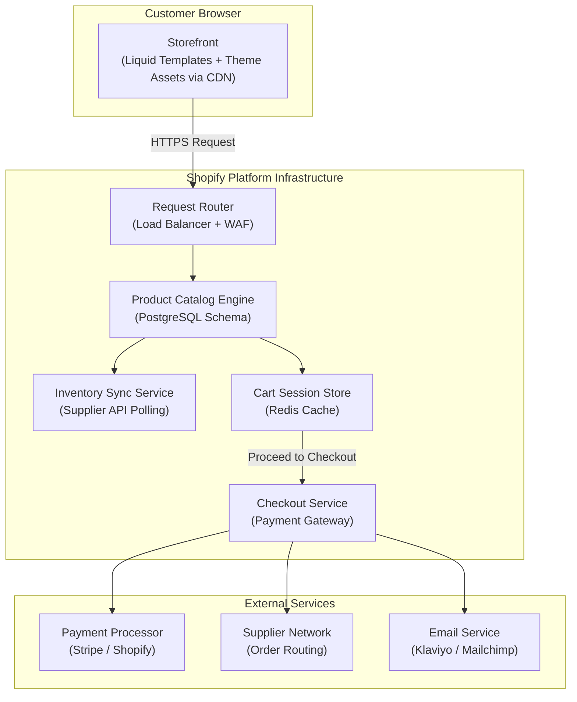
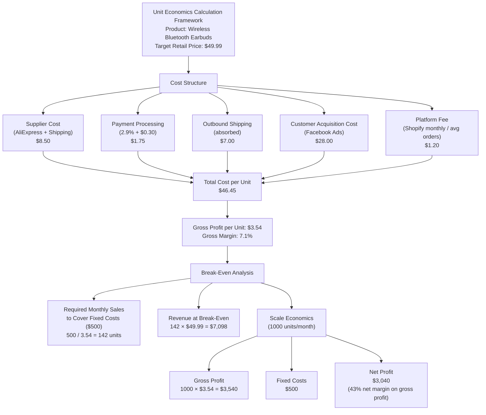

# Lesson 3: Storefront Architecture, Product Selection, Conversion Optimization

## 1. First-Principles Intuition & Invariants

The dropshipping storefront exists at the intersection of inventory-light commerce and zero-touch fulfillment, but its commercial viability depends entirely on conversion rate optimization mechanics that most operators fail to architect correctly from first principles. Unlike traditional retail where the store acts as a discovery interface for owned inventory, the dropshipping storefront must compensate for three structural disadvantages: extended shipping timelines imposed by third-party suppliers, zero differentiation in product sourcing since competitors access identical supplier catalogs, and razor-thin margin structures that collapse under any friction in the acquisition funnel. These constraints create a paradox where the store must simultaneously appear authoritative and trustworthy while operating with supplier dependencies that introduce unpredictable lead times and quality variance beyond the operator's direct control.

The fundamental invariant governing dropshipping storefront architecture is that conversion rate becomes the dominant variable determining unit economics sustainability, not traffic volume or average order value in isolation. This occurs because customer acquisition cost in paid traffic channels—Facebook Ads, Google Shopping, TikTok—rises monotonically as audience saturation increases, while organic discovery through search engines requires content moats that dropshippers typically cannot sustain against established brands. The mathematical consequence is brutal: if your storefront converts at two percent and competitors achieve four percent on identical traffic sources, you require twice the ad spend to generate equivalent revenue, immediately eroding gross margin below operational breakeven in commodity product categories where supplier pricing remains fixed across all resellers.

The correct mental model positions the storefront as a conversion rate engine rather than a catalog display interface. Every architectural decision—platform infrastructure selection, page load performance, checkout flow design, trust signal placement—must be evaluated through the lens of friction reduction in the purchase decision path. This requires rejecting the aesthetic-first design philosophy that dominates consumer brand storytelling in favor of a ruthlessly empirical approach where every pixel, every form field, and every content block exists solely to move the visitor closer to transaction completion or be eliminated through A/B testing. The distinction is critical: brand storytelling optimizes for emotional resonance and recall, while conversion rate optimization optimizes for immediate action under conditions of rational comparison shopping where the customer actively evaluates multiple suppliers before committing.

The storefront architecture must also accommodate the operational reality that successful dropshipping businesses operate multiple stores simultaneously rather than scaling a single flagship property. This strategy emerges from the need to test product-market fit across dozens of niches before identifying the two or three categories that deliver sustainable unit economics, combined with the risk mitigation benefit of spreading payment processor relationships across multiple merchant accounts to avoid catastrophic revenue loss when a single account faces holds or terminations. The architectural implication is that your storefront technology stack must support rapid cloning and deployment rather than bespoke customization per property, which immediately disqualifies custom-coded platforms in favor of template-based systems with standardized data schemas.

Product selection strategy in dropshipping inverts the traditional retail merchandising model where assortment breadth drives foot traffic and cross-sell opportunities. The correct approach in dropshipping is radical catalog focus on ten to fifty SKUs maximum per store, each selected through quantitative demand validation rather than intuitive taste or trend observation. This constraint exists because the dropshipper cannot leverage supplier volume discounts or negotiate exclusive distribution rights, eliminating the traditional merchandising levers of price competition and unique assortment. The only remaining differentiation vector is customer acquisition efficiency, which requires marketing creative and landing page messaging tightly coupled to specific product pain points rather than generic lifestyle positioning. A store selling two hundred products across fifteen categories cannot produce the creative depth and landing page specificity required to outperform competitors in paid acquisition channels, resulting in prohibitively high customer acquisition costs that destroy margin before the first sale closes.

The pricing strategy in dropshipping must navigate a narrow corridor between commodity price transparency—where customers can instantly locate identical products on Amazon or AliExpress through reverse image search—and the psychological pricing thresholds that trigger purchase consideration versus comparison shopping behavior. The correct framework recognizes that pricing serves as a filtering mechanism that segments customers by their willingness to pay for perceived convenience and service rather than as a margin maximization lever. Setting prices at thirty to fifty percent above identifiable commodity floors creates enough gross margin to fund customer acquisition while remaining below the eighty to one hundred percent markups that trigger consumer skepticism and competitor research. This pricing band acknowledges that you are selling the integrated purchase experience—curated product discovery, consolidated checkout, domestic return handling—rather than the physical goods themselves, which remain identical across all resellers accessing the same supplier network.

Trust signal architecture becomes the dominant conversion rate determinant in dropshipping because customers instinctively recognize the absence of physical inventory and retail infrastructure, triggering elevated fraud risk assessment that must be countered through explicit credibility markers. The mathematical relationship is asymmetric: a single missing trust signal—absent return policy, no customer service contact information, missing SSL certificate indicator—can crater conversion rates by forty to sixty percent, while adding trust signals beyond a saturation threshold generates diminishing returns below five percent incremental lift. This creates a binary pass-fail threshold where your storefront must implement the complete trust signal stack before achieving competitive conversion rates, making trust architecture a non-negotiable launch requirement rather than an iterative optimization target.

The checkout flow design in dropshipping must counteract the extended shipping timeline disadvantage by minimizing transaction friction to prevent customer reconsideration during the purchase completion window. Traditional retail checkout flows tolerate four to six page transitions because customers have already invested mental energy selecting products from owned inventory with immediate fulfillment expectations. Dropshipping checkout flows collapse under this friction because the customer retains awareness that identical products exist on Amazon with two-day Prime shipping, creating a narrow commitment window where any friction—mandatory account creation, surprise shipping costs, complex form validation—triggers cart abandonment and competitor comparison. The correct architecture implements single-page checkout with guest purchase enabled, transparent shipping cost calculation before payment information entry, and autofill support for address and payment fields to reduce completion time below sixty seconds from cart to confirmation.

## 2. Core Architecture & Mechanics

Platform selection in dropshipping operates under different constraints than general ecommerce because the operator requires rapid deployment capability, supplier integration automation, and the ability to abandon underperforming stores without stranded infrastructure investment. The three dominant platforms—Shopify, WooCommerce on WordPress, and custom headless commerce stacks—each optimize for different operational profiles that determine long-term scalability and unit economics sustainability.

Shopify represents the industrial standard for dropshipping operations because it provides the complete infrastructure stack required for conversion rate optimization without requiring technical implementation expertise. The platform delivers sub-two-second page load performance through its global content delivery network, maintains PCI DSS Level 1 compliance for payment processing without operator intervention, and offers native integration with the two dominant dropshipping supplier networks: Oberlo for AliExpress sourcing and Spocket for domestic US and EU suppliers. The critical architectural advantage is that Shopify's app ecosystem provides pre-built solutions for every conversion optimization requirement—urgency timers, social proof notification widgets, cart abandonment email sequences, product review aggregation—allowing non-technical operators to implement sophisticated conversion tactics through configuration rather than development. The cost structure consists of twenty-nine dollars monthly for the base plan, two-point-nine percent plus thirty cents per transaction for payment processing, and variable app subscription costs typically ranging from forty to one hundred twenty dollars monthly for a complete conversion optimization stack.

The Shopify liquid templating system provides the technical foundation for theme customization and A/B testing implementation without requiring full-stack development expertise. Liquid operates as a server-side rendering engine that generates HTML from product data schemas, allowing operators to modify page layouts, inject dynamic content blocks, and implement conditional logic for personalization through a constrained template syntax that prevents catastrophic site breakage. The product data schema follows a normalized structure where each product entity contains variants—size, color, material combinations—that map to unique SKU identifiers tied to supplier inventory feeds. The checkout process operates through Shopify's hosted payment gateway, which handles tokenization, fraud detection, and chargeback dispute management, eliminating the operator's liability for payment card data storage and reducing payment processing failure rates below three percent through adaptive routing across multiple acquirer relationships.



WooCommerce on WordPress provides greater architectural flexibility at the cost of operational complexity that typically exceeds dropshipping operator technical capabilities. The platform operates as a PHP-based plugin ecosystem layered on WordPress content management infrastructure, requiring the operator to manage server hosting, security patch cycles, database optimization, and payment gateway integration rather than relying on platform-managed services. The architectural advantage emerges in margin optimization scenarios where the operator processes sufficient volume—typically above five thousand monthly orders—to justify the reduction in transaction fees from two-point-nine percent on Shopify to one-point-five percent through direct payment processor integration with Stripe or Authorize.net. The hosting infrastructure cost ranges from twenty to two hundred dollars monthly depending on traffic volume and performance requirements, with additional expenses for SSL certificates, CDN services through Cloudflare or StackPath, and premium plugin licenses for conversion optimization functionality.

The WooCommerce product data model stores inventory in WordPress custom post types, creating architectural friction when synchronizing supplier feeds because the operator must implement custom integration logic rather than leveraging pre-built connectors. Product variants—size, color, material—exist as separate post entities linked through parent-child relationships rather than Shopify's native variant schema, creating database query performance degradation above five thousand SKU catalogs that requires manual query optimization and caching layer implementation. The checkout flow operates through template files that the operator must customize directly, providing unlimited design flexibility but requiring PHP development expertise to implement trust signal optimizations, checkout field reduction, and payment method prioritization logic that Shopify delivers through administrative configuration.

Custom headless commerce architectures using React or Vue.js storefronts with backend order management APIs represent the performance ceiling for conversion rate optimization but introduce engineering overhead that eliminates profitability for operators below one million dollars annual revenue. The architectural pattern decouples the customer-facing storefront from the order management and inventory systems, allowing the frontend to achieve sub-one-second page load performance through static site generation and edge caching while the backend handles supplier integration, order routing, and fulfillment tracking through API contracts. The technology stack typically consists of Next.js or Gatsby for the storefront application, a headless commerce backend like Medusa or Commerce.js for cart and checkout functionality, and custom middleware services for supplier integration and inventory synchronization. The development cost ranges from fifteen thousand to fifty thousand dollars for initial implementation, with ongoing maintenance requiring dedicated frontend and backend engineering resources that consume fixed costs incompatible with dropshipping's variable revenue model.

Product selection methodology in high-performing dropshipping operations follows a quantitative validation framework that tests demand signals before committing inventory capital or marketing spend. The correct approach recognizes that product intuition and trend observation introduce survivor bias because operators only observe successful products in competitor stores without understanding the dozens of failed product tests that preceded each winner. The validation framework must therefore test demand independent of competitor success signals through search volume analysis, social platform engagement metrics, and micro-scale paid traffic testing before scaling catalog investment.

The demand validation process begins with search volume analysis through Google Keyword Planner and Ahrefs to identify product categories with monthly search volumes between ten thousand and one hundred thousand queries in your target geographic market. This range represents the optimal balance between demand sufficiency to support paid acquisition and competition intensity that drives customer acquisition costs above sustainable thresholds. Product categories with search volumes below ten thousand monthly queries lack the audience scale to support consistent paid traffic testing, while categories exceeding one hundred thousand monthly searches attract established brand competition with wholesale supplier relationships that enable pricing below dropshipper margins. The keyword research must focus on product-intent queries—"buy wireless earbuds," "best yoga mat for home"—rather than informational queries—"how to choose earbuds," "yoga benefits"—because informational query traffic converts at one-tenth the rate of product-intent traffic and requires content marketing infrastructure beyond dropshipper operational capabilities.

Social platform engagement analysis provides a leading indicator of demand trajectory by identifying products with accelerating share, comment, and save activity on Instagram, TikTok, and Pinterest before search volume reflects the trend. The analysis framework tracks hashtag growth rates—products with hashtag volume increasing twenty percent month-over-month represent emerging opportunities—and identifies influencer content patterns where products appear organically in lifestyle content rather than through obvious sponsored placements. The critical distinction is that viral product trends experience exponentially growing engagement for eight to sixteen weeks before saturating and declining, creating a narrow window where dropshippers can exploit elevated demand before supplier networks become saturated with competing stores. The validation threshold requires observing consistent week-over-week engagement growth over a four-week period rather than responding to single viral posts that often represent temporary spikes without sustained demand.

Micro-scale paid traffic testing provides the definitive demand validation by measuring actual purchase behavior rather than search or engagement proxies. The testing framework allocates fifty to one hundred fifty dollars to Facebook or Google Shopping campaigns targeting a narrow audience segment—typically five hundred thousand to two million users—and measures conversion rate at introductory price points that generate five to ten dollar gross profit per unit. Products that convert above one percent in micro-scale testing with customer acquisition costs below half the gross profit validate sufficient demand to justify catalog inclusion and scaled traffic investment. Products that fail to achieve this threshold in testing—conversion rates below one percent or customer acquisition costs exceeding gross profit—must be eliminated regardless of search volume or social engagement signals because actual purchase behavior represents the ground truth that supersedes all proxy metrics.

The product catalog curation strategy must maintain radical focus on ten to fifty validated SKUs rather than expanding catalog breadth in an attempt to maximize average order value through cross-sell. This constraint exists because paid traffic acquisition creative—the images, videos, and copy used in Facebook Ads and Google Shopping—must align precisely with landing page product messaging to maintain scent from ad impression through checkout completion. An operator attempting to promote fifty products through paid traffic must produce fifty independent creative variations and landing page experiences to maintain this scent, while an operator focused on ten core products can produce five to ten creative variations per product and iterate based on performance data. The creative depth advantage compounds over time because the focused operator accumulates creative testing learnings that improve customer acquisition efficiency, while the broad catalog operator spreads testing budget across too many products to achieve statistical significance in creative performance measurement.

Pricing strategy implementation requires calculating the complete unit economics chain from supplier cost through customer acquisition cost to landed gross profit, then working backward to identify the customer-facing price that sustains positive contribution margin at scale. The supplier cost represents the wholesale price plus international shipping if sourcing from AliExpress or equivalent overseas networks, typically ranging from three to fifteen dollars for physical products in the twenty to eighty dollar retail price band. The payment processing cost consumes two-point-nine percent of transaction value plus thirty cents per order on Shopify or equivalent platforms, meaning a fifty dollar order incurs one dollar seventy-five in processing fees. The customer acquisition cost depends on traffic channel and conversion rate but typically ranges from fifteen to forty dollars in Facebook Ads for cold audience targeting, assuming conversion rates between one and three percent. The shipping cost to the end customer must be explicitly calculated even when presented as "free shipping" because the operator pays outbound shipping whether absorbed in product price or charged separately, typically ranging from five to twelve dollars for domestic US fulfillment through supplier networks.



The pricing calculation reveals why most dropshipping operations fail: gross margins below ten percent leave zero buffer for customer acquisition cost variance, creative testing budget, or operational overhead, creating a binary outcome where even minor performance degradation collapses profitability. The correct response is to filter products during validation that cannot sustain twenty to thirty percent gross margins after all variable costs, even if this eliminates ninety percent of potential products, because sustained profitability requires margin buffers to absorb the inevitable traffic cost inflation that occurs as Facebook and Google audience targeting saturates over time.

Psychological pricing implementation must account for the perception anchoring effects that influence purchase probability independent of absolute price levels. The foundational principle recognizes that customers evaluate prices through relative comparison rather than absolute value assessment, meaning the price perception depends more on competitive context and reference points than on the actual dollar amount. The nine-dollar-ninety-nine-cents pricing convention—charging $49.99 instead of $50.00—reduces perceived price by disproportionately more than one cent because customers anchor on the leftmost digit and round down rather than processing the complete value. This effect generates three to eight percent conversion rate lift in A/B testing across consumer product categories, making it a non-negotiable implementation despite its ubiquity.

The bundle pricing strategy increases average order value by presenting package deals that combine complementary products at a modest discount to individual purchase price, but the implementation must avoid the common error of creating bundles that reduce per-unit gross margin below sustainability thresholds. The correct framework maintains per-unit gross margin constant by discounting the bundle price by only the saved customer acquisition cost from selling multiple units to a single customer, typically ten to twenty percent of retail price, rather than offering aggressive thirty to forty percent bundle discounts that destroy margins in an attempt to increase order value. A properly structured bundle converts fifteen to twenty-five percent of single-product purchasers into multi-product buyers without sacrificing gross profit per customer, improving lifetime value through increased initial purchase commitment.

## 3. High-Performance Optimization & Failure Modes

Page load performance optimization represents the highest-leverage conversion rate improvement available to dropshipping operators because most stores operate with load times exceeding four seconds, creating forty to sixty percent abandonment before the customer even views product information. The performance bottleneck emerges from unoptimized images, excessive third-party script loading from conversion optimization apps, and inefficient CSS rendering that blocks initial page paint. The correct optimization framework measures page load performance through Google PageSpeed Insights and targets achieving ninety-plus performance scores on mobile devices, which translates to sub-two-second load times on 4G connections.

Image optimization provides the largest single performance improvement because product images typically consume seventy to eighty percent of page weight in dropshipping stores that display eight to twelve product images on listing pages. The optimization process converts all images to WebP format, which reduces file size by thirty to fifty percent compared to JPEG at equivalent visual quality, implements lazy loading so images outside the initial viewport only load when the customer scrolls, and serves appropriately sized image variants through responsive image markup rather than loading desktop-resolution images on mobile devices. The Shopify platform implements these optimizations automatically through its image CDN when using the liquid image filter syntax, while WooCommerce operators must install plugins like ShortPixel or Imagify to achieve equivalent optimization. The performance impact is dramatic: reducing total page weight from four megabytes to one megabyte through image optimization alone typically improves load time by two to three seconds and increases conversion rate by twelve to eighteen percent.

Third-party script optimization requires ruthlessly auditing every installed app and conversion optimization widget to eliminate those that provide marginal conversion benefit while imposing substantial performance costs. The common failure pattern loads fifteen to twenty scripts—urgency countdown timers, social proof notification pop-ups, exit-intent overlays, live chat widgets, email capture forms—each adding three hundred milliseconds to one second of load time and creating compounding delays that push total page load above five seconds. The correct approach implements a cost-benefit analysis where each script must demonstrate measurable conversion rate improvement exceeding five percent to justify its performance cost, eliminating marginal tactics that contribute one to two percent lift while degrading core page load performance. The typical optimization removes eight to twelve scripts, improving load time by two to four seconds while reducing conversion rate by only three to five percent from eliminated tactics, resulting in net conversion improvement of seven to thirteen percent from faster load times.

Trust signal architecture must balance credibility enhancement against the diminishing returns and visual clutter that emerge from excessive trust marker implementation. The foundational trust signals that generate measurable conversion improvements include prominent display of return policy terms on product pages, visible customer service contact information including phone number and email in the site header, SSL certificate indicators showing the secure connection padlock icon in the browser address bar, and payment method logos displaying accepted credit cards and PayPal at checkout. These four signals combined generate twenty to thirty percent conversion rate lift when added to stores lacking them, representing the minimum viable trust stack required for competitive conversion rates.

Advanced trust signal implementation adds customer review displays, third-party security badges from Norton or McAfee, shipping guarantee promises, and social proof counters showing recent purchases or product view counts. The empirical testing data demonstrates that these advanced signals generate incremental lift of only three to eight percent beyond the foundational trust stack, creating a saturation point where additional trust markers contribute minimal benefit while increasing visual noise and page complexity. The correct implementation establishes the foundational trust stack as a launch requirement, then tests advanced signals individually through A/B testing to measure their specific impact before permanent implementation, avoiding the common error of implementing every available trust tactic without performance validation.

Customer review implementation requires solving the cold start problem where new stores lack authentic purchase history to generate organic reviews. The acceptable solution sources initial reviews through customer incentive programs where early purchasers receive ten to twenty percent discount codes in exchange for verified review submission, clearly disclosing the incentive relationship to maintain Federal Trade Commission compliance with endorsement guidelines. The review solicitation email triggers seven days after delivery confirmation, allowing customers sufficient product experience to provide meaningful feedback. The review content must include customer name and purchase verification status to satisfy authentic review criteria, avoiding the fraud risk of fabricated reviews that trigger platform account termination when detected. The critical threshold requires accumulating twenty to thirty reviews with an average rating above four-point-zero stars before review display generates measurable conversion benefit, because displays showing fewer reviews or lower ratings reduce conversion by creating negative social proof.

Checkout friction reduction follows a systematic optimization framework that measures abandonment at each checkout stage and eliminates sources of hesitation or confusion in the purchase completion path. The baseline checkout flow on Shopify and WooCommerce platforms implements a three-page sequence: cart review, shipping information entry, and payment information entry. The optimization framework reduces this to a single-page checkout where all information fields display simultaneously, reducing abandonment by fifteen to twenty-five percent by eliminating page transitions where customers reconsider the purchase decision. The single-page implementation maintains logical information grouping—customer contact, shipping address, payment details—but removes the friction of clicking "Continue" buttons between stages that introduce micro-delays where customers evaluate whether to proceed or comparison shop.

Form field reduction represents the second-highest-impact checkout optimization by eliminating every non-essential information request that increases completion time or cognitive load. The default checkout implementations request company name, address line two, and phone number fields that contribute zero value for consumer dropshipping fulfillment while increasing abandonment through perceived form complexity. The optimized implementation restricts required fields to name, email, street address, city, state, postal code, and payment information, reducing average completion time from ninety seconds to forty-five seconds and improving checkout conversion by twelve to eighteen percent. The critical insight is that every removed field provides conversion benefit even when customers would have completed the original form, because reduced form length creates perception of faster checkout that decreases reconsideration likelihood.

Shipping cost transparency must present total landed price including shipping before the customer enters payment information, because surprise costs revealed at payment stage generate thirty to forty percent abandonment rates that destroy conversion funnel efficiency. The correct implementation calculates shipping cost based on address input and displays the total prominently before payment information entry, even when this reveals higher prices than competitors charging lower product prices plus shipping. The transparency advantage converts more customers than the pricing advantage of split pricing because customers who abandon at shipping cost revelation never complete purchases even at lower total prices, while customers who proceed past transparent pricing display have already committed to the purchase decision and rarely abandon during payment entry.

The "free shipping" pricing strategy absorbs shipping costs into product price rather than charging separately, generating ten to fifteen percent conversion rate improvement in A/B testing by eliminating the psychological friction of itemized shipping charges. The implementation increases product price by the average shipping cost—typically seven to ten dollars—and displays prominent "FREE SHIPPING" messaging on product pages and throughout checkout. The apparent contradiction—customers pay identical total prices whether shipping is itemized or absorbed—resolves through loss aversion psychology where customers perceive itemized shipping as a loss imposed by the merchant, while absorbed shipping registers as a benefit the merchant provides. The conversion improvement occurs despite identical total prices because the psychological framing shifts customer perception from evaluating cost fairness to evaluating product value.

A/B testing framework implementation must follow statistical rigor requirements that most dropshipping operators violate, generating false positive conclusions that destroy profitability through scaled deployment of inferior variations. The correct testing methodology requires calculating minimum sample size before launching tests to ensure statistical power sufficient to detect realistic effect sizes, typically eight to twelve percent conversion rate differences. The sample size calculation depends on baseline conversion rate and desired confidence level but typically requires five hundred to two thousand visitors per variation to achieve ninety-five percent confidence in detecting ten percent conversion differences. Tests deployed without pre-calculated sample sizes frequently terminate early when one variation shows apparent advantage, introducing selection bias that results in type one errors—false positives—fifty percent of the time.

```
A/B Test Sample Size Calculation

Given:
  Baseline Conversion Rate: 2.5%
  Minimum Detectable Effect: 15% relative improvement
    (2.5% → 2.875% absolute)
  Statistical Power: 80%
  Significance Level: 95% (α = 0.05)

Sample Size per Variation:
  n = [Z₁₋α/₂ + Z₁₋β]² × [p₁(1-p₁) + p₂(1-p₂)] / (p₂ - p₁)²
  
  Where:
    Z₁₋α/₂ = 1.96 (two-tailed test at 95% confidence)
    Z₁₋β = 0.84 (80% power)
    p₁ = 0.025 (baseline conversion)
    p₂ = 0.02875 (target conversion)

  n = [1.96 + 0.84]² × [0.025(0.975) + 0.02875(0.97125)] / (0.00375)²
  n = 7.84 × 0.0524 / 0.0000141
  n ≈ 29,100 visitors per variation

Total Test Traffic Required: 58,200 visitors

Time to Completion (at 1,000 visitors/day): 58 days

Revenue Exposure During Test:
  58,200 visitors × 2.5% baseline conversion × $50 AOV = $72,750

Risk-Adjusted Decision Threshold:
  Expected gain from 15% improvement: $72,750 × 0.15 = $10,913
  Test duration opportunity cost justifiable only if expected gain > $5,000
```

The sample size calculation reveals why most small-scale dropshipping operations cannot implement rigorous A/B testing: achieving statistical significance requires traffic volumes that take weeks or months to accumulate, during which market conditions, supplier inventory, or competitive landscape shifts invalidate the test conclusions. The correct response for operators processing fewer than one thousand daily visitors is to abandon continuous A/B testing in favor of batch testing cycles where you implement multiple evidence-based optimizations simultaneously, measure aggregate impact over two to four weeks, then standardize the winning configuration before testing the next batch. This approach sacrifices the ability to isolate individual tactic effects but allows low-traffic stores to implement optimization learnings from high-traffic operators without requiring months-long testing periods.

Customer psychology optimization focuses on the cognitive biases and heuristics that influence purchase decisions in conditions of uncertainty, which dominate dropshipping where customers cannot physically evaluate products or rely on brand reputation. The scarcity principle—presenting limited inventory availability or time-limited offers—activates loss aversion that increases purchase urgency, but implementation must maintain authenticity boundaries because false scarcity claims violate Federal Trade Commission deceptive advertising standards and trigger consumer distrust when detected. The correct implementation displays actual inventory counts when quantities fall below twenty units and implements genuine time-limited promotions tied to holidays or product launches rather than perpetual countdown timers that reset daily.

Social proof implementation leverages the conformity bias where customers interpret others' purchase decisions as information signals that reduce their own decision uncertainty. The effective tactics include displaying recent purchase notifications—"Sarah from Austin purchased 2 minutes ago"—and showing aggregate purchase counts—"1,247 customers purchased this week"—that establish product popularity without making specific outcome claims. The implementation must source data from actual order records rather than simulated activity to maintain FTC compliance and avoid the reputational damage from detected fraud. The conversion impact ranges from eight to fifteen percent when implemented on product pages, with larger effects in unfamiliar product categories where customers lack prior purchase experience to evaluate quality independently.

Authority signal implementation establishes merchant credibility through expert endorsements, media mentions, or certification displays that transfer legitimacy from recognized institutions to the merchant. The accessible tactics for dropshippers include displaying "As Seen On" logos from media properties where products received organic coverage, showcasing industry awards or certifications relevant to product categories, and featuring expert testimonials from recognized professionals in the product domain. The critical constraint is that all authority claims must be verifiable and authentic because fraudulent credentials trigger immediate customer distrust when investigated and create legal liability for false advertising. The conversion impact from authentic authority signals ranges from five to twelve percent, with larger effects in categories like health supplements, safety equipment, or technical products where customers require credible expertise validation before purchase.

The urgency and scarcity optimization must avoid the failure mode where excessive urgency tactics—countdown timers, limited stock warnings, "only 3 left" messages—create perception of manipulative pressure that triggers reactance and reduces conversion. The empirical testing data demonstrates that conversion improvement from urgency tactics peaks at moderate implementation levels—one urgency element per page such as a time-limited discount banner—and declines when multiple urgency triggers display simultaneously because customers interpret the intensity as desperation signaling or fraud indicators. The correct implementation restricts urgency messaging to the most credible tactic available for each product—actual inventory scarcity for fast-moving items, legitimate time-limited promotions for seasonal products—rather than artificially manufacturing urgency through fabricated constraints.

The failure mode analysis identifies the three dominant mechanisms that cause profitable dropshipping stores to collapse within twelve to eighteen months of launch: traffic cost inflation as Facebook and Google ad platforms saturate your target audiences and increase cost-per-click bidding, supplier relationship deterioration when quality or shipping performance degrades and the supplier refuses to address issues because dropshippers represent low-priority customers without volume commitments, and platform account termination when payment processors or storefront platforms suspend accounts due to elevated chargeback rates or policy violations. The correct operational strategy builds systematic defenses against each failure mode rather than reacting after collapse begins.

Traffic cost inflation mitigation requires continuous creative testing and audience expansion to prevent targeting saturation that drives cost-per-acquisition above sustainable thresholds. The defensive strategy produces three to five new creative variations per product every two weeks, testing different value propositions, visual styles, and offer structures to identify messaging that resonates with untapped audience segments. The audience expansion implements progressive targeting broadening where you start with narrow interest-based audiences—people interested in specific product categories—then expand to lookalike audiences modeled on purchaser behavior once you accumulate fifty to one hundred conversion events. The critical threshold monitoring tracks cost-per-acquisition trends week-over-week and triggers creative refresh cycles when CPA increases twenty percent above the four-week baseline, preventing gradual profit erosion from unnoticed cost inflation.

Supplier relationship management requires establishing backup supplier relationships before primary suppliers degrade performance, because identifying and onboarding replacement suppliers after quality or shipping failures begin typically requires four to eight weeks during which your store suffers poor customer experience and elevated return rates. The correct strategy qualifies two to three suppliers per product during initial sourcing, placing test orders from each supplier to validate quality consistency and shipping reliability before scaling primary supplier relationship. The backup supplier activation triggers when primary supplier performance degrades across specific metrics: shipping time exceeding promised timelines by more than three days, product defect rates rising above five percent of orders, or supplier communication becoming unresponsive beyond twenty-four hour reply windows. The supplier diversification prevents catastrophic performance collapse but requires maintaining relationships through occasional orders to backup suppliers even when primary supplier performs adequately, incurring modest cost overhead that functions as insurance against single-supplier dependency risk.

Platform account risk mitigation implements financial infrastructure diversification that prevents total revenue loss when individual payment processors or platform accounts face holds or terminations. The defensive architecture operates multiple merchant accounts across different payment processors—Shopify Payments, Stripe, PayPal—and distributes revenue processing across accounts to prevent concentration risk. The account distribution strategy processes thirty to forty percent of revenue through each processor rather than concentrating all revenue through a single provider, ensuring that account suspension of any single processor reduces revenue capacity by less than half rather than eliminating revenue completely. The infrastructure overhead includes maintaining separate business entities and bank accounts for each merchant account to satisfy processor underwriting requirements, incurring legal formation costs of five hundred to one thousand dollars per entity plus ongoing compliance costs that function as catastrophic risk insurance.

The chargeback rate management represents the critical variable determining platform account longevity because payment processors automatically terminate merchant accounts when chargeback rates exceed one percent of transaction volume. The rate accumulates from customer disputes claiming non-delivery, product not as described, or unauthorized charges, with each dispute assessed whether ultimately won or lost by the merchant. The defensive strategy implements three layers of prevention: preemptive customer service outreach when tracking information shows shipping delays, proactive partial refunds when customers report minor quality issues before they escalate to formal disputes, and detailed product descriptions with high-resolution images that establish clear expectation alignment reducing "not as described" disputes. The chargeback rate monitoring tracks monthly dispute volume and implements emergency intervention protocols—temporary advertising pause, enhanced shipping carrier selection, supplier quality review—when monthly chargeback rate approaches seventy-five basis points, providing buffer before reaching the one percent termination threshold.
