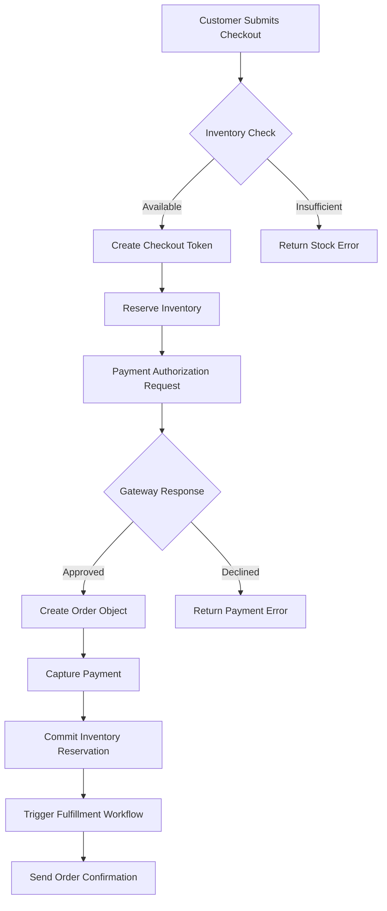

# Lesson 2: Checkout Flow, Payment Processing, Order Fulfillment

## 1. First-Principles Intuition & Invariants

The checkout flow represents the most economically critical conversion funnel in any ecommerce operation, yet practitioners frequently treat it as a simple form submission mechanism rather than the complex state machine it truly is. Every abandoned cart represents not merely lost revenue but a diagnostic signal about friction points in the customer journey, payment authorization failures, shipping calculation errors, or trust deficits in the purchase experience. Understanding the checkout flow from first principles requires recognizing that it orchestrates at least four independent subsystems—inventory reservation, payment authorization and capture, tax and duty computation, and fulfillment workflow initiation—each with distinct failure modes and rollback requirements.

Shopify's checkout architecture embodies a deliberate separation between the cart object, which exists as mutable customer intent, and the order object, which represents an immutable financial commitment. This distinction is not merely semantic. The cart lives in a perpetual draft state where line items can be added, removed, or modified without financial consequence. The moment a customer commits payment authorization, Shopify executes an atomic state transition that snapshots cart contents into a permanent order record, reserves inventory quantities against specific SKU-location combinations, initiates payment capture through the configured gateway, calculates final tax obligations based on nexus rules, and triggers fulfillment workflows across potentially multiple warehouses or dropship vendors.

The foundational invariant governing this transition is idempotence. A customer clicking "Complete Order" multiple times, whether due to UI confusion or network latency, must never generate duplicate charges or inventory reservations. Shopify enforces this through checkout tokens—cryptographically signed identifiers that permit exactly one successful order creation attempt. Once consumed, the token expires, and subsequent submission attempts return the existing order reference rather than creating duplicates. This idempotency guarantee extends through the entire payment processing chain, where gateway transaction identifiers ensure that authorization and capture operations cannot be accidentally replicated even under retry conditions.

Payment processing itself operates on a two-phase commit protocol inherited from traditional credit card merchant acquiring. The authorization phase locks funds on the customer's payment instrument and returns a temporary hold identifier, but does not transfer money to the merchant account. This phase validates that sufficient funds or credit exists and performs fraud screening through Address Verification System (AVS) checks, Card Verification Value (CVV) validation, and 3D Secure authentication challenges when required. The capture phase, which may occur immediately or be delayed until fulfillment, actually settles the transaction and initiates the funds transfer. Shopify permits merchants to separate these phases, enabling business models where authorization occurs at checkout but capture is deferred until the item ships, reducing refund friction for out-of-stock scenarios or custom manufacturing delays.

The inventory management subsystem operates under optimistic concurrency assumptions during browsing but enforces pessimistic locking at checkout. While customers browse the storefront, Shopify displays available quantities without reserving stock, accepting the risk that high-demand items might sell out between product page view and cart addition. At the moment of checkout initiation, however, Shopify transitions to reserved inventory state, where cart line items decrement available quantities for a bounded time window, typically thirty minutes. If the customer completes the purchase, these reservations convert to committed allocations. If the checkout session expires without completion, the reserved quantities return to the available pool, preventing inventory deadlock from abandoned sessions.

Fulfillment workflows introduce additional state complexity because modern ecommerce operations rarely ship all items from a single location. Multi-location inventory, dropshipping partnerships, print-on-demand integrations, and third-party logistics providers necessitate order splitting, where a single customer order fans out into multiple fulfillment tasks across different suppliers. Shopify models this through fulfillment orders, child objects that assign specific line items to specific locations with independent tracking numbers and shipping carriers. The parent order remains the source of truth for customer communication and financial accounting, while fulfillment orders manage the operational logistics of getting products to the customer's address.

Shipping calculation represents one of the most underestimated complexity sources in checkout optimization. Real-time carrier-calculated rates require synchronous API calls to FedEx, UPS, USPS, or regional carriers during checkout rendering, introducing latency and failure points. These calculations depend on package dimensions and weights, origin and destination postal codes, declared item values for insurance, and service level selection. Shopify caches carrier rate responses aggressively but must invalidate these caches whenever cart contents change, as adding a heavy item or reaching a dimensional weight threshold can dramatically alter shipping costs. Many high-volume merchants pre-negotiate flat-rate or table-based shipping rules to eliminate this runtime dependency, trading calculation precision for checkout speed and reliability.

Tax computation adds another layer of real-time dependency, particularly for merchants with physical or economic nexus in multiple jurisdictions. United States sales tax alone involves over eleven thousand distinct tax jurisdictions when accounting for state, county, city, and special district rates. Shopify integrates with Avalara and TaxJar to handle these calculations, but the integration point sits directly in the checkout critical path. A tax service outage or timeout can block order completion, forcing merchants to choose between failing the transaction, falling back to approximate ZIP-code-based estimates, or deferring tax collection to invoice reconciliation. International merchants face additional complexity with Value-Added Tax (VAT), Goods and Services Tax (GST), and customs duty calculations that vary by product harmonized tariff codes and customer import registration status.

The checkout flow's economic importance makes it the primary target for conversion rate optimization, yet mechanical constraints limit experimentation velocity. Unlike product pages or marketing landing pages where A/B tests can run continuously, checkout modifications risk revenue loss from introduced bugs or friction. Shopify Plus merchants gain access to checkout.liquid template customization and Script Editor for dynamic pricing rules, but these modifications execute in a sandboxed environment with strict performance budgets. Checkout scripts exceeding fifty-millisecond execution time get automatically terminated to prevent performance degradation. This forces practitioners to optimize aggressively, pre-computing discount eligibility and caching complex shipping rules rather than performing expensive calculations in the checkout hot path.

## 2. Core Architecture & Mechanics

The cart-to-order state machine in Shopify progresses through five distinct stages, each with specific data structure transformations and external service integrations. Understanding this progression requires examining the object schemas, API contracts, and database transaction boundaries that enforce consistency guarantees.

The cart object exists as a session-scoped container indexed by a persistent cart token stored in the customer's browser cookie. This token, typically a 32-character hexadecimal string, survives across browsing sessions and device switches if the customer authenticates, enabling cart recovery campaigns. The cart schema contains line items with variant identifiers, quantities, and custom properties for personalization data like engraving text or gift messages. Each line item references a product variant through an immutable variant ID that survives product title changes or image updates. This indirection ensures that cart contents remain semantically correct even if the merchant renames products or reorganizes collections.

When a customer navigates to checkout, Shopify instantiates a checkout object distinct from the cart, copying line items but adding validation layers. The checkout object introduces shipping address capture, which triggers multiple downstream calculations. First, the shipping address determines tax jurisdiction through postal code lookup, initiating communication with the tax service provider. Second, the address establishes the destination zone for carrier rate calculation, where zones are merchant-defined geographic groupings like "Domestic," "Canada," or "European Union." Third, the address influences payment gateway routing, as some processors charge different interchange rates for domestic versus international cards, and certain fraud detection rules apply different risk scores based on billing-shipping address mismatches.

```
Cart Object Schema:
- token: string (persistent identifier)
- line_items: array
  - variant_id: integer (immutable product reference)
  - quantity: integer
  - properties: object (custom attributes)
- note: string (customer message)
- attributes: object (cart-level metadata)

Checkout Object Schema (extends Cart):
- checkout_token: string (single-use idempotency key)
- email: string (customer contact)
- shipping_address: object
  - address1, address2, city, province, country, zip
- shipping_line: object
  - code: string (carrier service identifier)
  - price: decimal
  - source: enum (API, manual, calculated)
- tax_lines: array
  - title: string (jurisdiction name)
  - rate: decimal
  - price: decimal
- payment_gateway: integer (gateway reference)
- total_price: decimal (immutable snapshot)
```

The shipping rate calculation flow involves querying all enabled carrier services and presenting options to the customer. Shopify maintains a carrier service abstraction layer that normalizes responses from heterogeneous shipping APIs. When a customer requests rates, Shopify sends a webhook or direct API call to each configured service with a standardized payload containing origin location, destination address, package dimensions inferred from product weights, and total declared value. Each carrier returns a list of service levels with prices and estimated delivery timeframes. Shopify aggregates these responses, applies any merchant-defined markup percentages or flat adjustments, filters results based on availability rules, and renders the unified rate list in the checkout interface.

Third-party carrier integrations typically implement this through carrier service callbacks, where Shopify makes an HTTP POST request to a merchant-controlled endpoint during checkout rendering. This endpoint must respond within three seconds or face automatic timeout, which surfaces to the customer as "shipping rates unavailable." High-performance implementations pre-calculate and cache common rate combinations during off-peak hours, storing results in a fast key-value store indexed by origin-destination pairs and weight brackets. The real-time callback then becomes a cache lookup rather than a live carrier API invocation, reducing latency from hundreds of milliseconds to single-digit response times.

Payment processing begins when the customer submits the checkout form with payment instrument details. Shopify's payment gateway abstraction supports over one hundred processors, from global players like Stripe, PayPal, and Adyen to regional specialists like Mollie in Europe or Razorpay in India. Each gateway integration implements a common interface with authorization, capture, void, and refund operations, but the underlying protocol varies significantly. Credit card gateways typically receive tokenized payment credentials through client-side JavaScript that communicates directly with the gateway's PCI-compliant endpoints, returning a single-use token to Shopify's server. This token substitution ensures that raw card numbers never traverse Shopify's infrastructure, maintaining PCI DSS compliance through scope reduction.

The authorization request payload includes the tokenized payment instrument, transaction amount, currency code, billing address, and fraud analysis parameters like customer IP address, browser user agent, and prior order history. The gateway performs real-time risk assessment, consulting card network rules, internal fraud models, and merchant-configured velocity limits. A successful authorization returns a transaction identifier and an authorization code, typically a six-character alphanumeric string that the merchant must reference if disputing a chargeback. The funds remain locked on the customer's account but not yet transferred, giving merchants a window—usually seven days for card payments—to capture or void the authorization.



The atomic order creation transaction locks multiple database tables to ensure consistency. Shopify creates the order record with a sequential order number, copies all checkout data into immutable fields, decrements inventory quantities across affected locations, logs a financial transaction record for accounting integration, and queues background jobs for email notifications and webhook delivery. This transaction executes within a serializable isolation level to prevent race conditions where two customers simultaneously purchase the last unit of a scarce item. If any step fails—payment capture errors, inventory write conflicts, or database constraints—the entire transaction rolls back, returning the customer to the checkout form with an error message and releasing any reserved inventory.

Fulfillment workflows initiate immediately after order creation through fulfillment order generation. Shopify's fulfillment routing logic examines each line item and determines the optimal source location based on merchant-configured priority rules. These rules can prioritize proximity to the shipping destination to minimize delivery time, balance inventory levels across warehouses, or route specific products to specialized fulfillment partners. A single order might generate three fulfillment orders: one for items shipping from the primary warehouse, another for dropship products routed to a supplier integration, and a third for print-on-demand items sent to a production facility.

Each fulfillment order exposes a state machine with distinct stages: open, in_progress, success, cancelled, error, and incomplete. The open state indicates that the fulfillment location has been notified but hasn't acknowledged receipt. Warehouse management systems integrated through the Fulfillment API poll for new fulfillment orders or receive real-time webhooks, download line item details and shipping labels, and transition the state to in_progress once they begin picking and packing. The success state requires providing tracking numbers and carrier identifiers, which Shopify immediately transmits to the customer through email and SMS notifications. The incomplete state handles partial fulfillments where some items ship immediately while others remain backordered, requiring careful inventory reconciliation to prevent double-shipping when backorders arrive.

Shipping label generation integrates through carrier APIs or third-party shipping middleware like ShipStation, Shippo, or EasyPost. These services aggregate multiple carriers into unified APIs, provide discounted commercial rates through bulk purchasing agreements, and handle international customs documentation. When a fulfillment location requests a label, Shopify sends a request containing the fulfillment order line items, origin address, destination address, package dimensions, and insurance preferences. The shipping service calculates the exact postage cost, generates a printable label in PNG or PDF format, registers the tracking number with the carrier's network, and returns the label URL along with the final cost. This cost often differs from the estimated shipping rate shown at checkout, creating a shipping cost variance that merchants must monitor as a key operational metric.

Order editing capabilities introduce additional complexity because changes after payment capture require financial adjustments. Shopify permits adding line items, which generates an additional payment authorization for the incremental amount, or removing items, which initiates a partial refund. These modifications create order edit objects that maintain an audit trail of all changes with timestamps and staff account attribution. Refunds interact with the payment gateway's capture and void semantics: if the original authorization hasn't been captured, Shopify issues a void request that cancels the hold without settling funds; if capture has occurred, a refund request initiates a reversal that typically takes three to five business days to return to the customer's account.

## 3. High-Performance Optimization & Failure Modes

Checkout conversion rate optimization focuses on eliminating latency, reducing cognitive load, and providing transparent error recovery. Industry benchmarks indicate that every additional second of checkout load time reduces conversion by approximately seven percent, while complex multi-step checkout flows see abandonment rates exceeding seventy percent. High-performance checkout implementations obsess over three primary metrics: time to interactive (TTI), which measures how quickly the checkout form becomes usable; payment authorization success rate, tracking the percentage of attempted transactions that successfully capture funds; and fulfillment cycle time, measuring hours elapsed from order creation to shipment dispatch.

Latency optimization begins with minimizing synchronous external service calls in the checkout rendering path. Tax and shipping calculations represent the most problematic dependencies because they require real-time API responses before displaying final order totals. Advanced implementations employ progressive enhancement strategies where the checkout initially renders with estimated totals based on cached rates or ZIP-code approximations, then asynchronously refines these estimates as authoritative calculations complete. This approach presents the customer with an interactive interface within hundreds of milliseconds while accurate pricing loads in the background, providing visual feedback through loading indicators on the affected fields.

Carrier rate caching strategies vary by merchant order volume and product catalog stability. Low-volume merchants with predictable package dimensions can pre-calculate shipping rates during off-peak hours and store results indexed by origin-destination zone pairs and weight brackets. A cache entry might map "New York to California, 0-5 pounds" to a sorted list of available services with prices and transit times. At checkout, the system performs a cache lookup using the customer's shipping zone and cart weight, returning results in single-digit milliseconds. Cache invalidation occurs when merchants adjust product weights, modify shipping zones, or when carriers publish rate updates, typically quarterly. High-volume merchants with thousands of SKUs and complex packaging rules sacrifice cache hit rates and instead invest in ultra-low-latency carrier API integrations, employing connection pooling, request batching, and circuit breakers to maintain performance under load.

Payment gateway selection significantly impacts authorization success rates because different processors excel in different geographies and transaction categories. Stripe and Braintree provide excellent performance for North American and European card transactions with sophisticated fraud detection and support for alternative payment methods like Apple Pay and Google Pay. Adyen specializes in global acceptance with localized payment methods—iDEAL in the Netherlands, Boleto in Brazil, Alipay in China—essential for international merchants. PayPal offers trust signals that lift conversion rates among risk-averse customers but introduces redirect friction that increases abandonment. High-performance setups implement intelligent gateway routing where transaction attributes like card issuing country, currency, and transaction value determine which processor handles the authorization request, maximizing approval rates while minimizing interchange costs.

Fraud detection balances revenue protection against false positive friction that declines legitimate transactions. Shopify's native fraud analysis engine assigns risk scores based on order velocity, billing-shipping address mismatches, email domain reputation, IP geolocation consistency, and historical chargeback patterns. Merchants configure threshold rules: orders below a low-risk score automatically fulfill, scores above a high-risk threshold automatically cancel, and intermediate scores flag for manual review. Manual review workflows introduce fulfillment delays that erode customer experience, motivating investments in machine learning models trained on merchant-specific transaction history. These models achieve higher precision, reducing false positives while maintaining fraud catch rates.

Inventory synchronization failures create the most visible customer-facing errors because overselling generates expectation violations that damage brand reputation. Shopify's inventory management operates on eventual consistency principles where high-traffic products might briefly display availability after stock exhaustion due to caching layers. Merchants with tight inventory constraints implement inventory buffers, configuring available quantities at ninety percent of physical stock to create a safety margin. Others employ overselling policies where accepting orders beyond available inventory is acceptable if supplier replenishment arrives before fulfillment deadlines. These policies require sophisticated backorder management with customer communication workflows explaining delay reasons and offering cancellation options without penalty.

Multi-location inventory introduces routing optimization challenges where the system must decide which warehouse fulfills each order to minimize shipping costs and delivery time. Naive implementations assign orders to the geographically closest location without considering stock levels, creating imbalances where some facilities run out while others maintain excess inventory. Sophisticated routing engines implement constraint satisfaction algorithms that balance multiple objectives: minimize split shipments to avoid multiple shipping charges, prioritize high-velocity products at high-throughput facilities, route hazmat items to licensed handling locations, and consider real-time carrier transit times rather than simple distance calculations.

Checkout abandonment recovery campaigns target customers who initiated checkout but failed to complete payment, representing high-intent prospects with lower acquisition costs than cold traffic. Shopify automatically generates abandoned checkout records when customers provide email addresses but don't finalize orders, enabling automated email sequences with dynamic cart content rendering and discount incentives. High-performing recovery campaigns send the first email within one hour of abandonment with no discount, a second email at twenty-four hours offering ten percent off, and a final email at seventy-two hours with a stronger incentive or urgency messaging. Conversion rates on abandoned checkout emails typically range from eight to fifteen percent, substantially higher than cold email campaigns, because these customers have already demonstrated purchase intent.

Payment failure handling requires sophisticated retry logic because authorization declines occur for transient reasons—insufficient funds, velocity limits, network timeouts—that may resolve within hours. Shopify Payments and select gateway integrations support automatic payment retry, where failed transactions attempt authorization again after configurable delays, typically at six hours, twenty-four hours, and seventy-two hours. This retry mechanism operates transparently to the customer with optional email notifications explaining the situation and providing a link to update payment details. Successful retry conversion rates approach twenty percent, recovering substantial revenue that would otherwise be lost to payment friction.

International checkout optimization addresses currency display, customs duty transparency, and localized payment methods. Displaying prices in the customer's local currency lifts conversion rates by eliminating mental arithmetic and foreign exchange uncertainty, but requires careful handling of exchange rate fluctuation risk. Merchants choose between real-time conversion at prevailing rates, which shifts FX risk to the customer, or fixed rates updated periodically, which the merchant absorbs. Duty and import tax calculation for cross-border transactions introduces complexity because rates vary by product category, shipment value thresholds, and destination country trade agreements. Shopify Markets includes delivered duty paid (DDP) functionality that calculates and collects these fees at checkout, providing customers with landed cost certainty and eliminating surprise charges at delivery that trigger returns and disputes.

Fulfillment workflow automation reduces order processing time from hours to minutes through API integrations between Shopify and warehouse management systems. When an order enters the fulfillment queue, the WMS receives a webhook containing line items, shipping address, and service level requirements. The system generates optimized pick paths through the warehouse, assigns tasks to available staff, prints shipping labels and packing slips, and updates Shopify with tracking information the moment the package enters the carrier network. This closed-loop integration eliminates manual data entry, reduces picking errors through barcode scanning validation, and provides customers with near-real-time shipment notifications.

Return and refund workflows represent the inverse of fulfillment, requiring careful financial reconciliation and inventory reception handling. Shopify's refund API supports partial refunds, restocking fees, and inventory restock decisions on a per-line-item basis. When a customer initiates a return, the system can automatically generate a return label through carrier APIs, send the customer a printable PDF via email, and track the return package through the inbound shipping network. Upon warehouse receipt, quality control inspection determines whether items return to available inventory, move to damaged stock, or route to refurbishment. This disposition decision affects accounting because restocked items have no cost impact while damaged goods require inventory write-offs that flow through cost of goods sold.

The checkout flow's economic leverage makes it the highest-impact optimization target in ecommerce operations. A one percentage point conversion rate increase on a store processing ten thousand monthly checkout attempts with an average order value of seventy-five dollars generates nine thousand dollars in incremental monthly revenue, compounding to over one hundred thousand dollars annually. This leverage justifies substantial investment in performance optimization, user experience refinement, payment gateway selection, and fraud detection tuning. Mastering these systems—from cart state management through order fulfillment completion—separates competent ecommerce operators from those who achieve market-leading efficiency and customer satisfaction.
