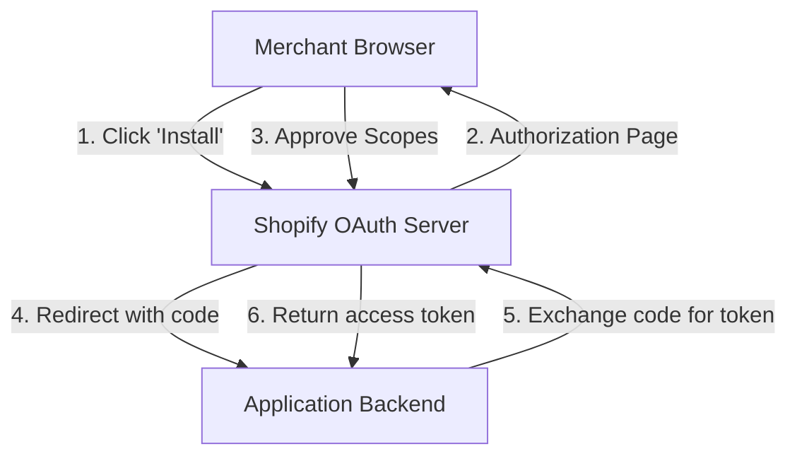
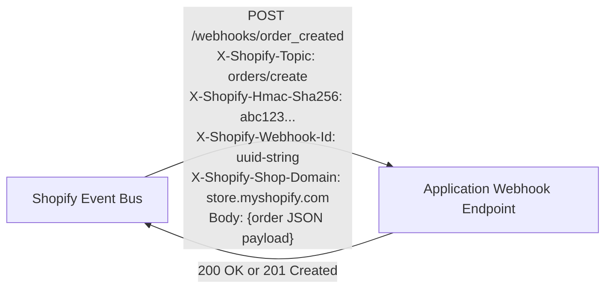
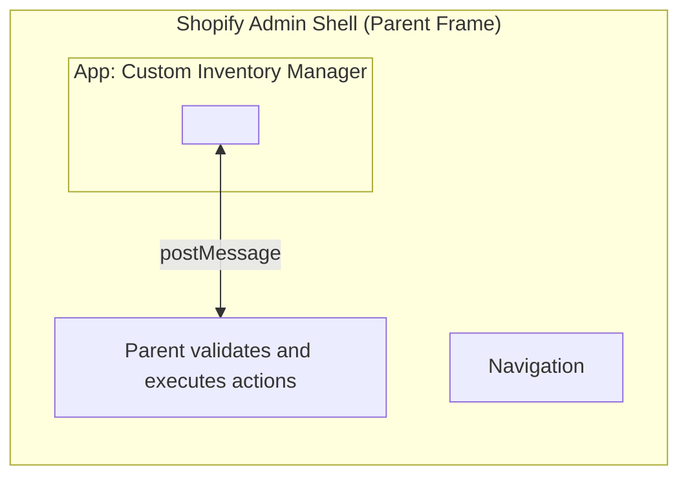

# Lesson 3: APIs, Webhooks, App Ecosystem

## 1. First-Principles Intuition & Invariants

The Shopify platform's technical architecture rests on a fundamental economic premise: merchants must be able to extend core commerce functionality without incurring the operational cost of maintaining their own infrastructure, while Shopify itself must preserve system stability and data integrity across millions of concurrent merchant operations. This tension between extensibility and control manifests in a carefully designed API surface that exposes granular commerce primitives—products, orders, customers, inventory—through both REST and GraphQL interfaces, each optimized for different access patterns and use cases.

At its foundation, Shopify's API architecture follows a resource-oriented design where every merchant entity becomes an addressable endpoint governed by OAuth 2.0 authorization scopes. When a third-party application requests access to a merchant's store, it initiates an authorization flow that exchanges a temporary authorization code for a permanent access token, scoped to specific read and write permissions. This token becomes the cryptographic bearer credential for all subsequent API requests, establishing a trust boundary that allows Shopify to enforce rate limits, audit access patterns, and revoke permissions without requiring merchants to share their administrative passwords with application vendors.

The REST Admin API, Shopify's original interface layer, organizes commerce entities into hierarchical resource collections accessed through conventional HTTP verbs. A product resource at `/admin/api/2024-01/products/632910392.json` exposes not just the product's title and description, but a nested graph of variants (each representing a unique SKU with its own price, inventory quantity, and option values), images (ordered arrays of media assets with position indices), and metafields (arbitrary key-value metadata that merchants use to store custom attributes outside Shopify's core schema). This resource nesting creates predictable access patterns but introduces n+1 query problems when clients need to traverse relationships: fetching a product's variants requires a second API call, fetching each variant's inventory locations requires additional calls, and the cumulative latency of these sequential round trips becomes untenable for applications rendering complex catalog views.

GraphQL Admin API emerged as Shopify's solution to over-fetching and under-fetching problems inherent in REST's fixed resource shapes. Where REST returns every field in a product object whether the client needs it or not, GraphQL allows clients to specify exactly which fields they want in a single request, traversing relationships through nested selection sets. A query requesting products with their first five variants, each variant's inventory quantities across all locations, and the product's first three images can be satisfied in a single HTTP POST to the GraphQL endpoint, with the response shape mirroring the query structure. This declarative data fetching reduces network overhead and server load, but introduces complexity in query cost calculation: Shopify must analyze each incoming GraphQL query to determine its computational expense before execution, rejecting queries that exceed platform-wide throttle limits.

The invariants governing both API styles center on rate limiting mechanisms designed to prevent individual applications from degrading platform performance. Shopify implements a leaky bucket algorithm where each access token receives a bucket of request credits that refills at a constant rate. REST API requests consume credits proportional to their complexity (typically 1-4 credits per request), while GraphQL queries consume credits calculated by a cost analysis algorithm that considers field selections, connection depths, and pagination sizes. When an application exhausts its bucket, subsequent requests receive 429 Too Many Requests responses with Retry-After headers indicating when credits will be available. This economic model forces application developers to optimize their data access patterns, batch operations where possible, and implement exponential backoff retry logic to gracefully handle throttling without degrading merchant experience.

Webhook subscriptions invert the traditional request-response model by allowing applications to receive push notifications when merchant data changes, eliminating the need for constant polling. When a merchant installs an application that subscribes to the `orders/create` webhook topic, Shopify registers this subscription in a distributed event bus that monitors all order creation events across the platform. The moment a customer completes checkout and an order transitions to a paid state, Shopify's webhook delivery system serializes the order resource as JSON, signs the payload with an HMAC-SHA256 signature using the application's shared secret, and POSTs this data to the application's registered webhook endpoint. This asynchronous notification model reduces API call volume by orders of magnitude, but introduces failure modes around delivery guarantees and idempotency that applications must handle correctly.

The App Bridge framework provides the final architectural pillar, enabling embedded applications to render user interfaces directly within the Shopify Admin while maintaining security boundaries through iframe sandboxing and message-passing protocols. When a merchant clicks an application link in their admin navigation, Shopify loads the application's frontend URL inside an iframe with restricted permissions—no direct DOM access to the parent frame, no ability to read cookies from the Shopify domain, no navigation control over the merchant's browser session. The application communicates with Shopify through a JavaScript SDK that serializes actions into postMessage calls, which Shopify's parent frame validates and executes. An application requesting a modal dialog dispatches a Modal.create action through App Bridge, Shopify renders the modal chrome with its own UI components, and loads the application's modal content URL in a nested iframe. This architecture ensures visual consistency across the admin interface while preventing malicious applications from executing clickjacking attacks or stealing session tokens.

Extension points represent Shopify's most recent architectural evolution, allowing applications to inject custom functionality directly into core merchant workflows without requiring iframe rendering overhead. Checkout UI Extensions enable applications to add custom fields, validation logic, and payment method integrations into the checkout flow through a declarative component model built on React-like primitives. Rather than loading arbitrary JavaScript in the checkout context (which would introduce security vulnerabilities and performance unpredictability), applications define their UI as a manifest of approved component types—text inputs, checkboxes, banners, payment buttons—that Shopify renders natively using its own component implementations. The extension communicates with its backend through Admin API mutations, maintaining the same OAuth authorization boundary, but the rendering happens inside Shopify's process space rather than an iframe, eliminating latency and ensuring accessibility compliance.

The fundamental invariant across all these architectural layers is that Shopify maintains ownership of the merchant relationship and platform stability while exposing controlled extension points that enable third-party innovation. Applications operate within strict resource boundaries, their data access is audited and rate-limited, their user interfaces are sandboxed and validated, and their webhook processing must be idempotent and resilient to delivery failures. Merchants benefit from a rich ecosystem of specialized applications without assuming the operational burden of vetting security implementations or managing API credentials across dozens of vendors. Shopify captures platform value by charging application developers revenue share fees (ranging from 10% to 25% depending on revenue tiers) while simultaneously increasing merchant retention by making the platform more valuable through its extensibility.

## 2. Core Architecture & Mechanics

The REST Admin API organizes its resource hierarchy around a versioned URL structure that encodes the API release in the path segment, ensuring that applications explicitly opt into new API versions rather than breaking when Shopify introduces backwards-incompatible changes. A request to retrieve a single product takes the form `GET /admin/api/2024-01/products/632910392.json`, where `2024-01` represents the API version, `products` identifies the resource collection, `632910392` specifies the resource ID, and the `.json` suffix indicates response format. Shopify maintains stable API versions for a minimum of twelve months after deprecation announcements, giving developers ample time to migrate to newer versions before older endpoints cease functioning.

Authentication for REST API requests follows the OAuth 2.0 authorization code flow, beginning when a merchant clicks an "Install App" button that redirects their browser to Shopify's OAuth authorization page. This page displays the application's requested permission scopes—`read_products`, `write_orders`, `read_customers`—and prompts the merchant to approve access. Upon approval, Shopify redirects the merchant's browser back to the application's registered redirect URI with a one-time authorization code appended as a query parameter. The application's backend immediately exchanges this code for a permanent access token by POSTing to Shopify's token endpoint with the code, its client ID, and client secret. The response contains an access token (a long-lived bearer credential), the shop domain, and the granted scopes. This token must be stored securely in the application's database, typically encrypted at rest, and included in all subsequent API requests as an `X-Shopify-Access-Token` HTTP header.



Rate limiting in the REST API operates through a leaky bucket algorithm where each shop-application pair receives a bucket of 40 credits that refills at a rate of 2 credits per second. Standard GET requests consume 1 credit, while POST, PUT, and DELETE operations consume 2-4 credits depending on their complexity. Shopify includes rate limit state in every API response through three custom headers: `X-Shopify-Shop-Api-Call-Limit` shows current usage as a ratio like `32/40`, indicating 32 credits consumed from a 40-credit bucket. When applications exceed this limit, they receive a 429 status code with a `Retry-After` header indicating how many seconds to wait before retrying. High-volume applications must implement exponential backoff with jitter: after receiving a 429, wait the `Retry-After` duration plus a random interval between 0 and 1000 milliseconds to prevent thundering herd problems when multiple request threads retry simultaneously.

GraphQL Admin API consolidates all queries and mutations into a single endpoint at `/admin/api/2024-01/graphql.json`, accepting POST requests with a JSON body containing a `query` field. The query language follows GraphQL specification syntax, beginning with either a `query` or `mutation` operation type, followed by a selection set specifying which fields to retrieve. A query fetching products with their variants and inventory levels might look like:

```graphql
query GetProductsWithInventory {
  products(first: 10) {
    edges {
      node {
        id
        title
        variants(first: 5) {
          edges {
            node {
              id
              sku
              inventoryQuantity
              inventoryItem {
                id
                inventoryLevels(first: 10) {
                  edges {
                    node {
                      location {
                        name
                      }
                      available
                    }
                  }
                }
              }
            }
          }
        }
      }
    }
    pageInfo {
      hasNextPage
      endCursor
    }
  }
}
```

This query retrieves the first ten products, each with up to five variants, each variant's inventory quantities across up to ten locations, and pagination metadata for fetching subsequent pages. The nested `edges` and `node` pattern represents Shopify's implementation of the Relay cursor pagination specification, where `edges` is an array of objects containing pagination cursors and `node` holds the actual resource data. The `pageInfo` object returns `hasNextPage` (a boolean indicating more results exist) and `endCursor` (an opaque cursor string to pass in the next query's `after` parameter).

GraphQL rate limiting operates on a cost-based model where each query consumes points calculated by analyzing its complexity before execution. Shopify assigns base costs to field selections (1 point per scalar field, 2 points per object field) and multiplies these costs by connection pagination sizes. The example query above would consume approximately 1 (products) + 10 (first: 10 multiplier) × [1 (title) + 5 (variants multiplier) × [1 (sku) + 1 (inventoryQuantity) + 10 (inventoryLevels multiplier) × 2 (nested object fields)]] = 1,060 points. Each application receives a bucket of 1,000 points that refills at 50 points per second, with a maximum burst capacity of 2,000 points. The response includes throttle state in extensions: `"throttleStatus": {"maximumAvailable": 2000.0, "currentlyAvailable": 940, "restoreRate": 50.0}`. Applications must monitor `currentlyAvailable` and delay subsequent queries when it drops below the cost of their next operation.

Webhook delivery begins when an application creates a webhook subscription through the REST API by POSTing to `/admin/api/2024-01/webhooks.json` with a payload specifying the `topic` (e.g., `orders/create`, `products/update`, `customers/delete`) and the `address` (the HTTPS URL where Shopify should POST event notifications). Shopify validates that the address uses HTTPS (plain HTTP endpoints are rejected to prevent credential leakage), registers the subscription in a distributed topic registry, and returns a webhook ID that the application can use to manage or delete the subscription later. When a subscribed event occurs—say, a customer completes checkout and creates an order—Shopify's event bus serializes the order resource as JSON, computes an HMAC-SHA256 signature over the payload using the application's client secret as the key, and POSTs the data to the registered address with the signature in the `X-Shopify-Hmac-Sha256` header and a unique event ID in the `X-Shopify-Webhook-Id` header.



Applications must verify the HMAC signature before processing the payload to ensure the request originated from Shopify and was not forged by an attacker. The verification algorithm concatenates the raw POST body (not JSON-parsed, but the literal byte string as received), computes HMAC-SHA256 using the application's client secret, base64-encodes the result, and compares it to the header value using a constant-time comparison function to prevent timing attacks. Only after successful verification should the application extract the webhook ID, check whether it has already processed this ID (to handle duplicate deliveries), and execute business logic based on the event data.

Webhook delivery guarantees follow an at-least-once model with exponential backoff retry logic. If the application's endpoint returns a 2xx status code within five seconds, Shopify considers the delivery successful and does not retry. If the endpoint returns a 5xx error, times out, or refuses the connection, Shopify schedules a retry with exponentially increasing delays: first retry after 1 second, second after 2 seconds, third after 4 seconds, continuing up to 19 retries over approximately 48 hours. This retry behavior demands idempotent webhook processing: applications must store processed webhook IDs in a deduplicated set (typically a database table with a unique constraint on the webhook ID column) and skip processing when receiving a duplicate ID. Failing to implement idempotency causes double-processing bugs where an order fulfillment webhook triggers duplicate shipments or inventory adjustments.

App Bridge architecture enables embedded applications to render user interfaces within the Shopify Admin while maintaining strict security boundaries through iframe sandboxing and controlled message passing. When a merchant navigates to an embedded application, Shopify renders the admin shell with its standard navigation and loads the application's frontend URL inside an iframe with the `sandbox` attribute set to `allow-scripts allow-same-origin allow-forms`, restricting the frame's access to the parent document and preventing direct cookie access. The application loads the App Bridge SDK, a JavaScript library that establishes a bidirectional communication channel with the parent frame through the postMessage API.



The application interacts with Shopify features by dispatching actions through the SDK rather than manipulating the DOM directly. To display a toast notification, the application calls `app.dispatch(Toast.Action.SHOW, {message: "Product saved", duration: 5000})`, which serializes this action as a postMessage event to the parent frame. Shopify's parent frame receives the message, validates that the action type is permitted for this application's scope, and executes the toast rendering using its own UI components. Similarly, to navigate the merchant to a different admin page, the application dispatches a `Redirect.Action.ADMIN_PATH` action with the target path, and Shopify handles the navigation while updating the browser's address bar. This architecture prevents malicious applications from executing JavaScript in the parent frame's context, reading session tokens from cookies, or navigating the merchant to phishing sites.

The App Bridge SDK also provides session token generation for authenticating requests to the application's backend. Rather than storing the OAuth access token in the frontend (which would expose it to XSS attacks), the SDK generates short-lived signed session tokens that encode the merchant's shop domain and expire after 60 seconds. The application's frontend includes this token in an `Authorization: Bearer <token>` header when making requests to its own backend. The backend verifies the token's signature using Shopify's public key (fetched from `https://shopify.dev/.well-known/shopify-public-keys.json`), checks that the token has not expired, and extracts the shop domain to look up the corresponding OAuth access token from its database before making Admin API calls. This token exchange mechanism ensures that the permanent access token never leaves the backend, reducing the attack surface for credential theft.

Extension points represent the most recent evolution in Shopify's application architecture, allowing applications to inject functionality into core merchant workflows without iframe rendering overhead. Checkout UI Extensions enable applications to add custom form fields, validation logic, and payment integrations directly into the checkout flow through a declarative component model. Rather than loading arbitrary JavaScript that could introduce XSS vulnerabilities or performance bottlenecks, applications define their UI as a manifest of approved React-like components:

```javascript
import {
  reactExtension,
  TextField,
  Banner,
  useApplyAttributeChange,
} from '@shopify/ui-extensions-react/checkout';

export default reactExtension(
  'purchase.checkout.block.render',
  () => <Extension />,
);

function Extension() {
  const applyAttributeChange = useApplyAttributeChange();

  const handleChange = (value) => {
    applyAttributeChange({
      key: 'gift-message',
      type: 'updateAttribute',
      value,
    });
  };

  return (
    <Banner title="Add a gift message">
      <TextField
        label="Message"
        onChange={handleChange}
      />
    </Banner>
  );
}
```

This extension renders a text field for gift messages directly in the checkout UI, storing the value as an order attribute through the `useApplyAttributeChange` hook. Shopify compiles this React code into a sandboxed execution context, validates that it only uses approved component types, and renders the components using its own implementations rather than executing the application's code in the checkout's main thread. The extension communicates with its backend by calling Admin API mutations through a network hook, maintaining the same OAuth authorization boundary but eliminating the latency and security risks of iframe rendering.

Function extensions take this model further by allowing applications to inject custom logic into Shopify's order processing pipeline through serverless functions. A discount function extension can compute custom discount amounts based on cart contents, customer segments, or inventory levels, running as a WebAssembly module inside Shopify's infrastructure rather than requiring round-trip HTTP calls to the application's backend. The function receives a JSON input representing the cart state, executes its discount calculation logic, and returns a JSON output specifying which line items should receive discounts. This in-process execution model eliminates network latency and allows Shopify to enforce strict resource limits (functions must complete within 50 milliseconds and cannot make external network requests), ensuring that custom discount logic does not degrade checkout performance.

## 3. High-Performance Optimization & Failure Modes

Optimizing REST API usage begins with minimizing request volume through batching and intelligent caching strategies. Applications that need to fetch multiple resources should leverage collection endpoints with pagination rather than making individual requests per resource. Fetching 500 products requires iterating through the `/admin/api/2024-01/products.json?limit=250` endpoint twice (with 250 being the maximum page size) rather than making 500 individual GET requests. The application must track pagination state using the `Link` header, which contains URLs for the next and previous pages encoded as `<https://store.myshopify.com/admin/api/2024-01/products.json?limit=250&page_info=abc123>; rel="next"`. Extracting the `page_info` parameter from this URL and including it in the next request retrieves the subsequent page without risking duplicate results or missed records.

Webhook processing optimization centers on queue-based architectures that decouple webhook receipt from business logic execution. When Shopify POSTs a webhook to an application's endpoint, the endpoint should immediately validate the HMAC signature, store the payload in a job queue (like Redis, RabbitMQ, or AWS SQS), and return a 200 status code within one second. Background worker processes then dequeue these jobs and execute the actual business logic—updating inventory counts, triggering fulfillment workflows, sending customer notifications—without blocking webhook delivery. This architecture prevents webhook delivery failures caused by slow downstream dependencies and allows the application to handle traffic spikes where hundreds of orders are created simultaneously during flash sales.

The critical failure mode in webhook processing is duplicate delivery handling. Because Shopify retries failed webhooks for up to 48 hours, applications will receive the same webhook multiple times if any delivery attempt fails partway through processing. Consider an order creation webhook that triggers an inventory adjustment and sends a confirmation email. If the application successfully adjusts inventory but crashes before sending the email, the next delivery retry will adjust inventory a second time, creating a double-decrement bug that leaves inventory counts inaccurate. The correct implementation stores the webhook ID in a database table with a unique constraint before executing any business logic:

```sql
CREATE TABLE processed_webhooks (
  id VARCHAR(255) PRIMARY KEY,
  topic VARCHAR(100) NOT NULL,
  processed_at TIMESTAMP DEFAULT CURRENT_TIMESTAMP
);

-- In webhook handler:
BEGIN TRANSACTION;

INSERT INTO processed_webhooks (id, topic) 
VALUES ('uuid-from-header', 'orders/create')
ON CONFLICT (id) DO NOTHING
RETURNING id;

-- If the INSERT returns 0 rows, this webhook was already processed
-- Skip business logic and return 200 immediately

-- Otherwise, execute inventory adjustment and email sending

COMMIT;
```

This pattern ensures that even if the database transaction commits but the application crashes before returning a 200 status, the retry delivery will detect the duplicate ID and skip processing. The webhook table should include a `processed_at` timestamp to enable periodic cleanup of old entries (webhooks older than 30 days can safely be purged since Shopify's retry window is 48 hours).

GraphQL query optimization requires understanding cost calculation and leveraging query batching to stay within throttle limits. Applications that need to fetch multiple independent resources—say, products for a catalog page and customer data for personalization—should combine them into a single GraphQL query using aliased fields rather than making sequential requests:

```graphql
query CombinedData {
  productsData: products(first: 20) {
    edges {
      node {
        id
        title
        priceRange {
          minVariantPrice {
            amount
            currencyCode
          }
        }
      }
    }
  }
  
  customerData: customer(id: "gid://shopify/Customer/123456") {
    displayName
    email
    orders(first: 5) {
      edges {
        node {
          id
          totalPrice
        }
      }
    }
  }
}
```

This single query fetches both products and customer data in one round trip, consuming the sum of both sub-query costs but avoiding the latency of sequential requests. Applications should monitor the `throttleStatus` extension in GraphQL responses and implement adaptive throttling: when `currentlyAvailable` drops below 500 points, delay subsequent queries by 1 second to allow the bucket to refill. For bulk data synchronization tasks that need to process thousands of products or orders, applications should implement a queue-based cursor pagination loop that respects throttle limits:

```javascript
async function syncAllProducts(client) {
  let hasNextPage = true;
  let cursor = null;
  const queue = [];

  while (hasNextPage) {
    const query = `
      query GetProducts($cursor: String) {
        products(first: 50, after: $cursor) {
          edges {
            node { id, title, variants(first: 10) { edges { node { id, sku } } } }
          }
          pageInfo { hasNextPage, endCursor }
        }
      }
    `;

    const response = await client.query(query, { cursor });
    const throttle = response.extensions.throttleStatus;

    // Process products
    for (const edge of response.data.products.edges) {
      queue.push(edge.node);
    }

    hasNextPage = response.data.products.pageInfo.hasNextPage;
    cursor = response.data.products.pageInfo.endCursor;

    // Adaptive throttling: if less than 500 points remain, delay next request
    if (throttle.currentlyAvailable < 500) {
      const refillTime = (500 - throttle.currentlyAvailable) / throttle.restoreRate;
      await sleep(refillTime * 1000);
    }
  }

  return queue;
}
```

This loop fetches products 50 at a time, checks throttle state after each query, and delays subsequent requests when the available point balance drops too low. The delay calculation ensures the bucket refills to at least 500 points before the next query executes, preventing 429 errors while maximizing throughput.

App Bridge performance optimization focuses on minimizing postMessage overhead and preloading modal content. Each App Bridge action dispatch incurs a round-trip delay as the message travels from the iframe to the parent frame, gets validated, and executes. Applications should batch action dispatches when possible: instead of dispatching five separate `Toast.Action.SHOW` actions to display multiple notifications, collect them and dispatch once with an array of messages. For modal workflows, preload the modal content in a hidden iframe when the merchant navigates to a page that might open the modal, so that when they click the trigger button the modal renders instantly rather than waiting for the content URL to load.

The critical failure mode in App Bridge implementations is session token expiration during long-running operations. Session tokens expire after 60 seconds, so applications that execute multi-step workflows—like product import wizards that take several minutes—must implement token refresh logic. The App Bridge SDK provides an `authenticatedFetch` wrapper that automatically handles token refresh by requesting a new token from the parent frame when the current token approaches expiration. Applications should use this wrapper for all backend requests rather than manually managing token lifecycle:

```javascript
import { authenticatedFetch } from '@shopify/app-bridge/utilities';

async function saveProduct(app, productData) {
  // authenticatedFetch automatically refreshes the token if needed
  const fetch = authenticatedFetch(app);
  
  const response = await fetch('/api/products', {
    method: 'POST',
    headers: { 'Content-Type': 'application/json' },
    body: JSON.stringify(productData),
  });

  return response.json();
}
```

This pattern ensures that even if the merchant leaves the page open for an hour before submitting a form, the authentication token remains valid.

Extension point performance requires understanding the execution context and resource limits imposed by Shopify. Checkout UI Extensions execute in a sandboxed WebAssembly environment with strict CPU and memory limits: extensions must render their initial UI within 200 milliseconds and respond to user interactions within 50 milliseconds. Extensions that violate these limits get terminated and show an error state to the customer, potentially causing checkout abandonment. To meet these constraints, extensions should defer expensive operations like API calls to backend endpoints using the Admin API network hooks, which execute asynchronously without blocking UI rendering. For example, a gift message validation extension should not call a backend API on every keystroke; instead, debounce the validation logic to trigger only after the customer stops typing for 500 milliseconds:

```javascript
import { useState, useEffect } from 'react';
import { useApplyAttributeChange, useApi } from '@shopify/ui-extensions-react/checkout';

function Extension() {
  const [message, setMessage] = useState('');
  const [validationError, setValidationError] = useState(null);
  const applyAttributeChange = useApplyAttributeChange();
  const { query } = useApi();

  useEffect(() => {
    const timer = setTimeout(async () => {
      if (message.length > 0) {
        // Validate message length through backend
        const result = await query(
          `mutation ValidateGiftMessage($message: String!) {
             validateGiftMessage(message: $message) {
               valid
               error
             }
           }`,
          { variables: { message } }
        );

        if (!result.data.validateGiftMessage.valid) {
          setValidationError(result.data.validateGiftMessage.error);
        } else {
          setValidationError(null);
          applyAttributeChange({
            key: 'gift-message',
            type: 'updateAttribute',
            value: message,
          });
        }
      }
    }, 500);

    return () => clearTimeout(timer);
  }, [message]);

  return (
    <TextField
      label="Gift message"
      value={message}
      onChange={setMessage}
      error={validationError}
    />
  );
}
```

This implementation debounces validation API calls, preventing excessive network traffic and ensuring the extension meets performance requirements even when customers type quickly. The Admin API call executes through Shopify's network stack rather than the extension's frontend, maintaining security boundaries while providing access to application-specific validation logic.

Function extensions face even stricter resource constraints: discount functions must execute in under 50 milliseconds and cannot make any external network requests. This forces discount logic to operate purely on the input cart data without accessing external APIs or databases. Applications that need to apply discounts based on external state—like customer loyalty points stored in a separate system—must synchronize that data into Shopify's metafield system during checkout initialization, then read metafields in the function rather than querying external APIs. The function receives metafields as part of its input JSON, processes them in memory, and returns discount targets without blocking on I/O:

```javascript
// Function executed inside Shopify's WebAssembly runtime
export function discountFunction(input) {
  // input.cart.buyerIdentity.customer.metafields contains synced loyalty data
  const loyaltyPoints = parseInt(
    input.cart.buyerIdentity.customer.metafields.find(
      m => m.namespace === 'loyalty' && m.key === 'points'
    )?.value || '0'
  );

  // Calculate discount percentage based on points (no external API calls)
  const discountPercentage = Math.min(loyaltyPoints / 100, 20); // Max 20% off

  if (discountPercentage > 0) {
    return {
      discountApplicationStrategy: 'FIRST',
      discounts: [{
        value: {
          percentage: { value: discountPercentage.toString() }
        },
        targets: input.cart.lines.map(line => ({ cartLine: { id: line.id } }))
      }]
    };
  }

  return { discounts: [] };
}
```

This function reads loyalty points from customer metafields (synchronized earlier through a webhook or scheduled job), computes a discount percentage using pure arithmetic, and returns a discount application structure—all in under 10 milliseconds of CPU time. By avoiding network I/O and operating entirely on in-memory data, the function meets Shopify's performance requirements while providing custom discount logic.

The final optimization frontier involves monitoring and observability. Applications must instrument their webhook handlers, API clients, and extension renderers with structured logging and metrics collection to diagnose performance degradation and delivery failures. Critical metrics include webhook processing latency (time from receipt to completion), webhook retry rate (percentage of deliveries that required retries), GraphQL query cost distribution (histogram of point consumption per query), and App Bridge action dispatch frequency. When webhook retry rates spike above 5%, it indicates either infrastructure instability in the application's endpoint or logic errors causing exceptions during processing. When GraphQL throttle errors exceed 1% of requests, it signals that the application needs to implement more aggressive rate limiting or optimize query costs. Monitoring these signals in production allows applications to detect and resolve issues before they impact merchant operations or trigger Shopify's automated app quality enforcement, which can suspend applications that exceed error rate thresholds.
