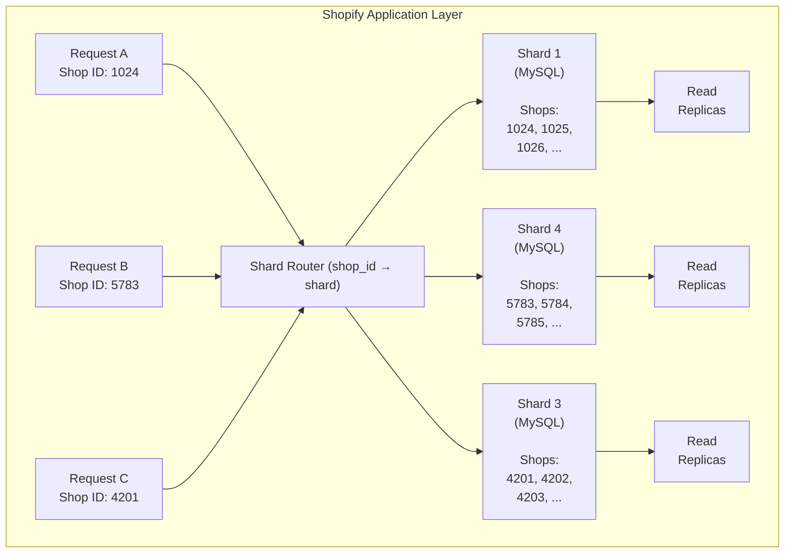
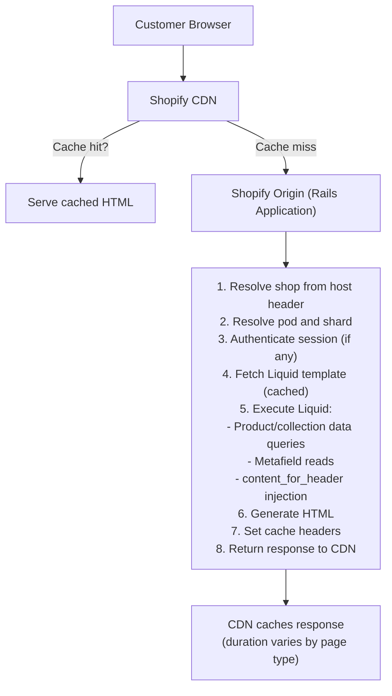

# Lesson 4: Multi-Tenancy, Scalability Patterns, Performance Optimization

## 1. First-Principles Intuition & Invariants

Shopify operates one of the most demanding multi-tenant architectures in existence. Over two million merchants share a single Ruby on Rails application, and on peak days like Black Friday, the platform processes tens of thousands of checkouts per minute across those merchants simultaneously. The fundamental engineering problem is not merely serving a high volume of traffic. It is serving that traffic for independent businesses that must never see each other's data, must never feel each other's load spikes, and must each receive predictable, isolated performance regardless of whether their neighbor is a boutique candle shop processing three orders a day or a Fortune 500 brand processing three orders a second.

Multi-tenancy exists on a spectrum. At one end, you have dedicated infrastructure per tenant: each merchant gets their own database, their own application servers, their own cache layer. This is what a self-hosted Magento installation provides, or what WooCommerce looks like on a dedicated hosting plan. Isolation is trivial because tenants physically cannot interact. The cost is enormous, because you provision for each tenant's peak and most of that capacity sits idle. At the other end of the spectrum, you have fully shared infrastructure with logical isolation: all tenants share the same databases, the same application processes, the same memory space, and the application itself enforces separation through tenant identifiers and access controls. This is where Shopify lives, and the choice is as much an economic decision as a technical one.

When a merchant signs up for a $39-per-month Basic plan, the unit economics only work because that merchant shares infrastructure with thousands of others. Dedicated infrastructure per merchant would require pricing that resembles AWS rather than a SaaS subscription. The shared model lets Shopify aggregate workloads, smooth out traffic variability across merchants in different time zones and different verticals, and achieve density that makes the platform profitable at low price points. The cost of this efficiency is engineering complexity: the application must enforce isolation guarantees that the infrastructure does not provide natively, and a single bug in a scope clause can expose one merchant's data to another.

Three invariants govern Shopify's multi-tenant architecture, and understanding them is essential for anyone building on the platform, whether as an app developer, a theme engineer, or an enterprise architect evaluating Shopify Plus for a high-volume brand.

The first invariant is **tenant isolation through application scoping**. Every database table that stores merchant data includes a `shop_id` column. Every query the application issues against these tables is scoped to the current `shop_id` established in the request context. There is no mechanism by which a query for Shop A's orders accidentally returns Shop B's orders unless the application fails to apply the scope. Shopify enforces this through Rails' `default_scope` mechanism, through ActiveRecord model associations that chain from the current shop, and through code review practices that scrutinize any query touching tenant data. The practical implication for app developers is that the Admin API and GraphQL API inherit this scoping automatically. When your application authenticates as an app installed on a specific shop, every API call you make is scoped to that shop's data. You cannot issue a cross-shop query through the standard API surface, and this is by design. If your business logic requires aggregating data across multiple shops, you must build that aggregation in your own application by making separate API calls per shop and assembling the results yourself.

The second invariant is **elastic resource allocation with graceful degradation**. Shopify does not guarantee fixed resource allocations to individual merchants on standard plans. CPU, memory, and database capacity are shared across tenants on a given database shard. When traffic spikes occur, the platform redistributes resources dynamically. Shopify Plus merchants receive higher rate limits, larger render time budgets, and access to features like dedicated CDN configuration, but even Plus merchants share infrastructure with other Plus merchants. The platform's design priority is that degradation, when it occurs, is graceful rather than catastrophic: pages load slowly rather than failing entirely, API calls are throttled with `Retry-After` headers rather than rejected outright, and checkout continues to function even when storefront rendering is degraded. This is why Shopify's rate limiting returns HTTP 429 status codes with a `Retry-After` header instead of simply failing requests permanently. The system is designed to slow you down, not cut you off, and your application must be designed to respect that signal.

The third invariant is **write-path priority over read-path**. In any multi-tenant system under load, write operations (placing orders, updating inventory, processing payments) must take priority over read operations (browsing product catalogs, viewing theme pages, fetching metafields). Shopify's architecture reflects this hierarchy. Checkout and order processing have dedicated infrastructure paths with lower latency requirements and higher rate limit ceilings than storefront browsing or API read operations. During peak events like Black Friday, the platform can degrade read performance by serving cached responses longer and allowing page load times to increase while maintaining write-path integrity so that checkouts still complete and inventory counts remain accurate. For merchants, this means the customer in the middle of checking out will finish their purchase even if the storefront is serving cached pages slowly. For app developers, it means that write operations through the Admin API (creating fulfillments, updating inventory, tagging orders) have different rate limit characteristics than read operations, and your application should prioritize write operations accordingly.

The economic dimension of this architecture deserves explicit attention because it drives every platform decision a merchant and app developer will make. Shopify's ability to offer a $39 entry-level plan is a direct consequence of multi-tenant density. Shopify Plus, starting at $2,300 per month, is not simply a feature unlock but a resource allocation upgrade: higher API rate limits, larger theme render budgets, access to scripts and Functions, dedicated infrastructure options, and the ability to handle higher checkout concurrency. The gap between standard and Plus is not arbitrary pricing but reflects the actual resource cost of giving a merchant a larger share of shared infrastructure. When you architect an ecommerce operation on Shopify, you are implicitly choosing a point on the cost-isolation tradeoff curve, and understanding the mechanics below lets you make that choice with open eyes rather than discovering the constraints at the worst possible moment.

## 2. Core Architecture & Mechanics

### 2.1 Shop Isolation Model

Shopify's data layer enforces tenant isolation through a combination of schema design and application-level query scoping. Every table that holds merchant-specific data, whether it is `products`, `orders`, `customers`, `metafields`, or `inventory_items`, carries a `shop_id` foreign key that identifies the owning tenant. The Rails application layer establishes the current shop context at the start of each request, typically by resolving the shop from the request's host header or the API authentication token, and then scopes all database queries through that context for the duration of the request.

The mechanism is straightforward in principle but demanding in execution. Rails models that represent merchant data use `default_scope { where(shop_id: current_shop.id) }` or an equivalent association chain, so that queries like `Product.all` automatically include a `WHERE shop_id = ?` clause. The risk is the "unscoped query" bug: a developer who writes a raw SQL query, or who uses `unscoped` to bypass the default scope, can accidentally issue a query that spans all tenants. Shopify's engineering practices include automated checks for unscoped queries, code review scrutiny on any query touching tenant data, and test suites that verify data isolation by creating multiple shops and asserting that queries never leak across boundaries.

For app developers, the isolation model is enforced at the API layer rather than the database layer, which simplifies your world considerably. When your app authenticates with Shopify using OAuth, you receive an access token scoped to a single shop. Every subsequent API call you make, whether through REST or GraphQL, carries that token, and Shopify's API gateway resolves the token to a `shop_id` and applies the same scoping that the internal application uses. You cannot request data from a shop your app is not installed on, and you cannot issue unscoped queries that span multiple shops. If your application serves multiple merchants and needs to correlate data across them, you must store the data in your own database and perform the aggregation yourself. This is a common architectural pattern for analytics apps, multi-store inventory sync tools, and reporting dashboards built on Shopify.

### 2.2 Sharding by shop_id

Shopify's original architecture ran on a single MySQL database, and it served the platform well for the first several years of growth. Eventually, the write volume and data size exceeded what a single MySQL instance could handle, and the team implemented horizontal sharding by `shop_id`. The sharding layer distributes shops across many MySQL databases, each called a shard, and a routing service resolves any `shop_id` to its owning shard.

The routing architecture works as follows. Each shop is assigned to a shard at creation time using a shard placement algorithm that balances load across available shards. The routing layer, implemented as a Ruby module within the Rails application, maintains a mapping of `shop_id` to shard identifier. When a request arrives for a specific shop, the application resolves the shard, connects to the corresponding MySQL database, and issues queries against it. The shard assignment is persistent: once a shop is placed on a shard, it stays there unless explicitly rebalanced, which is a rare, carefully orchestrated operation.



Each shard runs as a MySQL primary with one or more read replicas. Write operations go to the primary, read operations go to replicas, and replication lag between primary and replica is typically sub-second but can increase under heavy write load. The application is designed to route reads to replicas for non-critical operations (product listings, collection browsing, theme rendering) while routing reads to the primary for operations that require absolute consistency (checkout, inventory checks during order placement, payment processing).

The sharding model has direct implications for app developers. Cross-shard queries are expensive and generally avoided. When Shopify needs to run operations that span all shops, such as platform-wide analytics or schema migrations, it uses background job processors that iterate over shards sequentially, processing each shard's shops in parallel but never querying across shards in a single SQL statement. For app developers building tools that operate on multiple shops, the pattern is the same: iterate over shops, make per-shop API calls, aggregate results in your own datastore. There is no "select all products across all shops" operation available through the API, and there never will be, because the sharding architecture makes it structurally impossible.

Shard rebalancing is the process of moving shops from an overloaded shard to a less-loaded one. This is a carefully orchestrated operation because it involves copying data, redirecting traffic, and verifying consistency. Shopify performs rebalancing during low-traffic periods and uses MySQL replication to seed the destination shard before cutting over the routing. The operation is transparent to merchants and app developers: the shop remains available throughout, and the API endpoint does not change. The only observable effect might be a brief increase in replication lag during the cutover, which the application handles by routing reads to the primary temporarily.

### 2.3 Pod Architecture

As Shopify scaled beyond what database sharding alone could handle, the team introduced the concept of pods. A pod is a semi-independent unit of infrastructure that contains its own database shards, Redis clusters, Elasticsearch indices, and supporting services. Each shop is assigned to a pod, and all of that shop's data lives within that pod. The pod architecture provides blast-radius containment: a failure in one pod does not affect shops on other pods, because pods share no infrastructure dependencies at the data layer.

```mermaid
flowchart TD
    subgraph platform ["Shopify Platform (Global)"]
        subgraph pods ["Regional Pods"]
            subgraph pod_alpha ["Pod Alpha"]
                alpha_mysql["Shards 1–8\n(MySQL)"]
                alpha_redis["Redis Cluster"]
                alpha_es["Elasticsearch Cluster"]
            end

            subgraph pod_beta ["Pod Beta"]
                beta_mysql["Shards 9–16\n(MySQL)"]
                beta_redis["Redis Cluster"]
                beta_es["Elasticsearch Cluster"]
            end

            subgraph pod_gamma ["Pod Gamma"]
                gamma_mysql["Shards 17–24\n(MySQL)"]
                gamma_redis["Redis Cluster"]
                gamma_es["Elasticsearch Cluster"]
            end
        end

        subgraph shared ["Shared Services (Global)"]
            payments["Payments Gateway"]
            shipping["Shipping Services"]
            identity["Identity / Auth"]
            billing["Billing System"]
        end
    end

    alpha_mysql --- alpha_redis
    alpha_redis --- alpha_es
    beta_mysql --- beta_redis
    beta_redis --- beta_es
    gamma_mysql --- gamma_redis
    gamma_redis --- gamma_es

    pods --> shared
```



Pods share a common application codebase and common global services such as the payment gateway, shipping integrations, and identity management. The application layer is stateless and can serve requests for any pod, resolving the pod from the shop's `shop_id` and connecting to the appropriate pod's data layer. New shops are assigned to the pod with the most available capacity at creation time, and pod assignments are immutable for the life of the shop. This immutability simplifies routing: once a shop is on Pod Beta, it stays on Pod Beta, and the routing table does not need to handle pod migrations.

For Shopify Plus merchants, the pod architecture has a practical benefit. Plus merchants with extreme scale requirements can be placed on pods with fewer co-tenants or on pods with higher resource allocations, reducing the noisy-neighbor effect where a co-tenant's traffic spike degrades performance for all shops on the same shard. This is not a dedicated infrastructure model but a managed density model: the same architecture, with fewer shops per shard and more generous resource limits per shop.

### 2.4 CDN Integration

Shopify operates a global CDN that sits between the customer's browser and Shopify's origin servers. The CDN serves two distinct purposes: it reduces latency by serving cached content from edge locations geographically close to the customer, and it absorbs read traffic so that origin servers are not overwhelmed during traffic spikes. Understanding what the CDN caches, how cache keys are constructed, and how invalidation works is essential for theme developers and for anyone debugging storefront performance issues.

The CDN caches content at several layers. Static theme assets, including compiled JavaScript bundles, CSS files, and font files, are served with long cache durations and content-addressed URLs. When a merchant updates their theme, the asset URLs change because they include a content hash, and the new URLs are cached fresh at the edge. Product images flow through Shopify's image CDN, which provides dynamic resizing: a single source image can be requested at multiple dimensions (e.g., `100x100`, `300x300`, `600x600`, `1024x1024`, `2048x2048`) and the CDN generates and caches each variant on first request. The image CDN supports named sizes, `pico`, `icon`, `thumb`, `small`, `compact`, `medium`, `large`, `grande`, `original`, as well as arbitrary dimensions, and each variant is cached independently.

HTML responses, including product pages, collection pages, and the homepage, are cached at the CDN with shorter cache durations. The cache key for an HTML response is constructed from the full URL path plus a set of variant dimensions that determine when a cached response is valid. These variants include the shop's primary domain, the requested locale (for multi-language stores), the selected currency (for multi-currency stores), and the customer's context (logged-in versus anonymous, since logged-in customers may see personalized pricing or content). A product page for `/products/blue-shirt` in English with USD pricing is a different cache entry from the same URL in French with EUR pricing.

Cache invalidation is managed through surrogate keys, which are HTTP headers that the CDN uses to group related cache entries. When a merchant updates a product, Shopify's origin server sends an invalidation request to the CDN with the surrogate key for that product, which purges all cache entries related to that product across all variants. This is more efficient than URL-based invalidation because a single product might have cached entries across multiple locales, currencies, and collection pages, and all of them need to be purged simultaneously. The surrogate key model allows Shopify to batch invalidations and minimize the number of purge requests sent to the CDN.

For theme developers, the CDN integration has a critical implication: the `content_for_header` output, which Shopify injects into every page, includes performance-critical resources like Shopify's analytics scripts, payment button libraries, and SEO meta tags. These scripts are served from Shopify's CDN and are cached aggressively. When you optimize theme performance, you must account for the fact that `content_for_header` adds to your page's render-blocking resources, and you have limited control over what Shopify injects. The best practice is to ensure your theme's own assets are optimized, to minimize the number of additional third-party scripts you add through app installations, and to use Shopify's built-in lazy-loading mechanisms for below-the-fold content.

### 2.5 Rate Limiting Mechanisms

Shopify enforces rate limits to protect shared infrastructure from any single client consuming disproportionate resources. The rate limiting model differs between the REST Admin API and the GraphQL Admin API, and understanding both is essential for building reliable applications that do not degrade under load.

The REST Admin API uses a **leaky bucket algorithm**. The bucket has a fixed capacity and a continuous refill rate. Each API request removes one unit from the bucket. The bucket refills at a constant rate over time. If the bucket is empty when a request arrives, the API returns HTTP 429 with a `Retry-After` header indicating how many seconds the client should wait before retrying.

The leaky bucket is defined by two parameters:

| Parameter | Symbol | Standard Plan | Shopify Plus |
|-----------|--------|---------------|--------------|
| Bucket capacity | B | 40 requests | 400 requests |
| Refill rate | R | 2 requests/second | 4 requests/second |

The available capacity at any moment is calculated as:

```text
available(t) = min(B, current_level + R × t)
```

Where `current_level` is the number of requests remaining in the bucket and `t` is elapsed time since the last request. When a request arrives, if `available(t) >= 1`, the request succeeds and one unit is consumed. If `available(t) < 1`, the request fails with HTTP 429, and the `Retry-After` header is set to:

```text
Retry-After = ceil((1 - available(t)) / R)
```

The practical meaning of these numbers is that a standard-plan app can burst up to 40 requests at once, then sustain a steady throughput of 2 requests per second indefinitely. A Shopify Plus app can burst 400 requests and sustain 4 per second. For most interactive operations, this is sufficient. The constraint becomes binding during bulk operations: migrating a catalog of 50,000 products through the REST API at 2 requests per second takes approximately 25,000 seconds, or nearly 7 hours, if you can only send 2 product updates per second. This is why Shopify provides the GraphQL Admin API and the Bulk Operations API as higher-throughput alternatives.

The GraphQL Admin API has historically used a **query cost-based model** rather than a simple request count. Each GraphQL query is assigned a cost based on its structure: the number of fields, the depth of nested connections, and the page size of paginated lists. The rate limit bucket for GraphQL holds a larger number of cost units (typically 1,000 for standard plans) and refills at a higher rate (50 cost units per second). The cost of a query is calculated before execution, and if the query's cost exceeds available capacity, the API rejects it with HTTP 429 and a `Retry-After` header.

The cost calculation follows a model where each returned object node costs a fixed number of points and each connection (paginated list) has a base cost plus a per-node cost multiplied by the requested page size. For a query that fetches 50 products with 10 variants each:

```text
query_cost = connection_base + (products_count × (product_base + variants_count × variant_base))
```

This model rewards efficient queries: requesting only the fields you need costs less than requesting all fields, and requesting smaller page sizes costs less than requesting large ones. The practical optimization is to prefer GraphQL over REST for data-intensive operations, to request only the fields your application needs, and to use cursor-based pagination with moderate page sizes (50-250 items) rather than trying to fetch everything in a single query.

Shopify has also introduced **request-based rate limits** for newer API versions, which simplify the model by counting requests rather than calculating query cost. Under the request-based model, the bucket capacity and refill rate are expressed in requests per minute rather than cost units, making it easier for developers to reason about their API consumption. The specific limits depend on the API version, the shop's plan, and the endpoint category. You should always check the current API documentation for the version you are targeting, because Shopify has been migrating endpoints from the cost-based model to the request-based model over successive API versions.

The **Bulk Operations API** is the escape hatch for large-scale data operations. It allows apps to request asynchronous processing of large queries (products, orders, customers, inventory) that would exceed normal rate limits. The bulk operation runs server-side on Shopify's infrastructure, processes data in the background, and writes the results to a JSONL file that the app downloads via a temporary URL. Bulk operations bypass the per-request rate limit entirely and can process millions of records in a single operation. The tradeoff is latency: a bulk operation may take minutes to hours to complete, depending on the size of the dataset and the current platform load. For any operation that involves processing more than a few hundred records, the Bulk Operations API is the correct choice.

### 2.6 Theme Rendering Pipeline

Shopify themes are server-side rendered using Liquid, a templating language developed by Shopify co-founder Tobias Lütke. Liquid templates are compiled to Ruby code on first render and cached for subsequent requests. The rendering pipeline for a storefront page request proceeds through the following stages:



During Liquid execution, the template engine makes database queries to fetch the data needed for rendering: product information, collection membership, metafields, shop settings, and navigation structures. Each of these queries is scoped to the current shop and executed against the shop's assigned shard. The number and complexity of these queries directly affect render time, and Shopify enforces a render time budget to prevent any single merchant's complex theme from degrading performance for co-tenants on the same shard.

The render time budget varies by plan. Standard plans typically have a budget in the range of several seconds, after which the platform may serve a cached version of the page or return an error. Shopify Plus plans receive a more generous budget. The budget is not a hard timeout but a soft target: the platform monitors render times and may throttle or cache more aggressively for shops whose themes consistently approach the budget limit.

The `content_for_header` mechanism is a critical and often misunderstood part of the rendering pipeline. Shopify injects content into the `<head>` of every page through this Liquid tag, and the injected content includes analytics scripts (Shopify's own analytics, Google Analytics if configured), payment SDK scripts (Shop Pay, Apple Pay, Google Pay), SEO meta tags, and tracking pixels. This injection is non-negotiable: even if you build a custom theme from scratch, you must include `{{ content_for_header }}` in your layout, and Shopify will populate it with scripts you did not choose. These scripts count toward your page's render-blocking resources and affect Core Web Vitals scores. You cannot remove them, but you can minimize their impact by reducing the number of additional apps you install (each app may inject its own scripts) and by deferring your own theme's JavaScript to load after `content_for_header` resources.

## 3. High-Performance Optimization & Failure Modes

### 3.1 API Optimization Strategies

Building a reliable Shopify app requires treating rate limits as a first-class architectural concern rather than an afterthought. The most common failure mode is the app that works perfectly in development against a single test shop with modest data, then collapses in production when it tries to sync 10,000 products or poll order status across 50 shops simultaneously. The following strategies address the most common performance bottlenecks.

**Prefer GraphQL over REST for compound queries.** A REST API call to fetch a product and its variants requires two separate requests: `GET /products/{id}` and `GET /products/{id}/variants.json`. A single GraphQL query can fetch both in one round trip, reducing both request count and rate limit consumption. For any operation that requires data from multiple related resources (product + variants + metafields, order + customer + fulfillments), GraphQL is strictly more efficient.

**Use cursor-based pagination, not offset pagination.** Offset-based pagination (page=1, page=2, page=3) becomes increasingly expensive as you paginate deeper, because the database must skip all rows before the offset. Shopify's API enforces a maximum offset and will reject requests beyond it. Cursor-based pagination uses a opaque cursor token that tells the database exactly where to resume, resulting in constant-time queries regardless of depth. Every Shopify API that supports pagination supports cursor-based pagination, and you should use it exclusively.

**Use the Bulk Operations API for any dataset exceeding 250 records.** If you need to export all products from a shop with 10,000 SKUs, do not loop through paginated REST calls. Create a bulk operation, poll for completion, and download the JSONL result file. The Bulk Operations API can handle datasets of millions of records and runs server-side, consuming none of your rate limit budget. The tradeoff is that bulk operations are asynchronous: you submit the query, receive a job ID, poll the job status, and download results when complete. For real-time operations (checking inventory before an order, updating a single product), use synchronous API calls. For batch operations (catalog sync, order export, customer migration), use bulk operations.

**Subscribe to webhooks instead of polling.** The single most effective rate limit optimization is to stop making API calls you do not need. If your app needs to know when an order is created, subscribe to the `orders/create` webhook rather than polling `GET /orders.json` every 30 seconds. Shopify delivers webhooks as HTTP POST requests to your server, and webhook delivery does not consume your API rate limit. Register webhooks for the events your app cares about, implement webhook verification using the HMAC signature header, and process webhook payloads idempotently (Shopify may retry delivery if your server does not respond with 200 within a timeout).

**Implement exponential backoff with jitter.** When your app receives an HTTP 429 response, it must back off and retry. A naive retry strategy that immediately re-sends the request will only make the problem worse, as will a fixed-delay retry that causes all clients to retry simultaneously (the thundering herd problem). The correct approach is exponential backoff with jitter:

```text
delay(attempt) = min(max_delay, base_delay × 2^attempt) + random(0, jitter)

Where:
  base_delay  = 0.5 seconds
  max_delay   = 60 seconds
  jitter      = 0.25 seconds
  attempt     = 0, 1, 2, 3, ... (incremented on each consecutive failure)
```

The jitter component is critical: by adding a random component to each client's delay, you spread retries across time rather than concentrating them at the same instant. The `Retry-After` header from Shopify's 429 response should be respected as a minimum delay, but you should also apply your own backoff strategy for consecutive failures, because the `Retry-After` value reflects the current rate limit state, not the state after other clients have also retried.

### 3.2 CDN Cache Optimization

The CDN is your most powerful performance tool as a theme developer, but only if you understand what it caches and how to work with it rather than against it. The fundamental principle is that cacheable content should be identical for all visitors who share the same variant dimensions (locale, currency, market), and personalized content should be loaded asynchronously after the initial page render.

**Identify cacheable vs. non-cacheable content.** Product pages, collection pages, and the homepage are cacheable because they display the same content to all anonymous visitors in the same locale and currency. Cart pages, account pages, and checkout pages are not cacheable because they contain customer-specific data. If your theme includes personalized content on a cacheable page (a "recently viewed products" section, for example), that content must be loaded via JavaScript after the initial page render, not rendered server-side in Liquid. Shopify's `recommendations` and `predictive search` APIs are designed for this pattern: the cached HTML page loads, then JavaScript fetches personalized recommendations from the API and injects them into the page.

**Manage variant dimensions carefully.** If your store supports multiple currencies and multiple locales, the CDN creates a separate cache entry for each combination. A product page with 3 locales and 5 currencies has 15 cache entries per product. This is generally fine, but it means that a cache purge for that product purges all 15 entries, and the next request in each variant combination triggers a fresh render at the origin. If you operate in many markets, be aware that cache warming after a purge becomes proportionally more expensive.

**Use Shopify's image CDN aggressively.** Product images are often the largest contributor to page weight. Shopify's image CDN provides dynamic resizing, format negotiation (serving WebP to browsers that support it, JPEG to others), and progressive loading. In your Liquid templates, use the `image_url` filter with explicit size parameters rather than serving the original image and relying on CSS to resize it:

```liquid
{{ product.featured_image | image_url: width: 600, height: 600, crop: 'center' }}
```

This generates a URL for a 600×600 optimized image served from the CDN. For responsive layouts, use the `srcset` attribute to specify multiple sizes, and the browser will download only the size appropriate for its viewport:

```liquid

```

The `loading="lazy"` attribute defers image loading until the image approaches the viewport, reducing initial page weight. The explicit `width` and `height` attributes prevent cumulative layout shift by reserving space for the image before it loads.

### 3.3 Theme Performance and Core Web Vitals

Shopify theme performance is measured against Google's Core Web Vitals, which are field metrics collected from real user browser data. Three metrics define the current standard:

| Metric | Target | What it Measures |
|--------|--------|------------------|
| LCP (Largest Contentful Paint) | < 2.5 seconds | Time until the largest visible element renders |
| INP (Interaction to Next Paint) | < 200 milliseconds | Latency of the first user interaction |
| CLS (Cumulative Layout Shift) | < 0.1 | Total unexpected layout movement during page load |

The relationship between these metrics and conversion rate is well-documented. Industry benchmarks consistently show that every 100 milliseconds of additional page load time reduces conversion rate by approximately 1% for ecommerce sites. For a store doing $1 million in annual revenue, a 500-millisecond improvement in LCP translates to roughly $50,000 in incremental annual revenue, assuming the industry benchmark holds. This is why theme performance is not a cosmetic concern but a revenue concern, and why Shopify scores themes on performance in the Theme Store and requires minimum thresholds for approval.

**LCP optimization** starts with identifying the largest contentful element, which for most product pages is the hero image or the product featured image. The LCP element must load as early as possible, which means it should not be deferred by JavaScript execution or blocked by render-blocking CSS. Shopify themes should use `preload` hints for the LCP image in the `<head>`:

```liquid
<link rel="preload" as="image"
  href="{{ product.featured_image | image_url: width: 1200 }}"
  fetchpriority="high">
```

This tells the browser to start fetching the image immediately, before the HTML parser reaches the `` tag, reducing LCP by the time it would have taken to parse the DOM down to the image element.

**CLS optimization** requires reserving space for all dynamic content before it loads. Images need explicit `width` and `height` attributes. Embeds (YouTube videos, Instagram posts) need container elements with `aspect-ratio` CSS. Ads and banners need placeholder containers. The most common source of CLS on Shopify storefronts is third-party app scripts that inject content into the page after load, shifting existing elements. Every app you install is a potential CLS source, and you should audit installed apps for layout shift using Chrome DevTools' Layout Shift Regions visualization.

**JavaScript optimization** is where most theme performance gains are available. Shopify themes increasingly use JavaScript for interactive features: cart drawers, predictive search, quick-view modals, variant selectors. Each of these features adds to the JavaScript bundle that the browser must download, parse, and execute before the page becomes interactive. The optimization strategies are, in order of impact: remove unused JavaScript (uninstall apps you do not need, remove features your customers do not use), defer non-critical JavaScript with `defer` or `type="module"` attributes, split large bundles into route-specific chunks that load only when needed, and use web components or islands architecture to isolate interactive regions from the rest of the page.

### 3.4 Failure Modes and Mitigations

**Shard saturation** occurs when a shard's write volume exceeds its capacity, typically during a traffic spike affecting multiple shops on the same shard. Symptoms include increased database query latency, replication lag between primary and replica, and slower page render times as Liquid queries take longer to execute. Shopify mitigates this through shard rebalancing and through the write-path priority invariant: checkout and order processing are prioritized over read operations, so customers in the checkout flow are less affected than customers browsing the storefront. For merchants, the mitigation is to move high-volume operations to off-peak hours when possible, and for Shopify Plus merchants, to request placement on less-dense shards. For app developers, the mitigation is to use webhooks rather than polling, to use the Bulk Operations API rather than synchronous batch calls, and to implement backoff on 429 responses rather than retrying aggressively.

**Cache stampede** (also called thundering herd) occurs when a cached response expires and many requests arrive simultaneously, all of which miss the cache and trigger origin renders. Shopify's CDN uses request coalescing to mitigate this: when multiple requests arrive for the same cache key and the cache is empty or expired, the CDN forwards only one request to the origin and holds the others until the response arrives, then serves all waiting requests from the fresh cache entry. For theme developers, the mitigation is to ensure your pages set appropriate cache durations and that your theme does not generate unique URLs for each visitor (session-specific query parameters, for example, would defeat caching). For app developers, if you build a headless storefront using the Storefront API, implement your own cache layer with request coalescing to avoid stampeding Shopify's API when your cache entries expire.

**Rate limit exhaustion** occurs when an app's API consumption exceeds the bucket capacity and refill rate, resulting in HTTP 429 responses. The symptoms are straightforward: your app receives 429s, requests fail, and if your retry logic is poor, the failures cascade. The mitigation is to calculate your expected API throughput before building, not after launching. If your app needs to sync 1,000 products per minute to maintain inventory accuracy across channels, that requires 1,000 API calls per minute, or 16.7 calls per second. On a standard plan with a refill rate of 2 per second, this exceeds the sustained rate by 8x. The solutions are: upgrade to Shopify Plus for a higher refill rate, use the Bulk Operations API for inventory sync, batch updates into GraphQL mutations that process multiple items per call, or implement a queuing system that throttles your own API consumption to stay within the refill rate.

The throughput calculation for sustained operations is:

```text
max_sustained_throughput = refill_rate  (requests per second)
max_burst = bucket_capacity  (requests)

time_to_exhaust_burst = bucket_capacity / (actual_rate - refill_rate)
    when actual_rate > refill_rate

required_refill_rate = required_throughput
    (for sustained operations without 429s)
```

If your required throughput exceeds the refill rate, no amount of retry logic will solve the problem. You must either reduce your API consumption (batching, bulk operations, webhooks) or increase your rate limit (Shopify Plus, custom rate limit requests through Shopify's partner team).

**Theme rendering timeout** occurs when a Liquid template takes too long to render, exceeding the platform's render budget. Symptoms include 500-level errors on specific pages, intermittent slow page loads, or pages that render correctly for small collections but fail for large ones. The most common cause is a Liquid loop that iterates over a large collection: `` on a collection with 500 products, where each iteration makes metafield queries or renders complex logic, can easily exceed the render budget. The mitigations are to paginate collections (``), to avoid querying metafields in loops (fetch them in bulk using the `metafields` connection in GraphQL or the `metafields` REST endpoint), to cache expensive Liquid computations using `` blocks where available, and to move data-intensive rendering to the client side using JavaScript and the Storefront API.

### 3.5 Headless and Functions Considerations

The headless commerce pattern, where the storefront is decoupled from Shopify's Liquid rendering engine and built as a separate application using the Storefront API, changes the performance model fundamentally. In a headless architecture, the CDN cache layer is your responsibility rather than Shopify's. You control the cache strategy, the cache keys, and the invalidation logic. The Storefront API has its own rate limits, separate from the Admin API, and the API is designed for high read throughput with generous limits. The tradeoff is that you lose Shopify's built-in CDN caching, `content_for_header` injection, and Liquid rendering optimizations, and you must rebuild equivalent infrastructure yourself. Frameworks like Hydrogen (Shopify's React-based storefront framework built on Remix) provide this infrastructure out of the box, including server-side rendering, edge caching, and Storefront API integration with built-in caching strategies.

Shopify Functions, the platform's mechanism for custom checkout logic (custom discounts, shipping rules, payment customizations), introduces a different isolation model: untrusted code execution in a sandboxed environment. Shopify Functions are written in Rust (or other languages that compile to WebAssembly), deployed to Shopify's infrastructure, and executed in a Wasm runtime that enforces strict resource limits: memory caps, execution time limits, and no access to network or filesystem. The Wasm isolation model means that a merchant's custom discount function cannot access another merchant's data, cannot make outbound network calls, and cannot consume unbounded resources. The execution budget for a Function is measured in milliseconds, and functions that exceed the budget are terminated. For developers building Functions, the optimization imperative is algorithmic efficiency: the function must complete its computation within a tight time budget on Shopify's infrastructure, and there is no opportunity to paginate or defer work. The input is the checkout state, the output is the modification (discount amount, shipping rate, payment option), and the function must produce that output in a single synchronous execution pass.

The choice between hosted Shopify (Liquid themes on Shopify's infrastructure), headless commerce (custom storefront on your infrastructure with Storefront API), and a hybrid approach depends on where your performance constraints lie. Hosted Shopify is optimized for the median merchant: CDN caching is managed for you, rate limits are generous enough for interactive operations, and theme rendering is fast enough for most catalogs. Headless commerce is appropriate when your catalog is large enough that Liquid rendering becomes a bottleneck, when your storefront experience requires interaction patterns that Liquid cannot support efficiently, or when your traffic volume justifies the infrastructure cost of running your own rendering layer. The decision should be driven by measurement, not assumption: instrument your current storefront, identify the actual bottleneck (CDN cache hit ratio, Liquid render time, JavaScript bundle size, API call latency), and address that bottleneck specifically rather than rebuilding the entire storefront stack.
