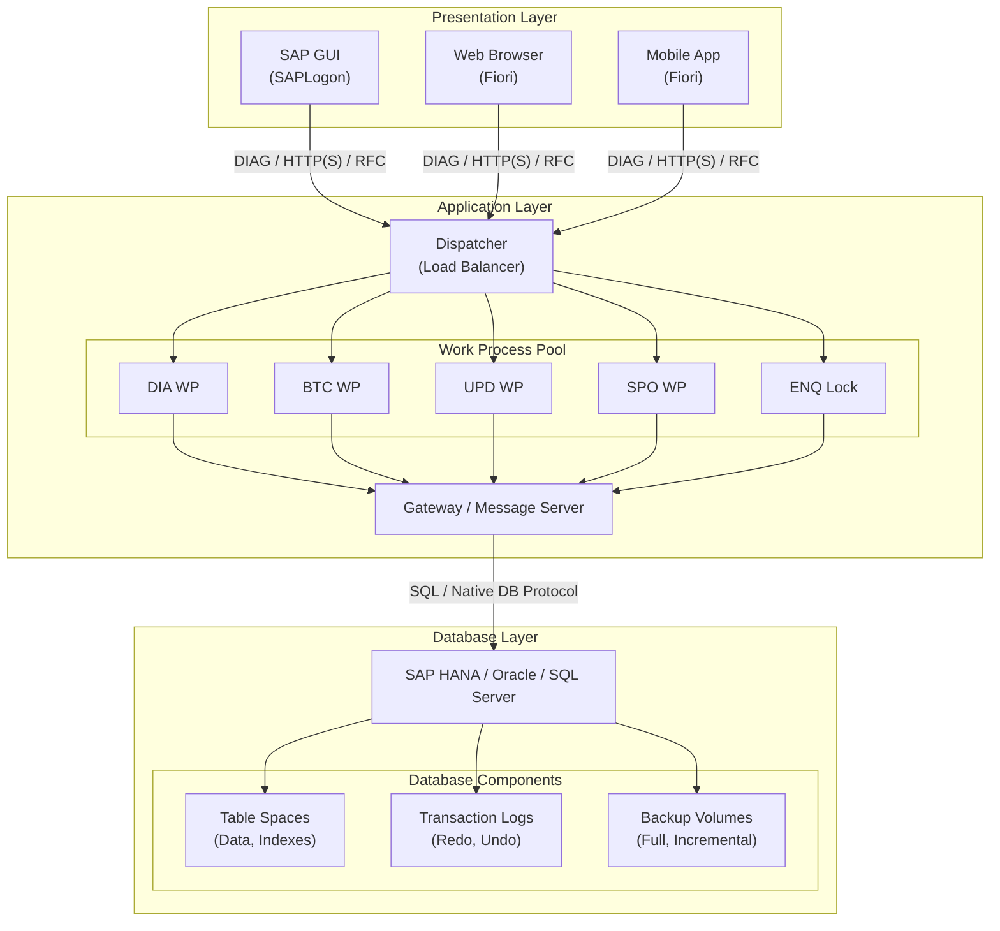

# Lesson 1: SAP Ecosystem Architecture

## 1. First-Principles Intuition & Invariants

Enterprise resource planning systems emerged from a fundamental tension in post-industrial organizations: the need to maintain unified operational truth across geographically distributed business units operating under a single legal entity. Before integrated systems, manufacturing plants maintained separate inventory ledgers from procurement departments, which kept independent records from finance teams reconciling the same transactions. This architectural fragmentation created latency in decision-making, introduced reconciliation errors that compounded across fiscal periods, and prevented real-time visibility into working capital positions.

SAP's founding thesis in 1972 centered on solving this problem through a unified transactional database architecture where a single write operation—such as posting a goods receipt—would automatically propagate financial impacts to general ledger accounts, update material master inventory balances, trigger vendor invoice matching logic, and recalculate manufacturing resource planning requirements. This design philosophy, termed "real-time enterprise," eliminated batch reconciliation cycles and established data consistency as a database-enforced invariant rather than a procedural business rule.

The architectural consequence of this design choice is profound: SAP systems are not loosely coupled microservices exchanging eventual-consistency messages, but rather tightly integrated monolithic applications sharing a single source of truth in a relational database. Every business transaction executes within the ACID guarantees of the underlying database layer, ensuring that debits equal credits, that material movements reconcile to financial postings, and that cross-module dependencies resolve transactionally. This design trades horizontal scalability for transactional correctness, a deliberate choice that reflects the regulatory and audit requirements of financial systems where eventual consistency is not merely suboptimal but legally impermissible.

Understanding SAP architecture requires internalizing three invariants that govern system design decisions. First, the separation of concerns between application logic and data persistence means that SAP applications never directly manipulate database tables; all data access flows through the ABAP runtime, which enforces authorization checks, field-level validations, and change document logging. Second, the client concept partitions a single database instance into logically isolated tenants, allowing a single physical system to serve multiple legal entities while maintaining complete data segregation enforced at the database query level. Third, the three-tier architecture separates presentation, application processing, and database persistence across distinct server processes, enabling independent scaling of user interface concurrency, business logic throughput, and database I/O capacity.

The SAP product portfolio evolved through accretive acquisitions and organic development along two parallel tracks: the core ERP suite providing transactional processing for finance, supply chain, and human capital management; and the analytical, planning, and industry-specific solutions extending operational capabilities. SAP ECC 6.0 represented the culmination of the R/3 architecture, a client-server system built on the ABAP programming language and NetWeaver technology stack. SAP S/4HANA, introduced in 2015, represents a fundamental re-platforming onto the HANA in-memory database, collapsing the traditional separation between transactional and analytical workloads by eliminating aggregate tables, materialized views, and batch ETL processes in favor of real-time columnar storage and query execution.

The distinction between these generations is not merely technical but operational. ECC systems require nightly batch jobs to aggregate transactional data into summary tables that support financial reporting and analytics; S/4HANA eliminates this latency by executing analytical queries directly against transactional tables, leveraging columnar compression and in-memory processing to achieve sub-second query response times on billion-row datasets. This architectural shift collapses the traditional boundary between OLTP and OLAP workloads, enabling real-time financial close processes, dynamic credit limit checks against current exposure, and intraday inventory rebalancing across global distribution networks.

The NetWeaver stack provides the middleware foundation for all SAP applications, encompassing the ABAP and Java application servers, the Solution Manager monitoring platform, the Process Integration message broker, and the Portal user interface framework. This stack abstracts underlying operating system and database dependencies, allowing SAP applications to run on Linux, Windows, AIX, and HP-UX with Oracle, Microsoft SQL Server, IBM DB2, or SAP HANA as the persistence layer. The cost of this portability is architectural complexity: every database operation flows through the database abstraction layer, every user interaction traverses the SAP GUI protocol or Fiori launchpad, and every integration point must conform to RFC, IDoc, or OData interface specifications.

## 2. Core Architecture & Mechanics

The SAP system landscape follows a three-tier separation model that partitions Development, Quality Assurance, and Production environments into distinct physical or virtual server instances. This separation enforces change control discipline by preventing direct modification of production configurations and requiring that all customizations flow through a structured transport management process. Development systems serve as sandbox environments where functional consultants configure business processes, ABAP developers write custom code, and integration architects design interface specifications. Quality Assurance systems provide pre-production validation environments where user acceptance testing, integration testing, and performance benchmarking occur under production-equivalent data volumes and transaction loads. Production systems execute live business operations, processing customer orders, manufacturing work orders, financial postings, and payroll calculations with database-enforced audit trails and high-availability failover configurations.

Transport management binds these environments through a change request workflow that packages configuration settings, ABAP programs, and database table modifications into atomic deployment units. A developer working in the DEV environment creates a transport request, which captures all configuration changes and code modifications within a logical change set. Upon completion, the transport request moves to the QAS environment for validation testing. After approval, the transport imports into the PRD environment during a scheduled change window, applying configuration changes and activating new code in a transactionally consistent manner. This process ensures that no configuration drift occurs between environments and that every production change undergoes formal approval and testing.

The client-server model divides processing responsibilities between presentation tier, application tier, and database tier, with each tier executing on dedicated server hardware or virtualized compute instances. The presentation tier runs on end-user workstations, executing either the SAP GUI client—a thick client application that maintains persistent connections to application servers—or a web browser accessing Fiori applications through the HTML5 rendering framework. The application tier consists of ABAP work processes executing on application servers, processing business logic, enforcing authorization rules, and orchestrating database transactions. The database tier persists all transactional data, configuration settings, and program source code in relational tables, executing SQL queries and maintaining transaction log files for crash recovery and point-in-time restore operations.

Each application server instance runs a dispatcher process that accepts inbound connection requests and assigns them to available work processes from a pre-allocated pool. Dialog work processes handle interactive user sessions, processing screen inputs, executing business logic, and returning screen outputs through the SAP GUI protocol. Background work processes execute scheduled batch jobs, processing mass data updates, running financial close programs, and generating reports without user interaction. Update work processes handle asynchronous database commits, allowing dialog processes to return control to users immediately after posting transactions while the actual database write operations complete in parallel. Spool work processes manage print job queues, rendering output documents and routing them to physical printers or PDF archives. The enqueue work process maintains a centralized lock table that coordinates concurrent access to business objects, preventing lost updates when multiple users modify the same customer master record, sales order, or general ledger account simultaneously.

The client concept partitions a single SAP database into logically isolated datasets, each representing a distinct legal entity, business unit, or system purpose. Client 000 contains repository objects—ABAP programs, data dictionary definitions, and system configuration—that apply across all clients. Client 001 serves as a template client containing SAP-delivered sample data and configuration settings. Functional clients like 100, 200, or 300 contain production or test business data, with complete isolation enforced through mandatory client fields in every business table. When a user logs into client 100, all database queries automatically filter to rows where the MANDT field equals 100, and all insert operations automatically populate MANDT with 100. This mechanism allows a single database instance to serve multiple subsidiaries operating under different tax jurisdictions, chart of accounts structures, and organizational hierarchies while maintaining complete data segregation and independent backup and restore capabilities.

The ABAP runtime environment executes all business logic, providing a virtual machine abstraction that isolates application code from underlying operating system and database dependencies. ABAP programs reside in database tables, not file systems; the ABAP compiler parses source code into an intermediate representation stored in the LOAD table, which the ABAP interpreter executes at runtime. This design enables zero-downtime code deployment, as new program versions activate atomically within a database transaction, and allows centralized source control through the transport management system without requiring file system replication or version control integration.

Database architecture follows a normalized relational schema with cluster tables optimizing frequently accessed data, pooled tables aggregating small configuration entities, and transparent tables providing one-to-one mappings to physical database tables. SAP applications never issue direct SQL statements; instead, they use Open SQL—a database-independent query language embedded in ABAP—which the runtime translates to native database dialects. This abstraction enables database portability but imposes performance costs, as the ABAP runtime cannot leverage database-specific optimization hints, query plan caching, or parallel execution strategies without explicit coding patterns.

Table buffering reduces database round-trips by caching frequently accessed configuration tables in application server shared memory. Single-record buffers cache individual rows by primary key; generic buffers cache entire tables or table partitions; fully buffered tables load complete datasets into memory during application server startup. Buffer synchronization occurs through the message server, which broadcasts invalidation messages when database modifications occur, ensuring that all application servers maintain consistent in-memory representations. This caching strategy is effective for reference data—country codes, material types, tax rates—but inappropriate for transactional data like sales orders or inventory balances, where cache invalidation latency would introduce stale read anomalies.

The SAP router provides secure network connectivity between remote systems, enabling consultants to access customer environments through encrypted tunnels without exposing application servers directly to the public internet. SNC (Secure Network Communications) encrypts data-in-transit between SAP GUI clients and application servers using X.509 certificates or Kerberos tickets, preventing credential theft and session hijacking. SSO (Single Sign-On) integrates with enterprise identity providers through SAML, OAuth, or Kerberos protocols, allowing users to authenticate once against Active Directory or Okta and access SAP systems without re-entering credentials.

## 3. High-Performance Optimization & Failure Modes

System performance optimization begins with work process tuning, balancing the allocation of dialog, background, update, and spool processes to match workload patterns. Insufficient dialog work processes cause users to wait in dispatcher queues during peak transaction periods, manifesting as slow screen response times and timeout errors. Excessive dialog processes waste memory and CPU resources on idle workers, reducing available capacity for batch processing and database query execution. The optimal ratio depends on concurrent user count, transaction complexity, and batch job scheduling density, typically requiring 1 dialog process per 5–10 active users with additional headroom for variance in session duration and think time.

Memory management governs application server capacity, with each work process allocating heap memory for program execution, data buffers, and user context. The ABAP runtime limits heap allocation through the abap/heap_area_dia and abap/heap_area_nondia parameters, terminating work processes that exceed configured thresholds to prevent memory exhaustion. Short dumps occur when programs allocate large internal tables without pagination logic, select millions of rows into memory without cursor processing, or recursively nest function calls beyond stack depth limits. Optimizing memory consumption requires refactoring SELECT statements to use PACKAGE SIZE cursors, implementing ALV grid pagination for large result sets, and replacing internal table iterations with database aggregations or secondary index scans.

Database performance depends on index design, statistics maintenance, and query execution plan optimization. Missing indexes force full table scans on multi-million-row tables, consuming excessive I/O bandwidth and CPU cycles while competing with concurrent transactions for buffer cache pages. Index fragmentation degrades seek performance as B-tree structures accumulate dead tuples and unbalanced branches, requiring periodic rebuilds through database maintenance jobs. Stale statistics cause the query optimizer to choose suboptimal execution plans, joining tables in the wrong order or selecting nested loop joins instead of hash joins, resulting in query response times degrading from milliseconds to minutes as data volumes grow.

SAP HANA introduces columnar storage and in-memory processing, fundamentally altering performance optimization strategies. Traditional row-store databases optimize for transactional write performance, storing related fields contiguously and indexing frequently queried columns. HANA's column-store architecture optimizes for analytical read performance, compressing each column independently and executing queries through vectorized operations that process thousands of rows in parallel. This design eliminates the need for aggregate tables and materialized views, as real-time aggregations over billions of rows complete in seconds through parallel column scans and distributed query execution across multiple processing cores.

Delta merge operations in HANA consolidate newly inserted rows from the delta store into the compressed main store, recalculating column dictionaries and applying block-level compression algorithms. Frequent merges during high-volume transaction periods consume CPU and memory resources, potentially degrading query performance; infrequent merges allow the delta store to grow excessively, increasing query response times as scans must check both delta and main stores. Tuning merge thresholds requires balancing write throughput, query latency, and system resource utilization, typically scheduling merges during low-activity windows or triggering them dynamically when delta store memory consumption exceeds configured limits.

Backup and recovery strategies depend on database size, recovery time objectives, and recovery point objectives. Full database backups copy all data files and transaction logs to external storage, providing point-in-time restore capability but consuming substantial storage capacity and network bandwidth. Incremental backups capture only changed data blocks since the last full backup, reducing backup window duration and storage requirements but increasing restore complexity and duration. Database log backups capture transaction logs at regular intervals, enabling point-in-time recovery to any moment between backup windows but requiring log retention policies that balance audit requirements against storage costs.

High availability architectures implement application server clustering and database replication to eliminate single points of failure. Multiple application servers connect to a shared database instance, with the message server and ASCS (ABAP System Central Services) providing centralized enqueue and batch scheduling coordination. Database replication strategies range from asynchronous log shipping—which tolerates brief data loss windows but imposes minimal performance overhead—to synchronous replication with automatic failover, which guarantees zero data loss but introduces commit latency penalties as transactions await confirmation from standby nodes.

Integration patterns connect SAP systems to external applications through RFC (Remote Function Call), IDoc (Intermediate Document), OData services, and RESTful APIs. RFC enables synchronous function invocations across SAP systems or between SAP and non-SAP applications, passing structured parameters and returning results within a single request-response cycle. IDoc supports asynchronous message exchange, serializing business documents like purchase orders, invoices, or goods receipts into XML or flat-file formats that queue in middleware layers for eventual processing. OData exposes SAP business objects as RESTful resources with standard HTTP verbs and JSON payloads, enabling web applications and mobile clients to query and update SAP data without proprietary protocol dependencies.

The SAP Process Integration / Process Orchestration middleware stack centralizes integration logic, routing messages between systems, transforming data formats, and orchestrating multi-step business processes that span heterogeneous applications. Message mapping converts source structures to target structures through XSLT transformations, field-level lookups, and conditional routing rules. Adapter modules handle protocol conversions, authenticating to external systems over SFTP, SOAP, or JMS transports and translating message payloads between SAP IDoc format and third-party schemas. Monitoring dashboards track message throughput, error rates, and queue depths, alerting operations teams to integration failures requiring manual reprocessing or code corrections.

Authorization management enforces access control through role-based security models, assigning users to roles that bundle transaction codes, organizational authorizations, and data-level restrictions. Composite roles group related functional roles, simplifying user provisioning by assigning a single composite role like "Procurement Specialist" instead of individual roles for purchase requisition creation, purchase order processing, and goods receipt posting. Authorization objects define fine-grained permissions, checking user access against organizational levels, material types, document types, and field values before allowing transaction execution. Segregation of duties controls prevent toxic combinations like allowing the same user to create vendor master records and process payments, mitigating fraud risk through forced separation of incompatible activities.

System monitoring tools track performance metrics, alerting administrators to resource bottlenecks, failed background jobs, and integration errors. Transaction ST06 displays operating system metrics—CPU utilization, memory consumption, disk I/O rates—across all application servers in a system landscape. Transaction SM50 lists active work processes, showing currently executing programs, elapsed execution time, and database wait states, enabling identification of long-running transactions that consume resources without progressing. Transaction SM37 monitors batch job execution, displaying job status, run duration, and error logs, facilitating troubleshooting of failed financial close programs, interface processing jobs, or data archiving runs.

Disaster recovery planning requires documented runbooks specifying recovery procedures, tested restore processes, and validated failover mechanisms. Regular backup validation ensures that stored backup files remain intact and restorable, preventing scenarios where corrupted backups render recovery procedures ineffective during actual outages. RTO (Recovery Time Objective) targets drive infrastructure design decisions, determining whether cold standby systems requiring manual startup suffice or whether hot standby systems with automatic failover justify their cost premiums. RPO (Recovery Point Objective) targets influence backup frequency, dictating whether hourly log backups meet business requirements or whether synchronous replication with zero data loss is operationally necessary.
