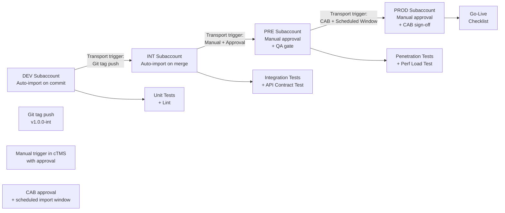

# Lesson 6: BTP Extension with Governance

## 1. First-Principles Intuition & Invariants

The SAP extension problem has always been one of containment. For two decades, enterprises customized their ERP systems through user exits, Business Add-Ins (BADIs), enhancement spots, and modification-free custom development embedded directly within the ABAP application layer. Each customization solved an immediate business requirement, but every injected code fragment dragged the system further from a maintainable baseline. When upgrade time arrived, the custom code collided with SAP's delivered corrections, regression test scopes ballooned, and the total cost of ownership calcified. The clean-core strategy that SAP now advocates is not a philosophical preference but a hard-won conclusion from decades of burned implementation budgets: the ERP core must remain standard, and differentiation must happen outside it.

SAP Business Technology Platform (BTP) is the architectural answer to that conclusion. It provides a cloud-native execution environment where extension applications run side-by-side with the S/4HANA or ECC backend, communicating through published APIs rather than injected code. The extension consumes OData services, REST endpoints, and events from the core system, applies business logic in its own runtime, and writes results back through the same API surface. The core system never knows the extension exists at the code level. It only sees API calls arriving with authenticated tokens, indistinguishable from any other integration partner.

This separation establishes the first invariant of BTP extension design: the API boundary is the only coupling. If your extension depends on a database table in the backend that is not exposed through a CDS view or an OData service, you have violated the contract. The extension must treat the backend as a black box whose only observable surface is its published API catalog. When the backend upgrades, the API contract holds or version-migrates predictably, and the extension continues to function without a code rewrite. When the API contract breaks, the extension fails in a predictable, debuggable way at a single integration point rather than scattering latent defects across modified ABAP includes.

The second invariant is tenant isolation. BTP is a multi-tenant platform, and extension applications built for the partner or enterprise ecosystem must support subscriber onboarding where each tenant's data is logically separated at the database container level, not merely filtered by a tenant ID column. This is not a performance preference but a security and compliance boundary. A manufacturing tenant must never be able to query, infer, or accidentally receive another tenant's production orders, even under fault conditions. The isolation must be enforced by the infrastructure (separate HANA HDI containers per tenant), verified by the application layer (tenant-aware JWT validation), and auditable through traceable onboarding and offboarding operations.

The third invariant is declarative over imperative. The Cloud Application Programming (CAP) Model that governs modern BTP extension development pushes you toward declaring what the data model and service look like in CDS (Core Data Services) and reserving imperative JavaScript or Java only for logic that cannot be expressed declaratively. The framework generates the OData service, the database schema, the persistence layer, and the CRUD handlers from your CDS definitions. Every line of imperative code you write is a line you must test, maintain, and debug. Every line of CDS you write is a line the framework maintains for you. The ratio of declarative to imperative code in a well-designed CAP service should be at least four to one.

The fourth invariant is governed lifecycle. An extension application that passes through no transport route, no quality gate, and no approval workflow before reaching production is a liability regardless of how well it is written. BTP governance means that every deployment is traceable to a change record, every subaccount entitlement is allocated against a documented quota, and every role collection assignment traces to an approver. Without this, the platform becomes a shadow IT surface where teams spin up subaccounts, consume entitlements, and deploy code that nobody owns when it breaks.

---

## 2. Core Architecture & Mechanics

### The BTP Account Model

A BTP global account is the top-level administrative boundary. Beneath it, directories organize subaccounts into logical groupings that mirror organizational structure, such as a directory for production landscapes, another for development, and a third for sandbox experimentation. Each subaccount is an isolation boundary with its own entitlements (service quotas), member lists, and role assignments. A subaccount maps to a cloud provider region, so a global account spanning Europe and North America will have subaccounts in both regions with independent entitlement allocations.

The entitlement mechanism is the currency of BTP governance. Every service your extension consumes—a HANA database instance, an XSUAA authentication service, a destination service, a connectivity service—draws from an entitlement quota assigned to the subaccount. The quota is measured in service plan instances (e.g., five instances of `hana-cloud` on the `hdi-shared` plan) or in resource units (e.g., 10 GB of HANA memory on the `hdi-shared` plan). When the quota is exhausted, no further instances can be created, and deployments that reference the service will fail at the binding step.

The practical consequence is that entitlement planning is an architectural exercise, not an administrative afterthought. A multi-tenant extension serving fifty subscribers needs a HANA memory entitlement sized for the aggregate workload, an XSUAA entitlement that covers both the provider and subscriber instances, and a destination service entitlement that supports per-tenant destination sets. The sizing formula is not guesswork: it derives from the number of concurrent users per tenant, the average query complexity, the HANA memory per concurrent session (approximately 150 MB for OLTP workloads), and a 30 percent headroom for peak load. For fifty tenants with twenty concurrent users each, the baseline HANA memory requirement is 50 × 20 × 0.15 GB = 150 GB, plus headroom of 45 GB, totaling 195 GB of HANA entitlement. This is the number that goes into the entitlement spreadsheet, and the number that the governance team approves before the subaccount is provisioned.

### The CAP Model in Execution

The Cloud Application Programming Model is the primary framework for building BTP extensions. It provides a layered architecture where the data model, service definition, and business logic are separated and each layer is independently testable.

The data model is written in CDS and lives in the `db` layer. This layer defines the persistence schema, entity relationships, and database-level constraints. The service definition, also in CDS, lives in the `srv` layer and projects the data model into consumable OData services with projections, filters, and associations. The business logic, written in JavaScript (Node.js) or Java, lives alongside the service definition and hooks into the lifecycle of every CRUD operation through event handlers.

A representative data model for a production order extension might look like this:

```cds
// db/schema.cds
namespace com.enterprise.extension;

using { managed, cuid } from '@sap/cds/common';

entity ProductionOrders : managed, cuid {
    orderID        : String(12);
    material       : String(18);
    plant          : String(4);
    orderQuantity  : Decimal(13, 3);
    confirmedQty   : Decimal(13, 3) default 0;
    status         : String(4) default 'CRTD';
    priority       : String(1) default 'M';
    scheduledStart : DateTime;
    scheduledEnd   : DateTime;
    operations      : Composition many ProductionOperations on operations.order = $self;
}

entity ProductionOperations : managed, cuid {
    order          : Association to ProductionOrders;
    operationNo    : String(4);
    workCenter     : String(8);
    standardValue   : Decimal(11, 3);
    controlKey      : String(4);
}

entity ExtensionConfig : cuid {
    plant          : String(4);
    autoConfirm    : Boolean default false;
    thresholdQty   : Decimal(13, 3) default 1000;
    approver       : String(12);
}
```

The `managed` aspect from `@sap/cds/common` automatically injects `createdAt`, `createdBy`, `modifiedAt`, and `modifiedBy` fields into every entity that inherits it, giving you audit fields without writing them manually. The `cuid` aspect injects a UUID-based primary key field named `ID`. These are not cosmetic conveniences—they are the framework's mechanism for ensuring that every entity in your extension is auditable and uniquely addressable without requiring you to design and maintain a key strategy for each entity.

The service layer projects this data model into an OData V4 service:

```cds
// srv/service.cds
using { com.enterprise.extension as ext } from '../db/schema';

service ProductionService {
    entity Orders as projection on ext.ProductionOrders;
    entity Operations as projection on ext.ProductionOperations;
    entity Config as projection on ext.ExtensionConfig;

    action autoConfirmOrders(plant : String(4)) returns Integer;
    function getOrderSummary(plant : String(4)) returns OrderSummary;
}

type OrderSummary {
    totalOrders     : Integer;
    confirmedOrders : Integer;
    pendingOrders   : Integer;
    avgQuantity     : Decimal(13, 3);
}
```

When CAP processes this service definition, it generates a fully functional OData V4 service endpoint at runtime. The entities support `$filter`, `$expand`, `$select`, `$orderby`, and `$count` out of the box. The custom action `autoConfirmOrders` and function `getOrderSummary` are exposed as OData actions and functions bound to the service, callable through standard OData URL conventions. You do not write any HTTP handling code, routing logic, or serialization logic. The framework handles all of it.

The business logic that cannot be expressed declaratively is implemented in event handlers:

```javascript
// srv/production-service.js
const cds = require('@sap/cds');

module.exports = class ProductionService extends cds.ApplicationService {
    async init() {
        const { Orders, Operations, Config } = this.entities;

        // Before CREATE: validate plant exists in config
        this.before('CREATE', 'Orders', async (req) => {
            const config = await SELECT.one.from(Config)
                .where({ plant: req.data.plant });
            if (!config) {
                req.error(400, `Plant ${req.data.plant} not configured`);
            }
            if (req.data.orderQuantity > config.thresholdQty) {
                req.warn(`Order quantity exceeds threshold for plant ${req.data.plant}`);
            }
        });

        // After READ: enrich with computed fields
        this.after('READ', 'Orders', (rows) => {
            if (!Array.isArray(rows)) rows = [rows];
            rows.forEach(row => {
                if (row.orderQuantity && row.confirmedQty) {
                    row.confirmationRate = 
                        (row.confirmedQty / row.orderQuantity * 100).toFixed(2);
                }
            });
        });

        // Custom action: auto-confirm orders below threshold
        this.on('autoConfirmOrders', async (req) => {
            const { plant } = req.data;
            const config = await SELECT.one.from(Config).where({ plant });

            if (!config || !config.autoConfirm) {
                return 0;
            }

            const candidates = await SELECT.from(Orders)
                .where({ plant, status: 'CRTD' })
                .and`orderQuantity <= ${config.thresholdQty}`;

            let confirmed = 0;
            for (const order of candidates) {
                await UPDATE(Orders).set({
                    status: 'CNFM',
                    confirmedQty: order.orderQuantity,
                    modifiedAt: new Date()
                }).where({ ID: order.ID });
                confirmed++;
            }
            return confirmed;
        });

        await super.init();
    }
};
```

The event handler architecture follows a before-on-after lifecycle for every operation. `before` handlers run before the framework executes the operation and can modify the request data or reject it entirely by calling `req.error()`. `on` handlers override the default operation entirely, which is how custom actions and functions are implemented. `after` handlers run after the operation completes and can modify the result before it is serialized to the response. This lifecycle is consistent across all entities and operations, which means a single validation handler can be registered for `CREATE` events across all entities, or a single audit handler can be registered for `WRITE` events globally.

### XSUAA Authorization Architecture

BTP authentication is handled by XSUAA (SAP Authorization and Trust Service), which is an OAuth 2.0 compliant identity broker built on top of SAP Cloud Identity. XSUAA issues JWT (JSON Web Token) access tokens that carry scopes, user attributes, and tenant context. Every CAP service deployed to BTP binds to an XSUAA service instance, and the XSUAA instance defines the security descriptor that specifies which scopes the application requires and how those scopes map to roles.

The security descriptor is defined in `xs-security.json`:

```json
{
    "xsappname": "production-extension",
    "tenant-mode": "shared",
    "scopes": [
        {
            "name": "$XSAPPNAME.Read",
            "description": "Read access to production data"
        },
        {
            "name": "$XSAPPNAME.Write",
            "description": "Create and update production data"
        },
        {
            "name": "$XSAPPNAME.Admin",
            "description": "Administrative access including config"
        }
    ],
    "role-templates": [
        {
            "name": "Reader",
            "scope-references": ["$XSAPPNAME.Read"],
            "description": "Can view production orders and operations"
        },
        {
            "name": "Operator",
            "scope-references": ["$XSAPPNAME.Read", "$XSAPPNAME.Write"],
            "description": "Can view and confirm production orders"
        },
        {
            "name": "Administrator",
            "scope-references": ["$XSAPPNAME.Read", "$XSAPPNAME.Write", "$XSAPPNAME.Admin"],
            "description": "Full access including configuration"
        }
    ],
    "role-collections": [
        {
            "name": "ProductionExtensionReader",
            "role-template-references": ["$XSAPPNAME.Reader"]
        },
        {
            "name": "ProductionExtensionOperator",
            "role-template-references": ["$XSAPPNAME.Operator"]
        },
        {
            "name": "ProductionExtensionAdmin",
            "role-template-references": ["$XSAPPNAME.Administrator"]
        }
    ]
}
```

The `$XSAPPNAME` variable resolves to the `xsappname` value at deploy time, which prevents scope name collisions between different applications on the same BTP subaccount. This is not a cosmetic concern—when two applications both define a scope called `Read`, XSUAA must distinguish between them, and the application-specific prefix is the mechanism.

The `tenant-mode` field set to `shared` means this is a multi-tenant application where a single XSUAA instance serves all tenants. The alternative is `dedicated`, where each tenant gets its own XSUAA instance. The `shared` mode is the correct choice for SaaS extensions because it allows a single deployment to serve all subscribers, with tenant context injected into the JWT token's `zone_id` and `user_attributes` claims.

In the CAP service, scope checks are enforced through the `@requires` annotation in the CDS service definition:

```cds
// srv/service.cds
using { com.enterprise.extension as ext } from '../db/schema';

@(requires: 'any')
service ProductionService {
    @(restrict: [
        { grant: 'READ', to: 'ProductionExtensionReader' }
    ])
    entity Orders as projection on ext.ProductionOrders;

    @(restrict: [
        { grant: 'READ', to: 'ProductionExtensionReader' },
        { grant: 'WRITE', to: 'ProductionExtensionOperator' }
    ])
    entity Operations as projection on ext.ProductionOperations;

    @(restrict: [
        { grant: '*', to: 'ProductionExtensionAdmin' }
    ])
    entity Config as projection on ext.ExtensionConfig;

    @(requires: 'ProductionExtensionOperator')
    action autoConfirmOrders(plant : String(4)) returns Integer;
}
```

The `@restrict` annotation maps HTTP methods to scopes. The `grant: 'READ'` check verifies that the incoming JWT contains the `ProductionExtensionReader` scope (resolved through the role collection). The `grant: 'WRITE'` check verifies the `ProductionExtensionOperator` scope. The `grant: '*'` grants all methods to the admin role. CAP evaluates these annotations before the event handler lifecycle begins, so unauthorized requests never reach your business logic. The rejection happens at the framework level with a standard 403 response.

### Multi-Tenancy Architecture

Multi-tenancy in BTP extensions is implemented through the SaaS Provisioning Service, which manages the subscriber lifecycle. The application provider deploys the extension to a provider subaccount, and subscribers subscribe to the application through the BTP cockpit or via API. When a subscriber onboards, the SaaS Provisioning Service triggers a tenant onboarding callback in the application, which provisions the tenant's data isolation boundary.

For CAP applications, multi-tenancy is implemented through the `@sap/cds-mtxs` module (the successor to `@sap/cds-mtx`), which manages tenant-aware HANA HDI (HANA Deployment Infrastructure) containers. Each tenant gets its own HDI container, which is a logically isolated schema within a shared HANA database instance. The container has its own container group, its own deploy service, and its own database user with privileges scoped to that container only.

The multi-tenancy configuration in `mta.yaml` binds the application to the SaaS Provisioning Service:

```yaml
# mta.yaml
ID: production-extension
_schema-version: '3.1'
version: '1.0.0'

parameters:
  approuter-version: '11.0.0'

modules:
  - name: production-extension-srv
    type: nodejs
    path: gen/srv
    parameters:
      buildpack: nodejs_buildpack
    requires:
      - name: production-extension-db
      - name: production-extension-auth
      - name: production-extension-saas-registry
      - name: production-extension-app-router
    provides:
      - name: srv-api
        properties:
          srv-url: ${default-url}

  - name: production-extension-db-deployer
    type: hdb
    path: gen/db
    parameters:
      buildpack: nodejs_buildpack
    requires:
      - name: production-extension-db
      - name: production-extension-auth

  - name: production-extension-app
    type: approuter
    path: app/router
    parameters:
      routes:
        - route: ${default-url}/production-extension
    requires:
      - name: srv-api
        properties:
          forward-srv-url: ~{srv-url}
      - name: production-extension-auth
      - name: production-extension-saas-registry

resources:
  - name: production-extension-db
    type: com.sap.xs.hdi-container
    parameters:
      service: hana
      service-plan: hdi-shared
    properties:
      hdi-service-name: ${service-name}

  - name: production-extension-auth
    type: org.cloudfoundry.existing-service
    parameters:
      service-name: production-extension-auth

  - name: production-extension-saas-registry
    type: org.cloudfoundry.existing-service
    parameters:
      service-name: production-extension-saas-registry
```

The SaaS Provisioning Service resource (`saas-registry`) is configured with a descriptor that defines the application's tenant onboarding and offboarding callback endpoints. When a subscriber initiates onboarding, the SaaS Provisioning Service sends a PUT request to the application's `/-/cds/saas-provisioning/tenant/:id` callback endpoint. The `cds-mtxs` module handles this callback automatically, creating a new HDI container for the tenant, deploying the database schema into that container, and returning a success response to the SaaS Provisioning Service.

The tenant context is propagated through the JWT token. When a user from a subscribed tenant accesses the application, the approuter forwards the request with the JWT token, which contains the tenant's `zone_id` in the `zid` claim. CAP reads this claim and routes all database operations to the tenant's HDI container. The developer does not write any tenant-switching logic. The framework handles it through the `@sap/cds-mtxs` middleware, which intercepts every database transaction and sets the HANA session context to the correct container.

The onboarding callback can be customized to perform tenant-specific initialization, such as seeding default configuration data or triggering an initial data load from the subscriber's backend system:

```javascript
// srv/saas-provisioning.js
const cds = require('@sap/cds');

module.exports = class SaasProvisioning extends cds.Service {
    async onboarding(req) {
        const { subscribedTenantId, subscribedSubdomain } = req.data;
        
        // The cds-mtxs module handles HDI container creation
        // This handler runs after the container is provisioned
        const tx = cds.tx({ tenant: subscribedTenantId });
        
        try {
            // Seed default configuration
            await tx.run(INSERT.into('ExtensionConfig').entries({
                plant: 'DEFAULT',
                autoConfirm: false,
                thresholdQty: 1000,
                approver: 'INITIAL'
            }));
            
            // Trigger initial data load from subscriber backend
            const destination = await getSubscriberDestination(subscribedSubdomain);
            await triggerInitialLoad(subscribedTenantId, destination);
            
            return { status: 'SUCCESS' };
        } catch (err) {
            req.error(500, `Tenant onboarding failed: ${err.message}`);
            return { status: 'ERROR' };
        } finally {
            await tx.commit();
        }
    }

    async offboarding(req) {
        const { subscribedTenantId } = req.data;
        
        // Export tenant data if required by data retention policy
        await exportTenantData(subscribedTenantId);
        
        // cds-mtxs handles HDI container deletion
        return { status: 'SUCCESS' };
    }
};
```

### Destination Service and Backend Connectivity

The extension communicates with the S/4HANA backend through the Destination Service, which acts as a secure configuration store for connection details, authentication credentials, and additional headers. The destination is not a simple connection string—it is a named configuration object that includes the URL, authentication type (Basic, OAuth 2.0, ClientCertificate, Principal Propagation), credentials, and custom properties.

Principal Propagation is the most important authentication pattern for BTP extensions. It allows the extension to call the backend API as the authenticated user, not as a technical service account. The user's JWT token from XSUAA is exchanged for an SAP SAML assertion or an OAuth 2.0 token that the backend accepts, and the backend performs authorization checks against the actual user, not a shared technical user. This means the backend's audit logs show the real user making the API call, and the backend's authorization checks (S/4HANA authorization objects, PFCG roles) apply exactly as they would for a direct UI transaction.

The destination configuration for Principal Propagation requires an OAuth 2.0 client setup in the backend system, a trust relationship between XSUAA and the backend's SAML identity provider, and a destination definition that specifies `PrincipalPropagation` as the authentication type. The destination is consumed in CAP through the `@sap-cloud-sdk/connectivity` module:

```javascript
const { getDestination } = require('@sap-cloud-sdk/connectivity');
const { executeHttpRequest } = require('@sap-cloud-sdk/http-client');

async function fetchProductionOrdersFromBackend(plant) {
    const destination = await getDestination('S4HANA_PRODUCTION_API');
    
    const response = await executeHttpRequest(destination, {
        method: 'GET',
        url: `/sap/opu/odata/sap/API_PRODUCTION_ORDER_2_SRV/A_ProductionOrder_2?$filter=Plant eq '${plant}'&$format=json`
    });
    
    return response.data.d.results;
}
```

The `getDestination` function reads the destination from the Destination Service using the XSUAA token of the current request, which means Principal Propagation happens transparently. The Cloud SDK handles the token exchange, adds the necessary headers, and returns the response. The extension code is clean because the complexity of token exchange, certificate validation, and SAML assertion generation is hidden behind a single function call.

### Transport Management and CI/CD Governance

BTP extension governance requires a transport management strategy that mirrors the rigor of the ABAP transport system. The SAP Cloud Transport Management service (cTMS) provides a transport route for cloud applications that supports the same import/export, validation, and approval workflow model that ABAP developers expect.

The transport flow for a CAP extension follows this pipeline:



The CI/CD pipeline is implemented with SAP Cloud Transport Management bound to the subaccounts. The development pipeline is fully automated: a commit to the main branch triggers a build using the Cloud MTA Build Tool (`mbt`), the build artifact is uploaded to cTMS, and cTMS imports it into the DEV subaccount. The integration pipeline triggers on a Git tag push with a version suffix, and the import into the INT subaccount is automatic after a successful build.

The pre-production and production transitions require manual approval. The cTMS approval workflow allows designated approvers to review the transport content (what changed, what entities were added, what configurations were modified) before authorizing the import. The production import is additionally gated by a Change Advisory Board (CAB) review and restricted to a defined maintenance window.

The MTA (Multi-Target Application) descriptor is the transport unit. It defines the complete application as a set of modules (service, database deployer, approuter) and resources (HDI container, XSUAA instance, SaaS registry). The `mta.yaml` file is versioned in Git, and each transport carries the version number from the MTA descriptor. This means every deployment to production is traceable to a specific Git commit, a specific MTA version, and a specific cTMS transport record.

---

## 3. High-Performance Optimization & Failure Modes

### CAP Query Optimization and HANA Pushdown

The performance of a CAP service is fundamentally determined by how much of the query logic the framework can push down to the HANA database layer. When CAP receives an OData request like `GET /Orders?$filter=plant eq '1000'&$expand=operations&$top=50`, it translates this into a CDS query that is compiled to SQL and executed on HANA. The pushdown is complete when the entire query, including the `$filter` condition, the `$expand` join, and the `$top` pagination, is executed as a single SQL statement on the database. The pushdown is partial when CAP retrieves a larger result set from the database and applies filtering or pagination in the application layer, which is slower and consumes more memory.

The factors that prevent full pushdown are after-handlers that modify result sets, computed fields that require application-layer calculation, and associations that cannot be expressed as SQL joins. A well-optimized CAP service minimizes after-handler logic and pushes computed fields into CDS calculated columns or HANA calculated columns whenever possible.

Consider this anti-pattern: an after-handler that calculates a confirmation rate for each order:

```javascript
// ANTI-PATTERN: Application-layer computation prevents pushdown
this.after('READ', 'Orders', (rows) => {
    rows.forEach(row => {
        row.confirmationRate = (row.confirmedQty / row.orderQuantity * 100).toFixed(2);
    });
});
```

This forces CAP to retrieve all matching rows from the database, compute the rate in Node.js, and return the result. The `$top` pagination happens in the application layer because the computed field is not available until after the rows are retrieved. The correct approach is a CDS calculated element:

```cds
// CORRECT: Database-layer computation enables full pushdown
entity ProductionOrders : managed, cuid {
    orderID        : String(12);
    orderQuantity  : Decimal(13, 3);
    confirmedQty   : Decimal(13, 3) default 0;
    confirmationRate : Decimal(5, 2) @(
        cds.api.on: 'round(confirmedQty / nullif(orderQuantity, 0) * 100, 2)'
    );
}
```

The `nullif` function prevents division by zero, and the `round` function ensures consistent decimal precision. This calculated column is compiled into the SQL statement that HANA executes, so `$filter`, `$orderby`, and `$top` all operate on the computed value at the database level. The application layer never touches the data.

For more complex calculations that require conditional logic, HANA window functions can be used through CDS custom handlers with `SELECT.from().columns()`:

```javascript
//srv/production-service.js - optimized query with HANA pushdown
this.on('getOrderSummary', async (req) => {
    const { plant } = req.data;
    
    const result = await SELECT.from(Orders)
        .columns(
            'count(*) as totalOrders',
            "sum(case when status = 'CNFM' then 1 else 0 end) as confirmedOrders",
            "sum(case when status = 'CRTD' then 1 else 0 end) as pendingOrders",
            'round(avg(orderQuantity), 3) as avgQuantity'
        )
        .where({ plant });
    
    return result[0];
});
```

This generates a single SQL aggregation query on HANA, which is orders of magnitude faster than retrieving all orders and aggregating in JavaScript, especially for plants with tens of thousands of production orders.

### Caching Strategy

CAP supports a two-tier caching strategy. The first tier is HANA's built-in result cache, which stores the result sets of frequently executed SQL statements. This is enabled at the HANA instance level and requires no application code, but it is most effective for queries that are executed repeatedly with the same parameters, such as configuration lookups.

The second tier is the CAP application cache, which uses the Node.js in-memory cache or an external Redis instance for larger deployments. The cache is populated through a custom handler:

```javascript
// srv/cache-handler.js
const cds = require('@sap/cds');
const cache = new Map();

module.exports = class CacheHandler extends cds.Service {
    async init() {
        this.before('READ', 'Config', async (req) => {
            const cacheKey = `config:${req.tenant}:${req.data.plant}`;
            if (cache.has(cacheKey)) {
                req.reply(cache.get(cacheKey));
                return;
            }
        });

        this.after('READ', 'Config', (data, req) => {
            const cacheKey = `config:${req.tenant}:${req.data.plant}`;
            cache.set(cacheKey, data);
            // TTL: 5 minutes for configuration data
            setTimeout(() => cache.delete(cacheKey), 300000);
        });

        // Invalidate cache on write
        this.after('WRITE', 'Config', (data, req) => {
            const cacheKey = `config:${req.tenant}:${req.data.plant}`;
            cache.delete(cacheKey);
        });

        await super.init();
    }
};
```

The cache key includes the tenant ID to prevent cross-tenant data leakage, which is a critical security invariant. The TTL (time-to-live) is set based on the data volatility: configuration data that changes rarely can have a 5-minute TTL, while transactional data should not be cached at all or should have a TTL measured in seconds. The cache is invalidated on any write operation to ensure consistency.

### Scaling and Resource Management

BTP applications run on the SAP Cloud Foundry runtime, which provides horizontal scaling through configurable instance counts. The MTA deployment manifest specifies the initial instances and the resource allocation per instance:

```yaml
# mta.yaml - production-extension-srv module
- name: production-extension-srv
  type: nodejs
  path: gen/srv
  parameters:
    instances: 2
    memory: 512M
    disk-quota: 1G
    buildpack: nodejs_buildpack
    routes:
      - route: ${default-url}
```

The `instances: 2` parameter means two identical instances of the service run simultaneously, and the Cloud Foundry router distributes incoming requests across them. This provides both load distribution and high availability: if one instance crashes, the other continues serving requests, and Cloud Foundry restarts the failed instance automatically.

The SAP Cloud Foundry autoscaler service can be bound to the application to adjust instance counts dynamically based on metrics. The autoscaler configuration specifies scaling rules:

```json
{
    "instance_min_count": 2,
    "instance_max_count": 10,
    "scaling_rules": [
        {
            "metric_type": "memory",
            "operator": ">=",
            "threshold": 80,
            "action": "ADD",
            "amount": 1,
            "cooldown": 120
        },
        {
            "metric_type": "memory",
            "operator": "<=",
            "threshold": 30,
            "action": "REMOVE",
            "amount": 1,
            "cooldown": 300
        },
        {
            "metric_type": "throughput",
            "operator": ">=",
            "threshold": 100,
            "action": "ADD",
            "amount": 2,
            "cooldown": 180
        }
    ]
}
```

The memory-based rule adds an instance when average memory utilization exceeds 80 percent for two minutes, and removes an instance when it drops below 30 percent for five minutes. The throughput rule adds two instances when request throughput exceeds 100 requests per minute for three minutes. The cooldown periods prevent thrashing, where instances are added and removed too rapidly in response to transient load spikes.

The memory allocation per instance is a critical tuning parameter. A CAP Node.js service with typical OData request handling needs approximately 256 MB of memory per instance under light load. Under heavy load with large result sets and complex event handlers, 512 MB is more appropriate. If the instance memory is too small, the Node.js garbage collector runs frequently, degrading performance. If it is too large, the instance takes longer to start and consumes more entitlement, which may trigger the subaccount's memory quota limit. The optimal memory allocation is determined through load testing with realistic data volumes and request patterns.

### Failure Modes and Mitigations

Several failure modes are specific to BTP extension architectures, and each requires a defined mitigation strategy.

**XSUAA token validation failure** occurs when the JWT token presented by the client is expired, malformed, or issued by a different XSUAA instance than the one the application is bound to. CAP rejects these requests with a 401 status code, but the error message may not clearly indicate the root cause to the consuming application. The mitigation is to implement a custom error handler that distinguishes between token expiration (which the client can recover by requesting a new token), token signature mismatch (which indicates a misconfiguration), and missing token (which indicates the approuter is not forwarding the authorization header):

```javascript
// srv/error-handler.js
const cds = require('@sap/cds');

module.exports = (srv) => {
    srv.on('ERROR', '*', (err, req) => {
        if (err.code === 'UNAUTHORIZED') {
            const authHeader = req.headers.authorization;
            if (!authHeader) {
                err.message = 'Authorization header missing. Approuter may not be configured correctly.';
                err.statusCode = 401;
            } else if (authHeader.startsWith('Bearer ')) {
                const token = authHeader.substring(7);
                try {
                    const payload = JSON.parse(
                        Buffer.from(token.split('.')[1], 'base64').toString()
                    );
                    const exp = payload.exp * 1000;
                    if (Date.now() > exp) {
                        err.message = 'Token expired. Request a new access token from XSUAA.';
                    } else {
                        err.message = 'Token signature validation failed. Check XSUAA binding.';
                    }
                } catch (e) {
                    err.message = 'Malformed JWT token.';
                }
            }
        }
    });
};
```

**HDI container provisioning failure** during tenant onboarding occurs when the HANA database has insufficient resources to create a new container, or when the schema deployment fails due to a dependency issue. The `cds-mtxs` module retries the provisioning operation, but if it fails after retries, the tenant onboarding is left in a partially provisioned state. The mitigation is to implement an idempotent onboarding handler that can detect and clean up partial provisioning before retrying:

```javascript
async onboarding(req) {
    const { subscribedTenantId } = req.data;
    
    // Check for existing partial provisioning
    const existingContainers = await getHDIContainers(subscribedTenantId);
    if (existingContainers.length > 0) {
        // Clean up partial containers before retrying
        await deleteHDIContainer(subscribedTenantId);
    }
    
    // Proceed with fresh provisioning
    try {
        await provisionTenantContainer(subscribedTenantId);
        return { status: 'SUCCESS' };
    } catch (err) {
        // Log detailed error for support, return generic error to SaaS registry
        console.error(`Tenant onboarding failed for ${subscribedTenantId}:`, err);
        return { status: 'ERROR' };
    }
}
```

**Destination service unavailability** occurs when the Destination Service is temporarily unreachable, causing all backend API calls to fail. The mitigation is a circuit breaker pattern that detects consecutive destination service failures and short-circuits subsequent calls to return a cached or fallback response instead of waiting for the timeout:

```javascript
const CircuitBreaker = require('opossum');

const destinationBreaker = new CircuitBreaker(fetchFromDestination, {
    timeout: 10000,
    errorThresholdPercentage: 50,
    resetTimeout: 60000
});

destinationBreaker.fallback(() => {
    return { error: 'Backend temporarily unavailable', cached: true };
});

async function getProductionOrdersWithCircuitBreaker(plant) {
    return destinationBreaker.fire(plant);
}
```

The circuit breaker opens after 50 percent of requests fail, and it stays open for 60 seconds before attempting to half-open and test the service. During the open state, all calls return the fallback response immediately, which prevents the extension from accumulating timed-out requests and exhausting its connection pool.

**Entitlement exhaustion** occurs when a subaccount runs out of service quotas, preventing new instances from being created. This is not a runtime failure but a deployment failure, and it is the most common cause of failed production deployments in ungoverned BTP landscapes. The mitigation is a governance process that monitors entitlement consumption and alerts before the limit is reached:

```javascript
// Entitlement monitoring (executed daily as a scheduled job)
async function checkEntitlements(subaccountId) {
    const entitlements = await btpCli.getEntitlements(subaccountId);
    
    const alerts = [];
    for (const service of entitlements) {
        const utilization = service.assigned / service.quotas;
        if (utilization > 0.85) {
            alerts.push({
                service: service.name,
                plan: service.plan,
                assigned: service.assigned,
                quota: service.quota,
                utilization: `${(utilization * 100).toFixed(1)}%`,
                action: 'Request quota increase or audit unused instances'
            });
        }
    }
    
    if (alerts.length > 0) {
        await sendGovernanceAlert(subaccountId, alerts);
    }
}
```

This monitoring job runs daily and sends an alert to the governance team when any service entitlement exceeds 85 percent utilization. The alert includes the specific service, the current utilization, and a recommended action, which allows the governance team to act before the entitlement is exhausted rather than reacting to a failed deployment.

### Governance Framework Implementation

The governance framework for BTP extensions operates on three levels: landscape governance (who can create subaccounts and allocate entitlements), deployment governance (what code reaches which environment), and runtime governance (what the deployed application is allowed to do).

Landscape governance is implemented through a subaccount request process that requires approval from both the technical owner (who validates the entitlement sizing) and the cost center owner (who validates the budget). The request includes the subaccount name, the cloud provider region, the required entitlements with sizing justification, the expected data classification, and the compliance requirements (GDPR, HIPAA, SOC 2). The approval workflow is automated in a governance tool such as SAP Cloud ALM or an external ITSM platform:

```json
{
    "subaccountRequest": {
        "name": "production-extension-prod",
        "directory": "Enterprise Extensions / Production",
        "region": "cf-eu10",
        "entitlements": [
            {
                "service": "hana-cloud",
                "plan": "hdi-shared",
                "amount": 200,
                "unit": "GB",
                "justification": "50 tenants x 2GB avg + 30% headroom = 130GB, round to 200GB"
            },
            {
                "service": "xsuaa",
                "plan": "application",
                "amount": 1,
                "unit": "instances",
                "justification": "Shared tenant mode, single XSUAA instance for all subscribers"
            },
            {
                "service": "destination",
                "plan": "lite",
                "amount": 1,
                "unit": "instances",
                "justification": "Destination service for S/4HANA backend connectivity"
            }
        ],
        "dataClassification": "Confidential",
        "compliance": ["GDPR"],
        "costCenter": "ENT-001",
        "approvals": ["technical-owner", "cost-center-owner"]
    }
}
```

Deployment governance is implemented through the cTMS transport route and the CI/CD pipeline described earlier. The key governance control is the separation of build and deploy: the build pipeline runs in a CI environment and produces the MTA archive, but it cannot deploy to any environment. The deploy step is a separate pipeline stage that runs in the target subaccount's context and requires the cTMS approval workflow to have authorized the transport. This separation prevents a compromised or misconfigured CI pipeline from deploying directly to production.

Runtime governance is implemented through XSUAA role collections and SAP Cloud Logging Service. Every API call is logged with the user identity (from the JWT token), the tenant ID, the operation, the entity, and the timestamp. These logs are shipped to the Cloud Logging Service, which provides a Kibana-based dashboard for audit queries and anomaly detection:

```javascript
// srv/audit-middleware.js
const cds = require('@sap/cds');

module.exports = (srv) => {
    srv.before('*', '*', async (req) => {
        req.auditEntry = {
            timestamp: new Date().toISOString(),
            tenant: req.tenant,
            user: req.user.id,
            operation: req.event,
            entity: req.entity?.name,
            method: req.http.req.method,
            path: req.http.req.path
        };
    });

    srv.after('*', '*', async (data, req) => {
        req.auditEntry.statusCode = req.http.res.statusCode;
        req.auditEntry.duration = Date.now() - new Date(req.auditEntry.timestamp).getTime();
        
        // Ship to Cloud Logging Service
        await cds.log('audit').info(JSON.stringify(req.auditEntry));
    });
};
```

The audit middleware captures every operation across every entity and writes it to the Cloud Logging Service with sufficient detail to reconstruct who did what, when, and from which tenant. The logs are retained according to the organization's compliance policy, and they are queryable for incident investigation, compliance audit, and anomaly detection.

The governance framework's effectiveness is measured through three key metrics: the mean time to approve a subaccount request (target: under 48 hours for standard configurations), the deployment success rate (target: above 95 percent, with failures attributed to code defects rather than entitlement or configuration issues), and the audit query response time (target: under 4 hours for a complete user activity trace across all BTP extensions). These metrics are tracked in the governance dashboard and reviewed monthly by the BTP platform governance committee, which is the body that owns the entitlement quotas, the subaccount directory structure, and the transport route policies.
