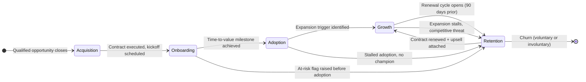

# Lesson 1: Account Lifecycle Fundamentals

## 1. First-Principles Intuition & Invariants

The central premise of account management is deceptively simple: a customer is not a transaction, but a relationship with a time dimension. Where sales treats the customer as a destination, account management treats the customer as a point of departure. That conceptual inversion changes everything about how you allocate attention, measure success, and structure the commercial relationship. Getting this distinction wrong is the most expensive mistake a revenue organization can make, because the cost of that confusion compounds silently until it surfaces as churn.

To understand why, start with the economics. In a subscription or recurring-revenue business, the initial sale typically recovers less than the cost of acquiring the customer. The CAC payback period for a mid-market SaaS business often runs between 18 and 30 months. That means the entire commercial thesis depends on the customer staying long enough for the relationship to become profitable, and then growing. The account does not generate value at the moment of signature; it generates value across time, proportional to retention and expansion. This is not merely a financial observation. It is an architectural constraint that dictates how every function in the business should operate.

The lifecycle model provides the temporal scaffold for that architecture. At its core, it describes the progressive states through which a customer relationship evolves, from first commercial contact through deep integration, expansion, and eventually — through failure or completion — termination. Each stage has distinct economic properties, distinct customer psychology, distinct risk exposures, and therefore distinct management imperatives. An account manager who applies the same playbook to a 60-day-old customer and a 4-year-old customer is not managing accounts; they are processing tickets.

Three invariants hold across every account lifecycle, regardless of industry, deal size, or product type. First, **the cost to rescue a deteriorating relationship always exceeds the cost to maintain a healthy one**. This is not intuition; it is a function of the work required. A customer who has mentally decided to leave requires executive re-engagement, pricing concessions, custom roadmap commitments, and significant professional services investment. A customer who is healthy requires a thoughtful QBR and a renewal conversation. The asymmetry is typically four to six times the effort, which is why leading indicators and health scoring are not nice-to-have capabilities but operational necessities.

Second, **expansion and retention are not independent variables**. The conditions that make a customer willing to expand their contract are the same conditions that make them willing to renew it: realized value, organizational adoption, and trust in the vendor's execution. This means that an account management motion focused exclusively on renewal protection leaves significant revenue on the table, while a motion focused exclusively on upsell at the expense of adoption creates the conditions for churn. The two must be sequenced deliberately within each lifecycle phase.

Third, **revenue recognition and relationship health are not the same signal, and treating them as equivalent destroys the ability to forecast accurately**. A customer can be fully contracted on paper while silently evacuating. Net Revenue Retention, calculated correctly, is a trailing indicator. It tells you what has already happened. The account manager's job is to operate on leading indicators — product engagement scores, support ticket velocity, stakeholder access, and executive sentiment — before the financial signal emerges.

These three invariants establish the problem space. Account lifecycle management is fundamentally the practice of converting a one-time commercial event into a durable, expanding economic relationship by managing state transitions deliberately, measuring the right variables at the right moments, and intervening before deterioration becomes visible in the revenue line.

---

## 2. Core Architecture & Mechanics

### The Account Lifecycle State Machine

The lifecycle is best understood as a finite state machine. Each state has defined entry criteria, characteristic activities, measurable exit signals, and transition paths — both forward toward expansion and backward toward risk. The following diagram renders the canonical five-stage model with its primary transition vectors.

Each arrow in this diagram represents a decision point that the account manager actively controls, not a passive passage of time. Understanding the mechanics at each stage is what separates practitioners who manage by calendar from those who manage by state.

### Stage 1: Acquisition and Commercial Handoff

The acquisition stage begins at closed-won and ends at the first substantive onboarding session. This transition is deceptively fraught. The selling motion creates expectations — sometimes accurate, sometimes inflated — that the account management team now owns to fulfill. The most reliable tool for managing this gap is the **Account Transition Document**, which captures four things: the business problem the customer articulated during the sales cycle, the specific outcomes they committed to in the success criteria, the key stakeholders and their individual motivations, and any commitments made during the sales process that are not reflected in the standard contract.

The commercial mechanics here are straightforward but require discipline. Revenue recognition under ASC 606 begins when — and only when — control of the promised good or service transfers to the customer. For a SaaS product with a go-live dependency, this may mean that revenue is deferred until provisioning is complete and the customer has acknowledged access. For a professional services component, revenue recognizes proportionally to the percentage of completion. The account manager does not set accounting policy, but they must understand that onboarding delays have direct P&L consequences, which creates legitimate organizational urgency to close the gap between signature and go-live.

### Stage 2: Onboarding and Time-to-Value

Onboarding is the highest-leverage stage in the lifecycle, because the habits and perceptions formed in the first 90 days are extraordinarily sticky. A customer who reaches a meaningful value milestone within 60 days is statistically far more likely to renew and expand than one who spends 60 days in configuration limbo. The practitioner term for this milestone is **Time-to-Value (TTV)**, and it must be defined in concrete, measurable terms before the kickoff call.

TTV is not "the customer is onboarded." It is "the customer's finance team has run three live reconciliation cycles using the product" or "the customer's SDR team has completed their first 500-contact sequence with a measured reply rate." The specificity matters because vague milestones cannot be tracked, cannot be communicated to the customer as proof of progress, and cannot be used to trigger the expansion conversation with legitimacy.

The onboarding workflow operates across three parallel tracks. The **technical track** covers provisioning, integration, data migration, and configuration — activities that are often owned by a solutions engineer or implementation team but require the account manager to maintain visibility and escalation rights. The **training track** covers user enablement, which must be differentiated by persona: the power users who need depth, the occasional users who need simplicity, and the executives who need outcome summaries rather than feature walkthroughs. The **success planning track** establishes the mutual success plan — a living document that maps the customer's business objectives to measurable product adoption milestones, with named owners and target dates on both sides of the relationship.

The mutual success plan is not a sales artifact. It is an operational contract between the account manager and the customer's internal champion, and it is the primary instrument for health scoring during onboarding. When milestones slip, the success plan surfaces the slippage before it becomes invisible inertia.

### Stage 3: Adoption and the Engagement Depth Model

Once onboarding closes, the account enters the adoption stage, where the core measurement shifts from milestone completion to engagement depth. Engagement depth is a composite signal built from three layers. **Breadth** measures the percentage of provisioned users who are active within a defined window — typically 30 days. **Depth** measures whether users are accessing high-value features that correlate with the outcomes the customer originally purchased for. **Frequency** measures whether engagement is consistent or episodic. A customer with high breadth but low depth is using the product superficially; they are exposed to churn from any competitor who makes switching easy. A customer with high depth but low breadth has a champion but no organizational penetration; they are exposed to churn from internal budget cuts or champion departure.

The account manager's operational tool at this stage is the **Customer Health Score**, which aggregates these signals into a single composite number. A production-grade health score for a B2B SaaS account typically weights the following components:

| Signal | Weight | Measurement Method |
|---|---|---|
| Product engagement (DAU/MAU ratio) | 25% | Product analytics platform (e.g., Mixpanel, Pendo) |
| Feature adoption of core use cases | 20% | Event-level telemetry mapped to defined workflow completion |
| Support ticket volume and severity | 15% | CRM / helpdesk ticket pipeline (e.g., Zendesk, Salesforce Cases) |
| Executive sponsor responsiveness | 15% | Logged touchpoints in CRM, QBR attendance rate |
| NPS / CSAT score (most recent) | 15% | In-app survey or email survey cycle |
| Contract utilization rate | 10% | Seat utilization or consumption metering |

Each component is scored on a normalized 0–100 scale, the weighted average produces the composite health score, and thresholds are set operationally: green above 70, yellow between 45 and 70, red below 45. The thresholds should be calibrated against historical churn data — specifically, the health score distribution of churned accounts in the 90 days prior to their cancellation. Any account whose score crosses from green to yellow triggers an automated task in the CRM assigned to the owning account manager, with a mandatory follow-up protocol.

### Stage 4: Growth and Expansion Mechanics

The expansion conversation has a specific precondition: demonstrated value. Attempting to expand before the customer has achieved measurable outcomes from their initial investment is not aggressive sales; it is a trust violation that damages the relationship. The account manager's job is to monitor the signals that indicate the customer has crossed the value threshold and to initiate the expansion motion at the moment of maximum receptivity.

Expansion in B2B account management takes three structural forms. **Seat expansion** occurs when utilization of the licensed capacity approaches saturation — typically when active users exceed 80% of provisioned seats for two consecutive months. **Tier expansion** occurs when the customer's use case complexity has outgrown the capabilities of their current product tier. **Use case expansion** occurs when a successful deployment in one department creates a cross-sell opportunity in an adjacent one. These three vectors are not equally probable at every account; the account manager must maintain an active **Expansion Map** that tracks current penetration by department, by use case, and by geography, and identifies the specific economic buyer for each untapped dimension.

The commercial structure of an expansion deal differs from a new logo acquisition in one important way: the customer already has negotiating context. They know the product's real capabilities, their internal switching costs, and the competitive alternatives. The account manager must anchor the expansion conversation to quantified business outcomes from the existing deployment, not to product features. A concrete framing sounds like: "Your operations team has reduced reconciliation time by 40% using Module A. The same workflow bottleneck exists in your procurement team, which currently runs the process manually. Here is what that costs them annually, and here is what a comparable deployment would cost relative to that waste." That is a CFO-level business case, not a feature pitch.

### Stage 5: Retention and Renewal Mechanics

The renewal cycle should open 90 days before the contract end date as a floor, not as a starting point. For accounts above a defined ACV threshold — typically anything above $50,000 ARR — the renewal conversation should begin at the 6-month mark, anchored to the next QBR cycle. This is not aggressive; it is rational. A renewal decision for a mid-market customer involves procurement, legal, finance, and IT. The paper process alone can consume 30 to 60 days. Starting at 90 days leaves no room for the commercial negotiation that precedes the paper process.

The QBR is the primary retention instrument. Its structure should follow a strict sequence: open with the customer's business outcomes and progress against the mutual success plan, present the product adoption metrics with interpretation rather than raw numbers, acknowledge any service failures and the remediation taken, present the roadmap items most relevant to the customer's stated strategic priorities, and close with the mutual commitments for the next period. The QBR is not a status report. It is a proof-of-value ceremony that re-establishes the commercial logic for the renewal before any pricing conversation occurs.

Net Revenue Retention is the financial metric that consolidates the entire lifecycle into a single number. It is calculated as:

$$NRR = \frac{(ARR_{start} + Expansion_{ARR} - Contraction_{ARR} - Churned_{ARR})}{ARR_{start}} \times 100$$

A world-class NRR benchmark for an enterprise SaaS business is 120% or above, meaning that the existing customer base grows by 20% annually through expansion net of churn, without acquiring a single new logo. At 100% NRR, expansion and churn perfectly offset. Below 100%, the business is in a leaky bucket condition where new logo acquisition is running to stand still. The account management organization's operational target should be an NRR floor of 110%, with the expansion and churn components tracked and reported separately so that deterioration in either direction is visible before the composite number masks it.

---

## 3. High-Performance Optimization & Failure Modes

### Failure Mode 1: The Orphaned Onboarding

The most common and most damaging failure in the account lifecycle occurs in the transition from sales to customer success. The selling team, incentivized on closed revenue and already mentally attached to the next prospect, hands off a new customer with insufficient context, compressed timelines, and occasionally with commitments the implementation team was not consulted on. The customer, whose expectations were calibrated by an optimistic sales process, encounters a slower, more complicated reality. By day 30, trust has already eroded.

The mitigation is structural, not motivational. High-performing organizations implement a **pre-close onboarding readiness review**, where the solutions engineer and onboarding lead must sign off on the implementation scope before the AE is authorized to push the deal to closed-won. This creates a forcing function: the sales team cannot close a deal whose implementation is not resourced and scoped. Paired with this, the Sales-to-CS handoff should be a live meeting — not an email — attended by the AE, the account manager, and the customer's project lead, with the Account Transition Document shared and reviewed in real time. This single process change, consistently enforced, is worth several points of NRR.

### Failure Mode 2: Stalled Adoption at the Power User Layer

A second failure mode occurs when product adoption concentrates in a small group of enthusiastic power users while the broader organization remains unengaged. This pattern is dangerous because it mimics health in the engagement metrics — the power users generate high activity signals — while concealing organizational fragility. When a power user departs or is promoted, the account's adoption foundation collapses overnight.

The diagnostic signal for this failure mode is a low **breadth ratio** (active users / provisioned users) paired with a high **depth score** on the active cohort. When this pattern emerges, the account manager must shift the engagement motion from individual users to departmental leaders. The goal is to get the department head — not the power user — to articulate the workflow value to their own team. That internal advocacy is far more durable than any training session the vendor can deliver, because it is embedded in the customer's own management authority structure.

### Failure Mode 3: Champion Departure

Champion departure is an underappreciated churn vector. When the internal executive who sponsored the purchase leaves the organization, the account loses its institutional memory, its internal advocate, and often the political capital that sustained the product's budget. Accounts that have experienced champion departure churn at two to three times the rate of stable accounts in the first 90 days after the departure event.

The mitigation requires proactive multi-threading during the growth stage — before any executive change occurs. Multi-threading means establishing substantive relationships with at least three named stakeholders at different organizational levels: the economic buyer, the operational champion, and an end-user advocate. Each relationship must be maintained through direct communication, not mediated exclusively through the primary champion. CRM hygiene is the operational discipline that makes this possible: every stakeholder interaction must be logged with the contact, the date, the content, and the sentiment, so that if the primary champion departs, the account manager can immediately identify who the strongest remaining relationships are and move to establish continuity.

### Failure Mode 4: The Renewal-Only Posture

An account management team that is measured exclusively on gross renewal rate will optimize for renewal conversations while neglecting expansion, adoption depth, and stakeholder development. This creates a systematic under-performance on NRR, because gross renewal rate captures only the absence of churn — it does not capture the expansion opportunity cost. The highest-performing account management organizations measure their teams on a composite quota that weights NRR as the primary metric, with gross renewal rate as a floor constraint rather than a ceiling target. The practical implication is that an account manager who renews all their accounts at flat ARR has not hit quota; they have met a minimum bar and left expansion revenue on the table.

### Optimization: Segmentation-Driven Coverage Models

Not all accounts warrant the same coverage investment. A coverage model that assigns equal attention to a $5,000 ARR customer and a $500,000 ARR customer destroys unit economics in both directions: the large account is under-served and at churn risk, the small account is over-served and unprofitable to retain. High-performing organizations segment their account portfolios along two dimensions simultaneously: **current ACV** and **expansion potential**, the latter derived from the customer's industry, company size, product maturity, and demonstrated adoption velocity.

The resulting two-by-two matrix produces four coverage archetypes. High ACV with high expansion potential receives a named enterprise account manager with executive access, quarterly business reviews, and a dedicated expansion roadmap. High ACV with low expansion potential receives a named account manager focused on retention and health maintenance. Low ACV with high expansion potential receives a scaled digital-touch motion with automated health scoring and trigger-based outreach, with the explicit goal of migrating the account into the high ACV quadrant. Low ACV with low expansion potential receives a fully automated renewal motion with a low-cost human escalation path for at-risk signals.

This segmentation discipline is not a cost-cutting measure. It is a resource allocation decision that maximizes the revenue-per-account-manager ratio while ensuring that the accounts most critical to the business receive a coverage intensity proportional to their strategic value. Organizations that implement this model systematically report NRR improvements of 10 to 15 percentage points within two to three fiscal quarters, because they have eliminated the two most common coverage failures simultaneously: under-investment in strategic accounts and over-investment in accounts with no expansion ceiling.

The account lifecycle, understood in full mechanical detail, is the operating system of a recurring-revenue business. Every other capability in the go-to-market organization — product, marketing, sales, and customer success — either feeds into this system or depends on its outputs. Practitioners who internalize its structure at the level of state transitions, leading indicators, and segmented coverage models are not simply better account managers; they are the people who determine whether a business compounds or decays.
