# Lesson 3: Account Strategy and Execution

## 1. First-Principles Intuition & Invariants

Strategic account management operates on a foundational premise that distinguishes it from transactional sales and reactive customer support: the long-term economic value of a customer relationship compounds through deliberate orchestration of organizational alignment, relationship capital, and measured expansion. Where transactional models optimize for immediate conversion efficiency and support models react to inbound requests, strategic account management proactively architects multi-year partnership trajectories that generate asymmetric returns on relationship investment.

The invariant governing all strategic account work is that enterprise customer value accrues through three interconnected mechanisms operating simultaneously across different timescales. First, consumption expansion occurs when customers deepen their usage of existing product capabilities, increasing license counts, transaction volumes, or platform capacity. This expansion typically follows a logarithmic adoption curve as the customer organization discovers new use cases, integrates the product into adjacent workflows, and achieves sufficient internal advocacy to justify headcount or budget allocation increases. Second, portfolio expansion happens when customers purchase additional product lines, modules, or services that address related but distinct organizational needs. This cross-sell motion requires relationship capital that extends beyond the original buyer persona and department, demanding orchestrated access to new stakeholder constituencies with different success criteria and political dynamics. Third, strategic partnership elevation transforms the vendor relationship from purchased capability to strategic dependency, creating switching costs through deep process integration, data entrenchment, and executive sponsorship that insulates the relationship from competitive displacement and price sensitivity.

These three expansion vectors operate under the constraint that enterprise organizations possess finite attention bandwidth, political capital reserves, and change management capacity. A strategic account manager who attempts to drive simultaneous consumption growth, aggressive cross-sell campaigns, and strategic partnership initiatives without respecting these organizational limits will trigger immune responses: procurement involvement to commoditize the relationship, project delays as internal champions become overwhelmed, or outright pushback from business unit leaders protecting their operational stability. The skilled account strategist therefore operates as an organizational economist, carefully metering the rate of value delivery, expansion asks, and strategic initiatives to remain within the customer's absorption capacity while maximizing lifetime value extraction.

The second foundational invariant concerns information asymmetry and organizational opacity. Enterprise customers are not monolithic decision-making entities but complex political systems where power, budget authority, and operational priorities fragment across business units, functional departments, and hierarchical layers. A procurement contract might list a single legal entity as the customer, but the actual consumption, adoption advocacy, renewal authority, and expansion budget decisions distribute across dozens of individuals operating under conflicting incentives and imperfect internal communication. The strategic account manager's primary competitive advantage lies in constructing a more complete and accurate model of the customer's organizational graph than the customer itself possesses. By systematically mapping stakeholder influence networks, budget allocation processes, success metric dependencies, and political faction alignments, the account manager develops asymmetric intelligence that enables precise targeting of expansion initiatives, early identification of competitive threats, and strategic positioning of value narratives to the constituencies with the authority and motivation to act.

This intelligence advantage degrades continuously through organizational entropy. Enterprise customers experience constant personnel turnover, reorganizations that redraw reporting lines and budget ownership, and strategic priority shifts that obsolete previous success criteria. A stakeholder map accurate in Q1 may be 40% outdated by Q4 as key champions depart, new executive leadership redefines departmental mandates, and acquisition integration reshuffles organizational structures. Strategic account planning therefore cannot be an annual static exercise but must operate as a continuous intelligence discipline with defined refresh cadences, systematic verification mechanisms, and rapid adaptation protocols.

The third invariant establishes that customer success metrics and vendor revenue objectives exist in tension rather than natural alignment. While account managers frequently invoke "mutual success" rhetoric, the economic reality is that customers optimize for capability acquisition at minimum cost and vendors optimize for revenue extraction at maximum margin. This fundamental tension manifests in concrete friction points: customers want pricing concessions and multi-year discounts while vendors push annual increases; customers demand extensive professional services and customization while vendors prefer standardized self-service adoption; customers seek contract flexibility and early termination rights while vendors require multi-year commitments with aggressive auto-renewal terms. Strategic account management does not eliminate this tension but channels it into productive negotiation dynamics where both parties achieve sufficient value capture to justify continued investment in the relationship.

The resolution mechanism operates through what can be termed "value creation arbitrage"—identifying opportunities where incremental vendor effort generates disproportionate customer value, enabling fair exchange where both parties capture gains. A vendor might provide a dedicated technical architect for one quarter to accelerate a customer's strategic initiative, creating $2M of realized business value through faster time-to-market. This investment of perhaps $50K in labor cost positions the vendor to negotiate a $300K expansion that still delivers 6:1 ROI to the customer while generating 6x return on the vendor's architectural investment. The account strategist continuously scans for these arbitrage opportunities, deploying targeted vendor resources to unlock customer value pools that justify proportional revenue capture.

## 2. Core Architecture & Mechanics

Strategic account planning architecture decomposes into four interconnected execution systems that operate in parallel with distinct cadences and feedback loops: organizational intelligence systems that maintain current understanding of customer structure and stakeholder dynamics; success criteria alignment systems that define measurable value realization and govern vendor credibility; expansion pathway systems that identify, qualify, and sequence revenue growth opportunities; and governance execution systems that orchestrate multi-party coordination and maintain relationship momentum.

### Organizational Intelligence Architecture

The organizational intelligence system functions as a living database that maps three distinct but interconnected layers of customer organizational structure. The formal organizational layer captures the official hierarchy documented in org charts, reporting relationships, and job titles. This layer defines formal authority paths for budget approval, contract signatures, and policy decisions but frequently obscures actual influence networks and decision-making power. The operational layer maps the individuals and teams who actually use the product, generate adoption metrics, experience operational pain points, and determine day-to-day consumption patterns. These operational users rarely possess budget authority or strategic influence but control the utilization metrics that justify renewals and the credible advocacy that enables expansion. The strategic layer identifies the executives and senior leaders who control multi-year budget allocations, define departmental success metrics, and possess the authority to champion or terminate vendor relationships regardless of operational advocacy.

A complete stakeholder map documents each individual across five critical dimensions that predict their influence on account outcomes. First, role classification tags each stakeholder according to their functional relationship to the vendor: economic buyer with budget authority, technical buyer with implementation veto power, end user consuming the product, executive sponsor providing political cover, or coach providing insider intelligence. Second, influence magnitude quantifies their decision-making weight through a calibrated scale: ultimate authority (can single-handedly approve or kill initiatives), strong influence (opinion heavily shapes decisions), moderate influence (consulted but not decisive), or minimal influence (aware but not consulted). Third, disposition assessment evaluates their current stance toward the vendor relationship: champion (actively promotes expansion), supporter (positively inclined but passive), neutral (no strong opinion), skeptic (questions value), or blocker (actively opposes initiatives). Fourth, success criteria documentation identifies the specific personal and organizational metrics that determine their performance evaluation and therefore drive their priorities: revenue targets, cost reduction mandates, operational efficiency metrics, user satisfaction scores, or strategic initiative milestones. Fifth, engagement history tracks all vendor interactions, communication frequency, response patterns, and relationship quality indicators that inform future outreach strategies.

```text
STAKEHOLDER MAP STRUCTURE

┌─────────────────────────────────────────────────────────────────┐
│ Account: Acme Corp          │ Last Updated: 2024-Q1-W3          │
├─────────────────────────────────────────────────────────────────┤
│                                                                   │
│  STRATEGIC LAYER (Budget Authority & Strategic Direction)        │
│  ┌────────────────────────────────────────────────────────┐    │
│  │ Sarah Chen - SVP, Digital Operations                   │    │
│  │ Role: Executive Sponsor | Influence: Ultimate Authority│    │
│  │ Disposition: Supporter  | Success: Digital ROI > 20%   │    │
│  │ Last Contact: 2w ago (QBR) | Next: Executive Dinner 4w │    │
│  └────────────────────────────────────────────────────────┘    │
│           │                            │                         │
│           │ Reports                   │ Advises                 │
│           ▼                            ▼                         │
│  OPERATIONAL LAYER (Day-to-Day Users & Implementers)            │
│  ┌──────────────────────────┐  ┌──────────────────────────┐   │
│  │ Marcus Liu              │  │ Jennifer Park            │   │
│  │ Dir, Marketing Ops      │  │ VP, Sales Enablement     │   │
│  │ Role: Economic Buyer    │  │ Role: Technical Buyer    │   │
│  │ Influence: Strong       │  │ Influence: Strong        │   │
│  │ Disposition: Champion   │  │ Disposition: Skeptic     │   │
│  │ Success: Campaign ROI   │  │ Success: Adoption >75%   │   │
│  │ Budget Owner: $400K     │  │ Veto: Integration Arch   │   │
│  └──────────────────────────┘  └──────────────────────────┘   │
│           │                            │                         │
│           │ Manages                   │ Oversees                │
│           ▼                            ▼                         │
│  ┌──────────────────────────┐  ┌──────────────────────────┐   │
│  │ 8 Marketing Analysts    │  │ 15 Sales Ops Users       │   │
│  │ Role: End Users         │  │ Role: End Users          │   │
│  │ Disposition: Mixed      │  │ Disposition: Frustrated  │   │
│  │ Pain: Reporting Gaps    │  │ Pain: Workflow Friction  │   │
│  └──────────────────────────┘  └──────────────────────────┘   │
│                                                                   │
│  COACH NETWORK (Insider Intelligence)                            │
│  ┌────────────────────────────────────────────────────────┐    │
│  │ David Okonkwo - Sr. Marketing Analyst                  │    │
│  │ Provides: Budget Cycle Intel, Competitive Movements    │    │
│  │ Engagement: Monthly 1:1 | NDA Status: Informal Trust   │    │
│  └────────────────────────────────────────────────────────┘    │
└─────────────────────────────────────────────────────────────────┘
```

This organizational intelligence architecture requires systematic refresh mechanisms to combat information decay. High-value stakeholders at director level and above warrant quarterly direct engagement with explicit intelligence validation objectives: confirming their continued role, reassessing their disposition through conversational cues, updating their current success priorities, and identifying new stakeholders entering their influence sphere. Operational users require less frequent but higher-volume touchpoints through scaled mechanisms like user group meetings, product feedback sessions, and support interaction analysis that reveal shifting pain points and adoption patterns. Personnel change detection operates through automated monitoring of LinkedIn profile updates, company announcement feeds, and email bounce detection that trigger immediate stakeholder status reviews when key individuals depart or change roles.

### Success Criteria Alignment Systems

Customer success in enterprise account management cannot rely on subjective relationship quality assessments or vague "partnership health" indicators but must ground in quantifiable business outcomes that customers and vendors can independently verify. The success criteria alignment system establishes a contractual framework—formal or informal—that defines measurable value realization targets, assigns accountability for achievement, and creates objective evidence for renewal and expansion justifications.

The architecture of mutual success plans operates on a tiered metric hierarchy that connects tactical product adoption metrics to strategic business impact measurements. Foundation metrics track basic product utilization and technical health: user login frequency, feature adoption breadth, data volume processed, system uptime, and support ticket resolution rates. These foundation metrics establish minimum viability thresholds below which the customer relationship enters at-risk status regardless of higher-level outcomes. Operational metrics measure workflow efficiency improvements and process optimization gains that the product enables: time savings per user, error rate reductions, automation coverage percentages, and manual process elimination counts. These operational metrics provide mid-level value evidence that justifies continued investment and protects against cost-cutting initiatives. Strategic impact metrics quantify business outcome improvements attributable to the product deployment: revenue increases, cost reductions, customer satisfaction improvements, compliance risk mitigation, or market share gains. These strategic metrics provide the ultimate justification for expansion and enable premium pricing positioning.

The challenge in success criteria systems lies in attribution complexity and measurement latency. A marketing automation platform might correlate with a 15% increase in qualified lead generation, but isolating the platform's contribution from simultaneous changes in market conditions, campaign creative, and sales process improvements requires rigorous quasi-experimental analysis. Similarly, strategic business impact often manifests 6-12 months after product deployment, creating dangerous measurement gaps where customers question value during the critical post-sale period before outcomes materialize. Sophisticated success criteria frameworks address these challenges through staged milestone definitions that provide interim validation points: technical implementation milestones in the first 90 days, operational adoption milestones in months 4-6, and business impact milestones in months 9-12.

The formal artifact that codifies this framework is the Mutual Success Plan, a living document that both parties review quarterly and update based on achievement progress and evolving priorities. The plan structure begins with a strategic context section documenting the customer's business objectives that motivated the initial purchase and any evolved priorities that have emerged since contract signature. The objectives section translates these business goals into specific, measurable, achievable, relevant, and time-bound (SMART) success criteria with unambiguous definitions and measurement methodologies. For each objective, the plan assigns clear ownership: which customer stakeholders are accountable for internal enablement and adoption, which vendor resources are committed to support achievement, and what external dependencies or blockers exist that require executive escalation.

```text
MUTUAL SUCCESS PLAN STRUCTURE

Account: Acme Corp | Contract Period: 2024-01-01 to 2026-12-31
Plan Version: 2024-Q1 | Next Review: 2024-04-15

STRATEGIC CONTEXT
Business Objective: Reduce customer acquisition cost by 25% through 
marketing automation efficiency improvements, supporting the 2024-2025 
revenue efficiency mandate from the CFO.

SUCCESS OBJECTIVES

Objective 1: Marketing Campaign Automation
  Target: Automate 80% of nurture campaigns by 2024-06-30
  Measurement: Campaign audit showing 32 of 40 campaigns automated
  Current Status: 55% (22/40) as of 2024-03-15
  Owner (Customer): Marcus Liu, Dir Marketing Ops
  Owner (Vendor): Technical Account Manager + Solutions Architect
  Dependencies: Marketing team training completion (scheduled 2024-04)
  At Risk?: No - tracking 5% ahead of linear schedule

Objective 2: Lead Qualification Accuracy
  Target: Increase MQL-to-SQL conversion rate from 18% to 25% by Q4
  Measurement: Salesforce opportunity data, MQL source attribution
  Current Status: 21% (Q1 preliminary data)
  Owner (Customer): Marcus Liu + Jennifer Park (Sales Ops)
  Owner (Vendor): Customer Success Manager
  Dependencies: Lead scoring model tuning (blocked on data integration)
  At Risk?: Yes - data integration delayed 3 weeks, may miss Q2 milestone

Objective 3: Cost per Acquisition Impact
  Target: Demonstrate $1.2M annual CAC reduction by 2024-12-31
  Measurement: Finance-validated CAC calculation, YoY comparison
  Current Status: Too early to measure (requires full quarter data)
  Owner (Customer): Sarah Chen (Executive Sponsor) + Finance
  Owner (Vendor): Account Executive + Executive Sponsor
  Dependencies: Baseline CAC calculation agreement (Finance review)
  At Risk?: No - on track for Q3 interim assessment

QUARTERLY BUSINESS REVIEW AGENDA (2024-Q1)
- Achievement Review: Obj 1 progress, Obj 2 early indicators
- Risk Mitigation: Data integration blocker - escalation plan
- Expansion Discussion: Sales enablement use case (Jennifer Park)
- Executive Update: Sarah Chen briefing on strategic impact timeline
```

This success criteria architecture creates a forcing function for regular stakeholder engagement, provides objective evidence for renewal negotiations, and identifies expansion opportunities through adjacent use case discovery. When the account team reviews progress against Objective 2 and discovers the lead scoring model requires customer behavioral data that Sales Operations owns, Jennifer Park's involvement transforms from skeptical observer to engaged stakeholder whose cooperation is explicitly required for mutual success. This structural conversion of blockers into collaborators represents the success plan's most valuable strategic function.

### Expansion Pathway Systems

Revenue growth within strategic accounts follows predictable expansion patterns that skilled account managers can identify early, qualify rigorously, and sequence strategically to maximize conversion probability and customer absorption capacity. The expansion pathway system operates as a continuous discovery and qualification pipeline that runs parallel to the core relationship management workstream, systematically surfacing growth opportunities and advancing them through stage-gated development until they mature into forecast-able revenue events.

Expansion opportunities manifest through four distinct pathway archetypes, each requiring different qualification criteria and sales motions. Consumption expansion occurs when existing users increase their usage intensity, add more user licenses, or upgrade to higher-capacity tiers. This pathway requires the least customer effort and political capital because it represents organic growth of a validated use case rather than new stakeholder persuasion or budget allocation. The qualification criteria center on utilization trending toward contracted capacity limits, operational evidence of constrained productivity due to insufficient licenses or capacity, and confirmation that the original budget owner retains spending authority for incremental increases. Cross-sell expansion introduces new product lines or modules that address different use cases for existing stakeholders or adjacent teams within the same business unit. This pathway demands more customer effort because it requires business case development for a new capability, but benefits from existing relationship capital and proven vendor credibility. Qualification hinges on validated pain point existence, confirmed budget availability or reallocation flexibility, and technical compatibility with existing infrastructure. Department expansion extends the current product into entirely new business units or departments that were not involved in the original purchase. This pathway essentially recreates the initial sales cycle with new stakeholders while leveraging internal reference ability and reduced perceived risk. Qualification requires identification of analogous pain points in the new department, executive sponsorship to facilitate cross-departmental introductions, and verification that organizational politics permit the expansion rather than triggering competitive RFPs. Strategic partnership expansion transforms the vendor relationship into a platform dependency that justifies premium pricing and insulation from competition through deep integration, strategic initiative alignment, or co-innovation programs. This pathway requires executive-level engagement, multi-year strategic planning alignment, and typically involves professional services revenue in addition to platform licensing.

Each expansion opportunity progresses through a stage-gated qualification and development pipeline that mirrors but compresses the initial sales cycle. The identification stage captures the initial signal that an expansion opportunity might exist: a customer stakeholder mentions a related pain point, utilization metrics indicate capacity constraints, or organizational intelligence reveals budget availability. This stage requires minimal customer engagement—often the signal emerges through passive listening during routine touchpoints—but demands rapid account manager response to document the opportunity and initiate preliminary qualification. The exploration stage involves structured discovery to understand the opportunity scope, stakeholder landscape, budget reality, and timing constraints. The account manager conducts targeted conversations with relevant stakeholders, reviews product usage data for evidence supporting the use case, and assesses competitive positioning if alternative solutions are under consideration. The qualification gate at the end of exploration applies rigorous criteria adapted from MEDDPICC framework elements: quantified metrics that define success, economic buyer identification and access confirmation, decision criteria that favor the vendor's solution, decision process timeline and approval requirements, paper process understanding including procurement and legal review, validated pain that creates urgency, champion identification who will advocate internally, and competitive landscape assessment.

Opportunities that pass qualification enter the development stage where the account team constructs the business case, prepares technical specifications, coordinates proof-of-concept demonstrations if required, and navigates the customer's internal approval process. This stage consumes the most vendor resources because it requires solution architects, product specialists, and potentially executive sponsorship to support the customer's internal selling. The proposal stage formalizes the commercial terms, negotiates pricing and contract structure, and advances through procurement and legal review. Unlike initial sales where pricing anchors to market comparisons, expansion pricing negotiations benefit from established value evidence and switching cost realities that often justify premium pricing or limited discounting. The commitment stage finalizes contract signatures, initiates implementation planning, and transitions to customer success for adoption enablement.

The account manager maintains a dynamic expansion pipeline that tracks all opportunities across these stages, estimates their revenue potential and close probability, and forecasts expected booking timing. This pipeline feeds quarterly business reviews with the customer executive sponsor, providing transparency into the vendor's investment in the relationship and creating commitment mechanisms where the customer acknowledges expansion pathways they have validated.

```mermaid
flowchart TD
    Header["<b>EXPANSION PIPELINE TRACKER</b><br/>Account: Acme Corp | Current ARR: $485K | Expansion Target: +$180K (2024)"]
    
    subgraph Identification["<b>IDENTIFICATION</b>"]
        I1["Product Analytics<br/>Cross-sell | $95K | 15% prob<br/>Close: 2024-Q3"]
        I2["APAC User Expansion<br/>Consumption | $30K | 20% prob<br/>Close: 2024-Q2"]
    end
    
    subgraph Exploration["<b>EXPLORATION</b>"]
        E1["Sales Enablement<br/>Department | $140K | 30% prob<br/>Close: 2024-Q4<br/><br/>Discovery: 2024-03-10 with Jennifer Park<br/>Blocker: Integration concerns, arch review needed"]
    end
    
    subgraph Qualification["<b>QUALIFICATION</b>"]
        Q1["Marketing Ops +20<br/>Consumption | $45K | 60% prob<br/>Close: 2024-Q2<br/><br/>Economic Buyer: Marcus Liu - confirmed budget<br/>Decision Process: No procurement, MSA amendment"]
    end
    
    subgraph Development["<b>DEVELOPMENT</b>"]
        D1["EU Subsidiary Deploy<br/>Department | $75K | 70% prob<br/>Close: 2024-Q2<br/><br/>Business Case: Submitted 2024-03-01<br/>Approval: Sarah Chen + EU GM - pending"]
    end
    
    subgraph Proposal["<b>PROPOSAL</b>"]
        P1["Enterprise Tier<br/>Consumption | $120K | 85% prob<br/>Close: 2024-Q1<br/><br/>Contract: Redlines resolved, awaiting signature<br/>Implementation: Kickoff scheduled 2024-04-01"]
    end
    
    Footer["<b>Pipeline Summary</b><br/>Pipeline Total: $505K weighted value<br/>Risk-Adjusted Forecast: $240K<br/>Expansion Target Achievement: 133% of $180K goal<br/>(accounting for 50% typical conversion)"]
    
    Header --> Identification
    Identification --> Exploration
    Exploration --> Qualification
    Qualification --> Development
    Development --> Proposal
    Proposal --> Footer
```



This pipeline discipline transforms account management from reactive relationship maintenance into proactive revenue generation, providing forecast visibility that enables capacity planning and quota attainment predictability. The weighted pipeline value applies stage-based probability multipliers to raw opportunity values, generating risk-adjusted forecasts that account for typical conversion attrition. A healthy strategic account maintains an expansion pipeline valued at 2.5-3x the annual growth target to absorb the natural qualification failures and timeline slippages that occur even in well-managed opportunities.

### Governance Execution Systems

Strategic account relationships require structured governance mechanisms that maintain momentum, coordinate multi-party execution, and provide escalation paths when blockers emerge. The governance execution system establishes recurring touchpoint cadences, defines meeting objectives and required participants, and creates accountability frameworks that prevent initiatives from languishing in ambiguous status.

The touchpoint architecture operates on three distinct cadence tiers that balance relationship maintenance with stakeholder time constraints. Operational touchpoints occur weekly or biweekly between the customer success manager and operational users, focusing on tactical adoption support, feature utilization optimization, and issue resolution. These touchpoints are intentionally lightweight—often 30-minute working sessions—and prioritize action item completion over strategic discussion. The agenda structure follows a consistent pattern: review action items from the prior session with completion confirmation, discuss current blockers or questions requiring vendor support, introduce relevant new features or capabilities that address observed user needs, and define action items for the next session with explicit ownership and deadlines. Tactical touchpoints occur monthly between the account manager and economic buyers or operational leaders, focusing on success criteria progress, expansion opportunity development, and cross-functional coordination. These sessions typically last 60 minutes and follow a structured agenda: success metrics dashboard review showing progress against mutual success plan objectives, risk review identifying blockers that require escalation or resource allocation, roadmap preview covering relevant upcoming product capabilities, expansion discussion exploring adjacent use cases or organizational changes that create new opportunities, and action item assignment for both parties. Strategic touchpoints occur quarterly between vendor executives and customer executive sponsors, focusing on strategic alignment, partnership value validation, and relationship investment justification. These Quarterly Business Reviews (QBRs) typically last 90-120 minutes and demand significant preparation to deliver executive-appropriate content: executive summary positioning the relationship within the customer's strategic context, achievement review documenting business impact realized against the objectives defined in prior QBRs, investment review transparently showing vendor resources committed to the account, future roadmap alignment discussing how upcoming vendor capabilities support evolving customer priorities, and expansion conversation exploring strategic growth opportunities that require executive sponsorship.

The QBR represents the highest-leverage governance mechanism because it creates forcing functions that drive account health and expansion velocity. Preparing for the QBR requires the account team to collect success evidence, update stakeholder intelligence, assess relationship risks, and develop expansion business cases—activities that might otherwise slip without the deadline pressure of an executive presentation. The QBR itself provides the account manager access to senior customer executives who are otherwise difficult to engage, creating opportunities to validate strategic direction and secure sponsorship for expansion initiatives. The QBR outcomes generate executive-level commitments documented in meeting notes and action item logs that carry more weight than operational promises, enabling the account manager to mobilize internal customer resources and overcome departmental blockers.

The governance system also defines escalation protocols that specify when and how to elevate issues beyond the normal touchpoint cadence. Technical escalations follow a tiered support structure where routine issues resolve through customer success manager coordination, complex technical problems escalate to solutions architects or product engineering, and systemic product gaps escalate to product management for roadmap consideration. Commercial escalations address pricing disputes, contract interpretation conflicts, or procurement challenges through progressive involvement of sales leadership and ultimately executive sponsors who can authorize special terms or pricing exceptions. Relationship escalations respond to stakeholder dissatisfaction, organizational changes that threaten the account, or competitive threats through immediate account team mobilization, executive sponsorship activation, and potentially crisis response protocols that include on-site visits and dedicated recovery resources.

```text
GOVERNANCE CALENDAR STRUCTURE

Account: Acme Corp | 2024-Q2 Planning

OPERATIONAL TOUCHPOINTS (CSM ↔ End Users)
Week 1: 2024-04-02 - Marcus Liu's Marketing Team
        Focus: Campaign automation training follow-up
Week 2: 2024-04-09 - Jennifer Park's Sales Ops Team  
        Focus: Lead scoring model tuning workshop
Week 3: 2024-04-16 - Marcus Liu's Marketing Team
Week 4: 2024-04-23 - Jennifer Park's Sales Ops Team
[Continues biweekly...]

TACTICAL TOUCHPOINTS (AM ↔ Economic Buyers)
2024-04-10 - Marcus Liu (Dir Marketing Ops)
  Agenda: Q1 success metrics review, Product Analytics expansion
  Prep: Metrics dashboard, PA demo environment, pricing proposal
  
2024-04-17 - Jennifer Park (VP Sales Enablement)  
  Agenda: Integration architecture review, Sales Enablement expansion
  Prep: Technical architecture doc, integration effort estimate
  
2024-05-08 - Marcus Liu
2024-05-15 - Jennifer Park
[Continues monthly...]

STRATEGIC TOUCHPOINTS (Exec ↔ Exec)
2024-04-25 - Sarah Chen (SVP Digital Operations) - Q1 QBR
  Attendees: Sarah Chen, Marcus Liu | Vendor: AE, CSM, RVP
  Agenda: 1) Q1 achievements vs. objectives
          2) Risk review: Data integration delays
          3) Expansion: Product Analytics + Sales Enablement business case
          4) 2024-H2 roadmap alignment
  Prep: Executive deck (12 slides max), success metrics dashboard,
        expansion ROI models, competitive intelligence brief
  Deliverable: Updated Mutual Success Plan, expansion approvals
  
2024-07-18 - Q2 QBR
2024-10-17 - Q3 QBR
2025-01-16 - Q4 QBR + Renewal Planning

ESCALATION PROTOCOLS
Technical: CSM → Solutions Architect → Product Engineering → CTO
           (SLA: 2 hrs → 24 hrs → 3 days → 1 week)
Commercial: AM → Sales Director → RVP → Chief Revenue Officer
           (Authority: 10% → 20% → 30% → Unlimited discretion)
Relationship: Immediate executive engagement for:
             - Champion departure, Exec sponsor change
             - Competitive displacement threat
             - NPS score drop >20 points
             - Usage decline >30% MoM sustained 2 months
```

This governance architecture creates relationship predictability and momentum that prevents accounts from drifting into passive maintenance mode. The defined cadences ensure regular stakeholder contact even during periods without active sales opportunities, maintaining relationship capital and early warning systems for risks. The structured agendas force both parties to prepare meaningful content rather than defaulting to status update meetings that consume time without delivering value. The escalation protocols provide safety nets that catch problems before they metastasize into account-threatening crises.

## 3. High-Performance Optimization & Failure Modes

Strategic account management at scale requires systematic optimization to maximize account manager productivity, prioritize investment across account portfolios, and identify efficiency opportunities that prevent resource constraints from limiting expansion velocity. The optimization challenge intensifies as account portfolios grow because relationship maintenance demands scale linearly with account count while available account manager time remains fixed, creating inevitable capacity constraints that force difficult prioritization decisions.

The first optimization dimension addresses account portfolio construction and segmentation. Account managers typically carry portfolios of 8-15 strategic accounts depending on account complexity and revenue magnitude, but not all accounts warrant equal time investment. A rigorous portfolio optimization framework segments accounts across two independent dimensions: current revenue contribution and expansion potential. Current revenue contribution determines the defensive priority—how much time to invest maintaining the relationship and preventing churn—while expansion potential determines the offensive priority—how aggressively to pursue growth opportunities. High-revenue, high-potential accounts warrant maximum time investment including all governance touchpoints, proactive expansion development, and quarterly executive engagement. High-revenue, low-potential accounts require defensive excellence to protect renewal but limited expansion investment, enabling lightweight touchpoint cadences focused on success validation rather than growth hunting. Low-revenue, high-potential accounts justify significant expansion investment despite modest current contribution, potentially warranting solutions architect attachment and accelerated QBR cadences to capture the growth opportunity. Low-revenue, low-potential accounts receive minimum viable attention sufficient to prevent at-risk status but should be candidates for portfolio rebalancing or transition to scaled customer success programs rather than dedicated strategic account management.

This segmentation drives differentiated time allocation targets that account managers enforce through calendar discipline. A portfolio of 10 accounts might allocate 25% of capacity to the top-tier high-high account, 15% each to three high-revenue accounts, 10% each to two high-potential growth accounts, and 5% each to four maintenance-mode accounts. These targets translate into concrete touchpoint commitments: the top-tier account receives weekly CSM engagement, biweekly account manager touchpoints, and quarterly executive QBRs, while maintenance accounts receive monthly check-ins and semi-annual business reviews. Account managers who fail to enforce this segmentation default to equal distribution across all accounts, systematically underinvesting in high-value relationships while overservicing low-priority accounts in ways that destroy portfolio-level returns.

The second optimization dimension concerns touchpoint efficiency and leverage. Strategic account managers face constant tension between relationship depth and portfolio breadth—the time required to maintain deep stakeholder relationships across multiple customer executives constrains the number of accounts a single manager can effectively serve. High-performance account teams resolve this tension through systematic leverage mechanisms that multiply relationship coverage without proportional time investment. One-to-many touchpoints such as customer advisory boards, user group meetings, and product roadmap previews enable a single vendor event to provide value to multiple stakeholders across multiple accounts simultaneously, delivering relationship touchpoints at fractional unit cost. Asynchronous touchpoints through executive newsletters, curated content sharing, and automated success metric dashboards maintain stakeholder engagement between synchronous meetings, creating relationship continuity without calendar coordination overhead. Team-based coverage distributes relationship responsibilities across the account team so customer success managers own operational user relationships, account managers own economic buyer relationships, and executives own strategic sponsor relationships, enabling specialized relationship development without requiring the account manager to personally maintain every connection.

Technology leverage through customer relationship management (CRM) systems and account planning tools provides another critical efficiency vector. Sophisticated account teams maintain all stakeholder intelligence, success criteria, expansion opportunities, and governance schedules in a centralized CRM that serves as system of record and coordination platform. This centralization enables account team members to access current stakeholder context before any customer interaction, preventing the embarrassing disconnects where different vendor representatives ask customers redundant questions or contradict each other's statements. CRM automation generates touchpoint reminders, flags at-risk indicators when success metrics trend negatively or key stakeholders become unresponsive, and produces governance meeting agendas that pull current data rather than requiring manual assembly. Email integration and meeting note capture reduce administrative overhead by automatically logging customer interactions and extracting action items for tracking.

The third optimization dimension addresses the insight generation that separates reactive account management from proactive strategic orchestration. High-performing account managers develop pattern recognition that identifies opportunity signals and risk indicators before they become obvious, enabling early intervention that shapes outcomes rather than reacting to customer-initiated events. Expansion signal recognition trains account managers to spot the subtle indicators that expansion opportunities are ripening: increased stakeholder engagement frequency suggesting growing internal advocacy, questions about capabilities beyond the current deployment scope indicating adjacent use case exploration, organizational announcements about strategic initiatives that align with vendor solutions, or budget cycle timing that creates windows for expansion discussions. Risk signal recognition similarly identifies early warnings of account health deterioration: declining usage metrics, delayed response times from previously engaged stakeholders, increased support ticket volume indicating adoption friction, competitive mentions in conversations, or upcoming contract renewals that lack proactive engagement from economic buyers.

These signals only provide value if they trigger systematic response protocols that convert early intelligence into action. Account teams implement alert systems that flag signals requiring investigation: a 20% month-over-month usage decline automatically generates an at-risk ticket that requires the customer success manager to conduct stakeholder outreach within 48 hours to diagnose the cause. Expansion signals trigger opportunity creation in the expansion pipeline with automatic assignment to the account manager for qualification within one week. Competitive signals escalate to sales engineering for battlecard review and response strategy development. Risk signals that persist despite initial intervention escalate through defined protocols until resolved or accepted.

Failure modes in strategic account management manifest through several characteristic patterns that predictably destroy account value when left unaddressed. The first failure mode involves stakeholder concentration risk where the vendor relationship depends on a single champion or executive sponsor whose departure, role change, or opinion shift creates catastrophic account vulnerability. Account managers who successfully sell an initial contract through a single advocate frequently fail to expand relationship breadth across the customer organization, creating brittle relationships that collapse when the champion leaves the company or moves to a different role. The mitigation requires deliberate multi-threading strategies that systematically build relationships with multiple stakeholders at different hierarchical levels and functional areas, ensuring the vendor maintains organizational integration that transcends individual personnel.

The second failure mode manifests as value evidence failure where the account team cannot produce credible quantitative proof of business impact when challenged during renewal negotiations or competitive displacements. This failure typically results from inadequate success criteria definition during initial deployment—the account team and customer never agreed on specific measurable outcomes—or from failure to instrument measurement systems that capture the necessary data. When renewal discussions begin and the customer questions whether the relationship justifies continued investment, the account manager who cannot produce validated ROI evidence or usage statistics faces severe negotiating disadvantage. The customer defaults to commodity pricing pressure or competitive evaluation because the account manager failed to establish objective value proof. Mitigation requires rigorous success criteria definition in mutual success plans, systematic measurement and documentation throughout the contract period, and quarterly validation of value evidence with customer stakeholders who can serve as credible witnesses.

The third failure mode occurs through expansion timing mismanagement where account teams either prematurely push expansion before establishing credible value or delay expansion discussions until competitive displacement threats emerge. Premature expansion attempts before the customer realizes operational value from the initial deployment trigger immune responses—procurement involvement, budget scrutiny, and stakeholder skepticism—that poison the relationship and make subsequent expansion more difficult. Conversely, account managers who wait for customers to proactively request expansion miss the optimal window when relationship capital is strongest and budget flexibility exists, allowing competitors to occupy adjacent use cases that should have been natural portfolio expansions. Optimal expansion timing aligns to value realization milestones documented in mutual success plans: when the customer achieves a defined success objective, that milestone triggers expansion conversations anchored in the just-demonstrated value.

The fourth failure mode emerges from governance execution inconsistency where account teams fail to maintain the touchpoint cadences and meeting commitments defined in their governance systems. Scheduled QBRs get postponed repeatedly due to account manager calendar conflicts or customer stakeholder unavailability, signaling to the customer that the vendor does not prioritize the relationship. Monthly tactical touchpoints become sporadic, eliminating early warning systems for emerging risks. This governance decay typically occurs gradually as account managers respond to urgent customer fires or new sales opportunities by deprioritizing existing account maintenance until relationship quality deteriorates enough to create churn risk. Mitigation requires calendar discipline that treats governance touchpoints as immovable commitments, executive accountability that tracks governance execution compliance across the account management organization, and customer success operations support that automates governance scheduling and preparation workflows.

The fifth failure mode involves political navigation blindness where account managers fail to recognize customer organizational politics, power dynamics, and faction conflicts that determine decision-making regardless of rational business case strength. Enterprise customers operate as political systems where department leaders compete for budget, functional groups protect their authority, and executives advance their careers through initiative success rather than organizational optimization. An account manager who proposes an expansion that threatens a powerful stakeholder's authority will face sophisticated obstruction regardless of business case merit. Conversely, an expansion that positions a key executive to claim credit for strategic innovation success gains disproportionate support even if the business case is marginal. Skilled account managers develop organizational intelligence that maps these political dynamics and structures expansion initiatives to align with rather than conflict with internal political incentives. This requires explicit political debriefs with internal coaches who understand factional alignments, careful positioning of proposals to provide executive stakeholders with success narratives, and avoidance of initiatives that pit departments against each other without senior executive sponsorship to override the conflict.

The final critical failure mode manifests as competitive complacency where incumbent account managers assume their relationship advantage insulates them from displacement and fail to maintain aggressive competitive positioning. Entrenched vendors who become comfortable in long-term customer relationships often miss the signals that a competitive evaluation has begun—frequently initiated quietly by procurement or a dissatisfied stakeholder exploring alternatives—and find themselves fighting reactive defensive battles with insufficient time to demonstrate differentiation. Effective competitive defense requires continuous competitive intelligence gathering through systematic stakeholder conversations that probe for competitor mentions, regular competitive positioning that reinforces differentiation before displacement threats emerge, and preemptive expansion that increases switching costs and relationship breadth faster than competitors can establish beach-heads. Account managers must operate with the assumption that competitors are always selling against them and that complacency creates vulnerability that sophisticated competitors will exploit.

Strategic account management at the highest performance levels transforms from reactive relationship maintenance into proactive partnership orchestration that systematically expands vendor influence, captures expansion revenue, and insulates relationships from competitive and internal threats. This transformation requires rigorous discipline across organizational intelligence maintenance, success criteria measurement, expansion opportunity development, and governance execution—a discipline that reveals account management as a quantifiable operating system rather than an art dependent on individual relationship skills.
