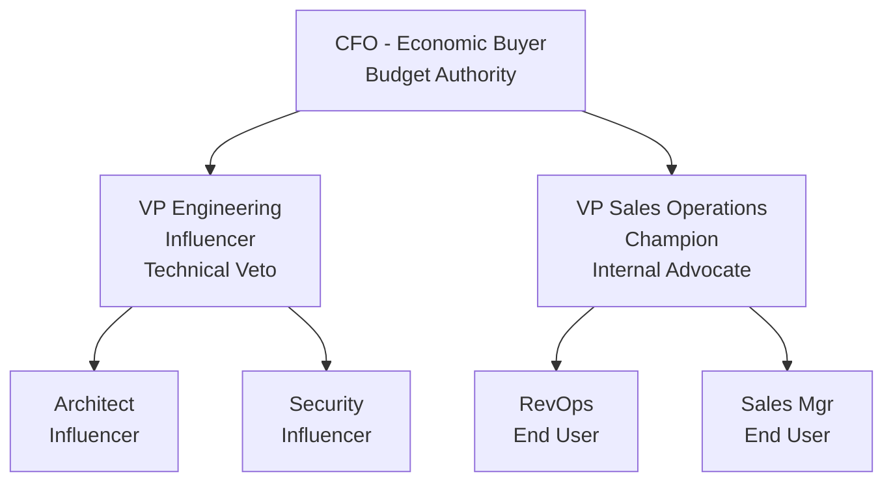

# Lesson 4: Enterprise Account Architectures

## 1. First-Principles Intuition & Invariants

Enterprise accounts represent the most complex revenue organisms in a commercial portfolio. Unlike transactional sales or mid-market relationships where a single economic buyer controls budget and decision authority, enterprise accounts exhibit multi-headed decision topologies, diffused political influence networks, and organizational inertia that resists both rapid adoption and sudden churn. The fundamental difference between managing a straightforward customer relationship and architecting an enterprise account lies in recognizing that you are not selling to a company—you are navigating a living political system with competing incentives, resource constraints, career anxieties, and legacy technical debt.

The first invariant of enterprise account management is that organizational complexity scales non-linearly with company size. A fifty-person startup might have three stakeholders involved in a purchasing decision: the founder, the head of engineering, and perhaps a finance controller. A five-thousand-person enterprise will involve procurement committees, legal review cycles, information security audits, technical architecture review boards, line-of-business sponsors, executive steering committees, and post-signature implementation teams that may have had zero visibility into the sales process. Each of these constituencies possesses veto power, yet none individually holds sufficient authority to guarantee closure. The account manager's craft lies in mapping this constellation of influence, identifying the true economic buyer who controls budget release, and orchestrating a coalition of champions who will advocate internally when you are not in the room.

The second invariant is that enterprise accounts generate revenue through expansion, not replacement. The initial contract represents table stakes—a beachhead landing that establishes credibility and integration surface area. The compounding economics emerge from land-and-expand motion: additional business units adopting the platform, incremental modules or feature tiers purchased as usage scales, and strategic services engagements that deepen product dependency. Net Revenue Retention in enterprise portfolios routinely exceeds 120 percent, meaning a cohort of customers from a given vintage year will generate more annual recurring revenue in year two than they did in year one, even accounting for churn. This expansion motion requires a fundamentally different muscle than new logo acquisition. The account manager must shift from external competitive positioning to internal value demonstration, from risk mitigation to opportunity capture, and from executive sponsorship to operational embeddedness.

The third invariant is that enterprise accounts demand cross-functional orchestration that exceeds the span of control of any individual account manager. A single enterprise relationship might require synchronized contributions from pre-sales solutions architects during technical discovery, professional services teams during onboarding and integration, product management to prioritize feature requests that unblock expansion opportunities, customer success managers who monitor product adoption telemetry and flag usage drop-offs, renewals specialists who navigate procurement cycles and contract negotiations, and executive sponsors who engage C-level counterparts during strategic business reviews. The account manager functions as the orchestration layer—maintaining the single threaded ownership of the customer relationship while conducting a distributed team that operates across time zones, reporting structures, and incentive frameworks.

The failure mode that collapses most enterprise account strategies is the illusion of relationship stability. A champion promoted into a different division, a merger that triggers vendor rationalization, a new CIO who brings preferred partnerships from a prior company, a security incident that triggers an enterprise-wide audit of third-party data access—any of these events can destabilize a relationship that appeared entrenched. Enterprises do not churn through dissatisfaction alone; they churn through organizational disruption, budget reallocation, and strategic pivots that render prior purchasing decisions obsolete. The resilient account architecture anticipates these disruptions by building relationship redundancy across multiple stakeholders, embedding product usage into mission-critical workflows that resist easy replacement, and maintaining executive sponsorship that survives middle-management turnover.

## 2. Core Architecture & Mechanics

Enterprise account architecture begins with stakeholder mapping, a systematic discipline of documenting every individual who holds influence over purchasing, adoption, renewal, and expansion decisions. The naive approach catalogs job titles and departments; the rigorous approach maps decision rights, political capital, and personal incentives. The framework most widely adopted in complex B2B sales is the buyer-influencer-champion taxonomy, which segments stakeholders by their role in the purchasing process.

The economic buyer controls budget authority and possesses the organizational mandate to release funds for the purchase. In small transactions, this might be a director-level manager with discretionary spending authority. In enterprise deals, the economic buyer is often a Vice President or C-level executive who must justify the expenditure against competing capital allocation priorities. Identifying the economic buyer requires tracing budget ownership through organizational hierarchies. The person who signs the purchase order is frequently not the economic buyer; procurement teams execute paperwork, but they do not control strategic budget decisions. The diagnostic question is: "Who would need to approve a ten percent budget increase for this initiative?" That individual is your economic buyer.

Influencers shape the evaluation process without holding final approval authority. Technical architects who define vendor requirements, security officers who audit compliance certifications, legal teams who negotiate contract terms, and peer executives who participate in steering committees all function as influencers. Influencers possess asymmetric veto power—they can block a deal through objection, but they cannot unilaterally approve it. The account manager must identify every influencer early in the sales cycle and develop tailored engagement strategies that address their specific concerns. A CISO cares about data sovereignty and breach notification obligations; a VP of Engineering cares about API reliability and integration effort; a CFO cares about total cost of ownership and contract flexibility. Generic value propositions collapse under influencer scrutiny; precision addressing of domain-specific anxieties builds coalition consensus.

Champions advocate for your solution internally, spending political capital to shepherd the deal through organizational friction. The champion believes in the product's value, possesses credibility within their organization, and maintains sufficient proximity to the economic buyer to influence decision-making. Champions are earned, not appointed. They emerge when your solution solves a problem that directly impacts their success metrics, when you have invested in their personal success through training or strategic insights, and when they trust that your company will deliver on commitments. The mistake most account managers make is confusing an enthusiastic end-user with a champion. An engineer who loves your developer tools is not a champion unless they possess organizational influence and willingness to spend political capital advocating for budget allocation.

The structural representation of an enterprise account's stakeholder network resembles a directed graph where nodes represent individuals and edges represent influence relationships. The economic buyer sits at the apex, but influence flows through indirect paths that bypass hierarchical reporting structures. A senior architect might lack budget authority but hold de facto veto power through technical credibility. A business unit leader might champion adoption in their division, creating proof-points that persuade the CFO to fund enterprise-wide rollout. The account manager's task is to map these influence paths and orchestrate engagement strategies that build momentum along multiple vectors simultaneously.



The second architectural layer is the engagement model, which defines how your cross-functional team interacts with the customer's stakeholders. The simplest engagement model assigns a single account executive who manages all customer interactions. This model scales to mid-market accounts where total contract value remains below half a million dollars annually and organizational complexity stays contained. Enterprise accounts exceeding several million in annual recurring revenue demand specialized roles that divide responsibilities by functional domain.

The solutions architect partners with technical stakeholders during pre-sales evaluation, designing integration blueprints, conducting proof-of-concept implementations, and de-risking technical feasibility concerns. The architect's mandate ends at contract signature; forcing architects to provide ongoing technical support cannibalizes their capacity to support new deals and misaligns incentives toward feature customization rather than scalable platform adoption.

The customer success manager owns product adoption and value realization post-sale. Where the account executive focuses on commercial expansion, the CSM focuses on operational health: tracking product usage telemetry, identifying adoption blockers, facilitating training sessions, and escalating technical issues to engineering support. The diagnostic metric for CSM effectiveness is product engagement depth—are end users logging in daily, are they utilizing advanced features, and are usage patterns expanding or contracting month-over-month?

The renewals specialist manages contract lifecycle events, engaging twelve to eighteen months before renewal dates to forecast risk, negotiate multi-year extensions, and navigate procurement processes. Separating renewals from new sales recognizes that contract negotiation demands different skills than relationship development. Renewals specialists understand legal terms, pricing structures, and procurement politics; account executives understand business problem diagnosis and competitive positioning.

The executive sponsor provides air cover during strategic escalations, engaging C-level counterparts during business reviews, and lending organizational credibility during high-stakes negotiations. Executive sponsors are capacity-constrained resources; they cannot attend every customer meeting. The engagement trigger is strategic risk or opportunity: a competitor threatening displacement, a merger creating expansion opportunity, or a strategic partnership discussion that requires executive alignment.

The orchestration challenge is synchronizing these specialized roles without fragmenting the customer experience into a disjointed parade of vendor representatives. The failure mode is "vendorized" relationships where the customer perceives they are being passed between disconnected teams who lack context on prior conversations and commitments. The solution is the account plan, a living document that centralizes customer context, tracks stakeholder engagement history, documents open commitments, and sequences cross-functional activities along a unified timeline.

The account plan's structural components include customer intelligence (organizational chart, stakeholder profiles, strategic initiatives, competitive landscape), commercial objectives (expansion opportunities, contract renewal timeline, revenue forecast), engagement history (meeting notes, deliverables, commitments tracking), and action plan (sequenced activities with ownership and deadlines). The discipline of maintaining an updated account plan transforms the account manager from a relationship coordinator into an orchestration layer that ensures every team member operates from a shared understanding of customer context and strategic priorities.

```
Account Plan Structure

Customer Intelligence
├── Organizational Chart (reporting structure, decision rights)
├── Stakeholder Profiles (role, incentives, relationship strength)
├── Strategic Initiatives (business priorities, transformation projects)
└── Competitive Landscape (incumbent vendors, evaluation criteria)

Commercial Objectives
├── Expansion Opportunities (whitespace analysis, cross-sell targets)
├── Contract Timeline (renewal dates, negotiation milestones)
└── Revenue Forecast (pipeline stages, probability weighting)

Engagement History
├── Meeting Log (date, attendees, discussion summary)
├── Deliverables (proposals, technical designs, ROI models)
└── Commitments Tracking (promises made, completion status)

Action Plan
├── Quarterly Objectives (measurable outcomes, success criteria)
├── Activity Sequence (ordered tasks, dependencies)
└── Cross-Functional Ownership (assigned roles, deadlines)
```

The third architectural layer is the scaled process infrastructure that maintains consistency across a portfolio of enterprise accounts. A single account manager might own responsibility for fifteen to twenty-five enterprise customers, representing aggregate annual recurring revenue of fifteen to thirty million dollars. Without systematized processes, the account manager drowns in reactive fire-fighting: responding to support escalations, attending unstructured check-in meetings, and losing visibility into early warning signals of churn risk or expansion opportunity.

The foundational process is the quarterly business review, a structured cadence that forces both customer and vendor to step back from tactical execution and assess strategic alignment. The QBR agenda follows a consistent template: review prior quarter's objectives and success metrics, analyze product usage and adoption trends, identify blockers or friction points requiring resolution, align on upcoming strategic initiatives, and commit to measurable objectives for the coming quarter. The QBR's value lies not in the presentation deck but in the preparation process. Building the QBR deck requires the account manager to synthesize product telemetry data, interview customer stakeholders about satisfaction and friction, forecast expansion opportunities, and coordinate cross-functional input from CSM, solutions architects, and product management. The QBR deck becomes the artifact that surfaces hidden risks (declining usage in a key department, frustration with a missing feature) and crystallizes expansion motions (new division preparing to onboard, strategic initiative that your product could accelerate).

The second scaled process is the health scoring algorithm, a quantitative model that aggregates multiple signals into a single account health metric. Health scores combat the recency bias and relationship illusion that plague subjective account assessments. An account manager with a strong personal relationship with a customer champion might rate the account as healthy, missing the underlying product adoption decline that predicts churn. The health score enforces discipline by weighting objective measures: product usage frequency, feature adoption breadth, support ticket volume and severity, payment delinquency, executive engagement recency, and contract renewal proximity.

A representative health score formula assigns weights across engagement, adoption, and commercial dimensions. Engagement score aggregates executive touchpoints, QBR completion, and response time to outreach. Adoption score tracks daily active users as a percentage of licensed seats, feature utilization depth, and integration completeness. Commercial score factors payment history, expansion pipeline value, and renewal risk assessment. The composite health score = (0.3 × Engagement) + (0.4 × Adoption) + (0.3 × Commercial), scaled to a zero-to-one-hundred range where seventy represents stable health, scores below fifty trigger intervention protocols, and scores above eighty-five indicate expansion readiness.

```
Account Health Score Model

Engagement Score (0-100)
  Executive touchpoints in past 90 days: +20 per touchpoint (max 40)
  QBR completion: +30 if conducted on schedule
  Response time to outreach: +30 if < 48 hours average

Adoption Score (0-100)
  Seat utilization: (Active Users / Licensed Seats) × 40
  Feature adoption depth: +20 per advanced feature in use (max 40)
  Integration completeness: +20 if API integration deployed

Commercial Score (0-100)
  Payment history: +40 if no delinquency
  Expansion pipeline: +30 if qualified opportunity exists
  Renewal risk: +30 if renewal > 12 months away or multi-year committed

Composite Health = (0.3 × Engagement) + (0.4 × Adoption) + (0.3 × Commercial)

Interpretation:
  85-100: Expansion Ready (prioritize upsell motions)
  70-84:  Stable (maintain standard cadence)
  50-69:  At Risk (initiate intervention plan)
  0-49:   Critical (executive escalation required)
```

The third scaled process is the whitespace analysis, a systematic method for identifying untapped expansion opportunity within an existing account. Whitespace mapping begins with total addressable wallet—the theoretical maximum annual spending the customer could allocate to your product category if you achieved complete organizational penetration. For a sales enablement platform, total addressable wallet equals the number of revenue-generating employees multiplied by annual per-seat pricing. For an infrastructure monitoring tool, total addressable wallet equals the total server and container count multiplied by per-node pricing.

Current penetration represents actual spending as a percentage of total addressable wallet. An enterprise customer spending two hundred thousand dollars annually on sales enablement when they employ two thousand revenue professionals at a per-seat cost of two hundred dollars has penetrated only fifty percent of their addressable wallet (200k actual / 400k potential). The whitespace—the fifty percent unpenetrated opportunity—becomes the expansion target.

Granular whitespace analysis segments the organization by division, geography, and use case to identify high-probability expansion vectors. A sales enablement platform might have achieved full penetration in the North American field sales organization but zero penetration in European sales teams, partner channel managers, or customer success representatives. Each segment represents a discrete expansion motion with specific stakeholders, success criteria, and objection patterns. The European sales team might resist adoption due to language localization gaps; the partner channel might require integration with partner relationship management systems; the customer success team might need different content templates optimized for retention conversations rather than new logo acquisition.

The expansion playbook documents the repeatable motion for converting whitespace into revenue: identify the segment, map the segment's stakeholders and decision authority, diagnose the segment-specific use case and success criteria, develop tailored proof-of-value demonstrating impact in that context, secure a pilot commitment with measurable success metrics, deliver results that justify broader rollout, and negotiate contract expansion. The playbook transforms opportunistic expansion into a systematic process executable across dozens of accounts simultaneously.

## 3. High-Performance Optimization & Failure Modes

Enterprise account optimization begins with portfolio segmentation, the discipline of allocating account management capacity against revenue potential and strategic value. The egalitarian approach distributes accounts evenly across account managers, ensuring equal workload. This approach catastrophically misallocates resources because enterprise accounts exhibit power-law distributions: the top twenty percent of accounts generate sixty to eighty percent of revenue, and the top five percent represent existential business risk if they churn. Treating all accounts equally guarantees under-investment in your most valuable relationships and over-investment in marginal accounts that will never scale.

The segmentation framework tiers accounts across three dimensions: current annual recurring revenue, expansion potential, and strategic value. Current ARR provides objective revenue ranking. Expansion potential assesses whitespace opportunity and buying momentum: an account with ten percent penetration of addressable wallet and active expansion discussions scores higher than a fully saturated account with no growth vectors. Strategic value captures non-revenue factors: reference logo credibility (Fortune 500 brand that accelerates enterprise sales cycles), product feedback quality (sophisticated users who stress-test features and provide actionable improvement insights), and ecosystem influence (accounts whose adoption drives network effects or partnership opportunities).

The tiering structure typically segments enterprise portfolios into three classes. Tier One accounts represent the top ten percent by composite score, generating fifty percent or more of portfolio revenue and demanding weekly touchpoints, dedicated cross-functional pods (named CSM, solutions architect, and executive sponsor), and proactive quarterly business reviews with C-level engagement. Tier Two accounts represent the next thirty percent, generating an additional thirty percent of revenue and receiving bi-weekly touchpoints, shared resource pools, and customer-success-led QBRs with account executive escalation for commercial discussions. Tier Three accounts represent the remaining sixty percent, generating twenty percent of revenue and managed through scaled channels: automated health monitoring, templatized outreach, and on-demand support rather than proactive relationship development.

The resource allocation formula calibrates account manager capacity against tier demands. If a Tier One account requires thirty hours of engagement per month (weekly meetings, stakeholder coordination, QBR preparation, cross-functional orchestration), an account manager with one hundred sixty hours of monthly capacity can own approximately five Tier One accounts. Tier Two accounts demanding ten hours monthly allow fifteen accounts per manager. Tier Three accounts demanding two hours monthly allow eighty accounts per manager. The blended portfolio for an enterprise account manager might comprise five Tier One accounts, ten Tier Two accounts, and twenty Tier Three accounts, consuming one hundred fifty hours per month (75 + 100 + 40) and leaving capacity buffer for reactive escalations.

The failure mode is portfolio drift, where accounts migrate across tiers without corresponding capacity reallocation. A Tier Two account that doubles annual spending and launches a strategic enterprise-wide rollout has graduated to Tier One status and demands intensified engagement. If the account manager continues treating it as Tier Two, they under-invest at the precise moment when relationship risk and expansion opportunity peak. The solution is quarterly portfolio reviews that re-segment accounts based on updated ARR, whitespace analysis, and health scores, then rebalance account assignments to ensure tier-appropriate capacity allocation.

The second optimization vector is stakeholder engagement depth, moving beyond superficial relationship breadth to secure strategic positioning with true decision-makers. The common failure mode is relationship concentration, where the account manager invests all engagement energy in a single champion—often a mid-level manager who enthusiastically advocates for the product but lacks budget authority or organizational influence to drive strategic decisions. When that champion departs the company or moves to a different division, the entire relationship foundation collapses.

Relationship resilience requires multi-threading: building direct relationships with multiple stakeholders across different organizational levels and functional domains. The targeting strategy identifies three relationship classes that insulate against disruption. Horizontal multi-threading engages peers of your primary champion: if your champion is the Director of Sales Operations, horizontal multi-threading develops relationships with the Director of Marketing Operations and Director of Customer Success Operations. These peers provide political air cover during budget discussions and ensure adoption spreads across divisions. Vertical multi-threading secures executive sponsorship: engaging the Vice President or C-level executive who oversees your champion's organization. Executive sponsors intervene during crises, approve strategic investments, and survive middle-management turnover. Diagonal multi-threading builds relationships in adjacent functions that influence your product's success: if you sell to Sales Operations, diagonal relationships with IT (who control system integrations) and Finance (who approve vendor contracts) accelerate adoption and remove blockers.

The engagement execution requires operational discipline that overcomes the natural tendency to over-invest in friendly, responsive stakeholders while avoiding difficult or unresponsive ones. The quarterly stakeholder coverage audit maps every key stakeholder against last touchpoint date and relationship strength. Stakeholders who have not been contacted in sixty days receive outreach scheduling. Stakeholders rated below five on a zero-to-ten relationship strength scale receive targeted engagement plans that deliver personalized value: sharing industry research relevant to their domain, facilitating introductions to peer executives at other customers, or providing early access to product capabilities that address their specific pain points.

The third optimization vector is expansion orchestration, systematizing the process of converting whitespace analysis into closed revenue. The failure mode is opportunistic expansion, where account managers pursue ad hoc upsell conversations whenever they sense customer openness. This approach generates unpredictable pipeline, misses high-probability opportunities that require deliberate cultivation, and collapses under objection because the account manager has not built the coalition consensus required for budget approval.

The structured expansion playbook sequences activities along a predictable timeline calibrated to customer buying cycles. The expansion motion initiates six to nine months before target close, beginning with usage analysis that identifies adoption patterns suggesting expansion readiness: a department consuming ninety-five percent of their licensed capacity, feature requests indicating unmet needs addressable through higher product tiers, or integration discussions suggesting enterprise-wide rollout. These signals trigger the expansion qualification stage, where the account manager and CSM co-develop a value hypothesis: "If we expand into the European sales organization, they will achieve X percent improvement in sales rep productivity within Y months, generating Z dollars in business value."

The qualification advances into stakeholder alignment, mapping decision rights for the expansion. Departmental expansions might require only the business unit leader's approval; enterprise-wide rollouts require C-level sponsorship and procurement committee review. The account manager sequences stakeholder engagement to build bottom-up advocacy and secure top-down approval simultaneously. The bottom-up motion engages end users and mid-level managers who will use the expanded deployment, conducting pilot projects that generate measurable success metrics and testimonials. The top-down motion positions the expansion as strategic imperative, tying it to executive priorities documented in quarterly business reviews or corporate strategic plans.

The proof phase delivers tangible validation that de-risks the expansion investment. For product expansions, this means pilot deployments with agreed success criteria: thirty-day trials with measurable adoption targets and business impact metrics. For services expansions, this means scoped statements of work that demonstrate expertise and deliver immediate value. The proof phase conclusion triggers the commercial negotiation, where the renewals specialist and account executive co-develop pricing proposals, navigate procurement processes, and close the contract expansion.

The failure modes that derail expansion motions include premature commercialization (proposing pricing before demonstrating value), stakeholder bypass (engaging the economic buyer before securing champion advocacy), and scope creep (allowing pilot projects to expand beyond agreed boundaries without corresponding commercial commitment). The antidote is stage-gate discipline: defining clear exit criteria for each expansion phase and refusing to advance until criteria are satisfied. Qualification gates require documented value hypothesis and stakeholder map. Alignment gates require champion commitment and executive sponsorship. Proof gates require achieved success metrics and testimonial approval. Commercial gates require procurement process timeline and budget confirmation.

The fourth optimization vector is early warning systems that detect churn risk before it metastasizes into irreversible relationship breakdown. Churn in enterprise accounts rarely happens suddenly; it telegraphs through behavioral signals that emerge months before contract non-renewal. The challenge is distinguishing noise from signal in the dozens of micro-interactions that comprise an enterprise relationship.

The leading indicators of churn risk fall into four categories. Engagement decline manifests through canceled meetings, delayed email responses, and reduced executive accessibility. A champion who previously responded to emails within hours but now takes days signals either personal bandwidth constraints or cooling enthusiasm. A QBR rescheduled twice without proposed alternative dates signals that the relationship has fallen below the customer's priority threshold. Product adoption decay appears in telemetry data: declining daily active users, reduced feature utilization, and abandoned workflows. These patterns indicate that the product has failed to embed itself into critical business processes and remains vulnerable to replacement.

Commercial friction surfaces through procurement resistance, budget inquiries, or requests for discounting. A customer asking for contract termination clauses or negotiating month-to-month extensions signals that they are hedging against commitment. A finance team requesting detailed usage reports to validate ROI signals that internal stakeholders are questioning the investment's value. Organizational disruption includes leadership turnover, restructuring initiatives, and strategic pivots. A new CIO conducting vendor rationalization reviews, a merger triggering technology stack consolidation, or a corporate mandate to reduce SaaS spending all create existential threats to contract renewal regardless of product satisfaction.

The intervention playbook matches response strategies to risk type and severity. Low-severity risks (health score between fifty and sixty-nine, single risk factor) trigger CSM-led intervention: proactive outreach to diagnose friction, accelerated training to improve adoption, or executive business reviews to re-establish value alignment. Medium-severity risks (health score between thirty and forty-nine, multiple risk factors) trigger account executive escalation: stakeholder interviews to surface hidden objections, discount proposals to remove commercial friction, or product roadmap previews demonstrating commitment to addressing feature gaps. High-severity risks (health score below thirty, contract non-renewal discussions) trigger executive sponsor engagement: C-level counterpart conversations to assess strategic fit, customized success plans with committed milestones, or contract restructuring that reduces financial commitment in exchange for extended evaluation periods.

The failure mode is intervention delay, where account managers recognize warning signals but postpone difficult conversations hoping the situation will self-correct. This avoidance allows small friction points to compound into relationship-threatening crises. The antidote is the mandatory intervention protocol: health scores below seventy automatically trigger intervention plans with assigned ownership and weekly tracking. Account managers who fail to execute intervention plans within prescribed timelines lose discretionary authority; their manager assumes direct account oversight until stability restores.

The final optimization vector is cross-functional orchestration efficiency, eliminating coordination overhead that fragments customer experience and exhausts internal capacity. The failure mode is uncoordinated engagement, where solutions architects, CSMs, and account executives independently schedule customer meetings without awareness of each other's activities, creating customer fatigue and duplicative conversations. A customer receiving separate emails from three different vendor representatives requesting meetings to discuss overlapping topics perceives disorganization and questions whether the vendor can execute complex enterprise initiatives.

The solution is the account team operating rhythm, a structured cadence of internal coordination meetings that synchronize customer-facing activities. The weekly account team sync convenes the account executive, CSM, solutions architect, and any active specialists (renewals, professional services) for a thirty-minute review of active accounts. The agenda template covers recent customer interactions, upcoming milestones, open commitments requiring follow-up, and coordination needs for scheduled activities. The output is a synchronized weekly engagement plan documenting who is contacting which customer stakeholders, meeting agendas that avoid duplication, and commitment tracking that ensures promises made by any team member are visible to all.

The monthly pipeline review expands the account team sync to include sales leadership and product management, focusing on expansion opportunities and strategic account planning. The pipeline review assesses whitespace conversion progress, identifies blockers requiring executive escalation or product investment, and re-prioritizes account focus based on updated revenue forecasts. The quarterly strategic review engages executive sponsors and functional leaders to assess portfolio health, rebalance tier assignments, and allocate cross-functional capacity against highest-value accounts.

This operating rhythm transforms ad hoc coordination into systematic practice, reducing the cognitive load on account managers who would otherwise spend hours each week chasing down internal stakeholders for updates. The meeting structure forces discipline: if a commitment was made to a customer, it gets documented in the account team sync and tracked to completion. If an expansion opportunity requires product capabilities, it gets escalated in the monthly pipeline review with timeline requests. If an account's health deteriorates, it surfaces in the weekly sync before it reaches crisis severity.

The enterprise account architecture's ultimate success metric is Net Revenue Retention, the ratio of revenue from a cohort of customers one year later compared to their initial contract value. NRR above one hundred twenty percent indicates that expansion revenue from existing customers exceeds new logo acquisition requirements for growth. NRR below one hundred percent indicates that churn and contraction are consuming growth, forcing the business into a perpetual new customer acquisition treadmill. The disciplines articulated in this lesson—stakeholder mapping that builds relationship resilience, scaled processes that maintain consistency across large portfolios, tiered segmentation that concentrates resources on highest-value accounts, and early warning systems that intervene before churn becomes inevitable—compound into the operational excellence that transforms enterprise accounts from transactional relationships into compounding revenue engines.
