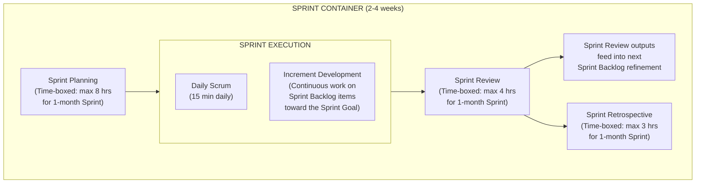
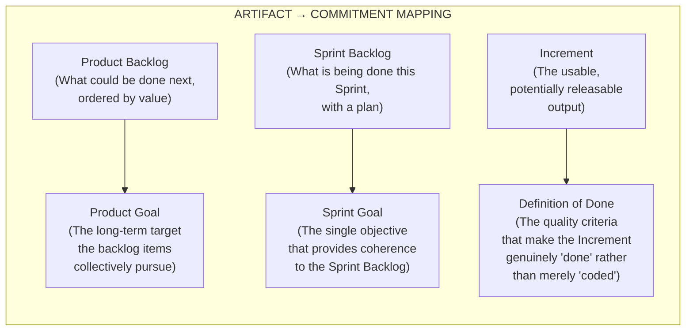

# Lesson 2: Scrum: Roles, Ceremonies, Artifacts, and Core Mechanics

## 1. First-Principles Intuition & Invariants

Scrum did not emerge from a theoretical framework for project management. It emerged from the observation that complex, unpredictable work resists deterministic planning. When Hirotaka Takeuchi and Ikujiro Nonaka published their 1986 Harvard Business Review article "The New New Product Development Game," they studied companies like Honda, Canon, and Fuji-Xerox and found that the most successful product teams did not follow the sequential, stage-gate models that dominated industrial manufacturing. Instead, those teams used small, cross-functional groups that moved as a unit, overlapping phases of development rather than passing work down a linear assembly line. They used the rugby metaphor of the scrum to describe this: a team that advances together, possesses the ball as one, and adapts to the opposition's formation in real time. Ken Schwaber and Jeff Sutherland formalized this into a software development framework at the 1995 OOPSLA conference, and the Scrum Guide, now in its 2020 revision, remains the canonical authority.

The invariant at the heart of Scrum is empirical process control. Empiricism asserts that knowledge comes from experience and that decisions should be based on what is observed rather than on speculative upfront planning. For empiricism to function, three conditions must hold: transparency, inspection, and adaptation. Transparency means that the work, the process, and the artifacts are visible to everyone who has a stake in the outcome. Inspection means that those artifacts and the process are checked frequently enough to detect potentially problematic variances early. Adaptation means that when inspection reveals that the process is deviating from acceptable limits, the team adjusts immediately rather than waiting for the next planning cycle. Scrum enforces these three pillars through its time-boxed events: the Sprint provides the inspection container, the Daily Scrum provides the daily checkpoint, the Sprint Review exposes the increment to stakeholders, and the Sprint Retrospective turns the team's own process into an inspectable artifact.

The second invariant is the Definition of Done. This is not a checklist of tasks; it is a contract that the entire Scrum Team agrees upon for what constitutes a completed, shippable unit of work. A Product Backlog item is either done or not done. There is no "80% done." A software feature is not done when the code compiles. It is done when it is coded, reviewed, tested at the unit and integration levels, documented, deployed to a staging environment, and validated against the acceptance criteria. The Definition of Done exists because ambiguity about completion is the single largest source of technical debt, scope creep, and velocity measurement error in agile teams. Without it, the Sprint Review becomes a debate about what was actually delivered, and velocity becomes a fiction.

The third invariant is the self-managing Development Team. Scrum does not prescribe how the team does its work. It prescribes who is accountable for deciding how the work is done. The Development Team, typically three to nine people with all the skills necessary to create a usable increment, decides how to turn Product Backlog items into the Increment. No one outside the team assigns work to individuals inside the team. The team pulls work from the Sprint Backlog during the Sprint, and the team determines how to decompose and execute that work. This is a structural feature, not a cultural aspiration. If someone outside the team assigns tasks to individuals, the empirical feedback loop breaks because the team is no longer adapting based on its own observations of its own work.

A critical distinction for advanced practitioners is that Scrum is a framework, not a methodology. A methodology prescribes specific techniques: it tells you how to write user stories, how to estimate, how to test. Scrum tells you what roles, events, and artifacts must exist, and it leaves the techniques to the team. This is why Scrum can coexist with Extreme Programming practices like pair programming and test-driven development, or with engineering practices like continuous integration and trunk-based development. The framework defines the container; the team fills it with the practices that fit their domain, technology stack, and organizational constraints.

## 2. Core Architecture & Mechanics

### Roles and Accountability Boundaries

Scrum defines three accountabilities, not three job titles. The Product Owner, Scrum Master, and Developers are roles that can be held by people with any job title. The separation exists to create clear accountability boundaries so that no single person is optimizing for conflicting outcomes.

The Product Owner is accountable for maximizing the value of the product resulting from the work of the Scrum Team. This is not a product manager who writes requirements. The Product Owner owns the Product Backlog, which means they are the sole person responsible for ordering the items in it, ensuring that it is transparent and visible, and making sure each item is understood at the level of detail needed for the Developers to pick it up in a Sprint Planning session. The Product Owner may delegate the actual writing of backlog items to others, but accountability for the backlog's content and ordering remains with them. In practice, this means the Product Owner maintains a working relationship with every stakeholder who has a claim on the product's direction: executive sponsors who control the budget, customers who buy or use the product, compliance officers who constrain it, and the development team that must understand the vision to execute it. The Product Owner translates these competing demands into a single, ordered list.

The Scrum Master is accountable for establishing Scrum as defined in the Scrum Guide. This is a leadership role, not a project management role. The Scrum Master does not track tasks, generate status reports, or manage the team's schedule. They serve the team, the Product Owner, and the organization. For the Developers, the Scrum Master removes impediments that the team has identified as blocking their progress and coaches them in self-management and cross-functionality. For the Product Owner, the Scrum Master helps them find techniques for effective Product Goal definition and Product Backlog management. For the organization, the Scrum Master leads and coaches the adoption of Scrum, which often means pushing back against organizational habits that undermine empirical process control: command-and-control task assignment, stage-gate approvals that bypass the Sprint Review, and incentive structures that reward individual heroics over team outcomes.

The Developers are the people who do the work of creating a usable Increment each Sprint. The term "Developers" in the 2020 Scrum Guide replaced "Development Team" to reduce confusion and to be inclusive of all contributors, not just software engineers. The team is cross-functional, meaning it has all the skills necessary to create value each Sprint without depending on external resources. It is also self-managing, meaning it decides internally who does what, when, and how. The optimal size is small enough to remain nimble and large enough to complete significant work in a Sprint. Three to nine people is the range the Scrum Guide specifies, with fewer than three reducing interaction diversity and more than nine creating too much coordination overhead.

### The Sprint as the Core Execution Container

The Sprint is the heart of Scrum. It is a time-box of one month or less during which a "done," usable, and potentially releasable product Increment is created. All Scrum events are contained within a Sprint. A new Sprint starts immediately after the previous one ends, creating a continuous, predictable cadence for inspection and adaptation.



The Sprint Planning event is where the entire Scrum Team collaborates to answer two questions: why is this Sprint valuable, and what can be done in this Sprint, and how will the chosen work get done? The Product Owner proposes how the Sprint could increase the value of the product and discusses the Product Goal that the Sprint should advance. The Developers then select items from the Product Backlog that they believe they can complete within the Sprint, bringing those items into the Sprint Backlog. The team creates a Sprint Goal, which is a single statement of what the Sprint is meant to achieve and why it matters. The Sprint Goal provides coherence: it gives the team a reason to keep working together rather than a list of disconnected tasks.

The Sprint Goal is the mechanism by which the team maintains focus when reality diverges from the plan. If the team discovers mid-Sprint that a selected backlog item is more complex than estimated, the Sprint Goal tells them whether that item is essential to the Sprint's purpose. If it is essential, the team negotiates scope with the Product Owner. If it is not, the team drops it and continues toward the goal. Without a Sprint Goal, the Sprint Backlog is a static to-do list, and any deviation becomes a crisis rather than a routine adaptation.

The Daily Scrum is a 15-minute event held every day of the Sprint, typically at the same time and place. Its purpose is to inspect progress toward the Sprint Goal and adapt the Sprint Backlog as needed. The 2020 Scrum Guide removed the prescriptive three-question format ("What did I do yesterday? What will I do today? Are there any impediments?") and left the structure to the Developers. The key invariant is that the Daily Scrum is not a status report to a manager. It is an inspection and adaptation event for the team itself. If it becomes a status report, the empirical loop has been compromised because the team is performing for an audience rather than inspecting for itself.

The Sprint Review occurs at the end of the Sprint and is the moment where the Increment is presented to stakeholders and the Product Backlog is collaboratively discussed. It is not a demo. A demo implies a one-way presentation. The Sprint Review is a working session where stakeholders and the Scrum Team inspect what was accomplished and what has changed in the environment, then collaborate on what to do next. The Product Backlog may be adjusted based on this discussion. If the market has shifted, if a competitor has released a feature, or if user feedback from the Increment has revealed something unexpected, those changes are captured in the revised Product Backlog.

The Sprint Retrospective is the final event of the Sprint and is the team's opportunity to inspect itself. The Retrospective focuses on three areas: what went well during the Sprint, what could be improved, and what the team will commit to changing in the next Sprint. The output is not a list of complaints. It is a small number of actionable improvements that the team will implement immediately in the next Sprint. The Retrospective is where the process becomes an inspectable artifact, closing the empirical loop.

### Artifacts and Their Commitments

Scrum defines three artifacts, each with a corresponding commitment that provides clarity about the artifact's purpose.

The Product Backlog is an emergent, ordered list of what is needed to improve the product. It is the single source of work for the Scrum Team. It is never complete; it evolves as the product and the environment evolve. Its commitment is the Product Goal, which describes a future state of the product that the team is working toward. The Product Goal provides focus for the Product Backlog: every item in the backlog should move the product toward the Product Goal, and items that do not should be questioned or removed.

Product Backlog refinement is the act of breaking down and further defining Product Backlog items into smaller, clearer items. This is an ongoing activity, not a formal event. Items at the top of the backlog, which will be selected in the near-term Sprints, should be refined to the point where they are small enough to be completed in a fraction of a Sprint and clear enough that the Developers understand what "done" means for each item. Items lower in the backlog can be larger and less detailed because they will not be selected until future Sprints, by which point the team's understanding may have changed.

The Sprint Backlog is the set of Product Backlog items selected for the Sprint plus the plan for delivering them. Its commitment is the Sprint Goal. The Sprint Backlog is not a static list. It is a living artifact that changes as the team learns during the Sprint. When the team discovers that a task is unnecessary, it is removed. When the team discovers that additional work is needed, it is added. The Sprint Backlog makes visible what the team is working on at any given moment, which is what enables the Daily Scrum to function as an inspection event.

The Increment is the concrete artifact produced during a Sprint. It is a stepping stone toward the Product Goal. Each Increment must be usable, which means it must meet the Definition of Done. Multiple Increments may be created within a Sprint, and the team may release them to stakeholders at any point during the Sprint. The commitment of the Increment is the Definition of Done itself: a formal description of the state of the Increment when it meets the quality measures required for the product.



### Velocity and Estimation Mechanics

Velocity is the sum of effort estimates for Product Backlog items completed during a Sprint, where "completed" means meeting the Definition of Done. It is a diagnostic metric, not a performance target. Using velocity as a target incentivizes the team to inflate estimates, which destroys the metric's usefulness for forecasting.

The two dominant estimation techniques in Scrum are story points and ideal days. Story points are a relative measure of complexity that combines effort, risk, and uncertainty into a single dimensionless number. Teams typically use a modified Fibonacci sequence (1, 2, 3, 5, 8, 13, 21) because the non-linear intervals reflect that larger items carry more uncertainty: it is easy to distinguish between a 2 and a 3, but distinguishing between an 8 and a 13 is harder, and distinguishing between a 21 and a 34 is nearly meaningless.

Planning Poker is the consensus-based estimation technique. Each Developer receives a deck of cards with the Fibonacci values. For each backlog item, the Product Owner reads the item and answers questions. Each Developer privately selects a card representing their estimate. All cards are revealed simultaneously. If there is a wide divergence, the highest and lowest estimators explain their reasoning, and the team discusses the item again. The process repeats until the estimates converge or the team agrees that the item needs further refinement before it can be estimated. This technique works because it prevents anchoring bias: when one person states an estimate aloud, subsequent estimates cluster around it, regardless of its accuracy.

For sprint forecasting, the team uses a rolling average of velocity over the previous three to five Sprints. If a team's velocity has been 34, 30, 38, and 32 over the last four Sprints, the team can reasonably forecast pulling approximately 32 to 34 points of work into the next Sprint. This forecast is a planning aid, not a commitment. The Sprint Goal is the commitment; the velocity forecast simply helps the team avoid pulling in more work than they can realistically complete, which would set the Sprint up for failure and erode trust with stakeholders.

## 3. High-Performance Optimization & Failure Modes

### Sprint Length Calibration

Sprint length is a trade-off between feedback frequency and overhead cost. Shorter Sprints (one to two weeks) provide faster feedback loops, which means that errors are caught earlier, the Product Backlog is updated more frequently based on stakeholder input, and risk is reduced because the team commits to less work per cycle. The cost is that Sprint overhead (Planning, Review, Retrospective) consumes a larger fraction of the Sprint. In a one-week Sprint, if Sprint Planning takes four hours, the Review two hours, and the Retrospective one and a half hours, that is 7.5 hours of ceremony overhead per week, which is nearly 20% of a 40-hour work week. In a four-week Sprint, the same ceremonies consume the same absolute time but represent only 5% of the work period.

For teams building software with continuous integration and automated deployment pipelines, shorter Sprints are generally preferable because the cost of integration is low and the benefit of rapid feedback is high. For teams building hardware, conducting field research, or operating in regulated environments where each release requires extensive validation, longer Sprints may be necessary to accommodate the natural cycle time of the work. The key principle is that the Sprint must be short enough that changes in the external environment cannot make the Sprint Goal irrelevant before the Sprint ends, but long enough that the team can produce a meaningful Increment without spending a disproportionate amount of time in ceremonies.

### Velocity Degradation and Anti-Patterns

Velocity inflation is the most common metric corruption pattern. It occurs when the team is rewarded for high velocity rather than for delivering value. The symptom is that velocity steadily increases while the amount of demonstrable value in the Sprint Review does not. The team is assigning higher point values to the same work, often unconsciously, because the organizational reward structure signals that higher velocity is better. The correction is to decouple velocity from performance evaluation entirely. Velocity should be used only by the team itself for forecasting. If management uses it as a productivity metric, the metric will be gamed, and its forecasting value will be destroyed.

The "mini-waterfall" Sprint is a structural anti-pattern where the Sprint is divided into phases: design early in the Sprint, implementation in the middle, testing at the end. This defeats the purpose of the Sprint because the empirical feedback loop is broken. If testing happens only at the end, the team cannot inspect and adapt during the Sprint. By the time testing reveals a problem, the Sprint is nearly over, and there is no time to adapt. The correction is to integrate testing into the daily work: each Product Backlog item should be tested as it is implemented, and the Increment should be in a potentially releasable state at all times, not just at the end of the Sprint.

The absentee Product Owner is a failure mode where the Product Owner is either unavailable to the team during the Sprint or is present but has not done the work to maintain the Product Backlog. When the team cannot get answers to questions about backlog items during the Sprint, they either guess, which leads to rework, or they wait, which leads to idle time and incomplete Sprints. When the Product Backlog is not refined, Sprint Planning becomes a requirements-gathering session rather than a selection session, and the team enters the Sprint with insufficient understanding of what it has committed to. The Scrum Master's responsibility is to coach the Product Owner on the cost of this behavior and to escalate to the organization if the Product Owner role is structurally under-resourced.

### Definition of Done Drift

The Definition of Done is subject to erosion when teams face schedule pressure. A team that has committed to a Sprint Goal and is running out of time may be tempted to relax the Definition of Done for the current Sprint: skip code review, defer performance testing, leave documentation incomplete. Each relaxation creates invisible technical debt that must be repaid later, usually at a higher cost because the context of the original work has been lost. The correction is to treat the Definition of Done as inviolable for the current Sprint and to use the Sprint Retrospective to adjust the Sprint Goal or the team's capacity estimates for future Sprints. If the Definition of Done is consistently too ambitious for the team's capacity, the team should formally revise it through a Retrospective decision, not through ad hoc relaxation under pressure.

A practical mechanism for preventing Definition of Done drift is to track the total effort spent on "undone" work separately from velocity. If the team estimates that a feature required 13 points of effort to reach "coded and unit-tested" but would require an additional 5 points to meet the full Definition of Done including integration testing, documentation, and staging deployment, those 5 points are recorded as undone work. Accumulating undone work over multiple Sprints makes the debt visible to the Product Owner and creates a forcing function for either paying it down or formally adjusting the Definition of Done.

### Scaling Considerations

When multiple Scrum Teams work on the same product, the Product Backlog must remain a single, unified list. If each team maintains its own backlog, the product fragments, and the Product Owner loses the ability to optimize for total product value. The Scrum of Scrums is a coordination pattern where representatives from each team meet regularly (typically twice a week for 15 minutes) to inspect integration dependencies, share impediments, and align on cross-team work. This is not a management hierarchy. It is a coordination mechanism that preserves the self-managing nature of each team while making inter-team dependencies visible.

The Nexus framework, developed by Schwaber, formalizes this coordination for teams of three to nine Scrum Teams working on a single product. It introduces a Nexus Integration Team that is accountable for ensuring that an Integrated Increment is produced at least once per Sprint. The Nexus Integration Team does not direct the individual teams. It provides the integration infrastructure, removes cross-team impediments, and ensures that the Definition of Done applies to the integrated product, not just to individual team Increments.

The failure mode in scaling is attempting to coordinate through centralized planning rather than through integration. If a program management office attempts to assign work across teams, decompose the Product Backlog on behalf of the teams, or enforce a uniform process across teams with different technical domains, the result is a return to command-and-control management dressed in Scrum vocabulary. The empirical loop is preserved only when each team retains the autonomy to inspect and adapt its own work within the constraints of a shared Product Backlog and a shared Definition of Done.

### Practical Velocity Forecasting Model

For sprint-to-sprint forecasting, a rolling three-Sprint median provides a more stable predictor than a single Sprint's velocity, because it smooths out one-time disruptions such as holidays, sick days, or particularly difficult backlog items. The formula is straightforward:

```
Rolling Velocity (Sprint N) = median(Velocity[Sprint N-3], Velocity[N-2], Velocity[N-1])

Sprint Commitment Range:
  Lower bound = Rolling Velocity × 0.85
  Upper bound = Rolling Velocity × 1.0
```

The 15% buffer on the lower bound accounts for the fact that pulling in exactly the rolling velocity points assumes the team will perform at its median, which by definition means a 50% chance of falling short. Pulling slightly below the median gives the team a higher probability of completing the Sprint Goal, which protects the trust relationship with stakeholders. The upper bound is capped at the median rather than at the maximum because pulling in more work than the median estimate does not increase the team's actual capacity; it merely increases the probability of an incomplete Sprint.

For longer-horizon release planning, a burn-up chart with a velocity range is more useful than a single-point forecast. The chart plots the cumulative completed points on the y-axis against Sprints on the x-axis, with two projection lines: one based on the 80th percentile of historical velocity and one based on the 20th percentile. The range between these lines represents the realistic delivery window for a given set of backlog items. If the Product Owner needs a feature by Sprint 12 and the burn-up range suggests it will land between Sprint 10 and Sprint 14, the team has an honest conversation about scope, sequencing, or additional capacity before making a commitment to stakeholders.

### Retrospective Action Item Follow-Through

The most common Retrospective failure is generating improvement items that are never acted upon. The team identifies a process problem, agrees on a solution, writes it on a flip chart, and then the flip chart is never referenced again. The correction is to add Retrospective action items to the Sprint Backlog of the immediately following Sprint, with the same visibility and priority as Product Backlog items. If the team identified three improvements in the Retrospective, those three items are placed in the Sprint Backlog and treated as work that must be completed alongside the product work. This creates accountability: the team either completes the improvement or it does not, and either outcome is visible in the Sprint Review.

A second technique is the "one improvement per Sprint" rule. Rather than generating a list of improvements, the team selects a single improvement and commits to it completely. This focuses the team's improvement energy and makes it impossible to defer action by spreading it across a list. The improvement is tracked on a visible board, and its impact is inspected in the next Retrospective. If it worked, it becomes part of the team's standard practice. If it did not, the team tries something different. This is empirical process control applied to the team's own working methods, which is the deepest purpose of the Retrospective and, ultimately, of Scrum itself.
